### 2
使用边缘翻边添加弯曲

被称为 **Edge Flanges** 的弯曲边缘是 **SolidWorks Sheet Metal** 的主力军，也是为平坦的 **Base Flanges** 添加 3D 细节最常见的构建块之一。虽然边缘翻边看起来可能非常简单，但它们可用于构建高度复杂的零件。

在本章中，我们将学习如何添加基本的边缘翻边，然后探索如何编辑和调整它们。我们还将查看一些更高级的选项和细节，可以释放边缘翻边的威力，使您能够在多个边缘上使用它们，以及编辑翻边轮廓等等。

到本章结束时，您将完全了解边缘翻边以及如何使用它们来构建钣金模型。

在本章中，我们将涵盖以下主要主题：

- 使用边缘翻边
- 边缘翻边：高级选项

#### 使用边缘翻边

SolidWorks Sheet Metal 中最基本和最常见的特征之一是边缘翻边。最简单地说，边缘翻边只是在边缘上金属板的弯曲部分。一个非常简单的钣金盒由一个单一的 Base Flange 和四个附着在其上的 Edge Flanges 组成（如图 2.1 所示，每侧一个）。

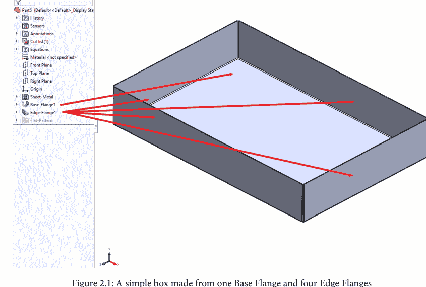

图 2.1：由一个 Base Flange 和四个 Edge Flanges 组成的一个简单盒子

单个边缘翻边是非常简单的特征，但组合起来时，它们可用于创建更复杂的零件。

#### 创建您的第一个边缘翻边

边缘翻边相对简单易做：

1. 打开第 1 章《钣金基础 – 探索钣金属性和材料选择》中的 **Base Flange** 零件，或创建一个新的 SolidWorks 零件并制作一个尺寸为 200 x 300 mm 的 Base Flange（如第 1 章《钣金基础 – 探索钣金属性和材料选择》中所示）。

2. 材料厚度应为 1 mm，弯曲半径为 1 mm（图 2.2）。

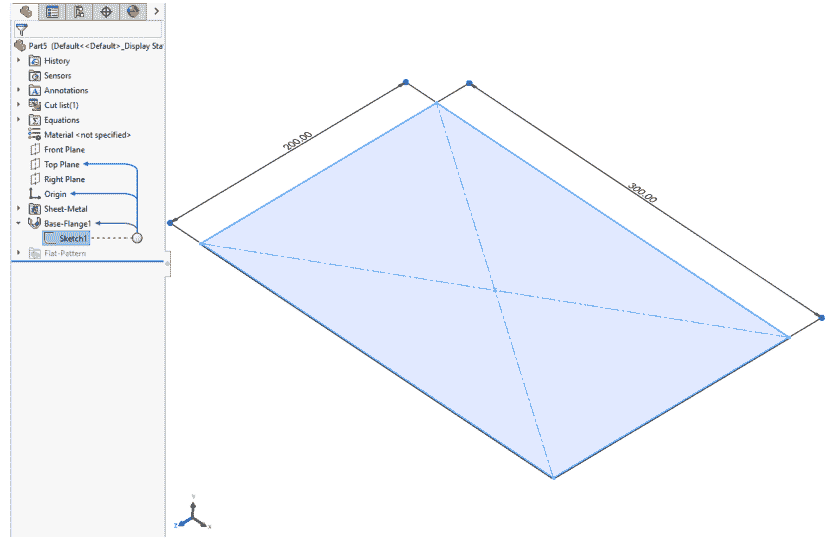

图 2.2：创建 200 x 300 mm 底法兰

3. 要开始添加边缘法兰，请从钣金工具中选择边缘法兰选项（图 2.3）。

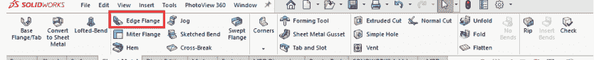

图 2.3：边缘法兰工具

4. 选择边缘法兰工具后，将打开边缘法兰属性管理器（图 2.4）并显示多个选项。虽然它们看起来相当复杂，但并非所有选项都对每个法兰都是必需的，我们将在本章中逐步介绍它们。

最重要的选项是法兰参数、角度和法兰长度

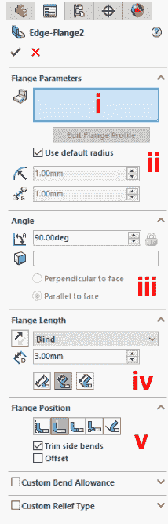

图 2.4：边缘法兰属性管理器

5. 边缘选择：在实际添加任何法兰之前，我们首先需要决定实际想要放置它们的位置。要选择边缘法兰的边缘，请完成以下步骤：

- I. 确保已选择边缘选择框（图 2.4，(i)）。选中时该框为蓝色。
- II. 在模型中左键单击边缘以选择它们。您可能需要放大以选择想要的边缘。
- III. 尝试通过左键单击选择其中一条短边。您应该会看到边缘法兰的黄色预览，它会跟随鼠标（图 2.5）。可以将其拖动到所需位置，然后单击一次左键即可设置长度（有关法兰长度的更多详细信息，请参阅步骤 7）。

IV. 可以通过再次左键单击它们或在边缘选择框中右键单击并选择清除选择或删除来从当前选择中移除边缘。

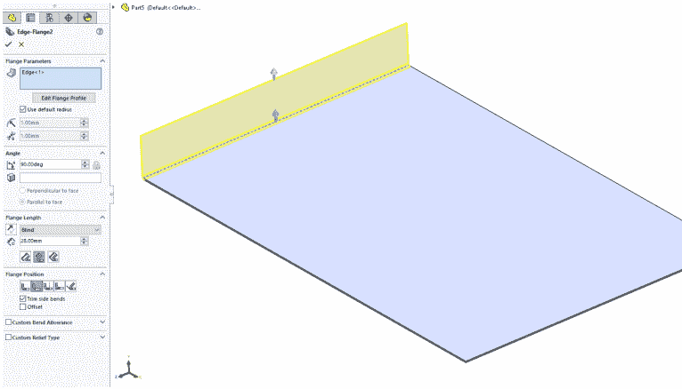

图 2.5：边缘法兰预览

6. 弯曲半径：请注意，新的边缘法兰的弯曲半径显示在属性管理器的顶部附近（图 2.4，(ii)）。此弯曲半径（本例中为 1 mm）由我们在编辑钣金文件夹中钣金属性中设置的全局弯曲半径决定。因此，所有边缘法兰将自动使用默认弯曲半径值。

然而，也可以覆盖单个边缘法兰的默认弯曲半径。要执行此操作，请完成以下步骤：

- I. 取消选中使用默认半径复选框并设置所需值。
- II. 尝试调整此弯曲半径值并注意图形区域中黄色预览的弯曲半径也随之变化。
- III. 要返回到默认弯曲半径值，只需再次在“使用默认半径”复选框中打勾即可。

7. 弯曲角度：接下来，我们可以设置边缘法兰的弯曲角度（图 2.4，(iii)）。尝试调整角度值，看看黄色预览是否也相应变化。

8. 也可以将角度设置为相对于某一面为*垂直*或*平行*。要使用此选项，首先在角度值下方的**选择面**框中单击，选择参考面，然后选择**垂直于面**或**平行于面**。

9. **法兰长度**：边缘法兰的另一个重要方面是其长度（*图 2.4，(iv)*）。这可以设置为盲值（单向拉伸）或使用下拉菜单中的不同端部条件，如果创建更复杂的零件。

10. 法兰的方向也可以通过单击**长度端部条件**下拉菜单左侧的**反向方向**按钮来翻转。

11. 尽管法兰长度被设置为尺寸值，但法兰的实际长度取决于我们从何处测量该值。法兰长度有三种测量选项，可在图 2.6 中看到。

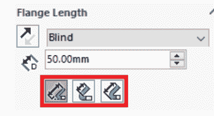

图 2.6：法兰长度选项

不同法兰长度选项的表示可从图 2.6 中按钮上的图标看出。从左到右，选项如下：

- **外虚拟尖角**：这会从假想线沿边缘法兰的外表面向下绘制并沿固定法兰底部延伸时尖角所在点测量法兰长度（图 2.7 中的左侧示例）。

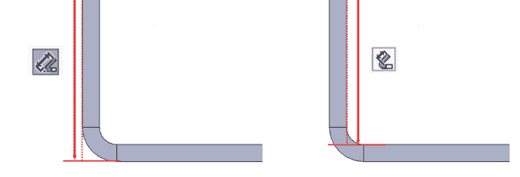

图 2.7：外虚拟尖角和内虚拟尖角示例

- **内虚拟尖角**：这与第一个选项类似，但它是从尖角所在点到固定法兰内表面测量法兰长度（图 2.7 中的右侧示例）。
- **切线弯曲**：此选项从与弯曲外侧相切的点测量法兰长度（图 2.8）。此选项仅在弯曲值大于 90° 时有效。否则，根据定义，长度将与外虚拟尖角相同。

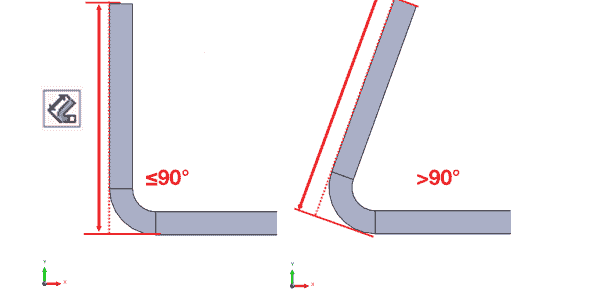

图 2.8：90° 弯曲和大于 90° 弯曲的切线弯曲示例

在实践中，使用哪种法兰选项并不重要，只要使用一致且法兰长度满足设计要求即可。

12. **法兰位置**：本节的最后一个选项是法兰位置，这里有五个选项（图 2.9）。通常，前三个选择使用更广泛，后两个较少见，但都有其用途。与法兰长度选项一样，按钮上的小图标对每个设置的含义进行了图形化表示。

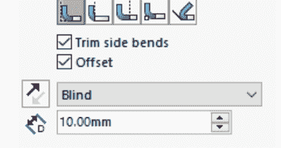

图 2.9：法兰位置选项

**法兰位置**选项如下：

- **材料在内**：此选项表示所有边缘法兰材料都将在固定法兰区域内（*图 2.10*）。
- **材料在外**：此选项将边缘法兰材料置于固定法兰区域之外，然而，可以看到弯曲区域的一部分仍在固定法兰区域内（*图 2.10*）。
- **弯曲在外**：此选择意味着整个弯曲将在固定法兰之外，有效地使边缘法兰相对于固定法兰略有偏移（*图 2.10*）。

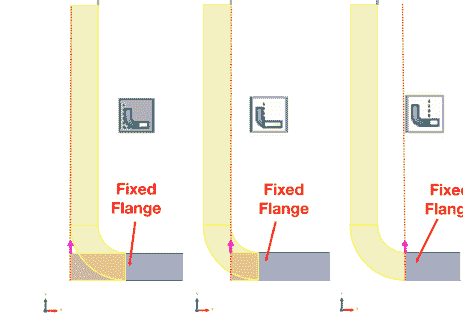

图 2.10：法兰位置选项（从左到右：材料在内、材料在外和弯曲在外）

- **从虚拟尖角弯曲**：第四和第五个选项更专业，在日常建模中使用较少，但仍可能有用。**从虚拟尖角弯曲**选项以固定法兰顶部面与边缘法兰内面之间尖角所在位置为基准进行弯曲。在*图 2.11*中，我们可以看到两个不同的弯曲角度来演示这一点。请注意，此选项只能与大于 90° 的弯曲尺寸一起使用。

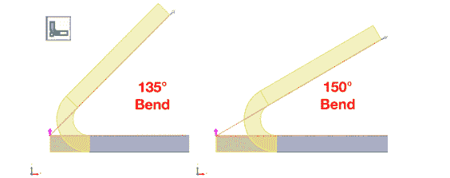

图 2.11：从虚拟尖角弯曲选项，两个不同的弯曲角度

- **切线于弯曲**：此选项也只能与大于 90° 的弯曲角度一起使用，并且使实际弯曲面与固定法兰侧面相切（图 2.12）。这与**材料在内**选项略有不同，后者使用边缘法兰外侧与固定法兰顶部的虚拟尖角。

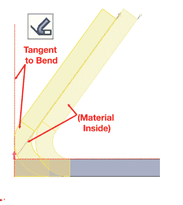

图 2.12：切线于弯曲选项（与材料在内选项并列显示）

- **偏移弯曲**：除**从虚拟尖角弯曲**外的所有弯曲选项都允许弯曲相对于固定法兰偏移。要偏移弯曲，请在**偏移**复选框中放置勾选标记（图 2.9），然后设置**偏移距离**。单击**反向方向**框可翻转偏移方向并从下拉菜单中选择不同的端部条件。

13. 设置以下参数，然后单击**确定**以添加边缘法兰（图 2.13）：

- **弯曲半径：**（1 mm）
- **角度：** 90°
- **法兰长度：** 50 mm，盲，外虚拟尖角

- **法兰位置：** 材料在内，无偏移

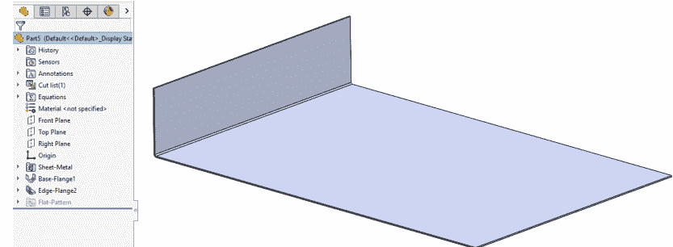

图 2.13：边缘法兰的示例

新的边缘法兰功能现在可以在屏幕左侧的 FeatureManager 设计树中看到，并且可以通过单击它并选择 **编辑特征** 以通常的方式进行编辑。

到目前为止，在本节中，我们学习了如何添加一个非常基本的边缘法兰，并且我们看到边缘法兰最重要的参数是 *边缘选择、弯曲角度、法兰长度* 和 *法兰位置*。

在下一节中，我们将查看使用边缘法兰的更高级方法，并探索一些详细选项。

#### 边缘法兰 – 高级选项

我们之前添加的边缘法兰是在单个边缘上的非常简单的示例，但我们也可以将边缘法兰添加到多个边缘，控制法兰轮廓等等。

##### 在同一个边缘法兰特征中添加多个边缘

不必为每个边缘创建新的边缘法兰——可以在同一个特征中制作多个法兰：

- 1. 继续使用上一节中的零件（见图 2.13），通过在 FeatureManager 设计树中左键或右键单击 **Edge-Flange** 特征并选择 **Edit Feature** 选项来编辑边缘法兰特征。
- 2. 要添加多个边缘，首先确保已选择 **Edge** 选择框（*图 2.14，(i)*），然后在图形区域中左键单击要添加法兰的边缘。尝试选择基座法兰的两个长边，以及已选择的那个短边（*图 2.14*）。
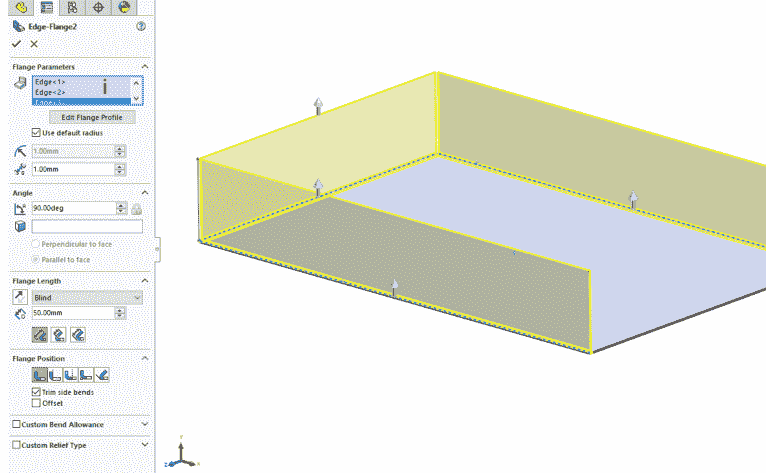

图 2.14：添加多个边缘法兰

- 3. 要取消选择边缘，只需在图形区域中再次左键单击它们，或在 **Edge** 选择框中右键单击它们并单击 **Delete**。
- 4. 单击 **OK** 确认更改。现在，基座法兰在四面中有三面带有边缘法兰。

##### 超过 90 度的边缘法兰会自动修剪

现在我们有一个具有多个边缘的边缘法兰特征，我们可以查看边缘法兰的一些更多细节：

- 1. 编辑边缘法兰特征。
- 2. 将 **Angle** 值从 90° 调整到 120°。这可以通过调整箭头完成，也可以通过直接在 **Flange Angle** 字段中输入数值完成。
- 3. 请注意，随着弯曲角度增加超过 90°，法兰的相邻边缘会自动修剪回以避免它们碰撞（图 2.15）。
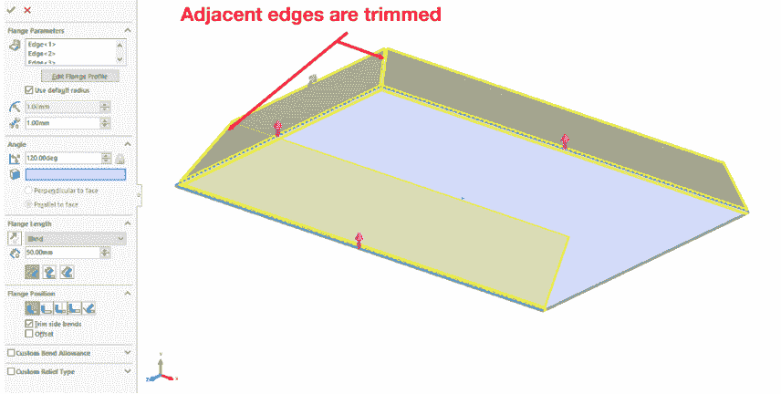

图 2.15：当弯曲角度超过 90° 时，相邻边缘会被修剪掉

- 4. 单击 OK 将三个法兰的角度值更改为 120°。
- 5. 现在可以展平零件以更清晰地显示修剪后的边缘。从钣金选项卡或工具栏中选择 Flatten 选项。你会看到展平后的板材（图 2.16）具有非垂直的角，这是由于相邻边缘发生的自动修剪所致。
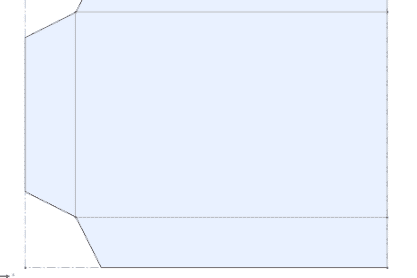

图 2.16：展平后的零件，显示非垂直的修剪边缘

- 6. 再次单击 **Flatten** 以重新折叠 **零件**。
- 7. 再次编辑边缘法兰特征并将 **Angle** 值减小到 60°。请注意，如果弯曲角度小于 90°，相邻边缘仍保持与所选边缘垂直。它们不会扩展以填补法兰之间的间隙（*图 2.17*）。
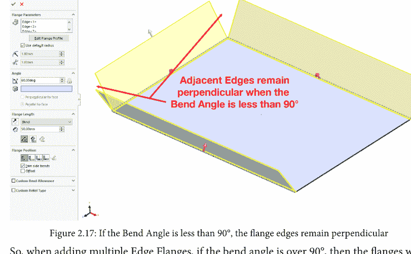

图 2.17：如果弯曲角度小于 90°，法兰边缘保持垂直

因此，在添加多个边缘法兰时，如果弯曲角度超过 90°，则法兰会自动修剪以避免碰撞，但如果弯曲角度小于 90°，则法兰不会延伸以关闭间隙。

##### 调整间隙距离

每当添加多个法兰时，我们可以看到它们在角落处并未连接，并且始终存在一个小间隙。这确保我们可以将这些法兰正确展开到平坦板材。

当边缘法兰特征具有多个边缘时，另一个选项对我们可用。**Gap distance** 允许我们轻松设置相邻法兰之间的间隙。

按照以下步骤调整间隙距离：

- 1. 编辑上一个示例中的边缘法兰特征并将弯曲角度设置为 90°。
- 2. 间隙距离选项现在可用（图 2.18）。尝试调整间隙大小并注意黄色预览中相邻法兰之间的间隙如何变化。
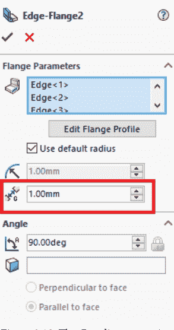

图 2.18：间隙距离选项

- 3. 删除所有额外的边缘法兰，使其只剩下一个。请注意间隙距离选项现在变灰；间隙只能在创建多个边缘法兰时指定（否则没有间隙的对象）。
- 4. 选择第二个边缘并将弯曲角度调整为小于 90°。请注意间隙距离现在再次变灰；对于弯曲角度小于 90° 的边缘法兰之间无法指定间隙距离，因为法兰正在分开，因此间隙大小不能恒定。
- 5. 将弯曲角度调整到 90° 或以上会再次激活间隙距离选项。

间隙距离是一个相当简单的选项，如果可以使用则会自动出现。如果弯曲角度小于 90°，则间隙距离会自动变灰且不可用。这是因为如果边缘正在分开，则无法指定恒定间隙。

##### 更改法兰轮廓

到目前为止，我们使用边缘法兰工具创建了矩形法兰，其长度贯穿所选边缘的整个长度。然而，通过调整法兰轮廓，也有可能创建不同形状和长度的法兰：

- 1. 编辑上一个示例中的边缘法兰特征。仅选择一个边缘并将弯曲角度设置为 90°，然后单击 OK。
- 2. 要编辑法兰轮廓，首先编辑边缘法兰特征，然后从左侧的属性管理器中选择 Edit Flange Profile。
- 3. 我们现在正在编辑构成法兰的草图。会弹出一个消息框确认当前草图有效。此框如有需要可以拖动移开。

草图可以以通常的方式编辑以调整法兰轮廓。例如，尝试从边缘末端向内拖动垂直线（图 2.19）并添加智能尺寸以完全定义草图。注意：从法线方向视图中操作可能更容易。
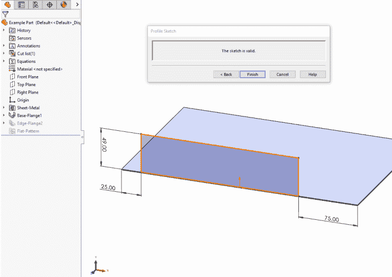

图 2.19：调整法兰轮廓

- 4. 对法兰轮廓满意后，单击 **Finish** 接受更改，你会看到法兰现在仅在边缘的特定长度上延伸。
- 5. 如果无法使用草图创建法兰，则 *步骤 3* 中的弹出消息将显示 **Unable to create the flange from the sketch**。在这种情况下，请确保草图具有完全封闭的轮廓（周界无间隙）并且没有自相交（没有重叠线条）。
- 6. 编辑边缘法兰轮廓的更快方法是展开 FeatureManager 设计树中的边缘法兰特征，然后编辑 **EdgeBend** 项目上方的草图（*图 2.20* – 注意，你的草图编号可能不同）。然后可以按照 *步骤 3* 的方式编辑此草图。
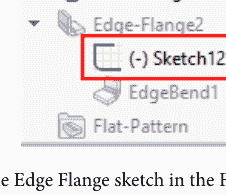

图 2.20：在 FeatureManager 设计树中编辑边缘法兰草图

- 7. 法兰轮廓草图也可以编辑以更改法兰的形状。对于此示例，法兰的侧面可以是倾斜或弯曲的（*图 2.21*）。要创建倾斜边缘，可能需要删除任何现有的水平或垂直关系。
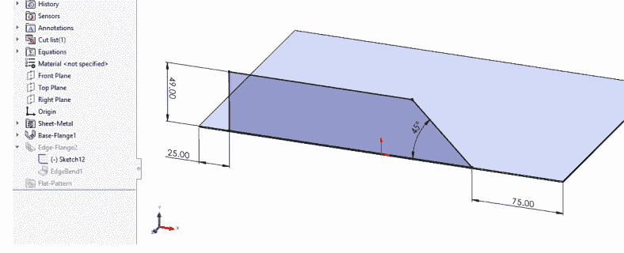

图 2.21：编辑法兰轮廓

以这种方式编辑法兰轮廓可以更灵活地使用边法兰，并解锁创建多种不同形状的能力。

#### 自定义弯曲余量和自定义开槽类型选项

在 **Edge Flange** 设置中底部属性管理器中还可以找到另外两个次要选项，它们是 **Custom Bend Allowance** 和 **Custom Relief Type** 选项（*Figure 2.21*）。这些选项允许覆盖 `Sheet-Metal` 属性文件夹中全局 *part* 设置，以应用于特定特征。它们可以与 *Chapter 1, Sheet Metal Basics – Exploring Sheet Metal Properties and Material Selection.* 中所述的 **Sheet-Metal Properties** 特征中的选项完全相同的方式使用。

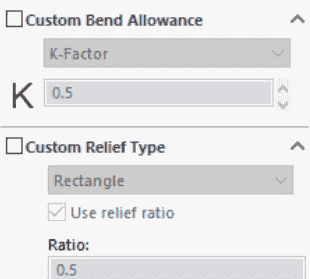

Figure 2.22: The Custom Bend Allowance and Custom Relief Type options

这些选项在实践中很少使用，但在需要时可提供一点额外的控制。

#### Trim side bends 选项

**Edge Flange** 选项中的最后一个设置是 **Trim side bends** 选项。它会自动修剪两个 Edge Flange 相交处角落的材料，可用于避免相邻弯曲处狭窄角落可能出现的制造问题。

以下示例最能说明这一点：

- 1. 删除当前 *part* 中的 Edge Flange 特征，使其仅保留 Base Flange。
- 2. 在其中一条短边上添加一个新的 Edge Flange 特征。此 Edge Flange 应沿着边的整个长度延伸（只需使用自动选择的默认法兰轮廓）。

按如下方式设置参数：

- - **Angle:** 90°
- - **Flange Length:** 50mm, Outer Virtual Sharp
- - **Flange Position:** Material Inside

3. 在 Base Flange 的其中一条长边上添加第二个 Edge Flange 特征，使用与步骤 2 相同的设置。现在你应该有一个带有两个凸起 Edge Flange 的 Base Flange（*Figure 2.23*）。

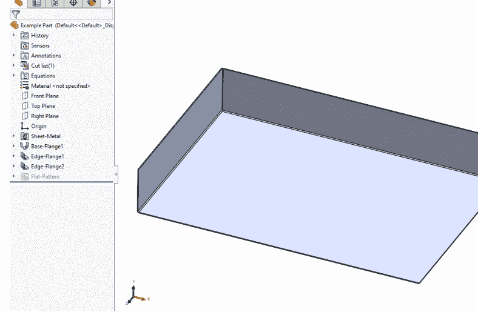

4. **Trim side bends** 选项会在两个法兰相交的角落创建自动修剪。尝试编辑第二个 Edge Flange，然后在 **Trim side bends** 复选框中勾选并单击 OK，以查看两种选项之间的差异 *Figure 2.24*)。

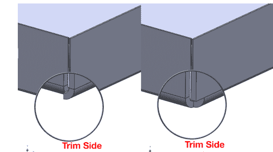

Figure 2.24: A corner with and without the Trim side bends option selected

- 5. 实际的修剪区域会自动创建，没有子选项；它可以添加也可以不添加。

Trim side bends 复选框是一个次要选项，但在减少狭窄角落潜在制造问题方面可能很有用。

#### Summary

在本章中，我们介绍了 Edge Flanges 的概念，它们是 SolidWorks Sheet Metal 中最常用的特征之一。添加基本 Edge Flange 后，我们了解了如何通过设置弯曲角度、法兰长度和位置等细节来调整它们。

之后，我们深入研究了 Edge Flange，并了解了更高级的选项如何通过例如选择多个边和编辑法兰轮廓等操作来释放 Edge Flange 的功能。

在第 3 章《Getting Familiar with Basic Tools in Sheet Metal》中，我们将继续在此基础上构建知识，并学习更多日常的 SolidWorks Sheet Metal 工具。
