### 3
Getting Familiar with Basic Tools in Sheet Metal

现在我们已经学会了如何创建 Base Flanges 以及如何添加 Edge Flanges，我们可以开始了解专用工具了。

在本章中，我们将了解如何使用 Tabs、 Cuts 和 Holes 来添加和移除材料。我们还将探索新的法兰类型，例如 Miter Flange 和 Hem，以及 Sketched Bends，可用于添加更不寻常的弯曲样式。最后，我们将从理论和实践两个角度学习 Jog 特征。

到本章结束时，你将全面了解基本的 Sheet Metal 工具。

在本章中，我们将涵盖以下主要主题：

- - Adding and removing material using Tabs, Cuts, and Holes
- - Using the Miter Flange tool
- - Using the Hem feature
- - Adding Sketched Bends
- - Creating and using Jogs

#### Adding and removing material using Tabs, Cuts, and Holes

在第 1 章《Sheet Metal Basics—Exploring Sheet Metal Properties and Material Selection》和第 2 章《Adding Bends Using Edge Flanges》中，我们学习了如何通过添加材料来制作 **Base Flanges** 和 **Edge Flanges**。然而，移除材料也是钣金设计的重要方面，我们将在本节中探索多种方法。我们还将学习如何通过使用 **Tabs** 向现有法兰添加新材料。

#### Creating basic Extruded Cuts

你可能有许多原因想要从模型中移除材料。这些可能包括创建螺钉孔、为端口或通风添加开口，甚至制作美观特征如标志。

移除材料最简单的方法是创建 Extruded Cuts，方法如下：

- 1. 打开上一章的 **Base Flange** *part*，或新建一个 *part* 文档并创建一个尺寸为 200x300mm、厚度为 1mm 的 **Base Flange**。我们将用它来演示 Extruded Cuts。
- 2. 选择要切割的面并开始新草图（可通过从 **Sketch** 选项卡中选择 **Sketch**，或在选择面时出现的弹出菜单中选择 **Sketch**）。
- 3. 绘制要切割的轮廓。对于此示例，我绘制了一个 50x50mm 的正方形，距离两条边 20mm。记得使用 **Smart Dimension** 工具完全定义你的草图。
- 4. 从 **Features** 选项卡或 **Sheet Metal** 选项卡或工具栏中选择 **Extruded Cut**，如（Figure 3.1）所示：

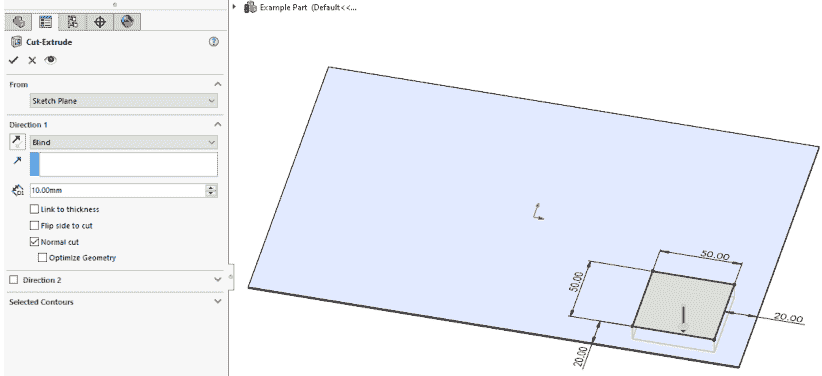

Figure 3.1: Creating an Extruded Cut

- 5. 我们现在可以使用标准端条件如 **Blind** 或 **Up to Next** 来创建切割，但由于我们正在处理 Sheet Metal *part*，现在还提供了一些额外选项。这些将在下一节中探讨。
- 6. 将切割参数设置为 Blind，10mm，并取消勾选切割深度下方立即的三个选项框（**Link to thickness**、**Flip side to cut** 和 **Normal cut**）。
- 7. 要创建切割，请按绿色 **OK** 勾号。

#### Linking a cut to the sheet thickness

**Extruded Cuts** 的第一个额外选项是 **Link to thickness**。顾名思义，此选项将切割特征链接到板材厚度。这意味着切割将始终穿透其所在的法兰。在此示例中为 1mm。操作如下：

- 1. 在先前的模型基础上，编辑 **Cut-Extrude** 特征。
- 2. 选择 **Link to thickness** 选项并注意预览如何调整，使切割仅穿透板材厚度——在此示例中为 1mm。另请注意，切割 **Depth** 现在消失了，因为该深度由板材厚度设定。
- 3. 按 **OK** 接受更改。

Link to thickness 是一个非常有用的选项，可确保即使板材尺寸以后发生变化，切割也能正确制作。然而，在某些情况下，它可能不会给出我们想要的结果，例如跨越弯曲进行切割，如以下示例所示：

- 1. 在最靠近切割的 Base Flange 短边上添加一个 Edge Flange。
- 2. 这可以通过从 Sheet Metal 工具中选择 Edge Flange，然后选择适当的边来完成。使用以下设置：

- - Angle: 60°
- - Flange Length: Blind, 50mm, Outer Virtual Sharp
- - Flange Position: Material Outside

该过程如图 3.2 所示：

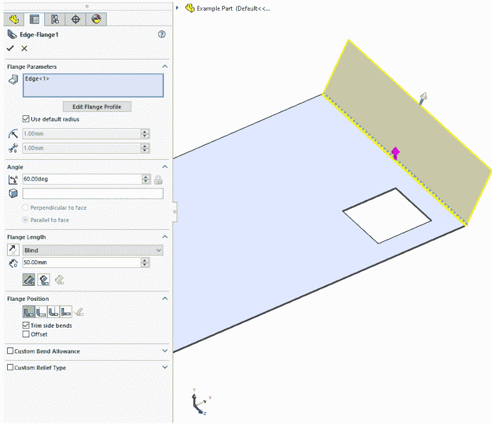

Figure 3.2: Adding a new, angled Edge Flange

3. 现在，在 Base Flange 的底面开始一个新的草图。此草图大小应为 50x50mm，并跨越新的 Edge Flange 弯曲，如图 3.3 所示：

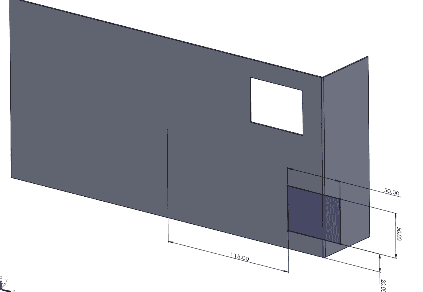

Figure 3.3: Sketching a new cut profile on the underside of the Base Flange

4. 使用草图创建拉伸切除并选择“链接到厚度”选项。注意图 3.4 中，黄色预览仅切割穿过底边折弯板的厚度。也就是说，切口仅穿过初始轮廓所绘制的板材；它不会切割穿过倾斜的边折弯：

> Note
> 您可能需要取消选择然后重新选择“链接到厚度”选项才能使其正常工作。

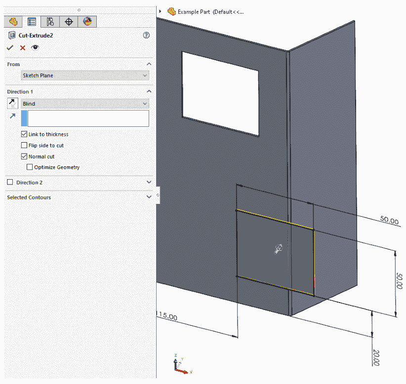

Figure 3.4: A cut that is linked to thickness will only go through the sheet that it is made on

5. 按 OK 创建切口。

#### Creating deeper cuts and using Normal cuts

除了创建仅穿过所制作板材厚度的切口外，我们还可以创建更深的切口。以下示例也很好地演示了 Normal To 切口选项。

Normal 切口只是垂直于板面（与板面成 90°）制作的切口，且通常比角度切口更容易制造，因此制造起来更便宜、更快。请按如下操作：

- 1. 要创建也穿过边折弯的切口，我们可以使用多种不同的端条件，例如盲切。
- 编辑拉伸切除特征，取消选中“链接到厚度”框，并设置 10mm 深的盲拉伸。

> Note
> 确保未选中 Normal cut 框。

- 2. 切口现在穿过底边折弯并进入弯折的边折弯。从俯视图看，切口看起来正确，仅显示为带方形边缘的矩形开口。然而，如果我们展开零件，就会看到一个潜在问题。
- 从钣金工具中选择展开选项。

- 3. 查看展开后的板材，我们可以看到我们刚刚制作的切口区域的边缘现在具有倾斜边缘。图 3.5 显示了穿过此切口的截面视图：

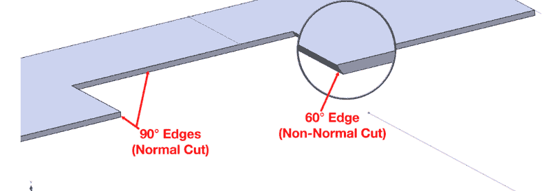

Figure 3.5: Cross-section view through the flattened cut showing the angled cut edge

请注意，先前折起来的边缘现在具有 60° 的边缘角度，这就是在切口制作时边折弯的角度——即零件折叠状态（未展开）时的角度。图 3.6 显示了未展开状态下切口的预览，以演示为什么会出现这种切口角度：

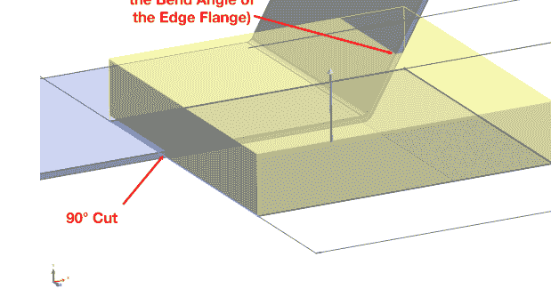

Figure 3.6: Example showing why the non-Normal cut happens

在这种平坦板材上创建非法向切口（切口不为 90°）对于激光切割等某些制造工艺来说可能很困难，因此会增加零件的时间和成本。为了减轻这种情况，能够确保这些切口为法向（90°）非常有用。这可以通过使用 Normal cut 选项轻松完成。

- 4. 编辑最新的 Cut-Extrude 特征，并在 Normal cut 框中打勾。

- 5. 按 OK 创建此特征。请注意，切口的角度现在已相对于边折弯的面为法向（图 3.7.）：

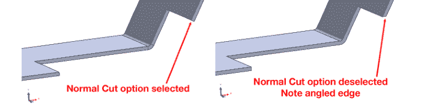

Figure 3.7: Differences between the Normal cut and non-Normal cut options

**Normal cut** 选项是优化模型以便制造的简单方法，可能为您节省时间和成本。

#### Cutting Simple Holes

除了创建特定的切口轮廓外，还可以轻松地向折弯添加简单孔。操作方法如下；

- 1. 从 **Sheet Metal** 选项卡或工具栏中选择 **Simple Hole** 工具。
- 2. 左键单击以选择要切割孔的面和位置。
- 3. 使用 **Property Manager** 编辑孔参数，例如深度和直径。孔深度也可以像上一节中的 **Extruded Cuts** 一样链接到厚度。
- 4. 按 **OK** 添加孔。
- 5. 要设置孔的确切位置，请在 FeatureManager 设计树中选择新的 **Hole** 特征并选择 **Edit Sketch**。现在可以使用 **Smart Dimension** 工具精确设置位置。

> **Is the Simple Hole Feature Useful?**
> 因为 **Simple Hole** 特征需要编辑来指定孔位置，通常更快的做法是直接创建常规的拉伸切除，如上一节所示，然后使用 **Circle** 工具创建孔轮廓。

#### Using the Hole Wizard for holes

如果您要创建孔，则 **Hole Wizard** 比使用 **Simple Hole** 或 **Extruded Cut** 选项提供更好的解决方案。**Hole Wizard** 工具包含大量预设尺寸和类型的孔库，并且也更易于添加多个孔或在以后阶段编辑它们。

在 SolidWorks 钣金中，**Hole Wizard** 的使用方式与标准建模相同。操作方法如下：

- 1. 从 **Features** 选项卡中选择 **Hole Wizard**。
- 2. 使用 **Type** 选项卡（在 **Hole Wizard Property Manager** 内）选择孔类型。
- 3. 设置尺寸和端条件。
- 4. 选择 **Positions** 选项卡，然后选择将添加孔的面。

- 5. 指针将变为 **Point** 工具，左键单击将放置 *Points*。每个 Point 位置都会添加一个孔。
- 6. 按 **OK** 添加孔。
- 7. 要编辑孔，只需在 FeatureManager 设计树中编辑 **Hole** 特征即可。
- 8. 孔位置也可以通过编辑位置草图轻松更改，该草图可以通过展开 **Hole** 特征找到。

**Hole Wizard** 通常是创建孔的最佳选择，因为它包含许多预设尺寸，并且在以后阶段添加或调整孔时非常容易。

> **Check Cutouts and Holes with Your Manufacturer**
> 许多制造商对切口或孔与边缘或其他特征（如折弯）之间的距离有限制。如果您创建的零件中孔或切口非常靠近板材边缘或其他特征，则最好检查制造商是否有任何可能影响设计的限制。

#### Using Tabs

到目前为止，本节中我们研究了去除材料的不同方法，但也有许多情况需要添加材料。有时，这种额外材料可以通过直接添加到折弯轮廓中来创建，但通常更有意义的是创建全新的区域。在 SolidWorks 钣金中，这些被称为 Tabs，可以轻松添加。操作方法如下：

- 1. 查看我们当前具有单个 60° **Edge Flange** 的模型，我们可能希望在折弯侧添加一个突出部分。
- 2. 首先，创建所需轮廓的草图。选择所需面并绘制完全定义的轮廓。在此示例中，一个 50x20mm 的截面被添加到现有的 **Edge Flange** 侧面（*Figure 3.8*）。

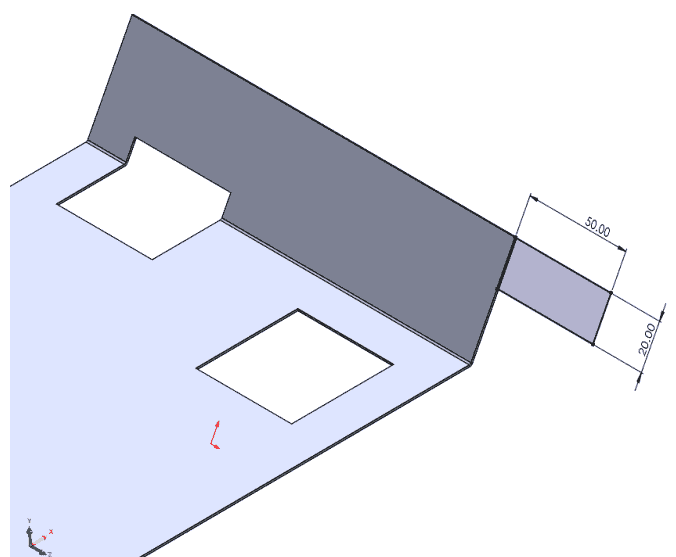

Figure 3.8: New Tab profile sketch

- 3. 最简单的选项似乎是使用 **Features** 选项卡创建 **Extruded Boss/Base** 特征。选择此工具显示我们现在有 **Link to thickness** 选项，但我们仍需确保新部分沿正确方向拉伸。因此，最好使用钣金专用工具。
- 4. 不要使用 **Extruded Boss/Base** 工具，打开 **Sheet Metal** 选项卡或工具栏并选择 **Base Flange/Tab** 工具（此工具可同时创建 **Base Flanges** 和 **Tabs**）。
- 5. 如有需要，选择我们刚刚绘制的轮廓草图，然后按 **OK**。

现在创建了一个新的 Tab 部分，并且它会自动链接到其所制作的折弯的厚度。

**Note**
该特征现在在 FeatureManager 设计树中显示为 **Tab1**。这是因为我们是在现有折弯的基础上构建的，因此 SolidWorks 知道新轮廓应为 **Tab** 而不是新的 **Base Flange**。

**Tab** 特征非常简单，但通常是向现有折弯添加新材料的最有效方法。

> **Using Mirrors, Patterns, and Other Standard SolidWorks Features**
> 通常，钣金模型是对称的或具有重复特征。如果是这种情况，则可以使用 **Mirrors** 和 **Patterns** 等特征来加快工作流程。有时，可以创建模型的一半（甚至四分之一），然后 **Mirror** 其余特征以创建其他部分。
> 
> Tabs 以及许多其他钣金特征，如 **Edge Flanges**，可以与 **Mirror** 和 **Pattern** 特征一起使用，就像标准 SolidWorks 特征一样。

添加和移除材料是钣金建模的基础部分，有多种方法可以实现。当创建孔时，通常最好使用 **Hole Wizard**，但其他形状可以用 **Extruded Cut** 选项切出。**Base Flange/Tab** 工具提供了一种快速简便的方式在需要时添加额外材料。

#### Using the Miter Flange tool

我们要探索的下一个工具是 **Miter Flange** 工具。可以用它向一个或多个边缘添加折弯，在许多方面与 **Edge Flange** 工具相似。然而，**Miter Flange** 工具要求您绘制折弯的横截面轮廓，从而可以相当容易地创建更复杂的折弯。

要创建 **Miter Flange**，请按如下操作：

- 1. 打开上一节中的 **Base Flange** *零件* 并删除任何额外的折弯、切口或 Tabs，以便仅保留 **Base Flange**。或者，您可以开始一个新的 *零件* 文档并创建尺寸为 200×300mm、厚度为 1mm 的 **Base Flange**。

- 2. 创建 **Miter Flange** 的最重要步骤是绘制折弯的横截面轮廓。这可以在选择 **Miter Flange** 工具之前完成，也可以在先选择工具后提示您选择或绘制草图。
  
- 两种方法产生相同的最终结果且非常相似。在此示例中，我们将先绘制草图。

- 3. 草图 *需要垂直于* **Miter Flange** 将要制作的边缘。因此，放大 **Base Flange**，选择一个小端面，如 *Figure 3.9* 所示，并开始草图：

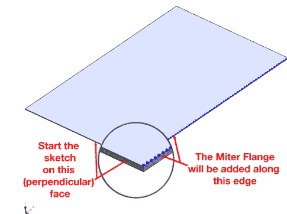

Figure 3.9: 倒角法兰草图需要在法兰将要位于的边的垂直面上

4. 使用草图实体工具绘制法兰截面。在本例中，我们将在面的右上角创建一个垂直线，高 50mm，如图 3.10 所示。

Note: 从正交视图创建这些草图会更容易：

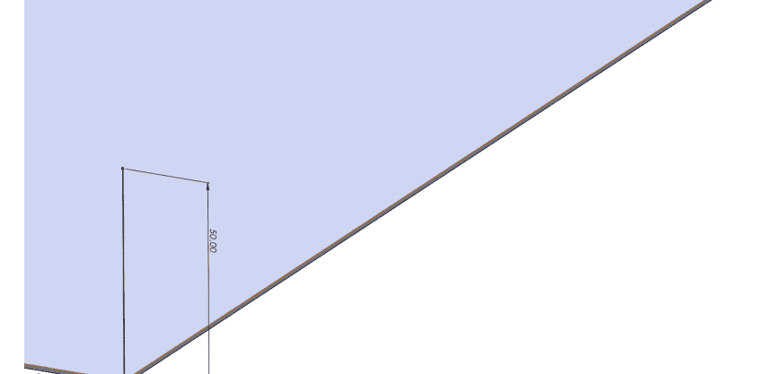

Figure 3.10: 绘制法兰截面轮廓

5. 从 Sheet Metal 选项卡或工具栏上 Edge Flange 工具旁选择 Miter Flange 工具。由于我们当前正在编辑草图，此草图将被自动用于法兰。如果我们没有在编辑草图，则选择 Miter Flange 工具后会提示我们选择或绘制草图。

6. 垂直线的轮廓现在将被用来沿着 Base Flange 的长边创建 Miter Flange（图 3.11）。如果看不到黄色预览，请确保在左侧属性管理器顶部的 Along Edges 选择框中已选择长边。

Miter Flange 可以被认为大致类似于普通实体建模中的 Swept Boss/Base 工具，其中需要 Path 和 Profile 草图。在本例中，Profile 草图是我们绘制的垂直线草图，而 Path 草图是所选的 Base Flange 的边。

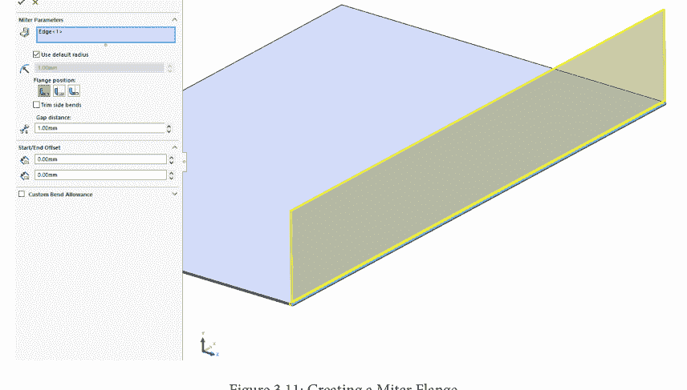

Figure 3.11: 创建 Miter Flange

7. 请注意，即使我们从 Base Flange 的尖角处绘制了一条完全垂直的线，新法兰预览也自动具有来自 Sheet-Metal 属性文件夹的默认弯曲半径。此 Bend Radius 也可通过取消选中 Use default radius 框并设置值来更改。

8. 法兰的确切位置可使用三个 **Flange Position** 按钮指定。**Trim Side Bends** 和 **Custom Bend Allowance** 选项也可使用，并且 **Miter Flange** 的起点和终点可以偏移。

9. 按 **OK** 创建 **Miter Flange**。

#### Adding multiple edges

使用 **Miter Flanges** 而非 **Edge Flanges** 的一大好处是，多条边之间的拐角可以进行倒角。在此上下文中，这意味着它们在拐角处正确连接并具有特定间隙。

要添加多条边并演示倒角拐角，请按如下操作：

- 1. 在 FeatureManager 设计树中编辑 **Miter Flange** 特性。
- 2. 确保您处于 **Along Edges** 选择框中（应为蓝色）。如果不是，请左键单击该框以选择它。
- 3. 左键单击 **Base Flange** 的更多边以选择它们，您应该会看到黄色预览现在为所选边添加了新的法兰。
- 4. **Property Manager** 中的 **Gap distance** 选项允许调整相邻法兰之间的间隙。
- 5. 选择 **Base Flange** 的全部四条边并按 **OK** 创建 **Miter Flange** 特性。

请注意，*所选边必须彼此相邻*，并且必须连接到最初绘制草图的原始边/面。

如前所述，使用 **Miter Flange** 而非 **Edge Flange** 的关键优势之一是它允许拐角得到正确倒角：

- 1. 在 FeatureManager 设计树中展开 **Miter Flange** 特性并编辑草图。我们现在可以更改法兰的轮廓。
- 2. 通过左键单击选择垂直线，并删除垂直关系。这可以通过在 **Graphics Area** 中选择并删除线旁的小 **Vertical Relation** 符号来完成，也可以通过在左侧 **Property Manager** 顶部的 **Existing Relations** 框中删除垂直关系来完成。

当删除垂直关系时，线应变为蓝色，这表明它现在处于欠定义状态。

3. 使用 **Smart Dimension** 为线添加角度，使其与水平面呈 140°，如图 3.12 所示：

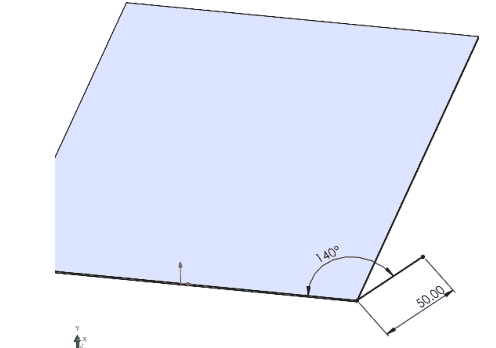

Figure 3.12: 编辑线使其不再垂直

4. 通过单击 **Graphics Area** 右上角的图标或 **Sketch** 选项卡上的 **Exit Sketch** 按钮退出草图。现在您应该会看到全部四个法兰都向外倾斜，并且拐角延伸以在它们之间形成恒定间隙（即它们被正确倒角），如图 3.13 所示：

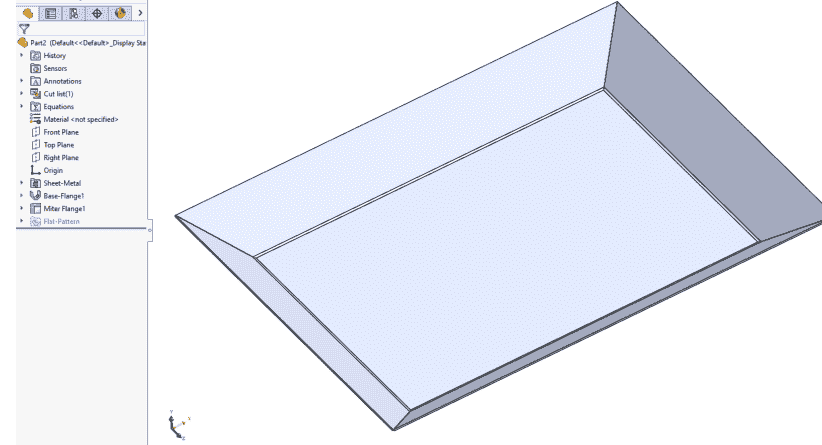

Figure 3.13: 具有倒角拐角的 Miter Flange

#### Creating more complex Flange Profiles

保持法兰的倒角拐角是一个有用的功能，但使用 **Miter Flanges** 的主要优势是初始草图可以被编辑以创建复杂的法兰形状，而无需大量额外的特征或工作。以下是操作方法：

- 1. 展开 **Miter Flange** 特性并再次编辑轮廓草图。
- 2. 我们现在可以编辑线并添加多条新线。尝试创建与 *Figure 3.14* 所示类似的草图：

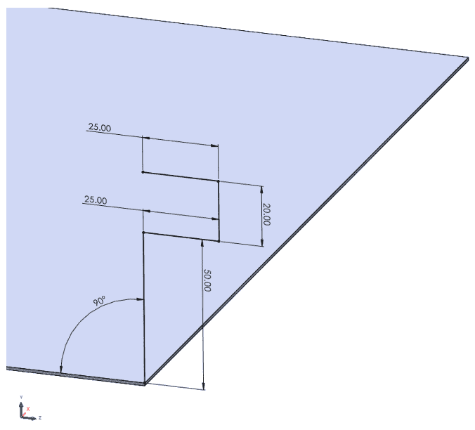

Figure 3.14: 尝试将 Miter Flange 轮廓草图调整为类似此图

- 3. 退出草图，现在可以看到更新的草图被用于 **Miter Flange**。请再次注意，弯曲半径已应用于任何尖角。

此功能展示了 **Miter Flange** 工具的价值：在本例中，我们用单个 **Miter Flange** 替代了四个潜在的 **Edge Flange** 特性。虽然两种工具相似，但 **Miter Flange** 工具提供了更强大的控制水平，并允许您通过这种方式组合多个特征来节省时间。

> **Make Sure the Bends can Actually Be Made in Real Life!**
> 尽管 Miter Flange 特性非常有用，但也很容易用它在多条边上创建紧密折叠的法兰，而这些法兰可能难以使用现实世界的制造技术制作。
> 
> 当为生产创建 SolidWorks 模型时，始终牢记零件在现实生活中实际如何制造，并在必要时调整模型。

到目前为止，我们已经研究了两种主要的法兰类型：**Edge Flanges** 和 **Miter Flanges**。在下一节中，我们将研究 **Hems**，这是一种法兰类型，其中边缘被紧密地折叠到自身上。

#### Using the Hem feature

术语 *hem* 最初来自织物制作，描述的是被加倍并折叠的材料。Hems 可以在许多衣物上看到，例如裤腿底部或 T 恤袖口。

**Hems** 的主要功能是：

- **Remove or hide edge imperfections**: 由于 **Hems** 将边缘折叠到自身上，因此可用于有效去除锋利边缘或隐藏切割边缘或其他缺陷。
- **Strengthening parts**: 将材料折叠过来会使厚度加倍，而不会增加太多重量或复杂性。这意味着它可以作为为零件或无支撑边缘增加额外强度的一种绝佳方式。

要添加 **Hems**，请按如下操作：

- 1. 打开上一节的 **Base Flange** *part* 并删除任何额外的法兰、切割或凸片，以便仅保留 **Base Flange**。或者，您可以开始一个新的 *part* 文档并创建尺寸为 200x300mm、厚度为 1mm 的 **Base Flange**。
- 2. 从 **Sheet Metal** 工具中选择 **Hem** 工具。它位于 **Miter Flange** 工具旁边。
- 3. 创建 **Hems** 时有许多不同的选项，但首先要选择的是应添加 **Hem** 的边：
  - I. 单击 **Property Manager** 顶部的 **Edges** 选择框，然后左键单击边以添加它们。
  - II. 左键单击以选择 **Base Flange** 的其中一条长边。

III. 可以以与 **Edge** 和 **Miter Flanges** 类似的方式添加多个边，并且如果需要可以调整 **Miter Gap**。

IV. 还可以通过选择 **Edit Hem Width** 选项并调整草图来调整折边宽度。

V. 还可以通过单击 **Reverse Direction** 框来翻转 **Hem** 的折叠方向。

4. 我们现在可以使用前两个按钮指定 **Hem** 的确切位置。与之前的工具一样，按钮上的小图标演示了每个选项，具体如下：

- **Material Inside** 确保所有的 **Hem** 材料都在 **Fixed Flange** 的轮廓内。
- **Material Outside** 表示 **Hem** 材料添加到 **Fixed Flange** 的外部，因此位于轮廓之外。

请参阅图 3.15 查看两种类型的示例：

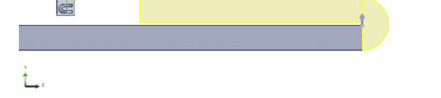

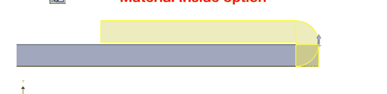

图 3.15：Material Inside 选项（下方）和 Material Outside 选项（上方）

5. 接下来，可以设置 Hem 的类型。有四种选项，如图 3.16 所示，并且与往常一样，图标显示了这些选项的简单图形表示：

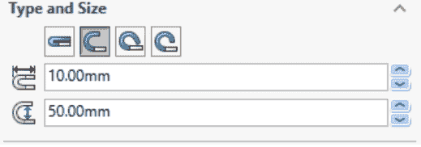

图 3.16：Hem 类型；从左到右：Closed、Open、Tear Drop、Rolled

从左到右，Hem 类型为：

- Closed：此选项将材料完全折叠过来，几乎平放在自身上。由于弯曲内部需要非常小的半径，折叠部分与 Fixed Flange 之间始终会存在一个很小的间隙。

唯一可以设置的参数是法兰的长度，这包括直的（折叠过来的）部分以及弯曲区域的外侧。

- Open：此类型与 Closed 类型非常相似，但允许设置间隙距离。同样，Hem 的长度包括弯曲区域。因此，更大的间隙会使弯曲半径更大，从而对于任何给定的 Hem 长度，直线部分会更短，如图 3.17 所示。

请注意，Hems（以及许多其他特征）可以通过双击快速编辑构成它们的參數：

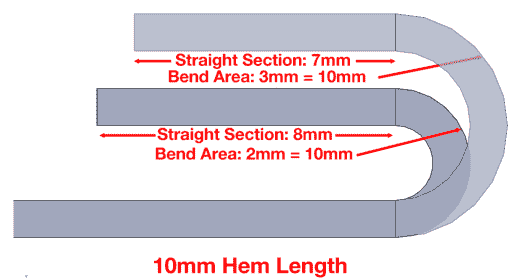

图 3.17：Hem 长度包括弯曲区域，因此更大的间隙会减少直线部分的长度

- **Tear Drop**：顾名思义，此选项创建了一个卷起的 Hem，具有形成水滴形状的倾斜直线部分。两个参数决定 **Tear Drop** Hem 的大小：弯曲的内半径和直线部分的夹角。角度是在 Hem 的直线部分与 **Fixed Flange** 之间测量的，必须在 180 到 270° 之间。尝试调整角度，注意 Hem 边缘与 **Fixed Flange** 之间的间隙保持不变时，直线部分的长度会自动调整。
- **Rolled**：Hem 的最后一种类型与 **Tear Drop** 选项非常相似，但只是去除了材料的直线部分。**Rolled** 选项也由弯曲的内半径和角度控制，但在此情况下可以设置任何角度。但是，请注意，虽然可以使用大角度，但超过约 300° 的角度可能会导致 Hem 的材料与其自身发生碰撞，这可能会导致制造问题。

6. 与许多其他 **Sheet Metal** 工具类似，如果需要，我们还可以为 **Hem** 特征调整 **Custom Bend Allowance** 和 **Custom Relief Type** 值。

**Hems** 是一种非常有用的小特征，主要用于改善边缘并增加强度。有四种类型，并且都可以以与其它法兰类似的方式添加到多个边缘。现在，我们将介绍 **Sketched Bends** 特征，它允许我们使用草图线在板材上的任何位置添加弯曲。

#### Adding Sketched Bends

除了在现有边缘添加弯曲外，我们还可以使用草图来精确定义弯曲的位置：

- 1. 打开上一节中的 **Base Flange** *part* 并删除任何额外的法兰、切割或凸片，以便仅保留 **Base Flange**。或者，您可以开始一个新的 *part* 文档并创建一个尺寸为 200×300mm、厚度为 1mm 的 **Base Flange**。
- 2. Sketched Bend 从草图开始，因此选择 **Base Flange** 的顶部面并开始草图。

与许多 SolidWorks 工具一样，也可以先选择 **Sketched Bend** 特征。如果这样做，您将被提示创建或选择用于该特征的草图。

3. 使用 **Line** 工具在 **Base Flange** 的一个角上绘制一条对角线。使该线的每个端点距离 **Base Flange** 的角为 100mm，如图 3.18 所示。该线将决定弯曲的位置：

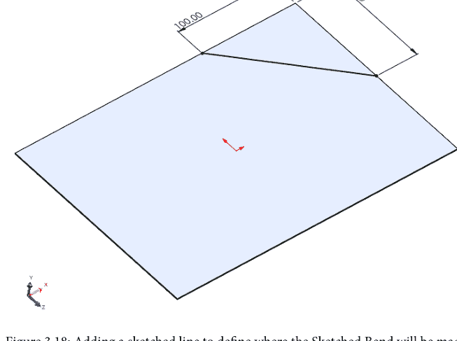

图 3.18：添加草图线以定义 Sketched Bend 的位置

4. 从 **Sheet Metal** 选项卡或工具栏中选择 **Sketched Bend** 特征。

5. 在 **Property Manager** 中，确保顶部已选中 **Fixed Face** 框（应为蓝色）。Fixed Face 是在创建弯曲时不会移动的模型部分。

6. 通过左键单击选择 **Base Flange** 表面的较大区域。应出现黄色预览，显示 **Base Flange** 的三角形角沿草图线向上弯曲，如图 3.19 所示。

尝试取消选择 **Fixed Face**，然后选择较小的三角形区域，以查看每次选择之间的差异：

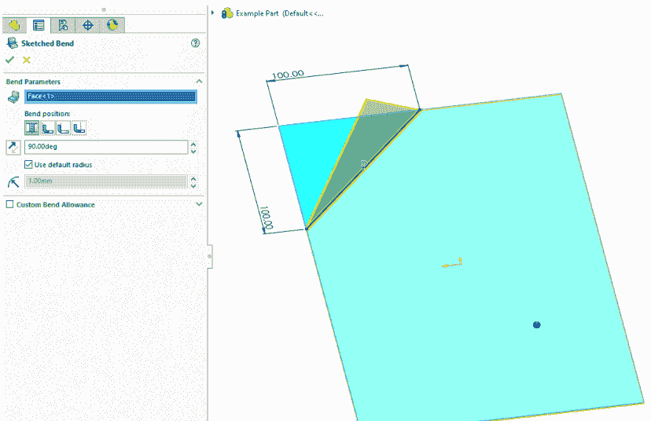

图 3.19：选择较大区域后，较小区域将沿草图线弯曲

- 7. 清除 Fixed Face 选择，然后重新选择 Base Flange 表面的原始较大区域。
- 8. 可以使用 Property Manager 中的值调整弯曲角度，并通过单击 Reverse Direction 框翻转方向。如果需要，还可以调整 Bend Radius 值。
- 9. 有四种 Bend Position 选项，都非常容易理解：

  - Bend Centerline：这会将第一个弯曲的中心放置在草图线的位置。
  - Material Inside：这会将整个弯曲法兰放置在草图线在 Fixed Face 上的轮廓内。
  - Material Outside：这会将弯曲法兰放置在草图线在 Fixed Face 上的轮廓之外（以便弯曲法兰的内表面与草图线对齐）。但是，部分实际弯曲区域仍可能位于 Fixed Face 上的草图线内。
  - **Bend Outside**：这会将整个弯曲放置在草图线之外。这意味着弯曲法兰将根据 **Bend Radius** 大小从草图线略微偏移。

10. 如果需要，可以设置 **Custom Bend Allowance** 值。使用 **Sketched Bends** 的好处之一是，我们可以确保平坦板材的大小从制造角度来看始终完全正确。如果使用其他工具（如 **Edge Flanges**）将弯曲添加到 **Base Flange**，则展开板材的大小可能会有所不同，具体取决于弯曲的定义方式。但是，通过使用 **Sketched Bends**，我们可以始终确保展开板材的大小保持完全相同。

实际上，这通常不是问题，但如果模型的精度至关重要，并且您使用的是非标准的 Bend Allowances，则应考虑使用 **Sketched Bends** 而不是其他类型的法兰。

11. 按 **OK** 创建 **Sketched Bend**。

12. 要编辑 **Sketched Bend** 参数，请在 FeatureManager 设计树中单击 **Sketched Bend** 特征并选择 **Edit Feature**。要编辑驱动弯曲的基础草图，请展开 **Sketched Bend** 特征并编辑其中的草图。

**Sketched Bends** 是在没有现有边缘时添加弯曲的绝佳方法，也是精确指定弯曲位置的好方法。以下部分介绍 **Jogs**，它会自动使用两个 **Sketched Bends** 来偏移法兰。

#### Creating and using Jogs

**Jogs** 是一种特殊的折弯形式，使用两个相反的弯曲来偏移板材，形成 Z 或 S 形。**Jogs** 可用于偏移边缘以使其适合其他零件（例如将盖子的边缘安装在盒子内部），或加固零件的边缘。它们在连接具有平坦外表面的两个板材时也特别有用。*图 3.20* 显示了使用 **Jog** 和铆钉连接的两张金属板：

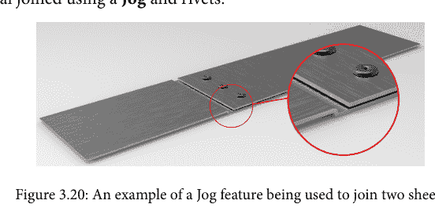

图 3.20：Jog 特征用于连接两张板材的示例

Jog 特性与 Sketched Bends 的创建方式非常相似：

1. 打开上一节中的 Base Flange 零件并删除多余的法兰、切割或凸片，使其仅保留 Base Flange。或者，你也可以新建一个零件文档并创建一个尺寸为 200x300mm、厚度为 1mm 的 Base Flange。
2. Jogs 需要一个草图来定义 Jog 的位置，因此在 Base Flange 的顶面上开始一个草图。
3. 使用 Line 工具在 Base Flange 上直接绘制一条线，使其为垂直方向且距离边缘 100mm（图 3.21）。

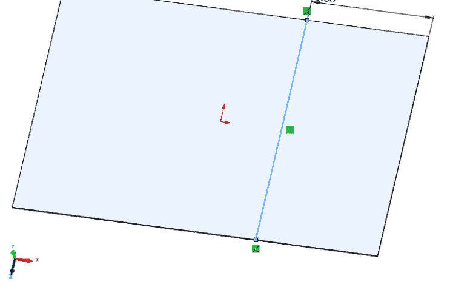

图 3.21：为 Jog 特性创建草图

4. 从 Sheet Metal 工具中选择 Jog 特性。注意 Jog 特性也可以在创建草图前选择。然后系统会提示你选择或创建要使用的草图。
5. 选择 Fixed Face。与 Sketched Bend 特性一样，这是不会移动的面。
6. 选择草图线左侧的大区域。将显示黄色预览以显示弯折区域。默认情况下使用 Default Bend Radius 属性，但如果需要可以覆盖。

7. 设置 Jog Offset 属性（图 3.22 中标记为 i）。如果需要，可以通过按 Reverse Direction 按钮来翻转方向。将偏移量设置为 10mm，Blind：

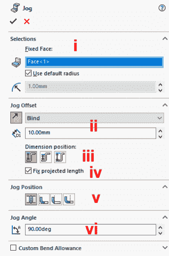

图 3.22：Jog 属性管理器

8. Offset Distance：偏移的实际高度（图 3.22 中标记为 ii）取决于以下三个选项中的哪一个被选中（图 3.22 中标记为 iii）：

- Outside Offset：这使用 Fixed Flange 的上表面与 Jog 区域的上表面之间的距离（图 3.23，左）。
- Inside Offset：这使用 Jog 的两个内表面之间的距离——即 Fixed Flange 的上表面与 Jog 区域的下表面（图 3.23，中间）。
- Overall Dimension：这给出 Jog 的总厚度——即 Fixed Flange 的下表面与 Jog 区域的上表面之间的距离（图 3.23，右）。

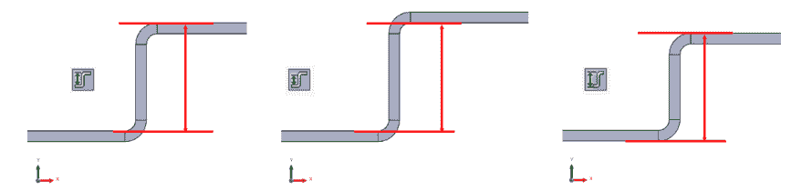

图 3.23：Offset Distance 类型；从左到右：Outside Offset、Inside Offset、Overall Dimension

9. Fix projected length 选项（图 3.22 中标记为 iv）允许在法兰上添加额外材料以补偿被 Jog 部分占用的材料。

如果选择 Fix projected length，则 Jog 法兰的长度将与原始 Fixed Flange 相同，但如果取消选择该选项，则 Jog 法兰将比 Fixed Flange 短（图 3.24），因为部分材料被 Jog 本身使用：

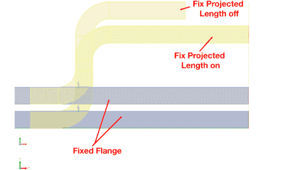

图 3.24：Fix projected length 选项

10. Jog Position：实际的 Jog 可以像 Sketched Bend 选项一样指定（图 3.22 中标记为 v）：

- Bend Centerline：这将第一个弯折的中心放置在草图线的位置。
- Material Inside：这将第一个 Jog 弯折放置在 Fixed Face 上草图线的轮廓内。
- Material Outside：这将第一个弯折法兰放置在 Fixed Face 上草图线轮廓之外（使得弯折法兰的内表面与草图线对齐）。然而，部分实际弯折区域仍可能位于 Fixed Face 上的草图线内。
- Bend Outside：这将第一个 Jog 弯折的全部置于草图线之外。这意味着弯折法兰将根据 Bend Radius 大小与草图线略有偏移。

11. Jog Angle：最后，可以设置 Jog Angle 属性（图 3.21 中标记为 vi）。Jog 特性中的两个弯折将使用相同的角度，这意味着 Jog 的上部始终与 Fixed Face 平行。

#### 使用 Jogs 的实际示例

Jog 特性对于连接两张薄板同时仍保持平整的外表面特别有用。如果两张薄板相互抵靠并直接连接，则它们实际连接的表面非常小（即板的厚度），因此焊接或其他连接会非常困难（图 3.25）。

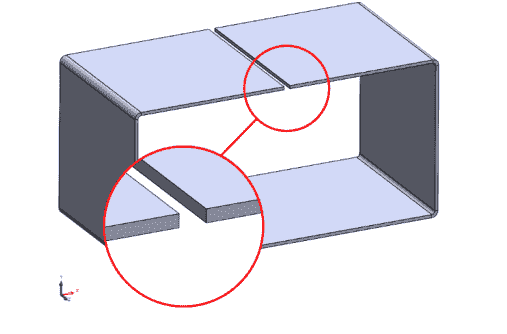

图 3.25：没有 Jogs 的情况下薄板可能难以连接

为演示 Jog 特性如何帮助解决此问题：

1. 新建一个零件文档并创建一个尺寸为 100×50mm、厚度为 1mm、弯曲半径值为 1mm 的 Base Flange。
2. 在每个较短的边缘添加 Edge Flanges。这些应为 50mm 长、角度为 90°、Flange Length 类型为 `Outer Virtual Sharp`、Flange Position 为 `Material Inside`。两个边缘可以添加到同一个特性中。这会形成一个 U 形模型。
3. 在之前 Edge Flanges 的顶部边缘添加另外两个 Edge Flanges（图 3.26）。这两个都应为 90° 角度且长度为 49mm（Outer Virtual Sharp 且 Material Inside），以便形成一个粗糙的盒形，但上法兰的末端不会完全接触并留有小间隙：

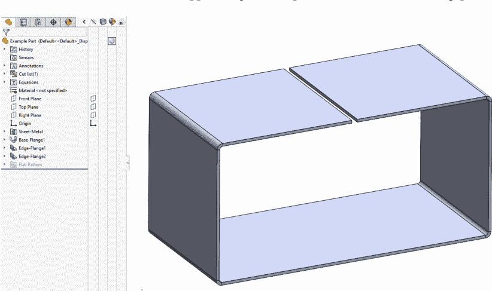

图 3.26：使用单个 Base Flange 和两组 Edge Flanges 创建零件，形成粗糙的盒形

4. 如果此零件在现实生活中制造，则上 Edge Flanges 的未支撑端可能相当脆弱。理想情况下，我们会将它们连接起来，但极薄的板厚会使焊接变得困难。因此，我们将使用 Jog 特性使法兰重叠。

5. 在其中一个法兰的顶面上绘制一条单线，使其与边缘平行且相距 20mm（图 3.27）。

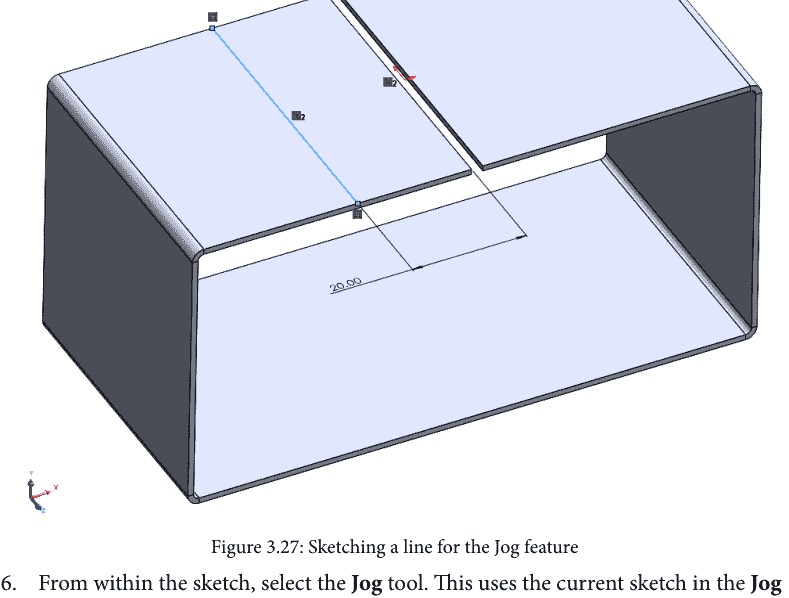

图 3.27：为 Jog 特性绘制线条

6. 在草图内选择 Jog 工具。这会将当前草图用于 Jog 特性。我们也可以先选择 Jog 工具，然后再绘制草图。

7. 在 Jog 工具中选择 Fixed Face。这将是法兰中较大的区域，位于法兰的弯曲侧（图 3.27 中的左侧部分）。

8. 输入以下参数：

- Jog Offset：Blind，1.5mm（朝向 Fixed Flange）
- Outside Offset
- Fix projected length：On
- Jog Angle：Bend Centerline
- Jog Angle：90°

9. 按 OK 创建 Jog。注意你可能会收到一条消息（图 3.28）警告 Jog Offset 值不正确。按 OK 仍创建 Jog，我们稍后查看问题：

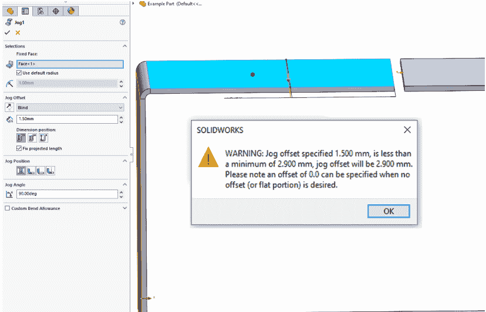

图 3.28：有时所需偏移距离不会被使用并会显示警告

10. 如果我们从侧面查看模型（图 3.29），可以看到尽管我们设置了 Offset Distance 值为 1.5mm，但 Jog 实际创建的 Offset Distance 值为 3mm。

这是因为 Jog 使用了 1mm 的 Default Bend Radius 值；因此，Jog 由两个 90° 弯折组成，每个弯折都不能小于 1mm。加上板厚就得到我们实际的 3mm 偏移。

因此，请注意 Jog 偏移距离有时可能与你认为指定的不同：

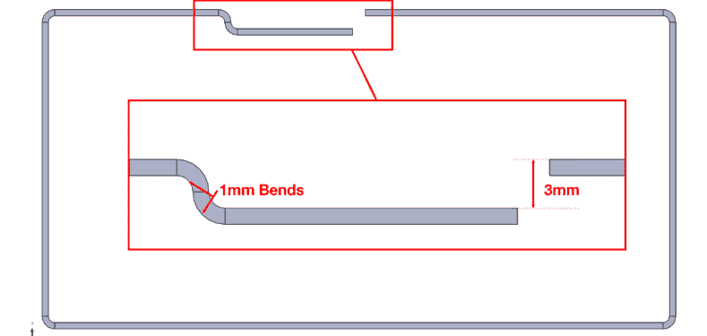

图 3.29：有时 Jog 偏移距离会大于指定的值

11. 要减小偏移距离，我们必须减小 Bend Radius 值或调整 Jog Angle 值。

编辑 Jog 特性并使用 Offset Distance 框旁的向下箭头减小 Bend Angle 从 90°。注意随着角度减小，预览中的 Offset Distance 值也会减小，因为我们实际上减小了 Jog 中弯折的高度。

在某个点（本例中为 60°），预览中的间隙将不再减小。这表明我们可以使用以达到正确偏移距离 1.5mm 的最大角度。

因此，设置 **步进角度** 值为 60° 并按下 **确定** (*图 3.30*)。

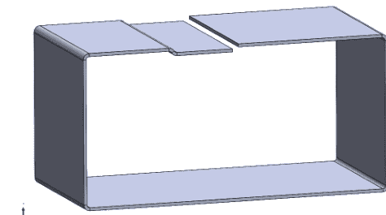

图 3.30：设置 60° 的步进角度将得到 1.5mm 的正确偏移量

+   12. 为了完成 **Jog** 示例，我们现在可以使用 **Tab** 创建一个重叠区域。在没有 **Jog** 的法兰上表面上开始一个草图。

+   13. 使用 **矩形** 工具绘制一个与 **Jog** 区域重叠的封闭轮廓 (*图 3.31*)。

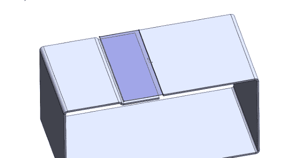

图 3.31：在法兰顶面上绘制封闭轮廓

14. 使用 Base Flange/Tab 选项创建重叠的 Tab 部分（图 3.32）。该重叠区域随后可用于使用铆钉或螺栓将两个法兰连接在一起，或可进行点焊：

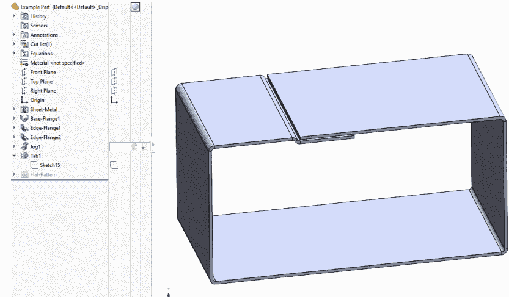

图 3.32：使用 Tab 工具创建重叠部分

Jogs 是一种有用的功能，可对板材或法兰进行偏移。它可用于多种方式，使边缘得到加强或偏移以帮助零件配合。

#### 摘要

在本章中，我们学习了如何使用 Cuts、Holes 和 Tabs 添加和移除材料。我们还探索了一些与法兰相关的新功能：Miter Flange、Hem、Sketched Bends 和 Jogs。所有这些都可用于为零件增加更大的复杂性和功能。

在第 4 章《创建钣金工程图和导出文件》中，我们将探讨如何将钣金模型导出用于实际生产，以及如何创建零件和装配体的二维 (2D) 工程图。
