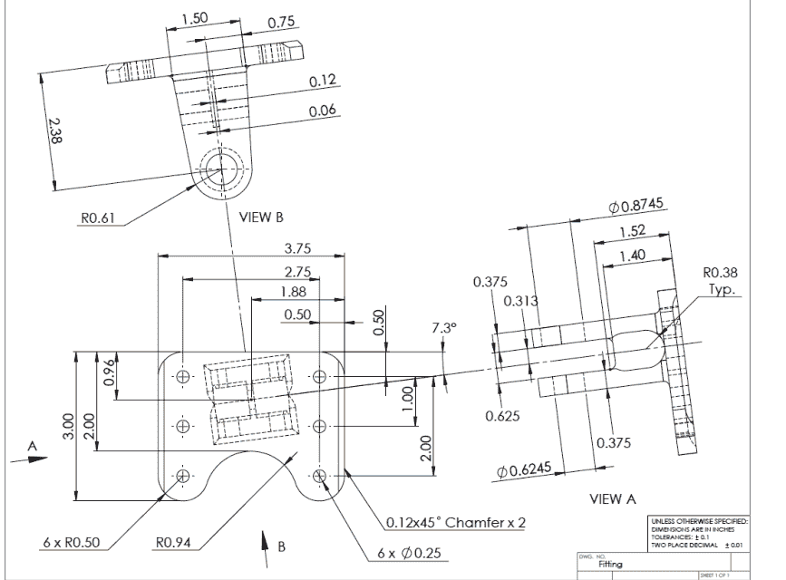
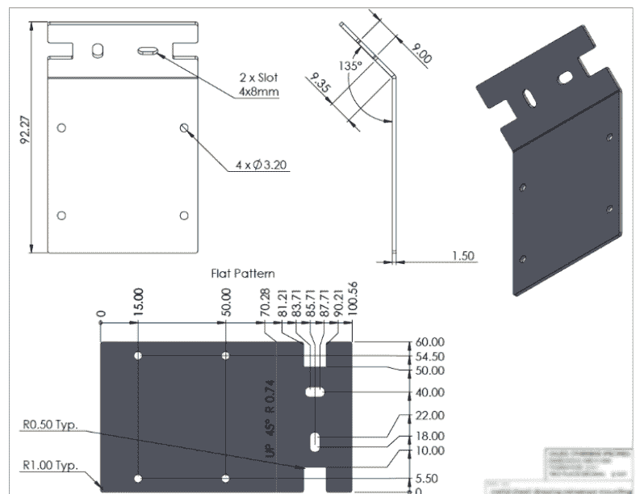
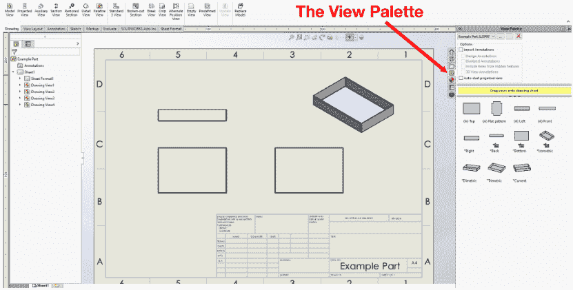
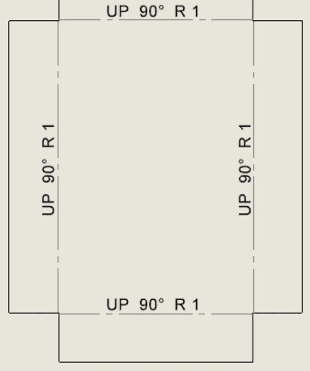
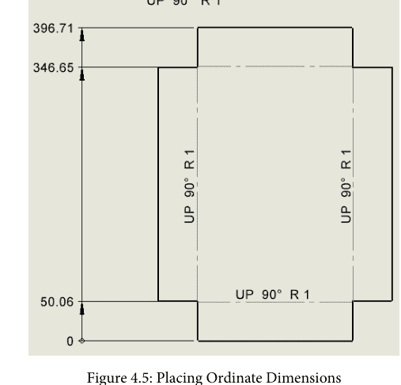
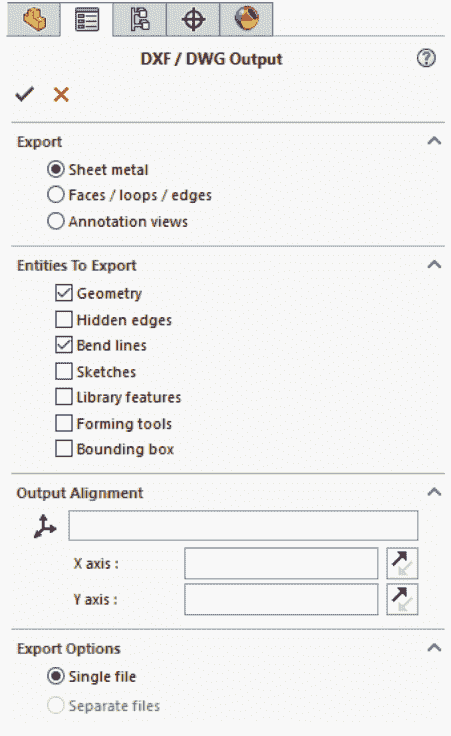

### 4
创建钣金工程图和导出文件

**二维 (2D)** 工程图对于钣金零件的制造和使用至关重要。

在本章中，我们将了解 SolidWorks 工程图所需的钣金特定细节，包括如何插入基于钣金 *零件* 的 **展开图**。我们还将学习钣金零件可用于制造的各种导出方式，例如 **Drawing Exchange Format (DXF)** 和 **Drawing (DWG)** 文件类型。

到本章结束时，您将了解如何向 SolidWorks 工程图添加钣金细节，以及如何导出 2D 文件。

在本章中，我们将涵盖以下主要主题：

-   创建钣金 *零件* 的基本 2D 工程图
-   使用 **展开图** 视图
-   导出钣金 *零件* 用于制造

#### SolidWorks 工程图概述

虽然 SolidWorks 主要侧重于 3D 模型的创建，但 2D 工程图仍然是工程和产品开发的重要方面。3D 模型完成后，通常会创建其 2D 工程图以协助制造或用于记录保存。这些工程图可以由单个零件或整个装配体制作，范围从模型的简单概述到包含剖视图、细节拆分和其他注释的复杂多页工程图。

图 4.1：SolidWorks 工程图示例

本书记载的工程图详细创建超出了本书的范围，但作为快速回顾，工程图可以通过转到 File | New... 然后选择 Drawing 来创建。

然后可以在工程图纸上添加各种视图，并添加尺寸和其他注释。完成后，SolidWorks 工程图可以导出为 PDF 文件，以便与非 SolidWorks 用户共享。

#### 创建钣金零件的基本 2D 工程图

现在我们知道了制作钣金模型的基础，我们可以探讨如何创建可用于实际制造这些零件的 2D 工程图。工程图对于钣金模型尤其重要，因为钣金生产工艺通常比其他制造方法（如计算机数控 (CNC) 加工或注塑成型）自动化程度更低。SolidWorks 钣金工程图的示例可在图 4.2 中看到。

图 4.2：SolidWorks 钣金工程图示例

本节假设您已经了解创建 SolidWorks 工程图的基础知识。本章并非旨在作为钣金和版面设计的总体指南（因国家和组织而异）；它只会演示 SolidWorks 工程图所需的额外钣金特定功能。

首先，我们将创建一个非常简单的零件，可用于演示工程图细节，如下所示：

+   1. 开始一个新的零件文档并创建尺寸为 200x300mm、厚度为 1mm 的 Base Flange。可使用默认的 Sheet Metal Properties，因为该零件仅用于展示通用工程图。
+   2. 向 Base Flange 的四个外边缘全部添加 Edge Flanges。使这些高度为 50mm，角度为 90°。我们现在应该有一个简单的开口盒形状。
+   3. 保存您的零件。
+   4. 要创建零件的 2D 工程图，请转到 File | Make Drawing from Part。
+   5. 如果出现选项，请选择模板。对于大多数用户，此步骤将自动发生并使用默认模板。
+   6. 我们现在处于新的空白工程图中，可以像标准 SolidWorks 工程图一样添加工程图视图。尝试转到 Drawing 选项卡并选择视图（如 Standard 3 View）或打开屏幕右侧的 View Palette（见图 4.3）并将所需的视图拖到页面上：

也可以通过转到 File | New... 并选择 Drawing 来单独创建工程图。然后系统会提示您选择要制作工程图的模型。

图 4.3：视图可以从 View Palette 拖到工程图页面上

7.  **尺寸** 和 **注释** 可根据需要添加，细节可像标准 SolidWorks 工程图一样添加。

8. **Cut Lists** 表格也可以添加到工程图中。在钣金工程图中，**Cut Lists** 显示创建模型所需的所有不同板材，因此它们可以被视为与标准 SolidWorks 工程图中的 **Bills of Material** 表格类似。

要添加 **Cut List** 表格：

+   I. 在向图纸添加工程图视图后，转到 **Annotation** 选项卡并选择 **Tables | Weldment Cut List.**
+   II. 系统会提示您选择一个模型来创建表格。在工程图中左键单击任意视图（因为它们都来自同一模型）。
+   III. 设置所需的任何特定属性或按绿色 **OK** 勾号插入表格。
+   IV. **Cut List** 表格现在会跟随鼠标移动，可以通过左键单击放置在工程图的任何位置。
+   V. **Balloons** 也可以添加到工程图中（也在 **Annotations** 选项卡上），以指定工程图视图中的哪些零件对应于表格中的哪些条目（在本例中不是必需的，因为模型中只有一个板材，但对于具有多个板材的复杂模型可能更有用）。

9. 保存工程图，转到 **File | Save** 或单击 **Save** 按钮。

10. 默认情况下，文件将保存为 SolidWorks 工程图文件，但工程图也可以导出为 **Portable Document Format (PDF)** 文件和其他文件类型。这些对于与没有 SolidWorks 的人共享非常有用。

要将工程图保存为 PDF，请转到 **File | Save As...** 然后从 **Save as type** 下拉列表中选择 **PDF**。

还可以通过单击 **Options** 按钮访问 PDF 特定选项。

> **指定板厚**
> 如果创建钣金工程图，请记住指定要使用的板厚。这很容易被忽略。它可以作为尺寸添加，也可以作为单独的注释添加。

在下一节中，我们将学习如何插入 **展开图** 视图，其中详细说明了从工程图实际制造零件所需的钣金操作。

#### 使用展开图视图

我们迄今为止创建的基础绘图是对模型的良好概览，但它并没有包含足够的信息来完全制造这些零件，因为它没有说明零件将如何从平板料折弯的细节。为了提供这些信息，我们可以使用展开图插入钣金模型的展开视图。

要插入展开图，请按如下操作：

- 1. 首先，我们将在工程图上添加一张额外的图纸，以确保展开图有足够的空间。点击添加图纸按钮，该按钮位于屏幕左下方的 Sheet1 标签右侧。你可以通过简单地左键点击相应的图纸标签在图纸之间切换。
- 2. 要向新图纸添加展开图，请展开屏幕右侧边缘的视图调色板。如果看不到模型的任何视图，请尝试点击视图调色板顶部的刷新按钮。
- 3. 找到标记为 Flat Pattern 的视图并将其拖到第二张图纸上（见图 4.4）。展开的零件视图——展开图——现在应该可见：

4. 视图上的虚线表示折弯线。如果你的折弯线不可见，请尝试进入 View | Hide/Show 并检查 Sketches 是否可见。

5. 四个写着 UP 90° R 1 的注释是折弯注释。它们指示钣金这些部分的折弯方式。在此情况下，法兰将以 90° 的角度向上折弯，折弯半径为 1mm。

如果你的折弯注释没有出现，请左键点击展开图视图并确保左侧属性管理器中的 Bend Notes 选项已打开。这里也可以编辑折弯注释的详细信息（以及其他展开图选项，如显示样式）。

6. 单个折弯注释也可以调整。左键点击并拖动它们以重新定位。注释的角度可以在属性管理器中更改，也可以添加引线箭头以明确哪个折弯线对应哪个折弯注释。

展开图是 2D 钣金工程图的重要组成部分，可用于准确显示零件将如何制造。

#### 使用等距标注

在创建钣金工程图时，尤其是在使用展开图时，有时工程图会变得非常杂乱，因为需要在很小的区域内容纳大量尺寸。为了减少这种影响，可以使用等距标注。这些是所有都加在一条线上、从等距点（或零点）开始的尺寸。

要使用等距标注：

- 1. 在工程图文档中，进入注释选项卡，然后点击智能标注下方的下拉箭头并选择等距标注。

> Note
> 等距标注工具可用于添加水平或垂直等距标注。或者，也可以选择特定的垂直等距和水平等距工具，仅在垂直或水平方向添加尺寸。如果你在让通用等距标注工具拾取正确的方向时遇到困难，这些工具会很有用。

- 2. 左键点击模型中的一个点或边（例如下方的水平边）以锚定等距的零点。拖出标注并再次左键点击以放置它。这条线现在将作为基准（零点），所有该线上的其他尺寸都将从此测量。
- 3. 选择模型中的更多点以向该线添加更多尺寸（见图 4.5）。完成放置尺寸后，按 Esc 键停止放置新尺寸：

- 4. 如果你发现等距标注变得过于拥挤，可以手动拖动它们以重新间隔。按 Ctrl+B 重建工程图有时也会自动重新间隔它们。
- 如果你的尺寸仍然靠得太近，请尝试右键点击其中一个尺寸并选择显示选项 | 重新整理等距。
- 5. 要在以后阶段向等距添加更多尺寸，请右键点击其中一个等距标注并选择添加到等距。

展开图是大多数钣金 2D 工程图的重要组成部分，等距标注可用于使其更清晰，避免因使用传统尺寸而变得过于杂乱。

在下一节中，我们将学习如何以可用于创建真实零件的格式导出钣金零件。

#### 导出钣金零件以供制造

纸质工程图是显示钣金零件将如何制造的非常有用的方式，但初始展开图很可能将使用激光或等离子切割机等机器从更大的板材上切割出来。为此，需要一个展开零件的 2D 文件。

这些 2D 文件有许多文件格式，但最常用的两种是 DXF 和 DWG 文件。这两种文件类型非常相似；它们都是 2D 矢量文件，由线条和圆弧等实体创建绘图。

DXF 和 DWG 文件通常可以互换使用，但 DWG 文件实际上是 Autodesk（AutoCAD 的制造商）的专有格式，而 DXF 文件更开放。因此，DXF 文件往往使用更广泛，在我的经验中，它们与更多其他软件和制造机器兼容。

如果您使用 AutoCAD，DWG 文件会很有用（因为它们包含特定的 AutoCAD 信息），但由于我们使用的是 SolidWorks，我建议使用 DXF 文件。

要将钣金零件导出为 DXF：

- 1. 首先，通过从 **Sheet Metal** 工具中选择 **Flatten** 来展开上一节中的零件。
- 2. 转到 **Top-down** 视图或选择钣金的上表面并转到 **Normal To** 视图。
- 3. 选择 **File | Save As....**
- 4. 通过在文件名下方的 **Save as type** 框中选择它，将文件类型设为 **DXF**。如果需要，也可选择 **DWG**；它位于 **DXF** 旁边。
- 5. 如有需要，通过按 **Options** 按钮设置特定的 *DXF/DWG options*。通常，默认选项在大多数情况下都能正常工作，我建议除非制造商特别要求更改某些设置，否则使用这些默认设置。
- 6. 输入文件名并按 **Save** 保存文件。
- 7. 现在将出现进一步的 **DXF / DWG Output** 选项（见 *Figure 4.6*）。对于钣金零件，**Export** 设置中通常 **Sheet metal** 选项是最好的选择。

也可以选择不同的 **Entities to Export** 设置。在此情况下，选择 **Geometry**（零件的外轮廓）和 **Bend lines：**

Figure 4.6: DXF / DWG Output options

- 8. 按绿色 OK 勾号。
- 9. 将要导出的文件的预览现在会出现。实线表示模型的几何形状（即外轮廓），而虚线为折弯线。视图可使用顶部的控件进行调整。如果不需要任何附加线条，可以通过左键点击选择然后删除它们。请注意，通常的 Ctrl + Z 快捷键在此预览中无法撤销操作，但预览窗口左下角有撤销和重做按钮。

在此情况下，我们可能决定不需要折弯线。因此，按 **Cancel** 关闭预览窗口。这不会取消整个保存操作；它只是将我们退回一步。

> **Which Lines Should I Export?**
> 在为钣金导出 2D 文件时，尝试考虑文件的最终用途。如果文件将用于切割平板毛坯，则可能只需要零件的外轮廓（Geometry），不需要折弯线。在这种情况下添加折弯线可能会让制造商感到困惑。

- 10. 取消选择 **Bend lines** 框，然后再次按绿色 **OK** 勾号。
- 11. 在更新的预览窗口中，注意折弯线不再出现。按 **Save** 保存 DXF 文件。
- 12. 保存的文件现在可以根据需要打开并检查。默认情况下，DXF 和 DWG 文件应使用 *eDrawings* 程序打开，该程序通常作为默认 SolidWorks 安装的一部分安装。
- 13. DXF 和 DWG 文件也可以在 SolidWorks 中打开，只需将文件拖入程序，或进入 **File | Open** 并在 **Open File** 对话框的右下角更改文件类型筛选器。这对于使用这些 2D 文件创建 3D 模型非常有用。
- 14. 其他程序也可以打开这些文件类型。例如，一个好的 2D CAD 编辑器是 **LibreCAD**。它可作为免费下载在线获取。

文件也可以导入到 **Adobe Illustrator**，如果需要创建丝网印刷标志或包装等 artwork，这会非常有用。也可以直接将模型保存为 Illustrator 文件，通过在 **Save as...** 菜单中更改 **Save as type** 设置来实现。

在本节中，我们学习了如何将 SolidWorks 钣金零件导出为 DXF 文件以供生产。我们还简要介绍了不同的文件类型以及它们的使用方法和原因。

#### Summary

在本章中，我们学习了如何创建基本的 2D 薄板图纸，以及如何使用 **折弯标注** 和如何在图纸中添加 **展开图**。我们还探索了一些可用于将薄板模型导出以在现实世界中生产的不同 2D 文件类型。

在下一章中，我们将研究一种更高级的折边类型——**扫掠折边**——并将发现如何使用 **折叠** 和 **展开** 工具，以及为什么这些工具很重要。

## Section 2:
高级薄板工具

现在我们已经了解了如何制作基本的薄板模型，我们可以开始探索更高级的薄板工具。这些工具可用于创建更复杂的模型，也可用于完善模型细节。

本节包含以下章节：

- Chapter 5, Creating Complex Parts Using Swept Flanges and the Fold/Unfold Tools
- Chapter 6, Utilizing Gussets, Crossbreaks, and Vents to Add Part Details
- Chapter 7, Producing Advanced Shapes Using Lofted Bends
- Chapter 8, Joining Multi-Sheet Parts Using Tab and Slot Features
- Chapter 9, Finishing Off Models Using Corner Details
- Chapter 10, Adding 3D Details to Models with Forming Tools
