### 5
使用扫掠折边和折叠/展开工具创建复杂零件

扫掠折边与倒角折边相似，会让部分用户感到困惑，但每个工具都有特定的使用场景。在本章中，我们将学习它们的使用方法和原因。

我们还将探索折叠和展开操作。这些与展平和折平不同，可用于制作特定特征，例如跨越折弯的切口。

在本章结束时，您将了解如何使用扫掠折边和折叠/展开工具，以及为什么可能需要它们。

在本章中，我们将涵盖以下主要主题：

- How to use Swept Flanges
- Swept Flange versus Miter Flange
- Folding and unfolding
- Why use **Fold/Unfold**?
- Unfolding versus flattening

#### How to use Swept Flanges

在 *Chapter 3, Getting Familiar with Basic Tools in Sheet Metal* 中，我们学习了如何使用 **倒角折边** 轻松地向多个边添加复杂的折边轮廓。**扫掠折边** 工具可用于创建相当相似的零件，但存在一些重要差异。

**扫掠折边** 可以被视为类似于普通实体建模中的 **扫掠凸台/基体** 特征。这些特征需要两个元素，一个 *轮廓草图* 和一个 *路径草图*，才能沿其扫掠。**扫掠折边** 也需要这两个元素，只不过使用的是现有边而不是独立的路径草图。

要创建 **扫掠折边**：

- 1. 启动一个新的 *零件* 文档并创建一个尺寸为 100×100mm、厚度为 1mm 的 **基体折边**。可以使用默认的薄板属性。
- 2. 首先，我们需要绘制将要创建的折边的轮廓。在 **基体折边** 的四个小面之一上开始草图。
- 3. 使用 **线** 工具绘制一个简单的折边轮廓，如 *Figure 5.1* 所示。记得通过添加关系和尺寸来完全定义您的草图。草图轮廓必须为开放式才能正确工作：

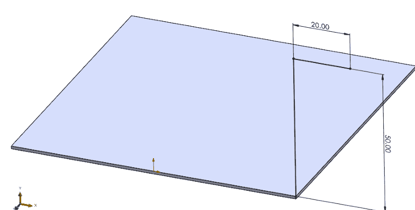

Figure 5.1: Creating a Base Flange and sketching a flange profile on one of the small faces

4. 从薄板工具中选择 **扫掠折边** 工具。这可以在草图内选择，也可以在先选择工具后再选择草图。

工具 **Property Manager** 顶部的消息解释了如何使用它。首先确保您处于 **Profile** 选择框中（较小的上方一个应为蓝色），然后选择开放的草图轮廓。

5. 接下来，选择将与 **扫掠折边** 一起使用的 **路径**——例如，**基体折边** 的现有侧面。折边的黄色预览应出现，如 *Figure 5.2* 所示。

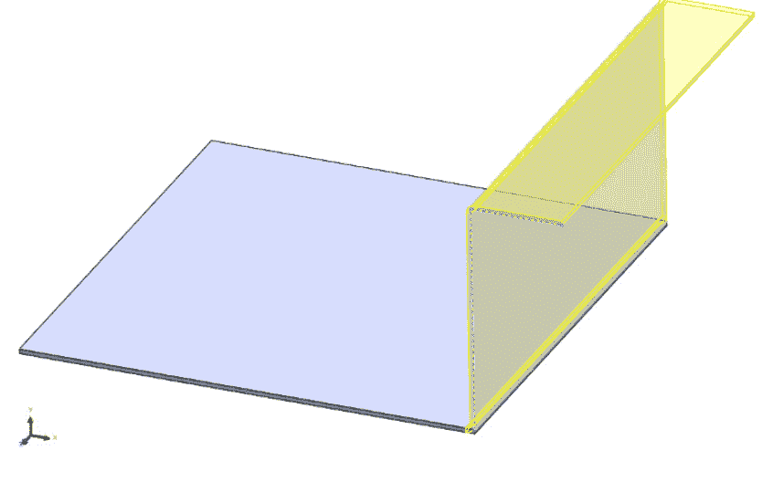

Figure 5.2: Swept Flange preview

6. 所有常规的折边选项都可用，例如设置 **弯曲半径**（或使用默认值）、更改 **折边位置**、偏移起点和终点，以及调整 **自定义弯曲余量** 或 **补强类型**。

7. 选择 **基体折边** 的另外三个边，注意折边的黄色预览如何绕过 **基体折边** 的拐角继续延伸，拐角处为圆弧，而不是每个边单独的折边。与 **倒角折边** 工具类似，所选边必须与原始折边轮廓草图相邻且连接。

8. 按下绿色的 **OK** 勾号以创建特征。

- 9. 通过单击 **Flatten** 按钮展平 *零件*。请注意，展平后的形状与使用相同轮廓制作的 **倒角折边** 特征的展平后外观非常不同。

由于平坦的 *零件* 没有弯曲补强切口，因此该零件可能无法使用传统的弯曲方法制造，而必须使用冲压等工艺。

- 10. 再次选择 **Flatten** 工具以重新折叠 *零件*。

**扫掠折边** 是一种相当专业的特征，可能需要特定的制造方法和工具。下一节将更详细地解释 **扫掠折边** 与 **倒角折边** 之间的区别。

#### Swept Flange versus Miter Flange

尽管 **扫掠折边** 和 **倒角折边** 看起来非常相似，但一个非常重要的区别是 **扫掠折边** 的拐角是连续连接的——即它们不是倒角（修剪以便配合）。这意味着拐角处没有弯曲补强切口（见 *Figure 5.3*），并且是圆形的。

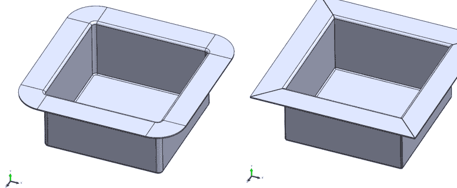

Figure 5.3: The same part made using a Swept Flange (left) and a Miter Flange (right)

该差异在两种 *零件* 的展平版本中甚至更明显。使用 **扫掠折边** 制作的版本（显示在 *Figure.5.4* 的左侧）拐角处没有切口，因此必须使用冲压等工艺制造，并且可能需要专用工具。相比之下，**倒角折边** 版本（显示在 Figure 5.4 的右侧）具有切角。这些可以使用通用工具如折弯机创建，因此可能更容易、更便宜地生产：

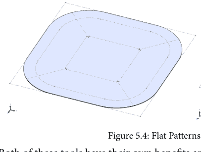

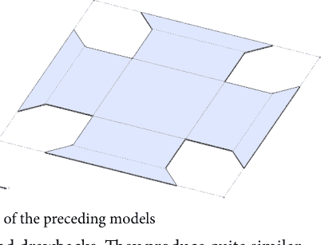

Figure 5.4: Flat Patterns of the preceding models

这两种工具各有利弊。它们产生的结果相当相似，但存在重要差异，因此它们的用途将取决于您想要制作什么以及 *如何* 计划制作它。

在下一节中，我们将学习如何使用 **折叠** 和 **展开** 功能来展开零件，以便添加不寻常的特征，例如跨越折弯的切口。

#### Folding and unfolding

**折叠** 和 **展开** 是两个相关的功能，它们彼此相反。正如名称所示，它们允许您展开模型中的折弯，然后重新折叠。这对于制作某些类型的切口和其他特征非常有用，将在下一节中更详细地解释。

要使用 **展开** 功能：

- 1. 首先，创建一个新的 *零件* 文档并制作一个尺寸为 100×100mm、厚度为 1mm 的 **基体折边**。可以使用默认的薄板属性。
- 2. 向全部四个边添加 **边折边**。这些应为 50mm 高、90° 角，并且可以使用任何折边位置。
- 3. 要展开折弯，请选择 **展开** 功能。

4. 现在选择固定面。这是折弯展开时不会移动的面——例如，在本例中，它是位于边折边中间的方形基体折边，如以下屏幕截图所示：

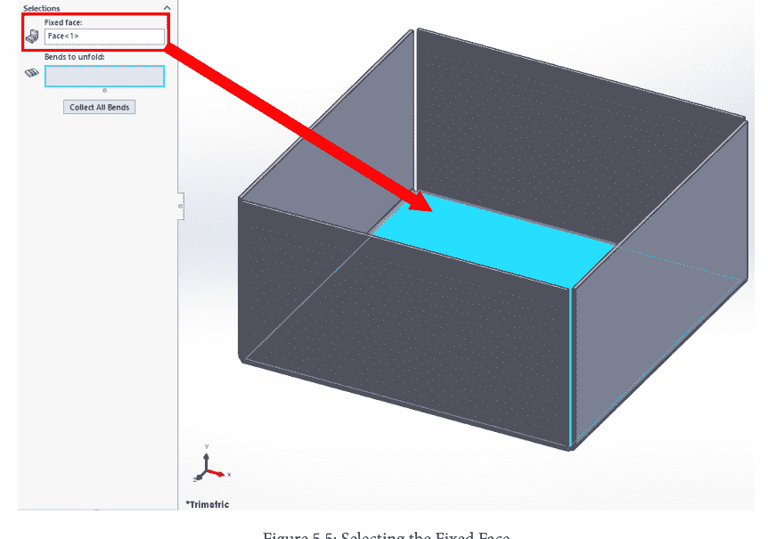

Figure 5.5: Selecting the Fixed Face

5. 现在可以通过左键单击它们来选择要展开的折弯。请注意，您实际上必须单击折弯面才能选择它。

也可以通过按下收集所有折弯按钮自动选择模型中所有合格的折弯。

使用任一方法选择所有折弯。

+   6. 按下绿色的 **OK** 勾选标记以应用展开。

**Unfold** 功能现在出现在 FeatureManager 设计树中。在此展开状态下，我们可以对零件进行更改，例如在弯折处进行切割。

请注意，展开的模型看起来与 *flattened* 模型完全相同；然而，存在一些重要的差异，这些差异将在接下来的两个部分中更详细地解释。

**Fold** 功能的工作方式与 **Unfold** 功能相反——因此，所有步骤都是相反的：

+   1. 选择 **Fold** 功能。
+   2. 选择 **Fixed Face**。在这种情况下，这与之前的 **Unfold** 示例相同——即正方形的 **Base Flange**。
+   3. 选择要折叠的弯折。这些可以手动选择，也可以使用 **Collect All Bends** 按钮来选择模型中所有合适的弯折。
+   4. 按下绿色的 **OK** 勾选标记。模型将被重新折叠，并且 **Fold** 功能出现在 FeatureManager 设计树中。

在下一节中，我们将解释为什么在钣金建模中可能实际上需要 **Unfold** 和 **Fold** 功能。

#### Why use Fold/Unfold?

**Unfold** 和 **Fold** 功能在制作折叠状态下无法进行的跨弯折切割时非常有用。以下是如何操作的示例：

+   1. 在之前的模型基础上，删除 **Fold** 功能，但保留之前的 **Unfold** 功能。这应该会留下具有粗略十字形状的展开模型。
+   2. 在零件的顶面上开始一个草图，并使用圆工具绘制一个直径 50mm 的圆，该圆跨越其中一个弯折区域，如图 5.6 所示。注意：你可以使用弯折边缘上的中点关系来固定圆的位置：

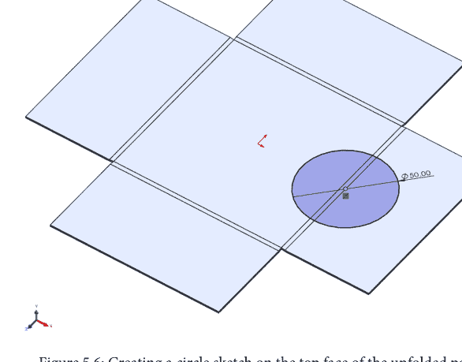

图 5.6：在展开零件的顶面上创建圆草图

+   3. 使用圆草图配合拉伸切除来创建贯穿整个板材的圆形切口。
+   4. 现在，通过选择 Fold 工具、选择固定面、按 Collect All Bends，然后按 OK 来重新折叠零件。

这应该会创建一个带有圆切口环绕弯折的折叠盒，如图 5.7 所示，并展示了 Unfold/Fold 工具如何与其他工具结合以制作不寻常的细节：

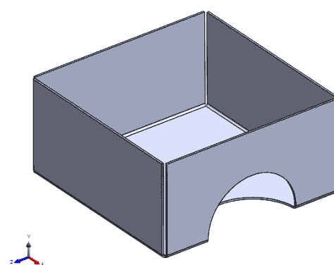

图 5.7：圆切口现在环绕弯折

+   5. 为了将此切口与在折叠状态下制作的类似切口进行比较，旋转模型并在底面开始一个草图。
+   6. 在与现有切口相对的边缘上绘制另一个 50mm 圆，如图 5.8 所示。

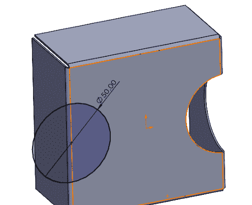

图 5.8：在零件底面绘制 50mm 圆

+   7. 使用此圆草图创建 **Extruded Cut** 25mm 深、盲切。我们现在可以看到两侧在 **Base Flange** 部分都有类似的切口，但 **Edge Flange** 部分的切口完全不同。最新的切口具有方形上边缘，而第一个是圆形的，如图 5.9 所见。这进一步证明了折叠和展开可能有用的原因：

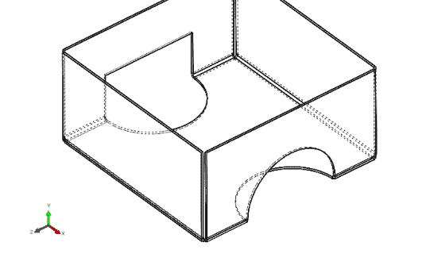

图 5.9：两种不同的切口类型产生不同的结果

+   8. 此外，如果我们现在展开零件，如图 5.10 所示，我们可以看到第一个切口（在展开模型上）是完全圆形的，而第二个切口有两个方形角。第一个圆圈使用钻头切割起来相当简单，但第二个圆圈如果没有激光切割机等计算机控制机器会更困难。因此，第一个切口可能更理想，具体取决于你的生产工艺：

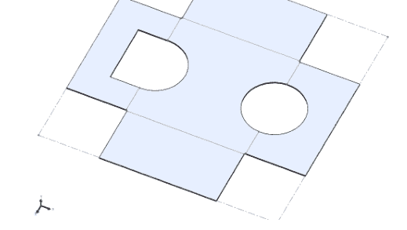

图 5.10：展开的零件，带两个切口

并非所有跨弯折的切口都需要使用 **Unfold** 和 **Fold**——可能有许多情况不需要，但有时如果需要特定类型的切口，它会非常有用。

在下一节中，我们将探讨 **unfolding** 与简单 **flattening** 有何不同以及为什么这很重要。

#### Unfolding versus flattening

在上一节中使用 **Flatten** 功能展开零件后，你可能会想知道这与展开有何不同。如果我们只需点击一个按钮即可展开模型，那么为什么还要添加 **Unfold** 工具所需的额外步骤呢？

第一个、相当次要的原因是 **Unfold** 功能只能用于特定的弯折，而 **Flatten** 按钮适用于整个模型。然而，使用 **Unfold** 功能的主要原因是 **Flatten** 功能是一种特殊类型的功能，通常是 FeatureManager 设计树中的最后一个功能。当选择 **Flatten** 时，该功能只是取消抑制（重新打开）模型末尾的 `Flat-Pattern` 文件夹。这反过来会展开模型。当模型展开时，`Flat-Pattern` 文件夹会被抑制（关闭），因此基于展开零件的任何功能也会被抑制。为了演示这一点，请按照以下步骤操作：

+   1. 使用上一节的模型，通过按 **Flatten** 按钮展开模型（如果尚未展开）。请注意，`Flat-Pattern` 文件夹现在已取消抑制。
+   2. 在其中一个清晰边缘上绘制一个 50mm 圆并制作 **Extruded Cut**。此时，切口看起来与我们第一次制作的切口非常相似，如 *图 5.11* 所示。

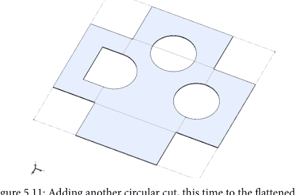

图 5.11：添加另一个圆形切口，这次是在展开的零件上

+   3. 现在，通过再次按 Flatten 按钮展开零件。注意最新的切口现在被抑制了，因为它是子功能（即它基于展开的零件）。在展开状态下添加到模型的任何功能在零件展开时都会自动被抑制（见图 5.12）：

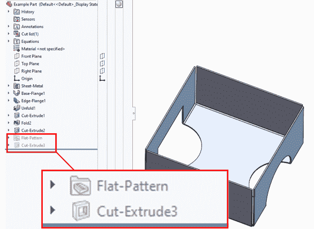

图 5.12：在展开模型中创建的任何功能在零件展开时都会被抑制

Flatten 仅在建模结束时用于生产展开或检查所有功能是否能与平板正确配合时才真正使用。理想情况下，不应在 Flat-Pattern 文件夹之后添加任何功能，而应改用 Unfold/Fold 功能。

然而，在某些罕见情况下，某些项目——例如孔——可能会根据你制作的内容和设计流程添加到 FeatureManager 设计树的末尾。

Unfold/Fold 和 Flatten 是两种不同的功能，各自具有自己的用途，如前所述。

#### Summary

在本章中，我们学习了如何使用 **Swept Flanges** 以及它们与 **Miter Flanges** 的区别，因为它们会在拐角处制作斜切。我们还查看了 **Fold** 和 **Unfold** 工具，可用于展开弯折以添加切口和其他特征。

在 *第 6 章，利用加强筋、横向折痕和通风口添加零件细节* 中，我们将继续探索 SolidWorks 钣金的更高级工具。
