### 6
Utilizing Gussets,
Cross Breaks,
and Vents to Add
Part Details

**Gussets** 和 **Cross Breaks** 是常见的钣金特征，用于改善钣金零件的各种性能，例如强度或刚度。本章将依次解释每个特征——如何使用它们以及为什么和在哪里使用它们。我们还将介绍 Vents：钣金零件中另一个常见的特征，用于多种原因，包括增加冷却、访问端口以及创建模块化产品。

到本章结束时，你将了解如何使用 Gussets 和 Cross Breaks，以及如何添加和修改 Vents。

在本章中，我们将涵盖以下主要主题：

- Working with Gussets
- Using Cross Breaks
- Using Vents

#### 使用加强筋

现在我们已经了解了一些标准的钣金工具，可以继续学习更专业的工具。首先是加强筋。与折边工具类似，这个术语最初来自服装。许多物品，例如衬衫，都包含加强筋。这些是小块额外的布料，通常是三角形的，用于增加额外的强度。它们可能出现在衬衫底部两侧或腋下区域，甚至在裤子的裆部。

在钣金中，加强筋也用于增加强度。然而，“加强筋”或“加强筋板”一词可能指代不同的东西。有时，“加强筋”或“加强筋板”是指添加到装配体中的额外金属件，以提供强度，例如如图 6.1 所示的柱子底部。

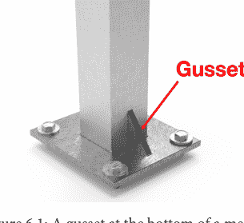

图 6.1：金属柱底部的加强筋

然而，在 SolidWorks 钣金中，加强筋一词有不同的含义，指在弯折处压入的加强筋，以增加其强度。这种加强筋如图 6.2 所示。

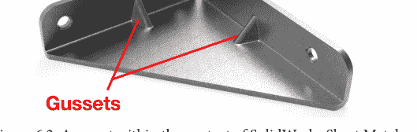

图 6.2：SolidWorks 钣金上下文中的加强筋

请注意，虽然你可能指的是 SolidWorks 风格的加强筋，但你的制造商可能指的是不同的部件。

我们现在将研究如何在 SolidWorks 钣金中使用加强筋。

#### 添加加强筋

**加强筋**工具有很多选项，因此乍一看可能令人望而生畏。然而，如果我们逐步进行选项，则比最初看起来简单得多。

添加 **加强筋**：

- 1. 启动一个新的 *零件* 文档并创建尺寸为 `100x100mm`、厚度为 1mm 的 **基体法兰**。可以使用默认的钣金属性。
- 2. 在一个边缘添加 **边法兰**。这可以是任意角度和尺寸，但对于本示例，我们将其制作为高 40mm 且角度为 90°。
- 3. 现在，我们可以通过选择 **钣金加强筋** 工具来放置我们的 **加强筋**。
- 4. 如前所述，属性管理器看起来很复杂，但遵循相当合乎逻辑的过程。首先，我们需要选择放置 **加强筋** 的弯折。
- 5. 将鼠标悬停在属性管理器顶部（颜色编码为浅蓝色）的 **支撑面** 框上（*图 6.3*）。你将看到一条消息，提示 **选择一个弯折面或两个平面**。
- 6. 现在，我们可以通过选择弯折本身（内部或外部）或选择连接到弯折的两个平面来放置我们的 **加强筋**。请注意，我们可以 *要么* 选择内部面之一，要么选择两个外部面，但不能混合使用。
- 7. 选择弯折后，我们的 **加强筋** 预览将会出现。请注意，我们可以使用属性管理器底部的选项选择 **局部预览** 或 **完整预览**：

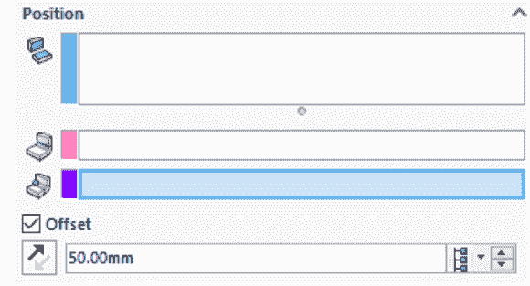

图 6.3：钣金加强筋属性 – 加强筋的位置

我们的 **加强筋** 的 **参考线** 是下一个框（*图 6.3*），颜色编码为粉红色（注意图形区域中模型上的粉红色线）。这将自动由所选弯折的边缘填充。这意味着，默认情况下，我们的 **加强筋** 将垂直于弯折。然而，如果需要，可以在创建 **加强筋** 特征之前绘制一条参考线，并在该框中使用它，以制作与弯折角度不同的 **加强筋**。

**参考点** 是下一个框（*图 6.3*），颜色编码为紫色（注意图形区域中模型上的紫色 *点*）。此 *点* 决定我们的 **加强筋** 沿 **参考线** 的放置位置。

此 *点* 可以放置在任何位置，但必须是现有位置，例如线的 *起点、终点或中点*；它不能放置在随机位置。

可以在创建 **加强筋** 特征之前绘制一个 *点*，并在该框中使用它来设置 **加强筋** 的确切位置。然而，通常更容易选择 **参考线** 的起点或终点，然后使用 **偏移** 选项来精确放置 **加强筋**。如果在选择 **偏移** 后看不到 **加强筋** 预览，请尝试反转方向；方向错误会导致 **加强筋** 悬浮在空中，这意味着它无法制作或预览。

- 8. 选择 **偏移** 选项并将距离设置为 50 mm，以便我们的 **加强筋** 位于弯折的中间（*图 6.4*）：

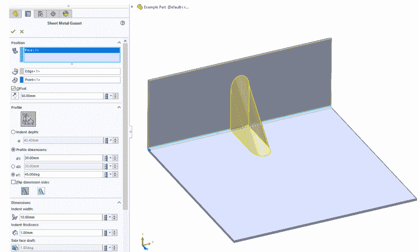

图 6.4：通过从端点偏移 50mm 来设置加强筋的位置

9. **加强筋** 轮廓的大小现在可以使用属性管理器的 **轮廓** 部分进行设置（*图 6.5*）。设置大小主要有两种方法：

- - **压入深度** 由属性管理器 **轮廓** 部分顶部的大图标上的对角尺寸线演示。此深度将决定 **加强筋** 的整个尺寸。
- - 或者，可以设置 **轮廓尺寸**。我们可以设置 **截面轮廓长度**（截图中的 d1）和 **截面轮廓角度**（a1），或者设置 **截面轮廓长度**（d1）和 **截面轮廓高度**（d2）。

这三个选项中只能同时使用两个，因为前两个值决定第三个值。

如果我们使用 **轮廓尺寸** 选项，还可以通过勾选 **翻转尺寸侧** 框来翻转尺寸：

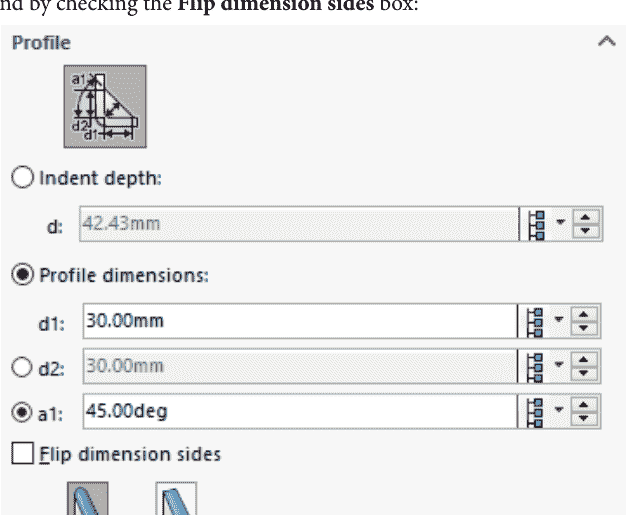

图 6.5：钣金加强筋属性的轮廓部分

此 **轮廓** 部分还包括创建 **圆角加强筋** 或 **平面加强筋** 的选项。一般来说，用于制作加强筋的工具相当圆润，以避免损坏零件，但确切形状将取决于你的设计要求。

> 注意
> 使用 **轮廓尺寸** 选项，d1 为 **30mm**，角度为 **45°**，并设置 **圆角加强筋**。

10. 下一节，**尺寸**，（*图 6.6*）允许我们设置 **加强筋** 所需的其余尺寸：

- - **压入宽度**：设置 **加强筋** 的总宽度。
- - **压入厚度**：设置 **加强筋** 区域板材的厚度。一般来说，这应与主板材的厚度相同，除非你有特定原因要更改它。
- - **侧面倒角**：允许 **加强筋** 的两侧向内倾斜。可以通过单击图标完全关闭它。
- - **内角倒圆** 和 **外角倒圆**：这些选项设置 **加强筋** 内外倒圆的大小。如果不需要，也可以完全关闭它们：

> 注意
> 设置 **压入宽度** 为 **10mm**，**压入厚度** 为 **1mm**，并关闭倒角和倒圆选项。

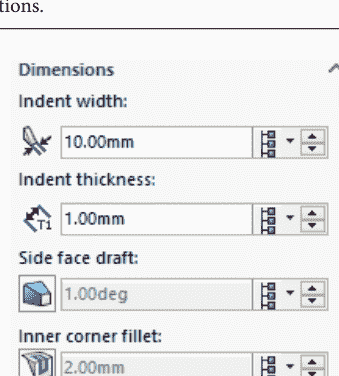

图 6.6：钣金加强筋的尺寸部分

11. 将底部 **展开图可见性** 选项保持未选中状态，然后按绿色 **确定** 勾号创建此特征。

我们的 **加强筋** 现在出现在模型中，也出现在特征管理器设计树中。它可以用通常的方式编辑，或者可以通过在设计树中展开特征并编辑其下方的草图来编辑 **加强筋** 的轮廓。

#### 展开加强筋特征

默认情况下，加强筋不会显示在展开的 *零件* 中。这是因为它们通常作为使用专用工具的单独工序添加。如果我们想在 **展开图** 中显示加强筋，则需要覆盖默认设置：

- 1. 单击 **展开**（在 **钣金** 选项卡或工具栏上）。请注意，**加强筋** 特征在 **展开图** 视图中无处可见。
- 2. 再次单击 **展开** 以重新折叠模型。
- 3. 编辑 **加强筋** 特征。
- 4. 滚动到属性管理器底部并勾选 **覆盖文档设置** 框。然后，选择 **显示轮廓** 和 **显示中心** 两个选项并按 **确定**。
- 5. 再次 **展开** 零件。

请注意，**加强筋** 特征的位置现在会出现。槽轮廓代表 **加强筋** 特征的形状，而 *点* 是 **加强筋** 特征中心的<|message|>

此选项仅显示 **加强筋** 特征的一般形状，因此建议在 2D *工程图* 上也写一个注释，指定其确切尺寸。

总之，加强筋为弯折提供强度。可以通过选择 **钣金加强筋** 工具，然后选择弯折，设置 **加强筋** 位置，然后指定轮廓和尺寸来添加它们。在下一节中，我们将研究如何使用横向压痕以不同方式增加强度。

#### 使用交叉折弯

交叉折弯在钣金中很常见，描述的是在平板上添加的轻微弯折，以使其更坚固并增加强度。这些交叉折弯通常可见于诸如钣金风管等物体的侧面，并且通常采用两个重叠的弯折形成交叉或 X 形，位于原本平坦的表面上。图 6.7 显示了金属风管侧面交叉折弯的示例：

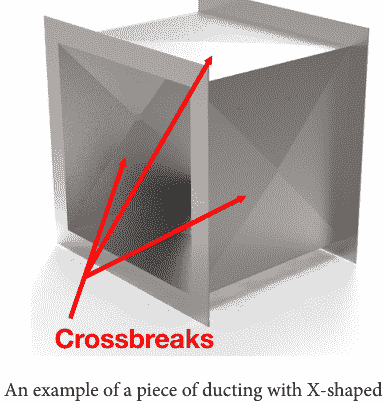

图 6.7：带有 X 形交叉折弯的风管件示例

在 SolidWorks 钣金中添加交叉折弯非常简单：

- 1. 启动一个新的零件文档并创建一个尺寸为 100x100mm、厚度为 1mm 的基体法兰。可使用默认的钣金属性。
- 2. 选择交叉折弯工具。
- 3. 现在，左键单击选择要添加交叉折弯特征的面。将出现黄色预览，显示交叉折弯特征的弯折将被添加的位置（图 6.8）：

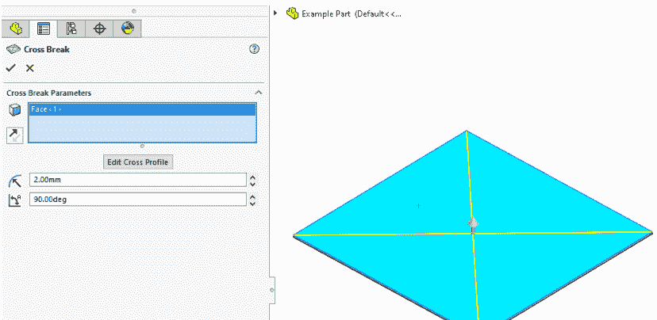

图 6.8：交叉折弯工具

4. 按下绿色的确定复选标记以添加交叉折弯特征。请注意，交叉折弯在 SolidWorks 钣金中纯粹是视觉特征。它们仅表示在现实生活中交叉折弯特征将被添加的位置。模型的实际几何形状保持不变，仍然是一个完全平坦的板。

5. 通过在 FeatureManager 设计树中单击它并按编辑特征来再次编辑交叉折弯特征。

6. 如有需要，我们可以调整折断半径和折断角度属性并调整交叉折弯特征的方向。请注意，更改这些值不会改变黄色预览或交叉折弯特征在 3D 模型中的外观。这些值只会出现在零件 2D 工程图的折弯注释中。

7. 交叉折弯通常以交叉或 X 形制作，但也可以调整其轮廓。

为此，从交叉折弯属性管理器中单击编辑交叉轮廓按钮。现在我们可以编辑交叉折弯草图，并会出现一条消息，说明当前草图可用于交叉折弯特征。草图中的构造线可以调整以改变轮廓。请注意，您可能需要删除将线端与面角连接的关联。

*线的端点始终必须接触面的外部边缘，如果您的草图不满足此要求，则消息框将不允许该草图与 **交叉折弯** 特征一起使用。*

- 8. 当您对轮廓满意时，按下 **完成** 按钮。然后，在对 **交叉折弯** 参数满意后，按下绿色的 **确定** 复选标记以创建该特征。

交叉折弯是非常简单的特征，用于为平坦板增加刚性。它们在 SolidWorks 钣金中作为纯粹的视觉项目添加。

在下一节中，我们将研究创建通风口。

#### 使用通风口

**通风口** 工具用于创建各种形状的切口，并且可以轻松用于添加详细的通风口。此功能不严格限定于钣金，也可用于普通实体建模。然而，通风口在钣金零件中非常常见，因此该功能与其它钣金工具分组在一起：

- 1. 启动一个新的 *零件* 文档并创建一个 **基体法兰**，尺寸为 `100x100mm`，厚度为 1mm。可使用默认的钣金属性。
- 2. 要创建 **通风口**，我们需要绘制草图来定义 **通风口** 特征的大小和形状。在 **基体法兰** 的大顶部面上开始一个草图。
- 3. 在原点处绘制一个直径为 80mm 的圆。请注意，通风口不一定是圆形的；它们可以使用任何封闭轮廓。
- 4. 接下来，我们需要添加额外的草图实体来创建 **加强筋**。从 **草图** 选项卡中选择 **偏移实体** 工具，设置 **偏移** 为 10mm，并选择我们绘制的原始 80mm 圆。这应该会创建一个比 80mm 圆小 10mm 的新圆（*图 6.9*）。

请注意，您可能需要选择 **反向** 框以确保 **偏移** 圆位于原始圆内。另外，确保取消选择 **构造几何** 选项，以便原始（**基体**）圆和 **偏移** 圆都是实线，而不是构造线：

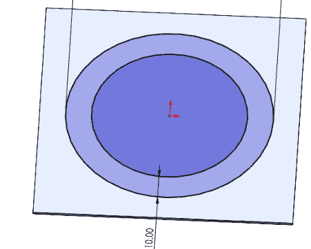

图 6.9：偏移 80mm 圆以创建另一个更小、同心的圆

- 5. 使用偏移实体工具再两次添加两个更多圆，每个圆比前一个小 10mm（图 6.10）：

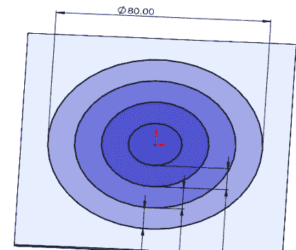

图 6.10：偏移另外两个圆，使我们总共有四个同心圆

6. 接下来，我们需要绘制一些肋条。请注意，并非所有通风口都需要肋条（或加强筋），并且该工具如果需要也可以仅使用简单的外轮廓。

选择直线工具并添加一条从圆心向外延伸到最大圆的单条垂直线。

7. 现在，我们可以使用圆形草图阵列添加更多肋条。在草图选项卡上，单击线性草图阵列工具旁的下拉箭头并选择圆形草图阵列。

选择垂直线作为要阵列的实体，选择圆的中心点作为阵列中心，并设置四个实例，等距分布，角度为 360°（图 6.11）：

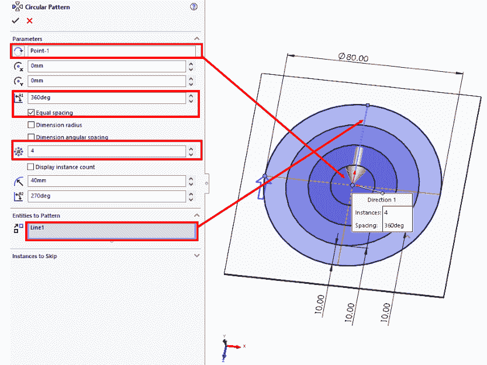

图 6.11：圆形草图阵列设置

按下绿色的确定复选标记以在圆周围添加三条新的肋条线。

如果您在使用 **圆形草图阵列** 时遇到困难，也可以直接使用 **直线** 工具手动绘制这些线（图 6.12）：

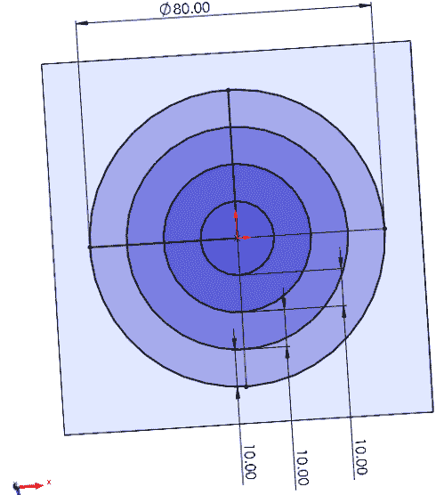

图 6.12：完成的通风口草图

- 8. 现在，我们可以使用此草图创建我们的通风口。通风口工具可以直接在草图内使用，但在本示例中，我们将先退出草图，以确保没有项目被自动预选，这可能会在您不熟悉该工具时造成混淆。
   
- 退出草图并确保未选择它。

- 9. 从钣金工具中选择通风口工具。

- 10. 属性管理器可能看起来非常复杂，但它使用相当合乎逻辑的工作流程。按照顶部消息提供的说明，首先选择边界。这是通风口的外限。
   
在这种情况下，通过左键单击选择最大圆。

请注意，通风口会以我们选择的圆的形状从基体法兰中切出（您可能需要旋转模型以更清晰地看到通风口特征）。我们也可以选择多条线，例如，如果我们要制作矩形通风口。

另请注意，流量面积消息现在显示为 5025.91 平方毫米，开放面积 = 100%。

这告诉您通风口的面积，以及 100% 的面积是开放的（即，我们没有肋条或加强筋阻挡气流）。

在几何属性部分，面已被自动选为通风口草图绘制的面：

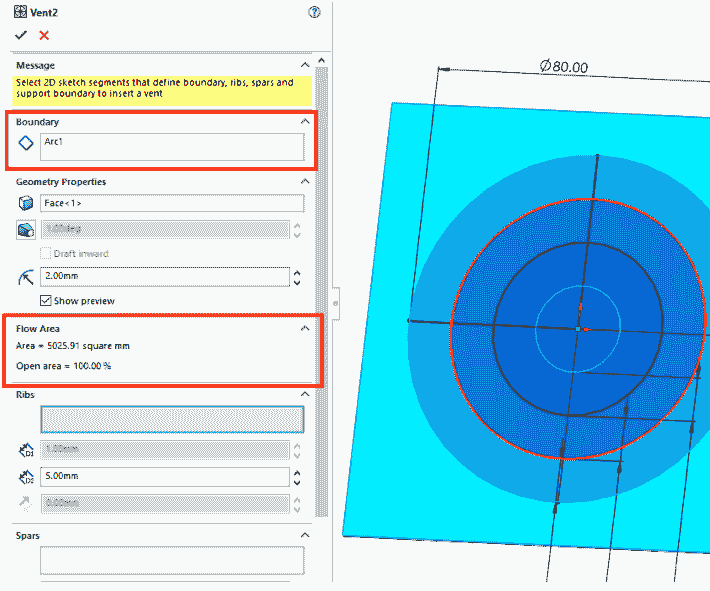

图 6.13：选择通风口的边界

11. 我们现在可以通过选择肋条框然后选择草图中的四条线来添加我们的肋条。

这些肋条的深度和方向将被变灰，因为钣金肋条的深度始终与模型的板厚相同。

将肋条宽度设置为 5mm，并注意开放面积减少到 84.60%。这是因为肋条阻挡了部分通过通风口的气流。

12. 现在，通过左键单击加强筋框然后选择两个较大的剩余圆来选择我们的加强筋。同样，深度和方向无法更改，但我们的加强筋的宽度可以更改。

将宽度设置为 2mm，并注意开放面积进一步减少到 73.70%（图 6.14）。

并非每个通风口都需要加强筋和肋条，但必须先添加肋条将其连接到模型的其余部分后，才能添加加强筋：

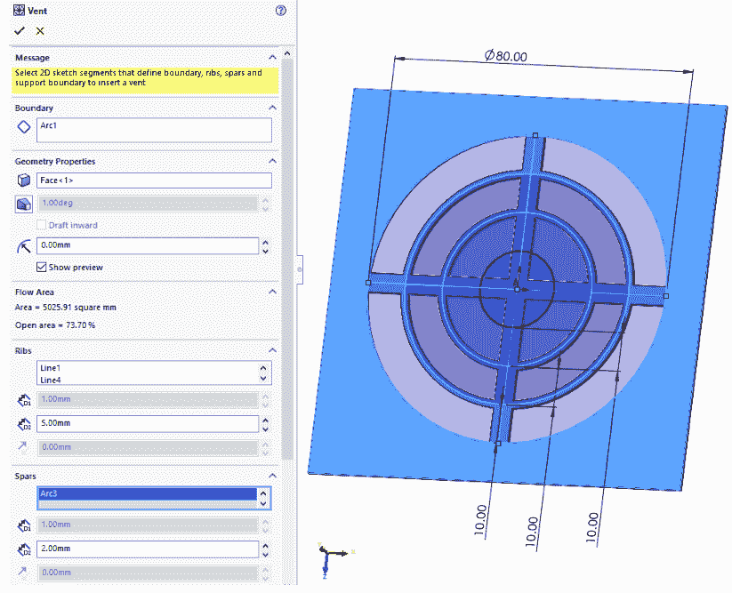

图 6.14：添加肋条和加强筋

13. 填充边界也是可选的，用于封闭通风口特征的区域。在我们的示例中，选择最小的内圆，并注意它现在已填充。

14. 在完成 **Vent** 功能之前，向上滚动回到 **Geometry Properties** 部分。在这里，我们可以为 **Vent** 切割设置一个 **Draft Angle**。该选项在钣金工作中并不常用，因为它会使 **Flat Patterns** 的切割变得复杂。

我们还可以为通风口的连接处添加圆角。

将半径设置为 2mm。请注意，这适用于整个 **Vent** 功能。

15. 按 **OK** 创建该功能（*Figure 6.15*）。注意它现在出现在 FeatureManager Design Tree 中：

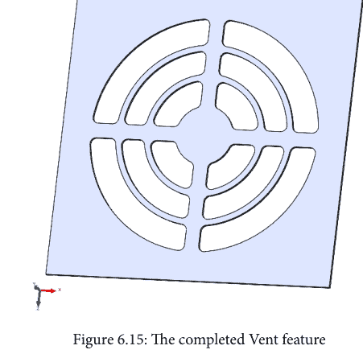

Figure 6.15: The completed Vent feature

**Vent** 功能不仅限于钣金 *parts*，并且非常适用于在钣金模型中添加这些常见功能。

#### Summary

在本章中，我们学习了如何使用 **Gussets** 和 **Cross Breaks**，两者都用于以不同方式为钣金件增加强度。我们学习了如何编辑 **Gussets** 以产生各种形状和尺寸，以及它们如何在 **Flat Pattern** 视图中显示。

我们还探索了 **Vent** 工具，该工具可用于快速制作不同布局和尺寸的钣金 **Vents**。

在下一章中，我们将探索 **Lofted Bend** 工具，该工具使我们能够创建更复杂类型的弯曲。
