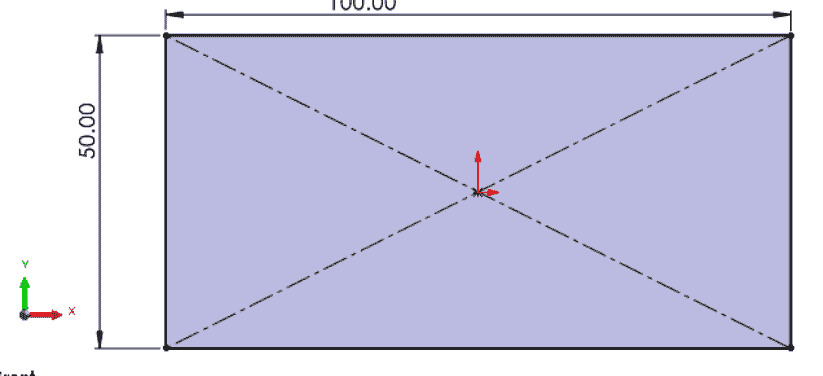
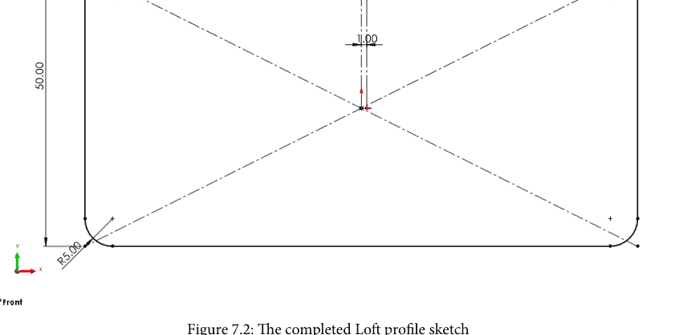
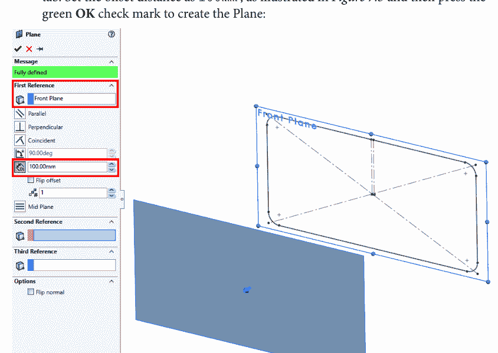
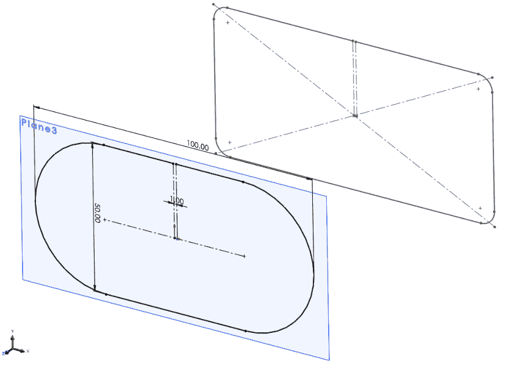
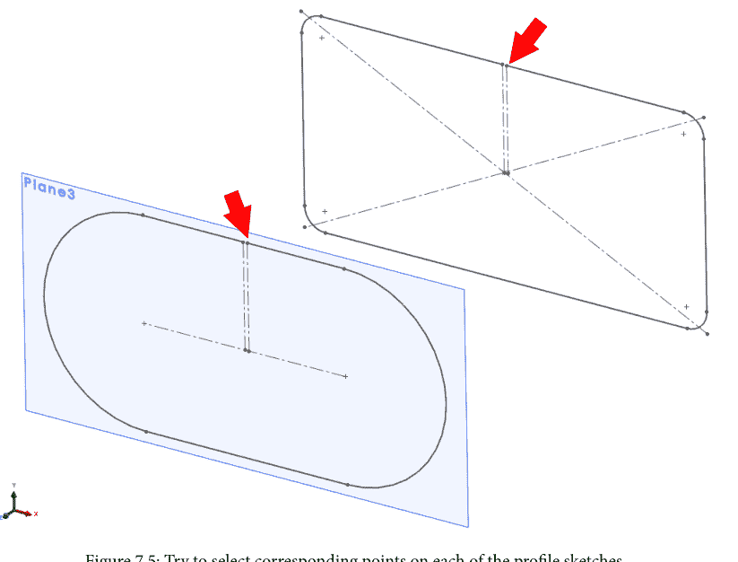
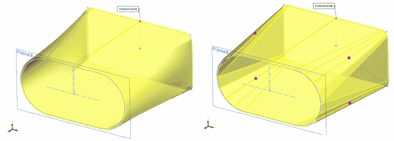
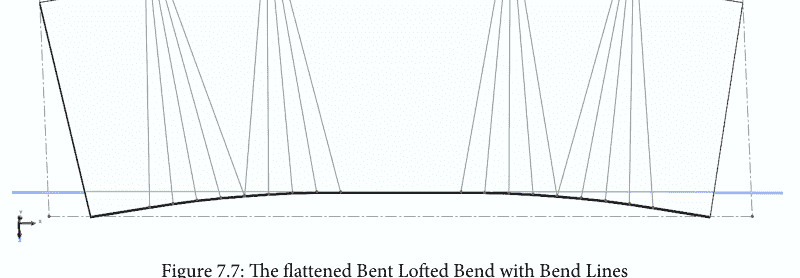
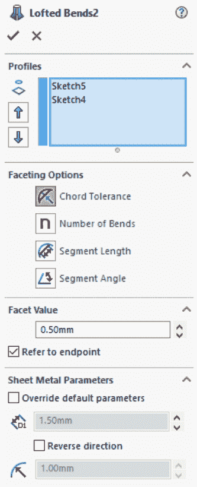
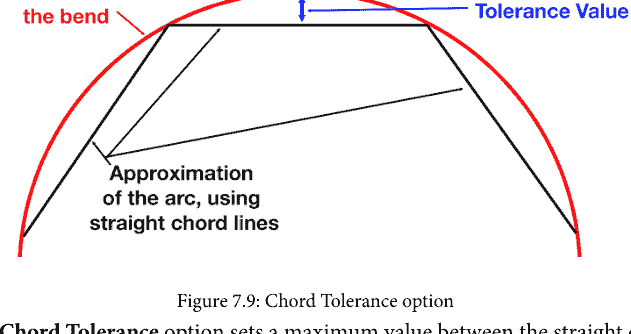

### 7
Producing
Advanced Shapes
Using Lofted Bends

Lofted Bend 是一种先进的弯曲形式，可用于创建比标准法兰类型更复杂的形状。

Lofted Bend 有两种类型——Formed 和 Bent，本章涵盖了这两种类型，包括两者之间的主要区别。

到本章结束时，您将了解如何使用 Lofted Bend 工具，使用 Formed 和 Bent 两种选项。

在本章中，我们将涵盖以下主要主题：

- Creating Formed Lofted Bends
- Adding Bent Lofted Bends

#### Creating Formed Lofted Bends

Lofted Bends 用于在两种不同轮廓形状之间创建弯曲过渡。这在许多不同的情况下都很有用，例如当您需要将方形轮廓连接到更圆润的轮廓（如管子）时。

在 SolidWorks Sheet Metal 中，Lofted Bends 可以是 Bent 或 Formed，这描述了弯曲实际的制作方式。一般来说，Formed 选项会产生更平滑的弯曲，并且更难制造，而 Bent 选项会近似弯曲形状，并且更易于物理制作。

Bent 和 Formed 类型都使用相同的工具——Lofted Bend 工具创建，并且两者都以相同的方式开始：使用两个开放轮廓。因此，Lofted Bends 是少数不需要预先存在的 Base Flange 的钣金工具之一。

要创建 Formed Lofted Bend：

- 1. 启动一个新的零件文档并在 Front Plane 上绘制第一个弯曲轮廓（见 Figure 7.1）。这可以使用 Center Rectangle 绘制，尺寸为 100×50 mm，并固定到 Origin：

Figure 7.1: Lofted Bend profile sketch

##### Lofted Bend Profile Requirements

Lofted Bends 需要两个轮廓才能创建。这两个轮廓都必须是开放的，并且不能包含任何尖角。

因此，使用 **Sketch Fillet** 工具（在 **Sketch** 选项卡上）为所有四个角添加 5mm 倒角，并在轮廓中修剪一个小间隙以确保其为 *open*（见 Figure 7.2）。这可以通过从 Origin 绘制一条垂直的 Construction Line 到矩形的顶线来完成。

然后，使用 **Offset Entities** 工具（在 **Sketch** 选项卡上）将此 Construction Line 偏移 1mm（确保偏移线也是 Construction Line）。

然后可以使用 **Trim Entities** 工具（也在 **Sketch** 选项卡上）来修剪一个小间隙：

Figure 7.2: The completed Loft profile sketch

请注意轮廓是开放的（顶部有一个小间隙）并且没有尖角（Figure 7.2）。

在完成时退出草图。

2. 接下来，我们需要创建第二个轮廓，因此我们需要一个新的 Plane。这可以通过选择 Front Plane（确保您已退出之前的草图）然后从 Features 选项卡中选择 Reference Geometry | Plane 来创建。设置偏移距离为 100mm，如 Figure 7.3 所示，然后按绿色 OK 勾号创建 Plane：

Figure 7.3: Adding a new Plane

3. 在新 Plane 上开始一个新的草图并绘制第二个 Loft 轮廓。这将与第一个相似，但形状略有不同。

这次，使用固定在 Origin 的 Centerpoint Straight Slot（在 Slot 工具内），尺寸为 100x50mm。

与之前一样，轮廓必须是开放的并且没有尖角。由于槽的形状，我们没有尖角，但槽仍然是一个封闭的轮廓。因此，我们需要修剪掉另一个小部分，通过偏移一条垂直线然后修剪一个间隙，就像我们对第一个轮廓所做的那样。请注意，修剪时可能会显示关于破坏槽实体的警告消息。这是正常的，可以通过按 OK 忽略。

如果您的草图丢失了关系并变得 Underdefined，则可以通过添加更多关系和尺寸使其 Fully Defined（您可能需要重新将槽锚定到 Origin 并在曲线和直线部分之间添加 Tangent 关系）。完成的草图如图 7.4 所示。

Figure 7.4: The finished, second Loft profile sketch

在完成时退出第二个草图。

- 4. 我们现在有了所需的两个轮廓草图，因此我们可以使用它们来创建该功能。从 Sheet Metal 工具中选择 Lofted Bend 工具。这将是少数可用的工具之一，因为我们的模型没有 Base Flange。如果 Lofted Bend 工具呈灰色，则确保您已退出草图并且不再编辑它们，这应该允许使用该工具。

- 5. 要创建该功能，我们首先需要选择两个轮廓。单击 Property Manager 左侧的 Profiles 框（如果尚未选择并且因此呈蓝色）。然后，通过左键单击依次选择每个草图。

##### Selecting Loft Profiles

选择 Loft Profiles 时，尽量确保在每个草图中选择对应的点。例如，如果您在第一个（矩形）草图的直线上选择顶部右侧中心的点，那么也在第二个（槽）草图的相同位置选择一个点（见 Figure 7.5 中的箭头）。

如果您使用的是不同的轮廓，则可能并不总是能够选择完全对应的点，但请尽量避免选择完全相反的点，因为这可能会导致 Loft 扭曲并使功能失败。

Figure 7.5: Try to select corresponding points on each of the profile sketches

6. 我们现在可以选择是制作 Bent 还是 Formed Loft。在 Property Manager 中的 Manufacturing Method 部分下，依次选择 Bent 和 Formed 选项。请注意，预览会随着每个选项略有变化（Figure 7.6）。Bent 选项有很多较小的、较直的边缘，而 Formed 选项要平滑得多。

选择 **Formed** 选项：

Figure 7.6: Previews of the Formed Lofted Bend (left) and the Bent Lofted Bend (right)

- 7. **Formed Lofted Bend** 只有一个选项需要设置，即板材的厚度。

  将其设置为 1.5mm 厚度。

- 8. 按绿色 **OK** 勾号创建该功能。**Lofted Bend** 功能出现在 FeatureManager Design Tree 中，可以像平常一样编辑。轮廓草图也可以通过展开该功能并编辑下面的草图来编辑。

- 9. 通过从 **Sheet Metal** 工具中选择 **Flatten** 来展平模型。请注意，平坦零件具有拱形，这是由于 **three-dimensional (3D)** 成型弯曲的形状所致。

  也没有弯曲线。这是因为形状将使用专用工具成型，而不是使用设定点弯曲。因此，这种类型的零件可能难以实际制造。

- 10. 按 **Flatten** 按钮重新折叠模型。

Formed Lofted Bends 由两个必须开放且不能包含尖角的轮廓草图制成。Formed Lofted Bends 产生平滑的形状，但在现实生活中可能难以生产。在下一节中，我们将使用相同的轮廓查看如何创建 **Bent Lofted Bend**。

#### 添加弯曲放样折弯

第二种放样折弯类型是 **弯曲** 版本。按以下步骤添加它：

- 1. 编辑当前的 **放样折弯** 特性；请注意，由于我们已经创建了成形放样折弯，因此我们不再有将其更改为弯曲放样折弯的选项。
- 然而，我们可以删除放样折弯，然后重用相同的轮廓来创建弯曲版本。
- 2. 退出 **放样折弯属性管理器**，以便不再编辑该特性，然后在 FeatureManager 设计树中选择该特性并按 Delete。这将删除放样折弯特性但保留两个底层的草图。
- 3. 选择 **放样折弯** 工具，然后再次选择两个轮廓。记住要尝试在每个轮廓上选择对应的点。
- 4. 现在，从 **属性管理器** 的 **制造方法** 部分中选择 **弯曲** 选项。
- 5. **弯曲** 选项包含的 sub-选项比 **成形** 选项多得多，但在此时，使用默认选项并按绿色 **确定** 勾号创建弯曲放样折弯。
- 6. 我们可以立即看到，模型的外观与之前的成形版本非常不同，并且包含许多小的弯曲边缘。

按 **展平** 展平模型，并注意我们现在可以看到多个将用于弯曲 *零件* 的折弯线（见图 7.7）：

图 7.7：展平的弯曲放样折弯及其折弯线

- 7. 再次按 **展平** 以重新折叠 *零件*。

8. 我们现在将探索用于创建弯曲放样折弯拐角的不同面片选项。

编辑 **放样折弯** 特性，并在 **属性管理器** 中，我们可以看到四个选择，如 *图 7.8* 所示。这些选择中的每一个都会产生相当相似的输出，但略有不同的选项允许您精确控制弯曲形状。

请注意，其中一些选项对于某些放样轮廓来说可能有点难以处理，因此如果您在使用一个选项时难以获得想要的结果，请尝试使用另一个选项进行实验：

图 7.8：弯曲放样折弯选项

从第一个选项开始：

- **弦长公差**：弦是连接圆弧上两点的直线。当我们创建弯曲放样折弯时，我们是通过使用直线来近似圆弧。*图 7.9* 显示了理想的圆弧以及使用弦（直线）近似的版本：

图 7.9：弦长公差选项

**弦长公差** 选项设置直线弦线与理想圆弧之间的最大数值，如 *图 7.9* 中蓝色所示。

尝试调整 **面片值** 设置并注意预览如何变化。较高的面片值会产生较少的直线段，因此会创建不太准确的圆弧形状，但由于弯折较少，因此更容易制造。

请注意，我们也可以点击图形区域中模型上四个拐角的紫色点（见 *图 7.6* 右侧），这也允许我们为该拐角专门设置面片选项。

如果您发现创建时 **放样折弯** 具有您不想要的补强切口，请尝试选择或取消选择 **参照端点** 选项。这可以产生更平滑的弯折并减少这些自动补强切口的问题。

- **弯折数量**：这是一个相当简单的选项，允许您设置每个拐角内的弯折数量。显然，更多的弯折会产生更平滑的曲线，但请注意，这也会在生产过程中需要更多的工作。

- **段长**：此选项允许您设置每个段的最大长度。较低的值会产生更多更短的段，从而产生更平滑的曲线，而较高的值会产生长度更长但数量更少的段。这会产生更近似的弯曲形状。

- **段角度**：最后一个选项决定相邻段之间的最大角度。此处较低的值会在弯折中产生更多段，因此会产生更平滑的曲线。

四个选项中的每一个都可以产生非常相似的结果，因此请尝试调整设置以获得所需的弯曲形状。

如果需要，这里也可以覆盖默认的 **钣金** 参数，例如 **弯曲半径** 和 **板厚**。

- 9. 将 **面片选项** 设置为您自己的偏好值，然后按绿色 **确定** 勾号创建特性。

弯曲放样折弯通常比成形放样折弯更容易制造，但它们产生的曲线要粗糙得多。弯折可以用多种不同的拐角类型控制，但这些通常都会产生相当相似的输出。

#### 总结

在本章中，我们了解到 **放样折弯** 是在两个不相似的轮廓之间创建曲线的良好方法。**放样折弯** 由两个开放轮廓制成，不能有尖锐边缘。

有两种类型的 **放样折弯：成形**，它会产生更平滑但更难制造的特性；以及 **弯曲**，它更容易物理制造，但只能近似弯曲形状。

在下一章中，我们将学习最后一个主要工具之一，**搭扣和插槽** 工具，它允许我们在两个 **钣金** 体之间添加细节以便于连接。
