### 9
使用角部细节完成模型

SolidWorks Sheet Metal 包含多个 Corner 工具，可用于多种不同的操作，包括封闭法兰之间的角部间隙、添加焊接角、修剪尖锐边缘以及在弯曲区域添加角部减料。

在本章结束时，你将了解如何使用四种不同的 Corner 工具。

在本章中，我们将涵盖以下主要主题：

- 使用 Closed Corners 减小间隙
- 通过添加 Welded Corners 消除角部间隙
- 使用 Break-Corner/Corner-Trim 工具去除尖锐角部
- 使用 Corner Relief 为制造准备模型

#### 使用 Closed Corners 减小间隙

Corner 工具是一组四个相似的工具，因为它们都处理角部细节。单独来看，这些工具都比较简单，但它们可以节省时间或在模型中创建特定特征。

第一个工具是 **Closed Corner**。它可用于减少两个相邻法兰之间可能出现的间隙。

为了展示 **Closed Corner** 工具的示例，首先我们将创建一个具有一些相邻法兰的简单零件：

- 1. 开始一个新的 *part* 文档并使用 **Center Rectangle** 工具创建固定在 **Origin** 上的 **Base Flange**，尺寸为 50×50mm，厚度为 2mm。可使用默认的 **Sheet Metal** 属性。
- 2. 在任意相邻边缘添加两个 **Edge Flanges**（*Figure 9.1*）。将其高度设为 30mm，角度为 90°。

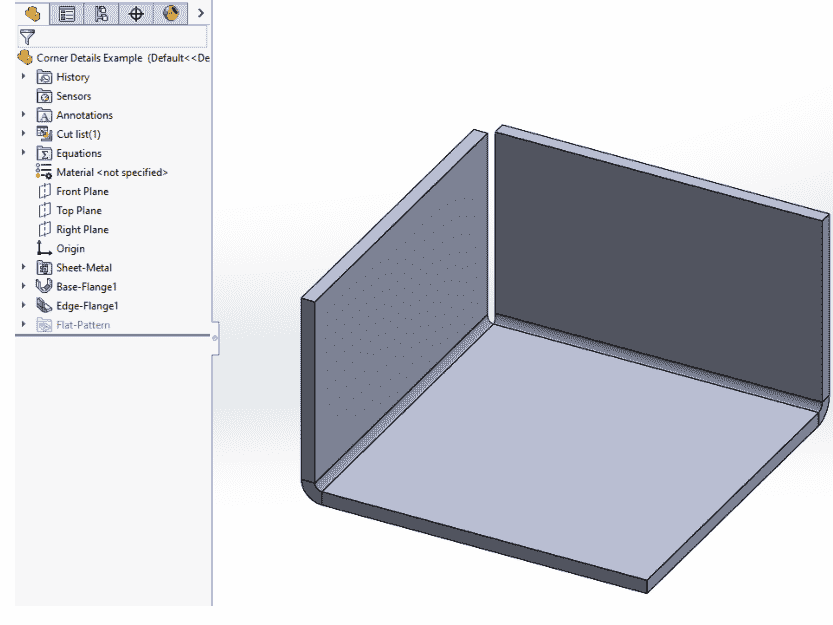

Figure 9.1: Creating a Base Flange with two adjacent Edge Flanges

3. 旋转模型并注意我们目前在角部、两个 Edge Flanges 之间存在间隙。从 Sheet Metal 工具中的 Corners 按钮下方的下拉菜单中选择 Closed Corner 工具。

4. 首先，我们需要选择要关闭间隙的位置。确保已激活顶部的选择框 – Faces to Extend – 然后选择其中一个 Edge Flange 的端面（Figure 9.2）：

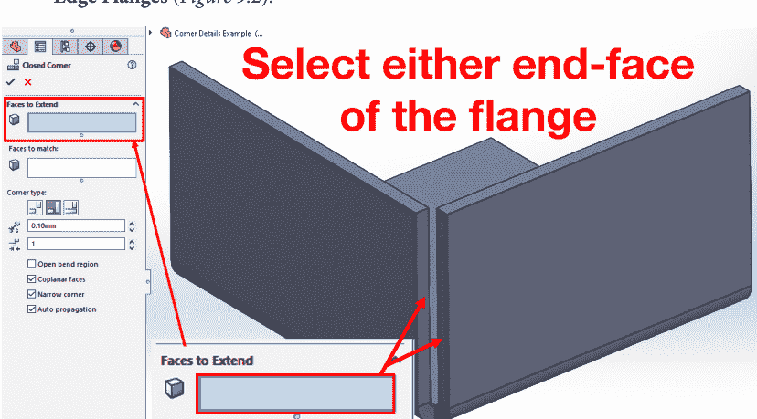

Figure 9.2: Selecting the Faces to Extend

5. 现在会出现一个预览，显示所选面已被延伸，并且对应的面被延伸了较小的量以减小角部间隙（Figure 9.3）。请注意，第二個面已被自动选为 Face to match。必要时也可以手动选择 Faces to match。

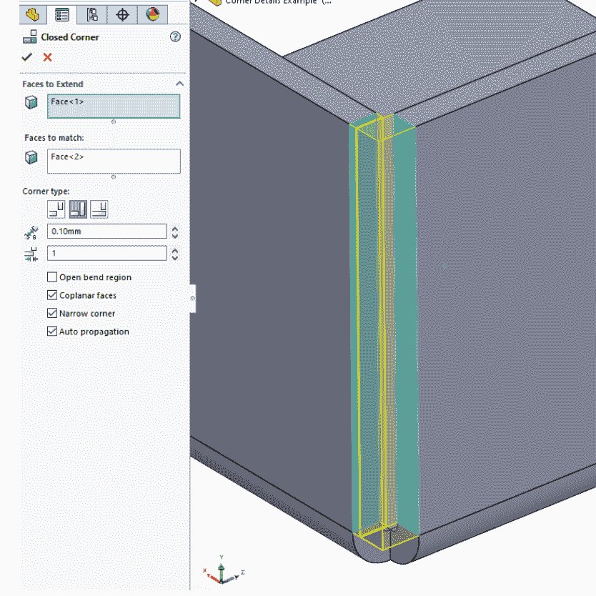

Figure 9.3: The Face to Extend is extended and the Face to match is extended by a smaller amount

6. 我们现在可以選擇 Corner Type。尝试依次选择每种类型以查看差异，方法是点击三个按钮中的每一个：

- **Butt**: 这会稍微延伸每个面，使间隙减小但法兰不会相互重叠（Figure 9.4，左）。**Gap distance** 可使用数值设置。
- **Overlap**: 这会延伸其中一个法兰使其与对应的法兰重叠（Figure 9.4，中间）。对于此选项，我们可以设置 **Gap distance** 以及 **Overlap/underlap ratio**。这控制较长法兰重叠较短法兰的程度。值为 1 表示重叠覆盖整个法兰，而值为 0.5（例如）表示重叠将覆盖法兰的一半。
- **Underlap**: 这与 **Overlap** 选项非常相似，但法兰方向相反（Figure 9.4，右）：

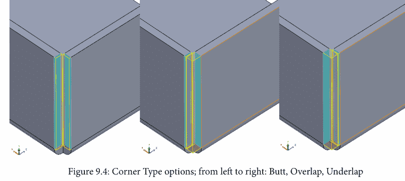

Figure 9.4: Corner Type options; from left to right: Butt, Overlap, Underlap

将 **Corner Type** 设置为 **Overlap**。

7. 确保已勾选 **Open bend region** 选项。这将在填充间隙时自动修剪角部减料区域。也可以在未选择此选项的情况下创建 Closed Corners（*Figure 9.5*），但这可能会导致制造复杂性，并且如果 **Gap distance** 太小，有时会导致模型错误。

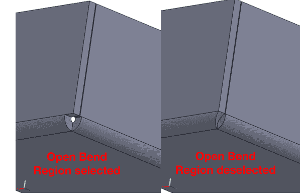

Figure 9.5: Closed Corner with Open bend region selected (left) and deselected (right)

8. 按下绿色的 OK 勾选标记以创建 **Closed Corner**。请注意，虽然我们仍然存在一个很小的间隙（由于折弯法兰的钣金特性），但它已大大减小。

9. 还有另外三个选项可与 **Closed Corner** 工具一起使用。这些选项可通过编辑 **Closed Corner** 特征查看：

- **Coplanar faces**: 选择此选项意味着 **Closed Corner** 将应用于与所选面 *coplanar*（对齐）的所有面，即使这些共面面未被选中。这在其中一个法兰上有切口将表面分割成较小的部分时很有用（*Figure 9.6*）：

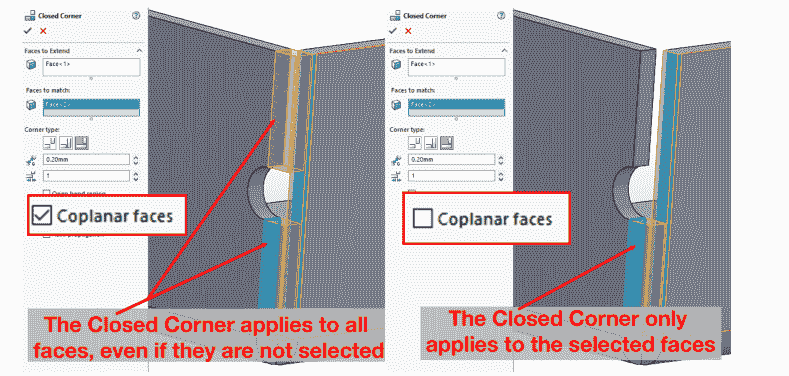

Figure 9.6: Selecting Coplanar faces will apply the Closed Corner to all coplanar faces, even if only one is selected

- **Narrow Corner**: 这可以根据模型的具体几何形状减小弯曲区域周围的间隙距离。然而，它通常只产生很小的影响。
- **Auto propagation**: 此选项只需在选择 **Faces to Extend** 时自动选择对应的 **Faces to match**。

当与 **Base Flange** 不成 90° 的法兰一起工作时，**Closed Corner** 尤其有用（*Figure 9.7*）。在这些情况下，间隙距离会沿法兰长度变化，因此使用 **Closed Corner** 工具可以轻松关闭这些间隙。

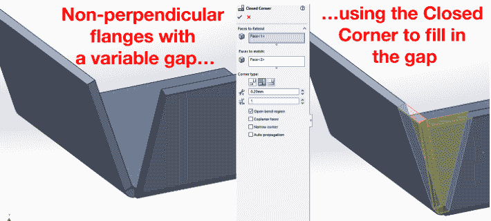

Figure 9.7: Using the Closed Corner tool to close gaps between non-perpendicular/parallel flanges

**Closed Corner** 工具是减少相邻法兰之间间隙的好方法，但有时你可能希望完全消除间隙。在下一节中，我们将查看如何使用 **Welded Corners** 工具来实现这一点。

#### 通过添加 Welded Corners 消除角部间隙

**Welded Corners** 工具可以通过焊接角部完全关闭角部间隙。此工具是四个 **Corner Tools** 中最简单的工具，可按如下方式使用：

- 1. 删除上一节中的 **Closed Corner** 特征，以便我们只剩下一个 **Base Flange**（50x50x2mm）和两个相邻的 **Edge Flanges**，高度为 30mm，角度为 90°。
- 2. 从 **Sheet Metal Corner** 工具中选择 **Welded Corner** 工具。
- 3. 现在我们只需选择其中一个 **Edge Flange** 的侧面。

我们将看到 **Welded Corner** 的黄色预览（Figure 9.8）：

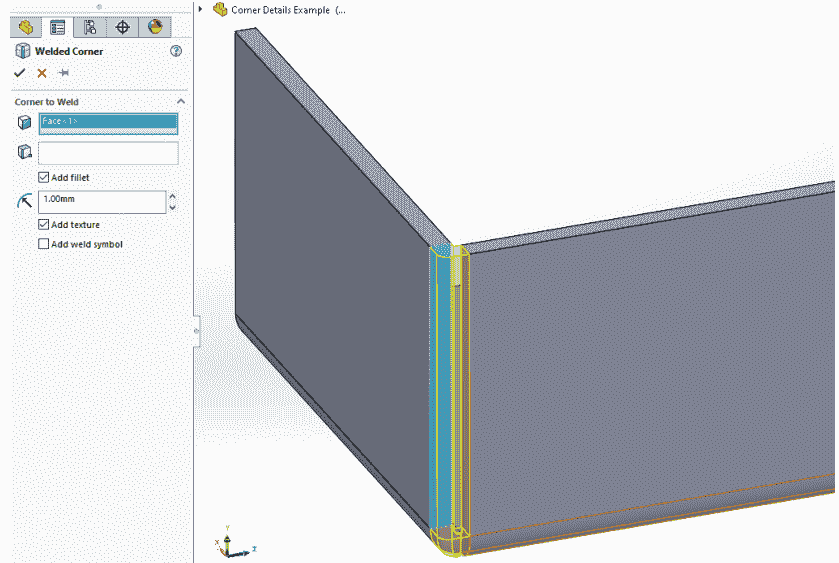

Figure 9.8: Adding a Welded Corner

- 4. 默认情况下，**Welded Corner** 将沿所选面全长运行，但如果需要，可以通过在创建 **Welded Corner** *之前* 在法兰侧面上创建一个带有 *point* 的草图来添加停止点。
- 5. 可以通过选择 **Add fillet** 选项将焊接区域倒圆。还有将 **Add texture** 添加到焊接区域以及 **Add weld symbol** 的选项。
- 6. 按下绿色的 **OK** 勾选标记以创建特征。焊接材料将计入模型的 *mass* 和 *volume*，可使用 **Evaluate** 选项卡上的 **Mass Properties** 工具显示。**Mass Properties** 工具还包含专门 **Show weld bead mass** 的选项。
- 7. 请注意，当模型被 **Flattened** 时，**Welded Corners** 将自动被抑制以允许板料正确展开。

**Welded Corner** 工具是一个非常简单的特征，可用于连接相邻边缘。在下一节中，我们将查看如何使用 **Break-Corner/Corner-Trim** 工具去除尖锐边缘。

#### 使用 Break-Corner/Corner-Trim 工具去除尖锐角部

**Break-Corner/Corner-Trim** 工具与 **Fillet** 和 **Chamfer** 工具非常相似，因为它允许通过倒圆或倒角轻松去除方形角部。这可用于使物品更易于制造，出于结构原因，甚至只是使零件更用户友好，通过去除尖锐角部。

要使用 **Break-Corner/Corner-Trim** 工具，请执行以下步骤：

- 1. 继续上一个示例，删除 **Welded Corner** 特征，以便你只剩下一个 **Base Flange**（50x50x2mm）和两个相邻的 **Edge Flanges**，高度为 30mm，角度为 90°。
- 2. 从 **Corner** 工具中选择 **Break-Corner/Corner-Trim** 工具。
- 3. 首先，我们可以设置一个 **Break Type** – **Filletted** 或 **Chamfered** – 然后设置 **Size**。

选择 **Fillet** 并将尺寸设置为 5mm。

4. 我们现在可以选取想要倒角的角。角可以直接左键点击，或者选择整个面，所有相关的角都会被倒角。这样，Break-Corner/Corner-Trim 工具比 Fillet 或 Chamfer 工具更有用，因为我们不必大幅缩放来选择法兰上非常短的边；我们可以直接选择整个面。

如 Figure 9.9 所示，选择两个 Edge Flanges 和 Base Flange：

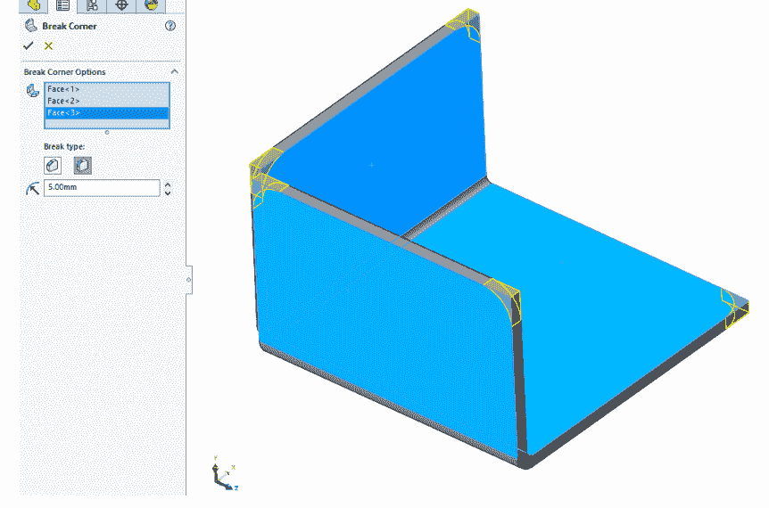

Figure 9.9: Adding the Break Corner feature

5. 按下绿色的 OK 勾选标记以添加 Break-Corner/Corner-Trim 特性。

到目前为止，我们只是创建了外部倒角，但该工具也可以用于内部角，如下一节所示。

#### Using the Break-Corner/Corner-Trim tool with internal corners

按照以下步骤使用此工具处理内部角：

- 1. 通过在上表面绘制矩形，然后选择 Base Flange/Tab 工具，为 Base Flange 添加一个 Tab（Figure 9.10）：

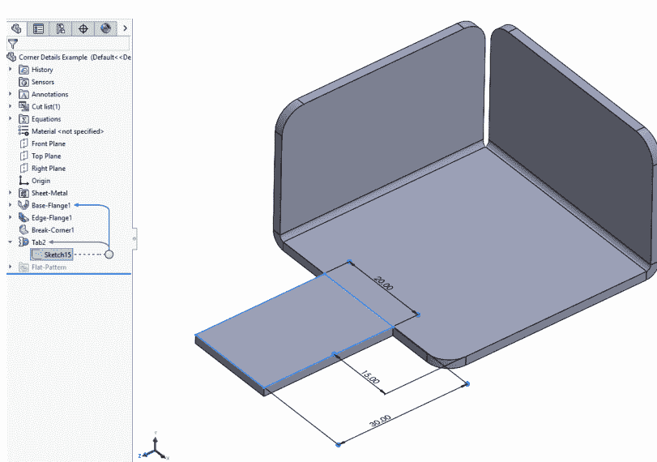

Figure 9.10: Adding a Tab to the Base Flange

- 2. 再次选择 Break-Corner/Corner-Trim 工具。

3. 使用与之前相同的设置（**Fillet**，5mm size），再次选择 **Base Flange** 面。注意只有 *external* 角被选中（Figure 9.11）：

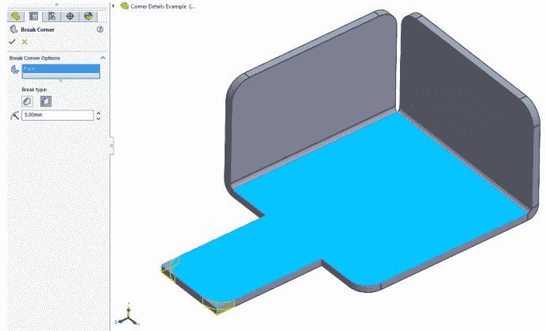

Figure 9.11: Selecting the Base Flange face

4. 放大并手动选择两个 *internal* 角（Figure 9.12）。创建内部倒角会增加材料，而创建外部倒角会移除材料。

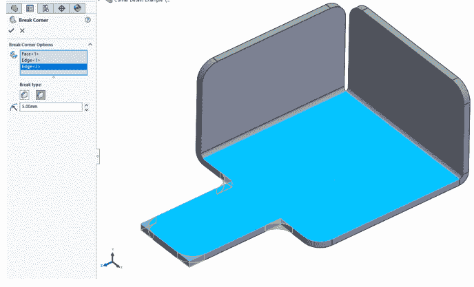

Figure 9.12: Manually selecting internal corners

5. 按下绿色的 **OK** 勾选标记以添加新的倒角。

除了在折弯零件上使用 **Break-Corner/Corner-Trim** 工具外，它也可以在展开模型上使用，以便快速一起选择所有角。

#### Using the Break-Corner/Corner-Trim tool on flattened models

在许多情况下，你可能会在不添加任何倒角的情况下创建整个 Sheet Metal 模型，但在建模结束时希望全部添加它们，也许是为了便于制造。

在这些情况下，可以在展开零件后使用 **Break-Corner/Corner-Trim** 工具：

- 1. 从前一个示例继续，删除任何当前的 **Break-Corner/Corner-Trim** 特性，以便你仅保留 **Base Flange**、**Tab** 和两个 **Edge Flange** 特性。
- 2. 通过点击 **Flatten** 按钮展开模型。
- 3. 现在展开 **Corner** 工具的下拉菜单，你会看到只有一个选项可用，**Corner-Trim**。这与我们在上一节中使用的工具非常相似，但专门用于展开模型。选择 **Corner-Trim** 工具（Figure 9.13）：

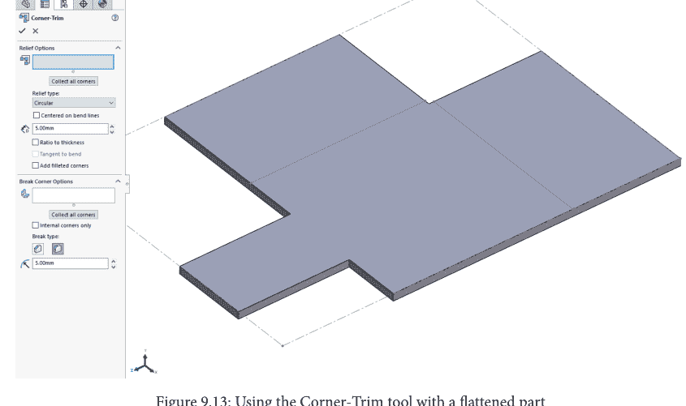

Figure 9.13: Using the Corner-Trim tool with a flattened part

- 4. 我们现在可以添加 **Relief Options** 并添加 **Break Corner Options**。我们将在下一节介绍 **Relief Options**，现在仅查看 **Break Corner Options**。

与之前一样，我们可以设置 **Break type** 和 **Size**。

设置为 **Filletted**，5mm size。

- 5. 接下来，选择要倒角的角。使用此工具在展开状态下，我们有两个新选项。点击 **Collect all corners** 按钮将自动选择模型中所有相关的角。我们还可以勾选 **Internal corners only** 框以仅选择内部角（外部角需要手动选择）。

点击 **Collect all corners** 以选择模型中的弯折。

> **Using the Collect all corners Button versus Selecting the Face**
> 在选择要倒角的角时，我建议使用 **Collect all corners** 按钮，而不是仅选择面。这是因为有时选择面也会错误地选择弯折内的角，而这些角不应该被倒角。

- 6. 按下绿色的 **OK** 勾选标记以倒角所选角。注意 **Corner-Trim** 特性现在出现在 FeatureManager Design Tree 中 **Flat-Pattern** 文件夹之后。

- 7. 通过再次选择 **Flatten** 按钮展开零件。注意倒角在模型中不再出现，并且 **Corner-Trim** 特性被抑制（关闭）。这是因为 **Corner-Trim** 特性是 **Flat-Pattern** 特性的 *child feature*。因此，如果 **Flat-Pattern** 特性被抑制（例如当模型展开时），则 **Corner-Trim** 特性也会被抑制。

以这种方式在展开后使用 **Corner-Trim** 工具是在建模结束时在 **Flat-Pattern** 文件夹之后向模型添加特性的少数情况之一。

如果需要在未展开状态下对角进行倒角，则可以使用本章前面描述的 **Corner/Corner-Trim** 工具，也可以使用 **Unfold** 特性展开零件，然后手动倒角所有角，然后使用 **Fold** 特性将零件折回。

在下一节中，我们将查看最后一个角工具，**Corner Relief**。

#### Preparing your model for manufacturing using Corner Relief

**Corner Relief** 工具允许我们在模型中添加角的减力切口。这对于避免在两个或多个弯折相遇的狭窄角处的制造问题很有用。

该工具可在未展开或展开状态下使用，我们将首先查看未展开版本：

- 1. 从前一个示例继续，删除任何当前的 **Break-Corner/Corner-Trim** 特性，以便你仅保留 **Base Flange**、**Tab** 和两个 **Edge Flange** 特性。确保模型处于 Unflattened（即折叠）状态。
- 2. 从 **Corner** 工具下方的下拉菜单中选择 **Corner Relief** 工具。我们现在可以在 Property Manager 中设置一些选项（*Figure 9.14*）：

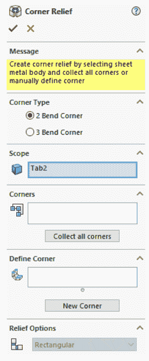

- 3. **Scope** 部分仅指示我们正在处理的板件。这通常会自动预填，但如果在多板件零件中工作，则可以选择适当的板件。

- 4. 接下来，我们需要选择 **2 Bend Corner** 或 **3 Bend Corner**。在我们当前的模型中，我们只有一个 2 Bend Corner。这意味着角有两个彼此相邻的弯折（*Figure 9.15*）。在下一节中，我们将查看 3 Bend Corners。

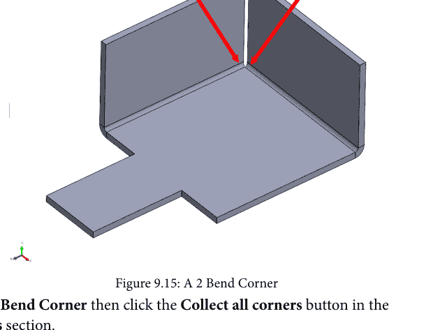

Figure 9.15: A 2 Bend Corner

选择 **2 Bend Corner** 然后在 **Corners** 部分点击 **Collect all corners** 按钮。

注意 **Define Corner** 框现在已填入来自弯折的两个面。

5. 我们现在可以设置 **Relief Options**。主要有五个选项，每个选项都会产生略有不同的切口样式。每个版本还具有多个子选项：

- **Rectangular**: 这将切出一个矩形区域。切口尺寸可以由 **Slot length** 框中的数值决定，也可以勾选 **Ratio to thickness** 框，根据板厚计算尺寸。

**Centered on bend lines** 选项使切口相对于弯折线居中，而 **Tangent to bend** 选项使切口与弯折线相切（Figure 9.16）。

**Add filleted corners** 按钮仅将减力切口的尖角圆化。

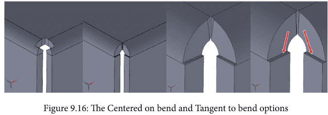

Figure 9.16: The Centered on bend and Tangent to bend options

- **Circular**: 产生圆形切口。

- **Tear**: 创建撕裂减力；没有可用的子选项。

- **Obround**: 这会创建腰形（槽形）切口。

- **Constant Width**: 这会产生具有恒定宽度的线性和连续切口，且没有子选项。

尝试不同的 **Corner Relief** 切口类型，以在图形区域的预览中查看它们之间的差异。

6. 按下绿色的 **OK** 勾选标记以创建 **Corner Relief** 切口。

除了 2 Bend Corners 外，**Corner Relief** 工具也可以与更不寻常的 3 Bend Corners 一起使用。

#### 使用 3 个弯角的 Corner Relief 选项

3 个弯角在钣金模型中相对较少见，但我们现在简要看一下：

+   1. 在之前的模型基础上，添加两个进一步的边法兰，如图 9.17 所示。这将创建一个 3 个弯角（我们刚刚添加了两个更多的弯角，而第一组边法兰之前已经有一个弯角）。

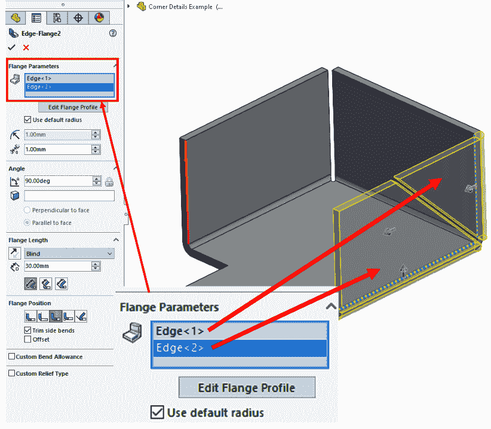

+   2. 我们现在可以使用相同的角工具，因此从 Corners 下拉菜单中选择 Corner Relief 工具。

+   3. 在 Corner Type 部分，选择 3 Bend Corner。

+   4. 按下 **Collect all corners** 按钮并注意 3 Bend Corner 被选中，并且所有三个面都被添加到 **Define Corner** 部分。
+   5. 我们现在可以使用 **Relief Options** 部分以与 2 Bend Corners 相同的方式添加角减料切口。

以这种方式，我们可以使用多个 **Corner Relief** 特性为不同角类型添加减料切口，当模型处于折叠状态时，但我们也可以使用 **Corner Relief** 工具处理展开的零件。

#### 向展开模型添加 Corner Relief 切口

有时你可能希望先完成大部分钣金模型，然后在建模结束时再向整个设计添加减料切口。使用此方法时，将切口应用于展开模型可能更容易：

+   1. 在大部分建模完成后，通过按下 **Flatten** 按钮展开模型。
+   2. 点击 **Corner** 工具下方的下拉菜单。选择 **Corner-Trim** 选项——这是展开状态下唯一可用的选项。这是我们在上一节中用于消除尖角的相同工具，但也可以用于添加角减料。
+   3. 在 **Relief Options** 部分下点击 **Collect all corners** 按钮。注意在展开状态下，我们不需要指定 2 或 3 个弯角——它们都被同等对待。
+   4. 设置 **Relief Type** 和 **Size**。这可以是 **Circular**、**Square** 或 **Bend Waist**（图 9.18）：

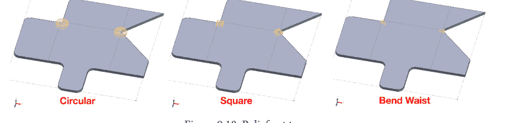

+   5. 按下绿色的 **OK** 勾选标记以添加减料切口。注意这些减料仅在展开状态下出现。如果模型被展开，则 **Corner Relief** 特性将被抑制。

以这种方式，减料切口可以一次性全部轻松添加。

#### 总结

在本章中，我们查看了四个 **Corner** 工具。第一个 **Closed Corner** 允许我们减少相邻法兰之间的角间隙，而 **Welded Corner** 工具则可以完全消除这些间隙。**Break-Corner/Corner-Trim** 工具加快了尖角的去除速度，最后一个工具 **Corner Relief** 添加了可能因制造原因而需要的减料切口。

在下一章中，我们将探讨如何通过创建和使用 **Forming Tools** 为我们的平板添加 3D 细节。
