### 10
使用
Forming Tools
向模型添加 3D 细节

到目前为止，我们已经学习了如何通过使用诸如边法兰等特征向平板添加三维（3D）细节。然而，也可以通过使用 Forming Tools 添加 3D 特征。这些是专门制作的工具，通常用于将形状压入平板。

本章解释了如何使用 SolidWorks 设计库中现有的 Forming Tools，以及如何修改 Forming Tools 并创建和使用完全定制的 Custom Forming Tools。

在本章中，我们将涵盖以下主要主题：

+   - 使用 Forming Tools
+   - 修改现有 Forming Tools
+   - 创建 Custom Forming Tools

#### 使用 Forming Tools

Forming Tools 是形状工具，也称为模具，在高压下压入平板，留下压痕。一些 Forming Tools 甚至可以在板材内创建切口，以及形状压痕。这些形状的例子包括诸如凹坑、百叶窗（形状通风口）甚至徽标和文字等事物。你可以在图 10.1 中看到一些使用成型工具创建的形状示例：

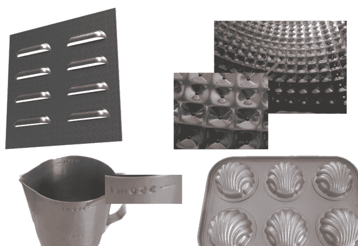

图 10.1：使用成型工具创建的形状示例

SolidWorks 设计库包含许多预先制作的 Forming Tools，可以在处理钣金模型时轻松使用。由于这些工具在形状和尺寸方面范围相当有限，它们可能对你的需求没有太大用处，但它们可以被修改；本章后面的部分将展示如何做到这一点，以及如何创建完全定制的 Custom Forming Tools。

为了演示 Forming Tools 的使用，我们首先将制作一个简单的钣金零件，如下所示：

+   1. 启动一个新的零件文档并使用 Center Rectangle 工具创建一个固定在原点且尺寸为 50x50mm、厚度为 1mm 的 Base Flange。可以使用默认的钣金属性。
+   2. 通过点击屏幕右侧任务窗格中的图标（看起来像一本书）打开设计库，如图 10.2 所示。
+   如果你看不到任务窗格，则可以通过右键单击命令管理器并确保在 Tools | Task Pane 旁边有复选标记来打开它。

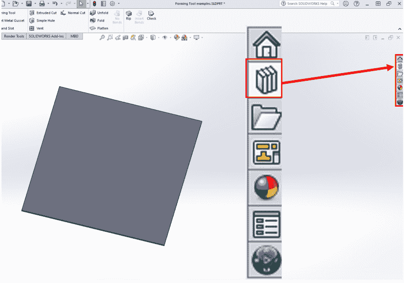

图 10.2：打开设计库选项卡

3. 在任务窗格中展开设计库文件夹并展开 Forming Tools 文件夹。你现在应该会看到许多不同的 Forming Tool 类型，例如 embosses 和 ribs。点击 embosses 并注意任务窗格底部将显示各种可用的压花工具。注意：根据你的设置和 SolidWorks 版本，你的设计库可能与图 10.3 中的外观略有不同。

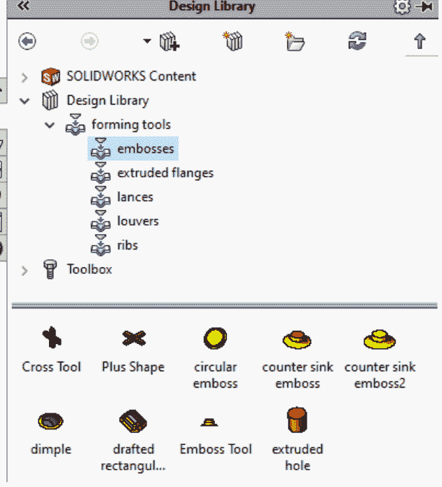

图 10.3：展开设计库和 Forming Tools 文件夹

##### 如果设计库不可见

如果在任务窗格中看不到设计库，则需要重新链接 SolidWorks 到正确的文件夹。

这可以通过转到 Tools | Options | System Options | File Locations 来完成。

然后，在下拉列表中找到 Design Library 并确保你的设计库文件夹的位置出现在 Folders 框中。如果文件夹不在那里，点击 Add 并找到你计算机硬盘上设计库的位置。

默认情况下，此位置通常为 C:\ProgramData\SolidWorks\SolidWorks 20xx\Design Library。

（注意 Program Data 文件夹通常是隐藏文件夹，因此你可能需要调整 Windows 资源管理器视图设置以显示隐藏文件夹。）

然后，按 OK 添加设计库文件夹，它现在应该出现在任务窗格中。

要使用 Forming Tools，可以通过按住鼠标左键并将所需工具拖到板材面上将其拖入模型。

+   4. 作为示例，在任务窗格的 forming tools 文件夹中选择 embosses 子文件夹，然后左键单击并将 counter sink emboss 工具拖到 Base Flange 的顶部面上。

现在图形区域中应该会出现一个黄色预览，显示将在模型上制作的压痕，如图 10.4 所示：

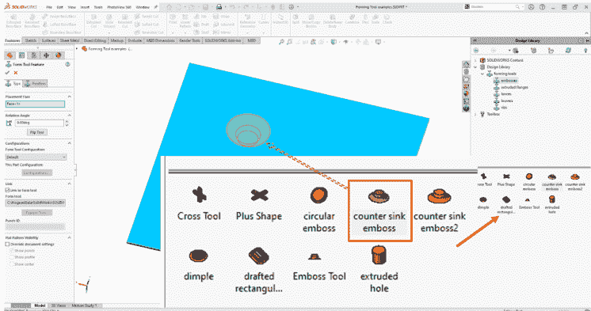

图 10.4：将 Forming Tool 拖到模型上

##### 你是否尝试制作派生零件？

如果你尝试将工具拖到板材上并收到消息 Are you trying to make a Derived Part?，这只是意味着 SolidWorks 不认识你正在使用 Forming Tools。为此，请通过选择 Cancel 关闭错误消息框。然后再次打开任务窗格，右键单击 Forming tools 文件夹，并在 Forming Tools Folder 选项旁边放置一个复选标记。这将确保 SolidWorks 知道文件夹内的所有零件都应被视为 Forming Tool 零件。

5. 按下绿色的 OK 勾选标记以插入 counter sink emboss 特性。我们现在应该会看到板材已被选定工具的形状变形，并且在压花区域中央有一个孔，如图 10.5 所示。如果我们查看设计库中的各种 Forming Tools（图 10.4——右下角），我们可以看到它们是黄色或红色着色的。黄色面表示工具的面将变形（或弯曲）板材，而红色面表示将被切除的材料（有关更多信息，请参阅本章后面 Creating Custom Forming Tools 部分）：

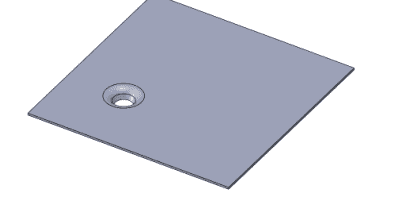

图 10.5：Forming Tool 特性

我们可以以通常的方式编辑 Forming Tool 特性，或者我们可以展开该特性并编辑特性下方的定位草图，如果我们只是想更改该特性的位置。

6. 在 FeatureManager 设计树中左键单击 counter sink emboss 特性并选择 Edit Feature。

Forming Tool 特性类似于 Hole Wizard，因为它包含一个 Type 选项卡，可用于调整实际工具细节，并且还包含一个 Position 选项卡，允许定位一个或多个实例。

Type 选项卡（图 10.6）提供以下选项：

+   - Placement Face：这设置了工具将被压入的面。
+   - Rotation Angle：工具可以在此处旋转到任意角度。它也可以被翻转，允许工具从板材的另一侧压入。

- **Configurations**：成型工具本身就是独立的 *part* 文件（本章接下来两节会详细介绍），因此可以拥有多个配置。此处可根据需要设置所需的配置。
- **Link**：此部分允许您保持或断开与 Forming Tool *part* 的链接。如果保持链接且后续更改了 Forming Tool *part*，则此模型中的特征也会随之更改。
- **Flat Pattern Visibility**：默认情况下，**Forming Tool** 特征不会出现在展开图上；不过，通过选中此复选框可以覆盖该设置。

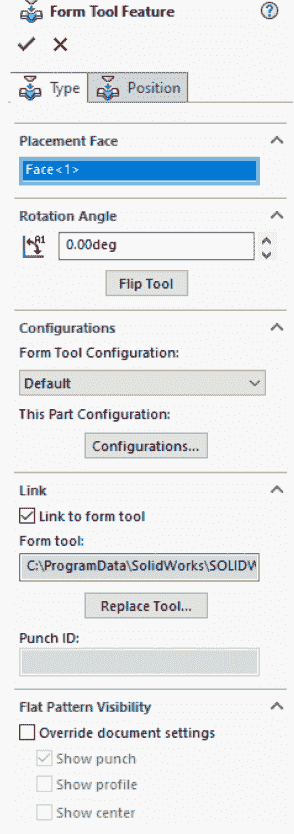

Figure 10.6: The Forming Tool Type tab

7. 现在可以使用 **Position** 选项卡来放置工具特征。选择 **Position** 选项卡，光标将变为 **Point** 工具。

与 **Hole Wizard** 类似，Forming Feature 将放置在放置 *point* 的任何位置。

**Smart Dimension** 工具也可以用来设置特征的精确位置。

8. 一旦对特征的位置和类型满意，请按绿色 **OK** 勾选标记以创建它们。

SolidWorks **Design Library** 中的基本 Forming Tools 很有用，但选择范围相当有限；因此，您很可能需要修改这些工具以满足自己的需求。在下一节中，我们将介绍如何做到这一点。

#### Modifying existing Forming Tools

SolidWorks **Toolbox** 和 **Hole Wizard** 特征都包含许多尺寸变化，因此非常有用。相比之下，SolidWorks **Design Library** 中提供的 Forming Tools 仅有非常有限的尺寸范围。然而，尽管这些工具的 *size range* 有限，但工具 *types* 却有相当多。因此，您很可能能找到一个形状或类型的 Forming Tool 与您的需求相似，然后修改其尺寸以完全满足您的要求。

要修改 Forming Tools：

1. 启动一个新的 *part* 文档并使用 **Center Rectangle** 工具创建一个固定在原点、尺寸为 50x50mm 且厚度为 1mm 的 **Base Flange**。可以使用默认的 Sheet Metal 属性。

您也可以使用上一节的模型并简单删除 Forming Tool 特征。

2. 修改 Forming Tools 的第一步是找到一个与您的需求相似的工具。例如，如果您想要一个带切口的挤出法兰，请展开 **extruded flanges** 部分并找到 **rectangular flange** 工具，如 *Figure 10.7* 所示。请记住，工具中黄色面会使钣金弯曲，而红色面会切除材料：

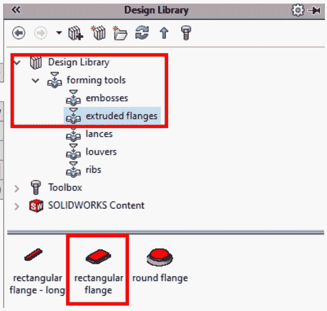

Figure 10.7: Finding an existing tool that is similar to your requirements

3. 接下来，我们需要打开工具以便修改它。在任务窗格中右键单击矩形法兰工具的预览图（见 Figure 10.7）并选择 Open。我们现在将被带到该工具的零件文档中。（注意：您可能会收到写入访问警告。可以忽略，因为我们不会覆盖原始零件文件。）零件可以像普通模型一样编辑——例如，可以通过编辑其底层草图或在图形区域中左键单击相应的特征然后双击任意尺寸并更改它来调整拉伸特征的尺寸。

4. 通过将尺寸从 30x20mm 改为 50x30mm 来调整主矩形区域（Boss-Extrude1 特征）的尺寸，如 Figure 10.8 所示。

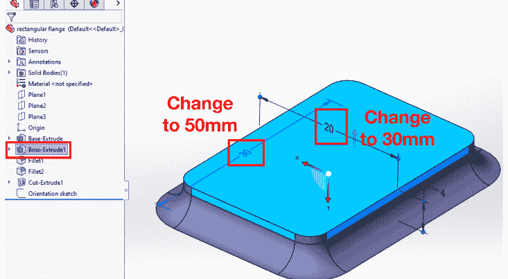

Figure 10.8: Adjusting the Forming Tool size

5. 请注意，围绕工具底部的 Fillet 不再完全绕着工具走（Figure 10.9）。此 Fillet 对于确保工具正确工作非常重要（Forming Tools 上的尖锐边缘可能会导致制造问题）：

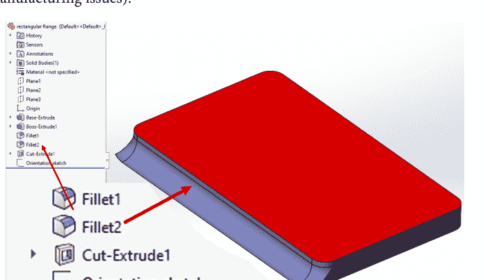

Figure 10.9: The Fillet around the bottom of the tool is no longer correct

因此，为确保此 Fillet 正确创建，请将 Base-Extrude 特征的尺寸按我们在步骤 4 中扩展工具形状的相同量进行扩展。

6. 因此，编辑 Base-Extrude 特征或草图，并在长边上增加 20mm，在短边上增加 10mm，如 Figure 10.10 所示。

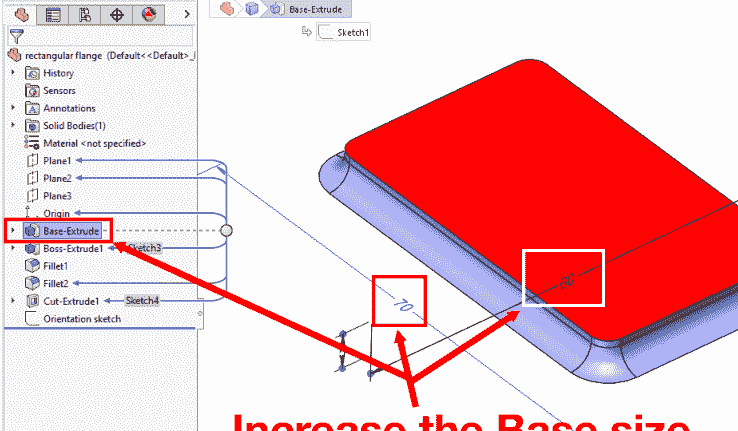

Figure 10.10: Increasing the base size

请注意，在增加底座尺寸后，Fillet 现在会正确地沿着下轮廓。

7. 我们现在可以按如下方式保存零件以供使用：

I. 选择 File | Save As...

II. 在对话框的左下角选择 Save as copy and open。

> Save As Copy
> 通过将文件另存为副本，我们保留了原始 Forming Tool 零件（矩形法兰工具），并将修改后的版本保存为全新的零件。这意味着使用原始 Forming Tool 的模型不会受到这些最新更改的影响。

III. 请注意，**Save as type** 对话框显示为 `Form Tool (*.sldftp)`。这表明文档将保存为特定的 *Form Tool Part* 文档。

IV. 保存位置应默认为 `forming tools` 文件夹中的 `extruded flanges` 子文件夹（与我们开始时使用的原始 **rectangular flange** 工具相同的位置）。通过在此文件夹中保存，*Form Tool Part* 将被识别为 Forming Tool 并会出现在 **Design Library** 中的 `forming tools` 文件夹中。

选择 **Save as copy and open**，然后使用新文件名保存修改后的 Forming Tool，例如 `Larger Rectangular Flange`。

8. 通过从 **Window** 菜单中选择它或按 *Ctrl + Tab* 键在打开的文档之间切换，返回到原始文档（**Base Flange** 钣金）。

9. 展开 **Task Pane** 并注意新的 Forming Tool——**Larger Rectangular Flange**——现在与其它 Forming Tools 一起出现，如 *Figure 10.11* 所示。此工具可以像任何其他 Forming Tool 一样拖入模型并使用：

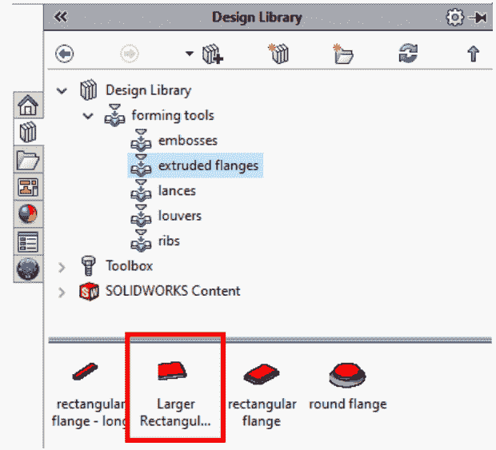

Figure 10.11: The saved Forming Tool now appears with the other tools

#### If the New Forming Tool Doesn't Appear

如果新的 *Form Tool Part* 没有与 **Design Library** 中的其他 Forming Tools 一起出现，那么它可能保存在与其它 Forming Tools 不同的位置。

这可以通过打开 *Form Tool Part*（或按 *Ctrl + Tab* 返回到文档，如果您仍将其保持打开）来修复。然后，展开 **Task Pane** 并选择 **Task Pane** 顶部 (*Figure 10.12*) 的 **Add to Library** 按钮。然后可以将零件添加到 **Design Library** 中的适当文件夹中，并像其他 Forming Tools 一样使用。

**Note:** 如果您使用此方法，则文件需要在添加到 **Design Library** 之前保存。

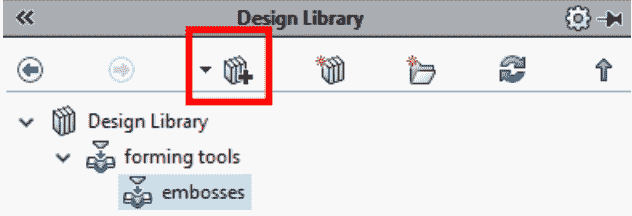

Figure 10.12: The Add to Library button

尽管 **Design Library** 中的标准 Forming Tools 在种类上相当有限，但它们可以轻松修改，使您能够根据自己的需求进行调整。在下一节中，我们将进一步探讨通过创建完全 **Custom Forming Tools** 来实现这一点。

#### Creating Custom Forming Tools

修改现有的 Forming Tools 在许多情况下可能是合适的，但有时您可能需要一个完全定制的工具。这可能是例如形状异常的压痕或通风口、产品的操作说明或标记，甚至是您公司的标志。在这些情况下，我们可以创建 Custom Forming Tools。这些工具在 SolidWorks 中制作相对简单，但请注意，在现实制造中使用 Custom Forming Tools 可能会增加零件的成本和交货时间。

要制作一个自定义成型工具，我们首先像普通的 *part* 文档一样创建一个形状，然后将其转换为成型工具并保存为适当的文档类型，具体如下：

1. 开始一个新的 *part* 文档，并在 **Top Plane** 上绘制一个底座草图。这个底座仅用于帮助工具设置，并在使用前会被从模型中切除，因此确切尺寸并不关键，但它在两个方向上都应始终大于主工具形状。

在本例中，绘制一个固定在原点的 50x50mm **Center Rectangle**。然后将其拉伸 10mm，如 *Figure 10.13* 所示。

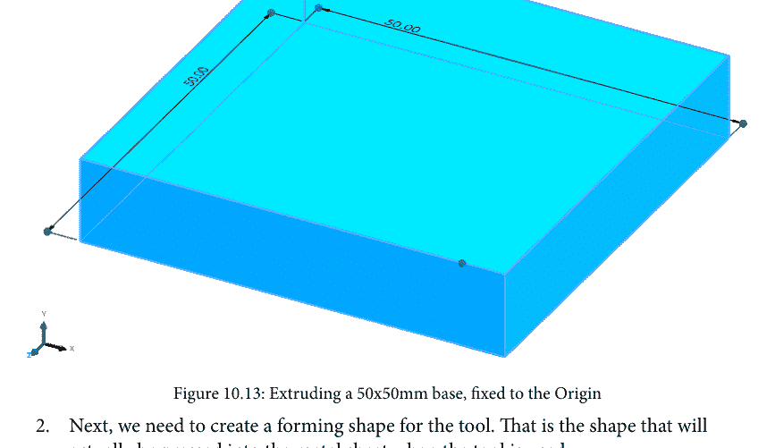

Figure 10.13: Extruding a 50x50mm base, fixed to the Origin

2. 接下来，我们需要为工具创建一个成型形状。这就是工具使用时实际压入金属板材的形状。

3. 在底座拉伸的上表面上开始一个草图，并使用 **Polygon** 工具绘制一个六边形（六边多边形），其在平边之间的尺寸为 30mm。该六边形应以原点为中心。

将六边形向上拉伸 10mm，如 *Figure 10.14* 所示。

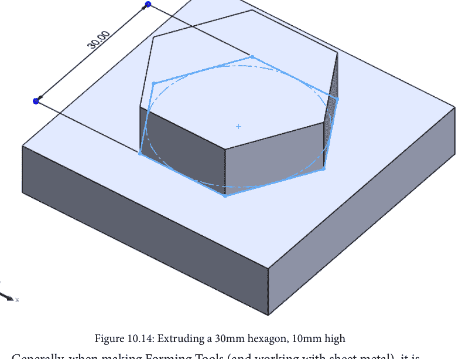

Figure 10.14: Extruding a 30mm hexagon, 10mm high

4. 通常，在制作成型工具（以及进行钣金加工）时，避免尖锐边缘是可取的。特别是对于成型工具，尖锐边缘可能会导致制造问题。

因此，使用 **Fillet** 工具首先为六边形的六个直立边缘各添加一个 5mm 的倒角。

5. 接下来，如 Figure 10.15 所示，为六边形的顶部和底部边缘各添加一个 2mm 的倒角。请注意，创建初始底座使其大于工具形状，现在可以让我们轻松添加下部倒角。如果没有底座，创建下部倒角边缘将困难得多：

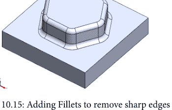

Figure 10.15: Adding Fillets to remove sharp edges

现在我们有了倒角的下边缘，就不再需要初始底座特征，因此我们可以将其切除。

6. 展开第一个 Boss-Extrude 特征并选择其下的草图。然后，使用该草图创建一个与第一个 Boss-Extrude 特征深度相同的拉伸切除（10mm），完全切除第一个 Boss-Extrude 特征，如 Figure 10.16 所示。

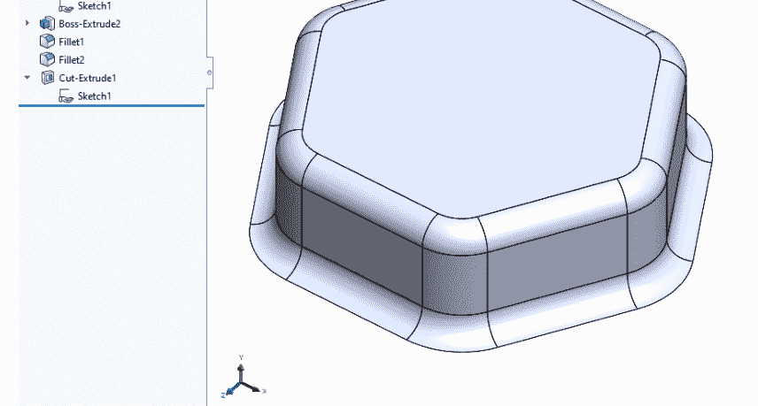

Figure 10.16: Cutting away the initial base, using the first sketch and a Cut Extrude

我们的工具几何形状现在已完成，但在将其转换为成型工具之前，我们可以添加一个 *Orientation Sketch*。该草图可在 **Flat Pattern** 版本的模型中使用，也有助于定位 *part*。

7. 在工具的下表面上开始一个草图。然后，左键单击选择整个面并按下 **Convert Entities** 工具（位于 **Sketch** 选项卡上）。这将把面的轮廓转换为新的草图实体，从而得到工具的轮廓。
8. 接下来，选择 **Point** 工具并在工具中心（与原点对齐）添加一个 *point*。这可用于帮助定位工具。

然后，退出草图。

你可以在 Figure 10.17 中看到工具的轮廓）：

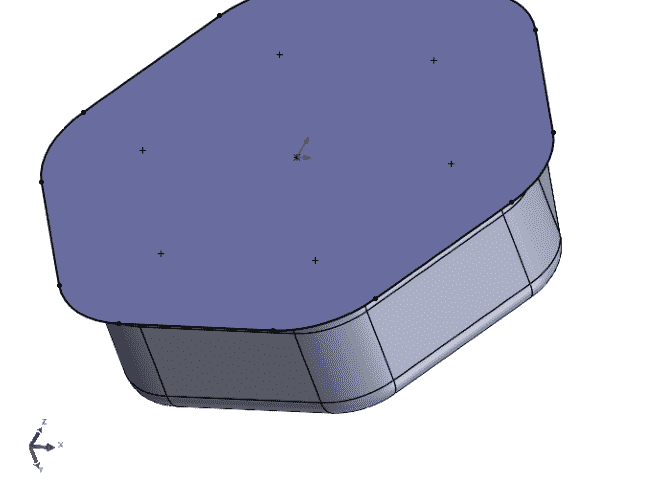

Figure 10.17: Adding an Orientation Sketch

9. 我们现在可以把 *part* 转换为成型工具。
选择 **Insert | Sheet Metal | Forming Tool**，**Form Tool Property Manager** 将打开。

10. 选择 **Stopping Face** 字段。

这是工具在插入时会在板材表面停止的面。换句话说，这是当工具处于最深点时与金属板材共面（对齐）的工具面。Figure 10.18 在另一个工具上展示了此示例：

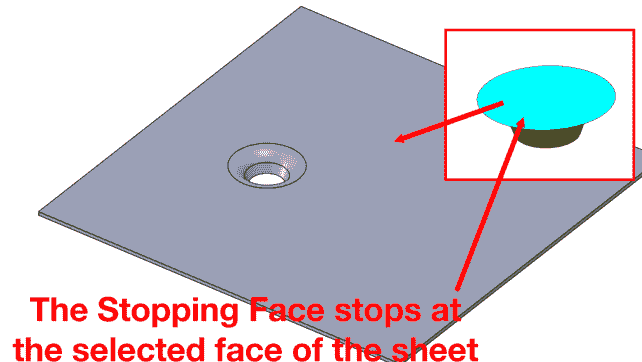

Figure 10.18: The Stopping Face

选择工具的下表面（即绘制 Orientation Sketch 的同一面）。请注意它会变为青色。

11. 接下来，可以设置 **Faces to Remove** 字段。

此选择是可选的；不必移除任何面，但在此处选择的面会变为红色，并在使用成型工具时被从板材上切除。

选择工具的上表面，如 Figure 10.19 所示。

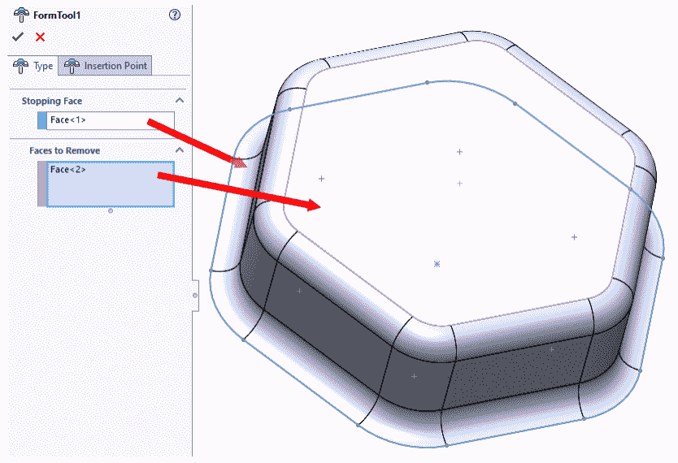

Figure 10.19: Selecting the upper face as the Face to Remove

请注意，面也可以被分割成更小的面（通过在要分割的区域上绘制草图实体，例如线条和圆圈，然后使用 Split Line 工具），如果您只想切除平面的某些部分，而不是整个面。

12. 最后，我们可以通过在 Property Manager 中选择该选项卡，然后从 Orientation Sketch 中选择该点（或原点；两者应在同一位置）来设置插入点字段。

13. 按下绿色的 OK 勾选标记以创建 Form Tool 特征（Figure 10.20）。请注意，该特征会出现在 FeatureManager 设计树中，图形区域中的工具现在已进行颜色编码。如前所述，黄色表示弯曲面，红色表示将被移除的面，青色（下方）显示停止面：

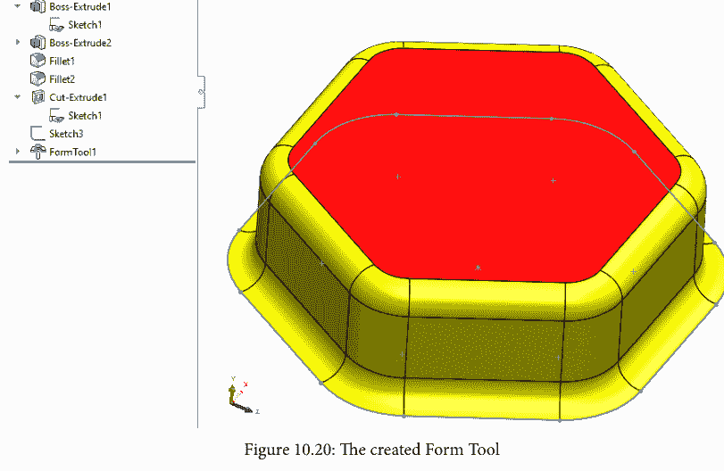

Figure 10.20: The created Form Tool

14. 在使用之前，必须保存成型工具。有两种主要方法可以做到这一点，如下所述：

- Save as a part document: 文档可以保存为标准零件文件（扩展名为 *.SLDPRT）。如果零件保存在成型工具文件夹中，则 SolidWorks 将将其识别为成型工具，即使它保存为标准零件文件。如果文件保存在其他位置，则 SolidWorks 不会将该零件识别为成型工具。
- Save as a Forming Tool document: 或者，模型可以保存为特定的成型工具文件（扩展名为 *.SLDFTP）。在这种情况下，文件可以保存在任何位置，SolidWorks 仍会将其识别为成型工具。

#### Forming Tool or Part Document?

成型工具可以保存为两种文件类型中的任何一种，如前所述。两者之间的区别主要在于文件组织。如果您希望将特定项目的全部文件保存在同一位置，那么最好将工具保存为成型工具文档（*.SLDFTP），但如果成型工具是通用工具，将在多个项目中使用，那么您可能更喜欢将其直接保存为普通零件文件到设计库中。

通过转到 File | Save As.... 来保存工具文件。

文档类型可以通过在文件名正下方的 Save as type 下拉菜单中进行选择来设置。

在本例中，将工具保存为标准 SolidWorks 零件，并保存在成型工具文件夹中。（默认位置为 C:\ProgramData\SolidWorks\SolidWorks 20xx\Design Library\Forming Tools。）

15. 保存后，在屏幕右侧的任务窗格中打开设计库，并检查您的新工具是否与其它成型工具一起出现。现在它可以像标准成型工具一样被拖入模型并使用。

如果工具未出现，您可能需要使用 Add to library 按钮将其添加到设计库中，如 Modifying existing forming tools 部分末尾的信息框中所述。

#### Forming Tool Not Working Correctly?

如果发现新的成型工具无法正常工作，请尝试检查角落是否已倒圆。尖锐的角有时会导致成型工具出现错误。

本节展示了如何创建完全自定义的成型工具，而不仅仅是修改现有模型。这极大地扩展了您可以使用压痕和切口的范围。

#### Summary

在本章中，我们研究了如何使用 **Design Library** 中的成型工具为钣金模型添加 3D 细节。我们还探讨了如何修改现有工具以满足自己的需求，以及如何创建完全自定义的成型工具。这使得可以使用几乎无限多种成型工具形状和尺寸。

在下一章中，我们将学习如何使用 **Insert Bends** 工具将现有 3D 模型转换为钣金模型。

## Section 3:
将 3D 零件
转换为钣金并
创建钣金外壳

除了从头创建钣金模型外，我们还可以将现有的 3D 设计转换为钣金模型。本节展示了两种不同的做法，并提供了一个实践示例，将本书中迄今为止学到的许多技能结合起来。

本节包含以下章节：

- Chapter 11, Converting to Sheet Metal Using the Insert Bends Tool
- Chapter 12, Building Sheet Metal Parts Using the Convert to Sheet Metal Tool
- Chapter 13, Practical Example: The Sheet Metal Enclosure
