### 12
Building Sheet Metal
Parts Using the
Convert to Sheet
Metal Tool

**Convert to Sheet Metal** 工具可用于将现有的 Solid 模型转换为钣金 *零件*。当这些模型没有恒定壁厚时尤其有用。该工具功能相当多样，具有许多选项，在此详细解释。

在本章中我们将涵盖以下主要主题：

- 使用 **Convert to Sheet Metal** 工具
- **Convert to Sheet Metal** – Advanced Options
- Solving conversion issues

#### Using the Convert to Sheet Metal tool

**Convert to Sheet Metal** 工具与我们在上一章介绍的 **Insert Bends** 工具相当相似，因为它可用于将预先存在的实体模型转换为钣金模型。它与 **Insert Bends** 工具的不同之处在于它可用于完全实体的体，而不是具有规则壁厚的体。如果你收到了来自使用不同 CAD 系统的外部客户或合作伙伴的模型，这可以节省大量时间。

为了演示如何使用该工具，首先，我们将创建一个简单的实体形状：

- 1. 启动一个新的 SolidWorks *零件* 文档并在前平面上绘制 *Figure 12.1* 中所示的轮廓。

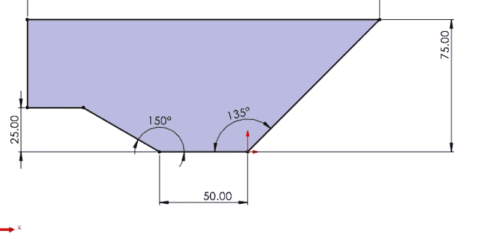

Figure 12.1: Sketch a closed profile

2. 使用 **Extruded Boss/Base** 和 **Mid Plane** End Condition 将形状挤出 75mm（Figure 12.2）。

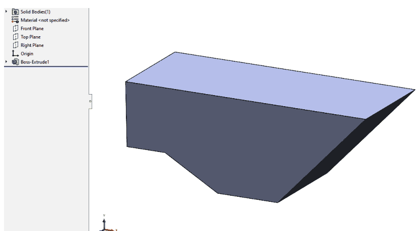

Figure 12.2: Extrude the sketch

3. 选择 **Convert to Sheet Metal** 工具。Property Manager 中现在会出现大量选项。

4. 工作流程与上一章的 Insert Bends 工具相当相似。首先，我们需要设置将用于钣金零件的参数，然后选择一个 Fixed Face（Figure 12.3）。

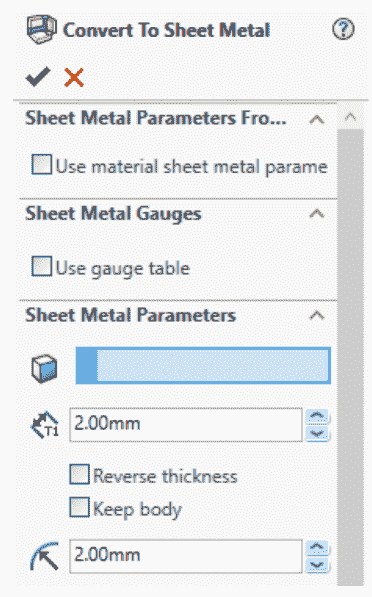

Figure 12.3: Setting the Sheet Metal parameters

5. 将 Thickness 设置为 2mm（Gauge Tables 也可通过勾选 Use gauge table 框使用）并将 Bend Radius 设置为 2mm。保持 Reverse thickness 和 Keep body 框未选中。

6. 接下来，选择 Fixed Entity。这将是模型在展开时不移动的面或边。可以将其视为与普通钣金零件中的 Base Flange 类似。

7. 旋转模型并选择最低的底部面作为 Fixed Entity（Figure 12.4）。

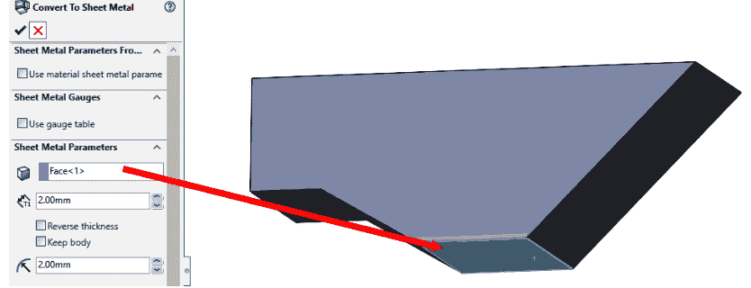

Figure 12.4: Select the Fixed Entity

8. 接下来，我们必须选择想要添加弯折的边。点击 Bend Edges 选择框，然后选择 Figure 12.5 中显示的两个边。

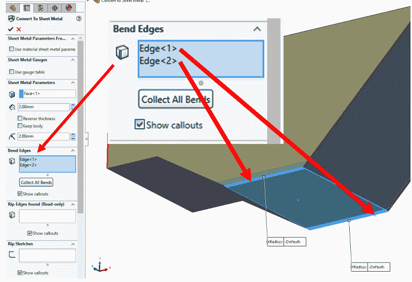

Figure 12.5: Select the edges to bend

9. 现在通过按下绿色的 **OK** 勾选标记创建 **Convert to Sheet Metal** 特征。

10. 我们可以看到实体已转换为厚度为 2mm 的钣金 *零件*，我们在 *步骤 4* 中设置。2mm 弯折已添加到两个选定的边上。此外，请注意与未选中的边相连的所有面都已从模型中移除（*Figure 12.6*）。

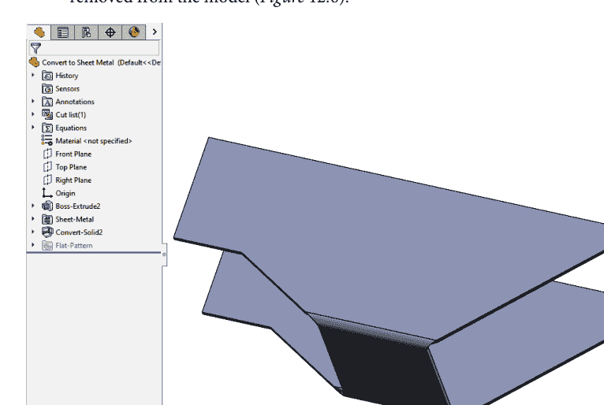

Figure 12.6: The converted part

11. 屏幕左侧的 FeatureManager Design Tree 现在包括 **Sheet-Metal** 和 **Flat-Pattern** 文件夹，表明此 *零件* 是钣金模型。它还包含 **Convert-Solid** 特征本身。点击 **Convert-Solid** 并选择 **Edit Feature** 编辑特征。

12. 我们现在将添加进一步的 Bend Edges 并查看 Rip Edges 如何使用。保留两个现有的 Bend Edges 并添加第三个边，如 Figure 12.7 所示。

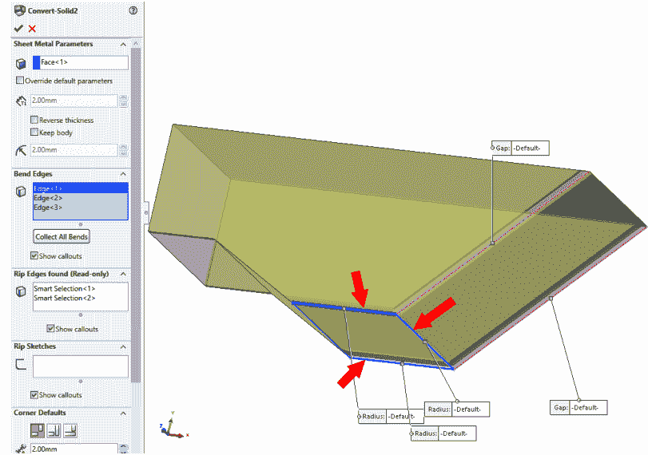

Figure 12.7: Select a third Bend Edge

13. 请注意 Rip Edges 选择框现在已被 Figure 12.7 中以粉红色突出显示的两个边自动填充。此选择是自动的，因为如果我们在所选的三个位置创建弯折，则粉红色边必须被撕裂，否则弯折面将无法平展折叠。

14. 按下绿色的 **OK** 勾选标记以更新特征，并注意 Sheet Metal 模型现在包含了我们所选的第三个弯折相关的额外面（*Figure 12.8*）。步骤 10 中的粉红色边缘也已被撕裂，即它们之间有一个小间隙。

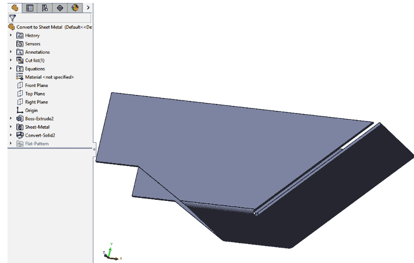

Figure 12.8: Update the feature with the third bend

根据我们选择的 **Bend Edges** 不同，我们可能会创建外观相似但底面图完全不同的 3D 模型。在选择弯折之前，通常值得先思考模型想要实现的目标。

举例说明：

- 1. 再次编辑 **Convert Solid** 特征，使我们回到该工具的 Property Manager 中。
- 2. 清除 **Bend Edges** 选择框中的所有选择，并选择 *Figure 12.9* 中显示的三个边缘。

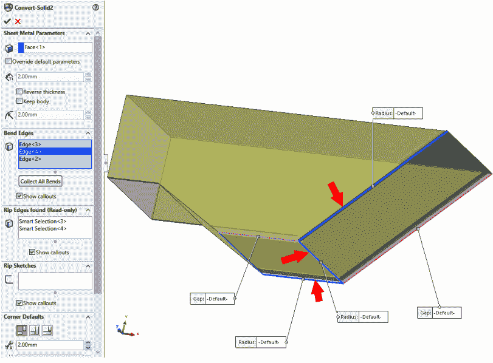

Figure 12.9: Edit the feature and change the Bend Edges

3. 按下 OK 以接受更改。我们现在可以看到，尽管这个新形状和图 12.8 中的形状在 3D 中看起来非常相似，但当展开时 Flattened 它们完全不同（图 12.10）。

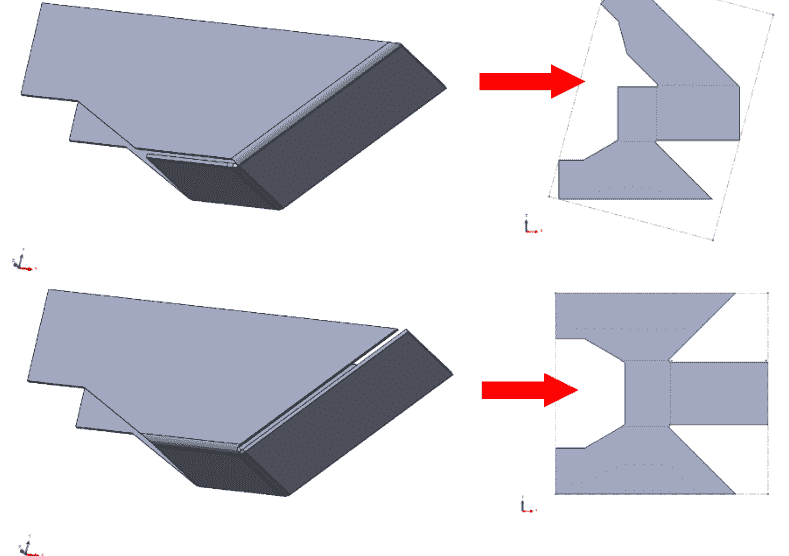

Figure 12.10: Different Bend Edge selections can give very variable results.

使用 **Convert to Sheet Metal** 工具时一个最后的重要方面是弯折必须按顺序选择：

- 1. 再次编辑 **Convert Solid** 特征，使我们回到该工具的 Property Manager 中。
- 2. 清除 **Bend Edges** 选择框中的所有选择。然后按 *Figure 12.11* 所示的顺序选择五个边缘。如果尝试选择未连接到 Fixed Face 的边缘（例如，如果在选择边缘 3 之前尝试选择边缘 4），则会弹出警告；边缘必须按正确顺序选择，以便它们连接到 Fixed Face。
- 3. 选择边缘 5 后，注意 **Rip Edges** 会自动出现在右上角边缘。

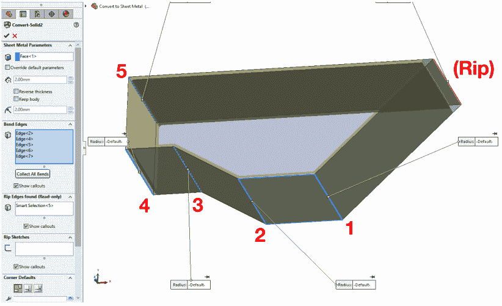

Figure 12.11: Select the five Bend Edges shown

4. 选择图 12.12 中显示的另外两个边缘，并注意 Rip Edges 会自动应用于形状的大面的四周。

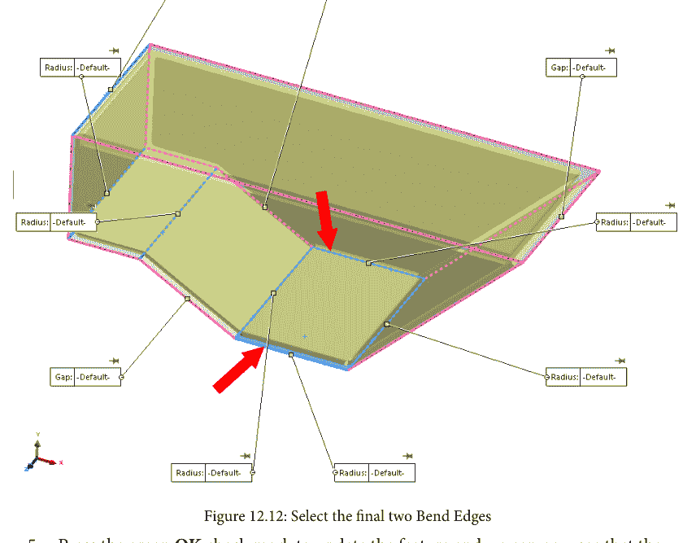

Figure 12.12: Select the final two Bend Edges

5. 按下绿色的 OK 勾选标记以更新特征，我们现在可以看到整个形状已被转换为 Sheet Metal 零件。这在图 12.13 中以展开和未展开状态显示。

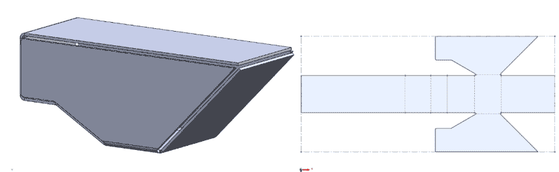

Figure 12.13: The completed part

本节展示了如何使用 Convert to Sheet Metal 工具的基本功能，但还有许多更高级的设置可以用来微调 Sheet Metal 形状。

#### Convert to Sheet Metal – Advanced Options

现在我们了解了如何使用 Convert to Sheet Metal 工具，让我们更详细地查看 Reverse Thickness、Keep Body、Manual Rip Sketches 和 Corner Defaults 选项。

#### Reverse Thickness option

此设置允许反转新创建的板材的方向：

- 1. 继续上节，重新编辑 Convert Solid 特征，以便我们回到该工具的 Property Manager 中。
- 2. 我们现在可以在 Sheet Metal Parameters 下看到两个选项 – Reverse thickness 和 Keep body（图 12.14）。

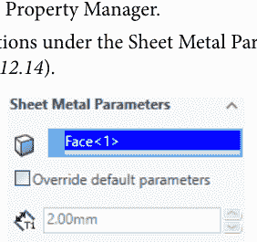

Figure 12.14: The Sheet Metal Parameters

- 3. 在 **Reverse thickness** 框中打勾并仔细观察图形区域中的预览。你应该会看到预览零件的尺寸略微增大，以便新添加的板材位于原始形状的 *外部*，而不是完全包含在其中。尝试反复切换 **Reverse thickness** 选项以更仔细地观察变化。
- 4. 选择 **Reverse thickness** 选项（在框中打勾），然后按 **OK** 接受更改。如果我们现在测量 *零件* 的外部尺寸，可以看到它为 79mm。这是原始形状的尺寸（75mm），加上两侧每个额外的外板厚度（各 2mm）。
- 5. **Reverse thickness** 选项是一个非常简单的设置，但在模型内部尺寸很重要时可能非常有用。

#### The Keep body option

通常当实体体转换为 Sheet Metal 时，原始实体体会被 **Convert to Sheet Metal** 特征消耗掉（用完）。然而，可能存在我们想要保留原始体的情况。例如，我们可能希望重用它来创建另一张板：

- 1. 继续上小节，重新编辑 **Convert Solid** 特征，以便我们回到该工具的 Property Manager 中。
- 2. 选择 **Keep body** 选项（*Figure 12.14*）。
- 3. 按 **OK** 接受更改。我们现在可以看到新的 Sheet Metal 特征已被添加，但原始体仍然保留在模型中（*Figure 12.15*）。如果你仍然选择了 **Reverse thickness** 选项，那么我们还会看到 Sheet Metal 特征比原始体更大。

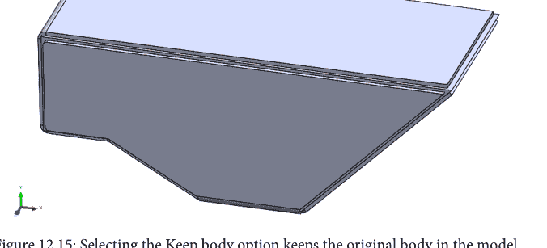

我们还可以看到 FeatureManager 设计树中的 Cut list 文件夹（图 12.16）后面现在跟着一个 (2)。这表明当前模型中有两个板或体。展开文件夹可以逐一查看它们，并可以通过选择项目并点击 Show 或 Hide 来显示或隐藏。

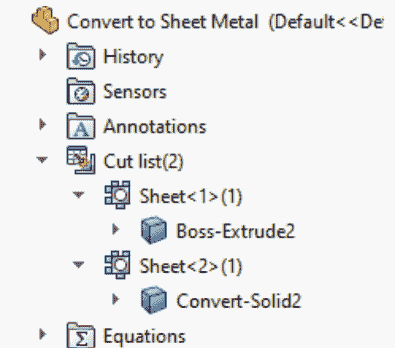

Figure 12.16: The Cut list folder displays sheets and bodies in a model

- 4. Keep body 选项在你想用单个体创建两个或多个板时尤其有用。
- 5. 继续上小节，重新编辑 Convert Solid 特征，以便我们回到该工具的 Property Manager 中。

6. 确保 Keep body 和 Reverse thickness 选项仍然都已选择，但调整 Bend Edges 仅选择图 12.17 中显示的五个边缘。

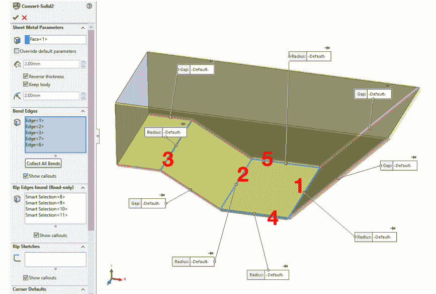

Figure 12.17: Select the Bend Edges shown

7. 按 OK 接受更改。现在我们可以看到我们有一个没有顶部和左侧边缘的 Sheet Metal 板，我们还有原始实体体（图 12.18）。

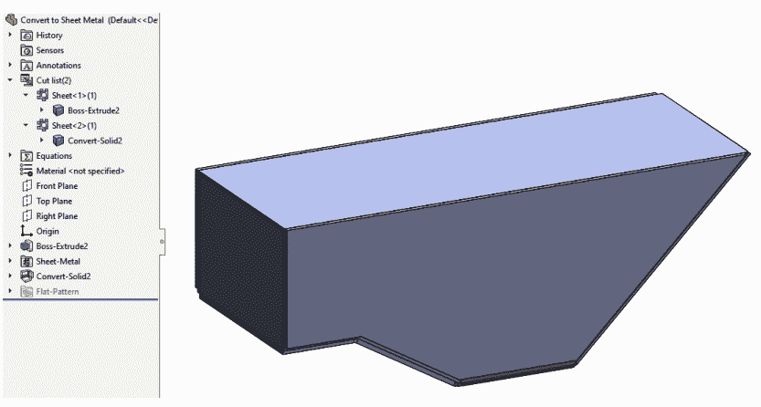

Figure 12.18: The sheet and original body

8. 我们现在可以重用实体体来创建第二张板。再次选择 Convert to Sheet Metal 工具。

9. 这次选择原始体的上表面作为 Fixed Face，并选择图 12.19 中显示的上边缘作为 Bend Line。

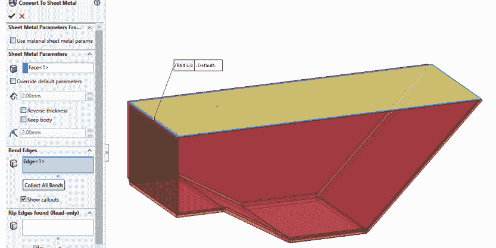

Figure 12.19: Select the upper face and the edge

10. 取消选择 **Keep body** 选项，因为我们不再需要保留该体。还取消选择 **Reverse thickness** 选项。这意味着这张新板将位于第一张板内部，这是一个很好的例子，说明为什么 **Reverse thickness** 对于创建正确配合的多板 *零件* 很有用。

11. 按 **OK** 创建第二张板。*Figure 12.20* 显示了两张板在爆炸视图中的样子，并展示了 **Keep body** 如何与单个实体模型一起使用以创建具有多张板的 *零件*。

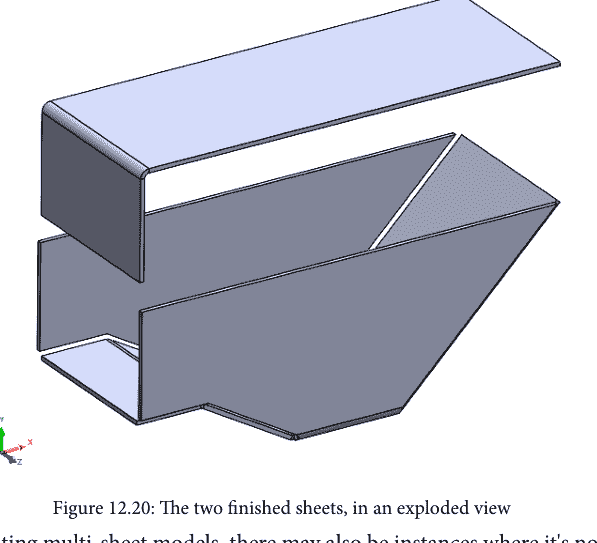

Figure 12.20: The two finished sheets, in an exploded view

除了创建多板模型外，可能还有一些情况不希望在现有边缘处创建撕裂。在这些情况下，可以使用手动 **Rip Lines**。

#### Manual Rip Lines

到目前为止，我们只使用了转换到 Sheet Metal 时自动分配的 Rip Lines。然而，可能有时候我们需要指定面将通过撕裂分开的确切位置：

- 1. 继续上小节，但删除两个现有的 **Convert Solid** 特征和 **Sheet-Metal folder**，以便我们模型中只剩下第一个 **Boss-Extrude**。
- 2. 手动 **Rip Lines** 必须在 **Convert to Sheet Metal** 特征 *之前* 绘制。在本例中，我们删除了之前的 **Convert to Sheet Metal** 特征，但也可以在模型中将 **Rollback Bar** 拖到 **Convert-Solid** 特征上方并在此阶段添加草图。
- 3. 现在使用 **Line Tool** 绘制 **Rip Lines**。对于本示例，在形状的大上表面上开始草图，并在长边缘的中点之间直接画一条线（*Figure 12.21*）。然后退出草图。

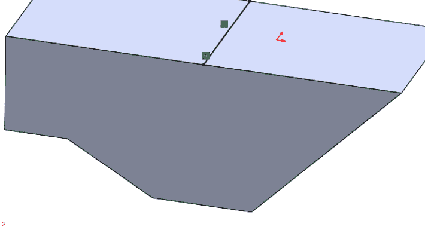

Figure 12.21: Sketch the Rip Line

4. 我们现在可以添加本章前面介绍过的 **Convert to Sheet Metal** 功能。选择 **Convert to Sheet Metal** 工具，然后选择底面作为 **Fixed Face**，然后选择图 12.22 所示的 **Bend Edges**。

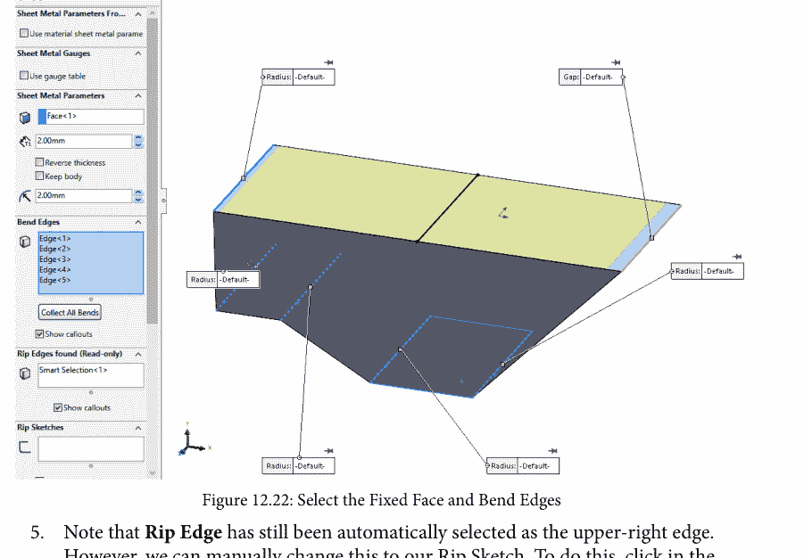

Figure 12.22: Select the Fixed Face and Bend Edges

5. 请注意，**Rip Edge** 仍然被自动选为右上角边缘。然而，我们可以手动将其更改为我们的 Rip Sketch。要做到这一点，请在 Property Manager 中的 **Rip Sketches** 选择框中单击，然后选择我们在步骤 3 中绘制的 Rip Sketch（图 12.23）。

如果您在 Graphics Area 中选择实际线条时遇到困难，则可以更容易地展开 Graphics Area 左上角的第二个 Design Tree，并在其中选择整个草图。

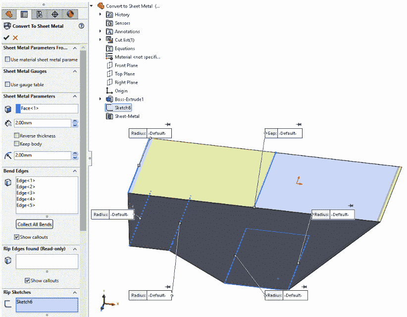

Figure 12.23: Select the Rip Sketch

6. 我们现在可以看到，上表面将沿着 Rip Sketch 被撕开，并且右上角边缘不再被选中用于折弯。

将右上角边缘添加到 Bend Edges。

7. 按 **OK** 创建该特征并注意 **Rip Line** 位于顶部边缘的中间位置（图 12.24）。

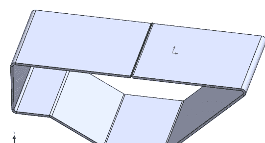

Figure 12.24: The finished model with a manual rip

这种添加手动 Rip Lines 的方法对于精确指定实体零件将如何创建非常有用。还可以更改许多较小的撕裂细节。

#### Adjusting rip and corner details

可以在 **Convert-Solid** 特征的 Property Manager 中进一步指定撕裂细节（图 12.25）。在这里，可以更改角部的样式（**Butt**、**Underlap** 或 **Overlap**），调整 **Gap Distance**，并调整 **Overlap/Underlap Ratios**。

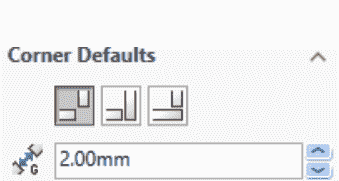

Figure 12.25: Corner Defaults

也可以通过在 Graphics Area 中选择它们并进行所需的更改来单独调整每个折弯和撕裂的细节。

使用 **Convert to Sheet Metal** 工具创建钣金模型时，有时会不小心创建出有问题的特征。在下一节中，我们将看一个这样的例子以及如何克服它。

#### Solving conversion issues

当从 Base Flange 开始创建标准钣金模型时，通常很难创建具有展平问题的新的凸缘，因为 SolidWorks 通常会自动修剪掉有问题区域。然而，有时将模型转换为钣金时，这些展平问题会无意中发生。我们可以强制 SolidWorks 创建其中一个问题，作为避免它的示例：

- 1. 继续上一节的操作，再次编辑 Convert Solid 特征，以便我们回到该工具的 Property Manager 中。
- 2. 将 Fixed Face 从小的底面更改为大的侧面（图 12.26）。然后移除任何现有的 Bend Edges（这将自动移除任何 Rip Edges，如果没有则手动删除这些），然后仅添加所示的三个 Bend Edges。

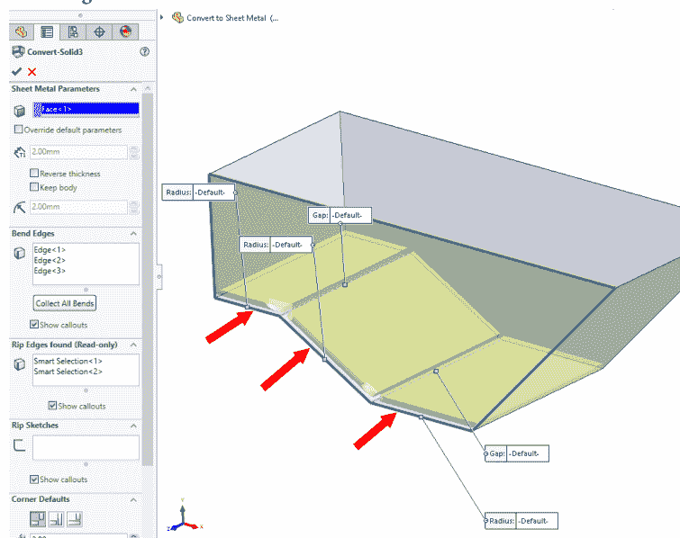

Figure 12.26: Adjust the Convert Solid feature

- 3. 按 OK 更新特征。

4. 如果我们现在旋转模型，可以看到在 3D 中一切看起来都正确，没有任何错误可见。然而，如果我们尝试通过按 Flatten 按钮来展平模型，我们现在可以看到其中两个凸缘占据相同的位置（图 12.27）。

> Note
> 根据您的 SolidWorks 版本，您的模型可能无法展平，而是可能显示错误。

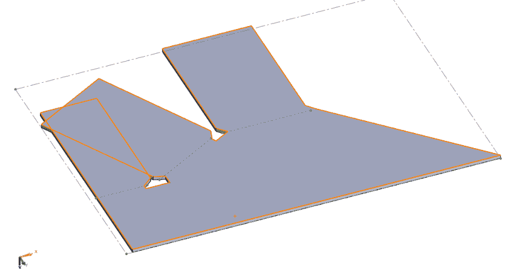

Figure 12.27: Two of the flattened flanges occupy the same space

在现实生活中不可能制造出这种模型（按其当前状态），因为它的两个不同部分不能来自同一块平板。这并不一定意味着整体零件无法制造，只是我们可能需要以稍微不同的方式创建它，也许通过调整折弯的位置。

#### If Your Model Does Not Flatten

如果您发现模型无法正确 **Flatten**，请展开 **Flat-Pattern** 文件夹并查找任何错误或警告消息。这将指示哪些特征存在需要修复的问题。如果没有可见错误但模型仍然无法 **Flatten**，则尝试逐一抑制之前的特征，然后，如果您的模型在缩小到单个问题区域之前无法 **Flatten**。

SolidWorks 以及 3D CAD 的一个局限性是，有时可以使用计算机创建的模型在现实生活中无法实际制造。在建模时，始终尝试考虑零件的实际制造方式，这可以帮助减少此类问题。

#### Summary

在本章中，我们使用 **Convert to Sheet Metal** 工具将 3D 模型转换为钣金 *parts*。我们探索了许多子选项，并简要讨论了可能出现的错误以及如何修复它们。**Convert to Sheet Metal** 工具是将预先存在的模型快速更改为钣金格式以节省时间的绝佳选择。

在下一章中，我们将把我们在前几章中学到的许多技术结合起来，并用它们创建一个钣金外壳。
