### 13
Practical Example:
The Sheet Metal
Enclosure

钣金外壳在电子行业很常见。本章展示了如何使用我们学到的各种钣金技术来创建示例外壳，以及在实际建模中提供有用的技巧和窍门。本章将涵盖以下主要主题：

- - Creating the enclosure base
- - Adding more details to the enclosure
- - Creating an enclosure lid
- - Adding final details to the enclosure

这些部分将展示如何使用各种钣金工具构建完整的项目。到本章结束时，您将了解 SolidWorks 钣金如何在真实设计情况下使用。

#### Creating the enclosure base

我们的示例外壳将由两个组件组成——*base* 和 *lid*——都在同一个 SolidWorks *part* 文件中制作。这些将作为 *part* 文件中的单独板件制作，从底板开始。

在本章中，给出的说明更像是一个指南而不是硬性参数，因此请随意根据需要尝试不同的尺寸和特征。

要创建底座，请按照以下步骤操作：

- 1. 启动新的 SolidWorks *part* 文档。
- 2. 首先，我们将绘制 **Base Flange** 轮廓。在 Top Plane 上开始一个草图并绘制一个 350x600mm 的矩形，如图 13.1 所示：

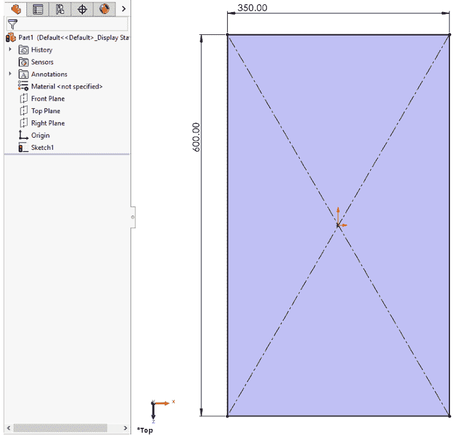

Figure 13.1 – Sketching a rectangle for the Base Flange profile

**Sketching Tip!**
请记住始终通过使用 Smart Dimensions 和 Relations 完全定义您的草图。

在这种情况下，我建议使用 **Center Rectangle** 工具并从 Origin 开始。这将使 Front 和 Right Planes 位于 **Base Flange** 的中心。这对于在 *assemblies* 中添加 Mates 以及在 *part* 中使用 **Mirror** 特征非常有用。

3. 在矩形草图内，选择 **Base Flange/Tab** 选项以创建第一个钣金特征。

在我的示例中，我将 **Sheet Thickness** 属性设置为 2mm，并将 **Bend Allowance** 属性设置为 K-Factor 为 0.5。

**Note**
**Sheet thickness selection**
钣金零件的厚度取决于您的具体需求以及它们的制造和用途。较薄的板厚会产生更轻（更便宜！）的零件，但如果您创建大型零件，则薄板可能缺乏刚性。
**Bend Allowance selections**
在 *Chapter 1, Sheet Metal Basics – Exploring Sheet Metal Properties and Material Selection* 中，我们详细讨论了不同类型的 Bend Allowance，但如果您不确定使用哪种 Bend Allowance 类型，则通常最安全的做法是设置 K-Factor 为 0.5。
您也可以考虑直接向制造合作伙伴寻求建议。

接下来，我们可以通过添加一些墙壁来构建外壳底座。我们可以使用简单的 **Edge Flange** 特征，但在我的示例中，我将使用 **Miter Flange** 特征。

**The Advantages of Using a Miter Flange Feature**
**Miter Flange** 特征允许您仅使用一个特征创建更复杂的凸缘形状，而不是使用多个 **Edge Flange** 特征来构建相同的轮廓。**Miter Flange** 特征还将自动倒角任何角部（修剪以使其正确配合），而并非所有 **Edge Flange** 类型都会执行此操作。

4. 在底座法兰的小端面上开始一个草图，并使用直线工具绘制图 13.2 所示的轮廓。垂直线长 75mm，小水平线长 10mm：

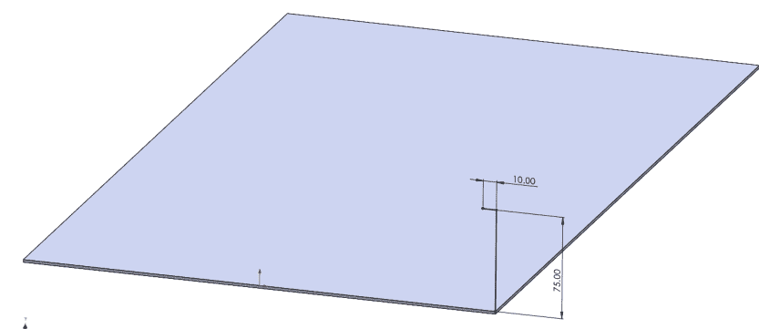

图 13.2 – 绘制斜切法兰轮廓

5. 草图轮廓现在可用于创建法兰。选择斜切法兰工具（在草图内）。然后，选择底座法兰的四个边（图 13.3）：

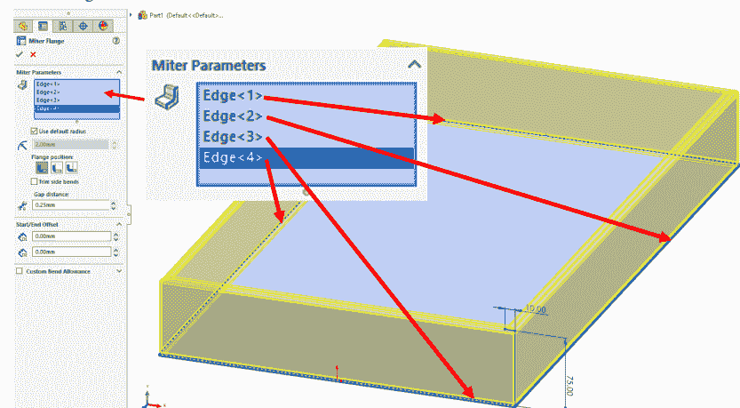

图 13.3 – 创建斜切法兰

请注意，法兰的角部已进行斜切，以便正确配合。法兰轮廓的方形角也已使用模型的弯曲半径进行倒圆。

#### 设置或更改弯曲半径

默认弯曲半径适用于板金模型中的所有弯曲（除非对特定特征进行覆盖）。弯曲半径值是在创建第一个板金特征时自动设置的，但可以通过编辑 FeatureManager 设计树中的 Sheet 文件夹来调整。

从实际角度来看，弯曲半径取决于多个因素，主要取决于被弯曲的板材厚度（以及材料类型和实际使用的弯曲工艺）。尝试咨询您的制造商或在线搜索典型的弯曲半径值。

- 6. 根据您的偏好设置斜切法兰参数，然后按 OK 创建该特征。

我们现在可以看到，我们仅使用两个特征就创建了一个简单的外壳底座。如果我们使用边法兰，则需要更多特征来构建法兰形状（尤其是如果我们添加了更多悬挑或其他细节）。

- 7. 通过按 Ctrl + S 键、单击保存图标或转到 文件 | 另存为... 来保存您的零件。

#### 在 SolidWorks 中保存

请养成定期保存模型的习惯，因为 SolidWorks 在使用过程中偶尔会崩溃。

我们现在已经创建了一个简单的外壳底座，在下一节中，我们将在此基础上添加更多特征。

#### 为外壳添加更多细节

现在我们有了外壳底座的基本结构，我们可以开始添加一些更多特征来扩展其功能。我们将首先在底座的前面上添加一些圆形切口。这些孔可能是用于 LED 指示灯、电缆，甚至可能是通风。

在 SolidWorks 板金中，我们可以制作圆形切口主要有三种方法：

- **简单孔**：此工具允许在板材上切割基本圆形。圆的直径使用工具的属性管理器指定，但此工具是三个选项中最不实用的，因为随后需要编辑该特征的草图来指定孔的确切位置。因此，使用另外两个选项之一通常同样快捷。
- **拉伸切除**：此选项可与 **圆** 工具一起使用来制作圆形孔，但在创建非圆形切口时更有用。这将在本节后面创建矩形开口时详细介绍。
- **孔向导**：孔向导通常是创建圆形孔的最佳选择，因为它允许从一系列预设尺寸或使用自定义参数指定确切的孔尺寸和类型。然后可以快速添加多个孔，并且在后续阶段对其进行定位和编辑非常容易。

在上述三个选项中，孔向导通常最适合创建圆形孔，而拉伸切除最适合非圆形切口。简单孔是最不实用的选项。

继续使用上一节中的底座外壳模型，我们现在可以使用孔向导切割一些孔，然后在本节后面使用拉伸切除制作矩形切口：

- 1. 选择 **孔向导** 工具。此工具可在 **特征** 选项卡上找到。
- 2. 首先，设置孔类型和尺寸。有许多选项可供选择，但对于简单的圆形孔，一个不错的选择是 **孔** 类型（右上角按钮 – 见图 13.4）和 **销孔** 子类型（从下拉菜单中选择）。然后可以从一系列预设尺寸中选择孔直径，或通过在 **显示自定义尺寸** 框中打勾然后添加值来输入确切尺寸。

在本例中，我创建了一个直径为 20mm 的孔：

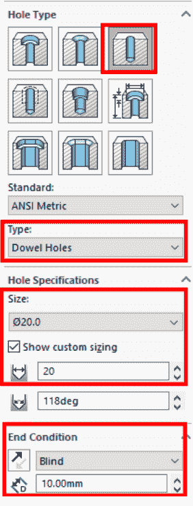

图 13.4 – 设置孔类型和尺寸

在此阶段，我们还可以将端部条件设置为盲孔，深度为 10mm。这将防止孔完全穿透外壳的前后两个面。

3. 现在孔的细节已指定，我们可以设置其位置。选择孔向导属性管理器顶部的 **位置** 选项卡，然后选择将添加孔的面。在我们的示例中，这将是外壳的前面。

光标将变为 **点** 工具，孔将在添加点的任何位置放置。向前面添加两个孔，如图 13.5 所示：

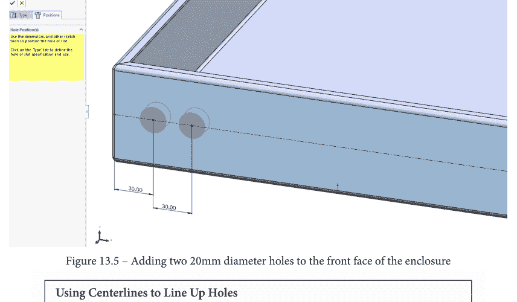

图 13.5 – 在外壳前表面添加两个直径 20mm 的孔

> **使用中心线对齐孔**
> 使用孔向导（和其他基于草图的特征）时，中心线非常有用。在图 13.5 所示的示例中，在前面垂直边的两个中点之间添加了一条中心线。这样，孔就可以沿着面的垂直中心对齐。

4. 使用智能尺寸、关系和中心线（如果需要）完全定义孔的位置，然后按 **OK** 添加孔。

#### 设计意图：在尺寸标注时，以及将孔放置在边缘和弯曲处附近

在 SolidWorks 中标注尺寸时，始终考虑您的设计意图。例如，在图 13.6 中，考虑我们如何标注这两个孔的尺寸。

如果两个孔都从外壳的左侧边缘标注尺寸（图 13.6 – 左），然后更改第一个孔的位置，则第二个孔的位置不受影响。

然而，如果孔相对于彼此标注尺寸（图 13.6 – 右），然后更改第一个孔的位置，则第二个孔也会移动。

您标注特征和草图的确切方式将取决于您的设计要求，但在建模时请记住这一点。

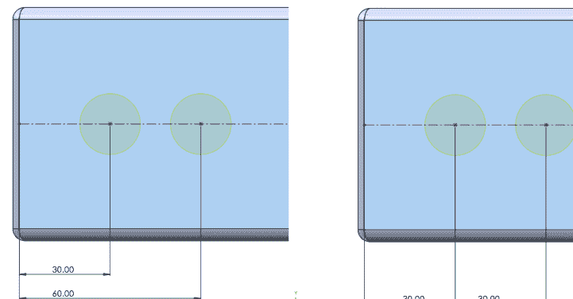

图 13.6 – 尺寸标注时的设计意图

5. 在添加了前两个孔之后，我们现在可以创建一个矩形切口。这可能用于容纳诸如 USB 端口之类的东西。在制作这些非圆形形状时，通常最好使用拉伸切除选项。

首先，在前面开始一个草图，然后绘制切口轮廓，如图 13.7 所示。

这是使用 **中心矩形** 和 **草图倒角** 来圆角化角部制作的。再次，中心线对于将草图实体与诸如两个孔之类的其他元素对齐非常有用。

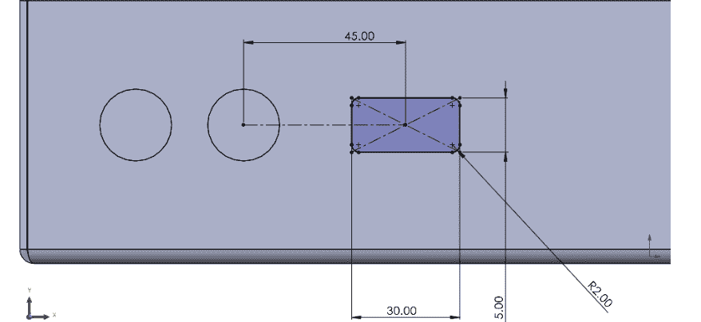

图 13.7 – 在前面绘制切口轮廓

#### 使用外部引用

如果您正在创建使用现有组件的设计，那么创建一个包含所有零件的 SolidWorks 装配体，然后在装配体内编辑新零件会很有用。

例如，如果此外壳设计有一个相关的 PCB 模型，那么我们可以创建一个包含外壳和 PCB 文件的装配体。然后，我们可以在装配体内编辑外壳零件，并使用 PCB 零件来对齐任何切口或其他细节。这意味着如果 PCB 零件以后发生变化，则外壳零件将自动更新以匹配这些变化。

6. 我们现在可以使用圆角矩形轮廓来创建切口。从草图内部选择 **Extruded Cut** 工具。

在 Property Manager 中选择 **Link to thickness** 选项。这意味着轮廓将仅穿过所选面进行切割。

7. 按 **OK** 创建切口（图 13.8）：

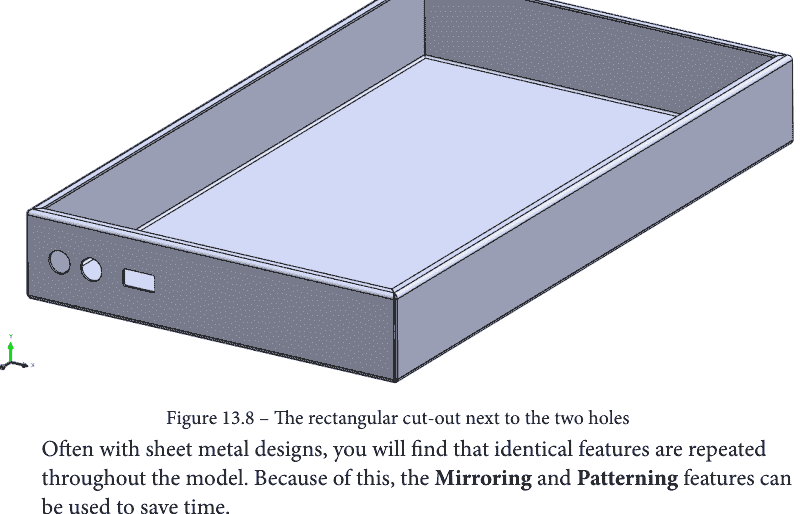

图 13.8 – 两个孔旁边的矩形切口

通常在钣金设计中，你会发现相同的特征在整个模型中重复出现。因此，可以使用 **Mirroring** 和 **Patterning** 特征来节省时间。

在本例中，我们可以在外壳的另一侧镜像切口。

8. 从 **Features** 选项卡中选择 **Mirror** 工具，然后同时选择 **Hole Wizard** 特征（两个圆形孔）和 **Extruded Cut**（矩形切口）。**Mirror Plane** 将是模型中央的大平面（应为 Right Plane）。

按 OK 添加镜像特征（图 13.9）：

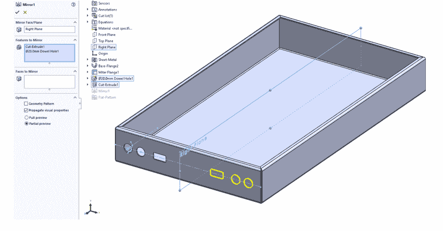

图 13.9 – 镜像切口

- 9. 请注意，如果我们想要沿前表面添加更多间隔开的实例，也可以使用线性阵列。

我们现在已在外壳底座部分添加了一些更多细节，包括圆形和矩形开口。在下一节中，我们将创建盖子，然后返回底座添加一些最终的润饰。

#### Creating an enclosure lid

接下来，我们将在模型上添加一个新的 Base Flange 以创建外壳的盖子。
这将使模型变成多片零件。

要添加盖子，请按以下步骤操作：

- 1. 首先，我们需要为新的 **Base Flange** 绘制一个轮廓。在现有 **Miter Flange** 壁的小上表面上开始草图。然后使用 **Corner Rectangle** 绘制一个矩形，其尺寸略大于现有外壳底座，并在四周都更大一些（图 13.10）：

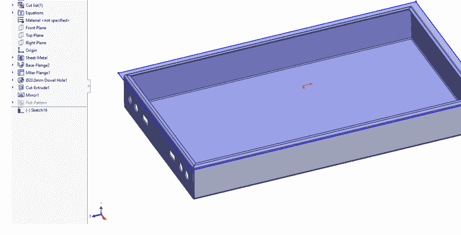

图 13.10 – 在 Miter Flange 壁的小上表面上绘制 Corner Rectangle

- 2. 现在，我们可以使用 Relations 将矩形的各边固定到底座的各边上。此方法比仅使用 **Center Rectangle** 并通过 Smart Dimension 设置尺寸要稍长一些，但这意味着如果以后底座尺寸发生变化，盖子的尺寸将自动更新以匹配。

依次选择草图矩形的一条边，然后再选择下方底座的对应边（按住 Ctrl 键以选择多个项目。请注意，从俯视图中操作会更容易）。

然后，使两个所选项目 Collinear。可以通过从小弹出菜单中选择 Make Collinear 来完成，也可以通过左侧 Property Manager 的 Add Relations 部分选择 Collinear：

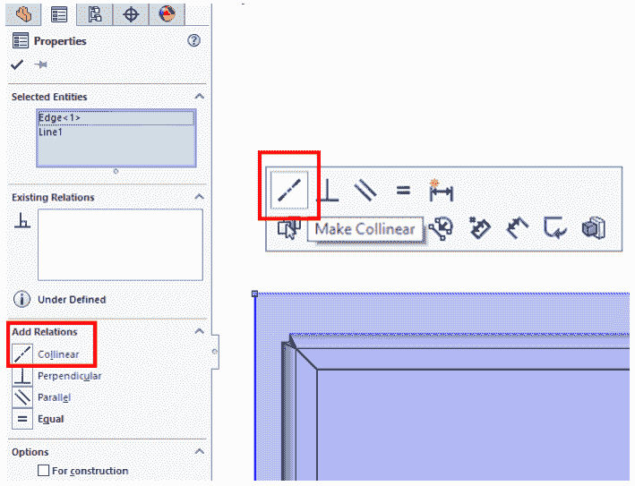

图 13.11 – 使草图矩形的各边与现有底座 Collinear

- 3. 对其余三条边继续此过程，以便整个矩形完全定义并与下方的底座部分相链接（图 13.12）：

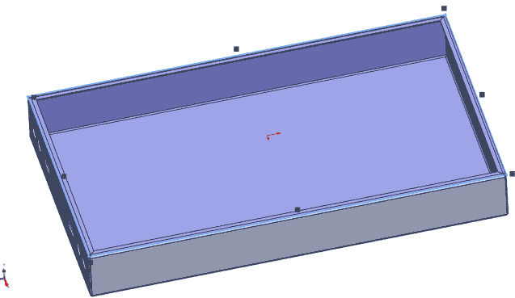

图 13.12 – 将矩形草图链接到底座

4. 我们现在可以使用完全定义的矩形来创建盖板。

选择 Base Flange/Tab 工具。然后，在按 OK 之前，取消选中 Merge Result 框。这意味着新的 Base Flange 将作为零件内的全新板单独创建，而不是与现有底板合并。

你可能还需要翻转新 Base Flange 的方向，以确保它不会与现有底座特征冲突（图 13.13）。这可以通过单击 Reverse direction 框来完成：

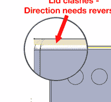

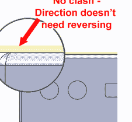

图 13.13 – 如有需要，反转盖板法兰的方向

5. 按 OK 创建盖板。我们现在可以看到 FeatureManager 设计树中的 Cut list 文件夹（图 13.14）显示了两个不同的板——一个用于底座，一个用于盖子。如果展开该文件夹，我们可以分别显示或隐藏每个板。

请注意，如果你的 Cut list 文件夹显示为单个板，则尝试编辑最新的 Base Flange/Tab 特征并确保未选中 Merge result 选项：

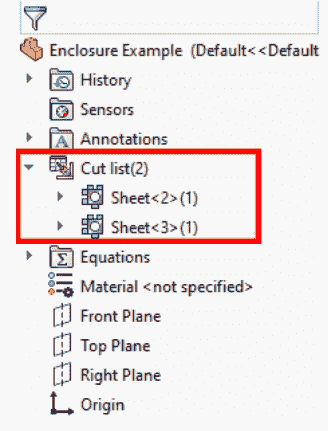

图 13.14 – Cut list 文件夹，显示两个板

6. 我们现在可以看到基本盖板特征已制作完成，但目前它只是一个单一的平板。根据厚度，该板在受载时可能会弯曲且缺乏刚性。它也可能在底座上表面滑动。为了解决这两个问题，我们可以在盖子上添加一些小的悬垂侧边：

- I. 选择 Edge Flange 工具并用其为短的前缘和两个较长的侧缘添加法兰（图 13.15）。这些法兰可以长 10mm，角度为 90°。
- II. 选择 Material Outside 法兰位置，以确保新的 Edge Flanges 不会与底板重叠：

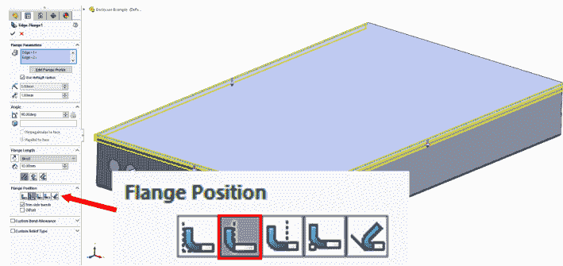

图 13.15 – 在盖子上添加三个 Edge Flanges

7. 按 OK 创建三个 Edge Flanges。请注意，我们没有为后缘添加法兰。这是因为在现实生活中，盖子可以用长钢琴铰链连接到底座（图 13.16）：

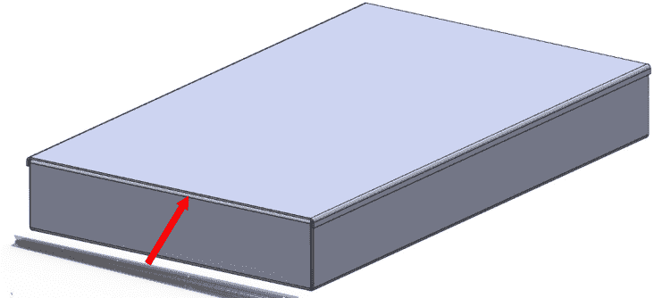

图 13.16 – 用于连接盖子和底座的钢琴铰链示例

8. 新 Edge Flanges 的后角仍然是方形的，可能会很锋利，因此使用 Break Corner/Corner Trim 选项将其倒角，使用 5mm 圆角将其圆滑（图 13.17）：

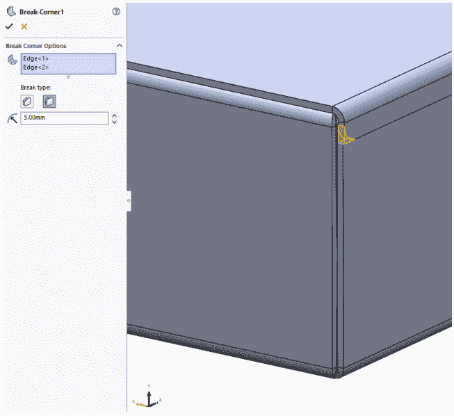

图 13.17 – 使用 5mm 圆角打断后角

现在，我们有一个相当简单的底座和盖子，但如果仔细观察两块板如何配合，我们可能会发现一个问题。盖子目前正好落在底座上，没有间隙（图 13.18）。它们大小相同：

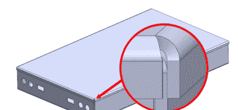

图 13.18 – 盖子和底座之间没有间隙

这可能会导致问题，因为在现实生活中，零件永远不会与 SolidWorks 中的模型完全相同大小。它们由于制造限制总是会略大或略小。设计零件尺寸与制造零件尺寸之间的这种差异称为 **tolerance**。

例如，一个 *10mm* 长的零件可能被指定为 *10.0±1mm*。这将使实际零件的尺寸在 *9.0mm* 到 *11.0mm* 之间。

公差可以减小（尽管更紧的公差会导致制造成本增加），但永远无法完全消除。因此，我们始终应在应配合在一起的两个零件之间设计间隙（除非我们希望设计中采用极其紧密的过盈配合）。

对于我们的示例，这意味着我们应在盖板和底板之间留出间隙。这意味着如果盖子制造低于公差（比 SolidWorks 模型略小）而底座制造略高于公差（比 SolidWorks 模型稍大），则两块板仍能配合。

要添加此间隙，我们只需编辑 **Edge Flanges** 并将其向外移动：

- 1. 编辑 **Edge Flange** 特征并从 **Flange Position** 部分选择 **Offset** 选项。确切的间隙量取决于公差——由你的预算、制造工艺和设计要求决定——但在本例中，输入 0.5mm 的值（*图 13.19*）：

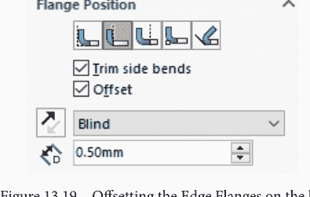

图 13.19 – 在盖子上偏移 Edge Flanges

2. 为了完成盖子，我们现在还将在盖子内侧添加一个 Hem。这将防止用户接触到盖子法兰的锋利下边缘。

选择 Hem 工具，然后为三个 Edge Flanges 的内侧边缘添加一个封闭 Hem，长度为 5mm（图 13.20）：

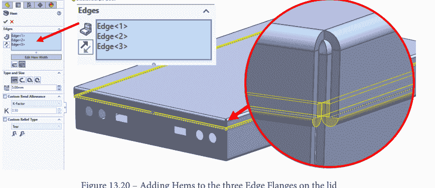

图 13.20 – 为盖子上的三个 Edge Flanges 添加 Hems

3. Hem 增加的额外厚度现在会导致盖子与底座发生碰撞（这可以使用 Interference Detection 工具进行检查 – 请参阅以下注释）。为了解决这个问题，重新编辑 Edge Flanges 并将 Offset 值增加到 2.6mm，以考虑 Hem 翻折材料的额外厚度。

#### Interference Detection Tool

Interference Detection 工具位于 Evaluate 选项卡上，是 SolidWorks 的一个非常有用的功能。它可以在零件和装配体中用于检查模型是否有任何相互碰撞的区域。

要使用它，请选择该工具，然后选择所需的主体、板或零件，并按 Calculate。不同区域之间的任何干涉都将以红色显示。

4. 对盖子进行最后检查可能会发现 Hem 角发生碰撞（这取决于你的 Edge Flange Gap 设置）。

如果你发现这些区域确实相互碰撞（图 13.21），则编辑 Edge Flange 特性并增加 Gap 距离。

在我这里，**3mm** 的间隙就足够了。注意，这些碰撞可能不会被 **Interference Detection** 工具检测到，因为它们是在单个板内，而不是在不同的板、主体或 *零件* 之间：

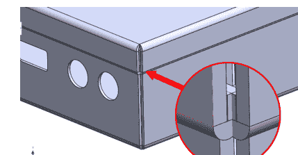

图 13.21 – 增加 Edge Flange Gap 距离以避免 Hem 角碰撞

盖子板现在已完成，如果需要，我们可以使用 **Flatten** 工具将其展平以检查一切是否正确。

**Flattening Sheets in Multi-Sheet Models**
使用 **Flatten** 工具检查模型时，每次只能展平一张板。

要选择应展平的板，首先展开 FeatureManager 设计树末端的 **Flat-pattern** 文件夹。每个板在模型中都有一个 **Flat-Pattern** 特性。选择所需的板，然后单击 **Flatten**。所选板将被展平，所有其他板将从视图中消失。

再次按下 **Flatten** 按钮以取消展平板，模型的其余部分将重新出现。

我们现在已经创建了一个简单的外壳底座和相应的盖子。在下一节中，我们将对外壳进行一些最后的润饰。

#### Adding final details to the enclosure

现在我们有了基本的外壳设计，我们可以通过在后部添加一些通风口，并使用 Forming Tools 在正面添加一些手柄来完成它。这个外壳是一个相当简单的示例，但它展示了可以通过使用简单步骤来构建更复杂设计的流程。

首先，我们将使用 Vent 工具在外壳的后部添加一些通风口。我们也可以手动切割这些通风口，但 Vent 工具加快了这一过程：

- 1. 所有 Vent 都需要一个 Vent 布局的草图，因此在外壳的后部开始一个草图并绘制图 13.22 所示的轮廓。
- 2. 使用了一条中心线来找到后部的垂直中点，然后使用 Circle 工具和 Offset Entities 添加了三个圆。Line 工具和 Circular Sketch Pattern 工具用于添加五个 Ribs。

外圆直径为 40mm，两个较小的圆各自向内偏移 8mm。圆心距 Origin 为 140mm，Origin 位于后部的中心：

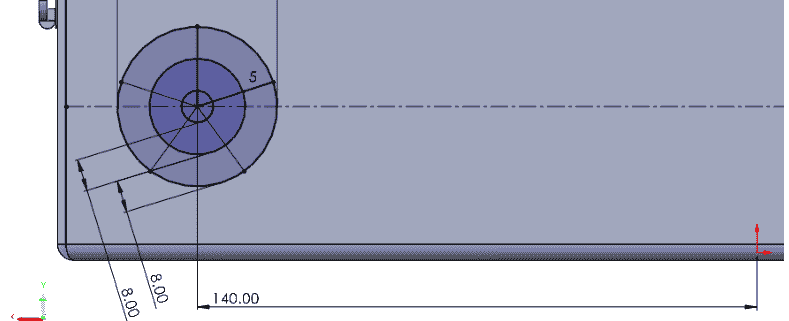

图 13.22 – 在后部绘制 Vent 细节草图

#### Creating Features Close to Sheet Edges and Bends

请注意，一些制造商可能对切口和其他特征可以靠近板边缘和弯曲处的距离有限制。如果你的特征距离边缘或弯曲处在 10mm（约 0.40"）以内，最好与制造商核实生产限制。

3. 我们现在可以开始创建 Vent 特性。选择 Vent 工具并使用草图填充 Property Manager 中的字段。我使用了以下参数（图 13.23）：

- **Boundary**：选择外侧（40mm）圆。
- **Ribs**：选择五条直线。肋条厚度为 2mm。
- **Spars**：选择中间（32mm）圆。桁条厚度为 2mm。
- **Fill In Area**：选择最小（24mm）圆。
- **Set a 2mm radius**：这将使通风口的所有尖锐内部角倒圆：

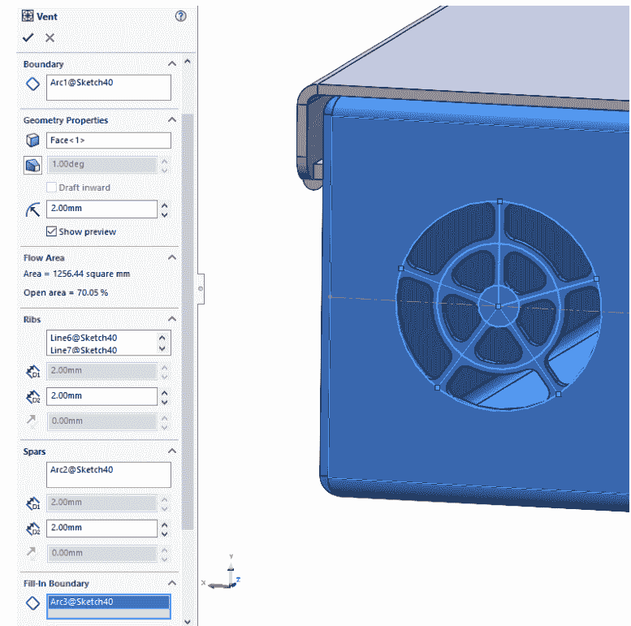

图 13.23 – 创建 Vent

- 4. 按 **OK** 创建 **Vent**。即使我们只制作了一个通风口，我们现在也可以通过对其进行图案化来添加更多通风口。

- 5. 选择 **Linear Pattern**（来自 **Features** 选项卡）。

使用我们刚刚创建的 **Vent** 特性并设置间距值为 70mm，实例数为五，并选择后部顶部或底部边缘之一作为图案方向（*图 13.24*）。

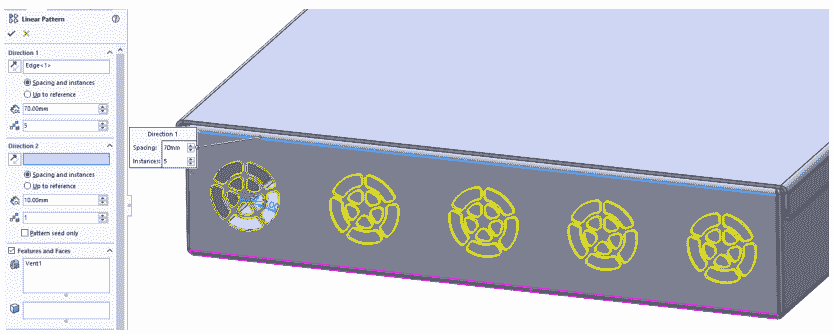

图 13.24 – 使用 Linear Pattern 对 Vent 进行图案化

- 6. 最后，我们可以添加一些成形手柄来完成设计。

打开屏幕右侧的 **Design Library** 面板并导航到 `forming tools` 文件夹。然后，找到 `louvers` 子文件夹。该文件夹应包含一个百叶窗 Forming Tool（*图 13.25*）。

> **Note**
> 
> 如果你无法找到百叶窗工具，则可以创建自定义成形工具，如 *第 10 章《使用 Forming Tools 为模型添加 3D 细节》中所述*：

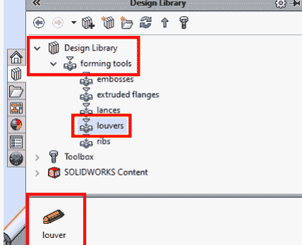

图 13.25 – 查找百叶窗 Forming Tool

左键单击并将百叶窗 Forming Tool 拖动到底座的前表面，以将成形百叶窗形状添加到该表面。

- 7. 使用 Forming Tool Property Manager 中的 Positions 选项卡精确放置 Forming Tool（图 13.26）。你可能需要使用 Point 工具在工具应放置的位置放置一个点：

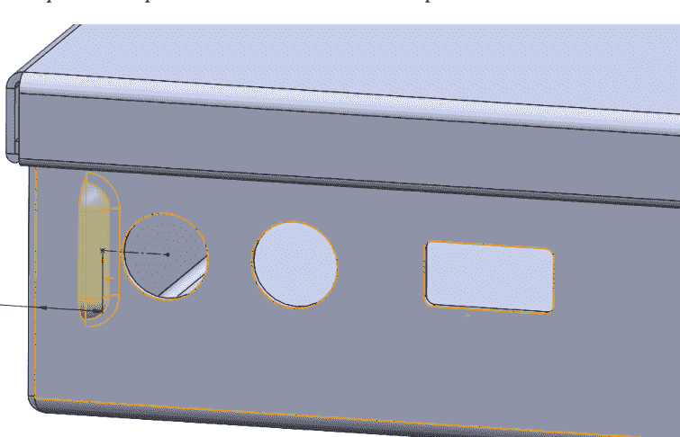

图 13.26 – 定位成形手柄

8. 按 **OK** 添加成形手柄特性。

9. 我们现在可以看到圆形孔和成形手柄靠得太近。编辑 **Hole Wizard** 特性并将两个孔移离外壳边缘（图 13.27）。矩形切口的位置也应自动移动，因为其位置是相对于两个圆形孔定义的：

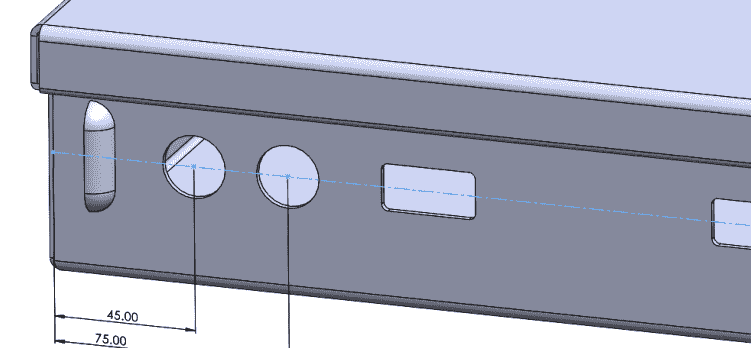

图 13.27 – 调整两个圆形孔（以及相关的矩形切口）的位置

10. 剩下的就是在正面另一侧添加第二个成形手柄。选择 **Mirror** 工具（来自 **Features** 选项卡），然后将 Right Plane 设置为 **Mirror Face/Plane**，将百叶窗特性设置为 **Features to mirror**（图 13.28）。按 **OK** 添加第二个手柄。

这两个百叶窗现在可以用作从服务器机柜中拉出托盘的手柄：

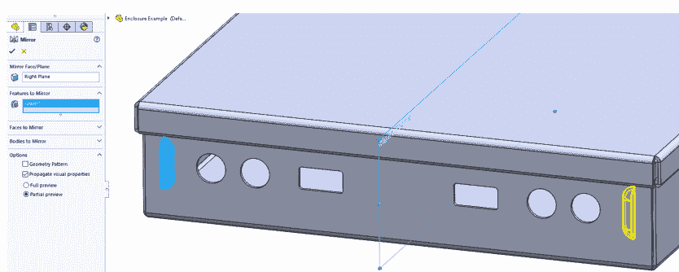

图 13.28 – 镜像成形手柄

这就是我们完成的钣金外壳的样子：

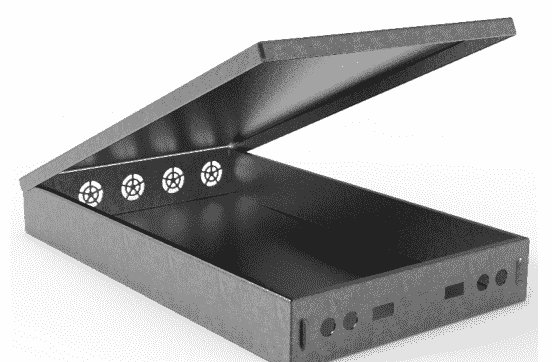

图 13.29 – 完成的钣金外壳

恭喜 – 我们的钣金外壳设计现已完成（图 13.29）！虽然这是一个相当简单的设计，但它展示了我们如何使用多种不同的特性来构建模型。这些单独的元素并不复杂，但合在一起时，可以组合起来创建更高级的设计。

#### Summary

在本章中，我们结合了书中学习到的各种技术来创建一个钣金外壳。底座使用 **Base Flange**、**Miter Flange** 和各种切口、**Vents** 和 **Formed Tools** 制作。

盖子由另一个简单的 **Base Flange** 构建，带有 **Edge Flange** 侧面和 **Hems** 使其更易于用户使用。

该设计使用了许多钣金工具和特性，但你可以用整个 SolidWorks 钣金套件创建的设计范围仅受你的想象力和设计要求限制。

与 SolidWorks 的大多数元素一样，掌握钣金的关键是尽可能多地练习这些技术。尝试在日常生活中寻找钣金产品，然后思考你如何在 SolidWorks 中建模它们。

钣金是标准 SolidWorks 工具集的一个很好的补充，可以将你的建模技能提升到下一个水平。

