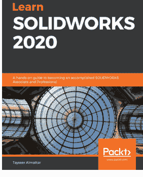
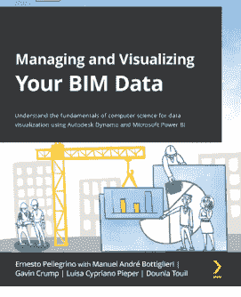

## 索引

## 符号

2D 绘图
  创建，钣金零件 95-97

## A

Adobe Illustrator 103

高级选项，边缘法兰
  自定义弯曲余量选项 55
  自定义折弯类型选项 55
  法兰轮廓，修改 53，54
  在同一
    边缘法兰特征内添加多个边 48，49
  修剪侧弯选项 55-57

铝
  优点 34
  缺点 34

自动折弯选项
  关于 23
  椭圆形 24
  矩形 24
  撕裂 24

## B

基体法兰
  创建复杂形状 29，30
  创建 7，10-13
  钣金选项卡，设置 9，10
  钣金工具栏，设置 9，10
  工作区，设置 8

基体法兰，选项
  关于 25
  多个包含封闭 26，32
  单个封闭轮廓基体法兰 32
  单个开放轮廓 26，32

弯曲余量
  选项 21-23
  属性 19，20

弯曲计算选项 23

弯曲扣除选项 22

弯曲位置选项
  弯曲中心线 81
  弯曲外部 82
  材料内部 81
  材料外部 81

弯曲半径
  确定方法 17
  编辑 15

激活规格表 17
尺寸，设置 16
弯曲表选项 23
弯曲回转弯
添加 144-147
黄铜 34
断角/角修剪工具
去除尖角 169，170
在展开模型上使用 173，174
与内部角配合使用 171，172
C
封闭角
减少间隙 162-168
计算机数控（CNC） 95
转换实体特征
调整 241
转换为钣金工具
关于 219
高级选项 231，232
使用 220-231
转换为钣金工具，高级选项
保留主体选项 232-236
反转厚度选项 231
撕裂线 237-240
铜 34
角折弯
向展开模型添加切口 179
模型，准备用于
制造 175-177
与三弯角配合使用 178
角工具 161
交叉折弯
关于 121
使用 128-130
自定义弯曲余量选项 55
自定义成形工具
创建 193-201
自定义折弯类型选项 55
E
边缘法兰
高级选项 48
弯曲角度 43
弯曲半径 43
创建 40-48
法兰位置 45
内部虚拟尖锐 45
长度 44
外部虚拟尖锐 44
选择 42
切线弯曲 45
使用 40
边缘法兰特征
在内添加多个边 48-51
压花 184
外壳
添加细节 266-271
外壳底座
创建 246-249
添加细节 249-256
外壳盖
创建 256-265
结束参考点 157
拉伸切口
创建 60，61
创建更深的切口 65
链接到板厚 61-64
使用法线切口 65-67

F
法兰位置
  选项 46，47
法兰轮廓
  修改 53，54
展开视图
  使用 98，99
展开模型
  断角/角修剪
    工具，在其上使用 173，174
展开特征
  使用 117，118
展开零件 25，30-32
折叠特征
  优点 113
  示例 113-117
  使用 113
成形回转弯
  创建 138-143
成形工具
  关于 182
  修改 188-193
  使用 183-188
完全定义草图 11

G
间隙距离
  调整 51，52
间隙
  使用封闭角减少 162-168
  通过添加焊接角去除 168，169
规格号
  使用，注意 19
规格表
  激活 17

加强筋
  关于 121
  添加 123-127
  特征，展开 127
  工作 122

H
包边
  关于 79
  添加 76-78
  功能 76
  卷边选项 79
  泪滴包边 79
  使用 76
包边工具 122
孔向导
  用于孔洞，使用 67

I
注塑成型 95
插入弯曲工具
  与壳体零件配合使用 206-213
  与薄特征零件配合使用 215-217
插入弯曲工具，与壳体零件配合使用
撕裂，调整 213-215
内部角
  断角/角修剪
    工具，与其配合使用 171，172

J
折弯
  关于 82
  创建 82
修复投影长度选项 85
折弯角度属性 86

K
折弯位置 85
偏移距离 84
实际示例 86-92
使用 83-85
保留主体选项 232-236
K 因子弯曲余量
  关于 21
  值 22

L
LibreCAD 103

M
制造
  钣金零件，导出用于 101-103
材料
  添加 60
  去除 60
  去除，创建拉伸切口 60
镜像
  使用 70
斜接法兰工具
  创建复杂法兰轮廓 75，76
  创建 70-72
  添加多个边 73，74
  使用 70
多个包含封闭
  基体法兰 26，32
多个边缘法兰
  在同一边缘内添加
    法兰特征 48-51
间隙距离，调整 51，52

O
坐标尺寸
  使用 99-101

P
图案
  使用 70
便携式文档格式（PDF） 97

R
反转厚度选项 231，232
肋 132
撕裂线
  关于 237
  角细节，调整 240
  撕裂细节，调整 240
撕裂
  调整 213-215

S
尖角
  使用断角/
    角修剪工具去除 169，170
钣金 5，6
钣金材料
  关于 36
  黄铜 34
  铜 34
  选择，考虑因素 33
板材尺寸 35
不锈钢 35
钢和铝 33
厚度 35

使用转换为钣金工具创建钣金模型
    解决转换问题 241-243
钣金零件
    创建 2D 绘图 95-97
    导出，用于制造 101-103
钣金属性
    关于 14，24，25
    自动折弯选项 23，24
    弯曲余量 20
    弯曲半径，编辑 15
    编辑 14
    板厚，调整 14
板厚
    调整 14
壳体零件
    插入弯曲工具，与其配合使用 206-213
简单孔工具
    切割 67
    特征 67
单个封闭轮廓基体法兰
    关于 32
    创建 27，28
单个封闭轮廓 25
单个开放轮廓基体法兰 26，32
草绘弯曲
    添加 79-82
    弯曲位置选项 81
SolidWorks
    版本 5
SolidWorks 绘图
    概述 94
SolidWorks 钣金
    在其中制作圆形切口的方法 250
桁条 130
不锈钢 35
开始参考点 157
钢
    关于 33
    优点 33
    缺点 33
    强度重量比（SWR） 34
扫掠法兰
    关于 108-110
    创建 108，109
    使用 109
    与斜接法兰对比 110，111
T
Tab 和 Slot 特征
    添加 149-156
Tab 和 Slot 属性
    调整 157-160
Tab
    使用 68，69
薄特征零件
    插入弯曲工具，与其配合使用 215-217
三弯角
    角折弯选项，与其配合使用 178
三维（3D） 143
修剪侧弯选项 55-57
U
展开特征
    优点 113
    示例 113-117
    使用 111-113
    展开
        与展开对比 117，118
测量单位 5

V
通风口
  使用 130-136

W
焊接角
  去除角间隙 168，169


Packt.com

订阅我们的在线数字图书馆，全面访问超过 7,000 本书籍和视频，以及帮助您规划个人发展和推进职业生涯的行业领先工具。有关更多信息，请访问我们的网站。

## 为什么订阅？

- 使用来自 4,000 多名行业专业人士的实用电子书和视频，花更少时间学习，花更多时间编码
- 使用专为您打造的技能计划改善学习
- 每月免费获得一本电子书或视频
- 完全可搜索，便于快速访问重要信息
- 复制、粘贴、打印和书签内容

您知道 Packt 提供每本出版书籍的电子书版本，文件格式为 PDF 和 ePub 吗？您可以在 packt.com 升级到电子书版本，如果您是印刷书籍客户，您有权享受电子书折扣。请通过 customercare@packtpub.com 与我们联系了解更多详情。

在 www.packt.com，您还可以阅读大量免费技术文章，订阅多种免费新闻通讯，并获得 Packt 书籍和电子书的独家折扣和优惠。


## 你可能喜欢的其他书籍

如果你喜欢这本书，你可能也会对 Packt 出版的以下其他书籍感兴趣：



## 学习 SOLIDWORKS 2020

Tayseer Almattar

ISBN: 978-1-78980-410-2

- 了解 SOLIDWORKS 和参数化建模的基础知识。
- 使用简单和高级建模技术创建专业的 2D 草图作为 3D 模型的基础。
- 使用 SOLIDWORKS 绘图工具生成标准的工程图纸。
- 评估质量属性和材料以设计零件和装配体。
- 了解 CSWA 和 CSWP 考试的目标和格式。



## 管理和可视化你的 BIM 数据

Ernesto Pellegrino | Jisell Howe | Manuel André Bottiglieri | Dounia Touil | Luisa Cypriano Pieper

ISBN: 978-1-80107-398-1

- 了解全球各地的企业为何转向数据驱动模型。
- 在 BIM 模型和基于 Web 的仪表板之间建立数据桥梁。
- 在多个逐步练习的帮助下掌握 Autodesk Dynamo。
- 专注于使用 Dynamo 的数据收集工作流程。
- 将 Power BI 连接到不同的数据集。

## Packt 正在寻找像你这样的作者

如果你有兴趣成为 Packt 的作者，请访问 authors.packtpub.com 并立即申请。我们已与成千上万的开发者和技术专业人士合作，就像你一样，帮助他们与全球技术社区分享他们的见解。你可以提交通用申请，申请我们正在招聘作者的特定热门主题，或提交你自己的想法。

Hi!

I'm Johno Ellison, author of *Mastering SOLIDWORKS Sheet Metal*. I really hope you enjoyed reading this book and found it useful for improving your SolidWorks skills.

It would really help me (and other potential readers!) if you could leave a review on Amazon sharing your thoughts on *Mastering SOLIDWORKS Sheet Metal*.

Go to the link below to leave your review:

```
https://packt.link/r/1803245247
```

Your review will help me to understand what's worked well in this book, and what could be improved upon for future editions, so it really is appreciated.

Best Wishes,


