# 回顾基础知识

`Tableau` 是用于解决**商业智能**（**BI**）和分析挑战的领先工具之一。通过本书，您将掌握 `Tableau` 在 BI 领域各种范式下的功能与特性。作为 *Mastering Tableau* 系列成功作品的更新版，本书涵盖了基本的 `Tableau` 概念、数据准备、使用 `Tableau` 进行计算，一直到机器学习用例。

本版附带新数据集、更多提升仪表板性能的示例，以及关于数据可视化、`Tableau Server` 和 `Tableau Prep Builder` 的最新实操知识。

新版还将探讨 `Tableau` 与 `Python` 和 `R` 的连接、`Tableau` 扩展、联合与合并，最后但同样重要的是，三个强大的自助式分析、时间序列分析和地理空间分析的新用例，以实践所学内容。读完本书，您将精通 `Tableau` 的高级功能及其最新更新，涵盖至 `Tableau` 2023 版本。

对于 `Tableau` 新手来说，本章有助于快速入门；不过，既然本书以高级主题为目标，因此花在基础知识上的时间相对较少。如果想更全面地了解基础主题，可参考 Joshua Milligan 编著、Packt Publishing 出版的 *Learning Tableau*。

在本章中，我们将讨论以下主题：

*   创建工作表和仪表板
*   将 `Tableau` 连接到您的数据
*   `Measure Names`（度量名称）和 `Measure Values`（度量值）
*   三个基本的 `Tableau` 概念
*   将数据导出到其他设备

现在，让我们从探索 `Tableau` 中的工作表和仪表板创建开始。

## 创建工作表和仪表板

`Tableau` 的核心是**工作表**和**仪表板**。工作表包含单个可视化图表，而仪表板包含一个或多个工作表。此外，工作表和仪表板可以组合成**故事**，以便在演示环境中向最终用户传达特定见解。最后，所有工作表、仪表板和故事都组织在**工作簿**中，可通过 `Tableau Desktop`、`Server`、`Reader` 或 `Tableau` 移动应用程序访问。

此时，我想向您介绍 **Tableau Public** ([`https://public.tableau.com/app/discover`](https://public.tableau.com/app/discover))。有时您可能需要一些灵感，或者想复制其他 `Tableau` 用户创建的仪表板。在这种情况下，Tableau Public 将是您的首选之地！它是一个基于 Web 的仪表板合集，也是一个创作者平台，允许您在无需许可证或安装的情况下设计精美的仪表板。

您可以创建自己的个人资料——注册免费——并分享您认为世界不容错过的所有仪表板。最棒的是，您可以下载所有这些仪表板，在自己的 `Tableau` 版本中打开它们，并开始学习和复制。即使没有自己的个人资料或注册，也可以下载仪表板。总之：Tableau Public 是一个免费选项，但提供有限的数据源连接、数据隐私和功能可用性。它确实提供了一个公开共享可视化图表的绝佳平台，且无需付费许可证即可磨练您的 `Tableau` 技能。

在本节中，我们将探讨如何创建工作表和仪表板。我们的意图是传达基础知识，但也会提供一些见解，这对更有经验的 `Tableau` 用户可能大有裨益。

### 创建工作表

在创建工作表之前，我们需要创建一个可视化图表来填充它。从最基本的层面来看，`Tableau` 中的可视化图表是通过将一个或多个**字段**放置在一个或多个**货架**上来创建的。例如，请注意，下图中创建的可视化图表是通过将**记录数**放置在**标记**卡上的**文本**货架上生成的：

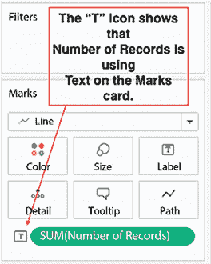

图 1.1：标记卡

了解了一些基本理论后，在下一小节中，您将有机会在自己的 `Tableau` 工作簿中跟随操作。开始吧！

#### 创建可视化图表

现在，让我们通过一个练习来探索创建可视化图表的基础知识：

1.  访问 [`https://public.tableau.com/app/profile/marleen.meier`](https://public.tableau.com/app/profile/marleen.meier) 以查找并下载与本章关联的工作簿。

2.  通过双击下载的工作簿来打开文件。

3.  在工作簿中，找到并选择标记为 **Fundamentals of Visualizations**（可视化基础）的选项卡：

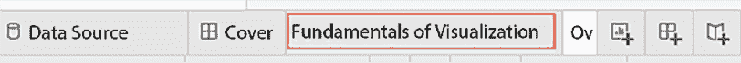

图 1.2：导航工作表选项卡

4.  该仪表板连接到两个数据源；对于第一个练习，我们将使用 **Summer-Olympics**（夏季奥运会）数据。点击左上角的数据源 **Summer-Olympics**：

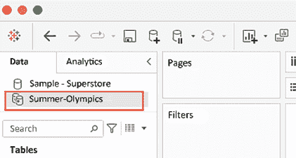

图 1.3：数据源

5.  在 **Fundamentals of Visualizations** 工作表左侧的**数据**窗格中找到 **Sport**（运动项目）：

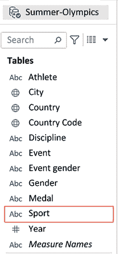

图 1.4：数据窗格上的维度

6.  将 **Sport** 拖至**标记**卡上的**颜色**，然后点击**添加所有成员**：

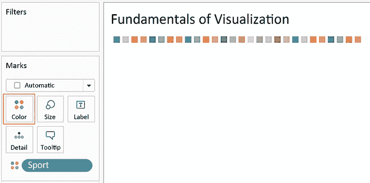

图 1.5：将颜色拖至标记卡

7.  点击**标记**卡上的**颜色**，然后点击**编辑颜色……**以根据需要调整可视化图表的颜色。这将允许您编辑可视化图表中使用的颜色，以及**透明度**和**边框**效果：

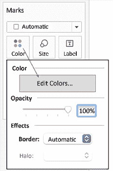

图 1.6：编辑颜色……

8.  现在看看如果将 **Sport** 移动到**大小**、**标签**、**详细信息**、**列**和**行**货架上会发生什么。将 **Sport** 放置在每个货架上后，您可以单独点击每个货架以访问其他选项。

9.  将其他字段拖放到各个货架上，继续探索 `Tableau` 的行为。例如，在空白画布上，将 **Year**（年份）拖至**列**货架，**Number of Records**（记录数）拖至**行**货架，并将 **Medal**（奖牌）拖至**标记**卡上的**颜色**。您现在将看到随时间变化的各奖牌类型数量：

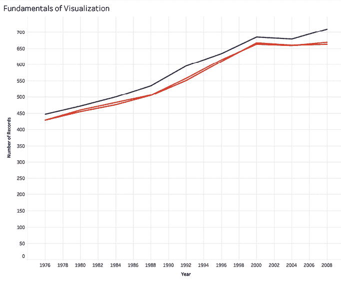

图 1.7：随时间变化的奖牌数

10. 您想出什么有趣的可视化图表了吗？欢迎分享到 Tableau Public。如果您希望本书的其他读者找到它们，请添加标签 **#MasteringTableau**——分享即关爱！

当您通过将不同字段拖放到不同的架上来探索 Tableau 的行为时，您会注意到 Tableau 会以默认行为进行响应。然而，这些默认值可以被覆盖，我们将在接下来探讨这一点。

## 超越默认行为

在前面的练习 *Creating a visualization* 中，我们可以注意到 **Marks** 卡显示为 **Automatic**。这意味着 Tableau 正在提供默认视图。通过从下拉菜单中选择不同的选项，可以轻松覆盖默认视图：

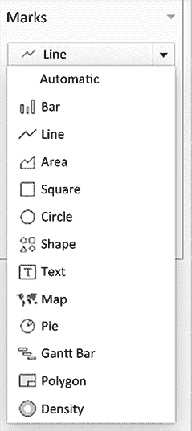

图 1.8：Marks 卡下拉菜单

通过更改 **Marks** 卡上的这些设置，我们可以调整数据的显示格式。

将字段拖放到架上时，可以观察到另一种默认行为。例如，将度量拖放到架上通常会产生 `SUM()` 聚合，这会将所有值汇总到最高聚合级别。如果不存在维度，则将是所有值的总和。如果 **Marks** 卡上存在维度，则该相同维度将作为最高聚合级别。

我们将在本节后面看到此行为的示例。

在 Windows 中，您可以通过右键单击并将 **Data** 窗格中的药丸拖放到架上来覆盖此默认行为。Tableau 将显示一个包含可能选项的对话框：

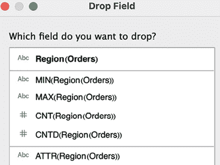

图 1.9：更改默认聚合

如果您使用的是 macOS，可以在将药丸拖放到位置后右键单击它，然后通过更改度量来调整默认行为。这在 Windows 上也适用。另一种选择是右键单击左侧 **Data** 窗格中仍然存在的字段，然后选择 **Default Properties** | **Aggregation**。

现在，让我们演练一个练习，我们将在 **Marks** 卡上覆盖另一个默认行为：

1. 在与本章关联的工作簿中，导航到 `Overriding Defaults` 工作表。

2. 将 `Year` 从数据窗格拖放到 **Columns** 架上：

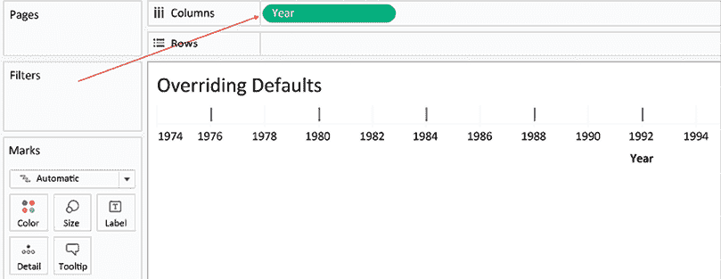

图 1.10：Year 到 Columns

3. 将 `Number of Records` 放在 **Rows** 架上（自动聚合为 `SUM(Number of Records)`），将 `Sport` 放在 **Detail** 架上。

4. 单击 **Marks** 卡上的下拉菜单并选择 **Area**：

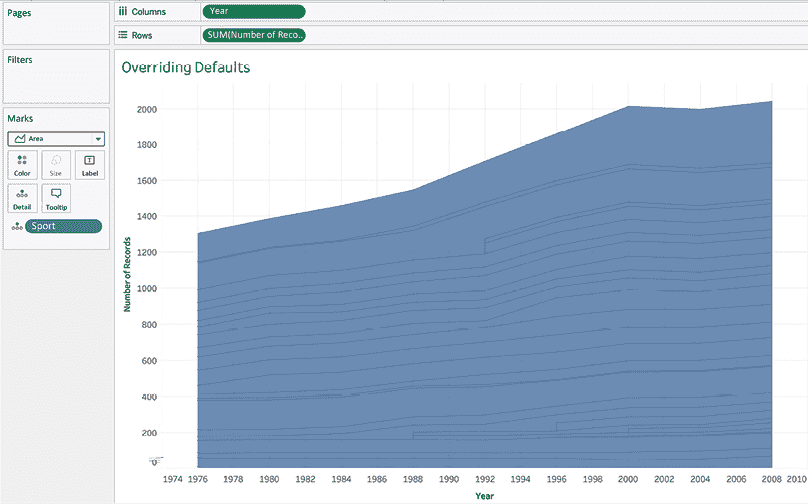

图 1.11：面积图

在 *图 1.11* 中，我们可以看到随时间变化的 `Number of Records`（`Year`），其中每条线代表一种 `Sport` 类型。我们选择用堆积面积图来可视化它。

### 排序和嵌套排序

现在您已经熟悉了拖放药丸的基础知识，并了解了 Tableau 的默认行为，大多数用户接下来想做的是对数据进行排序，以得出初步结论，例如最小值和最大值。

导航到 `Nested Sorting` 选项卡，尝试按获得奖牌数量对国家进行排序，但要分别针对金牌、银牌和铜牌。

对您有效吗？

在 Tableau 中，排序和嵌套排序只需单击每个列名旁边的图标即可完成：

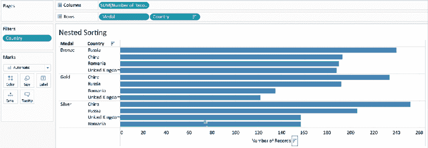

图 1.12：排序

要仔细检查排序方式，请将光标移至 `Country` 堆上，直到右上角出现箭头，单击给定字段（在本例中为 `Country`）旁边的箭头，然后选择 **Sort…**：

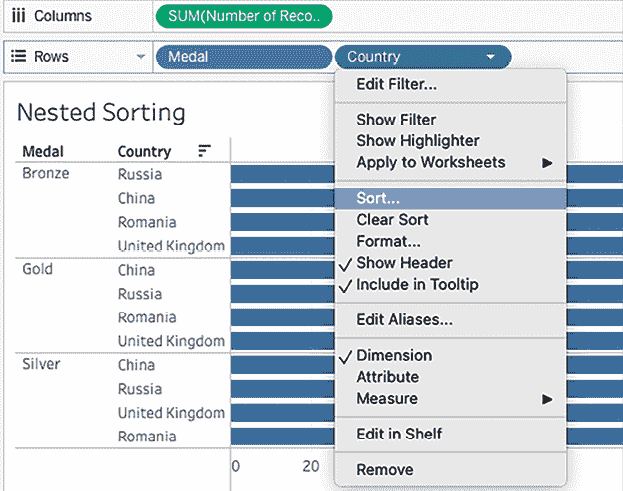

图 1.13：排序设置

从下拉菜单中选择 **Nested** 以及所需的 **Field Name** 和 **Aggregation** 类型：

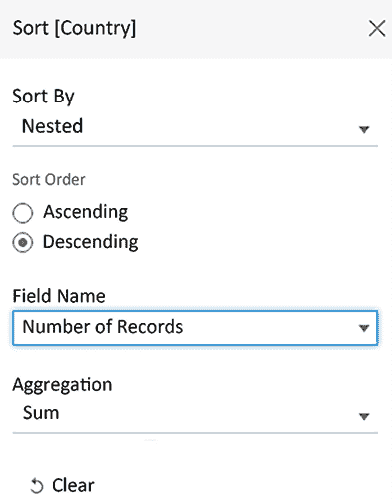

图 1.14：嵌套排序

完成并理解 **Sort** 和 **Nested Sort** 后，您将能够立即通过以最合乎逻辑的方式呈现值来为仪表板增加价值。现在，我们可以继续下一个主题，即 Tableau 自带的不同默认图表类型：**Show Me**。

## Show Me

**Show Me** 可以帮助 Tableau 新用户创建他们想要的可视化，例如条形图、直方图和面积图。它允许 Tableau 作者单击按钮即可从输入数据创建可视化。要了解其工作原理，请参考以下屏幕截图，它再次使用了 `Overriding Defaults` 工作表。可以通过单击任何 Tableau 工作表右上角的 **Show Me** 按钮来访问此视图：

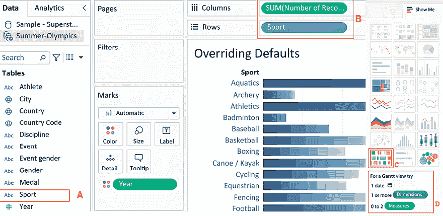

图 1.15：Show Me

现在让我们看看前面屏幕截图中突出显示的以下方面：

* **A**：**Data** 窗格中选中的字段
* **B**：视图中部署的字段，即药丸
* **C**：**Show Me** 面板中突出显示的推荐视图
* **D**：传达创建推荐视图要求或光标悬停其上的任何选择的帮助文本

**Show Me** 中每个未灰显的图标都代表一种只需单击即可创建的可视化。例如，在前面的屏幕截图 *图 1.15* 中，Tableau 作者可以选择单击面积图图标，根据选定和部署的字段创建面积图。

**Show Me** 选项根据两个标准突出显示：**Data** 窗格中选定的字段和视图中部署的字段。

**Show Me** 可因以下原因有效使用：

* **效率**：熟练的 Tableau 作者已经知道如何创建基本可视化类型。**Show Me** 将这些基本类型自动化，因此可用于更快的生产。
* **灵感**：确定可视化数据集的有效方法可能具有挑战性。**Show Me** 可以通过允许 Tableau 作者快速考虑各种选项来帮助应对这一挑战。
* **教育**：缺乏经验的 Tableau 作者可以访问 **Show Me** 以更好地了解各种可视化的创建方式。通过阅读 **Show Me** 底部显示的帮助文本并相应地更改药丸位置，可以学到很多东西：

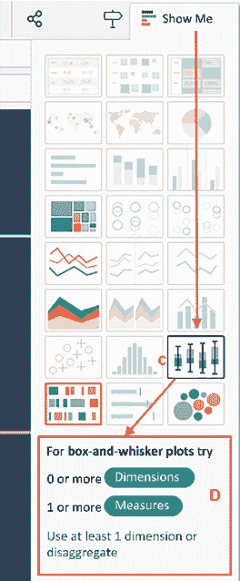

图 1.16：Show Me

这三个原因展示了 **Show Me** 为工作表创建提供的强大功能；但是，请小心不要将其作为拐杖使用。如果您在不了解每种可视化的创建方式的情况下单击各种选项，不仅会短换教育过程，还可能产生您不理解的结果，因此无法向利益相关者解释。

一旦您对结果满意，并确信所选可视化足够强调您的数据故事，您的工作表就准备好进行下一轮开发了。我们已经了解了一些基本的可视化创建和配置技术，现在让我们看看如何将多个工作表组合成一个仪表板。

数据故事讲述是通过图表等可视化手段利用数据创建引人入胜的故事的艺术。它将数据分析的力量与讲故事技巧相结合，以引人入胜且易于理解的方式传达复杂信息。

## 创建仪表板

尽管如前所述，仪表板包含一个或多个工作表，但仪表板远不止静态演示。它们是 Tableau 交互性的重要组成部分。在本节中，我们将用工作表填充仪表板，然后部署操作以实现交互性。

让我们开始构建仪表板。

### 构建仪表板

以下是构建仪表板的步骤：

1. 在本章的工作簿中，导航到 `Building a Dashboard` 选项卡。

## 创建仪表板

2. 在图 1.17 左侧的 `Dashboard` 窗格中，依次双击以下各工作表（按列出的顺序）以将它们添加到仪表板窗格：`Count of Disciplines`、`Attendees`、`Medals` 和 `Medal Shapes`：

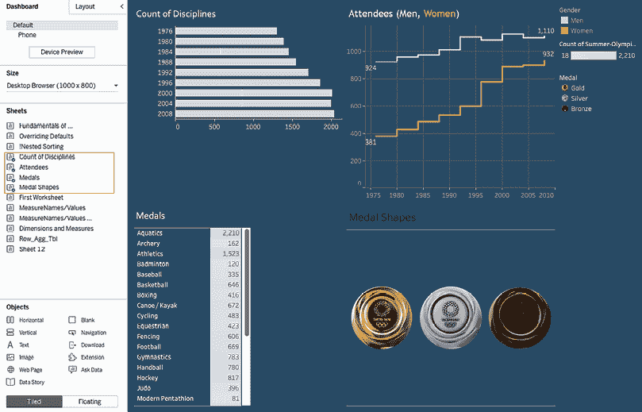

图 1.17：创建仪表板

1. 在仪表板右下角，单击空白区域（图 1.18 中用箭头指示）以选择一个 `container`（容器）。容器是一组工作表，它们会自动调整以适应仪表板上彼此旁边或下方的空间：

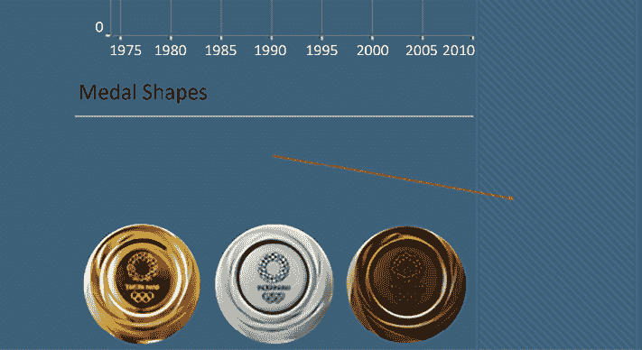

图 1.18：删除容器

1. 单击空白区域后，你应该会看到筛选器和图例周围有一个蓝色边框。这表明垂直容器已被选中。选择垂直容器的句柄，然后单击 `X` 将其删除。

2. 选中的容器也可以拖动到仪表板上的不同位置，替换现有工作表或共享空间。请注意图 1.19 中的灰色阴影，它指示选择内容将放置的位置。通过选择并按住句柄拖动 `Attendees` 工作表，将其放在 `Count of Disciplines` 工作表顶部，以交换两者的位置：

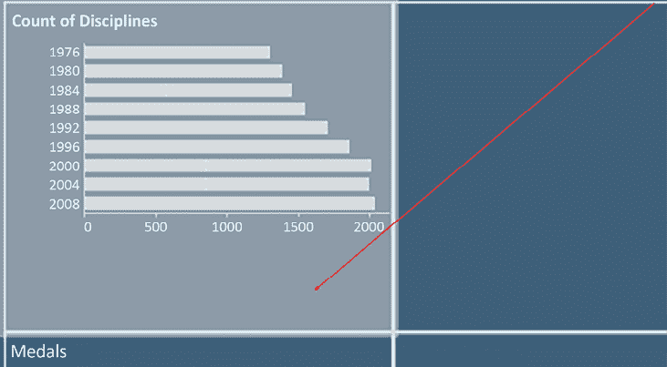

图 1.19：移动工作表

当将工作表和容器等元素拖放到仪表板上时，Tableau 提供的灰色阴影会有效地指示元素将放置的位置。请耐心操作，仔细观察将元素放置在仪表板上的位置，否则结果可能出乎意料。

1. 请注意仪表板旁边左下角的 `Floating`（浮动）和 `Tiled`（平铺）按钮，以及句柄下拉菜单下方的按钮。如果选择 `Floating` 而不是 `Tiled`，工作表将不再自动调整，而是在仪表板上“浮动”。这是一种在仪表板上自由排列工作表的形式，是一项强大的功能，特别是结合透明背景时。请注意，也可以通过仪表板中每个工作表右侧的 `More Options`（更多选项）下拉菜单选择浮动来实现：

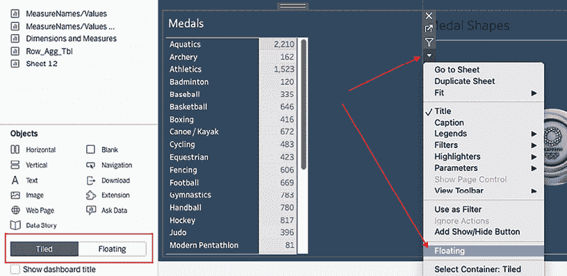

图 1.20：平铺和浮动

1. 现在，你可以根据需要格式化仪表板。以下提示可能会有所帮助：

- 通过将鼠标悬停在各元素之间的边缘上，然后单击并拖动来调整屏幕上元素的大小。拖动容器的边缘以调整每个工作表的大小。
- 如图 1.18 所示，使元素浮动。
- 通过将 `Objects`（对象）窗格中的 `Horizontal`（水平）和 `Vertical`（垂直）拖放到仪表板上，创建水平和垂直容器。其他对象，如 `Text`（文本）、`Image`（图像）和 `Blank`（空白），也可以添加到容器中。
- 通过在顶部窗格中选择 `Dashboard`，然后选择 `Show Title`（显示标题）来显示仪表板标题。双击标题本身进行调整：

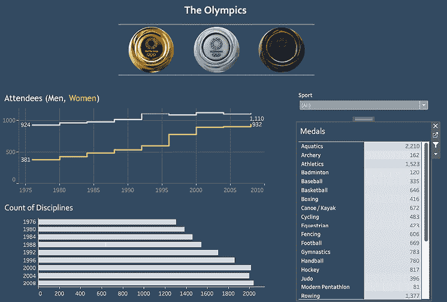

图 1.21：奥运会仪表板

正如你所见，你刚刚创建了第一个仪表板。所有工作表现已就位。在下一部分，我们将添加筛选器功能，使仪表板更具交互性和意义。

### 为仪表板添加交互性

Tableau 的主要优势之一是它为最终用户提供的交互性。仪表板不仅仅用于查看；它们旨在用于交互。在本练习中，我们将为上一练习中创建的仪表板添加交互性：

1. 在仪表板上选择 `Medals` 工作表，然后单击右侧的下拉箭头，这将打开一个菜单，如图 1.22 所示。从那里，选择 `Filters`（筛选器），然后选择 `Sport`：

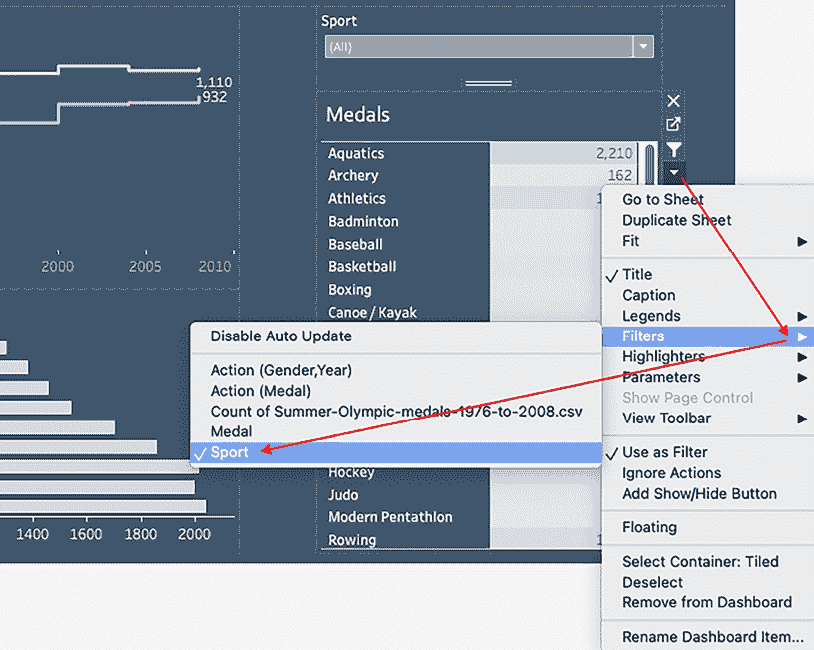

图 1.22：添加筛选器

1. 现在选择新创建的筛选器 `Sport`，再次单击下拉选项箭头，并选择 `Multiple Values (dropdown)`（多值（下拉框）），以及 `Apply to Worksheets | All Using This Data Source`（应用于工作表 | 所有使用此数据源的工作表），如图 1.23 所示：

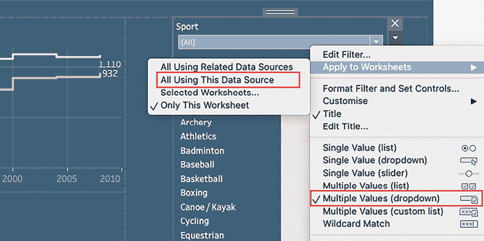

图 1.23：筛选器设置

1. 最后，通过单击并拖动，将筛选器放在 `Medals` 工作表上方。

2. 要将奖牌图像用作仪表板窗格上其他工作表的筛选器，请单击 `Medals Shapes` 工作表右上角的 `Use as Filter`（用作筛选器）图标：

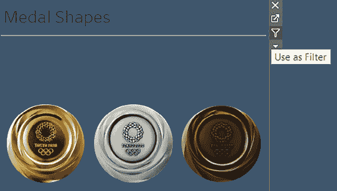

图 1.24：用作筛选器选项

1. 或者，导航至 `Dashboard | Actions…`。在对话框中，单击 `Add Action | Filter` 并创建一个筛选器，如图所示：

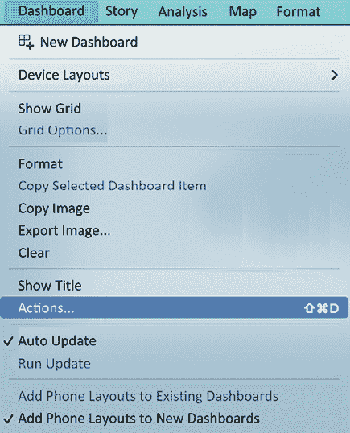

图 1.25：导航至筛选器

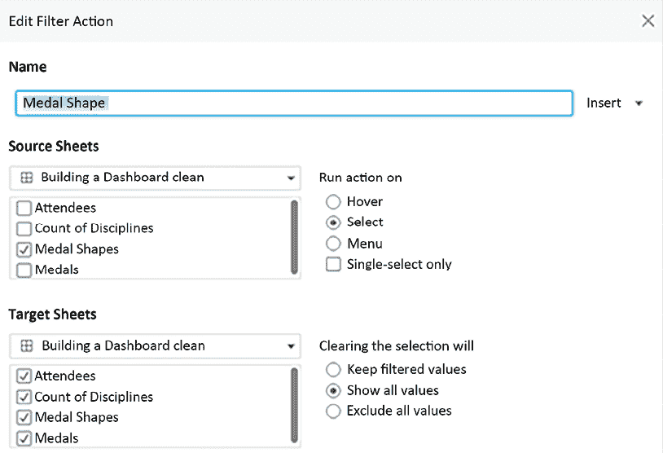

图 1.26：添加筛选器操作

从这里开始，你就可以使用筛选器和操作筛选器了。

在 Tableau 中，筛选器用于根据特定条件对底层数据进行子集划分，而操作筛选器允许用户通过单击可视化元素以交互方式筛选数据。

在第 13 章“提升性能”中，将更详细地讨论此主题。

完成前面的仪表板练习后，你现在应该能够单击仪表板上的各种对象来观察交互性。

要了解一些更高级的仪表板技巧，请务必查看第 11 章“设计仪表板和可视化最佳实践”。

总之，你已经学习了如何将现有工作表作为平铺或浮动对象放置在仪表板上。你通过拖放以及使用容器、筛选器和操作筛选器更改了仪表板布局。这些核心活动将在本书中重复多次，因此请随时返回本章，在需要时重复练习步骤！

接下来，你将学习如何将自己的数据连接到 Tableau 并对其进行处理。

# 将 Tableau 连接到你的数据

在撰写本文时，Tableau 的数据连接菜单包含 90 多种不同的连接类型。这在某种程度上还是一种保守的说法，因为其中一些类型包含多个选项。例如，`Other Files`（其他文件）包含 30 多个选项。当然，我们不会涵盖每种连接类型的详细信息，但我们将介绍基础知识。所有连接器的官方文档可在此处找到：[`help.tableau.com/current/pro/desktop/en-us/exampleconnections_overview.htm`](https://help.tableau.com/current/pro/desktop/en-us/exampleconnections_overview.htm)。

在 Tableau Desktop 中打开 Tableau Desktop 的新实例时（`File | New`），你会注意到工作区左上角有一个 `Connect to Data`（连接数据）链接。单击该链接将允许你连接到数据。从计算机上的应用程序位置打开 Tableau 的新实例将立即弹出蓝色的 `Connect`（连接）窗格。或者，你可以单击工具栏上的 `New Data Source`（新数据源）图标。

虽然在未来的章节中我们将连接到其他数据源，但这里我们将讨论范围限制在连接到 Microsoft Excel 和文本文件。

## 连接到文件

让我们看看如何连接到文件，以 Excel 为例：

1. 在 Tableau 中，导航至 `Data | New Data Source | Excel` 以连接到随 Tableau Desktop 安装的 `Sample - Superstore` 数据集（它应该位于你的硬盘上的 `My Tableau Repository | Data sources` 下）。

2. 双击 `Orders` 工作表。

3. 单击 `New Worksheet` 选项卡，如图 1.27 所示：

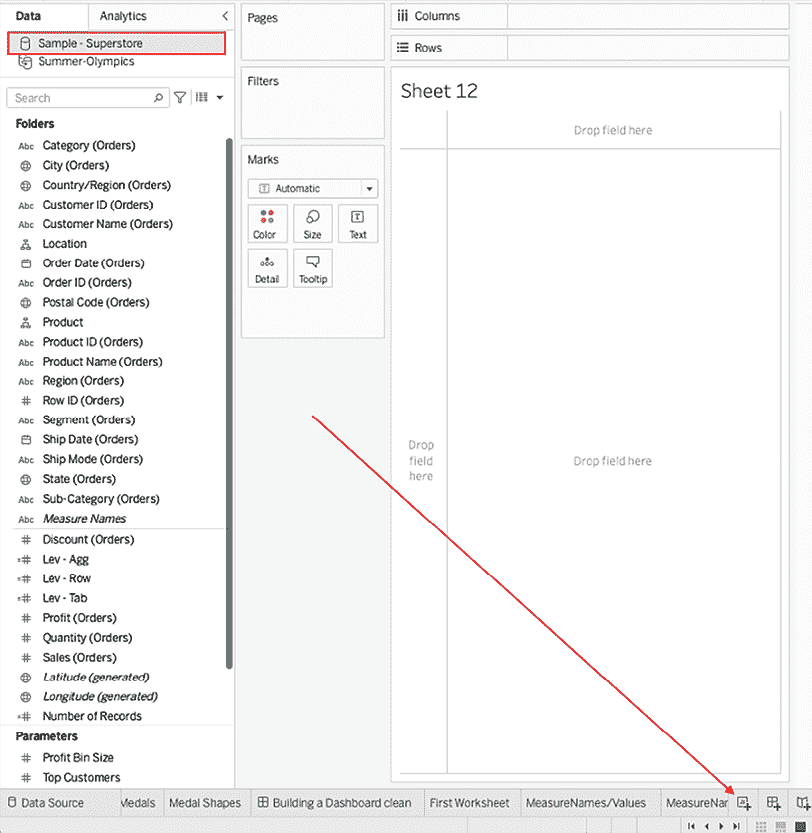

图 1.27：新工作表

1. 通过右键单击并选择 `Rename`（重命名），将新创建的选项卡重命名为 `First Worksheet`。

2. 将 `Discount` 放在 `Marks`（标记）卡中的 `Text`（文本）货架上。

3. 双击 `Profit` 和 `Sales`：

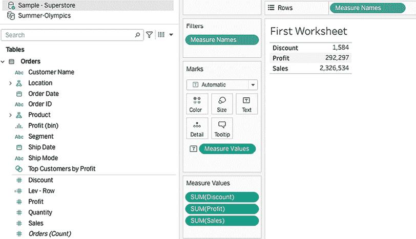

图 1.28：第一个工作表

你刚刚创建了你的第一个工作表！

如果您想要连接到 ` `.csv` ` 文件，可以使用 `Text file` 选项。稍后在本书的 `Chapter 12` `Leveraging Advanced Analytics` 中，我们还将连接到空间文件。

在本节中，我们学习了如何连接到文件。我们将在下一节继续介绍另一种重要的连接类型：Tableau Server。

## 连接到 Tableau Server

连接到 Tableau Server 或许是最重要的服务器连接类型，因为它经常被用来提供原本可能无法实现的更高性能。此外，连接到 Tableau Server 使作者不仅能接收数据，还能接收关于如何解释这些数据的信息——例如，某个字段应被视为度量还是维度。

我们将在本章后面的 `Dimensions and measures` 节中讨论这些术语之间的区别。

以下是连接到 Tableau Server 的步骤：

1. 要完成此练习，需要访问 Tableau Server 实例。如果您无法访问 Tableau Server，请考虑在本地计算机上安装试用版。

2. 在与本章关联的工作簿中，导航到 `Connecting to Tableau Server` 工作表。

3. 右键单击 `Superstore` 数据源，然后选择 `Publish to Server…`：

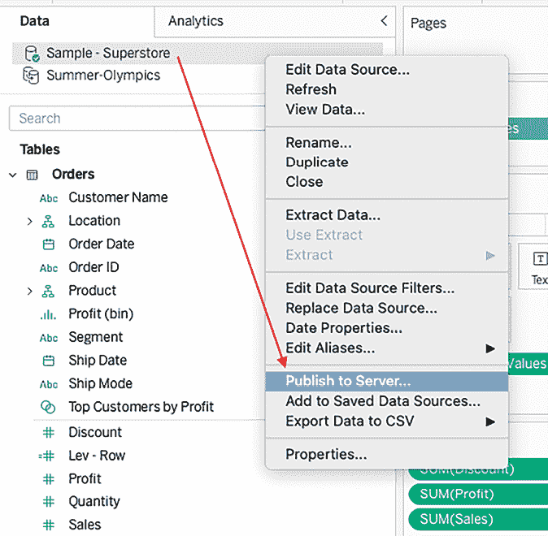

图 1.29：发布到服务器…

4. 登录 `Tableau Server` 并按照提示完成数据源的发布。

5. 打开 Tableau Desktop 的新实例，选择 `Data` | `New Data Source` | `Tableau Server`，然后搜索您刚刚发布的 `Superstore` 数据集并进行连接。

完成前面的两个练习后，让我们讨论最相关的要点，即 `metadata`。元数据通常被定义为 `data about data`。在前面的示例中，数据源名称、默认聚合和默认数字格式都是跨多个作者保持一致性的示例。

如果您更改了字段名称，然后将数据源发布到 Tableau Server，新字段名称将保留下来，因为 Tableau 会记住对元数据所做的更改。这一点很重要，例如，如果您的公司有关于显示货币时使用小数点的策略；如果所有 Tableau 作者都通过指向已预定义所有格式的数据源来开始构建工作簿，则该策略将易于遵守。

稍后在本书中，我们将连接到其他类型的服务器，如 Google BigQuery，但所有服务器的处理方式大同小异且非常简单。如果您仍有疑问，可以随时查看 [`help.tableau.com/current/pro/desktop/en-us/exampleconnections_overview.htm`](https://help.tableau.com/current/pro/desktop/en-us/exampleconnections_overview.htm)。

现在，关于连接的最后一个缺失部分是已保存的数据源。请也跟随此步骤操作。

## 连接到已保存的数据源

在本地计算机上连接到已保存的数据源，与连接到发布在 Tableau Server 上的数据源非常相似。与本地数据源关联的元数据定义得以保留，就像在 Tableau Server 上一样。当然，由于数据源是本地的而非远程的，发布过程有所不同。

让我们通过一个示例来探索创建本地数据连接的以下步骤：

1. 在与本章关联的工作簿中，导航到 `First Worksheet` 选项卡。

2. 在 `Data` 窗格中，右键单击 `Superstore` 数据源并选择 `Add to Saved Data Sources`。

3. 使用生成的对话框，将数据源另存为 `Superstore`，位置在 `My Tableau Repository` | `Data sources`，该位置位于您的硬盘驱动器上。

4. 单击屏幕左上角的 `Go to Start` 图标，观察新保存的数据源：

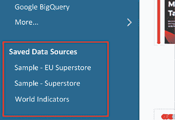

图 1.30：已保存的数据源

您可以保存一个指向 Tableau Server 上已发布数据源的本地数据源。首先，连接到 Tableau Server 上的已发布数据源。然后，在工作区中右键单击该数据源并选择 `Add to Saved Data Sources`。现在您可以直接从起始页面连接到 Tableau Server！

现在我们已经学习了如何连接到文件、Tableau Server 和已保存的数据源，我们将继续深入探讨关于 `Measure Names` 和 `Measure Values` 的更多细节。

## Measure Names 和 Measure Values

我经常观察到以下场景：一位新的 Tableau 作者创建一个工作表，并将一个度量拖到 `Text` 架上。他们将第二个度量拖到视图的各个位置，得到的结果似乎完全不可预测。这种体验让作者非常沮丧，因为在 Microsoft Excel 中完成这项任务非常容易！好消息是，在 Tableau 中也很容易实现。只是需要一种不同的方法。

`Measure Names` 和 `Measure Values` 是 Tableau 中的生成字段。它们不存在于底层数据中，但对于创建多种视图至关重要。从其在 `Data` 窗格中的位置及其名称可以推断出，`Measure Names` 是一个维度，其成员由底层数据集中每个度量的名称组成。`Measure Values` 包含数据集中每个度量的数字或值。

在本节中，我们将观察这些生成字段独立使用时会发生什么，然后观察它们如何协同工作以优雅地创建视图。让我们通过一个练习来探索这一点：

1. 在与本章关联的工作簿中，导航到 `MeasureNames/Values` 并确保选中了 `Olympics` 数据源。

2. 将 `Measure Values` 拖到 `Text` 架上并观察结果，所有四个值都打印在彼此顶部：

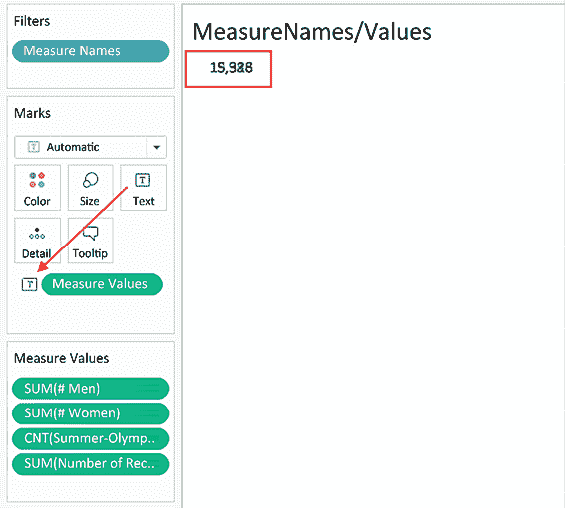

图 1.31：Measure Values

3. 单击工具栏上的 `Clear Sheet` 图标以清除工作表：

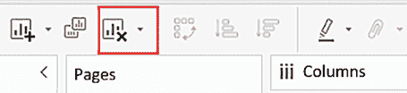

图 1.32：清除工作表

4. 现在，将 `Measure Names` 拖到 `Rows` 架上，观察视图仅显示 `No Measure Values`。

5. 将 `Measure Values` 拖到 `Text` 架上。注意度量列表及其关联的值，每个四个值都打印在相应的行中：

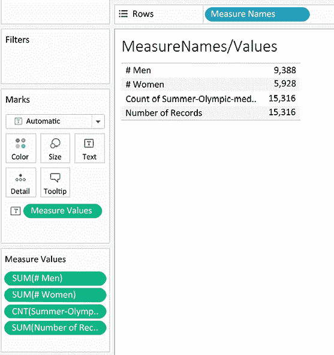

图 1.33：Measure Values 列表

`Measure Names` 和 `Measure Values` 之间的关系或许最好用一个类比来解释。想象几双袜子和一个分格的袜子抽屉。`Step 2` 相当于把袜子扔成一堆。结果嘛，很杂乱。`Step 4` 相当于一个空的、有分格的袜子抽屉。分格都在，但袜子在哪里？`Step 5` 是一个装满整齐袜子的分格抽屉。`Measure Names` 就像袜子抽屉。`Measure Values` 就像袜子。

它们单独使用时用处不大。结合使用时，可以应用于许多不同的方式。

### Measure Names 和 Measure Values 快捷方式

Tableau 提供了各种快捷方式以快速创建所需的可视化。如果您是该软件的新手，这种快捷行为可能看起来不直观，但您会逐渐理解它。让我们通过以下练习来探索如何使用快捷方式快速部署 `Measure Names` 和 `Measure Values`：

1. 在与本章关联的工作簿中，导航到 `MeasureNames/Values ShrtCts` 工作表。

2. 将 `# Women` 拖到 `Marks` 卡中的 `Text` 上。

3. 在视图中将 `# Men` 直接拖到 `# Women` 上方（`Show Me` 出现）：

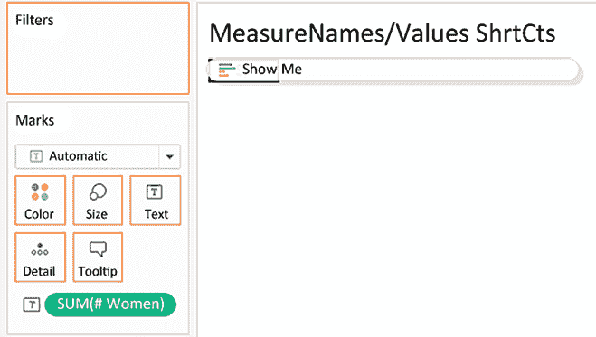

图 1.34：Show Me 和度量

1. 观察结果，包括 `Measure Values`（度量值）货架的出现、`Measure Names`（度量名称）部署在 `Rows`（行）和 `Filters`（筛选器）货架上，以及 `Measure Values`（度量值）位于 `Text`（文本）货架上：

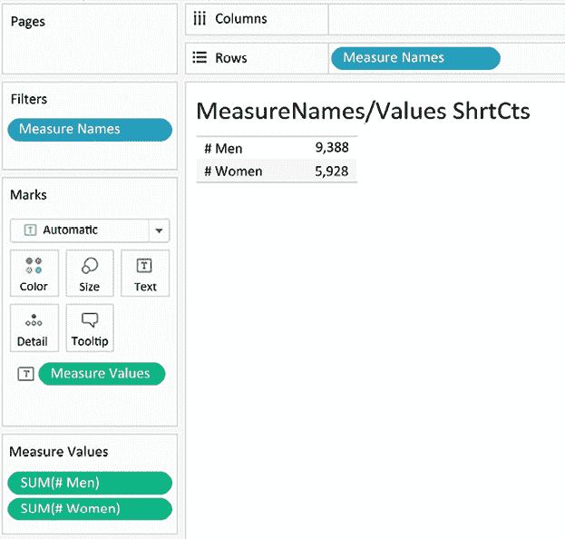

**Figure 1.35:** Measure Values appearance（度量值外观）

在本练习的*步骤 2* 中发生了几件事。将 `# Men`（男性数量）数字放在视图中 `# Women`（女性数量）数字的顶部后，Tableau 执行了以下操作：

1. 将 `Measure Names`（度量名称）部署到 `Filters`（筛选器）货架上：
    * 通过右键单击并选择 **Edit Filter...**（编辑筛选器...）打开 `Measure Names`（度量名称）筛选器。观察到仅选中了 `# Men` 和 `# Women`。这将视图限制为仅显示这两个度量。

2. 将 `Measure Names`（度量名称）部署到 `Rows`（行）货架上：
    * `Measure Names`（度量名称）充当分区容器，就像比喻中的袜子抽屉。由于筛选器的作用，显示的行仅限于 `# Men` 和 `# Women`。

3. 显示 `Measure Values`（度量值）货架：
    * `Measure Values`（度量值）货架在一定程度上是冗余的。虽然它清楚地显示视图中显示的度量，但它本质上充当访问筛选器的简便方式。您只需将度量拖入或拖出 `Measure Values`（度量值）货架即可调整筛选器，从而显示/隐藏其他 `Measure Values`（度量值）。您还可以更改 `Measure Values`（度量值）货架内的顺序，以更改视图中度量的顺序。

4. 将 `Measure Values`（度量值）部署到 `Text`（文本）货架上：
    * `Measure Values`（度量值）只是定义将为每一行显示的数字——在本例中，即与 `# Men` 和 `# Women` 关联的数字。

如果可视化有坐标轴，则部署 `Measure Names`（度量名称）和 `Measure Values`（度量值）的快捷方式要求将第二个度量放在初始度量的坐标轴顶部。在 *Figure 1.36*（图 1.36）中，`Year`（年份）位于 `Columns`（列）货架上，`Number of Records`（记录数）位于 `Rows`（行）货架上。请注意，截图是在将 `# Women` 放在 *y* 轴顶部时拍摄的：

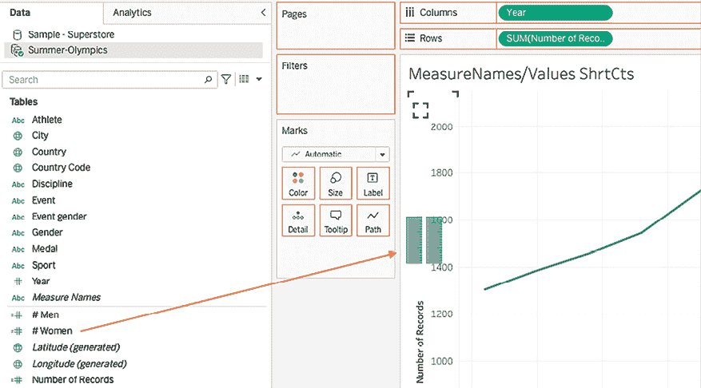

**Figure 1.36:** Axis shortcut（坐标轴快捷方式）

生成的工作表如 *Figure 1.37*（图 1.37）所示：

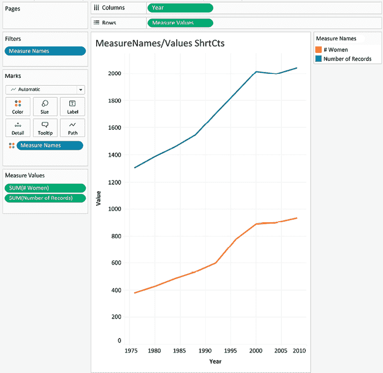

**Figure 1.37:** Two-line chart（双线图表）

前一节让我们更好地理解了 `Measure Names`（度量名称）和 `Measure Values`（度量值）。在您的 Tableau 职业生涯中，您会更多地接触到这些概念，但现在您已成功掌握了基础知识，让我们继续学习其他三个有助于您学习曲线的概念。

# Three essential Tableau concepts（三个基本 Tableau 概念）

掌握 Tableau 之路的一个重要驿站涉及三个基本概念。在本节中，我们将讨论其中的每一个：

* Dimensions and measures（维度和度量）
* Row-level, aggregate-level, and table-level calculations（行级、聚合级和表级计算）
* Continuous and discrete（连续和离散）

我们将首先定义 **dimensions**（维度）和 **measures**（度量）。

## Dimensions and measures（维度和度量）

Tableau 将基础数据源中的每个字段分类为 **dimension**（维度）或 **measure**（度量）。维度是定性的，或者用另一个词说，是分类的。度量是定量的或可聚合的。度量通常是数字，但也可能是聚合的非数字字段，例如 `MAX(Date)`。维度通常是文本、布尔或日期字段，但也可能是数字，例如 `Number of Records`（记录数）。维度通过将这些数字切分成单独的部分/类别，为数字提供含义。没有维度的度量大多是无意义的。

让我们看一个例子以便更好地理解：

1. 在与本章关联的工作簿中，导航到 `Dimensions and Measures`（维度和度量）工作表。

2. 将 `Number of Records`（记录数）拖到 **Marks**（标记）卡上的 **Text**（文本）上。结果大多是无意义的。度量的数量是 **15,316**，但如果没有通过跨一个或多个维度切分度量来提供的上下文，实际上无法理解其含义：

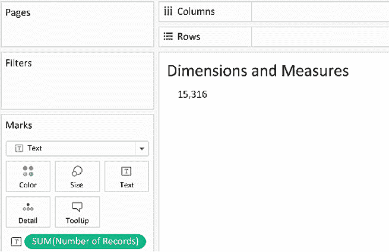

**Figure 1.38:** Worksheet without context（无上下文的工作表）

3. 将 `Country`（国家）和 `Year`（年份）放在 `Columns`（列）货架上，将 `Number of Records`（记录数）放在 `Rows`（行）货架上：

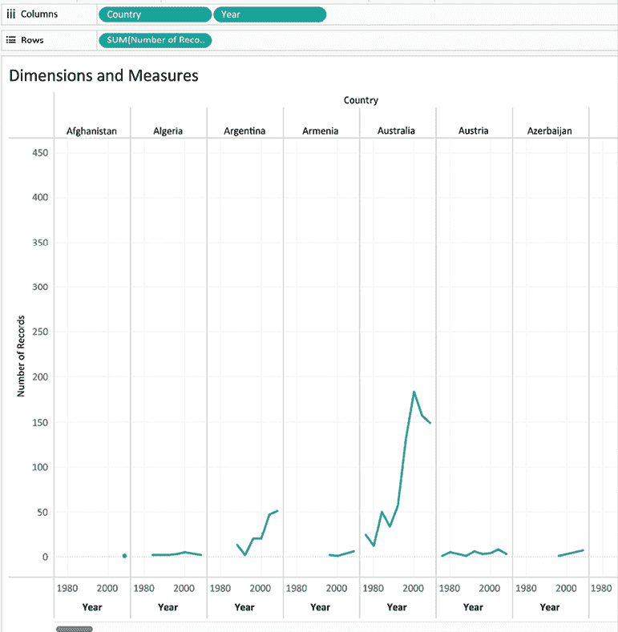

**Figure 1.39:** Dimensions and Measures（维度和度量）

如 *Figure 1.39*（图 1.39）所示，*步骤 3* 赋予了含义。将 `Country`（国家）和 `Year`（年份）放在 `Columns`（列）货架上提供了上下文，从而赋予了可视化含义。

## Row-level, aggregate-level, and table-level calculations（行级、聚合级和表级计算）

Tableau 中有三个计算层级：*row*（行级）、*aggregate*（聚合级）和 *table*（表级）。要理解这三个层级的功能，了解 Tableau 进程很重要。我们将通过一个考虑 `Superstore`（超级商店）数据集中 `Number of Records`（记录数）和 `Quantity`（数量）字段的示例来进行说明。

请考虑下表中的计算类型、计算字段和查询。与常用语言 SQL 的对比将让我们更好地理解如何解释 Tableau 计算。请注意，为了示例的简洁性，SQL 略作简化。

让我们通过下表中的示例，更深入地了解这三个计算层级：

| Calculation type（计算类型） | Calculated field in Tableau（Tableau 中的计算字段） | Query passed to data source（传递给数据源的查询） |
| --- | --- | --- |
| **Row-level**（行级） | `[Number of Records]/[Quantity]` | `SELECT [Number of Records] / [Quantity] FROM [Orders]` |
| **Aggregate-level**（聚合级） | `SUM([Number of Records])/SUM([Quantity])` | `SELECT SUM([Number of Records]), SUM([Quantity]) FROM [Orders]` |
| **Table level**（表级） | `WINDOW_SUM([Number of Records])/[Quantity]` | `SELECT [Number of Records], SUM([Quantity]) FROM [Orders]` |

对于行级和聚合级计算，计算实际上由数据源引擎完成，因为 Tableau 是一种内存工具。Tableau 仅显示结果。然而，表级计算的情况并非如此。尽管为表级计算传递给数据源的查询与聚合级计算的查询相同，但 Tableau 会在返回的结果上执行额外的计算。让我们通过一个使用相同计算字段的练习进一步探索这一点。

让我们看看以下步骤并开始练习：

1. 在与本章关联的工作簿中，导航到 `Row_Agg_Tbl` 工作表。

2. 通过单击左上角 **Data**（数据）部分中的 `Sample - Superstore`（示例 - 超级商店）连接到 `Superstore`（超级商店）数据源。

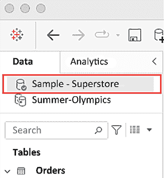

**Figure 1.40:** Connect to Superstore（连接到超级商店）

3. 选择 **Analysis**（分析）\| **Create Calculated Field**（创建计算字段）以创建以下计算字段。请注意，每个字段必须单独创建；即在这种情况下，无法创建一个包含所有三个计算的单一计算字段：
    * 将第一个计算命名为 `Lev – Row` 并输入以下代码：`[Number of Records]/[Quantity]`。
    * 接下来，将第二个计算命名为 `Lev – Agg` 并输入以下代码：`SUM([Number of Records])/SUM([Quantity])`。
    * 最后，将第三个计算命名为 `Lev – Tab` 并输入 `WINDOW_AVG([Lev - Agg])`。

4. 在 **Data**（数据）窗格中，右键单击刚创建的三个计算字段，然后选择 **Default Properties**（默认属性）\| **Number format**（数字格式）。

5. 在生成的对话框中，选择 **Percentage**（百分比）并单击 **OK**。

6. 将 `Order Date`（订单日期）放在 `Columns`（列）货架上。

7. 将 `Measure Names`（度量名称）放在 `Rows`（行）货架上，将 `Measure Values`（度量值）放在 **Marks**（标记）卡上的 **Text**（文本）上。

8. 通过将它们从 `Measure Values`（度量值）货架拖出或从 `Measure Names`（度量名称）筛选器中移除，排除除 `Lev - Row`、`Lev - Agg` 和 `Lev - Tab` 以外的所有值：

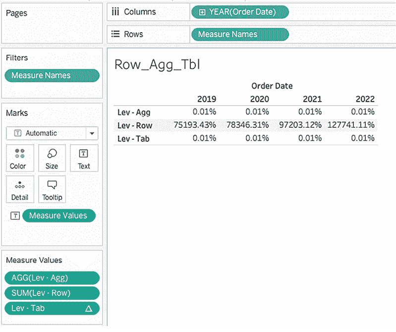

**Figure 1.41:** Level of calculations（计算层级）

* **Lev - Agg** 是聚合级计算。计算由数据源引擎完成。`[Number of Records]` 的总和除以 `[Quantity]` 的总和。计算结果可能对 Tableau 作者很有用。

## 计算层级

*   `Lev - Row` 是行级计算。计算由数据源引擎完成。对于底层数据的每一行，`[Number of Records]` 除以 `[Quantity]`。然后将所有行的结果相加。当然，在这种情况下，行级计算并不提供有用的结果；然而，由于新的 Tableau 制作者可能会在真正需要聚合级计算时错误地创建行级计算，因此此处包含该示例。

*   `Lev - Tab` 是表计算。部分计算由数据源引擎完成，即聚合。Tableau 根据工作表中显示的数据的维度和详细程度，对数据源引擎返回的结果进行额外计算。具体而言，`Lev - Agg` 的结果被求和，然后除以维度中的成员数量。对于前面的示例，情况如下：

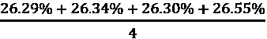

同样，在这种情况下结果并不是特别有帮助，但确实演示了初学者 Tableau 制作者应具备的知识。

## 连续与离散

连续和离散并非 Tableau 独有的概念。实际上，两者在许多领域都能观察到。请看下面的例子：

图 1.42：连续与离散

上图显示了两条河流：*River-Left* 和 *River-Right*。River-Left 中水流动。River-Right 由冰块组成。你能理论上对 River-Right 中的冰块进行排序吗？能！有办法对 River-Left 中的水进行排序吗？换句话说，你能从河底取出桶装水，把这些桶运到上游，再倒回 River-Left，从而说“我已经对河里的水进行了排序”吗？不能。

River-Left 中的 H[2]O 处于连续形式，即水。River-Right 中的 H[2]O 处于离散形式，即冰。

在自然界中考察了连续和离散的例子后，让我们把注意力转回 Tableau。通过以下七点考量，可以更清晰地理解 Tableau 中的连续与离散：

1.  连续是绿色。离散是蓝色：
    *   在 `Data` 窗格中选择任意字段，或将任意字段放到货架上，你会注意到它要么是绿色，要么是蓝色。此外，与字段关联的图标也是绿色或蓝色。

2.  连续始终是 `numeric`。离散可能是 `string`。

3.  连续和离散不等同于维度和度量：
    *   新手 Tableau 制作者常混淆连续与度量、离散与维度。它们并不等同。度量可以是离散或连续的。
    *   此外，如果维度是数字，它也可以是离散或连续的。要证明这一点，请在 Tableau 中右键单击任意数字或日期字段，注意你可以转换它：

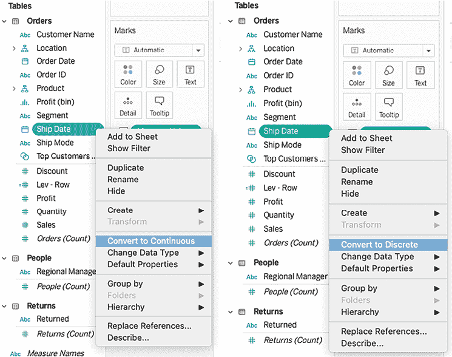

图 1.43：在离散和连续之间转换

4.  离散值可排序。连续值不可排序：
    *   可排序/不可排序的行为最容易通过日期和像 `Sum(Sales)` 这样的度量来观察，如下例所示：

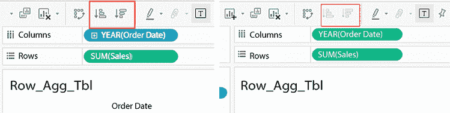

图 1.44：左侧：连续（不可排序）。右侧：离散（可排序）

5.  连续颜色是渐变。离散颜色是分离的：
    *   下面的示例展示了 `Sales` 作为连续和离散的情况。注意颜色渲染的差异。屏幕截图的左半部分显示连续结果为渐变，右半部分显示离散结果为截然不同的颜色类别：

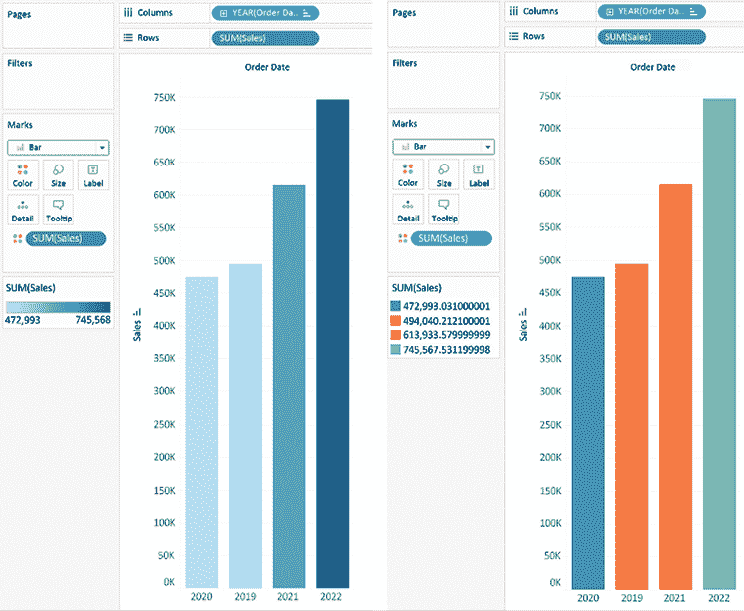

图 1.45：作为连续（左）和离散（右）的 Sales

6.  连续药丸可以放在离散药丸的右侧，但不能放在左侧，因为离散药丸定义了聚合级别：
    *   当 `Year` 是离散时，Tableau 制作者可以将 `Region` 放在 `Year` 的右侧。
    *   当 `Year` 是连续时，Tableau 制作者无法将 `Region` 放在 `Year` 的右侧。

7.  连续创建轴。离散创建表头：
    *   请注意下面屏幕截图右侧部分，`Order Date` 是连续的，且选中了 `Year of Order Date` 轴。因为 `Year of Order Date` 是一个轴，所以整个 `x` 平面被选中。然而在左侧部分，`Year(Order Date)` 是离散的，且选中了 **2014**。因为 2014 只是一个表头，所以只选中它，而不是整个 `x` 平面：

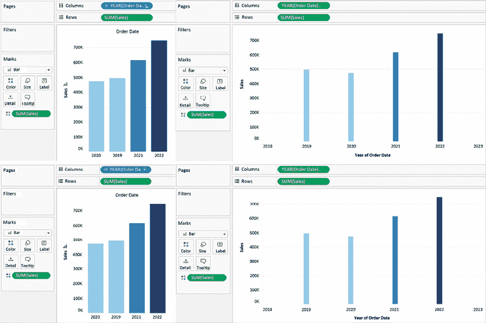

图 1.46：连续（右）和离散（左）日期

恭喜，你刚刚掌握了 Tableau 中的三个重要概念：度量和维度、计算层级，以及离散和连续值。仅凭这些知识，你就能创建第一个仪表板。我强烈鼓励你这样做；摆弄这些工具时学习曲线会非常陡峭，通过练习你会迅速建立信心！这也将帮助你跟上后续章节的内容。

为了结束基础部分，接下来我们将介绍将仪表板导出到其他设备。即使你还没准备好，这也将完善基本的 Tableau Desktop 之旅，并提供一个完整的原始钻石。然后我们可以在未来的章节中继续改进所有细节！

# 将数据导出到其他设备

一旦仪表板看起来符合预期，开发人员就有不同的选择来共享工作。上传到 **Tableau Server** 是最可能的选项。最终用户可能不仅在笔记本电脑上查看结果；他们也可能使用平板电脑或手机。

## 将数据导出到手机

在开发仪表板时，Tableau Creator 可以选择查看 `Device Designer` 或 `Device Preview`。每当你在 **Dashboard** 选项卡上时，可以在此处找到它：

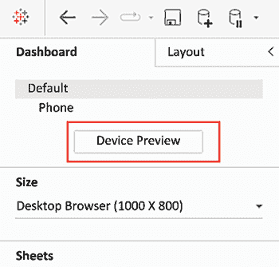

图 1.47：设备预览

Tableau 自带默认手机设置。如果需要，可以通过点击 `Phone` 然后点击三个点来调整这些默认值。进入 `Device Designer` 模式后，选择一个 `Device type` 选项，你将获得最常见型号的选择：

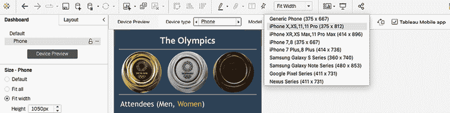

图 1.48：设备类型设为手机

请注意，你只能使用仪表板默认布局中的工作表。例如，如果你想为平板电脑添加默认布局，请进入 `Device Designer` 模式，选择 `Tablet`，并移动内容，使你想在平板电脑上看到的工作表位于设备框架内。满意了吗？然后将新布局（在 *Figure 1.50* 中高亮显示）添加到工作簿中。它将出现在左上角区域的 `Default` 布局下方：

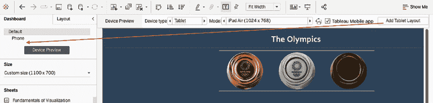

图 1.49：添加平板布局

现在用户每当从 **Tableau Server** 打开工作簿时，都可以选择所需的设计。

不仅可以方便地在移动设备上查看项目，还可以使用 **Tableau Mobile** 随时随地处理它们！我们将在下一节介绍这一点。

## Tableau Mobile

为了支持灵活办公，Tableau 创建了一个应用程序，可从 App Store 或 Google Play 下载，称为 **Tableau Mobile**。安装到手机和/或平板电脑后，你将获得将应用连接到 **Tableau Server** 或 **Tableau Online** 的选项。继续将我们在本章创建的仪表板 *The Olympics* 发布到这两个实例中的任意一个。如果你对发布有疑问，请参阅 **第 14 章**、**探索 Tableau Server 和 Tableau Cloud** 以获取进一步说明。

在登录页面底部，点击 **Explore** 查看刚刚发布的所有视图。点击 `Building a Dashboard` 视图，查看之前创建的仪表板 `The Olympics`：

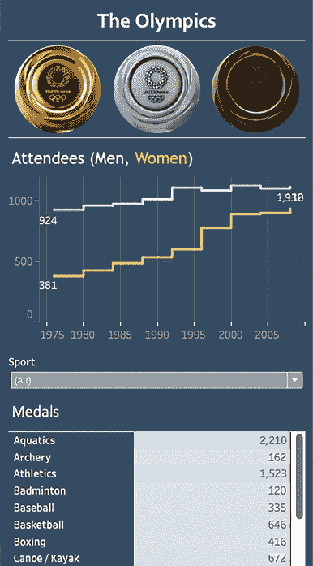

图 1.50：移动仪表板

最精彩的部分还在后面。仪表板完全交互，所以请尝试下拉筛选器或**奖牌**筛选器。此外，尝试点击一个标记并选择**仅保留**。通过点击右上角的工作簿图标（即最左侧的第一个图标），您创建的所有其他工作表将变得可见，从而可以在工作表之间切换：

图 1.51：工作表选择

现在，如果您点击右上角的三个点，将出现更多选项，例如**还原**、**警报**、**订阅**等。要了解 Tableau Server 上也可用的不同选项的更多信息，请参阅*第 14 章*、*探索 Tableau Server 和 Tableau Cloud*。目前，我们可以得出结论：Tableau Mobile 让您无论身在何处都能轻松查看收藏的仪表板。

## 摘要

在本章中，我们介绍了 Tableau 的基础知识。我们从一些基本术语开始，然后了解了创建工作表和仪表板的基础知识。我们重点关注了默认行为以及如何覆盖该行为，并探讨了一些最佳实践。然后，我们回顾了度量名称和度量值的基本原理。之后，我们探讨了三个基本的 Tableau 概念：维度和度量；行级、聚合级和表级计算；以及连续和离散的概念。特别重要的是要理解行级和聚合级计算由数据源引擎计算，而表级计算由 Tableau 处理。最后，我们了解了如何为其他设备（如手机或平板电脑）调整仪表板，以及 Tableau Mobile 的实际运作。

在下一章中，我们将通过研究数据继续探索 Tableau。我们将探讨如何使用 Tableau 的数据处理引擎 Hyper 来准备数据，并探索一些有用的数据准备模型和技术。

## 在 Discord 上了解更多

要加入本书的 Discord 社区——您可以在其中分享反馈、向作者提问并了解新版本——请扫描下方的二维码：

[`packt.link/tableau`](https://packt.link/tableau)

