# 准备您的数据

您是否曾自问：我的数据是否足够干净以进行分析？凡是处理数据的人很可能都有过这个疑问，因此本章专门讲解如何为分析准备数据，也就是数据清洗。

本章的第一部分侧重理论，不包含练习。建议仔细阅读这些信息，因为它们为深入理解奠定了基础。本章后半部分提供了各种专门针对数据准备的练习。

现在，让我们怀着丰富理解、成为更优秀的数据管家的目标，深入探讨这个迷人的主题。

在本章中，我们将讨论以下主题：

*   了解 Hyper
*   专注于数据准备
*   勘察数据
*   清理混乱数据

由于 Tableau Desktop 10.5 已上市一段时间，您可能已经听说过 Hyper。无论您是否听说过，请继续阅读以了解该功能的入门知识！

## 了解 Hyper

在本节中，我们将探索 Tableau 的数据处理引擎，以及它如何在企业中实现结构化且有机的数据挖掘过程。自 Tableau 10.5 发布以来，我们可以使用 Hyper——一种高性能数据库，让我们能比以往更快地查询源数据。即使是高级开发人员，通常也不太了解 Hyper，因为它不是日常活动中显而易见的一部分；然而，如果您想真正掌握如何为 Tableau 准备数据，这种理解至关重要。

Hyper 最初于 2008 年在慕尼黑大学作为一个研究项目启动。2016 年，Tableau 收购了它，并将其设立为 Tableau 专门的数据引擎团队，保留其在慕尼黑的基地和员工。最初在 Tableau 10.5 中，Hyper 仅针对提取替换了早期的数据处理引擎。实时连接仍不受 Hyper 影响，但 Tableau Prep Builder 现在也运行在 Hyper 引擎上，未来将有更多用例。正如 [tableau.com](http://tableau.com) 所述：“*Hyper 可在几秒内对海量数据进行切片和剖析，您将看到查询速度最高提升 5 倍，提取创建速度最高提升 3 倍*。”如果您还想了解更多，还可以通过 API 调用在您偏好的编程语言中使用 Hyper：[`help.tableau.com/current/api/hyper_api/en-us/docs/hyper_api_reference.html`](https://help.tableau.com/current/api/hyper_api/en-us/docs/hyper_api_reference.html)。

但是什么让 Hyper 如此之快？让我们揭开它的面纱一探究竟！

### Tableau 数据处理引擎

Hyper 创始人的共同愿景是创建一个高性能的下一代数据库——一个系统、一种状态、无妥协、无延迟。他们做到了——如今，Hyper 可以同时服务于通用数据库用途、数据摄取和分析。

内存价格呈指数级下降。CPU 也是如此；晶体管数量遵循摩尔定律增长，而其他特性却停滞不前。内存变得便宜，但处理能力仍需提升。

摩尔定律是英特尔联合创始人戈登·摩尔提出的观察：芯片上的晶体管数量每两年翻一番，而成本减半。关于摩尔定律的信息可在 Investopedia 上找到：[`www.investopedia.com/terms/m/mooreslaw.asp`](https://www.investopedia.com/terms/m/mooreslaw.asp)。

在试验 Hyper 时，创始人发现手写的 C 代码比任何现有的数据库引擎都快，因此他们想到将 Tableau 查询转换为 C 代码并同时优化，所有这些都在后台完成，Tableau 用户不会察觉。这种转换和优化是有代价的；传统数据库引擎可以立即开始执行代码。Tableau 需要先将查询转换为代码，优化代码，再编译为机器代码，然后才能执行。关键问题是：它仍然更快吗？正如 Tableau Public 和其他工作簿上的许多测试所证明的，答案是肯定的！

此外，如果预估某查询在不编译为机器代码的情况下执行会更快，Tableau 拥有自己的**虚拟机**（**VM**），查询将在其上立即执行。除此之外，Hyper 可利用 99% 的可用 CPU 算力，而其他并行进程只能利用 29% 的可用 CPU 算力。这归功于独特创新的碎片驱动并行化技术。

想了解更多关于碎片驱动并行化信息的读者，可以在 [`15721.courses.cs.cmu.edu/spring2016/papers/p743-leis.pdf`](https://15721.courses.cs.cmu.edu/spring2016/papers/p743-leis.pdf) 找到一篇论文，该论文后来成为 Hyper 引擎的基础。

如果您想了解更多关于 Hyper 引擎的信息，我强烈推荐观看以下视频：[`youtu.be/h2av4CX0k6s`](https://youtu.be/h2av4CX0k6s)。

Hyper 将传统数据仓库操作的三个步骤并行化：

*   事务和**持续数据摄取**（**联机事务处理**，或 **OLTP**）
*   **分析**（**联机分析处理**，或 **OLAP**）
*   **超越关系**（**联机超关系处理**，或 **OBRP**）

同时执行这些步骤使 Hyper 更高效、性能更强，这与传统系统将这三个步骤分离并依次执行形成对比。


# Hyper 要点总结

总而言之，`Hyper` 是一个高度专业化的数据库引擎，让我们作为用户能从查询中获得最佳性能。如果你还记得，在 `第 1 章` `回顾基础知识` 中，我们已经看到工作表或仪表板上的每一次更改，包括拖放药丸、筛选器和计算字段等，都会被转化为查询。这些查询非常像 `SQL`；然而，在 Tableau 中，我们称查询引擎为 `VizQL`。

`VizQL` 是 Tableau Desktop 中的另一颗隐藏宝石，负责以图表格式可视化数据，并完全在内存中执行。优势在于数据库端不需要额外的空间。当用户将字段放置在货架上时，会生成 `VizQL`。然后 `VizQL` 被翻译成 `SQL`、`MDX` 或 `Tableau 查询语言` (`TQL`)，并通过驱动程序传递给后端数据源。

## 专注于数据准备

Tableau 可以有效地用于各个数据准备阶段。遗憾的是，单个章节不足以深入探讨 Tableau 如何在每个阶段中使用。确实，这种深入探讨可能值得写成一整本书！因此，我们的重点将放在数据准备上，因为从历史上看，该阶段占据了高达 60% 的数据挖掘工作量。我们的目标是学习如何使用 Tableau 来简化这项工作。

### 勘察数据

Tableau 可以成为简单勘察数据的非常有效的工具。有时在勘察过程中，你可能会发现清理数据或根据现有字段填补不完整数据的方法。有时，遗憾的是，拼图碎片根本不足以拼凑出完整的数据集。在这种情况下，Tableau 可用于准确传达缺口所在，这反过来可能会激励组织更完整地填充底层数据。

在本练习中，我们将探索如何使用 Tableau 快速发现数据集中每个字段的空值百分比。接下来，我们将探索如何从现有字段推断数据以填补空白。

#### 确定空值

以下是勘察数据的步骤：

1.  如果你尚未这样做，请导航至 `https://public.tableau.com/profile/marleen.meier` 以查找并下载与本章关联的工作簿。
2.  导航至名为 `勘察` `&` `探索` `数据` 的工作表，并选择 `幸福报告` 数据源。
3.  将 `区域` 和 `国家` 拖至 `行` 货架。观察在某些情况下，`区域` 字段对于某些国家显示 `Null` 值：
    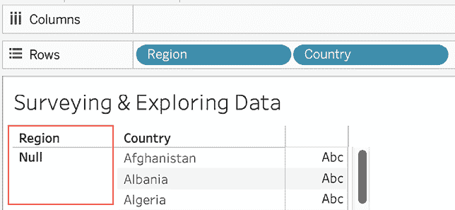
    图 2.1：空值区域
4.  右键单击并 `编辑` 名为 `选择字段` 的参数。注意 `数据类型` 设置为 `整数`，我们可以观察到一个包含数据集中每个字段名称条目的列表：
    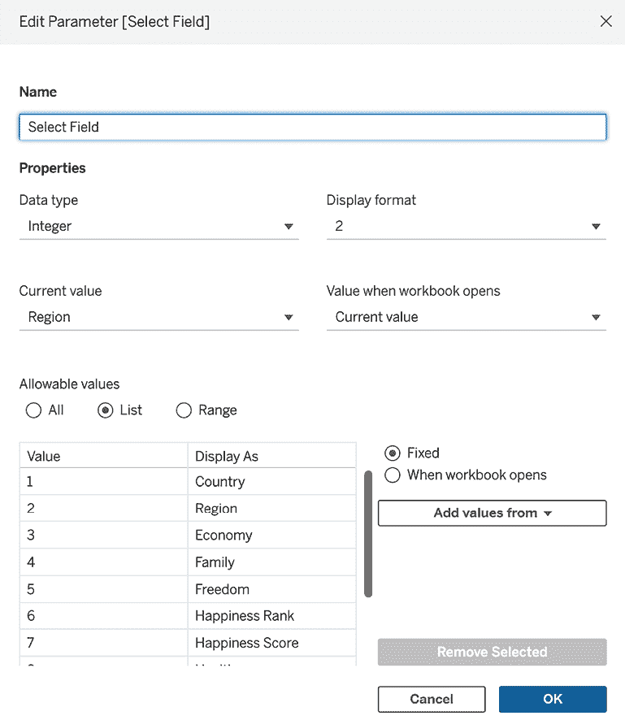
    图 2.2：编辑参数
5.  在 `数据` 窗格中，右键单击刚创建的参数并选择 `显示参数控件`。
6.  创建一个名为 `% 已填充` 的计算字段并编写以下计算：
    ```
    SUM([Number of Records]) / TOTAL(SUM([Number of Records]))
    ```
7.  在 `数据` 窗格中，右键单击 `% 已填充` 并选择 `默认属性` | `数字格式…`：
    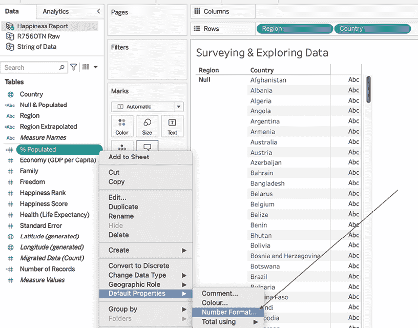
    图 2.3：调整默认属性
8.  在生成的对话框中，选择 `百分比`。
9.  创建一个名为 `空值与已填充` 的计算字段并添加以下代码。注意完整的 CASE 语句相当冗长但也重复。
    在需要冗长但重复计算的情况下，考虑使用 Excel 更快、更准确地编写代码。通过使用 Excel 的 `CONCATENATE` 函数，你可能能够节省时间并避免拼写错误。
    在下面的代码块中，代码行仅占总量的一部分，但应足以让你生成完整的代码块：
    ```
    CASE [Select Field]
    WHEN 1 THEN IF ISNULL ([Country]) THEN 'Null Values' ELSE 'Populated Values' END
    WHEN 2 THEN IF ISNULL ([Region]) THEN 'Null Values' ELSE 'Populated Values' END
    WHEN 3 THEN IF ISNULL ([Economy (GDP per Capita)]) THEN 'Null Values' ELSE 'Populated Values' END
    WHEN 4 THEN IF ISNULL ([Family]) THEN 'Null Values' ELSE 'Populated Values' END
    WHEN 5 THEN IF ISNULL ([Freedom]) THEN 'Null Values' ELSE 'Populated Values' END
    WHEN 6 THEN IF ISNULL ([Happiness Rank]) THEN 'Null Values' ELSE 'Populated Values' END
    WHEN 7 THEN IF ISNULL ([Happiness Score]) THEN 'Null Values' ELSE 'Populated Values' END
    WHEN 8 THEN IF ISNULL ([Health (Life Expectancy)]) THEN 'Null Values' ELSE 'Populated Values' END
    WHEN 9 THEN IF ISNULL ([Standard Error]) THEN 'Null Values' ELSE 'Populated Values' END
    END
    ```
10. 从 `行` 货架中移除 `区域` 和 `国家`。
11. 将 `空值与已填充` 放置在 `行` 和 `颜色` 货架上，将 `% 已填充` 放置在 `列` 和 `标签` 货架上：
    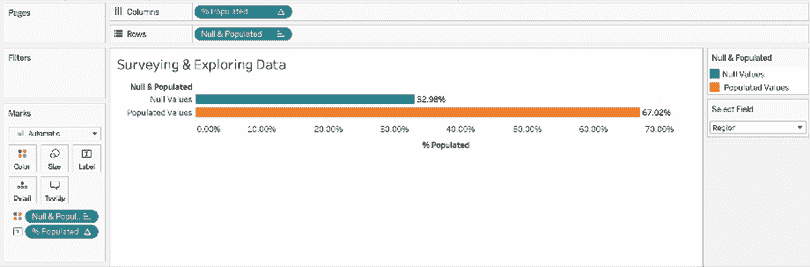
    图 2.4：已填充值
12. 如果需要，将 `空值` 的颜色改为红色，`已填充值` 的颜色改为绿色。你可以通过单击 `标记` 卡中的 `颜色` 并选择 `编辑颜色` 来实现。
13. 单击工作表上 `选择字段` 参数右上角的箭头，并选择 `单值列表`。
14. 在 `选择字段` 参数中选择不同的选项，并注意某些字段具有较高的空值百分比。例如，在下图中，`32.98%` 的记录没有 `区域` 的值：
    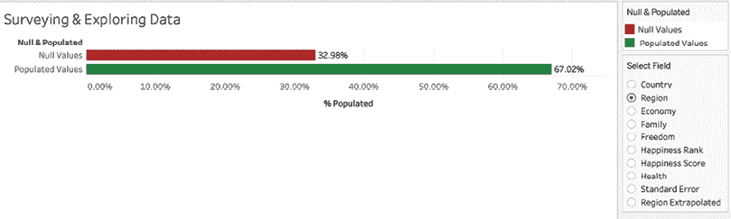
    图 2.5：比较空值和已填充值

基于此练习，让我们探索如何使用相同的数据集清理并从现有数据推断数据。

#### 推断数据

本练习将在上一个练习的基础上进行扩展，通过清理现有数据并利用已知信息填补部分缺失数据。我们将假设我们知道哪个国家属于哪个区域。我们将利用该知识来修复 `区域` 字段中的错误，并使用 Tableau 填补空白：

1.  从上一个练习结束的地方开始，创建一个名为 `区域推断` 的计算字段，包含以下代码块：
    ```
    CASE [Country]
    WHEN 'Afghanistan' THEN 'Southern Asia'
    WHEN 'Albania' THEN 'Central and Eastern Europe'
    WHEN 'Algeria' THEN 'Middle East and Northern Africa'
    WHEN 'Angola' THEN 'Sub-Saharan Africa'
    WHEN 'Argentina' THEN 'Latin America and Caribbean'
    WHEN 'Armenia' THEN 'Central and Eastern Europe'
    WHEN 'Australia' THEN 'Australia and New Zealand'
    WHEN 'Austria' THEN 'Western Europe'
    //用数据集中剩余的字段完成 case 语句
    END
    ```
    作为 `CASE` 语句的替代方案，你可以使用 `IF` 语句，如下所示：
    ```
    If [Country] = 'Afghanistan' then 'Southern Asia' 
    ELSEIF [Country] = 'Albania' then …
    END
    ```
    为了加快创建冗长计算字段的繁琐过程，你可以将数据下载到 Excel 文件中，通过连接各个部分来创建计算字段，如下所示：
    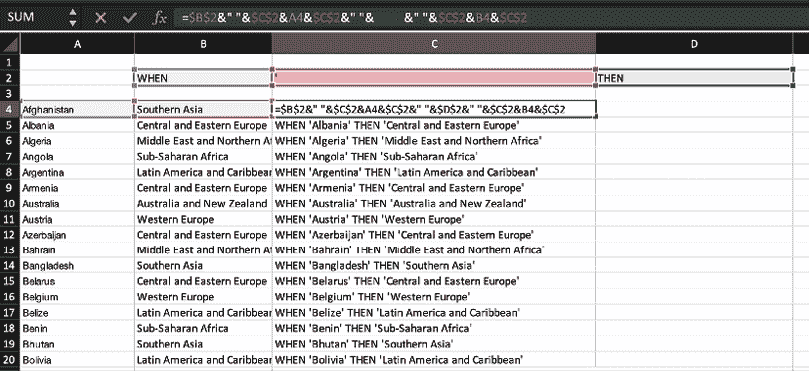
    图 2.6：在 Excel 中编译计算


# 清理混乱数据

美国政府为各种官僚流程提供了有用的文档。例如，**卫生与公众服务部**（**HSS**）提供 ICD-9 代码列表，即疾病和相关健康问题国际统计分类代码。不幸的是，这些代码并不总是采用易于访问的格式。

以此为例，让我们看看一份名为 `R756OTN` 的实际 HHS 文档，可在 <https://www.cms.gov/Regulations-and-Guidance/Guidance/Transmittals/downloads/R756OTN.pdf> 找到。

## 清理数据

导航到随本章提供的工作簿中的 `Cleaning the Data` 工作表，并执行以下步骤：

1. 在 **数据** 窗格中，选择 **R756OTN Raw** 数据源：

   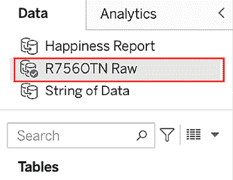

   图 2.9：选择原始文件

2. 将 **Diagnosis** 拖至 **行** 货架，然后选择 **添加所有成员**。点击 **AZ** 图标对 **Diagnosis** 列进行排序。注意某些行中出现的垃圾数据：

   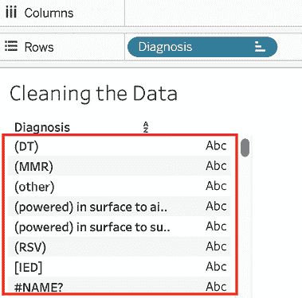

   图 2.10：将 Diagnosis 添加到行

3. 创建一个名为 `DX` 的计算字段，包含以下代码：

   ```
   SPLIT([Diagnosis], " ", 1)
   ```

4. 创建一个名为 `Null Hunting` 的计算字段，包含以下代码：

   ```
   INT(MID([DX],2,1))
   ```

5. 在 **数据** 窗格中，将 `Null Hunting` 从 **度量** 拖至 **维度**。

6. 将 **Diagnosis**、**DX** 和 `Null Hunting` 拖至 **行** 货架。观察当 **Diagnosis** 字段的第二个字符不是数字时，返回 **Null**：

   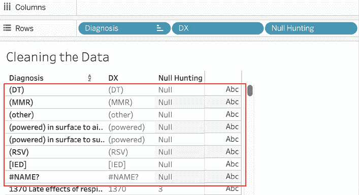

   图 2.11：在行上排序字段

7. 创建一个名为 `Exclude from ICD codes` 的计算字段，包含以下代码：

   ```
   ISNULL([Null Hunting])
   ```

8. 清除工作表中的所有字段，如 *第 1 章*、*回顾基础知识* 中所示，并将 **标记** 卡设置为 **形状**。

9. 将 `Exclude from ICD Codes` 放在 **颜色** 和 **形状** 货架上，然后将 `DX` 放在 **行** 货架上。观察标记为 **True** 的行：

   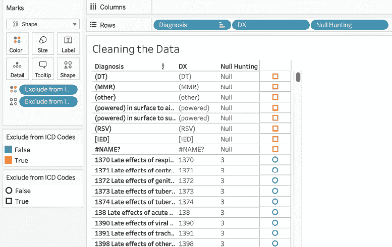

   图 2.12：排除垃圾数据

10. 为了排除垃圾数据（即 `Exclude from ICD Codes` 等于 `True` 的那些行），将 `Exclude from ICD Codes` 放在 **筛选器** 货架上并取消选择 **True**。

11. 创建一个名为 `Diagnosis Text` 的计算字段，包含以下代码：

    ```
    REPLACE([Diagnosis],[DX] + "","")
    ```

12. 将 **Diagnosis Text** 放在 **行** 货架上 `DX` 之后。此外，从 **行** 货架和 **标记** 卡中移除 `Exclude from ICD Codes`，并将标记类型设置为 **自动**：

    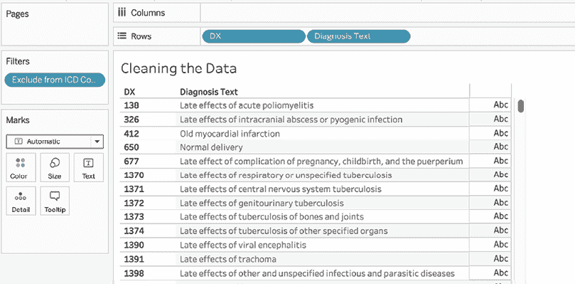

    图 2.13：观察清理后的数据

现在我们已经完成了练习，让我们花点时间来考虑一下我们使用的代码：

- `SPLIT` 函数是在 Tableau 9.0 中引入的：

  ```
  SPLIT([Diagnosis], " ", 1)
  ```

- 正如 Tableau 帮助文档中关于该函数的描述，该函数执行以下操作：

  *根据分隔符从字符串中返回子字符串，从字符串的开头或结尾提取字符*。

- 单击列标题并选择 **拆分** 时，也可以直接在 **数据源** 选项卡中调用此函数。要从字符串末尾提取字符，标记编号（即函数末尾的数字）必须为负数。

- 请看下面的代码，我们用它来创建 `Null Hunting` 字段：

  ```
  INT(MID([DX],2,1))
  ```

- `MID` 的用法非常直接，与 Excel 中对应的函数非常相似。然而，此处 `INT` 的用法可能会令人困惑。使用 `INT` 函数转换字母字符将导致 Tableau 返回 `Null`。这完全满足了我们的目的，因为我们只需通过定位空值来发现那些不以整数开头的行。

- `ISNULL` 是一个布尔函数，在 `Null` 的情况下只返回 `TRUE`：

  ```
  ISNULL([Null Hunting])
  ```

- 创建 `Diagnosis Text` 字段时使用了 `REPLACE` 函数：


```
REPLACE([Diagnosis],[DX] + "","")
```

3. 此计算字段使用在 `DX` 中隔离的 ICD-9 代码从 `Diagnosis` 字段中移除这些相同代码，从而提供一个相当干净的描述。注意 *fairly clean* 这一短语。被移除的行最初与较长的描述相关联，因此包含回车符。生成的额外行就是我们在本练习中移除的内容。因此，较长的描述在此解决方案中通过 `replace` 计算被截断。

本练习的最终输出可以是从 Tableau 导出数据作为额外的数据源。然后该数据可供 Tableau 和其他工具用于未来的报告需求。例如，`DX` 字段可用于数据混合。

Tableau 是否提供了一种更好的方法来解决前一个解决方案相关的数据截断问题？有的！让我们把注意力转移到下一个练习，我们将探讨正则表达式函数。

## 提取数据

虽然如前一个练习 *Cleaning the data* 所示，`SPLIT` 函数可用于清洗干净的数据，但正则表达式函数功能强大得多，这代表了 Tableau 传统上专注于可视化和分析的范围扩大，也包含了数据清洗功能。

让我们看一个需要在 Tableau 中处理一些非常混乱数据的示例。我们的目标是提取电话号码。

以下是步骤：

1. 如果您尚未下载，请从 [`public.tableau.com/profile/marleen.meier`](https://public.tableau.com/profile/marleen.meier) 下载工作簿并在 Tableau 中打开它。
2. 选择 `Extracting the Data` 选项卡。
3. 在 **数据** 窗格中，选择 **String of Data** 数据源并将 **String of Data** 字段拖到 **行** 架上。观察提取电话号码相关的挑战：

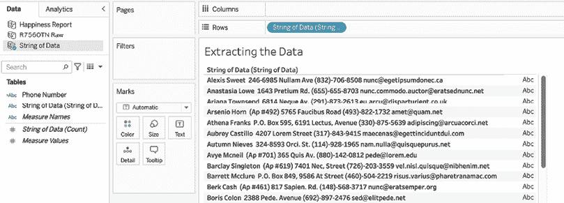

图 2.14：从混乱的数据格式中提取数据

4. 单击 **查看数据** 按钮并复制几行来访问底层数据：

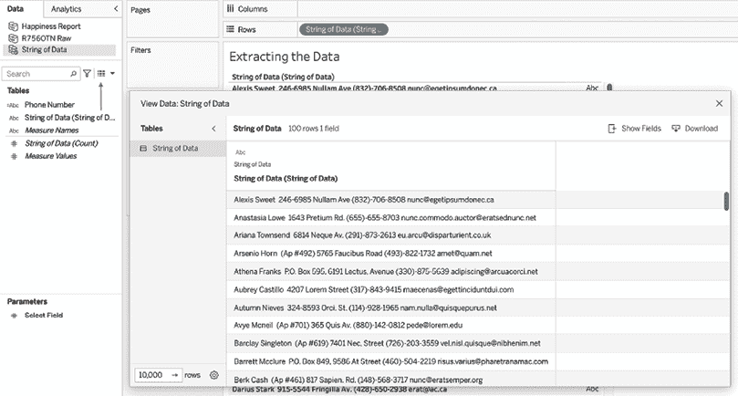

图 2.15：访问底层数据

5. 导航到 [`regexpal.com/`](http://regexpal.com/) 并将数据粘贴到标记为 **Test String** 的窗格中——即第二个窗格：

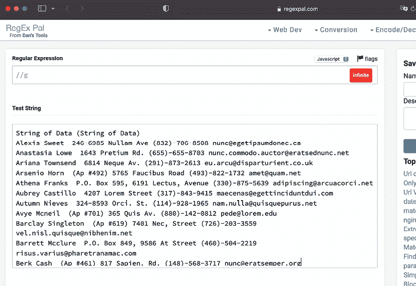

图 2.16：Regexpal

6. 在第一个窗格（标记为 **Regular Expression** 的那个）中，输入以下内容：

```
\([0-9]{3}\)-[0-9]{3}-[0-9]{4}
```

7. 返回 Tableau 并创建一个名为 `Phone Number` 的计算字段，使用以下代码块。注意计算字段中嵌套的正则表达式：

```
REGEXP_EXTRACT([String of Data (String of Data)],'(\([0-9]{3}\)-[0-9]{3}-[0-9]{4})')
```

8. 将 **Phone Number** 放在 **行** 架上，并观察结果：

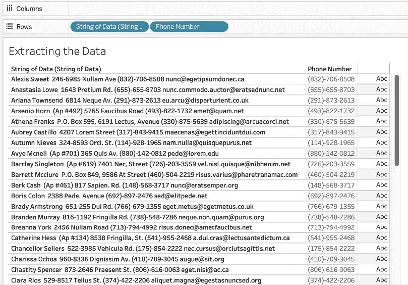

图 2.17：提取数据最终视图

现在让我们更详细地考虑前一个练习的一些细节：

* 考虑以下代码块：

```
REGEXP_EXTRACT([String of Data],'()')
```

* 此处有意排除表达式模式，因为稍后将详细介绍。‘`()`' 代码充当表达式模式的占位符。本示例中使用的 `REGEXP_EXTRACT` 函数在 Tableau 的帮助文档中描述如下：

> *返回给定字符串中与正则表达式模式内捕获组匹配的子字符串。*

* 请注意，截至撰写时，Tableau 文档未说明如何确保函数的模式输入部分正确分隔。对于此示例，请务必在模式输入部分周围包含 ‘`()`' 以避免空输出。

* 在计算字段中嵌套，而该计算字段本身嵌套在 `VizQL` 查询中，可能会影响性能（如果嵌套/聚合层级过多）。

* 有许多正则表达式网站允许您输入自己的代码，并通过基于您提供的示例数据提供即时反馈来帮助您。[`regexpal.com/`](http://regexpal.com/) 只是其中之一，请根据需要搜索以找到适合您的网站！

* 现在，考虑以下表达式：

```
\([0-9]{3}\)-[0-9]{3}-[0-9]{4}
```

在此上下文中，`\` 表示下一个字符不应被视为特殊字符，而应视为字面字符。在我们的示例中，我们字面上是在寻找一个左括号。`[0-9]` 只是声明我们在寻找一个或多个数字。或者，考虑使用 `\d` 以达到相同结果。`{3}` 指定我们要寻找三个连续数字。

与模式开头的左括号一样，`\` 字符将右括号指定为字面字符。`-` 是一个字面字符，专门寻找连字符。根据前面的信息，表达式模式的其余部分应该可以理解。

回顾此练习后，您可能会好奇如何仅返回电子邮件地址。根据 [`www.regular-expressions.info/email.html`](http://www.regular-expressions.info/email.html)，符合 RFC 5322 标准的电子邮件地址的正则表达式如下：

```
(?:[a-z0-9!#$%&'*+/=?^_'{|}~-]+(?:\.[a-z0-9!#$%&'*+/=?^_'{|}~-
]+)*|"(?:[\x01-\x08\x0b\x0c\x0e-\x1f\x21\x23-\x5b\x5d-
\x7f]|\\[\x01-\x09\x0b\x0c\x0e-\x7f])*")@(?:(?:a-z0-9?\.)+a-z0-9?|\[(?:(?:25[0-5]|2[0-4][0-9]|[01]?[0-9][0-9]?)\.){3}(?:25[0-
5]|2[0-4][0-9]|[01]?[0-9][0-9]?|[a-z0-9-]*[a-z0-9]:(?:[\x01-
\x08\x0b\x0c\x0e-\x1f\x21-\x5a\x53-\x7f]|\\[\x01-\x09\x0b\x0c\x0e-
\x7f])+)\])
```

电子邮件并不总是遵循 RFC 5322 标准，因此可能需要额外的工作才能真正清洗电子邮件地址数据。

虽然我不会尝试详细解释此代码，但您可以在 [`www.regular-expressions.info/email.html`](http://www.regular-expressions.info/email.html) 阅读所有相关内容，这是一个学习更多正则表达式知识的绝佳资源。此外，YouTube 上还有几个有用的正则表达式教程。

本练习的最终输出可能应该用于增强现有源数据。像此示例这样的 **数据转储** 不属于数据仓库；然而，即使重要且必要的数据也可能隐藏在这样的转储中，Tableau 可以有效地用于提取它。

## 摘要

我们本章开始时讨论了 Tableau 数据处理引擎。这说明了 Tableau 在处理数据时提供的灵活性。了解数据处理引擎对于确保您的数据挖掘工作聪明地聚焦非常重要。否则，您的精力可能会浪费在与 Tableau 无关的活动上。

接下来，我们专注于数据准备。我们考虑了使用 Tableau 来调查和清洗数据。由正则表达式函数代表的数据清洗功能特别引人入胜，值得进一步研究。

完成我们第一次以数据为中心的讨论后，我们将继续 *第 3 章*、*使用 Tableau Prep Builder*，探讨 Tableau 推向市场的较新功能之一。Tableau Prep Builder 是一个专用的数据预处理界面，能够大大减少您进行预处理所需的时间。我们将了解清洗、合并、筛选、连接以及 Tableau Prep Builder 提供的其他功能。

## 在 Discord 上了解更多

要加入本书的 Discord 社区——您可以在其中分享反馈、向作者提问并了解新版本——请扫描下方的二维码：

[`packt.link/tableau`](https://packt.link/tableau)


