# 使用 Tableau Prep Builder


## Tableau Prep Builder 概览

Tableau Prep Builder 随 Tableau Desktop 2018.1 版本推出，但我们可以用 Tableau Prep Builder（本章以下简称 *Prep*）做什么呢？该工具的核心用途是数据准备。好消息是，*Prep* 与 Tableau Desktop 完全兼容，也与 Tableau Server 兼容。这意味着您可以在 *Prep* 中单击一下按钮即可执行作业来清理数据。此外，*Prep* 与其“大哥” Tableau Desktop 一样可视化，这意味着您可以以完全可视化的格式查看数据准备的每一步。

因此，让我们深入了解**图形用户界面**（**GUI**），并对这款高端产品感到惊叹，它将帮助您获得初步的数据洞察，从而更快地决定您的数据集是否值得分析。*Prep* 将为更顺畅的 Tableau Desktop 体验铺平道路。

在本章中，将讨论以下主题：

*   连接数据
*   Prep GUI
*   数据质量
*   Prep 的其他选项
*   导出数据

为了开始，我们需要加载数据。如何在 *Prep* 中执行此操作将在下一节中介绍。

## 连接数据

如果您熟悉 Tableau Desktop，*Prep* 对您来说将易如反掌。操作方式和界面非常相似，而且连接数据（如果连接器在 *Prep* 中可用）的方式也相同，无论是文本文件、数据库还是提取文件。乍一看，您甚至可能注意不到 *Prep* 和 Tableau Desktop GUI 之间的区别，这提供了一个方便的优势：您可以立即开始准备数据。

要开始，请打开 *Prep* 并单击 **+** 以打开文件。将出现以下屏幕：

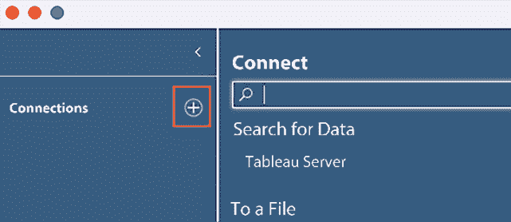

图 3.1：连接数据

从前面的屏幕截图中，我们可以看到您可以在搜索栏中选择要连接的数据类型。正如在 Tableau 中一样，*Prep* 的功能列表包含多种数据库。

现在，让我们通过一个实践练习来连接数据集。此练习需要以下数据集：[`www.kaggle.com/airbnb/boston`](https://www.kaggle.com/airbnb/boston)。请下载 `calendar.csv`、`listings.csv` 和 `reviews.csv`。或者，从 Tableau Public 上与本章关联的存储库下载：[`github.com/PacktPublishing/Mastering-Tableau-2023-Fourth-Edition/tree/main/Chapter03`](https://github.com/PacktPublishing/Mastering-Tableau-2023-Fourth-Edition/tree/main/Chapter03)。

首先，我们将从 `calendar.csv` 文件开始。通过建立文本文件连接，然后选择您的 `.csv` 文件，将其添加到空白的 *Prep* 画布中。您现在将看到以下屏幕：

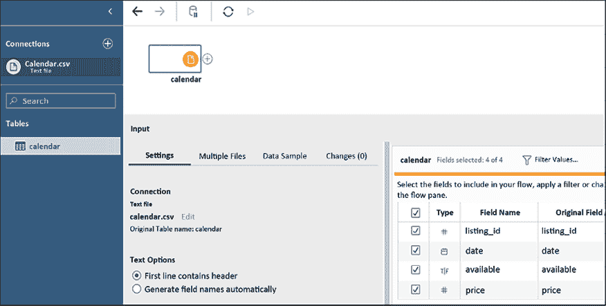

图 3.2：输入数据

恭喜——您刚刚建立了第一个 *Prep* 连接。在这里，您可以根据需要操作和可视化您连接的数据集！

在下一节中，我将更详细地描述 GUI。

## Prep GUI

用户体验是一个重要话题，不仅在您构建仪表板时，而且在您使用 Tableau 的其他方面时也是如此。Tableau 最大的卖点之一一直是 GUI 的易用性，这只是 Tableau 备受客户喜爱的原因之一。

Prep GUI 有两个重要的画布供您查看。连接数据到 *Prep* 后，工作区将分成几个部分：

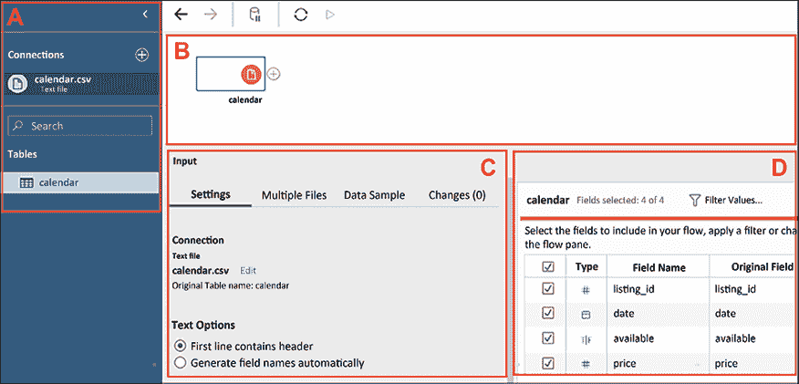

图 3.3：Prep 工作区部分

让我们看看从前面的屏幕截图中可以看到什么：

**A**：连接窗格，显示所选位置可用的输入文件。

**B**：流程窗格，显示您当前的 *Prep* 流程。这总是从输入步骤开始。

**C**：输入窗格设置，为您提供多个配置输入的选项。

**D**：输入窗格样本，显示您移至连接窗格的字段，包括样本值。

在输入窗格（**C**）中，您可以使用通配符联合（多个文件）功能从同一目录添加多个文件。此外，您可以限制 *Prep* 将打印的样本集以提高性能。在输入窗格样本（**D**）中，您可以选择和取消选择要导入的字段并更改其数据类型。数据类型选项包括字符串、日期或数字等。

第二个 GUI 是配置文件窗格。选择所需的输入数据后，单击流程窗格中的 **+** 并选择 **添加：清理步骤**。现在配置文件窗格将显示数据网格：

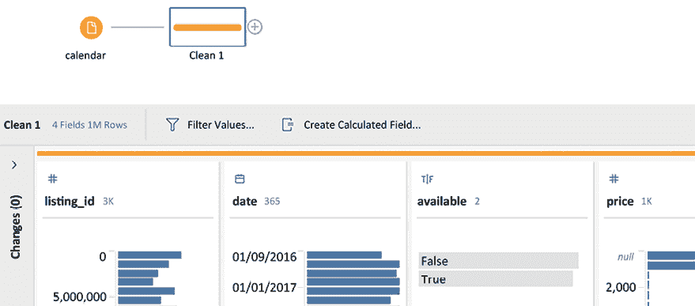

图 3.4：清理数据

在前面的屏幕截图中，配置文件窗格分两部分显示来自数据源的每一列。上半部分显示聚合信息。例如，第 2 列 `date` 在一个小型直方图中显示每个日期的行数。所有列都可以通过单击列名旁边的排序图标（当鼠标悬停在列上时出现的迷你条形图）并选择一项来排序。以 `available`（第 3 列）中的 `True` 为例。所有相关特征将被高亮显示：

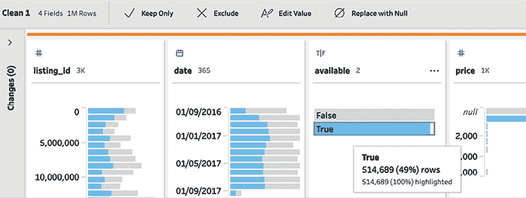

图 3.5：可视化筛选

这让您有机会在开始清理数据之前就对数据获得一些洞察。在下面的屏幕截图中，配置文件窗格的下半部分将按数据源中的原样显示每一行：

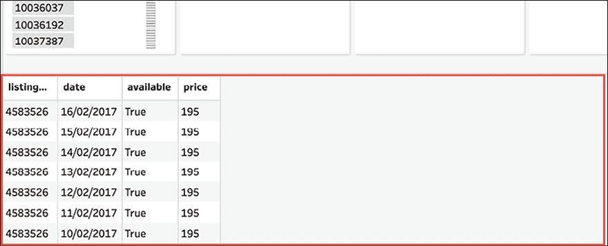

图 3.6：数据概览

到目前为止，我们已经看到，在 *Prep* 中加载数据后，可以通过单击列中的字段或条形来应用可视化筛选器。下半窗格将始终显示在行级别所做选择的数据源。接下来，我们将通过添加更多数据源继续。

### 了解 Prep

让我们从一个实际示例开始：

除了 `calendar.csv` 文件外，连接到以下文件：

*   `listings.csv`
*   `reviews.csv`

现在，将它们拖到流程窗格中：

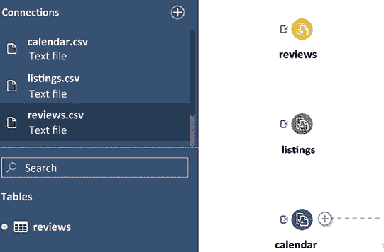

图 3.7：多表输入

您能回答以下问题吗？

*   有多少房源在其描述中使用了“beach”一词？
*   标记为“精确位置”的公寓占比是多少？
*   哪一天录入的评论最多？

没有像 *Prep* 这样的工具，要找到这类问题的答案要困难得多。*Prep* 让我们的数据分析之旅更快、更轻松，这正是我鼓励您花额外时间学习 *Prep* 以及 Tableau Desktop 的原因！

解决方案可在与本章关联的工作簿中找到，链接如下：[`public.tableau.com/profile/marleen.meier`](https://public.tableau.com/profile/marleen.meier)。

在这里您可以看到，作为示例，我对 `date` 使用了 `sort()` 函数来回答第三个问题：*哪一天录入的评论最多？*

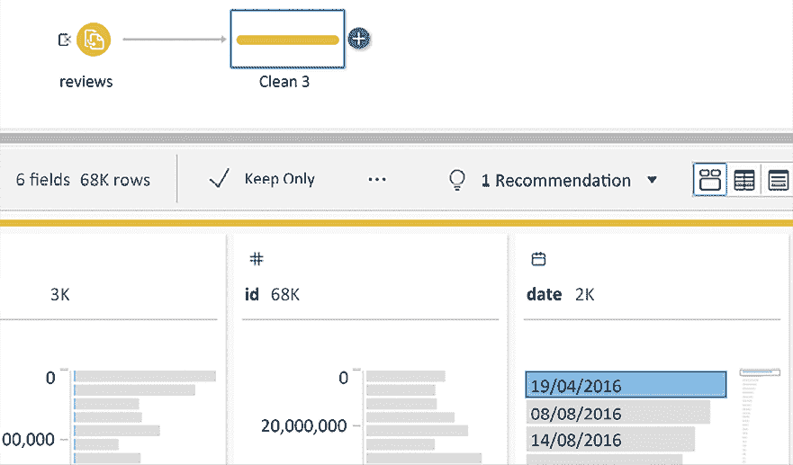

图 3.8：按日期排序

正如您所见，对该字段排序后，日期按条目数排序，从而非常简单地回答了*哪一天录入的评论最多？*这个问题。经过前几次点击后，它已经开始让人感觉很自然，不是吗？

您对数据集所做的所有更改都可以在配置文件窗格的左侧追溯。但别忘了为每个步骤添加合适的名称：这将使他人和您自己更容易理解您的流程。

那么，让我们继续了解 *Prep* 的数据质量功能。

## 数据质量


Prep 自带许多不同的功能。有时，你可能需要使用多种不同的工具来准备数据集，以使其达到你想要的形态。其他时候，你可能只需运行一次聚合（一个功能）就完成了。这实际上取决于数据集本身和预期的输出。事实是，Prep 的输出数据越接近你在 Tableau Desktop 中进行可视化所需的数据，VizQL 在 Tableau Desktop 上运行的效率就越高。Tableau Desktop 中的查询越少，意味着仪表板生成速度越快。

对我来说，Prep 最好的地方在于它能处理海量数据。有时，我甚至会将其用于那些我不打算在 Tableau Desktop 中可视化的数据集，只是为了快速了解概况，例如：有多少行包含特定单词、需要多少列、如果我筛选特定值日期范围会发生什么变化，等等！在短短几分钟内，我就能获得洞察，而如果用数据库查询或 Excel 函数则需要花费更多时间。希望在本章结束时，你能将数据准备所花的时间至少减半。我们将准备功能分为五个子类别：清洗、联合与连接、聚合、透视和脚本。让我们从清洗数据开始吧！

## 清洗数据

我们之前在 *The Prep GUI* 部分已经见过以下画布。要创建清洗步骤，用户只需点击输入节点旁边的 `+` 并选择 `Add: Clean Step`。在清洗步骤中，可以执行多种操作，例如筛选或创建计算字段。还要注意 Prep 给出的建议：

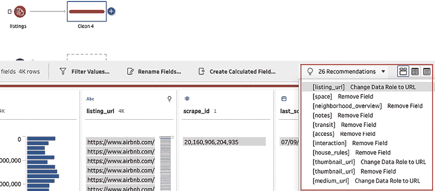

Figure 3.9: 建议

Prep 会分析列内容并提出可能适合该数据的更改。例如，`listing_url` 列被识别为网页，因此 Prep 建议你将其更改为 URL 数据角色。`listing_url` 之后的第二、第三以及更多建议是移除某些列。这可能是因为该列不包含任何数据，或仅包含少量数据。列表还在继续。

此功能非常有用，特别是对于不熟悉的数据集。我的工作方式是查看建议，检查它们是否合理，然后执行更改——或者不执行。不要盲目相信这些建议，但它们可以指出你可能忽略的数据缺陷。

数据通常很混乱，涉及空值、手工录入的拼写错误、不同的格式、其他系统的变更等。因此，在能从分析或仪表板获得可靠结果之前，你必须先理清这团乱麻。本节将向你展示如何在列级别清洗数据。

一旦在清洗步骤中选中某个值，你就可以选择 `Keep Only`（仅保留）、`Exclude`（排除）、`Edit Value`（编辑值）或 `Replace with Null`（替换为空值）：


Figure 3.10: 快速访问

这些更改都不会改变数据源本身。Prep 就像一个中间步骤，或原始数据源与 Tableau Desktop 之间的一个过滤器。使用图 3.10 中所示的选项排除某个值，只会将其从 Prep 中移除。然而，如果稍后将其作为 Tableau Desktop 的输入，将没有选项将该特定值加回去。此选项仅保留在 Prep 中。

另一个稍微隐藏的选项是点击列标题旁边的省略号 `...`（如 *Figure 3.11* 所示）并选择 `Clean`：


Figure 3.11: 更多选项

此 `Clean` 功能基于列的数据类型运行。在前面的屏幕截图中，数据类型为字符串（由 `Abc` 图标指示）。对于其他数据类型，该选项将置灰，因为 `Clean` 仅适用于字符串。该选项允许你使用八项更多清洗功能：

*   Make Uppercase（转大写）
*   Make Lowercase（转小写）
*   Remove Letters（移除字母）
*   Remove Numbers（移除数字）
*   Remove Punctuation（移除标点）
*   Trim Spaces（修剪空格）
*   Remove Extra Spaces（移除多余空格）
*   Remove All Spaces（移除所有空格）

数据类型可以在每个列标题正上方更改；你会在列名上方找到一个符号，点击它即可更改，就像在 Tableau Desktop 中一样：

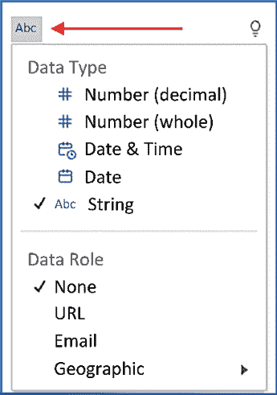

Figure 3.12: 更改数据类型

如果 Prep 错误解读了列的数据类型，这非常方便。错误分配的数据类型会影响你对其执行的计算，以及 Tableau Desktop 如何可视化该列。

在接下来的章节中，我们将练习合并多个数据集。例如，你可能想要将订单数据与发货数据合并（使用连接），或将 2020 年销售数据追加到 2019 年销售数据集中（使用联合）。想知道如何操作，请继续阅读！

## 联合与连接

我们现在将连接这三个数据集，以便能够一起分析和可视化它们。这三个数据集（`listings.csv`、`reviews.csv` 和 `calendar.csv`）的性质要求进行连接而非联合。不过，我仍将引导你完成联合的步骤，以便你知道何时需要它！

### 添加联合

Tableau 中的联合是将数据追加到现有数据集中。想象一下，你有两个 Excel 文件。两者具有完全相同的表头，但一个包含 2019 年的数据，另一个包含 2020 年的数据。如果你将 2020 年数据联合到 2019 年数据，就是将 2020 年文件的行追加到 2019 年文件的行下方。要执行联合，两个数据集需要具有几乎相同的布局/表头。为什么说“几乎”？你将在以下练习中看到：

1.  开始此练习时，你的 Prep 流程窗格应如下所示：

    

    Figure 3.13: 流程窗格

2.  点击 `listings` 数据集旁边的 `+` 添加一个清洗步骤。

    你可以通过右键点击某个步骤并选择 `Edit Color`，根据喜好更改每个步骤的颜色。

3.  选择 `host_identity_verified` 列并筛选 `True`：

    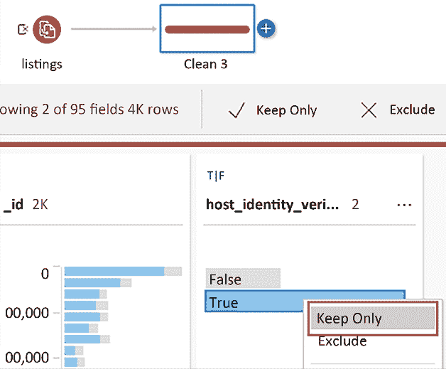

    Figure 3.14: 筛选 True

4.  现在，创建一个名为 `DatasetA_ID` 的计算字段，仅包含一个字符串 `'A'`：

    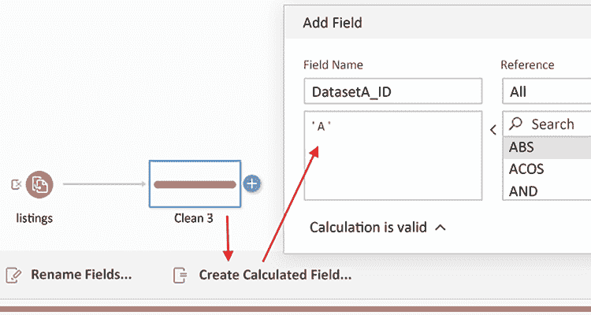

    Figure 3.15: 创建计算字段

5.  从同一个 listings 数据创建第二个清洗步骤，这次在 `host_identity_verified` 列上筛选 `True`：

    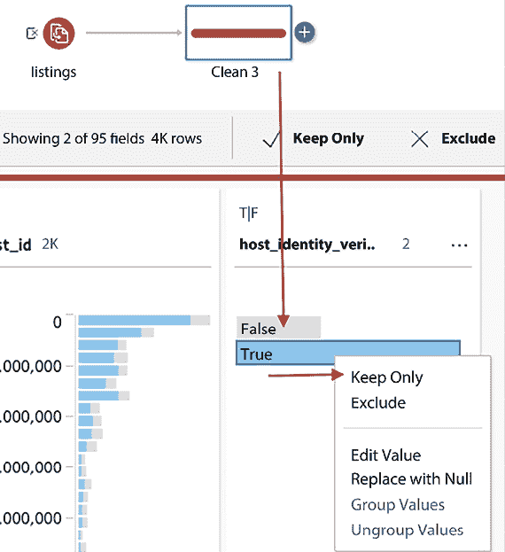

    Figure 3.16: 筛选 True

6.  使用 *Figure 3.15* 中所示的相同过程，创建一个计算字段 `DatasetB_ID`，仅包含字符串 `'B'`。通过右键点击并选择 `Rename` 重命名步骤，有助于跟踪应用的更改。你的流程应如下所示：

    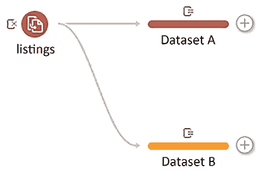

    Figure 3.17: 可视化流程

7.  你现在已经创建了两个可以使用联合合并的数据集，且未更改原始数据。通过点击 `Dataset A` 旁边的 `+` 并选择 `Union`，或将一个步骤拖拽到另一个步骤上（`Dataset B` 拖到 `Dataset A` 上，或反之），对两者进行联合：

    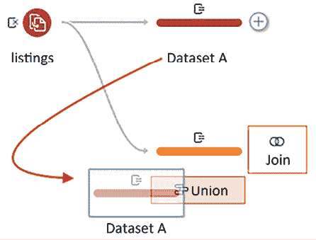

    Figure 3.18: 联合

8.  通过点击 `Union 1` 并查看屏幕左下角的输入详细信息，检查所有字段是否匹配：

    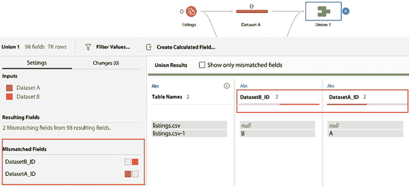

    Figure 3.19: 可视化检查

在前面的屏幕截图中，你可以看到左侧有关于联合的信息。从上到下：`Inputs` 及其各自的颜色（这些与流程窗格中的相同）、`Resulting Fields`（显示 2 个不匹配的字段），最后是 `Mismatched Fields` 本身：`DatasetA_ID` 和 `DatasetB_ID`。每个不匹配字段旁边的颜色表明，我们的 `DatasetB_ID` 字段在 `DatasetA` 中不存在，而 `DatasetA_ID` 字段在 `DatasetB` 中不存在。


2. 在此情况下，我们知道即使命名约定不同，这些列也可以追加。这两个字段更好的名称应该是 `Dataset_ID`（你可以回退几步尝试一下）。这样 Prep 就不会显示任何不匹配项。但对于我们这里的情况，我们可以继续将一个字段拖放到另一个字段上方以合并它们，从而授予 Prep 将它们视为一列的权限：

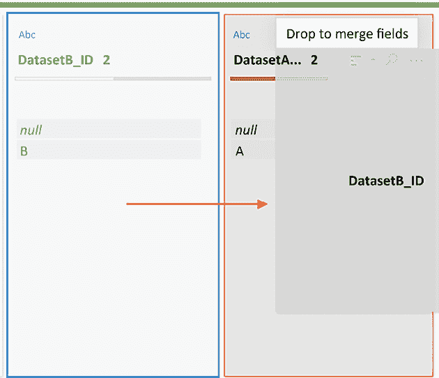

图 3.20：合并

1. 请看 `Resulting Fields`（生成的字段）现在显示 0 个不匹配项，以及两个数据集的颜色现在都显示在列标题下方的条形中：

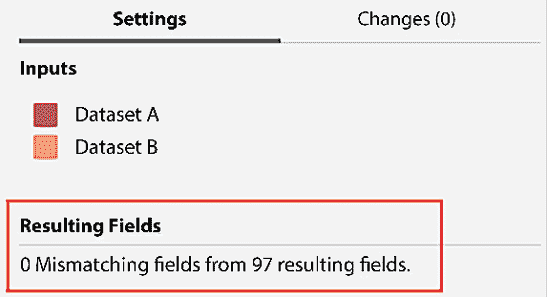

图 3.21：颜色编码

1. 通过选择并右键单击联合步骤将其从 `Union 1` 重命名为 `listings2`，如果愿意，还可以通过选择并右键单击联合步骤并点击 `Add Description`（添加说明）来添加描述——你现在付出的所有额外努力稍后都将有助于复制、文档编写和解释。

恭喜；你的第一次联合操作成功了。我们首先将原始 listings 数据集拆分为两个，然后再将它们合并回一个。将布局相同的数据垂直堆叠在一起，正如我们在这里所做的，是联合的典型任务。

### 通配符联合

除了像上一节那样将一个数据输入拖放到另一个数据输入之上，你还可以告诉 Prep 从预定义目录中联合哪些文件。通常，部门会有一个共享位置，用于存储例如命名为 `Jan2023Revenue`、`Feb2023Revenue`、`Mar2023Revenue` 等的 Excel 文件。如果你遇到这种情况，可以执行以下操作：

1. 将 Prep 连接到任意一个你想要使用的文件。

2. 点击输入数据图标并选择 `Tables`（表）选项卡。你现在可以看到，可以根据特定条件创建联合：

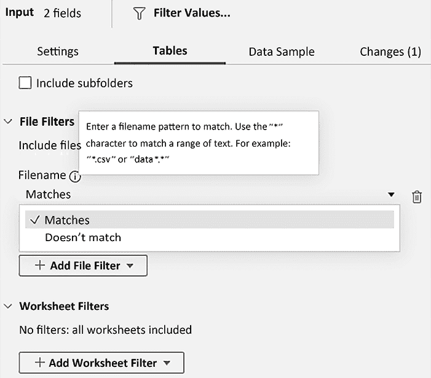

图 3.22：表菜单视图

1. 我将选择同一目录中所有以某内容（`*`）开头并以 `2023Revenue.xlsx` 结尾的匹配文件名，正如你所见，Jan、Feb 和 March 都将被包含在内，你甚至可以通过使用 `File`（文件）和 `Worksheet`（工作表）筛选器进行筛选，完成后点击 `Apply`（应用）：

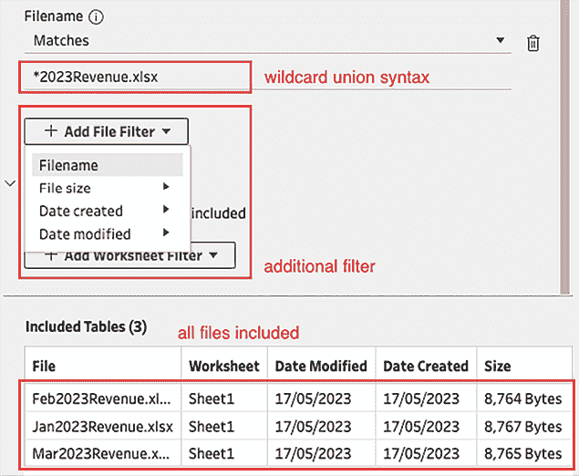

图 3.23：筛选联合

这就是 `wildcard union`（通配符联合）功能。它非常强大！亲自试一试吧。

### 添加联接

现在，我们将继续在同一个流程窗格中工作，重点关注联接。简要回顾一下，联接是水平追加数据。根据经验法则，联合增加行数，而联接改变列数：

1. 将 `listings2` 拖到 `reviews` 上，直到出现 `Join`（联接）选项。


图 3.24：联接

1. 为联接选择 `reviews` 中的 `listing_id` 和 `listings2` 中的 `id`。请注意，你可以通过点击 `Join Type`（联接类型）下方的文氏图来更改联接类型：

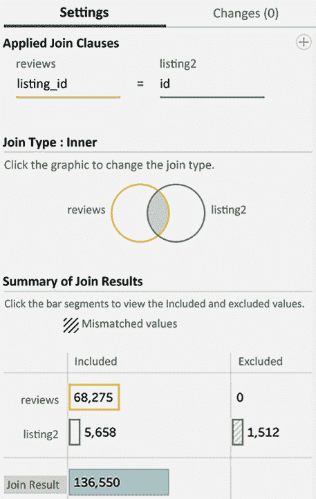

图 3.25：可视化检查联接

前面的概览告诉我们，`reviews` 数据集的所有 `68,275` 行都匹配到了 `listing2` 数据集中的一行。然而，我们确实有来自 `listing2` 数据集的 `756` 个不匹配项。因此，我们的总 `Join Result`（联接结果）为 `68,275` 行。但并非所有房源都有评论，这很正常，因此我们可以放心地假设联接按预期工作。

1. 另一种检查方法是将联接更改为 `full outer join`（全外联接），稍后在 Tableau Desktop 中深入分析数据。要获得 `full outer join`，只需点击两个圆圈的外边缘：


图 3.26：全联接

1. 如果你想检查即时结果，只需右键单击例如联接符号（由文氏图图标表示，如下截图所示），然后选择 `Preview in Tableau Desktop`（在 Tableau Desktop 中预览），即可在 Tableau Desktop 中查看数据：

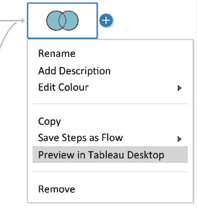

图 3.27：预览

1. 我们也可以重命名步骤；让我们将联接的名称改为 `lis&rev`。

到目前为止，我们已经了解了如何清理数据，以及如何使用联合和联接。联合部分教会了我们如何垂直追加数据或将数据堆叠在一起。联接部分让我们能够水平合并数据或将数据并排放置。更具体地说，我们能够将房源与其各自的评论相结合。我们不再拥有两个数据集，而是创建了一个数据集，它允许我们查找房源评论，并在同一行中查看关于房源本身的所有数据，如房源类型、卧室数量、是否有海景等。

接下来让我们继续聚合步骤。

## 聚合

当你想要更改数据粒度时，会用到聚合。在我们的数据集中，每条评论占一行。然而，我们想看看在波士顿从事 Airbnb 业务时间较长的房东，相比于近期才开始的房东，是否拥有更多评论。为此，我们需要获取房东开始提供房源每年的聚合评论数。`host_since` 字段将提供有用信息，`reviewer_id` 字段也是如此。对于后者，我们将统计留下评论的不同评论者数量。开始吧！

我们当前的流程窗格如下所示：

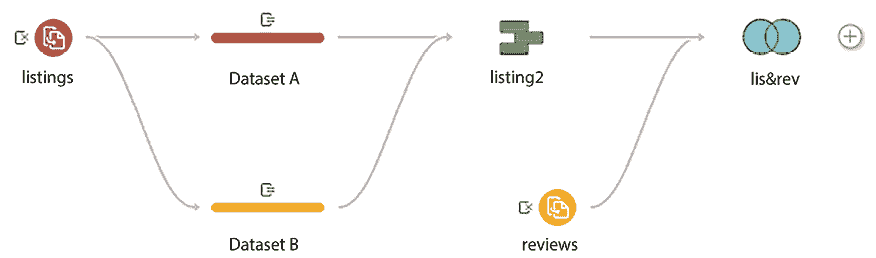

图 3.28：流程窗格

要聚合评论数量，请执行以下步骤：

1. 首先，点击 `lis&rev` 旁边的 `+` 号并选择 `Aggregate`（聚合）：

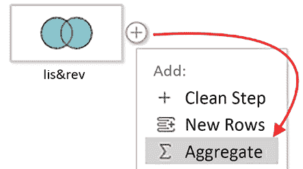

图 3.29：聚合

1. 这将打开一个名为 `Aggregate 1` 的窗口。我们的目标是查看从房东开始提供房源以来，每年有多少人评价了住宿；因此，请执行以下操作。

    1. 使用 `Additional Fields`（其他字段）窗格中的搜索字段（如图 3.30 左侧所示），通过拖放将 `host_since` 字段添加到 `Grouped Fields`（分组字段）中。

    2. 同样通过拖放将 `reviewer_id` 添加到 `Aggregated Fields`（聚合字段）中。注意默认聚合为 `SUM`，如右侧箭头所示：

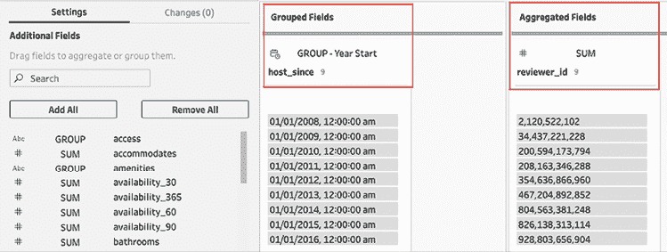

图 3.30：聚合字段

2. 通过点击 `Aggregated Fields` 下的 `SUM` 来更改 `reviewer_id` 的聚合方式，并将其改为 `Count Distinct`（去重计数）：

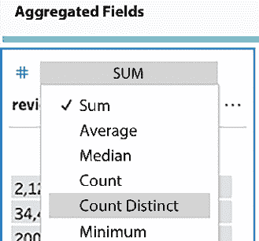

图 3.31：去重计数

1. 这将把默认聚合 `Sum`（计算每条评论）更改为 `Count Distinct`，后者统计不同的评论者 ID 聚合。这将使我们能够关注有多少不同的评论者留下了评论。这只是一个任意选择；请随意尝试其他聚合方式，看看数据如何变化。

让我们通过右键单击流程窗格上的 `Aggregate` 步骤并选择 `Preview in Tableau Desktop` 来查看 Tableau Desktop 预览：

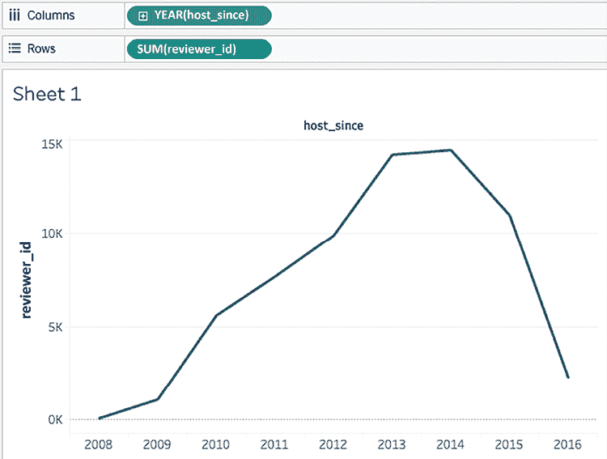

图 3.32：房东图表

在前面的屏幕截图中，我们可以看到按 `host_since` 日期统计的评论去重计数。当然，在这个特定示例中，如果这些是拖到视图上的唯一字段，即使没有 Prep 的帮助，Tableau Desktop 也能按 `host_since` 日期统计评论。但在将数据导入 Tableau Desktop 之前进行聚合的一个好处是，你需要导入的数据更少；因此，可以实现更好的性能。如果你想继续在 Prep 或 Tableau Desktop 中分析数据集，现在可以提出进一步的问题，例如：

* 哪种住宿类型住一周比住一天的折扣最大？
* 住宿大小与月价之间是否存在相关性？
* 拥有多个房源的房东占比是多少？

祝你好运，愉快地构建仪表板吧！


我们将在此结束本节，并回顾一个仅包含 9 个数据点的图表，该图表是通过按房东开始提供房源的年份聚合近 64,000 行 `reviewer_id` 数据而创建的。该图表讲述了一个故事；而 64,000 行单独的数据则不能。这就是为什么始终要减少数据量，并在可能的情况下对其进行聚合的原因。在下一节中，我们将讨论另一个重要功能：透视。

## 透视

你是否遇到过这样的情况：将字段拖放到 Tableau Desktop 的行货架和列货架上，但可视化效果不知为何无法按预期工作？很有可能你需要转换数据，或者更准确地说，对其进行透视。如果你预期位于同一列中的数据分散在多行中，却出现在多列中，这就是一个需要透视的场景。以下示例将展示透视的必要性。

对于我们的透视示例，我们将使用另一个数据集。你可以在 [`github.com/PacktPublishing/Mastering-Tableau-2023-Fourth-Edition/blob/main/Chapter03/Excel_Pivot.xlsx`](https://github.com/PacktPublishing/Mastering-Tableau-2023-Fourth-Edition/blob/main/Chapter03/Excel_Pivot.xlsx) 找到它。该数据集非常简单，如下所示：

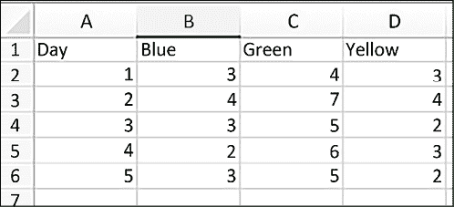

图 3.33：Excel 输入

它包含在五个不同日期观察到 `x` 次的三种不同颜色。这些数据是透视有助于整理数据的典型示例，因为多个列具有相同的用途——`B`、`C` 和 `D` 都是观察值。如果你想可视化此表，它可能如下所示：

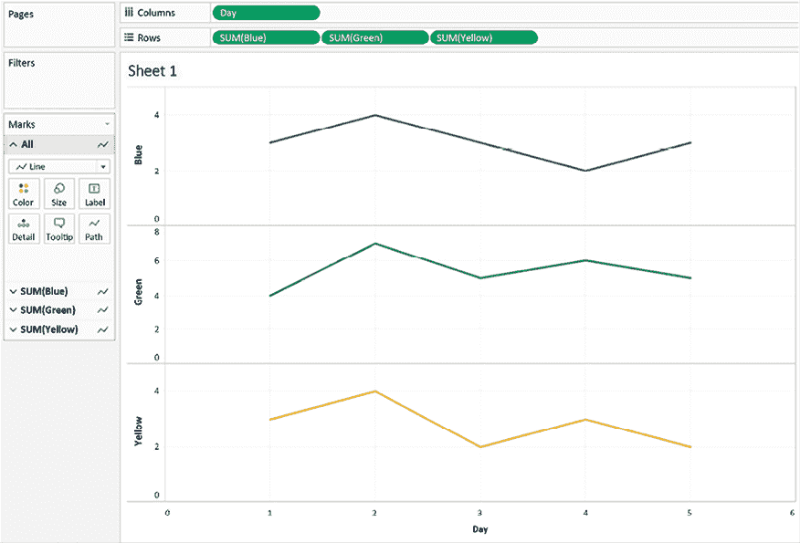

图 3.34：透视 I

但你可能会想，既然配色方案已经指示了观察到哪种颜色，将所有三条线放在一张图表中不是更好吗？在一张折线图中，按颜色分别显示单独的线条？让我们来实现这一点！

首先将 `PivotDataSet` 连接到 Prep，然后按照以下步骤透视数据：

1. 从 Prep 连接到我们刚创建的 Excel 文件，并将 `PivotDataSet` 添加到流程窗格，点击输入数据步骤旁边的 `+`，然后选择 `Pivot`。一个名为 `Pivot 1` 的新步骤将会出现：

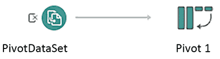

图 3.35：添加透视步骤

2. 在流程窗格中点击 `Pivot 1` 步骤，`图 3.36` 将出现在 Prep 窗口底部。选择 `字段` 窗格中显示的所有三种颜色（如 `步骤 I` 所示），并将它们拖动到 `透视字段` 窗格中（如 `步骤 II` 所示）：

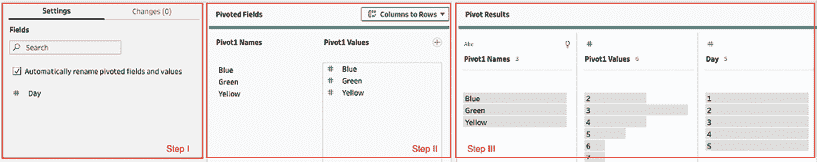

图 3.36：透视步骤

3. 现在，查看 `透视结果` 窗格（如上一张截图的 `步骤 III` 所示），通过右键点击并选择 `重命名`，将 `Pivot1 Names` 重命名为 `Colors`，将 `Pivot1 Values` 重命名为 `Observations`。现在点击 `Pivot 1` 旁边的 `+`，瞧，我们现在有了一个整洁的表，称为 `Clean 1`：

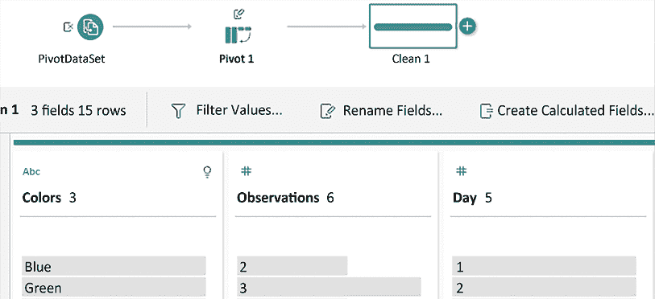

图 3.37：透视结果

4. 还记得我们开头提到的问题吗？现在我们的折线图可以用另一种方式创建，如 `图 3.38` 所示。请注意，`Colors` 现在是一个维度，而 `Observations` 是它们自己的字段，而在此之前，它们位于每种颜色的列标题下：

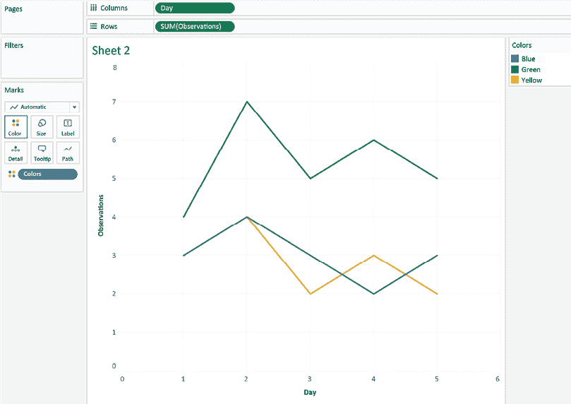

图 3.38：透视后的折线图

这是一个透视的简单用例，但此处的技术可以迁移到任何其他数据集。Prep 具有内置的推荐功能。每当你看到列右上角有一个灯泡图标时，请查看一下，看看该推荐是否适用于你的需求。

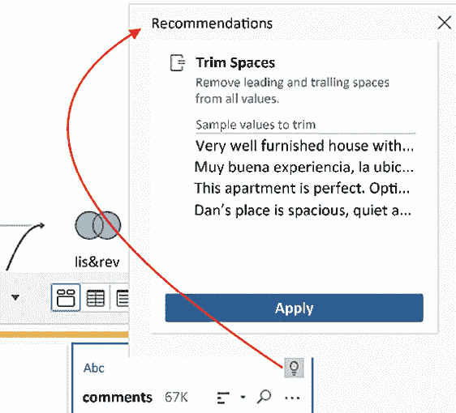

图 3.39：修剪空格

在这种情况下，Tableau 建议我们删除所有前导和尾随空格，这正是我们所需要的！正如这里演示的，检查推荐总是值得的。

很好；你已经掌握了主要的 Prep 功能。不过，你可能想知道如果需要进一步准备该怎么办。没问题；Prep 为你提供了支持。脚本是 Prep 最新增添的功能，也是最强大的功能；它几乎是无限的！继续阅读以探索 Prep 的脚本功能。

## 脚本

我们接下来要讨论的脚本功能是最近添加到 Tableau 中的功能之一。我们将其放在后面讨论，因为像 `Python` 或 `R` 这样的编程语言能给你带来无限的灵活性。如果你遇到了 Prep 功能的边界，你可以回退到脚本编写，编写自己的代码来精确实现你想要的功能。

为了使用它，你必须首先在 Tableau 之外连接到 Python（或 R）。以下步骤基于 [`help.tableau.com/current/prep/en-us/prep_scripts_TabPy.htm`](https://help.tableau.com/current/prep/en-us/prep_scripts_TabPy.htm) 中针对 Python 的说明，或 [`help.tableau.com/current/prep/en-us/prep_scripts._R.htm`](https://help.tableau.com/current/prep/en-us/prep_scripts._R.htm) 中针对 R 的说明。

对于此练习，我们将使用波士顿 Airbnb 数据集，更具体地说是 `calendar` 表。从 [`www.kaggle.com/airbnb/boston`](https://www.kaggle.com/airbnb/boston) 下载此数据集，并在 Prep 中连接到 `calendar` 表：

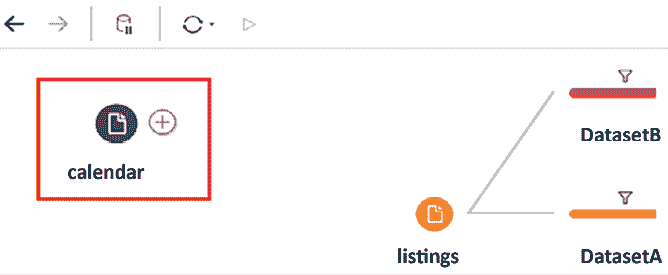

图 3.40：Calendar 数据集

现在，让我们退一步，将 Python 连接到 Prep：

1. 从 [python.org](http://python.org) 下载并安装 `Python`（或从 [`www.r-project.org/`](https://www.r-project.org/) 下载并安装 `R`）。

2. 通过在终端或命令行中执行以下命令来下载并安装 `TabPy`：

```
pip install tabpy
```

3. 或者，如果使用 `R`，打开 `R` 并执行：

```
install.packages("Rserve", , "http://rforge.net")
```

4. 通过在命令行/终端中输入以下命令来打开 `TabPy`：

```
tabpy
```

或者，在 R GUI 中，输入：

```
library(Rserve)
Rserve()
```

1. 回到 Prep，点击 calendar 表右侧的 `+` 并添加一个 `清理步骤`。

2. 添加一个名为 `PythonTest` 的计算字段（如果你选择尝试 `R`，则使用 `RTest`），字符串值为 `Test`：

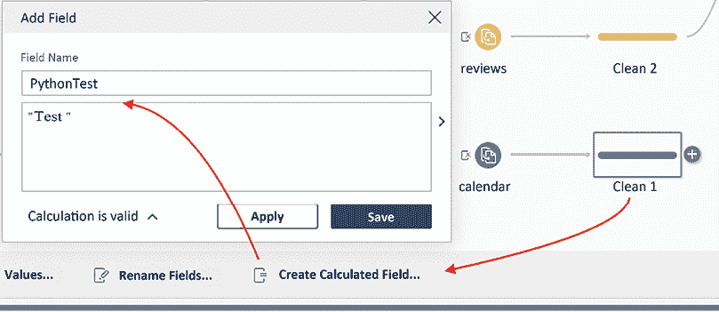

图 3.41：PythonTest

3. 现在，点击 `Clean 1` 步骤右侧的 `+` 并添加 `脚本`。

4. 通过选择 `脚本` 步骤，底部的 `设置` 窗格（见 `图 3.42`）将给你一个连接到 `Rserve` 或 `TabPy` 的选项。`Rserve` 是 `R` 的 Tableau 服务器，`TabPy` 是 Python 的 Tableau 服务器。

5. 通过选择 `Rserve` 或 `Tableau Python (TabPy) Server` 来选择你的连接类型。然后打开 `帮助 | 设置和性能 | 管理分析扩展连接`。在弹出的窗口中，使用 `localhost` 和 `端口 9004` 将 Prep 连接到 `TabPy`（如果使用 R，则通过在同一弹出窗口中 `连接类型` 下选择 `Rserve` 并使用 `localhost` 和 `端口 6311` 连接到 Rserve），然后点击 `登录`：

* 如果使用启用了 SSL 加密的 Rserve 服务器，`端口 4912` 是默认端口。

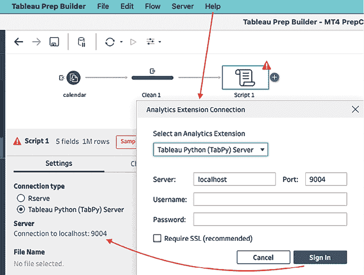

图 3.42：TabPy 服务器

6. 接下来，如果尝试 Python，创建一个包含以下代码的 `.py` 文件，并确保缩进完全相同：

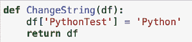

图 3.43：.py 文件

或者，创建一个包含以下代码的 `.R` 文件：

```
Get ChangeString<- add_column(
.data, 
.before = 'Test'
.after = 'R') {
Return (data.frame ())
}
```

7. 我们刚创建的脚本旨在更改 Prep 中的现有列，并根据你选择的语言，将每一行从 `Test` 重命名为 `Python` 或 `R`。


2. 我们将继续使用 Python 脚本。回到 Prep 中，浏览找到刚才创建的 `.py` 文件，并将函数名称添加到 Prep 界面。我将该文件命名为 `PrepTableau.py`，函数名称为 `ChangeString`，正如前一步所定义的：

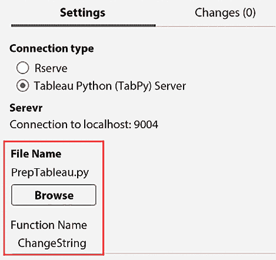

图 3.44：添加函数

1. 观察到 `PythonTest` 列已从 `Test` 变为 `Python`：

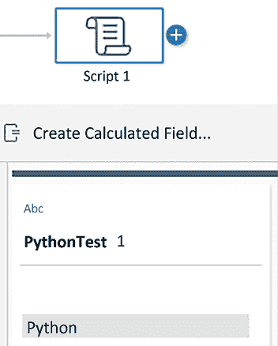

图 3.45：PythonTest

我们的小实验成功了！尽管我们使用了一个非常简单的例子，但它证明了脚本功能有效，你可以发挥创造力，利用脚本实现更多功能。例如包括从计算反向正态分布到使用情感分析或聚类进行机器学习等各种场景。

你可能注意到，我们并未在脚本本身中导入 `pandas`，但仍然使用了 `pandas` DataFrame。这是因为 `pandas` 的导入随 `TabPy` 一起提供。你可以在打开 `TabPy` 后的命令行/终端中看到这一点：

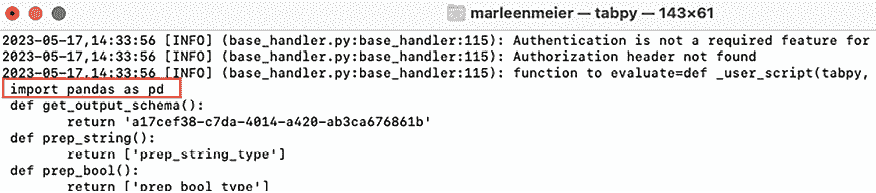

图 3.46：命令行中导入 pandas

如果你想在脚本中使用其他库，可以在命令行/终端上使用 `pip install` 来安装它们。之后只需重启 `TabPy`，你就能使用它们了。请记住，始终先在终端/命令行中打开 `TabPy`，否则 Prep 无法执行脚本。

在撰写本文时，Prep 尚不支持将脚本作为输入——不过，你可以使用一个虚拟的 `.csv` 文件作为变通方法，并在其后立即向流程中添加脚本。

# Prep 的其他选项

本节将讨论一些独立的、非常强大且新的 Prep 功能。你们中的一些人可能从最初的版本就开始使用 Prep 了。随着每个版本的发布、每一位新用户的加入以及每一条反馈的收集，Tableau 能够创建一个优先级列表，列出利益相关者（像你我这样的人）真正希望看到的功能。即将讨论的主题就是其中最好的例子。这些功能在最初的版本中均不存在，但它们让产品变得更好、更有价值、更完善。现在你可以保存流程的一部分并重复使用，将数据写回外部数据库，刷新数据集的部分内容，并使用 Tableau Data Management 插件调度流程。让我们仔细看看，从“插入流程”功能开始。

## 插入流程

Prep 中的一个选项是将现有流程添加到你自己的流程中。例如，假设有人已经处理了波士顿 Airbnb 数据集，并创建了一个仅包含高亮步骤的流程：

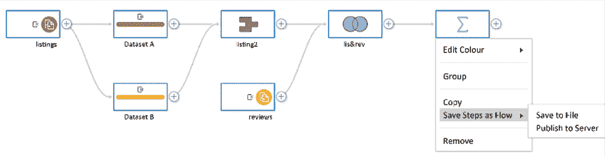

图 3.47：保存到文件

你可以通过右键单击并选择 `保存到文件` 来保存想要插入流程的步骤，如*图 3.47*所示。然后，通过在画布上右键单击，选择 `插入流程`，并浏览 `.tfl` 文件以找到之前下载的文件，即可将这些步骤插回到你的流程中：

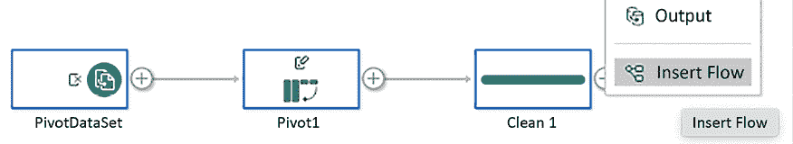

图 3.48：插入流程

此功能对于共享工作和重复使用已创建的步骤非常方便。接下来，我们将探讨另一个功能，它将允许你刷新 Prep 流程中使用的数据：增量刷新。

## 增量刷新

Prep 2020.2 引入了增量刷新功能。完成流程并添加 `输出` 步骤后，你可以决定是想要完全刷新还是增量刷新，以及想要使用哪个字段作为指标。想象一下，你拥有某种疾病每天感染人数的数据集。每天结束时，你都想将来自卫生部门数据库的新数据添加到你的数据集中。那么，你该怎么做？

通常，你会在最新数据点添加后加载整个数据集，所有数据。但比那一天早的数据点没有任何变化；它们将保持不变，而且你之前已经加载过它们了。因此，重新加载整个数据集是对资源的浪费。增量刷新将仅加载新数据点并将它们添加到现有数据中，这些现有数据是在许多天里累积起来的。你可以想象这将节省多少时间和精力。与完全刷新相比，这是一种更可持续的方式来保持数据的最新状态。

我们将在以下工作流中查看一个示例。重要的是流程中包含一个 `输出` 步骤：


图 3.49：增量刷新

要添加增量刷新，请执行以下步骤：

1. 单击数据输入步骤，向下滚动 `设置` 选项卡，直到看到 `增量刷新` 选项。然后，勾选 `启用增量刷新` 复选框：

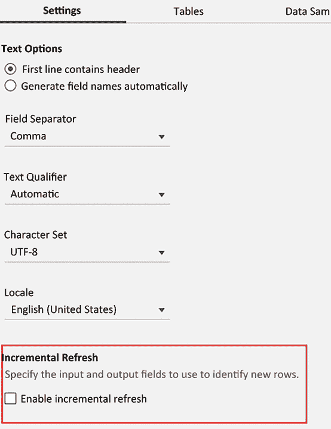

图 3.50：设置增量刷新

1. 单击 `启用增量刷新` 复选框后，将出现一个下拉菜单。此下拉菜单包含 Prep 认为可用作数据刷新指标的所有字段。例如，选择 `date` 字段。这是完美的字段，因为一旦原始数据源中添加了新日期，刷新就会开始。

2. Prep 还会要求你提供输出中代表 `date` 列的输出字段。在我们的例子中，它仍然是 `date`：

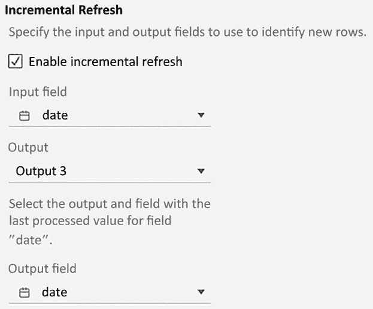

图 3.51：选择输出字段

1. 完成所有设置后，再次单击 `输出` 步骤，注意现在你可以通过单击 `运行流程` 选项上的下拉菜单，选择你希望用于此流程的刷新类型（完全或增量）：

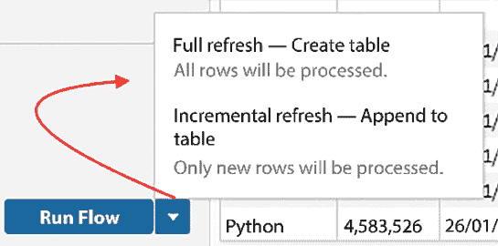

图 3.52：刷新选项

你刚刚学会了如何设置数据刷新——完全刷新和增量刷新。这将帮助你可持续地使用计算资源，并始终保持数据的最新状态。接下来，我们将介绍另一个值得探究的 Tableau 功能——批量重命名。

## 批量重命名

此功能真是个节省时间的利器！只需选择任意数量的要重命名的列，右键单击，然后选择 `重命名字段`。将打开一个新视图，允许你为每个选定的列添加前缀或后缀，或者替换其中每个列中的特定文本：

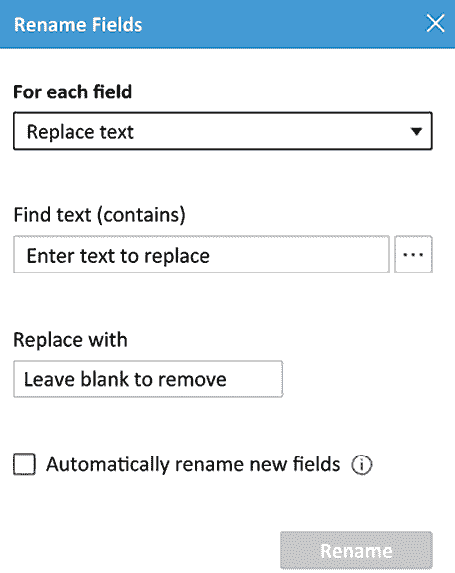

图 3.53：批量重命名演示

然后你还可以利用 `查找文本` 功能，或自动重命名稍后可能新增的所有字段，例如，因为 IT 部门向你的数据集添加了一个额外的列。

## Tableau Prep Conductor

借助 `Tableau Prep Conductor`，你可以将 Prep 流程发布到 Tableau Server，安排它们在特定时间运行，并始终拥有刷新后的数据。Conductor 可在 Tableau Data Management 插件中获得，不随 Tableau Desktop 或 Prep 一起提供。

有关更多信息，请查看 [`www.tableau.com/products/add-ons/data-management`](https://www.tableau.com/products/add-ons/data-management)。

# 导出数据

最后但同样重要的是，我们可能想要导出数据。我们之前看到过，在流程窗格中右键单击符号可以预览 Tableau Desktop 中的数据：

1. 如果你想按计划运行流程或将其保存到某个位置，最好使用 `添加` | `输出`。

2. 执行此操作后，将出现以下屏幕：

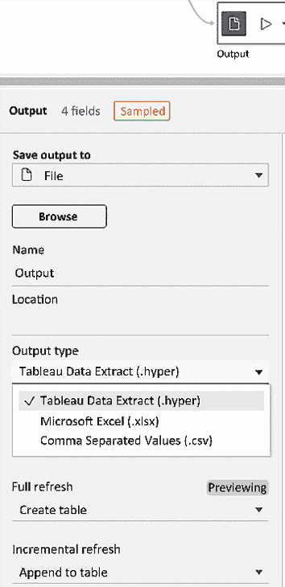

图 3.54：保存到文件

1. 用户现在可以选择将数据保存到文件，也可以将其保存为 Hyper 文件格式 `.hyper`、`.xlsx`（Tableau 2021.1 新增）或 `.csv` 文件。

2. 另一个选项是将新生成的数据源直接发布到 Tableau Server，使其可供其他用户使用。对于此选项，请从下拉菜单中选择 `作为数据源发布` 而不是 `保存到文件`。


## 将输出保存到外部数据库

3. Tableau 2020.3 新增了保存 Prep 输出的第三种选项：将结果数据写入外部数据库。如果您想这样做，请从下拉菜单中选择 `Database` 表选项。撰写本文时，有七种数据库兼容写回功能，但将根据用户需求增加更多：

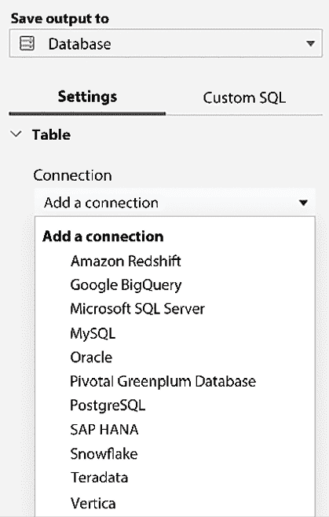

图 3.55：保存到外部数据库

自 Tableau 2022.3 版本起，您也可以写回 CRM Analytics。为此，您需要一个 Salesforce 账户和相应的许可证。因此，我们将不再深入讨论此选项，但如果您是 Salesforce Analytics 用户，请去了解一下！

本节向我们展示了如何保存工作，更重要的是如何保存 Prep 流的输出。在我看来，将输出保存到外部数据库是最好的新功能，因为它是以结构化和有组织的方式与他人共享输出的最简单方法。这样不仅我，其他用户也可以使用预处理好的数据，节省额外的工作。该流随后不仅可以由我复用，也可以由任何人复用。

## 总结

我们本章从 Prep 简介开始。我们查看了 GUI 以及如何将数据连接到其中。之后，我们进行了一些关于数据准备的练习。这可以分为五个部分：数据清洗、联合与连接、聚合、透视和脚本。我们还考虑了其他几个提高数据实用性的选项，包括从其他流插入步骤，以及增量刷新。为了完成本章关于 Prep 的内容，我们研究了导出数据。在这里，我们看到新数据集可以保存为文件或数据提取，写回外部数据库，或直接推送到 Tableau Server。

正如 Tableau Desktop 一样，Prep 非常直观且高度可视化。颜色、符号和高亮使得这款提取、转换和加载 (ETL) 工具易于上手，它在您于主 Tableau 界面操作数据之前准备数据时非常宝贵！

在下一章中，我们将继续探索 Tableau 中的数据。我们将通过查看连接、混合和数据结构，来探讨如何为 Tableau 准备数据。

## 在 Discord 上了解更多

要加入本书的 Discord 社区——您可以在其中分享反馈、向作者提问并了解新版本——请扫描下方的二维码：

[`packt.link/tableau`](https://packt.link/tableau)


