# 第 4 章：了解连接、混合和数据结构

## 简介

将 Tableau 连接到数据通常不仅意味着连接到单个数据 `source` 中的单个表。您可能需要使用 Tableau 连接来自单个数据源的多个表。为此，我们可以使用连接，如果给定的键值匹配，连接会将一个数据集的行与另一个数据集的行结合起来。您也可以连接来自不同数据源的表，或联合具有相似元数据结构的数据。

有时，您可能需要合并不共享公共行级键的数据，这意味着如果您像在连接中那样尝试在行级别匹配两个数据集，您将会复制数据，因为一个数据集中的行数据详细程度要高得多（例如城市），而另一个数据集可能只包含国家。在这种情况下，您将需要混合数据。此功能允许您，例如，在不将城市数据集更改为国家级别的情况下，显示每个国家的城市数量。

此外，您可能会遇到需要创建多个到单个数据源的连接，以便以不同方式透视数据的情况。这可以通过操作数据结构来实现，它可以帮助您使用同一个数据集从不同角度进行数据分析。这可能是为了发现那些用单一数据结构难以或根本无法回答的问题的答案。

在本章中，我们将讨论以下主题：

*   关系
*   连接
*   联合
*   混合
*   理解数据结构

在 2020.2 版本中，Tableau 增加了功能，允许您在不指定上述两种方法（连接或混合）的情况下进行连接或混合。它被称为 `relationships`。我们将首先解释这一新功能，然后再深入研究连接、混合等的细节。

## 关系

虽然本章将主要关注连接、混合和数据结构操作，但让我们首先介绍 `relationships`：这是 Tableau 2020.2 起可用的新功能，也是 Tableau 社区期盼已久的功能。它是数据画布中的新默认选项；因此，我们将首先研究属于数据模型 `logical layer`（逻辑层）的 `relationships`，然后再深入探讨在 `physical layer`（物理层）上运行的连接和联合功能。

要阅读有关 Tableau 数据模型的物理层和逻辑层的所有内容，请访问 Tableau 帮助页面：[`help.tableau.com/current/online/en-us/datasource_datamodel.htm`](https://help.tableau.com/current/online/en-us/datasource_datamodel.htm)。

目前，您可以将逻辑层理解为能够“更聪明地计数”。想象一个包含唯一客户名称的客户表，和一个包含数百个记录订单的订单表。在逻辑层中，拥有多个订单的客户名称（因此在订单表中有多行订单和客户 ID）将被计为一位客户，因为逻辑层很智能，它能识别客户名称；而物理层会为每个订单计数一位客户，因此如果同一客户下了多个订单，物理层会将其计为多位客户。只有通过计算非重复值才能解决此问题（使用逻辑层时无需此操作）。

在下面的屏幕截图中，您可以看到数据源画布，左侧是两个数据集通过关系结合，右侧是相同数据集通过 `join` 结合。请注意，关系仅在表之间显示一条线（`Orders`、`People` 和 `Returns`），而连接则通过两个圆圈指示连接类型：

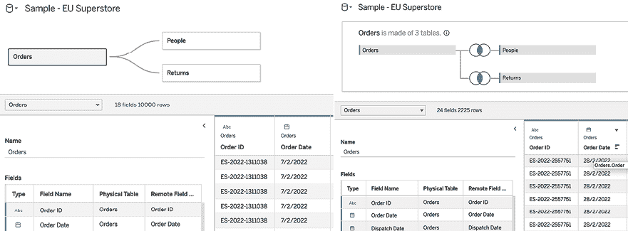

图 4.1：数据源画布上的关系和连接

一个关键区别是，底部的数据预览在关系中将仅显示所选表的数据，而使用连接时显示所有数据。这是合理的，因为关系中的数据粒度会根据您在仪表板中使用的字段而变化。然而，连接具有固定的粒度级别，由您选择的连接类型和连接子句定义。

关系是 Tableau Desktop 2020.2 及更高版本的默认设置。但是，如果您仍想使用连接功能，可以将数据集拖入数据源画布，点击下拉箭头，然后选择 `Open…`：

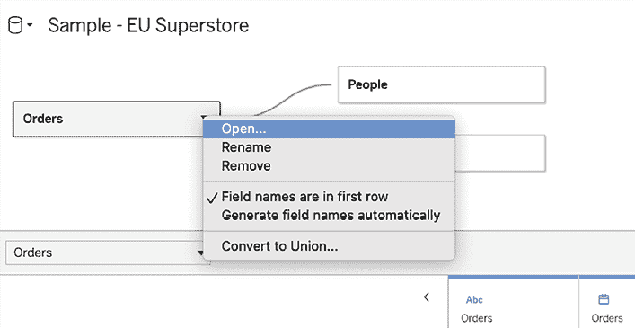

图 4.2：从关系画布到连接画布

这将像在 2020.2 版本之前的 Tableau 数据窗格中那样打开数据集，您将能够以旧方式使用连接，正如我们将在 `Joins` 部分所述。

关系中两个数据集之间的线（基于逻辑层）被称为 `noodle`，因为它看起来像 al dente 意大利面——美味！只要您将第二个数据源拖入数据源画布，Tableau 就会检测到关系，但您可以通过点击 noodle 本身来添加更多键列，或删除和调整它们：

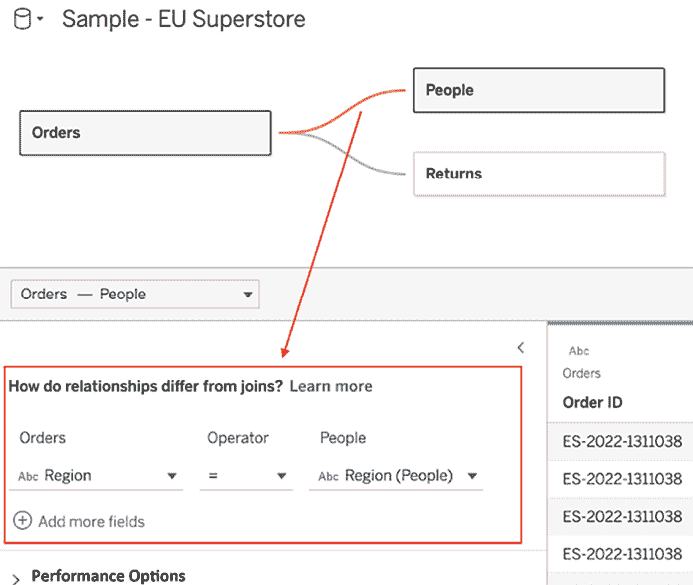

图 4.3：关系键

如果您在 Tableau 2020.2 或更高版本中打开旧版仪表板，您将看到连接的数据显示为 `Migrated`（已迁移）。这是有意为之。只需点击已迁移的数据源，Tableau 就会从逻辑层切换到物理层，这意味着您将看到基于连接的数据源画布，而不是关系画布。


查看工作表，你也会注意到一些差异。你会发现，在新的关系布局中，列首先按表名划分，然后按数据源拆分为 `Dimensions`（维度）和 `Measures`（度量），而在联接中，列则被划分为 `Dimensions` 和 `Measures`，并按表名拆分。

总而言之，新的数据源布局让合并数据集变得容易得多，你无需预先决定是要联接还是混合。习惯了旧版数据源窗格的用户可能需要一点时间来适应这种新的灵活性，但对于 Tableau 新用户来说，从一开始处理不同的数据集将容易得多。尽管如此，我们接下来仍将介绍联接，特别是因为该功能仍作为物理层的一部分保留在 Tableau 中。

## 联接

本书假设读者具备联接的基础知识，特别是内联接、左外联接、右外联接和全外联接。如果你不熟悉联接的基础知识，建议学习 W3Schools 的 SQL 教程：[`www.w3schools.com/sql/default.asp`](https://www.w3schools.com/sql/default.asp)。基础知识并不难，所以你不会花太长时间就能上手。

下面的屏幕截图显示了三个相关的数据集：

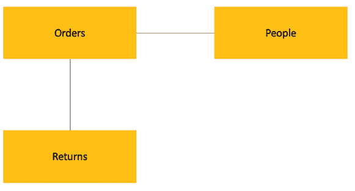

图 4.4：相关数据集

## 联接查询

下面的屏幕截图展示了图 4.4 中已联接数据集的表示：

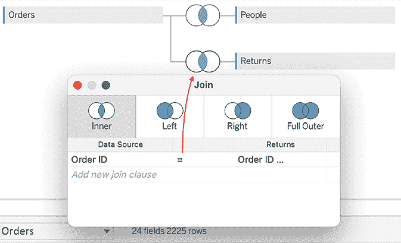

图 4.5：联接剪裁

上述屏幕截图表示 `Orders` 表和 `Returns` 表之间的内联接，通过公共键 `Order ID` 进行内联接。`Orders` 和 `People` 通过公共键 `Region` 进行联接。

为了更好地理解刚才的描述，我们将继续进行一个联接剪裁练习。我们将查看在使用这两个表构建简单视图时 Tableau 生成的 SQL 查询，这将向我们展示当我们仅仅进行拖放操作时，Tableau 在后台做了什么。

请遵循以下步骤：

1.  从 [`public.tableau.com/profile/marleen.meier/`](https://public.tableau.com/profile/marleen.meier/) 找到并下载与本章关联的工作簿。
2.  选择 `Join Culling` 工作表，然后点击 `Sample - EU Superstore Join` 数据源。
3.  从菜单中选择 `Help`（帮助），然后选择 `Settings and Performance`（设置和性能），最后选择 `Start Performance Recording`（开始性能记录）：

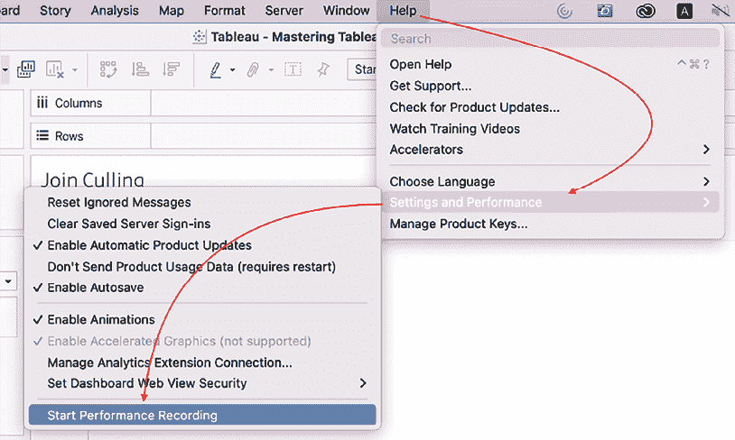

图 4.6：开始性能记录

4.  将 `People` 拖到 `Rows`（行）架上，将 `Sales` 放在 `Text`（文本）架上：

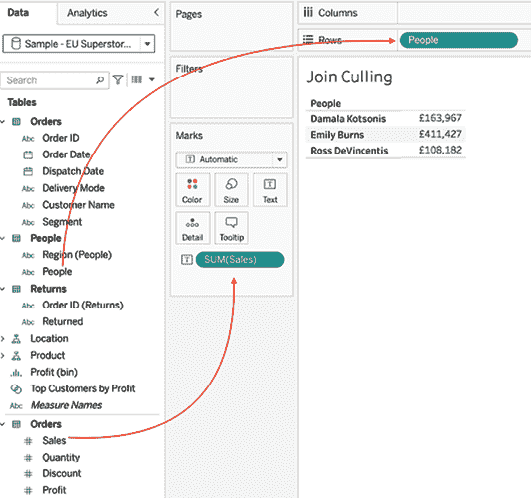

图 4.7：拖放操作

5.  通过 `Help`、`Settings and Performance`，最后选择 `Stop Performance Recording` 停止记录。
6.  在生成的 `Performance Summary`（性能摘要）仪表板中，将时间滑块拖到 `0.0000`，并选择两个绿色条形：`Executing Query`（执行查询）。现在你可以看到 Tableau 生成的两条 SQL 查询：

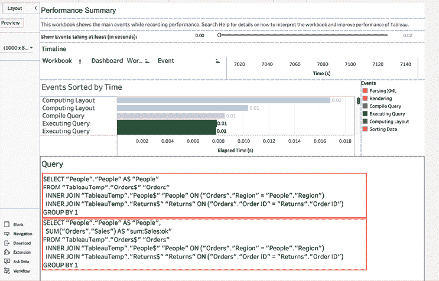

图 4.8：性能记录

到目前为止，我们已将 Tableau 连接到数据集，然后创建了一个非常简单的工作表，显示人员的销售数量。但是，为了显示人员姓名和销售金额，Tableau 需要从两个不同的表中获取数据：`Orders` 和 `People`。图 4.8 中的性能记录显示了构建仪表板每个步骤所花费的时间以及发送到数据库的查询。因为我们先拖入一个 `dimension`（维度），然后拖入一个 `measure`（度量）到工作表中，所以看到了两条查询。第二条查询结合了两个拖入的字段；因此，我们将重点关注后者。让我们详细看一下：

```sql
"SELECT ""People"".""People"" AS ""People"",
  SUM(""Orders"".""Sales"") AS ""sum:Sales:ok""
FROM ""TableauTemp"".""Orders$"" ""Orders""
  INNER JOIN ""TableauTemp"".""People$"" ""People"" ON (""Orders"".""Region"" = ""People"".""Region"")
  INNER JOIN ""TableauTemp"".""Returns$"" ""Returns"" ON (""Orders"".""Order ID"" = ""Returns"".""Order ID"")
GROUP BY 1"
```

请注意，表之间生成了内联接。这是 Tableau 联接功能的后台视图。

现在技术细节已经讨论过了，让我们看看仪表板本身中的联接。

## 联接计算

在 Tableau 中，可以基于计算联接两个文件。你可以使用此功能来解决两个数据源之间的不匹配问题。计算联接可以在每个联接的下拉菜单中访问。

请看下面的屏幕截图：

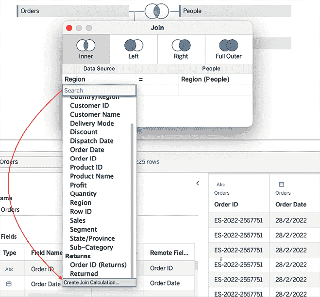

图 4.9：创建联接计算……

举个例子，假设一个数据集包含一列 `First Name`（名）和另一列 `Last Name`（姓）。你想将其联接到第二个数据集，该数据集有一列名为 `Name`，包含名和姓。在第一个数据集中创建如下 `Join Calculation`（联接计算）是联接这两个数据集的一种选择：

```
[First Name] + ' ' + [Last Name]
```

现在，在第二个数据集中选择 `Name` 列，你的键应该就匹配了！

如果你想了解更多关于计算联接的信息，请查看 Tableau 帮助页面：[`help.tableau.com/current/pro/desktop/en-us/joining_tables.htm#use-calculations-to-resolve-mismatches-between-fields-in-a-join`](https://help.tableau.com/current/pro/desktop/en-us/joining_tables.htm#use-calculations-to-resolve-mismatches-between-fields-in-a-join)。

## 空间联接

在 Tableau 2018.2 中，增加了 `spatial joins`（空间联接）。这意味着你可以联接来自 MapInfo 表以及 Shape、Esri、KML、TopoJSON 和 GeoJSON 文件的空间字段。你也可以使用 CSV 或 Excel 文件，并通过 Tableau 的 `MAKEPOINT` 函数将数据转换为空间数据（请参见第 12 章，利用高级分析）。在实践中，想象一下两个数据集，一个关于流域的位置，由空间字段指示；第二个数据集包含水禽目击位置，也在空间列中。Tableau 允许你联接这两个数据集，否则这很难实现，因为大多数程序不支持空间数据。

要在空间列上联接，必须从 `Join`（联接）下拉菜单中选择 `Intersects`（相交）字段，该字段仅在处理空间数据时可见。

有关在 Tableau 中联接空间文件的更多信息，请阅读 Tableau 提供的以下资源：

*   [`help.tableau.com/current/pro/desktop/en-us/maps_spatial_join.htm`](https://help.tableau.com/current/pro/desktop/en-us/maps_spatial_join.htm)
*   [`www.tableau.com/about/blog/2018/8/perform-advanced-spatial-analysis-spatial-join-now-available-tableau-92166`](https://www.tableau.com/about/blog/2018/8/perform-advanced-spatial-analysis-spatial-join-now-available-tableau-92166)
*   [`help.tableau.com/current/pro/desktop/en-us/maps_spatial_join.htm`](https://help.tableau.com/current/pro/desktop/en-us/maps_spatial_join.htm)
*   [`help.tableau.com/current/pro/desktop/en-us/examples_spatial_files.htm`](https://help.tableau.com/current/pro/desktop/en-us/examples_spatial_files.htm)

作为水平联接的替代，你可能需要垂直联接，也称为 `union`（联合）。典型的 `union` 用例是可视化存储在多个文件或表中随时间变化的数据。你可能有一份日报，其列结构相同，但每天作为一个新文件收集，存储在月度或年度文件夹中。

合并这些文件比逐个查看它们能提供更多洞察！你将能够分析趋势和每日或每年的变化，或执行年初至今分析。因此，接下来我们将继续深入解释 Tableau 中的 `unions`。

## 联合


## 联合 (重复条目)

有时您可能想要分析存储在不同文件中但具有相同元数据结构的数据——例如，来自多个年份、不同月份或不同国家的销售数据。您可以对数据进行联合，而不必复制和粘贴。我们已经在*第 3 章* *使用 Tableau Prep Builder* 中涉及过此主题，但联合基本上是 Tableau 将新数据行追加到具有相同标题的现有列中。在以下练习中，我们将使用 FIFA 数据（来自 PlayStation 游戏，而非世界杯）。数据来自 Kaggle（`https://www.kaggle.com/datasets/stefanoleone992/fifa-22-complete-player-dataset?resource=download`），并以多个 `CSV` 文件的形式提供；每个 `CSV` 包含一年的数据，男性和女性数据也被分开存放。

为了进行分析，我们希望将所有文件合并为一个。因此，我们需要进行联合，步骤如下：

1.  从 GitHub（`https://github.com/PacktPublishing/Mastering-Tableau-2023-Fourth-Edition/tree/main/Chapter04`）或 Kaggle（`https://www.kaggle.com/datasets/stefanoleone992/fifa-22-complete-player-dataset?resource=download`）下载 `CSV` 文件。
2.  在属于本章的仪表板中，打开 `连接到数据` 窗格，然后点击 `文本文件`：


图 4.10：文本文件

3.  在您的计算机上找到下载的 FIFA 数据并连接到其中任意一个文件。
4.  通过将左侧窗格中的第二个文件拖放到初始文件顶部来创建联合，直到出现 `联合` 字样，这表示现在放置数据将用于联合：

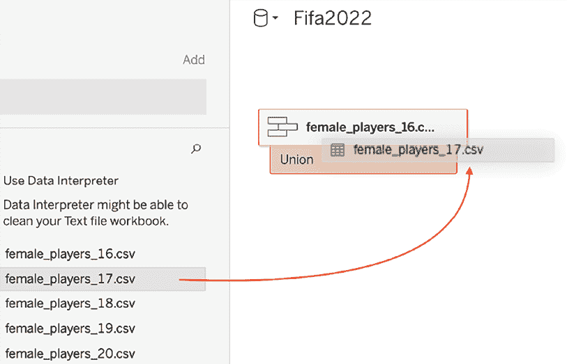

图 4.11：联合

5.  或者，点击主数据集的箭头并选择 `转换为联合...`：

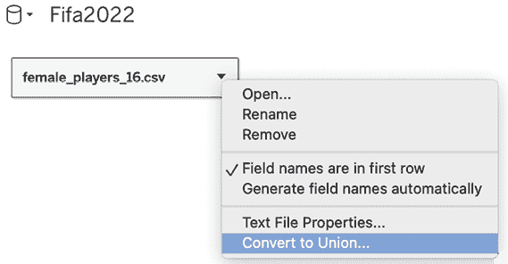

图 4.12：转换为联合...

6.  在以下弹出窗口中（*图 4.13*），用户可以通过拖放或使用 `通配符` 联合单独选择应作为联合一部分的所有数据表，后者将根据命名约定包含某个目录中的所有表——`*` 代表任意字符。`players*` 将包含所有以 `players` 开头的文件。同理，`female*` 将包含所有以 `female` 开头的文件，而 `*` 将包含所有文件：

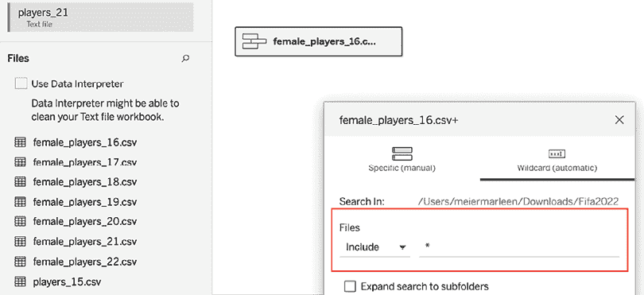

图 4.13：编辑联合...

联合用于合并相似的数据，并将它们追加在彼此下方。它们最常用于多个数据文件的场景，其中每个文件具有不同的日期戳、不同的地区、不同的经理等。通过使用联合，您希望使数据集更完整。我们看到 Tableau 允许通过拖放以及右键单击初始数据源来进行联合。我们还讨论了使用拖放或通配符将一个或多个其他数据集合并的联合。*图 4.14* 展示了一个典型的联合示例：

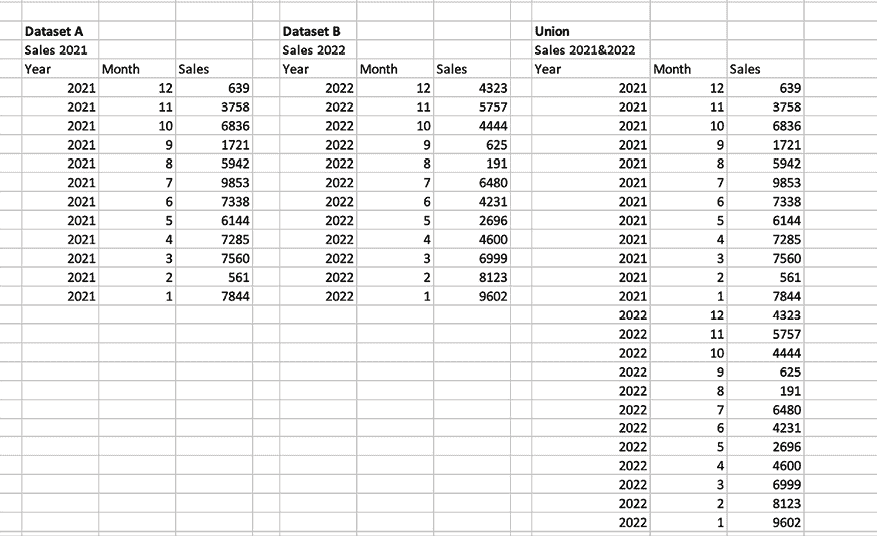

图 4.14：联合

让我们看看需要记住的几个方面：

*   联合通过创建额外的行来追加数据。
*   联合应包含具有许多公共列的数据集。
*   联合应仅用于存储在多个数据源中的结构相同的数据。
*   使用联合时请留意性能。联合中的每个额外数据集都会增加 Tableau `VizQL` 的复杂性。

既然您刚成为联合专家，是时候继续了解 Tableau 提供的下一项功能了：`混合`！混合可帮助您合并具有不同粒度级别的数据集。请考虑数据集之间的 `一对多` 关系。一个数据集每行有一个唯一键；另一个数据集每个键有多行。为了避免在第一个数据集中复制行，Tableau 部署了混合功能，这远在关系成为软件包一部分之前。

## 混合

关系使得数据混合的必要性稍微降低，且可被视为遗留功能。但为了完整性以及针对较旧的 Tableau 版本（2020.2 以下），让我们在以下部分总结数据混合。简而言之，数据混合允许您将多个不同的数据源合并到单个视图中。理解以下四点将让您掌握数据混合的要点：

*   数据混合通常用于合并来自多个数据源的数据。尽管从 Tableau 10 开始，多个数据源之间可以进行联接，但在某些情况下，数据混合仍然是合并来自两个或更多来源数据的唯一可行选项。在以下部分中，我们将看到一个演示此类情况的实际示例。
*   数据混合需要一个共享维度。日期维度通常是混合多数据源的可行候选者。
*   数据混合先聚合后匹配。另一方面，联接先匹配后聚合。
*   数据混合不支持来自辅助数据源的维度。尝试使用辅助数据源的维度将导致视图中出现 `*` 或 `null`。此规则有一个例外，我们将稍后在 *添加辅助维度* 部分讨论。

既然我们已经介绍了关系、联接和联合，我想稍微将您的关注点转移到工作簿内的数据结构上。您可能设置了完美的联接或联合，开始将字段拖放到工作簿画布上，使用了筛选器，使用了计算字段，却得到了一些意外的结果。Tableau 的表现是正常的，只是不符合您的预期。为什么会这样？！操作顺序在这里至关重要。必须了解何时应用哪个筛选器以及这如何影响您的数据。因此，接下来的内容是：操作顺序。

## 探索操作顺序

数据混合不就是 `左联接` 吗？这是新 Tableau 制作者经常问的问题。答案当然是否定的，但让我们探讨一下它们的区别。以下示例很简单，甚至有点轻松，但确实演示了因错误联接导致的错误聚合可能产生的深远后果。

我们将探索 Tableau 中聚合发生的顺序。这将帮助您更有效地使用混合和联接。

对于此示例，我们将使用以下数据：

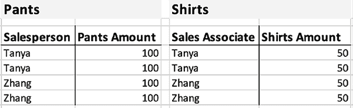

图 4.15：裤子和衬衫销售

在这些表中，列出了两个人：`Tanya` 和 `Zhang`。在一个表中，这些人是 `销售人员` 维度的成员，在另一个表中，他们是 `销售助理` 维度的成员。此外，`Tanya` 和 `Zhang` 都卖出了 200 美元的裤子和 100 美元的衬衫。让我们探索 Tableau 连接这些数据的新方式，以更好地理解联接和数据混合。

当您查看与此练习关联的电子表格时，会注意到额外的列。这些列将在后续练习中使用。

请执行以下步骤：

1.  在属于本章的工作簿中，右键单击 `裤子` 数据源，然后单击 `查看数据` 来查看数据。对 `衬衫` 数据源执行相同操作。
2.  通过右键单击 `联接` 数据源并选择 `编辑数据源` 来打开它，并观察 `裤子` 和 `衬衫` 表之间使用 `销售人员/销售助理` 作为公共键的联接：

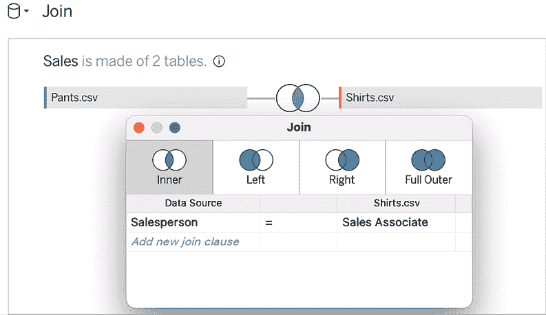

图 4.16：联接

3.  在 `裤子` 工作表上，选择 `裤子` 数据源，将 `销售人员` 放在 `行` 货架上，将 `裤子金额` 放在 `文本` 货架上：

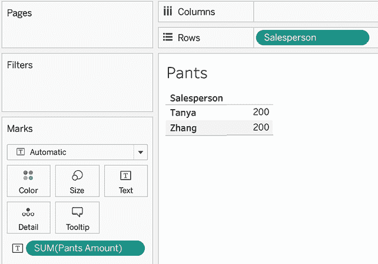

图 4.17：设置工作表


## 对比联接与混合

1. 在 `Shirts` 工作表中，选择 `Shirts` 数据源，将 `Sales Associate` 放入 `Rows`（行）功能区，将 `Shirt Amount` 放入 `Text`（文本）功能区：

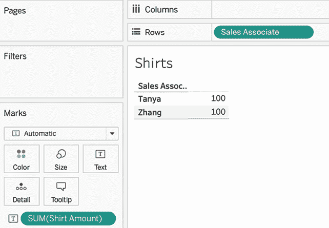

图 4.18：`Shirts`

2. 在 `Join` 工作表中，选择 `Join` 数据源，将 `Salesperson` 放入 `Rows`（行）功能区。接着，双击 `Pants Amount` 和 `Shirt Amount` 将两者都放入视图：

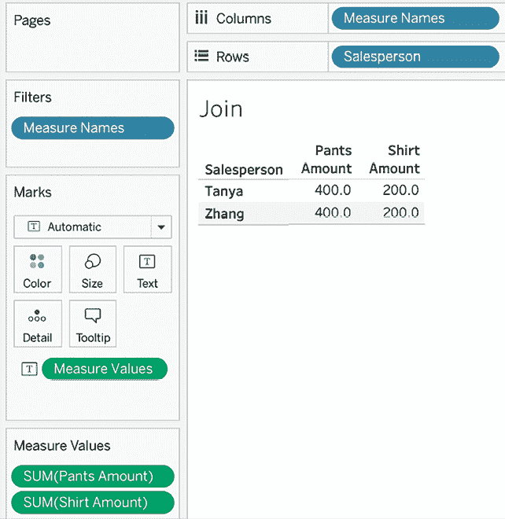

图 4.19：`Join`

3. 在 `Blend – Pants Primary` 工作表中，选择 `Pants` 数据源，将 `Salesperson` 放入 `Rows`（行）功能区，将 `Pants Amount` 放入 `Text`（文本）功能区：

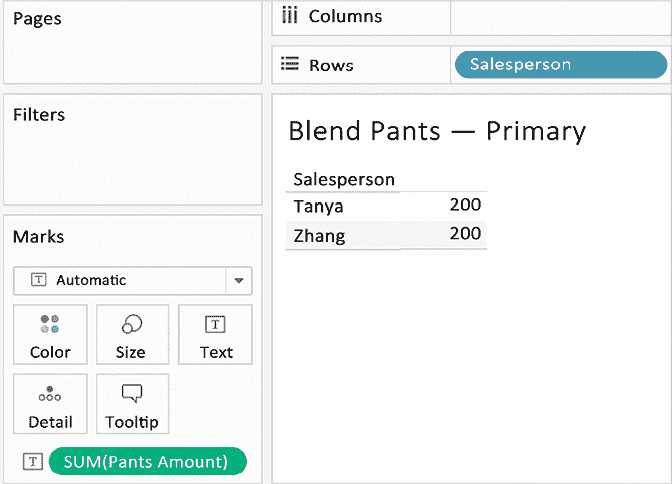

图 4.20：`Blend – Pants Primary`

4. 保持在同一工作表，从左侧数据源面板中选择 `Shirts` 数据源，然后双击 `Shirt Amount`。如果弹出错误消息，请点击 `OK`。

5. 从菜单栏中选择 `Data`（数据），然后选择 `Edit Blend Relationships…`（编辑混合关系……）：


图 4.21：`Edit Blend Relationships...`

6. 在弹出的对话框中，将 `Pants` 选为 `Primary data source`（主数据源），将 `Shirts` 选为 `Secondary data source`（辅助数据源），然后点击 `Custom`（自定义）单选按钮，如图 4.22 所示，接着点击 `Add…`（添加……）。

7. 在左侧列中选择 `Salesperson`，在右侧列中选择 `Sales Associate`。左侧列代表来自 `Primary data source`（主数据源）的数据，右侧列代表 `Secondary data source`（辅助数据源）中所有可用的数据。

8. 如果有其他链接，请全部移除，然后点击 `OK`。对话框中的结果应与下面截图中显示的内容一致：

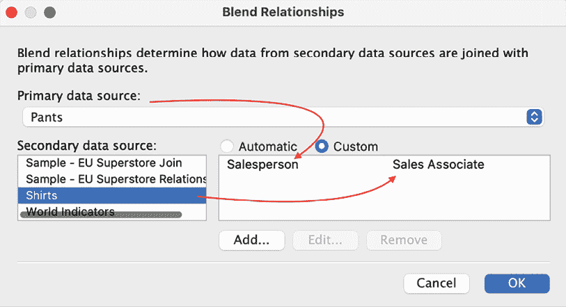

图 4.22：`Blend Relationships`

简要回顾一下我们迄今为止所做的工作：我们正在使用三个数据源：`Pants`、`Shirts` 和 `Join`，其中 `Join` 由 `Pants` 和 `Shirts` 组成。我们还创建了一个以 `Pants` 为主数据源的混合，并使用 `Salesperson` 和 `Sales Associate` 作为键将它们连接起来。

不要被名称 `Blend Relationships`（混合关系）搞混。这与逻辑层关系无关。它只是弹出窗口的名称。

回到练习，继续以下步骤：

9. 在 `Blend – Shirts Primary` 工作表中，选择 `Shirts` 数据源，将 `Sales Associate` 放入 `Rows`（行）功能区，将 `Shirt Amount` 放入 `Text`（文本）功能区：

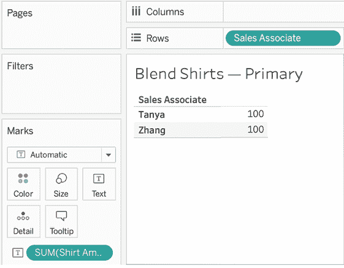

图 4.23：`Blend – Shirts Primary`

10. 在同一工作簿中，选择 `Pants` 数据源，确保 `Salesperson` 旁边的链接图标处于连接/红色状态，然后双击 `Pants Amount` 将其添加到视图中：

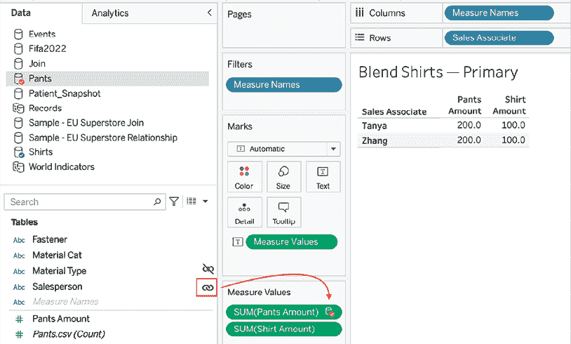

图 4.24：`Finalizing the worksheet`

11. 将所有五个工作表放入一个仪表板中。根据需要进行格式化和排列。现在让我们在下面的截图中对比这五个工作表的结果：

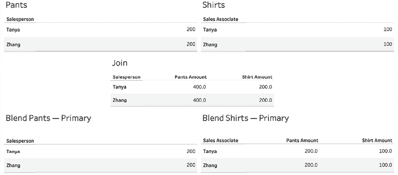

图 4.25：`Comparison`

在上面的截图中，`Join` 工作表的结果是预期值的两倍。为什么？因为联接首先匹配公共键（在本例中为 `Salesperson`/`Sales Associate`），然后聚合结果。在公共键上找到的匹配项越多，问题就越严重。如果在公共键上找到多个匹配项，结果将呈指数级增长。两个匹配项会导致平方结果，三个会导致立方结果，以此类推。这种指数效应在下面的截图中以图形方式表示：

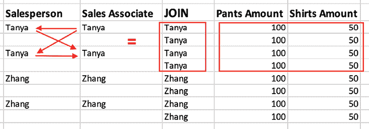

图 4.26：`Join`

另一方面，混合功能运行得更高效，但在混合能正常工作之前，我们必须编辑数据关系，以便 Tableau 能够使用 `Salesperson` 和 `Sales Associate` 字段连接这两个数据源。如果这两个字段名称相同（例如均为 `Salesperson`），Tableau 会自动提供一个选项，使用这些字段在数据源之间进行混合。

`Blend – Pants Primary` 和 `Blend – Shirts Primary` 工作表的结果是正确的。不存在指数效应。为什么？因为数据混合**先**聚合两个数据源的结果，**再**在公共维度上匹配结果。

在本例中，该公共维度即为 `Salesperson`/`Sales Associate`，如下截图所示：

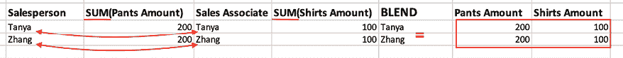

图 4.27：`Blending results`

在本练习中我们看到，联接可能会改变数据结构，因此使用时要小心，且必须非常清楚哪些列适合作为键。此外，在联接数据前后都要进行检查，这可以简单到统计行数并检查是否为预期结果。

混合有优点也有缺点；例如，添加维度就不是那么简单直接。但在下一节中，我们将探讨更多关于辅助维度的细节。

## 添加辅助维度

数据混合虽然对于连接不同的数据源特别有用，但也有局限性。最重要的局限性是：**数据混合不支持来自辅助数据源的维度**。此限制有一个例外；也就是说，**有一种方法可以添加来自辅助数据源的维度**。让我们进一步探讨这一点。

除了 `Salesperson`/`Sales Associate` 和 `Shirt Amount`/`Pants Amount` 之外，数据源中还有其他字段。我们将在本练习中引用这些字段：

1. 在本章关联的工作簿中，选择 `Adding Secondary Dimensions` 工作表。

2. 选择 `Shirts` 数据源。

3. 为 `Material Type` 在 `Shirts` 和 `Pants` 数据源之间添加关系，执行以下步骤：

    1. 选择 `Data`（数据），然后选择 `Edit Relationships`（编辑关系）。
    2. 确保 `Shirts` 是主数据源，`Pants` 是辅助数据源。
    3. 选择 `Custom`（自定义）单选按钮。
    4. 点击 `Add…`（添加……）。
    5. 在左、右两列中均选择 `Material Type`：

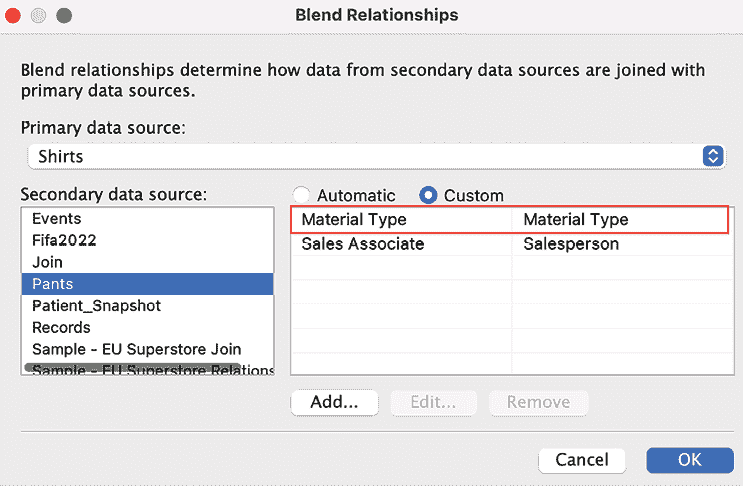

图 4.28：`Custom` 混合关系

    6. 点击 `OK` 返回视图。

4. 将 `Material Type` 放入 `Rows`（行）功能区。

5. 选择 `Pants` 数据源，确保 `Data`（数据）面板中 `Material Type` 旁边的链接图标处于激活状态，而 `Salesperson` 旁边的链接图标处于非激活状态。如果图标是灰色的断开链接，则未激活；如果是橙色的连接链接，则已激活：

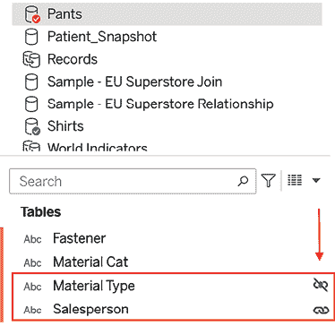

图 4.29：`Shirts` 和 `Pants`

6. 将 `Material Cat` 放在 `Material Type` 之前，将 `Fastener` 放在 `Material Type` 之后，均置于 `Rows`（行）功能区，如下所示：

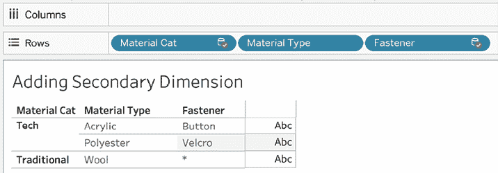

图 4.30：`Secondary dimensions`

`Material Cat` 是来自辅助数据源的维度。数据混合不支持来自辅助数据源的维度。为什么在这种情况下它却生效了？有几个原因：

* `Material Cat` 和 `Material Type` 之间存在一对多关系；即 `Material Type` 维度的每个成员都**仅**与 `Material Cat` 维度的**一个**成员匹配。
* 视图是基于 `Material Type` 而非 `Material Cat` 进行混合的。这一点很重要，因为 `Material Type` 的粒度低于 `Material Cat`。尝试基于 `Material Cat` 混合视图将无法启用 `Material Type` 作为辅助维度。
* 主数据源中 `Material Type` 维度的每个成员在辅助数据源中也都存在。


`Fastener` 也是来自辅助数据源的一个维度。在*图 4.35* 中，它在一个单元格中显示 `\*`，从而表明 `Fastener` 没有按维度应有的方式工作；也就是说，它没有对数据进行切片，正如*第 1 章*、*回顾基础知识*中所讨论的。显示星号的原因是有多种 `Fastener` 类型与 `Wool` 相关联。`Button` 和 `Velcro` 之所以显示，是因为 `Acrylic` 和 `Polyester` 在底层数据中各自只有一种 `Fastener` 类型。

如果您使用混合，请确保您的主要原因是为了组合度量，并且您不需要在详细级别上使用维度。在创建仪表板之前了解这一点尤其有用，以便做好相应的准备。您的数据需要额外的准备（请查看*第 3 章*、*使用 Tableau Prep Builder*），因为无论是联接还是混合都无法为您带来预期的数据结构。或者您可以利用搭建（scaffolding）技术，这是一种使用辅助数据源的技术——我们将在下一节讨论这一点。

## 介绍搭建技术

搭建是一种通过混合引入第二个数据源，以重塑和/或扩展初始数据源的技术。搭建启用了一些功能，可扩展 Tableau 以满足原本极难甚至完全无法实现的可视化和分析需求。搭建技术在 Tableau 中的先驱 Joe Mako 讲述了一个故事，他在其中使用该技术仅用四个工作表就重建了一个仪表板。原来的仪表板未使用搭建技术，需要 80 个工作表，并需费力地逐像素对齐。

搭建技术所实现的众多可能性中，包括扩展 Tableau 的预测功能。Tableau 原生的预测功能有时因缺乏复杂性而受到批评。搭建技术可用于解决这一批评。

以下是步骤：

1. 在与本章关联的工作簿中，选择 `Scaffolding` 工作表并连接到 `World Indicators` 数据源。
2. 使用 Excel 或文本编辑器，创建一个 `Records` 数据集。下面的两行表格代表了 `Records` 数据集的全部内容：
   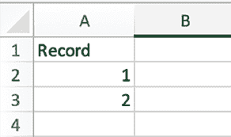
   *图 4.31：Excel 文件*
3. 将 Tableau 连接到该数据集。
4. 为方便起见，可考虑使用 `Ctrl` + `C` 直接从 Excel 复制数据集，并使用 `Ctrl` + `V` 直接粘贴到 Tableau 中。
5. 在 Tableau 中创建一个 `Start Date` 参数，设置如下面屏幕截图所示。请注意屏幕截图中高亮显示的部分，您可以通过它们设置所需的显示格式：
   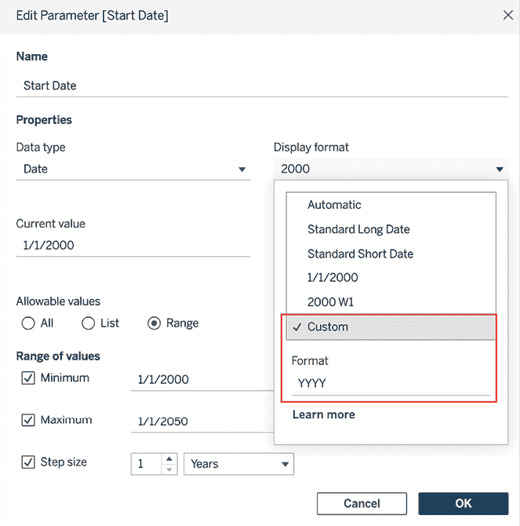
   *图 4.32：显示格式*
6. 创建另一个名为 `End Date` 的参数，设置相同。
7. 在 `数据` 窗格中，右键单击刚创建的 `Start Date` 和 `End Date` 参数，然后选择 `显示参数`：
   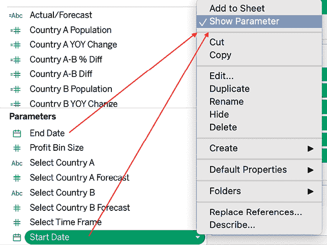
   *图 4.33：显示参数*
8. 根据需要设置开始和结束日期，例如 `2000` – `2027`：
   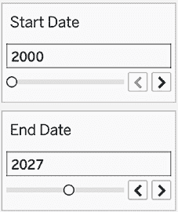
   *图 4.34：开始和结束日期*
9. 选择 `Records` 数据源，并创建一个名为 `Date` 的计算字段，代码如下：
   ```
   IIF([Records]=1,[Start Date],[End Date])
   ```
10. 将 `Date` 字段放置在 `行` 货架上。
11. 右键单击 `行` 货架上的 `Date` 字段，然后选择 `显示缺失值`。请注意，现在显示了开始和结束日期设置之间的所有日期：
    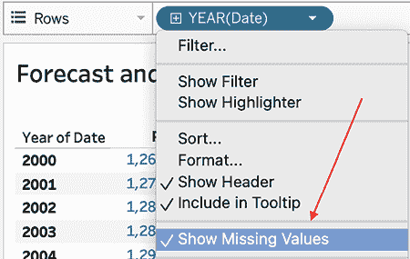
    *图 4.35：显示缺失值*
12. 创建一个名为 `Select Country A` 的参数，设置如下面屏幕截图所示。请注意，国家列表是通过 `从字段添加值` 按钮添加的：
    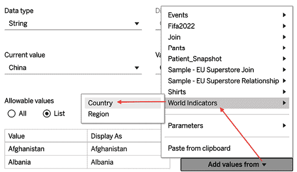
    *图 4.36：从字段添加*
13. 创建另一个名为 `Select Country B` 的参数，设置相同。
14. 创建一个名为 `Select Country A Forecast` 的参数，设置如下面屏幕截图所示：
    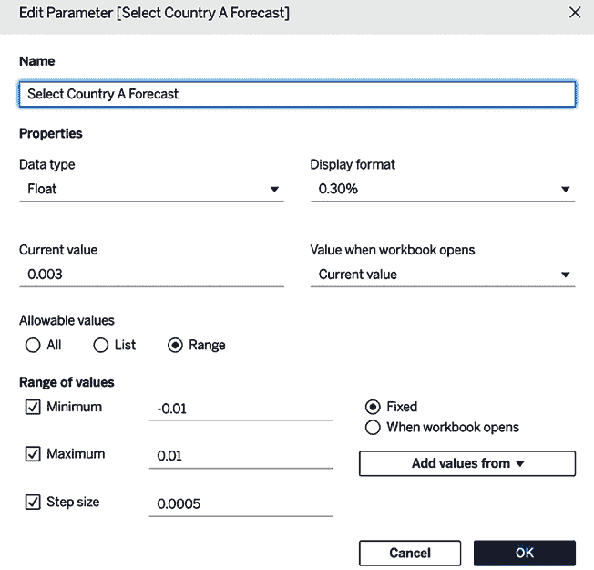
    *图 4.37：编辑参数*
15. 创建另一个名为 `Select Country B Forecast` 的参数，设置相同。
16. 在 `数据` 窗格中，右键单击刚创建的四个参数（`Select Country A`、`Select Country B`、`Select Country A Forecast` 和 `Select Country B Forecast`），然后选择 `显示参数`：
    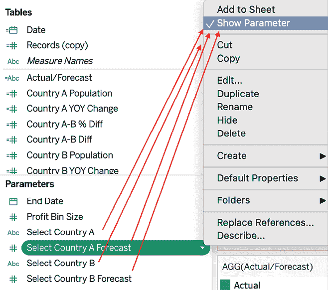
    *图 4.38：显示参数*
17. 确保 `World Indicators` 数据源中的 `Date` 字段显示了橙色的链接图标。这表明它被用作链接字段：
    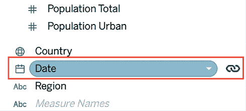
    *图 4.39：链接*
18. 在 `World Indicators` 数据集中，创建以下计算字段：
    | **计算字段名称** | **计算字段代码** |
    | --- | --- |
    | `Country A Population` | 
    ```
    IIF([Country] = [Select Country A],[Population Total],NULL)
    ```
    |
    | `Country B Population` | 
    ```
    IIF([Country] = [Select Country B],[Population Total],NULL)
    ```
    |
19. 在 `Records` 数据集中，创建以下计算字段：
    | **计算字段名称** | **计算字段代码** |
    | --- | --- |
    | `Actual/Forecast` | 
    ```
    IIF(ISNULL(AVG([World Indicators].[Population Total])),"Forecast","Actual")
    ```
    |
    | `Country A Population` | 
    ```
    IF [Actual/Forecast] = "Actual" THEN SUM([World Indicators].[Country A Population]) ELSE PREVIOUS_VALUE(0)
    *[Select Country A Forecast] + PREVIOUS_VALUE(0)
    END
    ```
    |
    | `Country A YOY Change` | 
    ```
    ([Country A Population] - LOOKUP([Country A Population], -1)) /
    ABS(LOOKUP([Country A Population], -1))
    ```
    |
    | `Country B Population` | 
    ```
    IF [Actual/Forecast] = "Actual" THEN SUM([World Indicators].[Country B Population]) ELSE PREVIOUS_VALUE(0)
    *[Select Country B Forecast] + PREVIOUS_VALUE(0)
    END
    ```
    |
    | `Country B YOY Change` | 
    ```
    ([Country B Population] - LOOKUP([Country B Population], -1)) /
    ABS(LOOKUP([Country B Population], -1))
    ```
    |
    | `Country A-B Diff` | 
    ```
    [Country A Population] - [Country B Population]
    ```
    |
    | `Country A-B % Diff` | 
    ```
    [Country A-B Diff]/[Country A Population]
    ```
    |
20. 在 `数据` 窗格中，右键单击 `Country A YOY Change`、`Country B YOY Change` 和 `Country A-B % Diff`，然后选择 `默认属性` | `数字格式…` 以将默认数字格式更改为 `百分比`：
    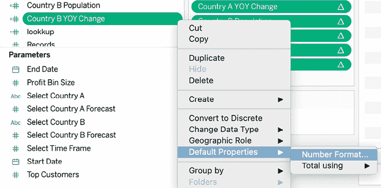
    *图 4.40：默认属性*
21. 选中 `Records` 数据源，将 `Actual/Forecast`、`度量值` 和 `度量名称` 字段分别放置在 `颜色`、`文本` 和 `列` 货架上：
    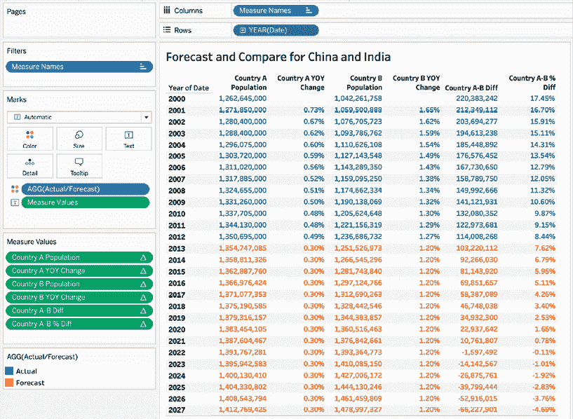
    *图 4.41：预测设置*
22. 调整 `度量值` 货架，使显示的字段与下面的屏幕截图完全一致。此外，确保这些字段中的每一个的 `计算使用` 都设置为 `表格(向下)`：
    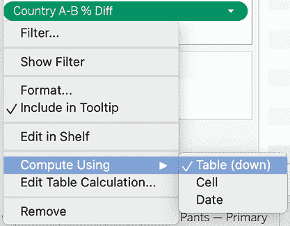
    *图 4.42：计算使用*

那么，我们迄今为止实现了什么？我们创建了一个重复的数据结构，使我们能够在两个单独的列中比较两个国家，即使原始数据集中的数据在一列中。此设置允许我们提出更高级的问题。


# 预测人口增长

为了演示这一点，让我们问一个问题：“印度人口何时将超过中国？”您可以根据需要设置参数——我选择了 0.45% 和 1.20% 作为平均年增长率，但您可以随意选择认为最适合某个国家的任何参数。在*图 4.48*中，您可以看到，中国和印度的增长率分别为 0.45% 和 1.20% 时，到 2024 年印度将拥有比中国更多的人口。您可以通过查看 `Country A Population` 和 `Country B Population` 列来观察这一点。橙色部分为预测数据，蓝色部分为我们数据集中的实际数据：

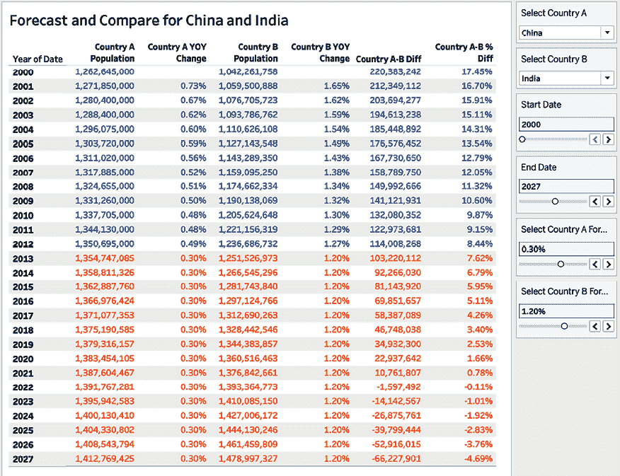

**图 4.43：预测仪表板**

我们显然已经领先很多年了；如果我告诉您 2020 年中国人口为 1,439,323,776，印度人口为 1,380,004,385，您能使用此仪表板算出 2012 年至 2020 年中国和印度的实际平均增长率吗？请在 Tableau Public 上分享您的结果，并添加标签 `#MasteringTableau`！

## 数据搭建

本练习的一个关键在于数据搭建。数据搭建会生成数据源中不存在的数据。`World Indicators` 数据集仅包含 2000 年至 2012 年的日期，显然 `Records` 数据集不包含任何日期。通过使用 `Start Date` 和 `End Date` 参数并结合计算字段 `Date`，我们能够生成所需的任何日期集合。我们必须混合数据，而不是连接或联合，以保持原始数据源完好无损，并在 `World Indicators` 本身之外创建所有额外数据。

实际的数据搭建发生在将 `Date` 字段放置在 `Rows` 架构上后，从其下拉菜单中选择 `Show Missing Values`（显示缺失值）时。这使得 `Start Date` 和 `End Date` 之间的每一年都能显示出来，即使底层数据中没有匹配的年份。*第 6 章* *利用 OData、数据密化、大数据和 Google BigQuery* 将更详细地探讨与数据搭建非常相似的数据密化。

## 计算字段深度解析

让我们更深入地了解一些计算字段，以更好地理解本练习中预测的工作原理：

### 计算字段：`Actual/Forecast`

```
IIF(ISNULL(AVG([World Indicators].[Population Total])),"Forecast","Actual")
```

前面的代码用于确定 `World Indicators` 数据集中是否存在数据。如果日期在 2012 年之后，则不存在数据，因此返回 `Forecast`。

### 计算字段：`Country A Population`

```
IF [Actual/Forecast] = "Actual" THEN SUM([World Indicators].[Country A Population]) ELSE PREVIOUS_VALUE(0)
*[Select Country A Forecast] + PREVIOUS_VALUE(0) END
```

如果需要预测来确定值（即日期在 2012 年之后），则会执行这段代码的 `ELSE` 部分。`PREVIOUS_VALUE` 函数返回上一行的值，并将结果乘以预测值，然后加上上一行的值。

让我们看一下下表中的示例：

| `Previous Row Value (PRV)` | | 1,000 |
| --- | --- | --- |
| `Forecast (F)` | | 0.01 |
| `PRV * F` | | 10 |
| `Current Row Value` | | 1,010 |

在 `Country A Population` 计算字段中，有一点很重要：预测方法非常简单：将上一期人口乘以给定的预测数字，然后汇总结果。在不改变逻辑整体结构的前提下，这段代码可以修改为更复杂的预测方法。

这些练习表明，通过一些其他技巧和方法，混合数据可以在您的数据项目中发挥巨大作用。最后，我们将总体讨论数据结构，以便您更好地理解 Tableau 为什么要这样做，以及如何实现您的可视化目标。

# 理解数据结构

正确的数据结构不易定义。确实有一些基本规则。例如，长表数据通常优于宽表数据。包含许多列的宽数据集可能难以处理，而相同的数据如果采用长格式结构（列较少但行较多），通常更易于处理。

但情况并非总是如此！某些业务问题使用宽数据结构更容易回答。这才是关键所在。业务问题决定了正确的数据结构。如果一种结构能回答所有问题，那固然很好！不过，您的问题可能需要多种数据结构。Tableau 中的 `pivot`（透视）功能可帮助您即时调整数据结构，以回答不同的业务问题。

在开始此练习之前，请确保您理解以下几点：

- Tableau 中的透视功能仅限于 Excel、文本文件和 Google Sheets；否则，您必须使用自定义 SQL 或 Tableau Prep
- Tableau 中的透视在数据库术语中称为 *unpivot*（逆透视）

作为医院的业务分析师，您将 Tableau 连接到患者数据的每日快照。您有两个问题：

- 任何给定日期发生多少事件？例如，某天有多少患者办理入住？
- 事件之间间隔多少时间？例如，住院多天的患者平均住院时长是多少？

要回答这些问题，请执行以下步骤：

1. 在与本章关联的初级工作簿中，选择 `Time Frames` 工作表，并在 **数据** 窗格中选择 `Patient_Snapshot` 数据源。
2. 单击 **标记** 卡中的下拉菜单，选择 **条形图** 作为图表类型。
3. 在 **数据** 窗格中右键单击，创建一个名为 `Select Time Frame` 的参数，设置如下面屏幕截图所示：

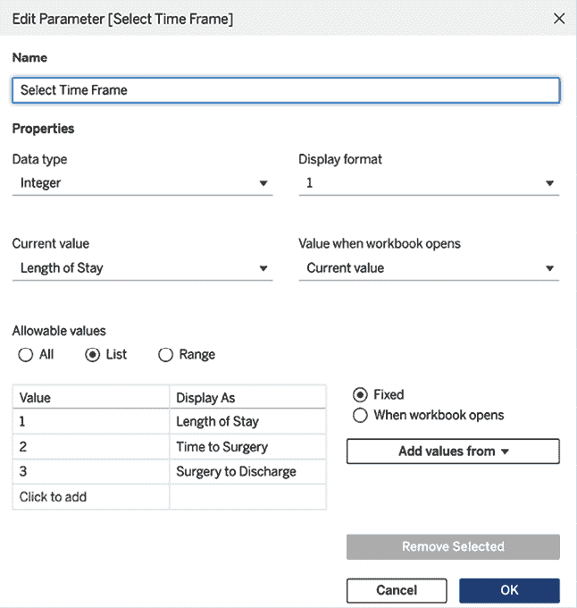

**图 4.44：参数**

4. 右键单击刚创建的参数，选择 `Show Parameter`（显示参数）。
5. 在 **数据** 窗格中右键单击，创建一个名为 `Selected Time Frame` 的计算字段，代码如下：

```
CASE [Select Time Frame]
WHEN 1 THEN DATEDIFF('day',[Check-in Date],[Discharge Date])
WHEN 2 THEN DATEDIFF('day',[Surgery Date],[Discharge Date])
WHEN 3 THEN DATEDIFF('day',[Check-in Date],[Surgery Date])
END
```

6. 将以下字段拖放到相应的架构上，并按指示进行定义：

| 字段名称 | 架构操作说明 |
| --- | --- |
| `Patient Type` | 拖至 **筛选器** 架构并勾选 **住院患者**。 |
| `Check-in Date` | 拖至 **筛选器** 架构并选择 **日期范围**。此外，右键单击生成的筛选器并选择 **显示筛选器**。 |
| `Check-in Date` | 右键拖至 **列** 架构并选择 **MDY**（月-日-年）。 |
| `Selected Time Frame` | 右键拖至 **行** 架构并选择 **AVG**（平均值）。 |
| `Selected Time Frame` | 右键拖至 **颜色** 架构并选择 **AVG**。按需设置颜色。 |

7. 完成这些操作后，您的工作表应如下所示：

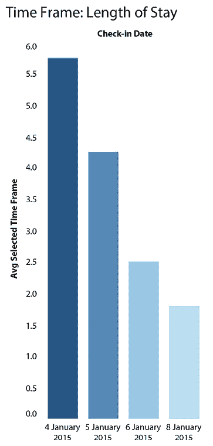

**图 4.45：初始仪表板**

8. 右键单击 `Avg Selected Time Frame` 轴，选择 `Edit Axis…`（编辑轴），如下图所示。然后删除标题：

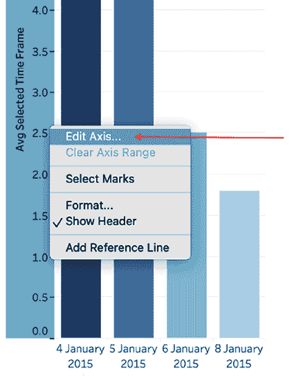

**图 4.46：编辑轴...**

9. 选择 **工作表** | **显示标题**。通过插入参数 `Select Time Frame` 来编辑标题，如下面的屏幕截图所示：

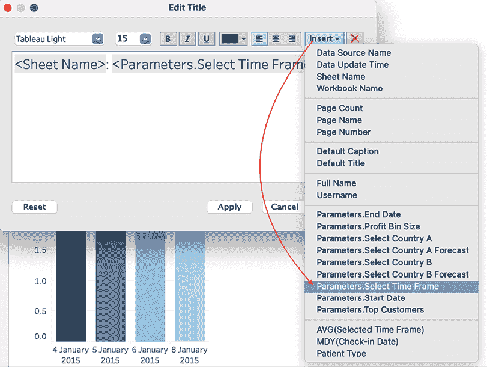

**图 4.47：添加参数**

此数据结构非常适合本练习的第一部分。您能够快速创建可视化。唯一稍微有点意思的部分是设置 `Selected Time Frame` 计算字段及其关联参数。

这允许最终用户选择他们想要查看的时间范围：

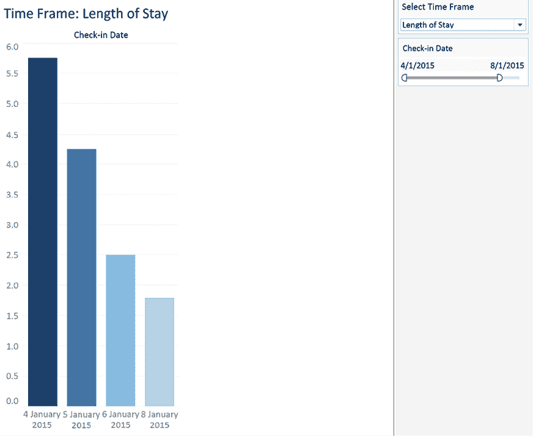

**图 4.48：仪表板**

但如果您需要知道每天有多少人参与了某类事件，会发生什么？


由于当前数据结构中每位患者一行却包含多个日期，因此用它来回答这个问题相当困难。在*图 4.49*中，你可以看到区别：右侧是我们当前的数据结构，左侧是能让每日事件计数变得更容易的数据结构：

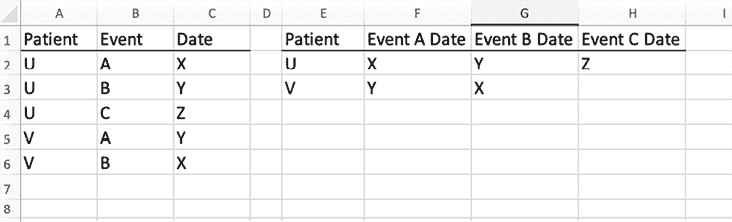

**图 4.49：患者数据结构**

因此，在本练习的第二部分，我们将尝试通过透视数据来采用一种不同的方法：

1.  在与本章关联的起始工作簿中，选择 `Events Per Date` 工作表。

2.  在**数据**窗格中，右键单击 **Patient_Snapshot** 数据源并选择**复制**。

3.  将副本重命名为 **Events**。

4.  右键单击 **Events** 数据源并选择**编辑数据源...**：

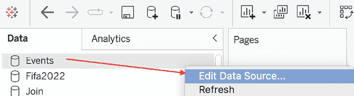

**图 4.50：编辑数据源...**

1.  执行以下步骤：

    1.  按住 *Shift* 或 *Ctrl* 键单击以选中所有五个日期字段。

    2.  选择任一选中字段的下拉选项并选择**透视**：

    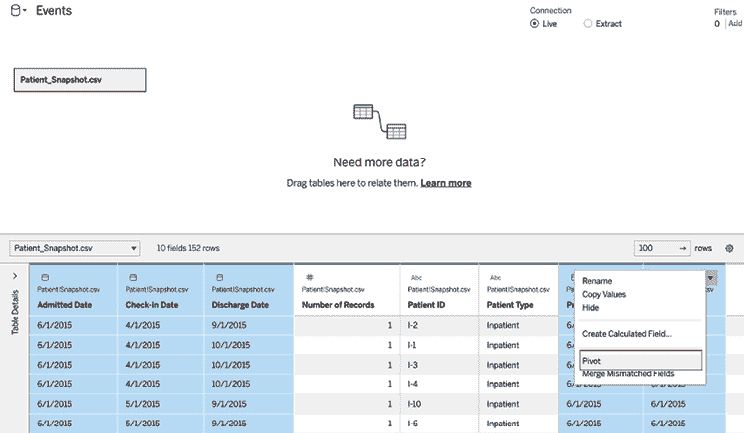

    **图 4.51：透视**

    1.  透视会将行和列互换，我们将获得如*图 4.49*左侧所示的数据结构。将透视后的字段重命名为 **Event Type** 和 **Event Date**。

    2.  选择 `Events Per Date` 工作表，并将以下字段放置在相关联的货架上，按指示进行定义：

| **字段名** | **货架方向** |
| --- | --- |
| `Event Date` | 右键拖动到**行**货架并选择 **MDY** |
| `Event Type` | 放在**行**货架上 **Event Date** 之后 |
| `Patient Type` | 右键单击并选择**显示筛选器** |
| `Number of Records` | 拖动到**列**货架 |

    1.  由此，你的工作表应如下所示：

    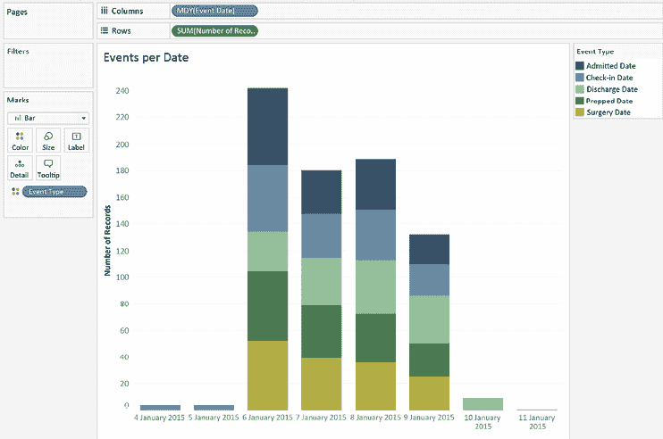

    **图 4.52：按日期统计事件**

原始数据结构不太适合此练习；然而，在复制数据源并进行透视后，每日事件计数的任务变得非常简单，因为我们仅使用三个字段：**Event Date**、**Number of Records** 和 **Event Type** 就实现了这一点。这就是主要收获。如果你发现自己在努力创建可视化以回答一个看似简单的业务问题，请考虑使用透视。

# 总结

我们本章开始时介绍了关系，接着讨论了连接，并了解了 Tableau 用于生成相应数据的查询。如果存储在多个工作表或数据源中格式相同的数据需要追加，联合非常有用。

然后，我们回顾了数据混合，以清楚了解它与连接的区别。我们发现数据混合的主要限制是不允许来自次要数据源的维度；然而，我们也发现这条规则有例外。我们还讨论了脚手架，它能使数据混合出奇地富有成效。

最后，我们讨论了数据结构，并了解了透视如何使困难或不可能的可视化变得简单。完成第二次以数据为中心的讨论后，在下一章中，我们将讨论表计算、分区和寻址。

# 在 Discord 上了解更多

要加入本书的 Discord 社区——你可以在其中分享反馈、向作者提问并了解新版本——请扫描下方的二维码：

[`packt.link/tableau`](https://packt.link/tableau)


