# 表计算简介

Tableau 中表计算这一主题极其丰富且深奥，仅此一项就足以成为一整本书的主题。探索每个表计算函数可用的各种选项以及应用表计算的各种方式，是一项有趣且收获颇丰的工作。当你回顾本章中的示例时，你无疑会遇到可应用于日常工作中的技术；然而，你可能难以理解为什么其中一些技术有效。编写本章旨在提供关于表计算的思维方式，这将有助于你掌握这个迷人主题的旅程。在此过程中，也将探讨一些实际示例。

在为本章审查的数十篇博客、论坛帖子、会议演讲、文章和白皮书中，Jonathan Drummy 的博客文章（[`drawingwithnumbers.artisart.org/at-the-level-unlocking-the-mystery-part-1-ordinal-cals/`](http://drawingwithnumbers.artisart.org/at-the-level-unlocking-the-mystery-part-1-ordinal-cals/)），《At the Level – Unlocking the Mystery Part 1: Ordinal Calcs》（在层级上——解开谜团第 1 部分：序数计算），对于理解分区和寻址的各种细微差别——表计算的 DNA——最为清晰且富有洞见。在本章中，我们将讨论以下主题：

* 分区和寻址方向
* 定向和非定向寻址
* 探索每个独特的表计算函数
* 函数的应用

让我们深入细节，从表计算的一般定义和两个随之而来的问题开始本章，我们将在本章结束时回答这些问题。

## 分区和寻址方向

正如*第 1 章* *回顾基础知识*中所讨论的，计算字段可分为行级、聚合级或表级。对于行级和聚合级计算，底层数据源引擎会完成大部分（如果不是全部）计算工作，Tableau 仅负责可视化结果。对于表计算，Tableau 同样依赖底层数据源引擎和机器上的可用 RAM 来执行计算任务；然而，在该工作完成并返回数据集后，Tableau 会在渲染结果前执行额外的处理。

让我们看一下表计算的定义，如下所示：

表计算是在缓存数据集上执行的函数，该数据集是 Tableau 向数据源发起查询的结果生成的。

让我们考虑一下关于上述定义中提到的缓存中的数据集的几点。

此缓存不仅仅是查询返回的结果。Tableau 可能会调整返回的结果。我们将在*第 6 章* *利用 OData、数据填充、大数据和 Google BigQuery* 中探讨这一点；Tableau 可能会通过数据填充来扩展缓存，但通常这是用户驱动的。在表计算术语中，缓存称为**分区**。

考虑缓存的结构非常重要。缓存中的数据集是你工作表中使用的表，和所有表一样，由行和列组成。这对表计算尤为重要，因为表计算可能会在沿缓存移动时进行计算。每当缓存结构发生变化时，`previous_value()` 表计算都会改变，因为它会检索当前值之前的值，而这具有很强的主观性。是按日期、数值还是字母顺序的“之前”？这取决于你通过寻址和分区来告诉 Tableau 如何构建缓存。

大多数表计算都需要考虑缓存结构。这种表计算称为**定向**计算。或者，表计算可能基于整个缓存进行计算，而不考虑寻址和分区。例如，表计算 `total()` 将计算总值，该值不会随缓存顺序的改变而改变。另一个是 `size()`、`script_` 和 `model` 函数。这种类型的表计算称为**非定向**计算。

请注意，在 Tableau 文档中，缓存中的数据集通常被称为分区。本章的结构旨在提供一个简单的模式，以便理解表计算。

*函数介绍* 部分探讨每个独特的表计算函数。*函数应用* 部分探讨表计算如何通过分区和寻址维度应用到视图中。

# 定向和非定向寻址

我们将首先列出不同的表计算函数来开始本节。

Tableau 提供了广泛的表计算，但如果我们将考虑范围缩小到表计算函数的独特组别，我们会发现只有 11 个：

| 表计算 |
| --- |
| `LOOKUP` |
| `PREVIOUS VALUE` |
| `RUNNING` |
| `WINDOW` |
| `FIRST` |
| `INDEX` |
| `LAST` |
| `RANK` |
| `SIZE` |
| `TOTAL` |
| `SCRIPT & MODEL` |

正如*分区和寻址方向*中所述，表计算函数作用于缓存，因此根据表计算的类型（定向或非定向），如果缓存数据发生变化，结果可能会改变。在以下练习中，我们将看到定向和非定向表计算函数的实际运作。

让我们更仔细地看看定向和非定向表计算：

1.  导航至 `https://public.tableau.com/profile/marleen.meier` 以查找并下载与本章关联的工作簿。
2.  导航至 `Directional/Non-Directional` 工作表。
3.  创建计算字段，如下表所示：

| 名称 | 计算 | 备注 |
| --- | --- | --- |
| `Lookup` | `LOOKUP(SUM([Sales]),-1)` | 请注意此计算中包含的 `-1`。这指示 Tableau 从上一行检索值。 |
| `Size` | `SIZE()` | `SIZE` 函数返回分区中的行数。因此，正如下面的屏幕截图所示，大小等于总行数。 |
| `Window Sum` | `WINDOW_SUM(SUM([Sales]))` | `WINDOW_SUM` 函数（`WINDOW_SUM(expression, [start, end])`）可以定向或非定向地运行。由于此示例不包含 `[start, end]` 选项，因此它非定向运行。 |
| `Window Sum w/ Start&End` | `WINDOW_SUM(SUM([Sales]),0,1)` | 此窗口函数示例定向运行，这可以通过包含 `[start, end]` 选项来看出。 |
| `Running Sum` | `RUNNING_SUM(SUM([Sales]))` | 就其本质而言，`RUNNING` 函数定向运行，因为它们考虑前几行以进行计算。 |

1.  将 `Category` 和 `Ship Mode` 放置在 `Rows` 货架上。
2.  双击 `Sales`、`Lookup`、`Size`、`Window Sum`、`Window Sum w/ Start&End` 和 `Running Sum`，以填充视图，如下面的屏幕截图所示：

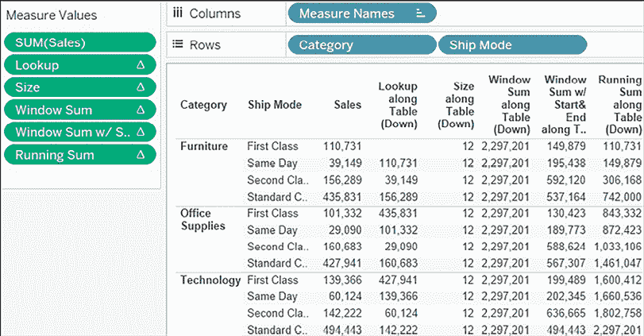

图 5.1：表计算

1.  *图 5.1* 中的表显示，`Size` 函数和 `Window Sum` 函数是仅有的两个非定向函数。所有其他函数根据方向显示数字。例如，`Lookup` 向下移动并打印实际字段之前的值。您可以通过单击任何表计算字段的三角形并选择 `Edit Table Calculation` 来更改方向。

此第一个练习是两个表计算类别的示例：定向和非定向。现在，我们将逐个考虑表计算函数。遗憾的是，篇幅不允许我们探索所有表计算；然而，为了获得实用的理解，考虑除一个之外的所有独特选项组别应该足够了。以 `Script_` 开头的四个表计算，以及六个 `Model_` 函数，将在*第 15 章*、*集成编程语言*中介绍。

虽然我在每节末尾添加了真实场景，但跟随练习的重点是演示表计算功能，并考虑每个功能如何**定向**或**非定向**地与缓存中的数据集（也称为**分区**）交互。

## 探索每个独特的表计算函数

以下练习将向我们单独展示每个表计算；在每节末尾，您将看到我对真实场景的思考。

### Lookup 和 Total

以下工作表的目标是显示在 2013 年最后两天进行购买的客户，以及 12 月相关的绝对销售额和相对销售额。

在下表中，`LOOKUP` 表现为定向，而 `TOTAL` 是非定向。这种行为在结果中很容易注意到。请按照以下步骤操作：

1.  在与本章关联的工作簿中，导航至 `Lookup/Total` 工作表。
2.  将 `Customer Name` 和 `Order Date` 拖至 `Rows` 货架。通过右键单击并选择 `Day` 以及 `Discrete`，将 `Order Date` 设置为 `Month/Day/Year` 离散型。
3.  将 `Order Date` 放置在 `Filters` 货架上，选择仅查看 2013 年 12 月，并选择 `Month/Year` 作为日期格式。
4.  创建以下计算字段：

| 名称 | 计算 |
| --- | --- |
| `Lookup Intervening Time` | `DATEDIFF('day', LOOKUP(MAX([Order Date]), 0), MAKEDATE(2013,12,31))` |
| `% Total Sales` | `SUM([Sales])/TOTAL(SUM([Sales]))` |

1.  右键单击 `% Total Sales`，选择 `Default Properties` | `Number format`，将数字格式设置为百分比，保留两位小数。
2.  将 `Lookup Intervening Time` 放置在 `Filters` 货架上，并选择 0 到 1 的范围。
3.  双击 `Sales` 和 `% Total Sales`，将这两个字段放置在视图上。
4.  根据需要进行格式化：

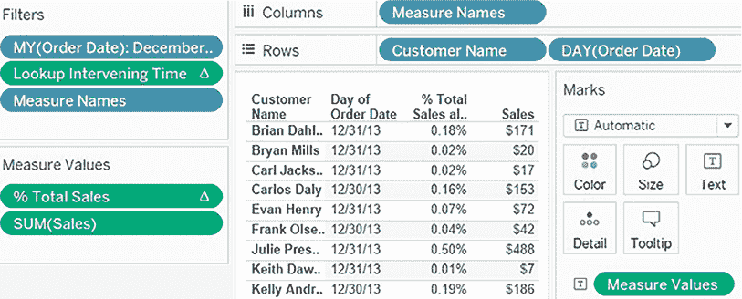

图 5.2：总销售额

让我们考虑一下前面的工作表是如何运作的：

*   `Order Date` 上的筛选器确保返回给 Tableau 的数据集仅包含 2013 年 12 月的数据。
*   `% Total Sales` `SUM([Sales])/TOTAL(SUM([Sales]))` 包含 `TOTAL(SUM([Sales]))` 计算字段，它返回整个数据集的总销售额。用 `SUM([Sales])` 除以此总计可返回总计的百分比。
*   `Lookup Intervening Time`：`DATEDIFF('day', LOOKUP(MAX([Order Date]), 0), MAKEDATE(2013,12,31))` 将返回一个整数，反映 `LOOKUP` 函数返回的日期与 `12/31/2013` 之间的差异。请注意，`LOOKUP` 函数的偏移量为零。这导致每行返回与该行关联的日期。这与包含偏移量为 -1 的 `LOOKUP` 函数的定向和非定向表计算不同，后者导致视图中的每行返回与前一行关联的数据。

乍一看，您可能会认为可以通过从 `Filters` 货架中移除 `Lookup Intervening Time` 并调整 `[Order Date]` 上的筛选器以仅显示 12 月的最后两天来简化此工作簿。然而，如果您这样做，`% Total Sales` 将在视图的所有行中加起来等于 100%，这将无法满足工作簿的目标。将 `Lookup Intervening Time` 视为不进行筛选，而是隐藏 12 月除最后两天之外的所有日期。这种隐藏确保了计算 `% Total Sales` 所需的数据位于缓存/分区的数据集中。

真实场景：我使用 `Lookup` 的频率比 `Total` 高。两者在使用 Tableau 时都非常宝贵。我们已经看到，您可以使用 lookup 进行变化对比；您可以考虑月度利润对比、今天与去年同期的员工人数对比、每周每天的网站点击量差异等。

对于表计算总计，每当您想要显示某事物的总数，同时仍在仪表板中显示一定程度的聚合时，都可以使用它。*图 5.2* 中 `Total` 的百分比实际上是完美的示例。

## Previous Value（前一个值）

以下工作表的目标是返回每年的销售额聚合值，并设定明年的销售目标。请注意，提供了两种确定明年销售目标的选项，旨在演示 `PREVIOUS_VALUE` 与 `LOOKUP` 的区别。此外，请注意 `PREVIOUS_VALUE` 的行为具有方向性。

请看以下步骤：

1. 在与本章关联的工作簿中，导航至 `Previous Value`（前一个值）工作表。

2. 创建以下计算字段：

| 名称 | 计算 |
| --- | --- |
| `Next Year Goal Prv_Val` | `PREVIOUS_VALUE(SUM([Sales])) * 1.05` |
| `Next Year Goal Lkup` | `LOOKUP(SUM([Sales]), 0) * 1.05` |

3. 将 `Order Date`（订单日期）放置在 `Rows`（行）货架上。

4. 双击 `Sales`（销售额）和 `Next Year Goal Prv_Val`，将两者分别放置在视图中。

5. 按需格式化，或参考以下屏幕截图（通过拖动 `Measure Values`（度量值）中的药丸，视图中的顺序会随之改变，如以下屏幕截图所示）：

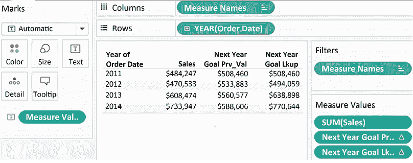

图 5.3：明年

让我们来分析前面工作表的运作方式：

* `Next Year Goal Prv_Val`：此工作表中应用了 `PREVIOUS_VALUE(SUM([Sales])) * 1.05`，它检索每一前一行的结果并增加 5%。换句话说，目标是所有年份每年 5% 的稳态增长率。

* `Next Year Goal Lkup`：此工作表中也应用了 `LOOKUP(SUM([Sales]), 0) * 1.05`；此计算在今年的销售额基础上增加 5%。换句话说，明年的目标是销售额比今年高 5%。不考虑以前的年份。

为了更好地理解此练习，请参考前面屏幕截图中与 **2014** 关联的值。`Next Year Goal Prv_Val` 是通过 `2013 Next Year Goal Prv_Val` 计算得出的；即 `$560,577 * 1.05`。另一方面，`Next Year Goal Lkup` 是通过 **2014** 年的销售额计算得出的；即 `$733,947 * 1.05`。

真实场景：假设您想要推断一个数据点，并继续从该新值进行推断；为此，您可以使用 `Previous_Value`。一个例子是定期支付息票的债券。如果您的债券面值为 100，并支付 4% 的半年息票，您可以使用 `Previous_Value` 计算债券的最终价值，就像我们在上一个练习中对 `Next Year Goal Prv_Val` 所做的那样。

## Running（运行中/累计）

以下工作表的目标是显示运行中最小利润、运行中平均利润和运行中最大利润，并将它们与数据集中每个月的 `SUM(Profit)` 进行比较。

以下示例演示了 `Running` 函数如何按方向运作：

1. 在与本章关联的工作簿中，导航至 `Running`（运行中）工作表。

2. 创建以下计算字段：

| 名称 | 计算 |
| --- | --- |
| `Running Min` | `RUNNING_MIN(SUM([Profit]))` |
| `Running Max` | `RUNNING_MAX(SUM([Profit]))` |
| `Running Avg` | `RUNNING_AVG(SUM([Profit]))` |

3. 将 `Order Date`（订单日期）放置在 `Columns`（列）货架上，并将其设置为 `Month/Year`（月/年）连续型。将 `Measure Values`（度量值）放置在 `Rows`（行）货架上。

4. 从 `Measure Values`（度量值）货架中移除所有度量实例，仅保留 `Running Min`、`Running Max`、`Running Avg` 和 `Profit`。

5. 将 `SUM(Profit)` 从 `Measure Values`（度量值）货架移至 `Rows`（行）货架。右键单击 `SUM(Profit)` 并选择 `Dual Axis`（双轴）。

6. 按需格式化。

让我们来分析前面工作表的运作方式：

* `Running Min`：前面的屏幕截图中显示了 `RUNNING_MIN(SUM([Profit]))`，它将当前 `SUM(Profit)` 与迄今为止记录的最小 `SUM(Profit)` 进行比较。如果当前 `SUM(Profit)` 小于迄今为止记录的最小 `SUM(Profit)`，则当前 `SUM(Profit)` 将取代该最小值。

* `Running Max`：`RUNNING_MAX(SUM([Profit]))` 的运作方式与 `Running Min` 类似，当然区别在于它查找最大值。

* `Running Avg`：`RUNNING_AVG(SUM([Profit]))` 根据截至当前月份的每个月计算平均 `SUM(Profit)`。

真实场景：同样，此表计算有大量示例。考虑年初至今利润、基于出生人口数量（别忘了减去死亡人数）、当前未结支持工单数量等等。

## Window（窗口）

以下工作表的目标是显示 `WINDOW` 函数的一个方向性实例和一个非方向性实例。

请遵循以下步骤：

1. 在与本章关联的工作簿中，导航至 `Window`（窗口）工作表。

2. 创建以下计算字段：

| 名称 | 计算 |
| --- | --- |
| `Win Avg Directional` | `WINDOW_AVG(SUM([Profit]), -2, 0)` |
| `Win Avg Non-Directional` | `WINDOW_AVG(SUM([Profit]))` |

3. 将 `Order Date`（订单日期）放置在 `Columns`（列）货架上，并将其设置为 `Month/Year`（月/年）连续型。将 `Measure Values`（度量值）放置在 `Rows`（行）货架上。

4. 从 `Measure Values`（度量值）货架中移除所有度量实例，仅保留 `Win Avg Directional`、`Win Avg Non-Directional` 和 `Profit`。

5. 从 `Data`（数据）窗格中，将另一个 `Profit`（利润）实例拖至 `Rows`（行）货架。右键单击 `Rows`（行）货架上的 `Profit`（利润）实例，然后选择 `Quick Table Calculation`（快速表计算）\| `Moving Average`（移动平均）。右键单击 `Rows`（行）货架上的 `Profit`（利润）实例，然后选择 `Dual Axis`（双轴）。

6. 右键单击标记为 `Moving Average of Profit`（利润移动平均）的轴，然后选择 `Synchronize Axis`（同步轴）。

7. 按需格式化，或参考以下屏幕截图：

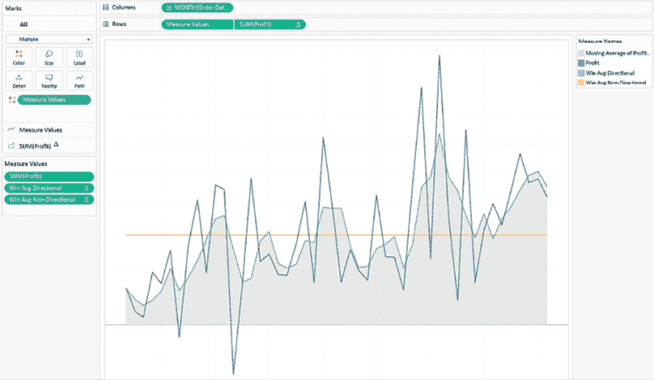

图 5.4：Window（窗口）

让我们来分析前面工作表的运作方式：

* `Win Avg Directional`：`WINDOW_AVG(SUM([Profit]), -2, 0)` 的起点为 -2，终点为 0，这意味着 Tableau 将基于当前月份和前两个月计算出的 `SUM([Profit])` 平均值来创建一个点。将 `0` 改为 `2` 将导致每个点的平均值基于前 2 个月、当前月和后 2 个月进行计算。双击 `Rows`（行）货架上的 `Profit`（利润）实例以查看底层代码。（这是通过右键单击并选择 `Quick Table Calculation`（快速表计算）\| `Moving Average`（移动平均）而转换为表计算的 `Profit` 实例。）请注意，该计算与为 `Win Avg Directional` 创建的代码完全相同。但是，如果您右键单击这两个药丸并选择 `Edit Table Calculation`（编辑表计算），您会注意到生成的对话框有所不同。与 `Profit` 关联的对话框具有更多选项，包括更改前一个值和后一个值的功能。更改 `Win Avg Directional` 的前一个值和后一个值需要调整计算字段。

* `Win Avg Non-Directional`：`WINDOW_AVG(SUM([Profit]))` 与视图中的水平线相关联。请注意，它不依赖于方向。相反，它是缓存/分区中所有聚合 `Profit` 值平均值生成的单个值，因此无论数据点的顺序如何，它都将保持相同。

实际场景：为什么要使用窗口平均值？因为你想要平滑异常值，例如。窗口平均值提供了数据的稳定表现。单个高点或低点将被移除。如果你分析股票价格，你会注意到价格全年都可能不同！通过使用窗口平均值，或者更确切地说是窗口标准差作为预警指标，你将能更清晰地看到价格跳跃，并作为投资者采取行动。然而，稳定的增长或下降将落入移动带中。使用固定带无法实现这一点。

## 首项和末项

以下工作表的目标是在 `Superstore` 数据集中显示最畅销商品的首项和末项实例。请注意以下示例如何演示 `FIRST()` 和 `LAST()` 函数的方向性行为。

执行以下步骤：

1. 在与本章关联的工作簿中，导航到 `First/Last` 工作表。
2. 创建以下计算字段：

| 名称 | 计算 |
| --- | --- |
| `First` | `FIRST()` |
| `Last` | `LAST()` |
| `First or Last` | `FIRST() = 0 OR LAST() = 0` |

3. 将 `Product Name` 放到 `Filters`（筛选器）架上，选择 `Top`（前 N 项）选项卡，并按 `Sales`（销售额）的 `Sum`（求和）选择 `Top` `1`，如下面的屏幕截图所示：

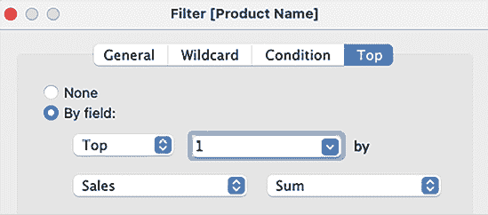

图 5.5：前 N 项筛选器

4. 将 `First or Last` 放到 `Filters` 架上，并在生成的对话框中选择 `True`。
5. 将 `Product Name`、`Order Date` 和 `Row ID` 拖到 `Rows`（行）架上。
6. 将 `Order Date` 设置为 `Month/Day/Year`（月/日/年）离散型。
7. 双击 `Sales`、`First` 和 `Last` 将它们分别放到视图中。
8. 右键单击 `First`、`Last` 和 `First or Last`，然后选择 `Compute Using`（按以下方式计算）| `Table (down)`（表格（向下））。
9. 按需设置格式：

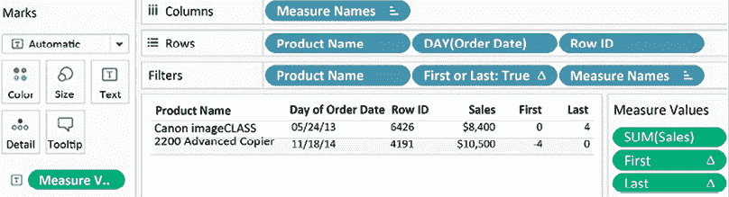

图 5.6：首项和末项

让我们来看看前面的工作表是如何运作的：

* **首项**：`FIRST()` 从 `0` 开始，向下计数到缓存中数据集的最后一行。在前面的屏幕截图中，请注意 `Canon imageCLASS` 的首项实例出现在 `05/24/13`。`FIRST()` 的范围从 `0` 到 `-4` 表明缓存中或窗口缓存内有五个 `Canon imageCLASS` 实例。
* **末项**：`LAST()` 从缓存中数据集的最后一行开始，向下计数到 0。在前面的屏幕截图中，请注意 `Canon imageCLASS` 的末项实例出现在 `11/18/14`。`LAST()` 的范围从 `4` 到 `0` 表明缓存中有五个 `Canon imageCLASS` 实例。
* **首项或末项**：`FIRST() = 0 OR LAST() = 0` 放到 `Filters` 架上并设置为 `True` 时，会隐藏除首项和末项之外的所有匹配行实例。
* `Row ID` 字段包含在视图中，以确保显示 `Canon imageCLASS` 的最早和最晚实例。否则，如果在首个或末个日期有多个 `Canon imageCLASS` 实例，销售数字将反映多个值。为视图中的每个表计算将 `Compute Using` 设置为 `Table (down)` 非常重要。`Compute Using` 与 `Addressing`（寻址）相同，将在 `Application of functions`（函数应用）部分详细讨论。

实际场景：你可以使用这种计算来分析每季度最后 5 个订单之间的时间间隔，以查看订单间隔时间在一天中是增加还是减少。这随后有助于改进营销或更高效地安排服务台工时。

## 索引

以下工作表的目标是列出基础数据集中拥有 50 个以上邮政编码的美国州。

请注意以下示例如何演示 `INDEX()` 函数具有方向性，并可视为行计数：

1. 在与本章关联的工作簿中，导航到 `Index` 工作表。
2. 将 `Marks`（标记）卡设置为 `Circle`（圆圈）。
3. 将 `State` 放到 `Rows` 架上，将 `Postal Code` 放到 `Detail`（详细信息）架上。
4. 创建一个名为 `Index` 的计算字段，代码为：`INDEX()`。将 `Index` 拖到 `Filters` 架上，选择 `Range of values`（值范围）筛选器。通过将滑块移动到最小值 `50`，选择仅查看大于或等于 50 的值。
5. 右键单击 `Index`，选择 `Edit Table Calculation`（编辑表计算）。选择 `Specific Dimensions`（特定维度）并勾选 `Postal Code`：

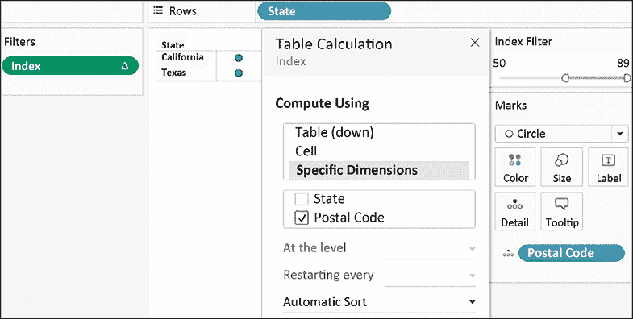

图 5.7：索引

6. 选择 `Analysis`（分析）| `Stack Marks`（堆叠标记）| `Off`（关闭），然后查看：

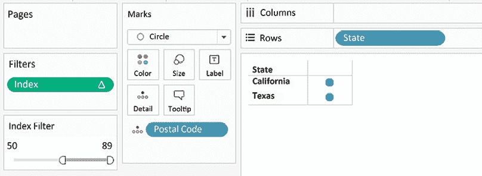

图 5.8：最终索引

让我们来看看前面的工作表是如何运作的：

**索引**：`INDEX()` 从 1 计数到 *n*。因此，它具有方向性。在这种情况下，由于分区和寻址设置的结果，`Index` 正在对邮政编码进行计数。（分区和寻址将在 `Application of functions` 部分详细讨论。）将 `Index` 筛选器设置为仅显示大于或等于 50 的值，可确保只有拥有 50 个或更多邮政编码的州位于缓存显示的分区/数据集中。

实际场景：通常，我将 `Index` 与 `First` 和 `Last` 交替使用。

## 排名

以下工作表的目标是显示每个区域中销量前三名的商品。此示例将演示 `RANK()` 如何以方向性方式与缓存中的数据集交互：

1. 在与本章关联的工作簿中，导航到 `Rank` 工作表。
2. 将 `Product Name` 放到 `Filters` 架上，选择 `Top` 选项卡，并按 `Sales` 的 `Sum` 选择 `Top 3`：

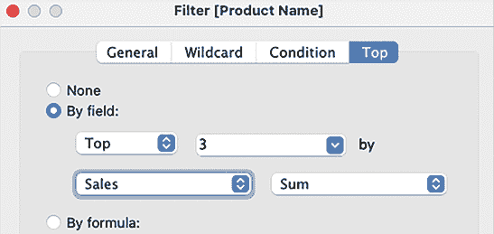

图 5.9：筛选器

3. 将 `Region` 和 `Product Name` 放到 `Rows` 架上，将 `Sales` 放到 `Columns`（列）架上。
4. 请注意，每个区域只显示两个商品：

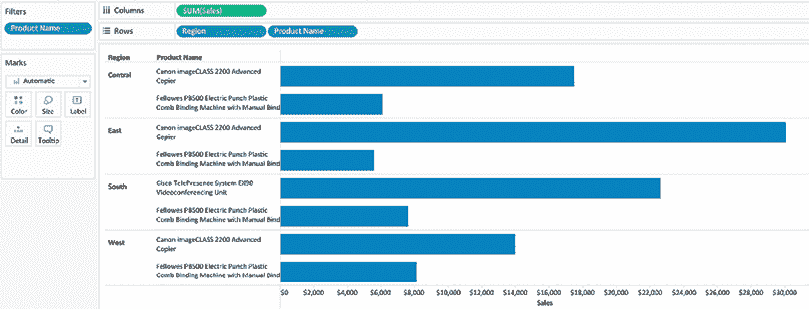

图 5.10：查看前两个商品

5. 创建一个名为 `Rank` 的计算字段，代码为 `RANK(SUM(Sales))`。将 `Rank` 拖到 `Rows` 架上 `Region` 和 `Product Name` 之间。
6. 请注意，在将 `Rank` 放到 `Rows` 架上的两个药丸之间之前，必须将其转换为离散型。实现这一点的一种方法是将 `Rank` 放到 `Detail` 架上，右键单击药丸，然后选择 `Discrete`（离散）。
7. 右键单击 `Rank`，选择 `Compute Using` | `Product Name`。
8. 从 `Filters` 架上移除 `Product Name`。
9. 按住 `Ctrl`（Mac 上按 `Option`），右键单击并将 `Rank` 从 `Rows` 架拖到 `Filters` 架上。在将药丸从一个架拖到另一个架时按住 `Ctrl` 键会创建该药丸的副本。如果不按 `Ctrl` 键，当然只会移动药丸。在生成的对话框中，选择 `1`、`2` 和 `3`。

按需设置格式：

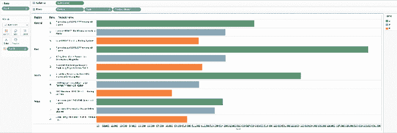

图 5.11：排名

让我们来看看前面的工作表是如何运作的：

* 如果你遵循了本练习的分步说明，你会注意到，将 `Region` 和 `Product Name` 放到 `Rows` 架上并筛选仅显示前三个产品名称后，生成的可视化视图在每个区域中只显示了两个产品。这是因为 `Product Name` 上的筛选器显示了总体前三名产品，但碰巧这三名中的两名始终出现在每个区域中。但我们实际上想显示每个区域的前三名，而不是总体前三名。为了解决这个问题，我们使用了 `RANK()` 表计算函数。

## 排名

让我们来了解一下这是如何工作的。我们不需要编写 `Rank(Sum(Sales))` 函数，只需在任意货架上的 `Sales` 实例上右键单击，然后选择 `Quick Table Calculation`（快速表计算）| `Rank`（排名），相同的代码就会自动生成。请注意，`RANK()` 正在对每个区域内的产品名称进行计数。这表明 `RANK()` 表计算在缓存/分区中的数据集上按方向运行。

实际场景：当我想要筛选一个持续变化的视图，且该视图被划分为多个子部分时，我会使用 `RANK()`——例如，我每篇博客文章的最后三条评论。或者当我想要展示随时间变化的行为时——例如，两年内排名前 10 位的产品。这将生成一张凸峰图。

## 大小

以下工作表的目标是在 `Superstore` 数据集中显示城市数量在五个或五个以下的所有州。此示例将演示 `SIZE()` 如何利用缓存中的整个分区/数据集，因此它是非方向性的。我们还将使用 `FIRST()` 表计算函数（它是方向性的）来清理视图。

请遵循以下步骤：

1.  在与本章关联的工作簿中，导航到 `Size` 工作表。
2.  将 `Analysis`（分析）| `Stack Marks`（堆叠标记）设置为 `Off`（关闭）。
3.  创建以下计算字段：

| 名称 | 计算 |
| --- | --- |
| `Size` | `SIZE()` |
| `City Count` | `IF FIRST() = 0 THEN [Size] ELSE NULL END` |

4.  将 `State` 拖至 `Rows`（行）货架，`City` 拖至 `Detail`（详细信息）货架，`City Count` 拖至 `Text`/`Label`（文本/标签）货架，`Size` 拖至 `Detail` 货架。
5.  右键单击 `Size` 筛选器，选择 `Compute Using`（使用计算方式）| `City`。将 `Size` 从 `Marks`（标记）卡移动到 `Filters`（筛选器）货架。
6.  在生成的对话框中，选择 `At most`（至多）值为 `5`：

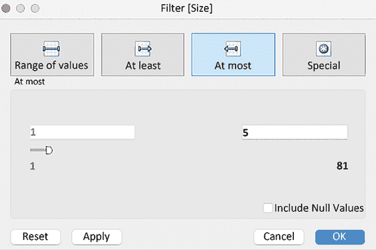

图 5.12：至多

7.  在 `Marks` 卡上，右键单击 `City Count` 并选择 `Edit Table Calculation`（编辑表计算）。在 `Nested Calculations`（嵌套计算）下，选择 `City Count`。
8.  选择 `Compute Using` | `Specific Dimensions`（特定维度）并勾选 `City`：

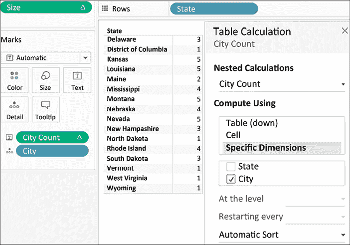

图 5.13：特定维度

9.  再次使用 `Nested Calculations` 下的下拉菜单选择 `Size`。然后，选择 `Compute Using` | `Specific Dimensions` 并勾选 `City`。
10. 观察最终视图：

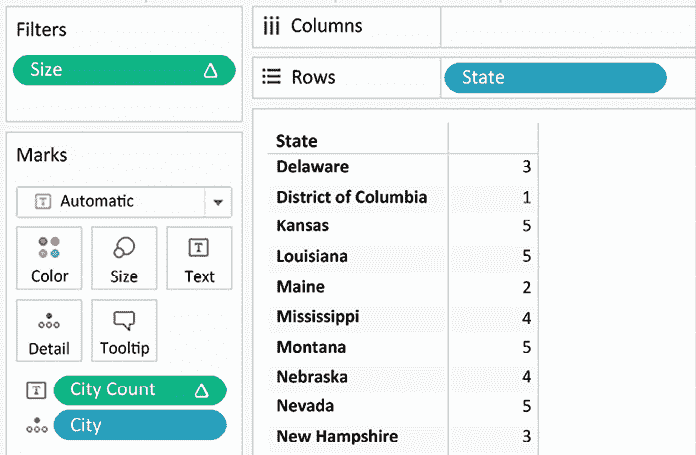

图 5.14：最终工作表

让我们思考一下前面的工作表是如何运作的：

*   **Size**：`SIZE()` 生成一个单一数字，例如特拉华州的 3，基于缓存中的分区/数据集。该数字可能会根据分区和寻址设置而变化，但不会因在分区中的移动而改变。因此，它表现为非方向性。
*   **City Count**：`IF FIRST() = 0 THEN LOOKUP([Size],0) ELSE NULL END` 字段并非严格必需。你可以直接将 `Size` 放在 `Text`/`Label` 货架上。但是，如果你这样做，你会注意到视图中的数字看起来会变粗。这是因为数字实际上被重复了，然后层叠在一起。利用 `FIRST() = 0` 只会显示一组数字。

请注意，前面的练习有一个 `Nested Calculations` 选项，这是因为 `Size` 计算字段在 `City Count` 计算字段中被引用了。

实际场景：`SIZE()` 可能是使用最少的。老实说，除了解释和演示它之外，我从未真正使用过它。但我见过其他人用 `SIZE()` 做以下事情；通过开启总计列视图，`SIZE()` 可以生成非默认聚合，如标准差。只需使用此公式：`if size()=1 then sum({STDEV([Sales])}) else sum([Sales]) end`。

如果你对表计算还不够满足，这里还有更多场景：[`www.tableau.com/blog/top-10-tableau-table-calculations`](https://www.tableau.com/blog/top-10-tableau-table-calculations)。

现在我们已经介绍了不同的表计算，我们将看到如何操作计算的分区（范围）和寻址（方向）。

# 函数的应用

到目前为止，我们已经涵盖了两个主要问题中的第一个：*函数是什么？* 现在我们将继续下一个问题：*函数如何应用？*

让我们尝试通过以下三个选项来理解这个问题，它们都是 `INDEX()` 函数的应用：

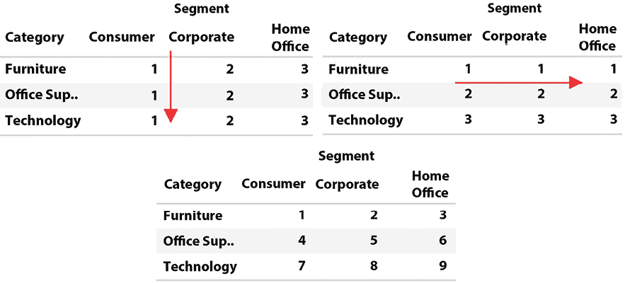

图 5.15：应用

这三个屏幕截图中都使用了 `INDEX()` 函数；然而，在每个截图中应用的方式都不同。第一和第二个截图都显示 **1**、**2** 和 **3**，但在方向上有所不同。第三个截图的范围是从 **1** 到 **9**。那么，`INDEX()` 在每种情况下是如何应用的？

回答这个问题可能会令人困惑，因为 Tableau 使用了不同的术语。在 Tableau 本身中，表计算的应用方式可能被称为 running along（沿...运行）、moving along（沿...移动）、compute using（使用计算方式），或 **partitioning (scoping)（分区/范围）** 和 **addressing (direction)（寻址/方向）**。为了我们的目的，我们将使用分区和寻址这两个术语，并根据 Tableau 文档（[`help.tableau.com/current/pro/desktop/en-us/calculations_tablecalculations.htm`](https://help.tableau.com/current/pro/desktop/en-us/calculations_tablecalculations.htm)）在此定义它们：

> 定义如何对计算进行分组的维度，即定义其执行所在数据范围的维度，称为分区字段。表计算在每个分区内单独执行。其余维度，即表计算所依据的维度，称为寻址字段，并决定计算的方向。

这基本上意味着分区定义了正在使用哪些字段，例如 `Segment`（细分市场）。如果你有三个细分市场分布在三个品类上，你可以单独查看每个组合、一个细分市场内的所有品类，或一个品类内的所有细分市场。你查看它的方式就是 Tableau 所说的寻址。

如果在视图中使用了表计算，你可以右键单击它并选择 `Edit Table Calculation`。这样做会显示一个对话框，允许你选择特定维度。如果勾选了某个维度，则对其进行寻址。如果未勾选，则对其进行分区。

请看下图示例：

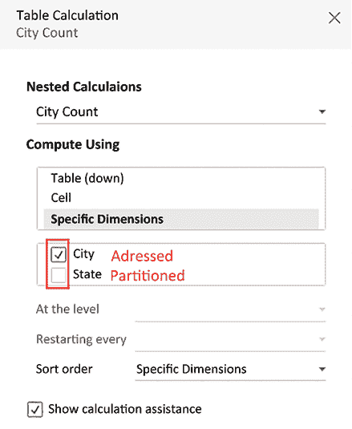

图 5.16：寻址和分区

Tableau 提供了许多开箱即用的分区和寻址设置，包括 `Table (down)`（表格(向下)）、`Table (across)`（表格(向右)）、`Pane (down)`（窗格(向下)）和 `Cell`（单元格）。我们偶尔会提到这些选项，但不会进行详细回顾。这引出了我们的第一条分区和寻址准则：

**不要使用 Tableau 提供的开箱即用的分区和寻址设置，包括 `Table (across)` 和 `Pane (down)`。强迫自己点击 `Specific Dimensions` 并手动定义分区和寻址，以便你清楚地了解每个表计算是如何应用的。**

前面的准则有几个注意事项：

*   有一个例外，即 `Cell`。无法使用分区和寻址在视图中寻址单个单元格。相反，必须将 `Compute Using` 设置为 `Cell`，或者在 `Table Calculation` 对话框中选择 `Cell`。令人惊讶的是，沿每个单元格寻址表计算可能很有用。一个示例在与本章关联的工作簿的 `Percent of Total` 工作表上提供。在那里，它被用来显示每个单元格分为两个类别时的 100%。

如果您为给定的表计算设置了分区和寻址，然后向视图中添加维度，通常 Tableau 不会自动调整分区和寻址设置；它们会被锁定。但是，当使用 `Table (down)`、`Pane (across)` 等选项时，随着维度被添加到视图中，Tableau 会进行自动调整。

这引出了我们的下一条准则：

在为表计算设置分区和寻址*之前*，请将所有必需的维度放置在所需的货架上。

遵循这些准则将有助于确保您始终清楚表计算是如何应用的。起初这可能会花费更多时间，但最终您将能更好地控制表计算，并能更快地进行开发。

## 构建演练场

让我们设置一个简单的演练场环境，以快速高效地探索分区和寻址：

1.  在与本章关联的工作簿中，导航到 `Playground` 工作表。

2.  将 `Category` 放置在 `Rows`（行）货架上，将 `Index` 计算放置在 `Label`（标签）货架上。

3.  `Index` 计算仅为 `Index()`。单击与 `Index` 关联的下拉菜单，然后选择 `Edit Table Calculation`（编辑表计算）。在生成的对话框中，单击 `Specific Dimensions`（特定维度）。

4.  最佳地定位屏幕组件。有关一种可能的设置，请参见以下屏幕截图：

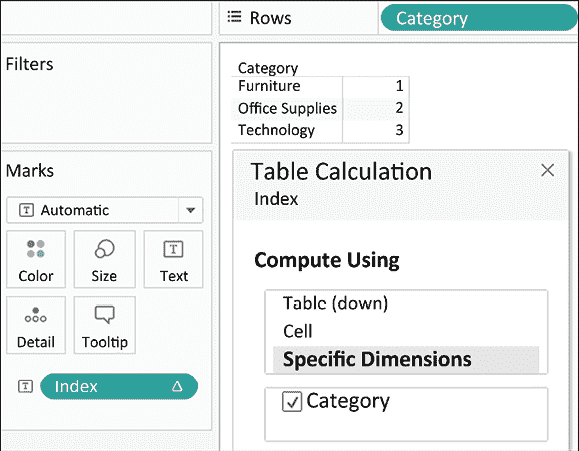

图 5.17：构建演练场

您可以在*图 5.17* 中看到，我们创建了一个显示三个类别 `Furniture`（家具）、`Office Supplies`（办公用品）和 `Technology`（技术）的工作表。通过将 `Index` 字段添加到 `Text`（文本）货架，我们满足了使用表计算的最低要求，即一个维度和一个表计算。现在我们可以更改表计算中使用的计算方式，并观察可视化中的变化。稍后，我们将探索更复杂的示例；然而，始终从简单入手，慢慢增加复杂程度，以充分理解正在发生的事情。

在接下来的页面中，我们将大量使用我们的演练场，并根据需要对其进行修改。然而，为了效率起见，我们需要将重点集中在演练场及其随附的讨论上。讨论将局限于 `Rows` 和 `Columns` 货架上的维度以及 `Text` 货架上的 `INDEX` 函数。

我们本可以探索各种货架上的不同函数及其提供的不同选项。例如，将日期字段放置在 `Pages`（页面）货架上将导致使用 `TOTAL` 函数的表计算显示一个选项，用于跨所有页面计算总数。遗憾的是，在一章中探索每一种可能的细微差别根本不可能，但如果您对该主题感兴趣，请随时查看 Tableau 帮助页面以获取更多内容和示例：`https://help.tableau.com/current/pro/desktop/en-us/functions_functions_tablecalculation.htm`。

## 单维度的分区和寻址

让我们使用演练场，从最简单的示例开始探索分区和寻址：

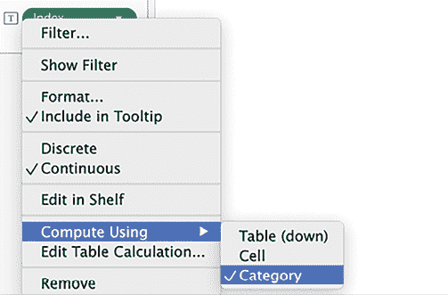

图 5.18：Compute Using（按...计算）| Category

在这个简单的示例中，寻址 `Category` 会导致 `Category` 维度的每个成员被计数。这表明寻址维度决定了计算的方向。在我们的示例中，我们有表计算 `Index`，但正如我们之前所学，`Index` 取决于分区和寻址。`Category` 在 `Rows` 货架上充当分区。我们将数据分成三份：`Furniture`、`Office Supplies` 和 `Technology`。现在我们还指定为表计算寻址 `Category`。我们是通过从 `Compute Using` 中选择 `Category` 来实现的（*图 5.18*）。现在表计算将应用于这些类别，因此计数为 1、2、3 个类别。

如果您选择 `Compute Using` | `Cell`，视图中仍会保留分成三个类别的分区——您仍然会看到 `Furniture`、`Office Supplies` 和 `Technology`——但计数将按单元格进行，而不是针对整个 `Category` 维度。因此，`Index` 将计数 1，然后移至下一个单元格计数 1，再下一个单元格又计数 1：

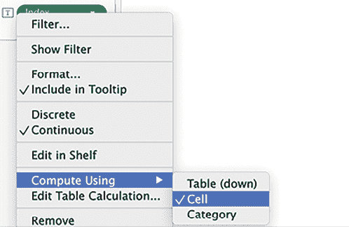

图 5.19：Compute Using | Cell

## 双维度的分区和寻址

当对两个或更多维度进行分区和寻址时，会提供两个额外选项：`At the level`（按级别）和 `Restarting every`（每...重新开始）。您可以将此场景比作按大洲统计所有国家/地区的任务。在此场景中，`At the level` 将是国家/地区，因为您统计的不是街道或树木，而是国家/地区。`Restarting` 将是大洲。在完成一个大洲的国家/地区统计后，您将为下一个大洲重新从 1 开始计数：

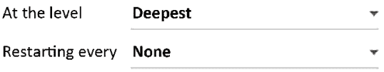

图 5.20：两个维度

`At the level` 和 `Restarting every` 都允许作者从下拉菜单中选择维度。`At the level` 允许作者选择在哪个级别进行递增，顾名思义，`Restarting every` 允许作者选择在哪些维度上重新开始。此处的示例将为您的理解提供背景。

请注意，`At the level` 还有一个额外选项：`Deepest`（最深）。在这种情况下，将 `At the level` 设置为 `Deepest` 与选择 `Ship Mode` 相同。这引出了我们的下一条准则：

没有必要在 `At the level` 下拉菜单中选择最底层的维度。它始终等同于 `Deepest`。

要重现此处列出的迭代，您需要对演练场环境进行一些更改。除了在 `Rows` 货架上放置 `Category`、在 `Label` 货架上放置 `Index` 之外，还需在 `Rows` 货架上放置 `Ship Mode`。我们不会涉及在 `Columns` 货架上包含一个或多个维度的迭代，因为这些可能性的行为大致相同。

当您考虑和/或重现以下选项时，请注意 `Addressing`（寻址）顺序很重要。对于示例 3-5，`Category` 在寻址列表中排第一。对于选项 6-8，`Ship Mode` 在列表中排第一。

在第一个示例中，按如下方式配置分区和寻址设置：

*   `Partitioning`（分区）：`Category`
*   `Addressing`（寻址）：`Ship Mode`
*   `At the level`（按级别）：-
*   `Restarting every`（每...重新开始）：-

这将生成以下可视化：

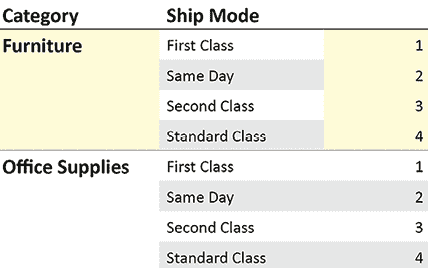

图 5.21：示例 1

在这里，我们按 `Category` 计数 `Ship Mode`。

在第二个示例中，按如下方式配置分区和寻址设置：

*   `Partitioning`：`Ship Mode`
*   `Addressing`：`Category`
*   `At the level`：-
*   `Restarting every`：-

这将生成以下可视化：

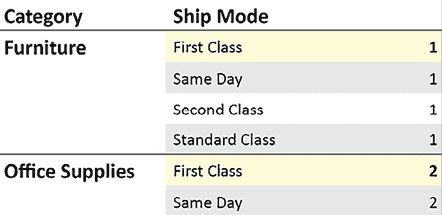

图 5.22：示例 2

在该示例中，我们按 `Ship Mode` 计数 `Category`。

在第三个示例中，按如下方式配置分区和寻址设置：

*   `Partitioning`：-
*   `Addressing`：`Category`、`Ship Mode`
*   `At the level`：`Deepest`
*   `Restarting every`：`None`

这将生成以下可视化：

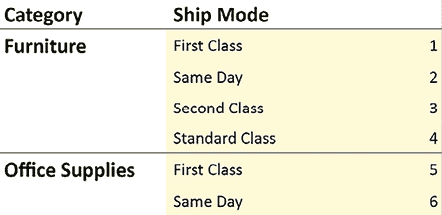

图 5.23：示例 3

这一次，我们计数 `Category` 和 `Ship Mode` 的组合。

在第四个示例中，按如下方式配置分区和寻址设置：

*   `Partitioning`：-
*   `Addressing`：`Category`、`Ship Mode`
*   `At the level`：`Deepest`
*   `Restarting every`：`Category`

这将生成以下可视化：

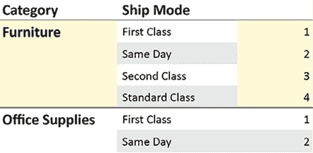

图 5.24：示例 4

## 二维示例（示例 5–8）

### 示例 5

在这里，我们计算 `Category` 和 `Ship Mode` 的组合，并在每个新的 `Category` 处重新开始计数。

在第五个示例中，按如下方式配置分区和寻址设置：

- `Partitioning`：-
- `Addressing`：`Category`、`Ship Mode`
- `At the level`：`Category`
- `Restarting every`：`None`

这将生成以下可视化结果：

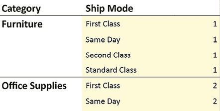

图 5.25：示例 5

我们计算出现在 `Category` 层级的 `Category` 和 `Ship Mode` 组合。由于 `Category` 层级在层次结构中高于 `Ship Mode`，我们最终每个 `Category` 只计算一个值。

### 示例 6

在第六个示例中，按如下方式配置分区和寻址设置：

- `Partitioning`：-
- `Addressing`：`Ship Mode`、`Category`
- `At the level`：`Deepest`
- `Restarting every`：`None`

这将生成以下可视化结果：

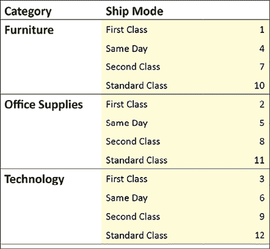

图 5.26：示例 6

我们在 `Ship Mode` 层级计算 `Ship Mode` 和 `Category` 的组合；因此，我们先计算 `First Class` 及其与所有 `Category` 的组合，然后再计算 `Same Day` 及其与 `Category` 的组合。

### 示例 7

在第七个示例中，按如下方式配置分区和寻址设置：

- `Partitioning`：-
- `Addressing`：`Ship Mode`、`Category`
- `At the level`：`Deepest`
- `Restarting every`：`Ship Mode`

这将生成以下可视化结果：

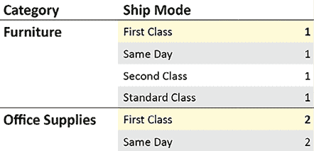

图 5.27：示例 7

我们在最深层级计算 `Ship Mode` 和 `Category` 的组合，但在每个 `Ship Mode` 处重新开始计数；因此，我们计算 `First Class` 和 `Furniture`、`First Class` 和 `Office Supplies`，然后是 `First Class` 和 `Technology`。接着，我们转到 `Same Day` 及其组合，再次从 1 开始计数。

### 示例 8

在第八个示例中，按如下方式配置分区和寻址设置：

- `Partitioning`：-
- `Addressing`：`Ship Mode`、`Category`
- `At the level`：`Ship Mode`
- `Restarting every`：`None`

这将生成以下可视化结果：

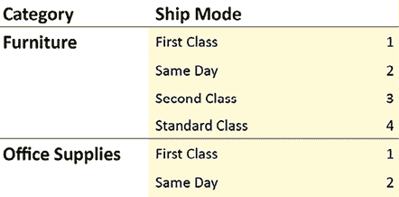

图 5.28：示例 8

我们在 `Ship Mode` 层级计算 `Ship Mode` 和 `Category` 的组合。

## 示例 1、4 和 8 的分析

现在，让我们更详细地考虑一下此处提出的一些可能性。某些选项是相同的。事实上，在九个选项中，只有四个是唯一的。让我们来看看示例 1、4 和 8，它们都有相同的最终结果。这是否意味着它们完全相同？选项 1 和 4 是相同的。然而，选项 8 略有不同。要理解这一点，请注意选项 8 的表计算对话框中的说明：

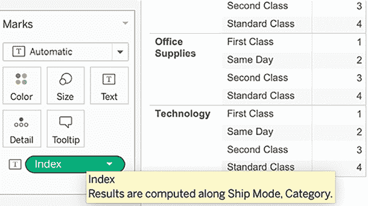

图 5.29：索引

示例 8 中的说明显示为 `Results are computed along Ship Mode, Category`（请参阅 `Figure 5.29`）。示例 1 说明框中的文本与示例 4 相同：`Results are computed along Ship Mode for Category`，这可以翻译为分区 `Category` 和寻址 `Ship Mode`。这种翻译与示例 1 中实际完成的分区/寻址设置相同。因此，示例 1 和 4 是相同的。但示例 8 的细微差别是否意味着存在实际差异？没有！

## 示例 6 详细分析

示例 6 乍看之下可能令人困惑。为什么会出现这种奇怪的编号序列？因为寻址维度的顺序与 `Rows` 架上的维度顺序不同。寻址顺序是 `Ship Mode`、`Category`。`Rows` 架上的顺序是 `Category`、`Ship Mode`。只需交换 `Rows` 架上 `Category` 和 `Ship Mode` 的位置，并观察编号序列的变化，即可消除任何困惑：

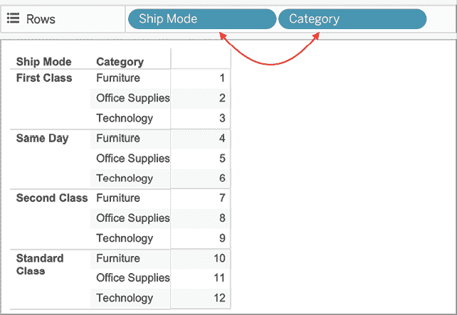

图 5.30：切换维度

示例 6 有实际用途吗？有的。有时可能需要按与架上列出的顺序不同的顺序来寻址维度。但这通常不是这种情况。这引出了我们的下一条准则：

> 当为表计算寻址多个维度时，寻址顺序通常将反映 `Rows` 和/或 `Columns` 架上维度的顺序。

## 使用三个维度进行分区和寻址

让我们在练习环境中添加另一个维度，并稍微重新排序。将 `Category` 和 `Region` 放在 `Rows` 架上，将 `Ship Mode` 放在 `Columns` 架上。`Index` 应保留在 `Marks` 架上的 `Text` 中。此外，添加两个筛选器。将 `Region` 筛选为 `East`、`South` 和 `West`。将 `Ship Mode` 筛选为 `First Class`、`Second Class` 和 `Standard Class`。

当对三个维度进行分区和寻址时，可能的迭代次数跃升至 57 次；然而，其中只有 14 种是唯一的。以下列出了这些唯一的可能性。

请记住，寻址意味着在表计算设置中选择维度，而分区则是取消选择维度，如 `Figure 5.17` 所述。

### 示例 1

在第一个示例中，按如下方式配置分区和寻址设置：

- `Partitioning`：`Category`、`Region`
- `Addressing`：`Ship Mode`
- `At the level`：-
- `Restarting every`：-

这将生成以下可视化结果：

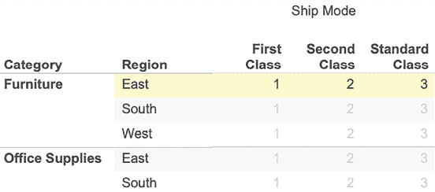

图 5.31：示例 1

在这里，我们计算每个 `Category` 和 `Region` 组合下不同的 `Ship Modes`。

### 示例 2

在第二个示例中，按如下方式配置分区和寻址设置：

- `Partitioning`：`Category`、`Ship Mode`
- `Addressing`：`Region`
- `At the level`：-
- `Restarting every`：-

这将生成以下可视化结果：

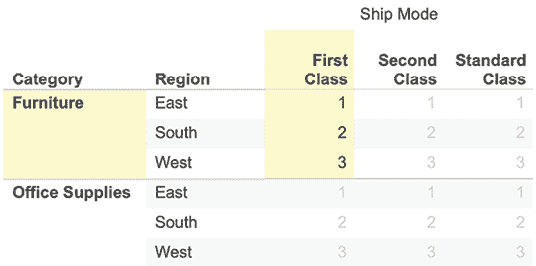

图 5.32：示例 2

在这里，我们计算每个 `Category` 和 `Ship Mode` 组合下不同的 `Regions`。

### 示例 3

在第三个示例中，按如下方式配置分区和寻址设置：

- `Partitioning`：`Region`、`Ship Mode`
- `Addressing`：`Category`
- `At the level`：-
- `Restarting every`：-

这将生成以下可视化结果：

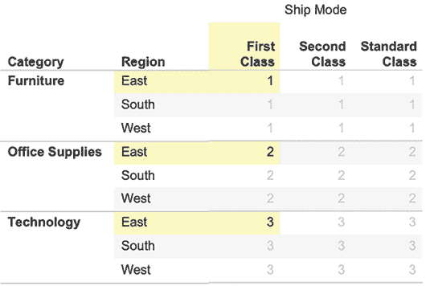

图 5.33：示例 3

在这里，我们计算每个 `Region` 和 `Ship Mode` 组合下不同的 `Category` 选项。

### 示例 4

在第四个示例中，按如下方式配置分区和寻址设置：

- `Partitioning`：`Category`
- `Addressing`：`Region`、`Ship Mode`
- `At the level`：`Deepest`
- `Restarting every`：`None`

这将生成以下可视化结果：

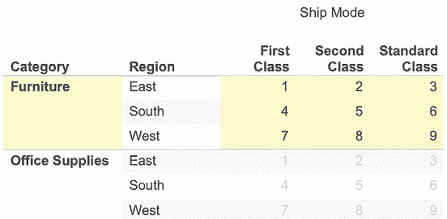

图 5.34：示例 4

在这里，我们在最深层级计算每个 `Region` 和 `Ship Mode` 组合下不同的 `Category` 选项。

### 示例 5

在第五个示例中，按如下方式配置分区和寻址设置：

- `Partitioning`：`Category`
- `Addressing`：`Ship Mode`、`Region`
- `At the level`：`Deepest`
- `Restarting every`：`None`

这将生成以下可视化结果：

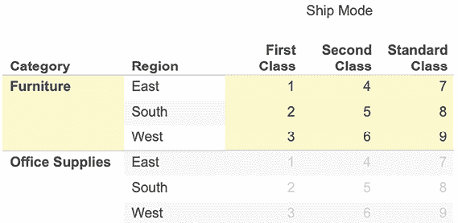

图 5.35：示例 5

在这里，我们在最深层级计算每个 `Ship Mode` 和 `Region` 组合下不同的 `Category` 选项。

### 示例 6

在第六个示例中，按如下方式配置分区和寻址设置：

- `Partitioning`：`Region`
- `Addressing`：`Category`、`Ship Mode`
- `At the level`：`Deepest`
- `Restarting every`：`None`

这将生成以下可视化结果：

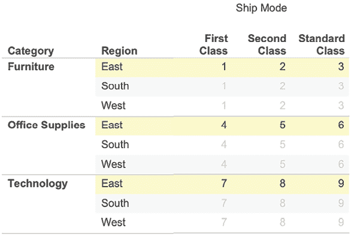

图 5.36：示例 6

在这里，我们在最深层级计算每个 `Category` 和 `Ship Mode` 组合下不同的 `Regions`。

### 示例 7

在第七个示例中，按如下方式配置分区和寻址设置：

- `Partitioning`：`Ship Mode`
- `Addressing`：`Category`、`Region`
- `At the level`：`Deepest`
- `Restarting every`：`None`

这将生成以下可视化结果：

### Figure 5.37: Example 7

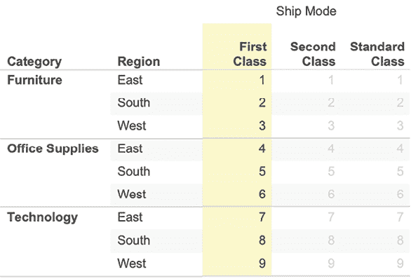

这里我们计算最深层级下每个 `Category` 和 `Region` 组合的不同 `Ship Modes` 数量。

在第八个示例中，按如下方式配置分区和寻址设置：

*   **分区**：`Ship Mode`
*   **寻址**：`Region`, `Category`
*   **所在层级**：`Deepest`
*   **每...重新开始**：`None`

这将生成以下可视化：

### Figure 5.38: Example 8

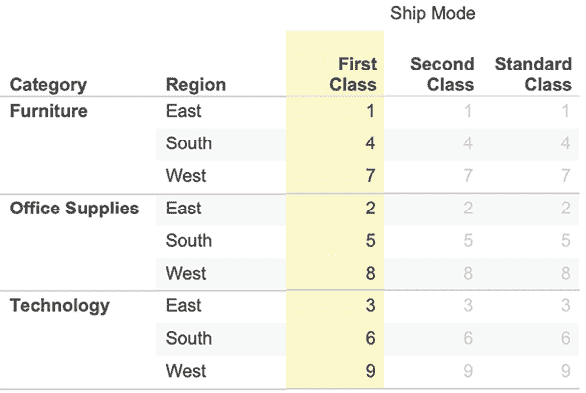

这里我们计算最深层级下每个 `Region` 和 `Category` 组合的不同 `Ship Modes` 数量。

在第九个示例中，按如下方式配置分区和寻址设置：

*   **分区**：`-`
*   **寻址**：`Category`, `Ship Mode`, `Region`
*   **所在层级**：`Deepest`
*   **每...重新开始**：`None`

这将生成以下可视化：

### Figure 5.39: Example 9

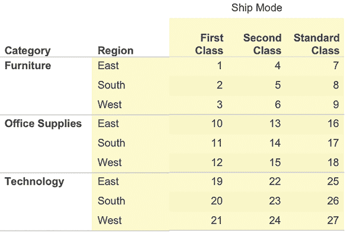

这里我们计算最深层级下 `Category`、`Ship Mode` 和 `Region` 的组合数量。

在第十个示例中，按如下方式配置分区和寻址设置：

*   **分区**：`-`
*   **寻址**：`Ship Mode`, `Category`, `Region`
*   **所在层级**：`Deepest`
*   **每...重新开始**：`None`

这将生成以下可视化：

### Figure 5.40: Example 10

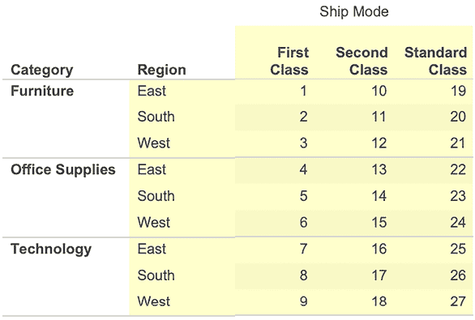

这里我们计算最深层级下 `Ship Mode`、`Category` 和 `Region` 的组合数量。

在第十一个示例中，按如下方式配置分区和寻址设置：

*   **分区**：`-`
*   **寻址**：`Ship Mode`, `Category`, `Region`
*   **所在层级**：`Category`
*   **每...重新开始**：`None`

这将生成以下可视化：

### Figure 5.41: Example 11

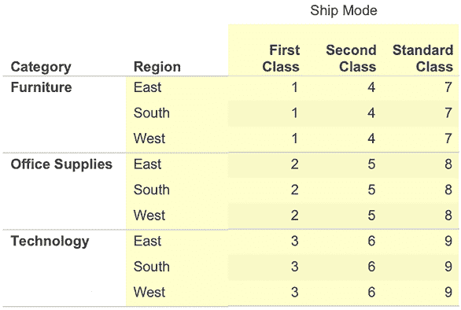

这里我们计算 `Category` 层级下 `Ship Mode`、`Category` 和 `Region` 的组合数量。

在第十二个示例中，按如下方式配置分区和寻址设置：

*   **分区**：`-`
*   **寻址**：`Ship Mode`, `Region`, `Category`
*   **所在层级**：`Deepest`
*   **每...重新开始**：`None`

这将生成以下可视化：

### Figure 5.42: Example 12

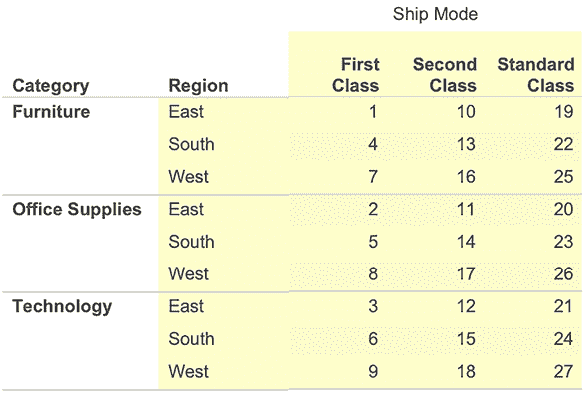

这里我们计算最深层级下 `Ship Mode`、`Region` 和 `Category` 的组合数量。

在第十三个示例中，按如下方式配置分区和寻址设置：

*   **分区**：`-`
*   **寻址**：`Ship Mode`, `Region`, `Category`
*   **所在层级**：`Deepest`
*   **每...重新开始**：`Ship Mode`

这将生成以下可视化：

### Figure 5.43: Example 13

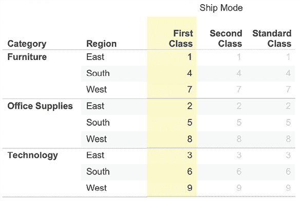

这里我们计算最深层级下 `Ship Mode`、`Region` 和 `Category` 的组合数量。

在第十四个示例中，按如下方式配置分区和寻址设置：

*   **分区**：`-`
*   **寻址**：`Region`, `Ship Mode`, `Category`
*   **所在层级**：`Deepest`
*   **每...重新开始**：`None`

这将生成以下可视化：

### Figure 5.44: Example 14

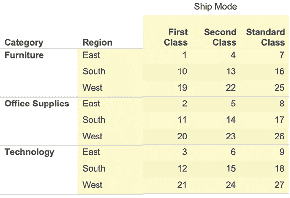

我们不会逐一讲解这些可能性的各种实例。相反，建议读者在 Tableau 中重现这 14 种可能性，以巩固对分区和寻址的理解。更进一步，可以考虑重现所有 57 种可能的迭代，并努力理解 Tableau 是如何生成每个结果的。这个过程可能很繁琐，但由此获得的理解是无价的，它能让用户明白 Tableau 在计算时在后台所做的事情。

## 准则：提醒

在整章中，我列出了一系列分区和寻址准则。这里再次列出作为快速提醒：

*   不要使用 Tableau 提供的开箱即用的分区和寻址设置，包括 `Table`（横向）和 `Pane`（纵向）。强迫自己点击 `Specific Dimensions`（特定维度）并手动定义分区和寻址，以便你清楚地了解每个表计算是如何应用的。
*   在为表计算设置分区和寻址*之前*，将所有必需的维度放置在所需的功能区上。
*   没有必要在 `At the level`（所在层级）下拉菜单中选择底部的维度。它始终等同于 `Deepest`（最深）。
*   当为表计算寻址多个维度时，寻址顺序通常反映 `Rows`（行）和/或 `Columns`（列）功能区上维度的顺序。

## 摘要

在本章中，我们探讨了表计算的内部工作原理。我们首先考虑了什么是表计算的分区和方向。在随后的章节中，我们区分了表计算的定向寻址和非定向寻址，这最终引导我们了解 `Edit Table Calculation`（编辑表计算）界面，并确定它是更改分区和寻址（也称为作用域和方向）的地方。在探索过程中，我们浏览了每组独特的表计算函数，除了 `Script_` 和 `Model_` 函数，它们将在*第 15 章* *Integrating Programming Languages*（集成编程语言）中详细介绍。我们学习了如何通过分区和寻址将这些函数应用于视图，其中分区可视为计算的作用域，寻址可视为计算的方向。

我们已经看到了在不同时间段比较度量的示例，比如每周利润数字，或者将部分与整体进行比较。我们继续探讨了用于股价预警的标准差带，以及用于生成凸凹图的 `Rank`（排名）函数。

利用本章获得的分区和寻址知识，在下一章中，我们将继续探索数据填充和大数据。

## 在 Discord 上了解更多

要加入本书的 Discord 社区——您可以在其中分享反馈、向作者提问并了解新版本——请扫描下方的二维码：

[`packt.link/tableau`](https://packt.link/tableau)

