# 第 6 章：利用 OData、数据填充、大数据和 Google BigQuery

Tableau 新手的许多问题与数据准备、联接、合并、数据混合或数据结构无关，而是与以下内容有关：

*   如何从视图中移除空日期？
*   为什么表计算会显示底层数据中不存在的数字？
*   Tableau 如何处理大数据？
*   如果我查询数百万行，Tableau 还能保持良好性能吗？

本章将回答上述所有问题。一如既往，Tableau 帮助页面也提供了极佳的资源。以下是一些用于深入探索这些主题的有用链接：

*   数据填充：[`help.tableau.com/current/pro/desktop/en-us/predictions_generated_marks.htm`](https://help.tableau.com/current/pro/desktop/en-us/predictions_generated_marks.htm)
*   大数据：[`www.tableau.com/solutions/big-data`](https://www.tableau.com/solutions/big-data)

在本章中，我们将讨论以下主题：

*   使用 OData 连接器
*   数据填充
*   域完成
*   域填充
*   大数据
*   Google BigQuery

我们将通过介绍 OData 连接器来开始本章。芝加哥市公开提供数据，就像其他城市、国家或公共机构一样。去看看吧；你会惊讶于能在网上找到这么多数据。在我们的例子中，我们更幸运，因为芝加哥市使用 OData，这使得分析变得更加容易，因为 Tableau 拥有直接连接 OData 的连接器。让我们开始吧。

## 使用 OData 连接器


本章中的练习可通过下载与本章关联的工作簿来完成，下载地址为 [`public.tableau.com/profile/marleen.meier`](https://public.tableau.com/profile/marleen.meier)。以下步骤解释了如何通过使用 OData 端点将来自 Web 的数据集直接加载到 Tableau 中——在本例中，由芝加哥市提供：

1. 导航至 [`data.cityofchicago.org/Public-Safety/Crimes-2001-to-Present/ijzp-q8t2`](https://data.cityofchicago.org/Public-Safety/Crimes-2001-to-Present/ijzp-q8t2) 并选择 **More（更多）** 图标（由省略号 **…** 指示），随后选择 **Access Data via OData（通过 OData 访问数据）** 按钮：

   

   图 6.1：芝加哥数据门户

2. 复制 **OData Endpoint（OData 端点）** URL 并打开 Tableau Desktop：

   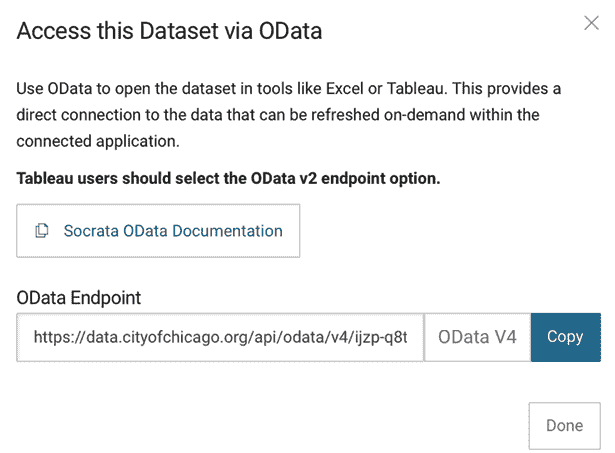

   图 6.2：OData

3. 在 **Data Source（数据源）** 窗格中，搜索 `OData`，并选择 **OData** 选项：

   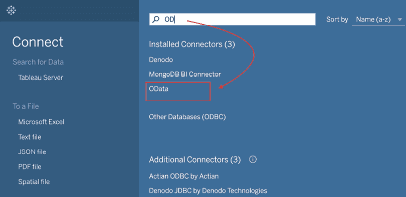

   图 6.3：OData 连接器

4. 在 **Server（服务器）** 字段中，粘贴来自芝加哥犯罪网站的 **OData** 端点。无需身份验证，因此选择 **Sign In（登录）** 以开始：

   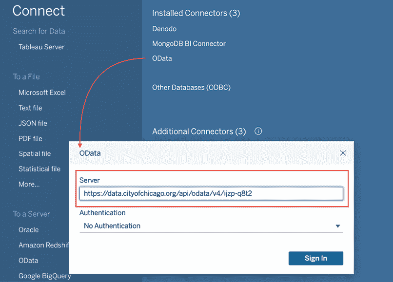

   图 6.4：服务器名称

5. 开始构建您的仪表板！

现在我们已经完成了数据连接的所有设置，可以继续进行关于数据加密的第一个真正练习。了解数据加密将帮助您在仪表板中看到意外的数据输出时进行故障排除，并将帮助您以正确的方式设置可视化以实现目标，而无需进行任何故障排除。

## 数据加密简介

数据加密是 Tableau 中一个很大程度上未被记录的方面，在许多情况下非常有用，但如果意外遇到也会令人困惑。本节将提供关于数据加密的信息，旨在消除困惑，并为 Tableau 作者提供足够的知识，以便利用此功能。从最简单的形式来看，数据加密是在底层数据集中不存在的视图中添加数据点。这个主题乍一看可能有点令人困惑。

如果您想了解更多相关信息，请查看以下文章：[`towardsdatascience.com/data-densification-in-tableau-93c0a6bfcc5f`](https://towardsdatascience.com/data-densification-in-tableau-93c0a6bfcc5f)

为了开始理解数据加密，应定义四个术语：数据加密、稀疏数据、域补全和域填充。除了定义之外，每个术语都将通过示例进行详细讨论，以帮助加深理解：

* **数据加密**：显示没有相应底层数据的数据点（例如，通过使用域补全或域填充）
* **稀疏数据**：缺少多个数据点的数据集（可想象成瑞士奶酪）
* **域补全**：使稀疏数据变稠密——域补全是一种数据加密方法，它使用表计算来填补缺失的空白，当视图中有两个或更多维度时在 Tableau 中可用
* **域填充**：向稀疏数据集添加数据点——域填充是一种数据加密方法，可通过区域分区（例如日期和存储桶维度）中的 **Show Missing Values（显示缺失值）** 功能获得

定义应该很清晰了；让我们继续进行实操练习。

## 域补全

数据加密有两种类型：域补全和域填充。**域补全** 是两者中更复杂的一种，可以巧妙地部署以解决稀疏数据问题，但也可能意外出现并成为一个难以解决的挑战。

掌握域补全需要对 **dimensions（维度）** 和 **measures（度量）**——离散和连续——以及表计算中的 **partitioning（分区）** 和 **addressing（寻址）** 有很好的理解。如果您需要复习这些主题，请在继续下一个练习之前，查阅 *Chapter 1（第 1 章）* *Reviewing the Basics（回顾基础知识）* （关于 **dimensions** 和 **measures**）以及 *Chapter 5（第 5 章）* *Introducing Table Calculations（表计算简介）* （关于 **partitioning** 和 **addressing**）。

现在，让我们考虑如何部署域补全，何时有用，以及何时可能成为问题。

### 部署域补全

域补全可以通过多种方式激活，有时令人惊讶且困惑。调整货架上药丸的排列、在离散和连续之间切换维度、在 **Marks（标记）** 卡上切换视图类型、调整分区、寻址和其他更改都可能影响域补全的激活。虽然本书不会涵盖每种激活可能性的示例，但回顾典型的域补全场景应该会有所帮助。

#### 在交叉表中激活域补全

以下步骤将引导您完成一个域补全的示例。

导航至 [`public.tableau.com/profile/marleen.meier`](https://public.tableau.com/profile/marleen.meier) 以查找并下载与本章关联的起始工作簿，或使用 *Using the OData connector（使用 OData 连接器）* 部分中所述的 OData 端点：

1. 在起始工作簿中导航至名为 `DC` `-` `Crosstab` 的工作表。请注意，此工作表不存在于解决方案工作簿中。由于独特的用户 OData 连接，无法使用我的凭据保存此页面。

2. 确保 **Analysis（分析）** | **Table Layout（表布局）** | **Show Empty Rows（显示空行）** 和 **Show Empty Columns（显示空列）** 均已 *取消选择*。

3. 在 `Chicago` `Crime` 数据集中，创建一个名为 **Index** 的计算字段，代码为 `INDEX()`。

4. 添加一个 **Location Description（位置描述）** 筛选器，仅查看少数位置——例如，所有以 `AIRPORT` 开头的位置。然后将 **Location Description** 放置在 **Rows（行）** 货架上。

5. 将 **Date（日期）** 放置在 **Columns（列）** 货架上。保持 **YEAR（年）** 聚合级别并将其更改为离散值。请注意，如下截图所示，视图是稀疏填充的：

   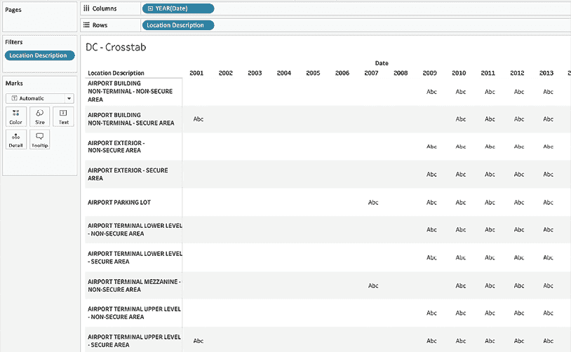

   图 6.5：交叉表

6. 将 **Index** 放置在 **Marks** 卡上的 **Detail（详细信息）** 货架上。请注意，在下截图中，视图现在反映了域补全——即视图已完全填充：

   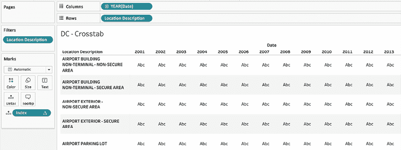

   图 6.6：交叉表 II

7. 右键单击 **YEAR(Date)** 并选择 **Continuous（连续）**。请注意，数据加密已停用：

   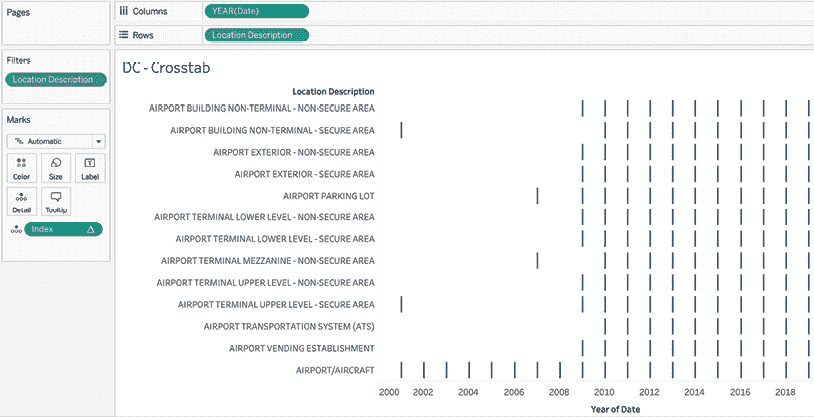

   图 6.7：交叉表 III

8. 将 **YEAR(Date)** 重置为 **Discrete（离散）**，然后右键单击 **Index** 并选择 **Edit Table Calculation（编辑表计算）**。

9. 在生成的对话框中，选择 **Specific Dimensions（特定维度）**，然后观察以下各项选择的结果：

| **Select Specific Dimension（选择特定维度）** | **Data Densification Activated/Deactivated（数据加密已激活/已停用）** |
| --- | --- |
| `Location Description` | Activated（已激活） |
| `Year of Date` | Activated（已激活） |
| `Location Description` and `Year of Date` | Deactivated（已停用） |
| No selection（无选择） | Deactivated（已停用） |

前面的练习说明了部署域补全的以下规则：

> 给定一个在 **Rows** 和 **Columns** 货架上具有离散维度的交叉表，利用表计算（在本例中为 **Index** 字段），其中至少寻址了一个维度（但并非所有维度），将激活域补全。

前面规则中的一个关键术语可能令人困惑：addressed（寻址）。*Chapter 5* *Introducing Table Calculations* 中涵盖了分区和寻址，但此处将再次定义以确保理解此规则。请参考 Tableau 文档 ([`help.tableau.com/current/pro/desktop/en-us/calculations_tablecalculations.htm`](https://help.tableau.com/current/pro/desktop/en-us/calculations_tablecalculations.htm)) 中的以下内容：


定义计算分组方式的维度（即定义计算所针对的数据范围）称为**分区字段**（`partitioning fields`）。表计算会在每个分区内单独执行。剩余的维度（即表计算所依据的维度）称为**寻址字段**（`addressing fields`），它们决定计算的方向。

编辑表计算时，可选择选中/取消选中特定维度。选中某维度时，该维度用于寻址表计算；取消选中时，该维度用于分区表计算。下图 **Table Calculation** 编辑对话框演示了在 **Location Description** 上寻址、在 **Year of Date** 上分区的情况：

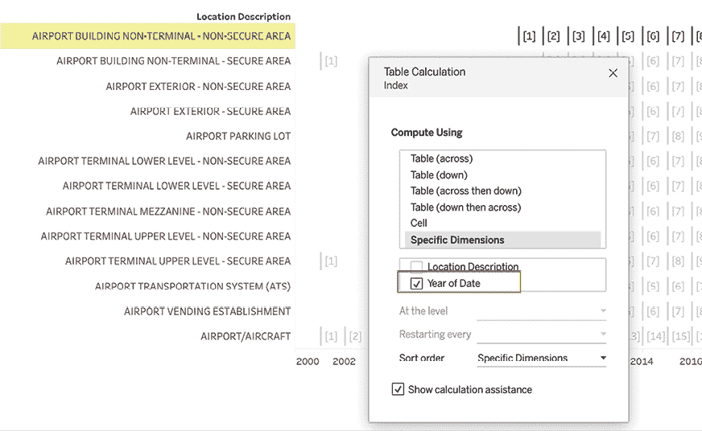

Figure 6.8: Table Calculation

下面介绍在交叉表中激活域补全的其余步骤：

1.  复制上一练习的工作表 `DC – Crosstab`，将新工作表命名为 `DC – Crosstab II`。
2.  右键单击 **Index**，选择 **Compute Using** | **Cell**。注意视图稀疏填充。
3.  选择 **Analysis** | **Table Layout** | **Show Empty Columns**。视图现已完全填充：

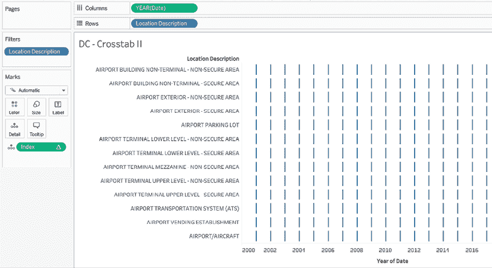

Figure 6.9: Crosstab

本练习阐释了在交叉表中部署域补全的以下规则：

*   给定 **Rows** 和 **Columns** 架子上有离散维度（蓝色），选择 **Compute Using** | **Cell** 会停用域补全。
*   给定 **Rows** 和 **Columns** 架子上有离散维度（蓝色），选择 **Analysis** | **Table Layout** | **Show Empty Rows/Columns** 会激活域补全。

将 **Compute Using** 设为 **Cell** 可能引发疑问：其他 **Compute Using** 选项（如 **Table (across)** 和 **Table (down)**）如何？这些选项均为分区与寻址的变体。

## 通过视图类型激活域补全

现探究通过视图类型激活域补全：

1.  复制上一练习的工作表 `DC – Crosstab II`，将新工作表命名为 `DC – View Types`。
2.  从 **Marks** 视图卡中移除 **Index**，并取消选择 **Analysis** | **Table Layout** | **Show Empty Columns**。视图现为稀疏填充。
3.  将 **Marks** 类型从 **Automatic** 改为 **Line**。视图现已完全填充，且标记更多：

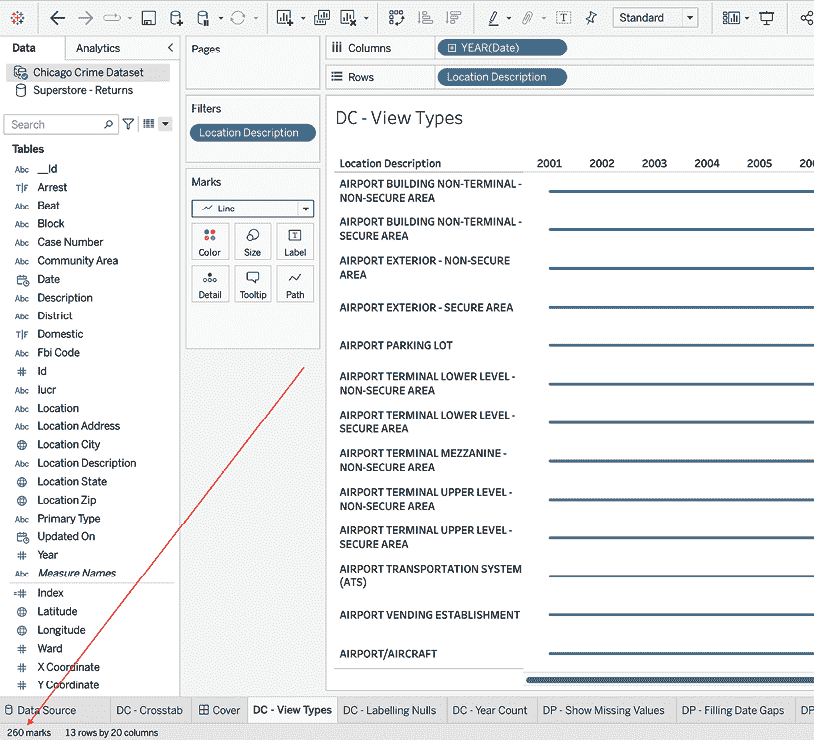

Figure 6.10: View types

1.  依次选择 **Marks** 卡上的各视图类型选项，观察哪些类型激活域补全、哪些不激活。

上述练习阐释了部署数据补全的以下规则：

给定 **Rows** 和 **Columns** 架子上有离散维度，从 **Marks** 视图卡中选择 **Line**、**Area**、**Polygon** 视图类型会激活域补全。

## 域补全的实用性

域补全在许多场景下很有用——例如，想使用参数时，或进行解释性分析时，无需手动填补缺失值。事实上，你可能已从前几个练习（虽仅为演示）中领悟到一些用法。下面的练习演示如何利用域补全，在稀疏填充的视图中为无值单元格显示“无数据”。

### 标记空值

按以下步骤开始练习：

1.  复制上一练习的工作表 `DC – View Types`，将新工作表命名为 `DC – Labeling Nulls`。
2.  调整复制的工作表，使视图类型设为 **Text**。另确保视图上仅部署 **Location Description** 和 **Year**。务必保留 **Location Description** 在 **Filters** 架子上，以便仅显示少数位置。
3.  创建名为 **No Data** 的计算字段，代码如下：

```
IF ISNULL(COUNT([Case Number])) THEN 'No Data' ELSE 'Data' END
```

4.  将 **Ward** 和 **No Data** 放入 **Text** 架子。注意文本 `No` `Data` 不显示：

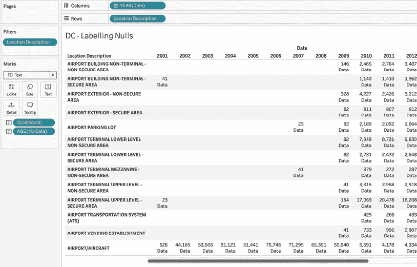

Figure 6.11: Labeling nulls

1.  将 **Index** 放入 **Detail** 架子。注意文本 **No Data** 现已显示。域补全部分现已完成，但可考虑利用形状让可视化更美观：

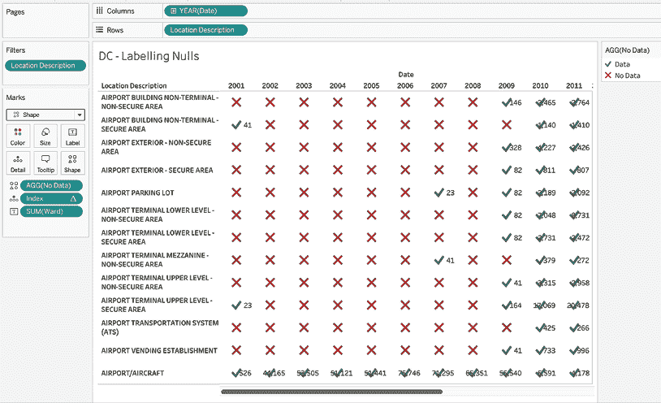

Figure 6.12: Labeling nulls, with additional formatting

希望本练习能让你切实理解域补全的工作原理。打个比方，域补全就像在浏览器搜索栏输入网址时的自动补全。但若想彻底移除它该怎么办？下节将讨论。

## 移除不需要的域补全

了解域补全后，用户在视图中出现意外标记时不再困惑。但如何从显示中移除这些不需要的标记却是个挑战。下面的练习展示了一个不需要的域补全场景及其解决方法。练习目标：显示某犯罪被报告的每个年份，并附带筛选器，根据数据可用的年份数量调整显示的犯罪：

1.  在本章关联的工作簿中，导航至 `DC – Year Count` 工作表。
2.  在 **Data** 窗格中选择 `Chicago Crime` 数据集。
3.  将 **Description** 放入 **Filter** 架子，选择 **AGG PO HANDS NO/MIN INJURY**。
4.  将 **Description** 和 **Date** 放入 **Rows** 架子，将 **YEAR(Date)** 设为离散，并将 **Ward** 放入 **Text** 架子。按需格式化。注意 **2001** 缺失值，如下截图所示：

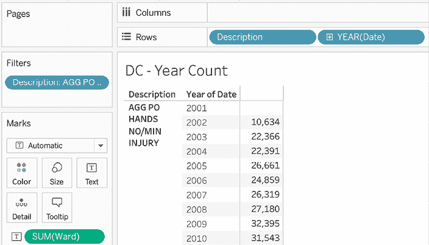

Figure 6.13: Year Count

这不是数据加密实例，因为数据集包含 **2001** 年的行，尽管该年 **Ward** 值为空。因此 **2001** 为空值。

1.  为移除含空值的字段，单击 **SUM(Ward)** 关联的下拉菜单，选择 **Filter**。在弹出的对话框中，选择 **Special** | **Non-null values**：

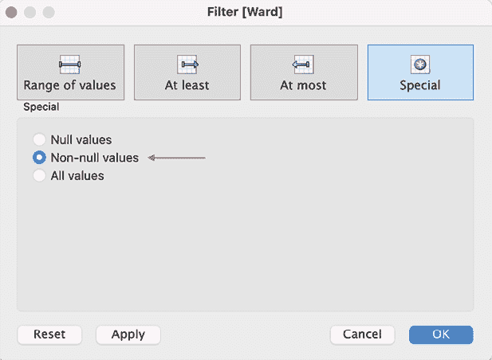

Figure 6.14: Filtering non-null values

1.  创建名为 `Year Count` 的表计算，代码如下：

```
SIZE()
```

2.  若在*步骤 3* 中将 **Description** 药丸放入 **Filters** 架子，请在后续步骤中移除它。
3.  将 **Year Count** 的离散实例放入 **Columns** 架子。注意生成的数字 **6411**（注：数据集持续更新，你可能看到不同数字）代表视图中的每一列：

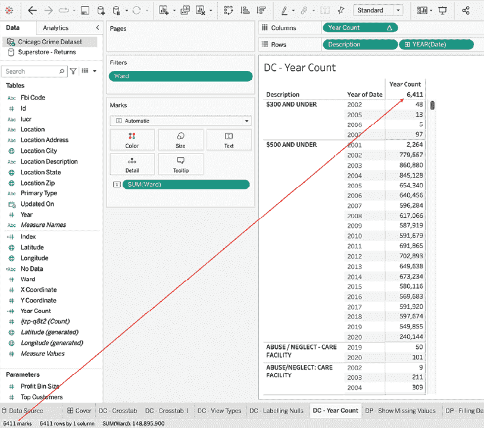

Figure 6.15: Year count

1.  右键单击 **Year Count**，选择 **Compute Using** | **Date**。视觉上似乎回到了*步骤 4* 讨论的场景。但尽管视图中问题看起来相同，底层原因不同。**Year Count** 是表计算，导致了域补全。因此我们看到数据集中每年的一行，即使例如 **$300 AND UNDER** 与 **2001** 的组合在数据集中不存在。因表计算 **Year Count**，我们看到了每一年：

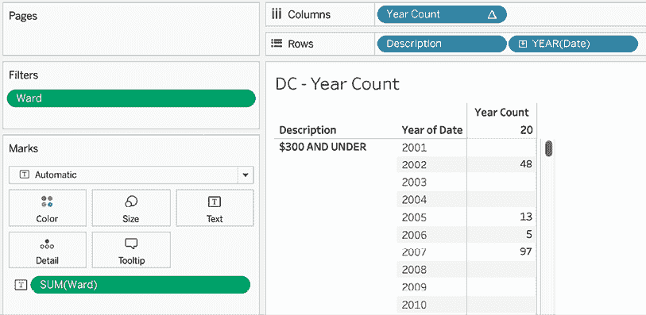

Figure 6.16: Year count domain completion

1.  右键单击 **Year Count**，选择 **Edit Table Calculation**。


## 域填充

第二种数据加密类型称为**域填充**。我们现在将探讨域填充的部署方式及其适用场景。

## 部署域填充

您可能还记得，部署域补全的方法之一是 `Analysis` | `Table Layout` | `Show Empty Rows`/`Columns`（分析 | 表格布局 | 显示空行/列）。域填充也是如此，如下面的练习所示。本练习演示了如何开启和关闭域填充：

1.  在与本章关联的工作簿中，选择 `Data` | `New Data Source`（数据 | 新建数据源），并连接到随 Tableau 附带的 `Sample` `Superstore`（示例超市）Excel 工作簿。它位于 `My Tableau Repository` | `Datasources+` 中。

2.  在生成的 `Data Source`（数据源）页面实例中，双击 `Orders and Returns`（订单和退货）。这将在 `Order ID`（订单 ID）字段上创建一段关系。

3.  将数据源命名为 `Superstore – Returns`（超市 - 退货）。

4.  导航到名为 `DP` `–` `Show` `Missing` `Values` 的工作表，并选择刚刚创建的 `Superstore –` `Returns` 数据源。

5.  将 `Ship Mode`（发货方式）和 `State`（州）放置在 `Rows`（行）功能区上。接下来，将 `Region`（区域）放置在 `Filters`（筛选器）功能区上并选择 `West`（西部）。最后，将 `SUM(Sales)`（销售额总和）放置在 `Text`（文本）功能区上。请注意，例如，`Wyoming`（怀俄明州）仅出现在 `Standard Class`（标准类）发货方式下：

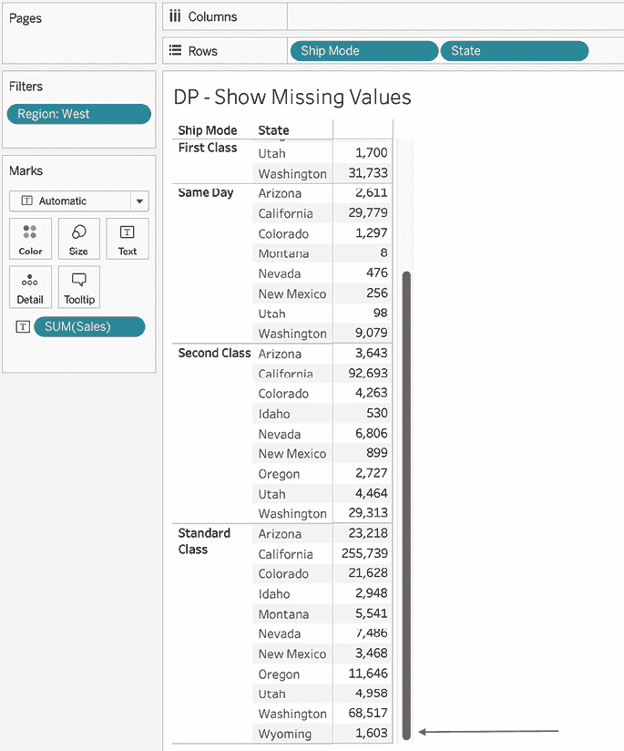

图 6.19：显示缺失值

1.  选择 `Analysis` | `Table Layout` | `Show Empty Rows`（分析 | 表格布局 | 显示空行）：

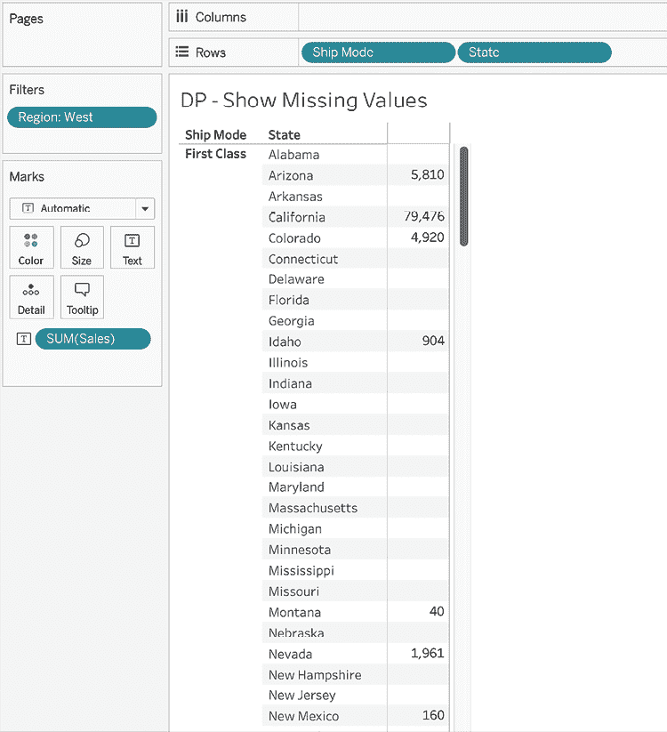

图 6.20：显示缺失值 II

此时您可以看到域填充的实际效果。所有在某个年份或某个区域拥有值的州现在都显示出来了，即使是那些被 `Region: West`（区域：西部）筛选掉的州。现在，筛选器仅移除 `Sales`（销售额）数值，但会显示所有可能的州。

之所以必须指向实时数据源（例如随 Tableau 附带的 `Superstore` 实例），是因为在这种情况下使用提取不会激活域填充，即使选择了 `Analysis` | `Table Layout` | `Show Empty Rows`。一旦您激活提取，该功能就会丢失。

## 域填充的实用性

在处理存在间隙的日期时，域填充通常很有用。当某些日期有关联值而其他日期没有时，就会出现这种间隙。正如下面的示例所示，在 `Superstore` 数据集中，退货并非每天都会发生。由于显示带有间隙日期的可视化可能会令人困惑，因此填补这些间隙可能会有所帮助。

### 使用域填充填补日期间隙

我们现在将尝试填补日期间隙：

1.  在与本章关联的工作簿中，导航到名为 `DP – Filling Date Gaps` 的工作表。

2.  选择在上一个练习中创建的 `Superstore – Returns` 数据源。

3.  将 `MDY(Order Date)`（月/日/年(订单日期)）的离散实例放置在 `Columns`（列）功能区上，并将 `Sales`（销售额）放置在 `Rows`（行）功能区上。请注意，视图中的每个标记间距相等，无论日期之间的时间跨度有多长：

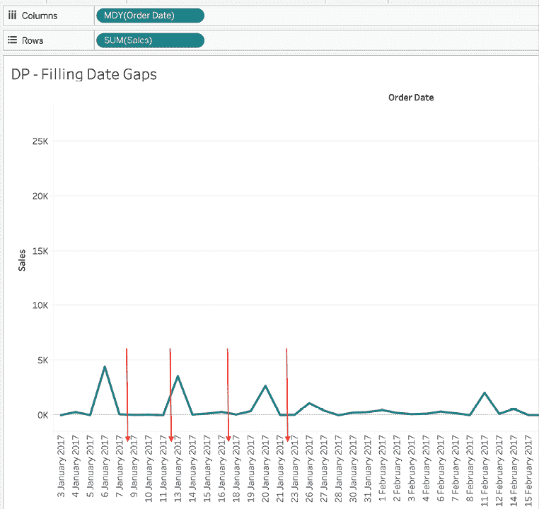

图 6.21：填补日期间隙

1.  右键单击 `MDY`(`Order Date`)，然后选择 `Show Missing Values`（显示缺失值）。

2.  右键单击 `Rows` 功能区上的 `SUM(Sales)`，然后选择 `Format`（格式）。在生成的 `Format` 窗口中，选择 `Pane`（窗格）选项卡，并选择 `Marks: Show at Default Value`（标记：按默认值显示）：

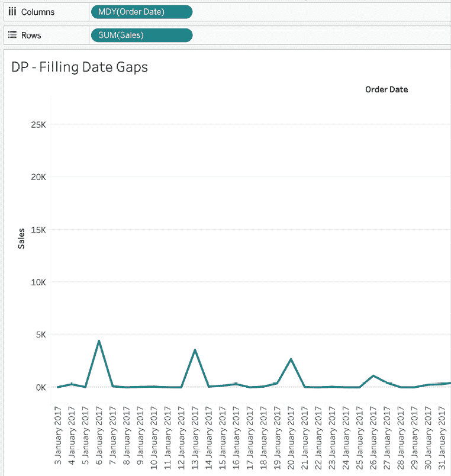

图 6.22：填补日期间隙 II

请注意，标记之间的距离现在基于日期之间的时间长度。所有没有值的日期均显示 `Sales` 值为零。

## 域填充的问题

由于域填充可以通过 Tableau 中的特定命令（即 `Show Missing Values` 和 `Show Empty Rows`/`Columns`）切换开启或关闭，因此它通常不是问题。然而，在少数场景下，域填充可能会导致混淆，其中一种情况将在下面的示例中介绍。

### 从域填充可视化到交叉表

让我们看看如何从域填充可视化创建交叉表：

1.  在与本章关联的工作簿中，导航到名为 `DP – From Viz to Crosstab` 的工作表。

2.  选择 `Superstore – Returns` 数据源。

3.  在数据窗格中右键单击 `Discount`（折扣），然后选择 `Create` | `Bins`（创建 | 箱）。在生成的对话框中，选择 `0.05` 作为箱大小。

4.  将新创建的 `Discount (bin)`（折扣(箱)）维度放置在 `Columns` 功能区上。

5.  右键单击 `Discount (bin)`，确保选中了 `Show Missing Values`。

6.  右键拖动 `Data` 窗格中的 `Discount` 字段到 `Rows` 功能区。选择 `CNT` 作为度量。请注意，某些箱没有值。例如，如下面的屏幕截图所示，`0.35` 箱没有关联值：

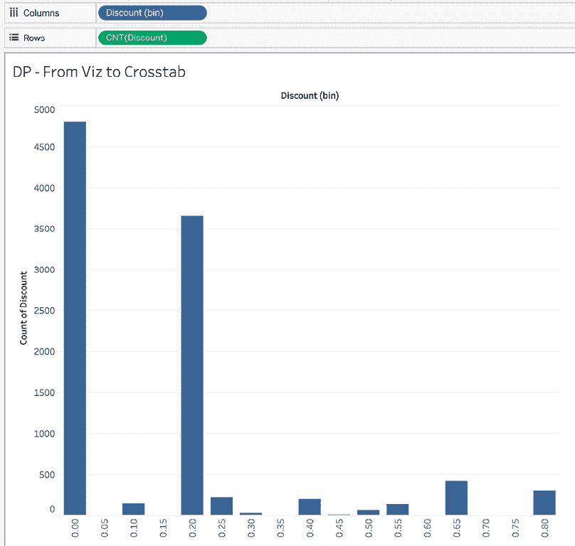

图 6.23：从可视化到交叉表

1.  通过右键单击工作表标签并选择 `Duplicate as Crosstab`（复制为交叉表）来复制该工作表为交叉表。请注意，`Show Missing Values` 仍处于激活状态：

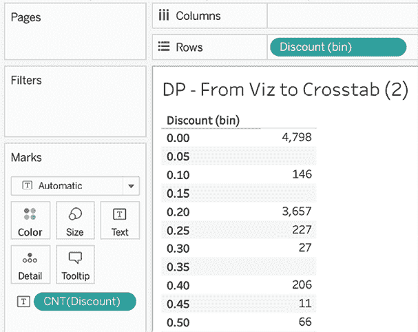

图 6.24：从可视化到交叉表 II

1.  通过右键单击 `Discount (bin)` 并取消选择 `Show Missing Values` 来完成练习：

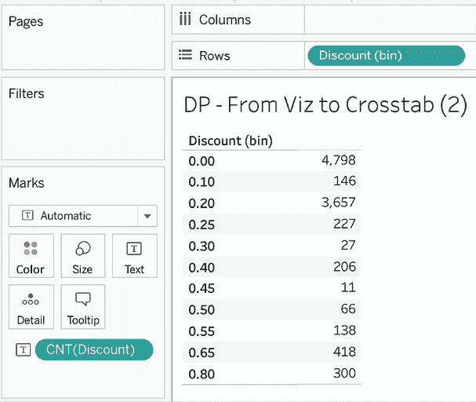

图 6.25：从可视化到交叉表 III

对箱或日期使用 `Show Missing Values` 在可视化中通常很有帮助，但在交叉表视图中可能没有帮助。如果有许多没有值的行或列，尤其如此。这会让人类更难消化数据量，而且由于通常与不重要相关，因此在交叉表中排除缺失值大多数时候更好——仅仅是为了保持更好的概览。

使用预测建模时，会出现数据加密的一种特殊情况。这就是为什么我们接下来要讨论这个问题。

## 预测建模中的数据加密


除了趋势线和预测（可通过**分析**窗格访问），Tableau Desktop 目前支持三种类型的预测建模作为内置函数。例如，通过使用 Python 集成（参见*第 15 章*、*集成编程语言*）可以添加更多。线性回归、正则化线性回归和高斯过程回归是目前可供选择的模型。可以通过在计算字段中使用 `Model_Quantile` 和 `Model_Percentile` 函数来调用它们。

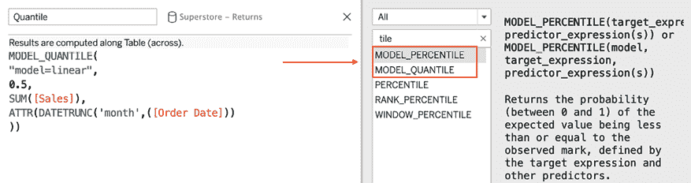

图 6.26：内置预测函数

在随本章附带的**解决方案**仪表板中的 `DP - Show Missing Values Prediction` 工作表中，你可以看到 2020 年 10 月每天的 `Superstore Count(Orders)` 以及相应的每日 50% 分位数。

有关内置预测分析和 `Model_Quantile` 的更多信息，请查看 [`help.tableau.com/current/pro/desktop/en-us/predictions\_overview.htm`](https://help.tableau.com/current/pro/desktop/en-us/predictions_overview.htm)。

有些日子不显示数据：

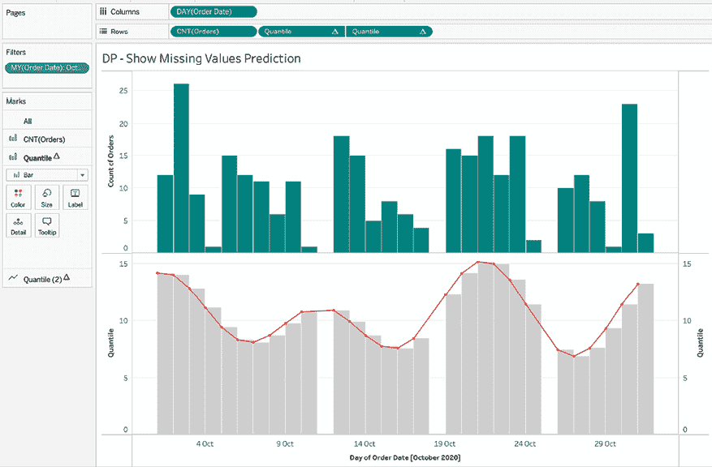

图 6.27：缺失值

但我们可以启用数据补全来完善视图。

在**列**货架上右键单击 `DAY(Order Date)` 并开启 `Show Missing Values`。

选择 **分析** | `Infer Properties from Missing Values` 并查看完整的预测：

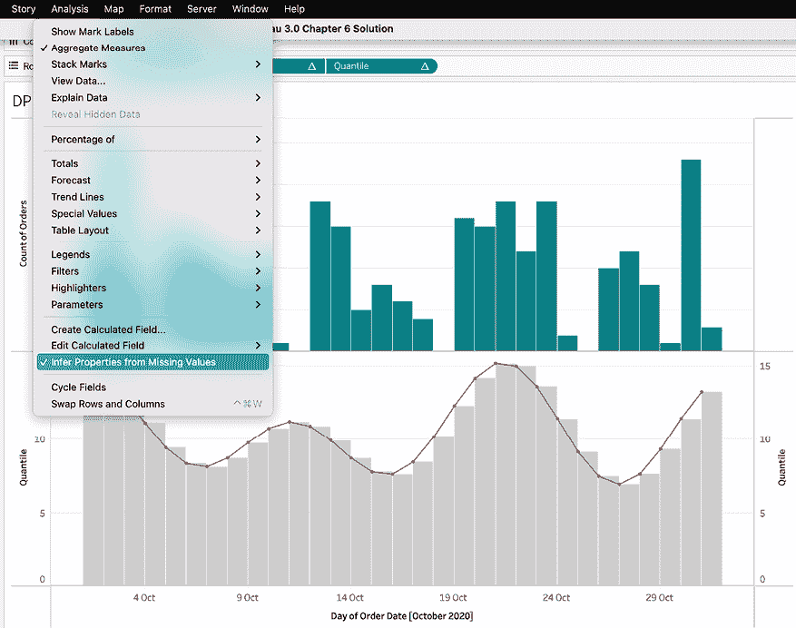

图 6.28：数据补全

我希望数据补全现在变得更清晰了一些。这是一个强大的功能，应该被更多地讨论。传播一下吧！数据补全将增强你的可视化效果（参见*图 6.28*），为你插值数据点，甚至可以用于计算——一个不存在的数字突然出现了——多酷啊！不过，我们的旅程将继续，接下来我们将讨论的主题是处理大数据。

## Tableau 与大数据

也许大数据的第一个挑战是给它一个恰当的定义。这是一个被广泛使用以至于几乎失去意义的术语。例如，有些人可能将超过 1,048,576 行的数据称为大数据（这是 Microsoft 365、Excel 2019、Excel 2016、Excel 2013、Excel 2010 和 Excel 2007 的行限制），而另一些人则仅将该术语应用于 PB 级的数据集。维基百科上找到的定义（[`en.wikipedia.org/wiki/Big\_data`](https://en.wikipedia.org/wiki/Big_data)）非常宽泛，足以涵盖这两个例子。

确实，将仅超过 Excel 行限制的数据视为大数据可能过于简单化；不过，从将 Excel 作为传统数据处理应用程序的个人角度来看，上述定义是合适的。

谈论大数据离不开并行处理。对于 Tableau 和处理大数据而言，了解 IT 团队为并行处理设置的分区非常重要。例如，可能是 `YEAR`、`MONTH` 和 `DAY` 列。如果你使用那些在数据库中也用作分区的列，你的 Tableau 仪表板性能将比在数据集中查询随机字段好得多。因此，首先设置筛选器——最好是分区。然后，在数据子集上构建仪表板。完成后，加载你需要的数据并再次检查性能。关于性能的更多信息见*第 13 章*、*提升性能*。

许多组织选择基于云的解决方案，如 AWS、Azure 或 GCP。在 **Google Cloud Platform** (**GCP**) 中，你将找到 BigQuery，我们将在下一个练习中使用它。

## 使用 Google BigQuery 构建可视化

一种大数据解决方案是来自 Google 的 BigQuery，此外还有来自 Amazon、阿里云、Azure、IBM 等提供商的许多其他方案。对于本书的这一部分，我们随机选择了 BigQuery，如果你有 Gmail 账号，可以免费试用。其他提供商也提供免费层级账户。既然我们在云端工作，就不需要安装任何东西，这使得 Google Cloud 成为本书练习的良好平台。

要使用 Google BigQuery 构建可视化，你首先需要设置对 BigQuery 的访问权限。以下练习将指引你走向正确的方向。一旦你设置了对 BigQuery 的访问权限，就能连接到 BigQuery 示例数据集。在练习的剩余部分，你将在连接到 BigQuery 的情况下构建可视化。

假设你有良好的网络连接，性能可能会超过你使用同等大小的提取数据源本地副本时的体验。

让我们看看如何在 Tableau 仪表板中使用 Google BigQuery：

1.  登录你的 Google 账号，导航到 [`cloud.google.com/bigquery/`](https://cloud.google.com/bigquery/)，并按照提供的说明免费试用 `BigQuery`。

2.  在与本章关联的工作簿中，导航到 `BigQuery` 工作表。

3.  按 `Ctrl` + `D` 连接到数据源。在弹出的窗口中，选择 `Google BigQuery`，并在提示时提供你的 Gmail 登录信息。

4.  在**数据源**页面，选择你在 GCP 注册时设置的任何计费项目。在我的例子中，它叫 `BigDataProject`。

5.  然后选择 `publicdata` 项目、`samples` 数据集和 `natality` 表。此数据对所有人公开，因此你也应该能看到它。

6.  `natality` 表提供了 1969 年至 2008 年美国的出生人口统计数据：

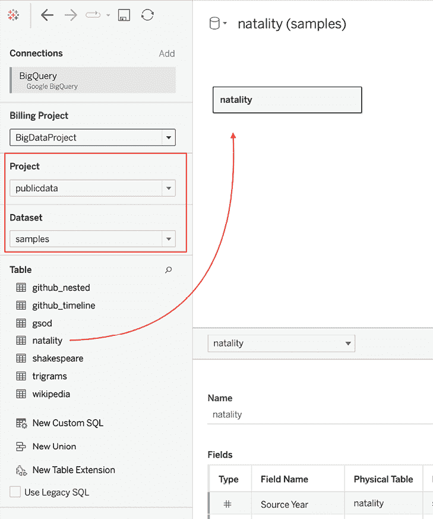

图 6.29：BigQuery

7.  在**数据**窗格中，双击 `natality(Count)`。

8.  从**数据**窗格中，将 `Month` 拖到**列**货架上，并将其设置为**离散型**。

9.  右键单击 *y* 轴 `Count of natality`，选择**编辑轴**。取消勾选**包含零**。

10. 按需格式化。此可视化显示了 1969 年至 2008 年每个月出生的婴儿数量：

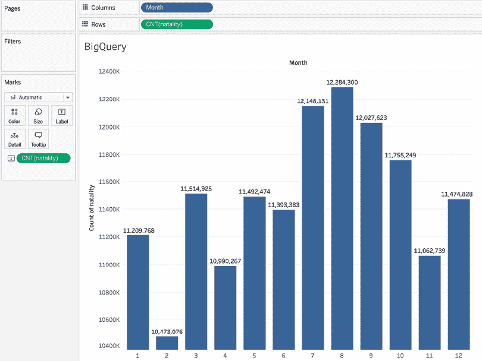

图 6.30：BigQuery 可视化

了解大数据引擎所依据的分区字段将在面对性能问题时提供很大帮助。例如，如果你的数据按 `Year` 分区，请始终尝试在筛选器和计算中利用此字段。*第 13 章*、*提升性能*包含有关此主题的更多信息。

正如你所见，BigQuery 让我们能够快速轻松地可视化包含数百万条记录的数据集。

# 摘要

我们本章开始时讨论了数据补全，并发现了两种类型的数据补全：域补全和域填充。在回顾这两种类型的数据补全时，我们了解了如何部署每一种、何时有用以及何时可能有问题。接下来，我们通过一个示例演练探索了大数据，展示了如何使用 Tableau 连接到 Google BigQuery。

在下一章中，我们将探索另一种功能：详细级别计算。虽然表计算仍然是日常 Tableau 使用的重要组成部分，但我们将发现详细级别计算如何轻松完成以前只能通过复杂的表计算才能实现的任务。

# 在 Discord 上了解更多

要加入本书的 Discord 社区——你可以在那里分享反馈、向作者提问并了解新版本——请扫描下方的二维码：

[`packt.link/tableau`](https://packt.link/tableau)


