## 7. 练习详细级别计算


当我们在 Tableau 中谈论 `Level of Detail` (`LOD`) 计算时，指的是三种表达式：`FIXED`、`INCLUDE` 和 `EXCLUDE`。这三种表达式通过提供创建以特定粒度级别为目标的计算的能力，开启了一个全新的选项世界。在旧版本的 Tableau 中，工作表的数据粒度由视图中的维度决定。如果视图包含例如 `Region`、`State` 和 `Postal Code` 等维度，但作者想要创建一个 `City` 级别的计算，则必须在视图中包含 `City` 维度。此外，没有机制在视图上排除或忽略给定的 `dimension`。诚然，通常可以通过一些复杂且有时曲折的表计算、数据混合等用法来获得期望的结果。幸运的是，LOD 极大地简化了这些用例场景，并在某些情况下实现了以前不可能的功能。

在本章中，我们将讨论以下主题：

- Introducing LODs（LOD 简介）
- `FIXED` 和 `EXCLUDE`
- `INCLUDE`
- Building practical applications with LODs（使用 LOD 构建实用应用）

本章前几节更多地基于理论，但请别担心——您将在 *Building practical applications with LODs* 一节中以实用的方式探索这些概念。让我们从介绍 LOD 及其用法开始。

## Introducing LODs（LOD 简介）

Tableau 的默认行为是根据视图中也存在的维度来显示度量。如果您有一个包含 `Sales` 数据和 `State`、`City` 等维度的仪表板，并将 `State` 和 `Sales` 数据拖到视图上，`Sales` 数据将按 `State` 划分，显示每个 `State` 的 `Sales`。如果您想将 `Sales` 数据进一步细分为更小的块，可以添加 `City` 字段，从而得到按 `State` 划分的每个 `City` 的 `Sales` 数据。LOD 可以操控这种默认行为。

完成本章后，您将能够按视图中不存在的维度来划分或分区度量，并使用比视图中可见维度更少的维度来显示度量。

为此，我们将构建并使用两个 `playgrounds`（演练环境）。根据工作职责交付报告可能会导致对有限功能集的透彻了解；即理解深但面窄。很难抽出时间（并证明该时间合理）去探索 Tableau 那些表面上似乎与工作职责没有直接关联的功能。演练环境可以通过提供高效的探索途径来帮助克服这些困难和异议。在本章中，我们将专门为 LOD 构建两个演练环境，通过提供高效的探索和理解途径，使深度和广度理解的任务变得更容易。您随时可以回到随本章附带的工作簿，测试与 LOD 相关的功能。

# FIXED and EXCLUDE（FIXED 和 EXCLUDE）

我们将构建的第一个演练环境旨在探索三个 LOD 函数中的两个：`FIXED` 和 `EXCLUDE`。我们将使用一组参数和相关的计算字段来高效地探索这些函数的工作原理。

## Setting up the workbook（设置工作簿）

本练习的大部分基础工作已在随本章附带的工作簿中完成。以下步骤只需您打开不同的计算和参数，查看它们是如何设置的以及为什么这样设置。沿途会给出解释。如果您无法直接访问该工作簿，应能通过参考以下步骤构建一个类似的工作簿。

要完成工作表的初始设置，请执行以下步骤：

1. 导航至 [Tableau Public 上的 Marleen Meier 个人资料](https://public.tableau.com/profile/marleen.meier) 以查找并下载随本章附带的工作簿。
2. 打开随本章附带的工作簿并导航至 `Fixed and Exclude` 工作表。工作表应如下所示：
   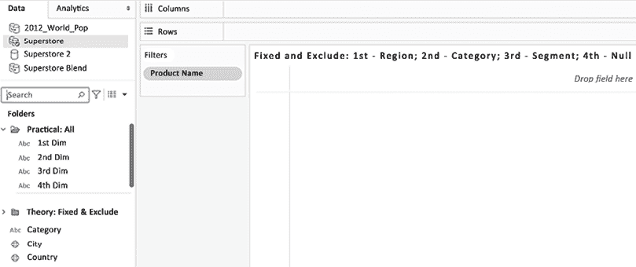
   图 7.1：工作表
3. 选择 `Superstore` 数据源，通过右键单击并选择 `Edit` 来检查名为 `1st Dim` 的参数：
   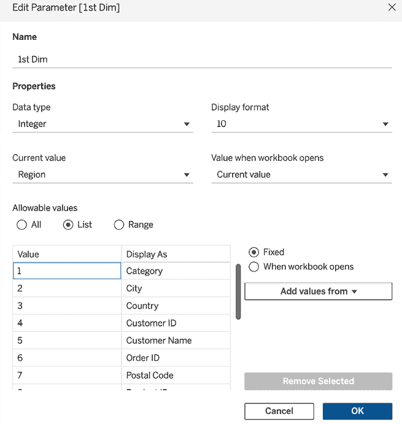
   图 7.2：参数 I
4. 名为 `2nd Dim`、`3rd Dim` 和 `4th Dim` 的参数与 `1st Dim` 相同。
5. 请注意，除 `Order Date` 和 `Ship Date` 外，数据集中的每个维度都包含在值列表中（请参阅 *图 7.2*）。就本练习而言，`Category`、`Region`、`Segment`、`Ship Mode` 和 `Sub-Category` 尤为重要，因为这些是成员较少的维度。成员较多的维度在此上下文中更难使用。
6. 检查工作簿中包含的 `Choose Fixed Dims`、`Choose Excluded Dims 1` 和 `Choose Excluded Dims 2` 参数，请注意我们在 `Value` 列下定义了几个整数，每个整数稍后将在参数下拉列表的 `Displays As` 列下指定的字符串形式显示。`Choose Fixed Dims` 的 `Value` 和 `Display As` 配置如下：
   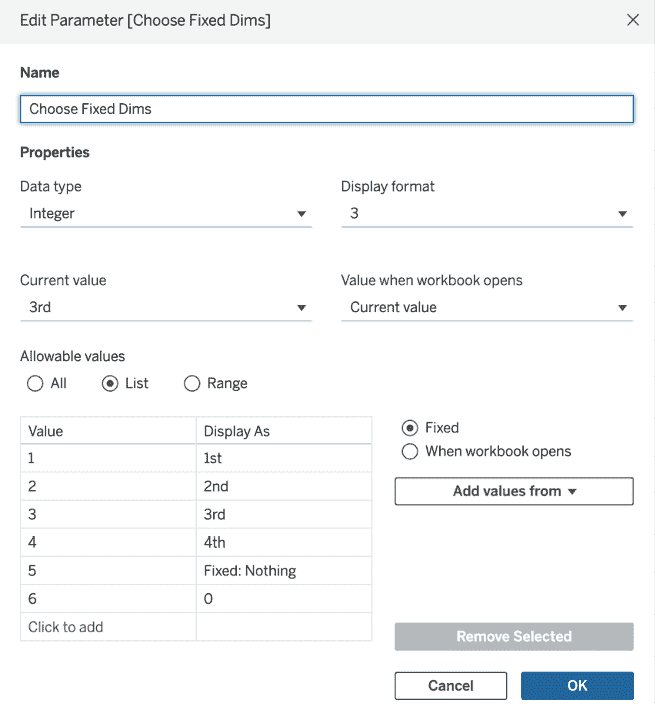
   图 7.3：参数 II
7. 检查名为 `1st Dim` 的计算字段（它位于 `Data` 窗格中的 `Practical: All` 文件夹下）；此计算使用了 `1st Dim` 参数，并将根据参数的选择显示一个字段。如果用户在 `1st Dim` 参数中选择 `Category`，则值 `1` 将被激活（根据 *图 7.2* 中指定的值）。值 `1` 随后会在计算的 `1st Dim` 字段中转换为 `Category` 字段，如下截图所示：
   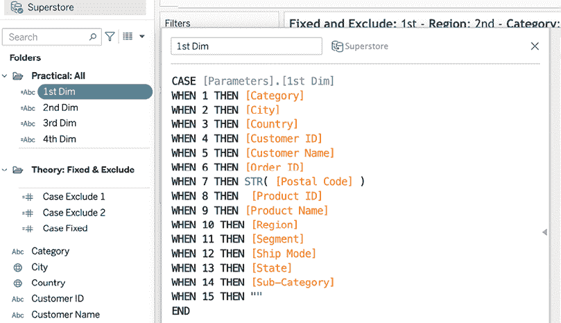
   图 7.4：计算的 1st Dim 字段
8. 名为 `2nd Dim`、`3rd Dim` 和 `4th Dim` 的计算字段与 `1st Dim` 相同，只是每个字段引用其同名参数；例如，`2nd Dim` 计算字段使用 `[Parameters].[2nd Dim]`。
9. 这些 `Case` 语句结合相关参数，将允许您从视图中的下拉列表中选择要查看的维度，如 *步骤 5* 所述。
10. 检查以下计算字段，它们使您能够选择要采用的 LOD，从而比较和对比差异与相似之处：
    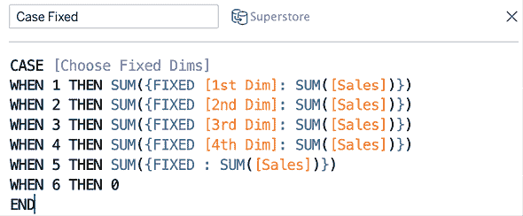
    图 7.5：Case Fixed
    `Case Fixed` 计算显示，如果用户在 `Choose Fixed Dims` 参数中选择 `1`（显示为 `1st`），则 `1st Dim` 将被固定——无论仪表板设置如何。这意味着 `SUM(Sales)` 将按 `1st Dim` 分区，无论它是否属于仪表板的一部分：
    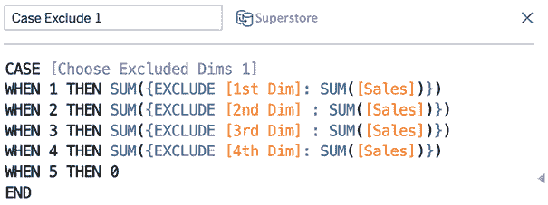
    图 7.6：Case Exclude 1
    `Case Exclude 1` 计算显示，如果用户在 `Choose Excluded Dims 1` 参数中选择 `1`（将显示为 `1st`），则 `1st Dim` 将从视图中的计算中排除。这意味着 `SUM(Sales)` 不会按 `1st Dim` 分区，即使它是视图的一部分：
    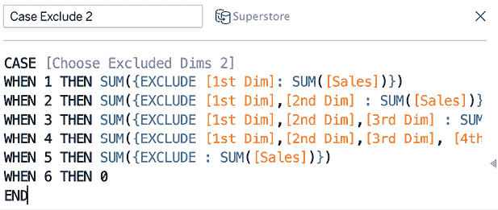
    图 7.7：Case Exclude 2
    `Case Exclude 2` 计算显示，如果用户在 `Choose Excluded Dims 2` 参数中选择 `1`（将显示为 `1st`），则 `1st Dim` 将从视图中的计算中排除。这意味着 `SUM(Sales)` 不会按 `1st Dim` 分区，即使它是视图的一部分。
11. 现在，右键单击并打开 `Product Name` 上的上下文筛选器以进行检查。在生成的对话框中，单击 `Wildcard` 选项卡并注意设置，如下截图所示。筛选器已设置为仅显示以 `S` 开头的产品名称（`Match value` 不区分大小写）：
    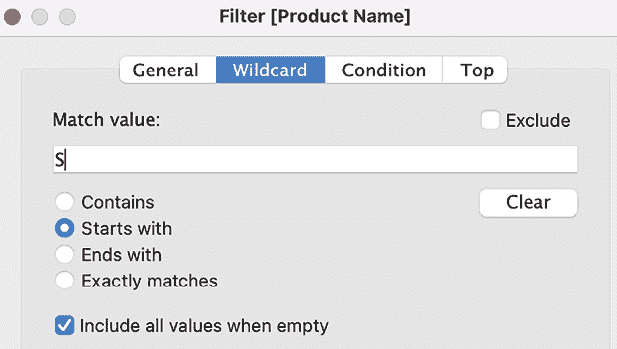


图 7.8：通配符筛选器

1. 单击 `OK` 后，右键单击筛选器并单击 `Add to Context`（添加到上下文）。请注意，上下文筛选器以灰色表示：

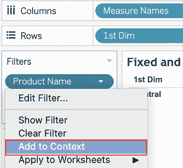

图 7.9：灰色上下文筛选器

1. 将以下维度放置在 `Rows`（行）架上：`1st Dim`、`2nd Dim`、`3rd Dim` 和 `4th Dim`。

2. 将 `Measure Names`（度量名称）拖到 `Filters`（筛选器）架上，并选择 `Sales`、`Case Fixed`、`Case Exclude 1` 和 `Case Exclude 2`。

3. 将 `Measure Values`（度量值）添加到 `Text`（文本），将 `Measure Names`（度量名称）添加到 `Columns`（列）：

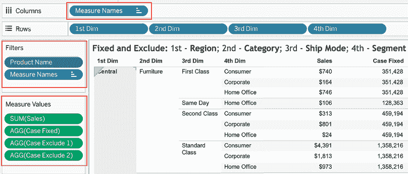

图 7.10：度量值

1. 通过右键单击每个参数并选择 `Show Parameter Control`（显示参数控件）来显示所有参数。按如下方式排序参数控件：

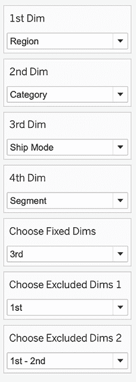

图 7.11：最终演练场

通过遵循前面的步骤，我们现在可以构建各种表格来比较不同的 LOD，因为参数将允许我们选择不同的维度以及包含 Tableau `FIXED` 和 `EXCLUDE` 函数的计算字段。我们现在将继续使用演练场，并解释 LOD 如何更改计算字段。

## 理解 FIXED

现在演练场环境已准备就绪，让我们构建场景以更好地理解 `FIXED` 和 `EXCLUDE` 函数。我们将从 `FIXED` 开始。`FIXED` LOD 仅考虑其指向的维度。因此，当固定在某个维度上时，视图中的所有其他维度（如果有）都将被忽略。当 `FIXED` LOD 在未定义任何维度的情况下使用时，结果将是一个忽略视图中所有维度（如果有）的计算。

让我们直接进入练习亲自验证一下：

1. 使用前面描述的工作表，按如下所示设置参数：

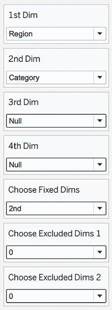

图 7.12：第一个示例

我们通过不同参数实现的效果是：显示每个 `Region`（区域）的 `SUM(Sales)` 以及每个 `Category`（类别）下的每个 `Region`，但我们也在 `Case Fixed` 列中将 `SUM(Sales)` 计算固定在了 `Category` 维度上。

1. `Case Fixed` 列现在显示每个 `Category` 的总计，并忽略 `Region`，因为我们指示计算固定 `2nd Dim`（`Region`）并忽略视图本身的维度。

通过比较 `Sales` 列和 `Case Fixed` 列可以看到这种效果：

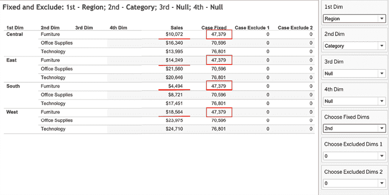

图 7.13：Case Fixed I

1. 亲自核对一下，计算 `Furniture`（家具）的数值：

`10,072 + 14,249 + 4,494 + 18,564 = 47,379`。

尽管 `Region` 在视图中可见，但 `Case Fixed` 列中的 `SUM(Sales)` 忽略了 `Region`，并显示结果，就好像 `Category` 维度是视图中唯一的维度一样。我们操纵了数据的粒度。在 `Case Fixed` 列中，`Region` 仅用于提供信息，但不影响 `SUM(Sales)` 的计算。

1. 现在将 `Choose Fixed Dims` 参数更改为 `1st`，请注意 `Case Fixed` 现在显示每个 `Region` 的总计：

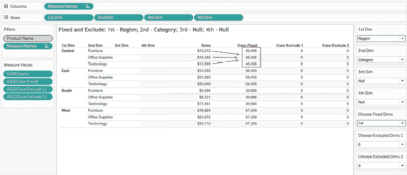

图 7.14：Case Fixed II

1. 这一次，我们将 `Case Fixed` 列中的计算固定为仅考虑 `Region` 但忽略 `Category`。亲自核对一下，计算 `Central`（中部）的数值：`10,072 + 16,340 + 13,995 = 40,406`。

将 `Choose Fixed Dims` 参数更改为 `Fixed: Nothing`，请注意该金额反映了总 `SUM(Sales)`：

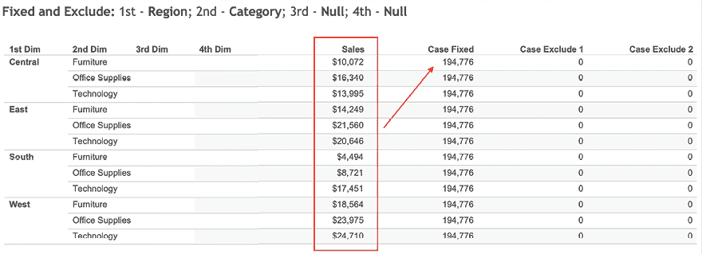

图 7.15：Fixed: Nothing

这一次，我们将计算固定为“无”，这意味着我们忽略视图中的每一个维度。亲自核对一下，通过对 `Sales` 值求和来计算；总和将为 `194,776`。

显而易见，`FIXED` LOD 仅考虑其指向的维度。因此，当固定在 `Category` 上时，`Region` 被忽略。正如演示的那样，当固定在 `Region` 上时，`Category` 被忽略。最后，当 `Choose Fixed Dims` 设置为 `Fixed: Nothing` 时，将显示未受 `Product Name`（产品名称）上下文筛选器限制的整个数据集。

接下来，让我们看看 Tableau 2021.1 中引入的几个与 `FIXED` LOD 相关的新功能。

### 表作用域表达式

当使用整张表作为作用域时，编写 `FIXED` LOD 表达式的快捷方法是使用如下代码：

```
{MAX([Order Date])}
```

如果在 `Superstore` 数据集上使用此计算，将获得与编写以下内容完全相同的结果：

```
{FIXED: MAX([Order Date])}
```

无论视图中显示什么，此字段将始终从整张表中检索最新数据。很酷，对吧？

### 快速 LOD

Tableau 2021.1 允许我们更快地创建 `FIXED` LOD。只需将所需的度量拖到维度上方并按下 `Ctrl`（macOS 上为 `Cmd`）。

现在你将看到该维度以蓝色高亮显示（请参阅*图 7.16* 中的 `Region`）。然后将度量放置在那里，将创建一个新的度量字段（在本例中为 `Sales (Region)`）。

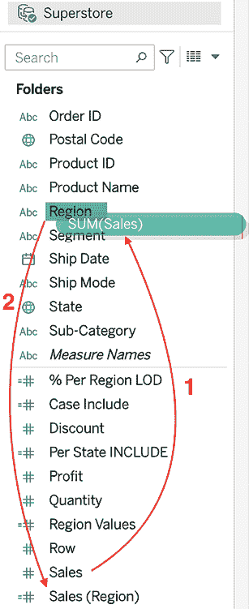

图 7.16：快速 LOD

右键单击 `Sales (Region)`，请注意已创建一个 `FIXED` LOD：

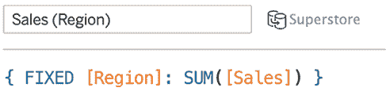

图 7.17：快速 LOD II

如果你使用的是 Tableau 2021.1 或更高版本，可以使用此快捷方式创建 `FIXED` LOD。

我们构建的演练场不仅用于 `FIXED`，也用于 `EXCLUDE`。接下来让我们看看 `EXCLUDE`。

## 理解 EXCLUDE

让我们开始理解 `EXCLUDE` LOD。`EXCLUDE` LOD 将排除其指向的任何维度。如果视图包含 `Region` 和 `Category`，并且你在 `Category` 上编写 `EXCLUDE` LOD，则计算中将仅考虑 `Region`。以下示例将使这一点更加清晰——本练习的目标是使用比视图中更少的维度来计算 `SUM(Sales)`。我们希望仅从计算中排除可见维度，但仍在仪表板中显示维度值：

1. 按如下屏幕截图所示设置参数：

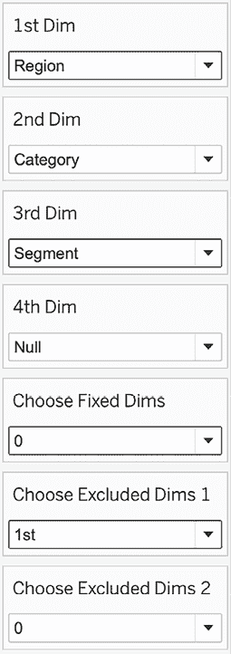

图 7.18：Fixed: Nothing

1. 你可以观察到以下结果：

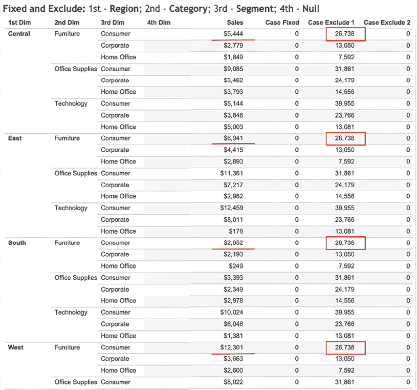

图 7.19：Exclude I

`Case Exclude 1` 显示每个 `Category` 和 `Segment`（细分市场）的总计，并忽略 `Region`。例如，`Furniture` 类别中 `Consumer`（消费者）细分市场的总计为 $26,738。该总计针对每个 `Region` 重复显示。生成这些结果的相关代码是

```
SUM({EXCLUDE [Region] : SUM([Sales])})
```

1. 对参数进行以下更改：

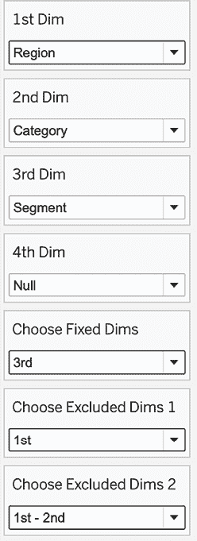

图 7.20：Exclude II

任何 LOD 计算都可以在视图中与多个维度一起使用。在本例中，`Case Exclude 2` 忽略两个维度：`1st Dim` 和 `2nd Dim`，它们分别与 `Region` 和 `Category` 关联。因此 `Case Exclude 2` 的相关代码为：

```
SUM({EXCLUDE [Region],[Category] : SUM([Sales])})
```

`Case Fixed` 的相关代码为：

```
SUM({FIXED [Segment]: SUM([Sales])})
```

`Case Exclude 2` 和 `Case Fixed` 现在具有相同的结果。这是因为排除前两个维度等同于固定在第三个维度上。在两种情况下，仅考虑第三个维度 `Segment`。

你可以在以下屏幕截图中观察结果：

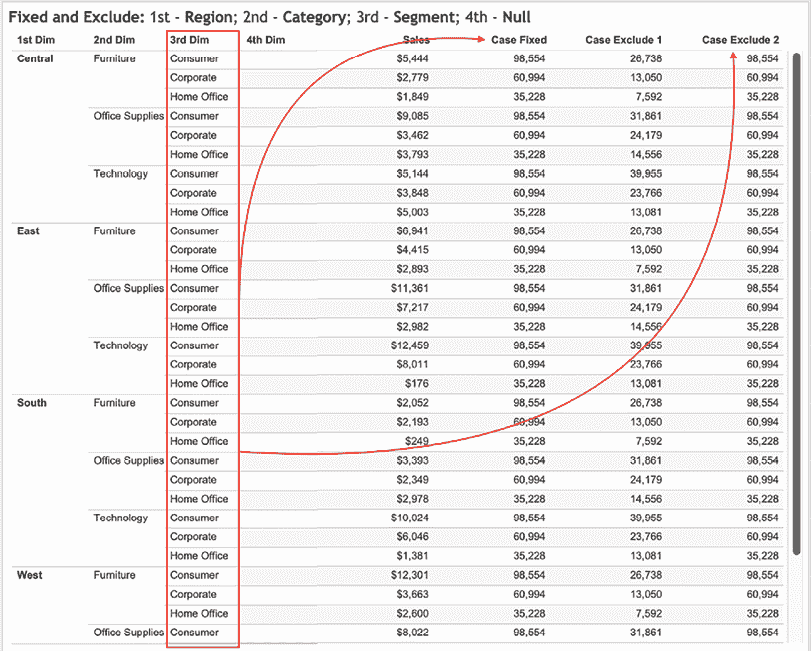

图 7.21：Exclude II 表

1. 对参数进行以下更改：

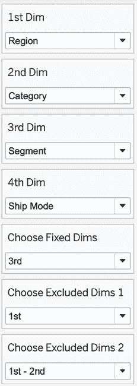

图 7.22：更改第 4 个维度

1. 你可以观察到如下结果：

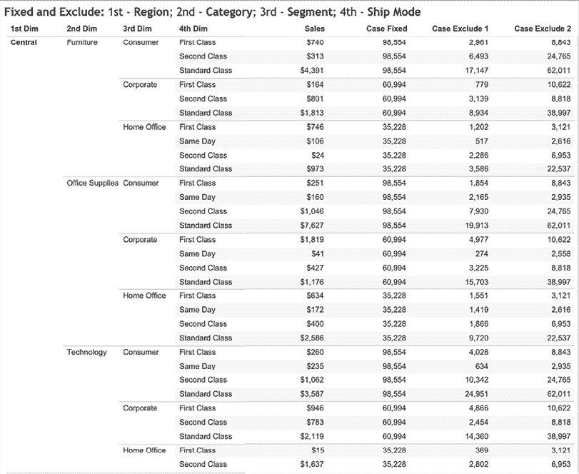

图 7.23：Exclude III

1. 请注意，`Case Exclude 2` 和 `Case Fixed` 不再具有相同的结果。这是因为引入了 `Ship Mode`（发货方式），`Case Exclude 2` 考虑了 `Ship Mode`，而 `Case Fixed` 没有。


2. 尝试其他设置，以进一步加深你对 `FIXED` 和 `EXCLUDE` LOD 的理解。

`EXCLUDE` 会导致 LOD 计算中涉及的任何维度从计算中移除。多个维度可以是 `EXCLUDE` LOD 的一部分，常见用例包括直接比较较低聚合级别的值（视图中的字段）与较高聚合级别的值（就好像维度从视图中移除一样）。假设你想要可视化不同区域中各类别的销售额，以及每个区域的总销售额。你可能还想计算某区域中单个类别与该区域整体的差异。LOD 能解决这种看似不可能的场景，是不是很酷？我希望前面的练习能让你更好地理解 `EXCLUDE` LOD。

在完成那些关于 `FIXED` 和 `EXCLUDE` 的练习后，作为一个简短的插曲，让我们更仔细地看看 Tableau 的运算顺序。正如你现在所知道的，`FIXED` 和 `EXCLUDE` 得到相同结果并非总是如此——运算顺序将帮助我们理解原因。

## 理解 Tableau 的运算顺序

之前的练习让我们相信，通过固定未被排除的维度，反之亦然，可以获得 `FIXED` 和 `EXCLUDE` 的相同结果。然而，Tableau 执行 `FIXED` 和 `EXCLUDE` LOD 的顺序不同，因此可能导致意外结果。为避免这种情况，我将向你展示在使用 `FIXED` 或 `EXCLUDE` LOD 时需要考虑的因素。

让我们看看筛选的顺序：

1.  按如下方式设置参数：

    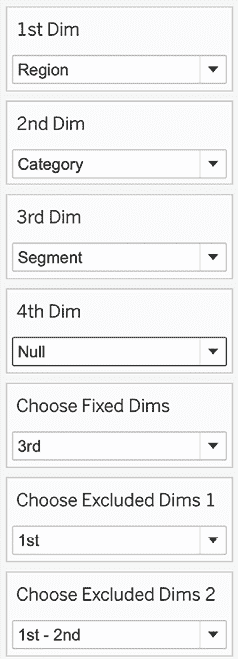

    图 7.24：设置参数

2.  观察结果：

    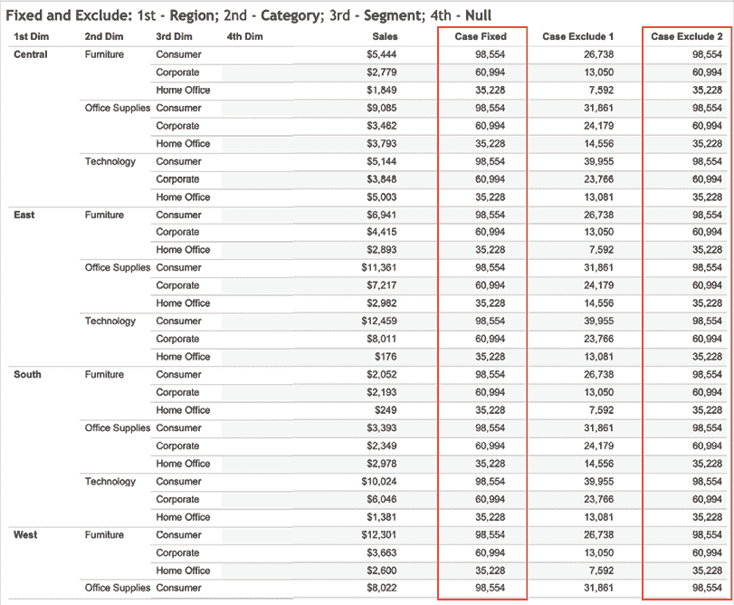

    图 7.25：相同结果

    请注意，正如前一个练习所见，**Case Exclude 2** 和 **Case Fixed** 是相同的。

3.  右键单击 **Product Name（产品名称）** 筛选器，然后选择 **Remove from Context（从上下文中移除）**：

    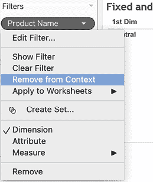

    图 7.26：从上下文中移除

4.  观察下面屏幕截图中的结果：

    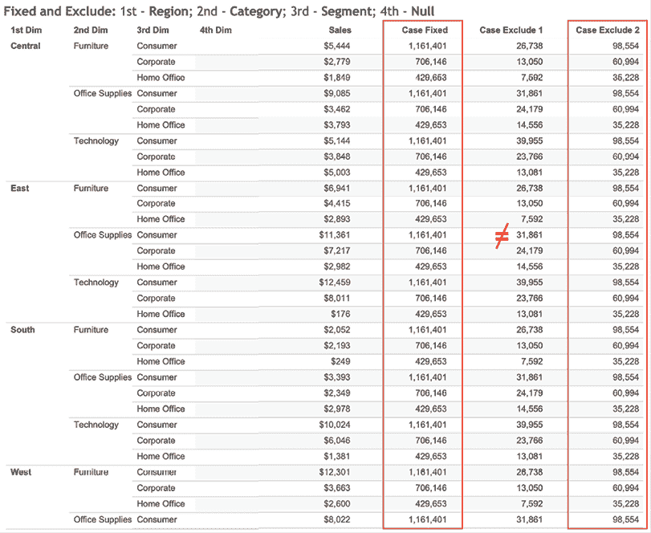

    图 7.27：无上下文筛选器

5.  **Case Exclude 2** 和 **Case Fixed** 不再相同。**Case Fixed** 不再受 **Product Name（产品名称）** 筛选器的影响，因为上下文已被移除。

前面练习中观察到的 `EXCLUDE` 和 `FIXED` 之间的行为差异反映了底层的筛选器运算顺序。如 *图 7.27* 所示，**上下文筛选器**将影响 `FIXED`、`EXCLUDE` 和 `INCLUDE` 计算，因为**上下文筛选器**首先应用于数据集，然后才是 LOD。然而，**维度筛选器**将只影响 `EXCLUDE` 和 `INCLUDE` LOD，因为 `FIXED` LOD 将首先应用于数据集，然后是维度筛选器，随后是 `EXCLUDE` 和 `INCLUDE` LOD。

请看下面的图表，它是 Tableau 运算顺序的示意图：

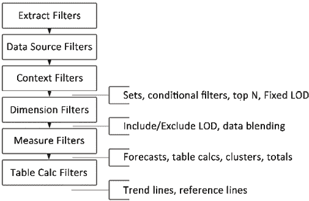

图 7.28：运算顺序

*图 7.28* 来源于 Tableau 的帮助页面，链接如下：[`help.tableau.com/current/pro/desktop/en-us/order_of_operations.htm`](https://help.tableau.com/current/pro/desktop/en-us/order_of_operations.htm)。

该页面还包含有关 Tableau 运算顺序的更多信息。

我们刚才看到，当使用上下文筛选器时，`EXCLUDE` 和 `FIXED` LOD 可能得出相同的数字，而维度筛选器会导致结果不同。之所以发生这种情况，是因为 Tableau 依次执行不同的请求。正如前面的图表所示，运算顺序是：

1.  上下文筛选器
2.  `FIXED` LOD
3.  维度筛选器
4.  `INCLUDE` 和 `EXCLUDE` LOD

了解这一点很重要，以便你为你的目的选择正确的筛选器或 LOD。

接下来，我们将使用一个新的演练环境，这次来展示 `INCLUDE` LOD 的工作原理。

# INCLUDE

配套工作簿（[`github.com/PacktPublishing/Mastering-Tableau-2023-Fourth-Edition/tree/main/Chapter07`](https://github.com/PacktPublishing/Mastering-Tableau-2023-Fourth-Edition/tree/main/Chapter07)）在很大程度上已经为你设置好了第二个演练环境。不过，我们将添加一些计算字段，以便进行有效的探索。如果你无法直接访问该工作簿，你应该能够通过参考以下信息构建一个类似的工作簿。

## 设置工作簿

在下文中，我们将设置一个工作表，用于练习 `INCLUDE` LOD：

1.  打开与本章关联的工作簿，并导航到 `Exploring Include` 工作表。

2.  在前面的练习中创建的名为 **1st Dim**、**2nd Dim**、**3rd Dim** 和 **4th Dim** 的参数和计算字段也将在该工作表中使用。

3.  右键单击 **1st Dim** 参数，然后选择 **Duplicate（复制）**。

4.  将副本重命名为 `Choose Included Dims`。

5.  创建一个名为 `Case Include` 的新计算字段，代码如下：

    ```
    CASE [Choose Included Dims]
    WHEN 1 THEN AVG({INCLUDE [Category]: SUM([Sales])})
    WHEN 2 THEN AVG({INCLUDE [City]: SUM([Sales])})
    WHEN 3 THEN AVG({INCLUDE [Country]: SUM([Sales])})
    WHEN 4 THEN AVG({INCLUDE [Customer ID]: SUM([Sales])})
    WHEN 5 THEN AVG({INCLUDE [Customer Name]: SUM([Sales])})
    WHEN 6 THEN AVG({INCLUDE [Order ID]: SUM([Sales])})
    WHEN 7 THEN AVG({INCLUDE [Postal Code]: SUM([Sales])})
    WHEN 8 THEN AVG({INCLUDE [Product ID]: SUM([Sales])})
    WHEN 9 THEN AVG({INCLUDE [Product Name]: SUM([Sales])})
    WHEN 10 THEN AVG({INCLUDE [Region]: SUM([Sales])})
    WHEN 11 THEN AVG({INCLUDE [Segment]: SUM([Sales])})
    WHEN 12 THEN AVG({INCLUDE [Ship Mode]: SUM([Sales])})
    WHEN 13 THEN AVG({INCLUDE [State]: SUM([Sales])})
    WHEN 14 THEN AVG({INCLUDE [Sub-Category]: SUM([Sales])})
    WHEN 15 THEN 0
    END
    ```

6.  将 **Case Include** 放到 **Detail（详细信息）** 卡架上。

7.  将以下度量和维度放到各自的卡架上：

    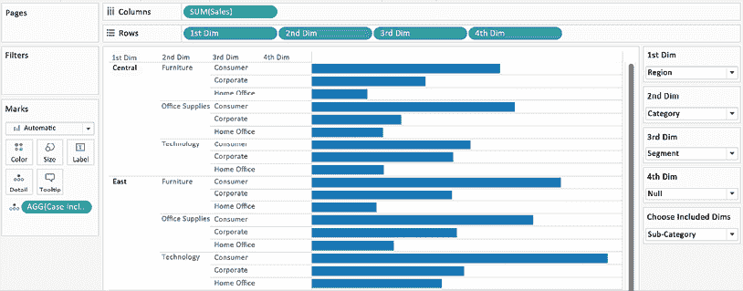

    图 7.29：探索 INCLUDE

8.  通过右键单击以下各参数并选择 **Show Parameter Control（显示参数控件）**，来显示它们：

    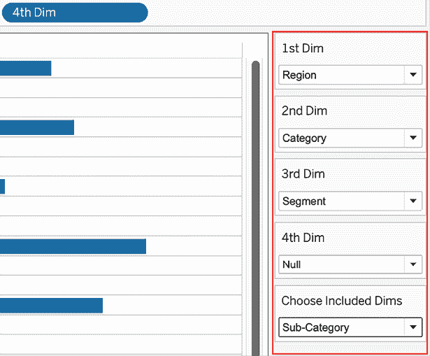

    图 7.30：参数

完成初始设置后，我们终于可以开始探究 `INCLUDE` LOD 了。

## 理解 INCLUDE

现在演练环境已准备就绪，让我们构建一个场景以更好地理解 `INCLUDE`。到目前为止，你大概能想象到，如果 `FIXED` 和 `EXCLUDE` LOD 从计算中移除维度，那么 `INCLUDE` 就是添加维度。没错！有时你可能希望在计算中包含一个或多个维度，即使视图中不显示它们。下一个示例将利用此功能，在不显示子类别的情况下展示每个子类别的平均值。之所以这样做，是因为子类别有太多额外的值，会导致仪表板更难阅读，并且需要更长时间才能得出快速结论。尽管如此，了解每个子类别的平均值仍很有意义，因为子类别的数量可能因 **Region（区域）** 和其他维度而异，因此包含它将让你深入了解真实的平均销售额。

让我们看看实际效果：

1.  将右侧的参数设置如下图所示：

    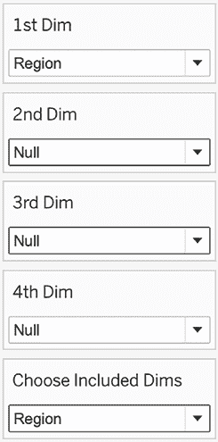

    图 7.31：初始布局

2.  单击 **Analytics（分析）** 添加两条参考线，并使用以下设置进行编辑：

    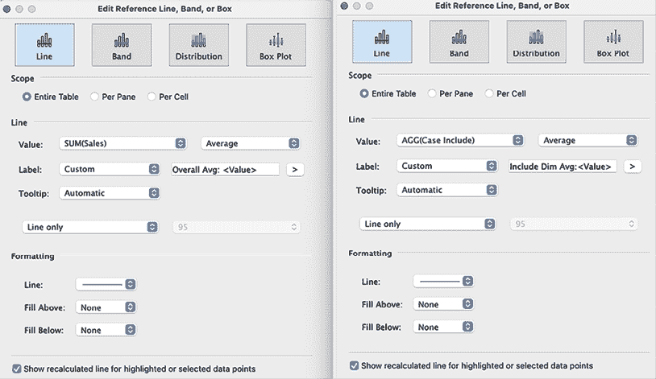

    图 7.32：参考线设置

3.  查看下面的屏幕截图以了解结果。请注意，两条参考线重合：

    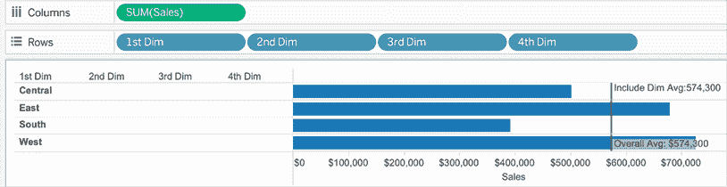

    图 7.33：每个区域的销售额和参考线

4.  如果参考线相互重叠，请编辑格式并将 **Alignment（对齐方式）** 设置为 **Top（顶部）**。要访问格式设置，请单击视图中的参考线：

    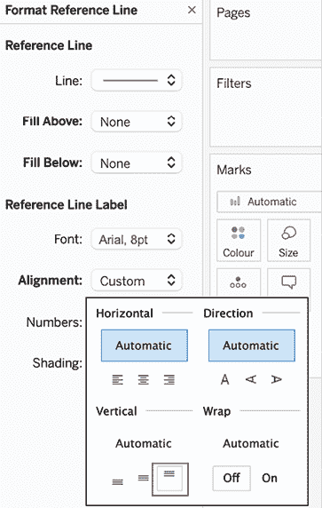


图 7.34：格式参考线

1. 现在，按如下所示设置参数：

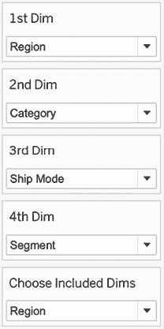

图 7.35：格式参考线

1. 在 Tableau Desktop 中，您现在应看到如下内容。和之前一样，两条**参考线**相等：

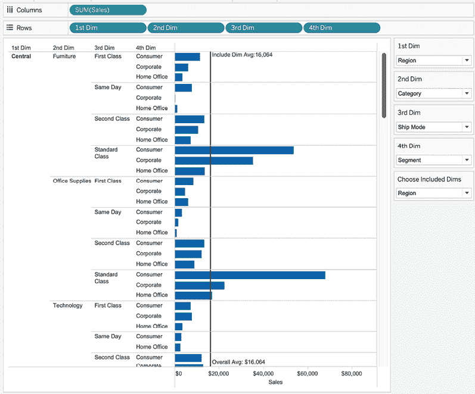

图 7.36：参考线

1. 将**选择包含的维度**参数更改为**类别**、**发货方式**和**细分**。
2. 请注意，对于这些设置中的每一项，**参考线**彼此相等。这是因为**选择包含的维度**仅引入了视图中已表示的维度。
3. 将**选择包含的维度**参数更改为**子类别**，以查看其他参考线在其预期位置：

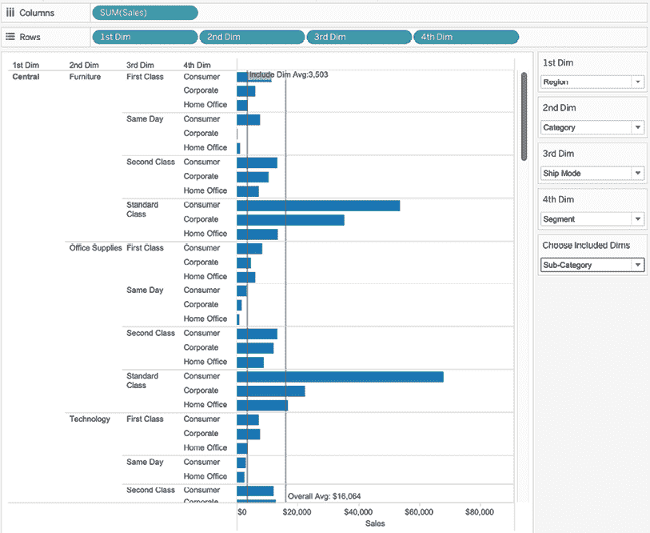

图 7.37：显示其他参考线

**包含维度平均值**参考线现在在平均值中包含**子类别**，因此与**总体平均值**参考线不同。平均值变小是因为总**销售额**金额被分摊到了比视图中可见的更多点上。将**子类别**添加到 LOD 会导致行数增加，从而导致每行的平均值变小。此外，请注意，**子类别**维度未在视图中使用。LOD 不要求计算驻留在视图中。

总之，`INCLUDE` LOD 可以通过一种方式操作可视化，即可以添加视图本身中未使用的分区。此外，所有三种 LOD 的命名约定将成为您理解它们的最佳助记符：`Fixed` 用于固定所用字段，`Include` 用于添加“缺失”字段，`Exclude` 用于从计算中移除已存在的不需要字段。

为了获得更多实操训练，我们将继续介绍一些实际应用。

# 使用 LOD 构建实际应用

本章的第一部分旨在演示 LOD 的工作原理。其余部分将专门用于实际应用。具体而言，我们将探讨三个典型挑战，这些挑战以前是使用其他 Tableau 功能（如表计算和数据混合）来解决的。

此练习将探讨一个问题，即将计算总数百分比的表计算与维度筛选器混合使用时会出现的问题。我们将分析该问题、使用 LOD 计算的解决方案，并以解决方案相关要点的评论部分作为结尾。

## 使用 LOD FIXED 计算

您是否曾遇到过这样的情况：您想计算`占总数百分比`，但在视图中只想显示`总数`维度的一个子集？好吧，您并不孤单。但多亏了 LOD，您很快就会知道如何解决这个问题。以下步骤将指导您完成练习：

1. 打开与本章关联的工作簿，并导航到名为 `The Problem` 的工作表。
2. 选择 `2012_World_Pop` 数据集。
3. 创建一个名为 `Percent of Total` 的计算字段，代码如下：

```
SUM([Population]) / TOTAL(SUM([Population]))
```

4. 右键单击 `Percent of Total`，然后选择 `Default Properties` | `Number Format` | `Percentage`（**默认属性** | **数字格式** | **百分比**）。
5. 将 `Country` 放入 `Columns`（**列**）货架，`Measure Names`（**度量名称**）放入 `Rows`（**行**）货架，`Measure Values`（**度量值**）放入 `Text`（**文本**）货架。
6. 从 `Measure Values`（**度量值**）货架中移除 `Number of Records`（**记录数**）。
7. 右键单击 `Percent of Total`，将其设置为 `Compute Using` | `Country`（**按...计算** | **Country**）。
8. 在 `Country` 上创建一个筛选器，使其仅显示 `Afghanistan`（**阿富汗**）：

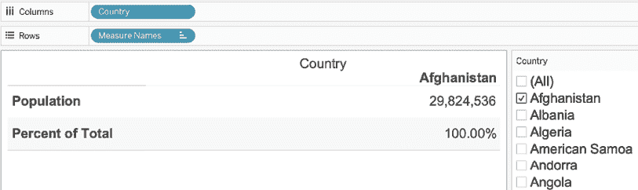

图 7.38：阿富汗人口

`Afghanistan`（**阿富汗**）显示的占总数百分比为 100%。显然，这并不代表阿富汗占世界总人口的百分比。让我们探讨一个可能的解决方案——要使用 LOD 解决该问题，请遵循以下练习步骤：

1. 复制名为 `The Problem` 的工作表，并将其重命名为 `Solution LOD`。
2. 创建一个名为 `Percent of Total LOD` 的计算字段，代码如下：

```
SUM([Population])/SUM({ FIXED : SUM([Population])})
```

3. 将 `Percent of Total LOD` 放入 `Measure Values`（**度量值**）货架，并注意显示的百分比等于 **0.43%**。如果显示 **0**，请将数字格式更改为百分比：

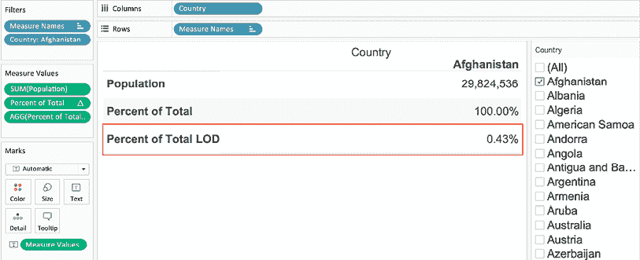

图 7.39：占总数百分比

1. 从 `Measure Values`（**度量值**）货架中移除之前创建的 `Percent of Total` 表计算：

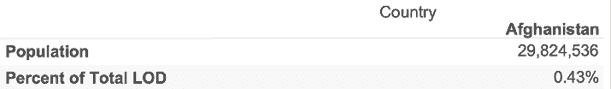

图 7.40：LOD 占总数百分比

正如您所见，问题解决了！为了更好地了解后台发生的情况，让我们看看 Tableau 为名为 `The Problem` 的工作表生成的查询。可通过单击 `Help` | `Settings and Performance` | `Start Performance Recording`（**帮助** | **设置和性能** | **开始性能记录**）来查看生成的查询。（有关查看 Tableau 生成的查询的更多信息，请参阅*第 11 章*、*设计仪表板和可视化最佳实践*。）

SQL 语句如下：

```sql
SELECT 
['2012_World_Pop$'].[Country] AS [Country],
SUM(['2012_World_Pop$'].[Population]) AS [SUM:Population:ok] 
FROM
[dbo].['2012_World_Pop$'] ['2012_World_Pop$'] 
WHERE
(['2012_World_Pop$'].[Country] = 'Afghanistan') 
GROUP BY
['2012_World_Pop$'].[Country]]
```

请注意，查询中的 `WHERE` 子句将返回的数据集限制为仅包含 `Country` 为 `Afghanistan` 的行。之所以生成此 `WHERE` 子句，是因为将 `Country` 放入了 `Filters`（**筛选器**）货架。通过限制返回的数据，处理需求从 Tableau 转移到了底层数据源引擎。换句话说，数据源引擎执行查询的工作，因此 Tableau 处理的是一个较小的数据集。此设计背后的原因是，数据源引擎专门设计用于高效查询大型数据集，且通常具有支持此类活动的底层硬件。此外，限制返回给 Tableau 的数据行数可以减少因延迟导致的低效率。

由于 Tableau 尽可能从缓存工作，因此低效率进一步减少。通常，用户可以在不生成对底层数据源调用的情况下执行各种操作。然而，在前一种情况下，如果用户从筛选器中选择不同的 `Country`，Tableau 将向数据源生成新查询。例如，如果用户与筛选器交互，取消选择 `Afghanistan`（**阿富汗**）并选择 `Albania`（**阿尔巴尼亚**），将生成一个带有相应 `WHERE` 子句的新查询。尽管 Tableau 依赖数据源引擎的逻辑显而易见，但前面示例中提出的问题依然存在。Tableau 制作者该如何计算整体的百分比，而不管筛选如何？

一种解决方案是创建一个也可用作筛选器的表计算。区别在于，与 `The Problem`（**问题**）工作表不同，Tableau 发送给数据源的查询返回整个数据集。当表计算用作筛选器时，筛选要等到返回底层数据后才进行。换句话说，Tableau 执行筛选。无论用户选择查看哪个国家的人口总数，这都会保留总数的百分比。但表计算的一个潜在问题是，返回的数据集可能非常大，这可能会导致性能问题。由于返回大型数据集所需的时间增加，可能会遇到延迟，并且由于筛选数据集的额外处理职责，Tableau 可能会运行得更慢。

我们提出的解决方案——LOD 计算——可以应对这些挑战。让我们看看 `Solution LOD`（**LOD 解决方案**）工作表中 `Percent of Total LOD`（**LOD 占总数百分比**）计算字段创建的 SQL 查询：


```sql
SELECT 
[t0].[Country] AS [Country], 
[t1].[ measure 0] AS
[TEMP(Calculation_418553293854285824)(2417030171)(0)],
[t0].[TEMP(Calculation_418553293854285824)(616435453)(0)] AS
[TEMP(Calculation_418553293854285824)(616435453)(0)] 
FROM 
( SELECT
['2012_World_Pop$'].[Country] AS [Country], SUM(['2012_World_Pop$'].[Population])
AS [TEMP(Calculation_418553293854285824)(616435453)(0)] 
FROM
[dbo].['2012_World_Pop$'] ['2012_World_Pop$'] 
WHERE 
(['2012_World_Pop$'].[Country]= 'Afghanistan') 
GROUP BY 
['2012_World_Pop$'].[Country] ) [t0] 
CROSS JOIN
( SELECT SUM(['2012_World_Pop$'].[Population]) AS [ measure 0] FROM
[dbo].['2012_World_Pop$'] ['2012_World_Pop$'] 
GROUP BY () ) [t1]
```

请注意术语 `CROSS JOIN`；LOD 计算生成的查询指示底层数据源引擎以一种方式返回数据，使 Tableau 能够将一个或多个国家的人口值除以世界人口总数，从而返回正确的总百分比。

## 使用 LOD INCLUDE 计算

接下来，我们将练习 `INCLUDE` LOD 计算。在本练习中，我们将创建一个显示以下内容的工作表：

*   每个区域的总销售额
*   所有区域总销售额的平均值
*   每个区域内所有州总销售额的平均值

使用 LOD 计算来显示这些值非常简单。让我们一探究竟。请跟随练习步骤操作：

1.  选择 `Practical Include` 工作表。
2.  选择 `Superstore` 数据集。
3.  创建一个名为 `Per State INCLUDE` 的计算字段，代码如下：

``` 
{INCLUDE [State]:SUM([Sales])}
```

4.  将 `Region` 拖至 `Columns` 货架，`SUM(Sales)` 拖至 `Rows` 货架，`AVG(Per State INCLUDE)` 拖至 `Details` 货架。请务必将 `Per State INCLUDE` 的聚合方式更改为平均值。
5.  通过右键单击 `Sales` 轴并选择 `Add Reference Line` 来添加两条 `Reference Lines`。使用以下设置：

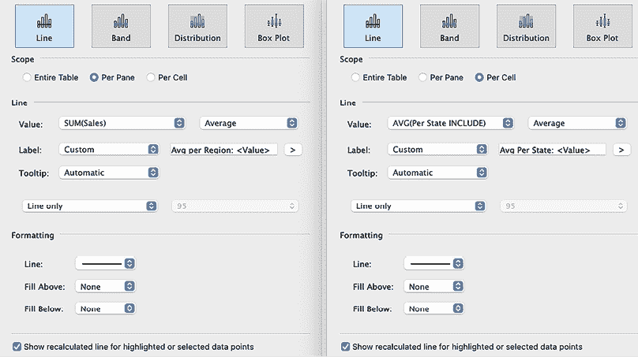

图 7.41：参考线

1.  根据需要格式化工作表以完成它：

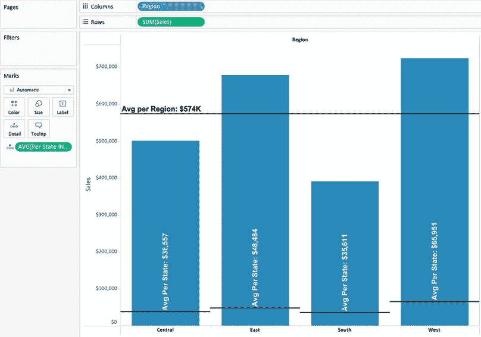

图 7.42：每个区域和州的平均值

正如你所见，得益于 LOD，我们可以显示每个 `Region` 的折线图，以及整个数据集的折线图。之所以能做到这一点，是因为我们在 `Per State INCLUDE` 计算中包含了 `State` 维度。使用此计算字段创建参考线，使 Tableau 不仅能显示每个（可见）`Region` 的平均值，还能显示每个 `Region` 内每个 `State`（不可见）的平均值。

## 使用 LOD EXCLUDE 计算

在本练习中，我们将使用 `Superstore` 数据集创建一个工作表，计算每个区域中每个城市产生的销售额百分比。

请跟随练习步骤操作：

1.  选择 `Practical Exclude` 工作表。
2.  选择 `Superstore` 数据集。
3.  创建以下计算字段：

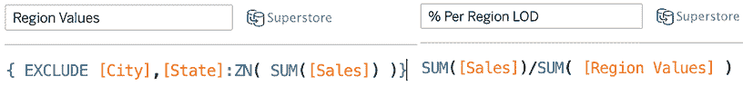

图 7.43：区域值和每区域百分比 LOD

1.  将 `Region` 和 `City` 放在 `Rows` 货架上。
2.  将 `Measure Names` 放在 `Columns` 货架上，将 `Measure Values` 放在 `Text` 货架上。
3.  从 `Measure Values` 货架中移除所有度量实例，仅保留 `Sales`、`Region Values` 和 `% Per Region LOD`。
4.  为了使 `% Per Region LOD` 以百分比形式显示，必须调整数字格式。只需在 `Data` 窗格中右键单击该计算字段，然后选择 `Default Properties` | `Number Format` | `Percentage`：

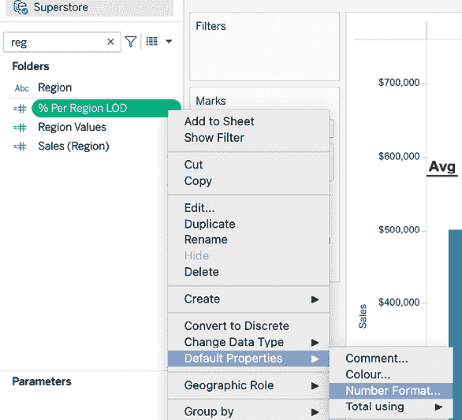

图 7.44：更改数字格式

1.  将 `AGG(% Per Region LOD)` 的一个实例放在 `Filter` 货架上，并调整以显示至少 `0.1`（即 10%）：

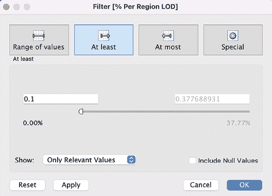

图 7.45：百分比筛选器

1.  观察当前视图，`Region` 和 `City` 在 `Rows` 货架上：

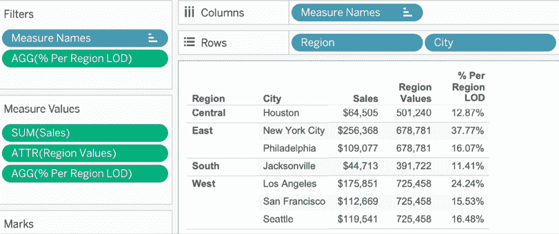

图 7.46：Jacksonville 仍然可见

1.  现在，将 `State` 放在 `Rows` 货架上 `Region` 和 `City` 之间。请注意 `Jacksonville` 消失了：

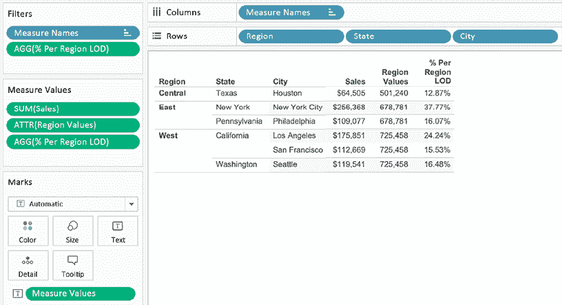

图 7.47：将 Region 添加到 Rows 时 Jacksonville 消失

之所以发生这种情况，是因为 `Jacksonville` 存在于 `South` 区域的两个州中，即 `Florida` 和 `North Carolina`。你可以通过将 `% Per Region LOD` 筛选器替换为 `City`: `Jacksonville` 来查看这一点：

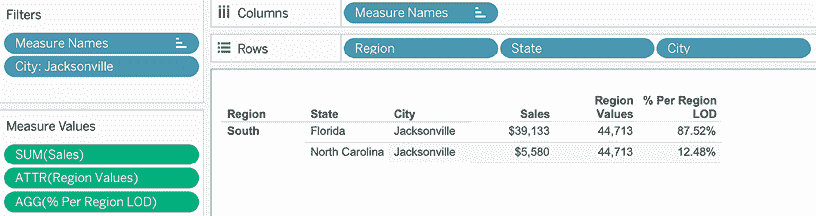

图 7.48：Jacksonville 存在于两个州中

我们的 `Region Values` 计算排除了 `City` 和 `State`，因此 `% Per Region LOD` 将考虑视图中可见内容的 `SUM(Sales)`，除以 `Region Values`。当视图中只有 `Region` 和 `City` 时，`Jacksonville` 的 `SUM(Sales)` 为 **44,713**（见 *图 7.48*）。该数字除以 **391,722** 的 `Region Values`（见 *图 7.46*）大于 10%。但随后我们向视图添加了 `State`，将 `SUM(Sales)` 改为 `Florida` 中 `Jacksonville` 的 **39,133** 和 `North Carolina` 中 `Jacksonville` 的 **5,580**（见 *图 7.50*）。当它们分别除以 `Region Values` 的 **391,722** 时，没有一个超过 10%，因此由于我们的筛选器，它们将从视图中消失。

LOD 是使用 Tableau 时较高级的主题之一，但它们非常强大，值得花时间去理解。想要更多实际示例，我建议你查看以下网站：[`www.tableau.com/about/blog/LOD-expressions`](https://www.tableau.com/about/blog/LOD-expressions)。我记得当我最初开始使用 Tableau 时，我不认为我会想要显示基于视图中不存在的维度的数据，或者想要排除维度。但我无数次需要这样做，例如，当向仪表板添加到总行平均值的距离计算时，或者当一个维度有多个最大日期而你只想显示每个单独最大日期的度量时。我回顾 LOD 文档的次数多得难以想象，我只能鼓励你也这样做；你阅读关于 LOD 的内容越多，就越容易掌握其概念并自然地使用它们。LOD 为仪表板带来的额外灵活性令人难以置信。

## 总结

我们本章首先探讨了 LOD 为何如此有影响力，以及为何它们被纳入 Tableau 备受赞誉。接下来，我们构建了两个演示场来探索三种 LOD——`FIXED`、`EXCLUDE` 和 `INCLUDE`——的工作原理。Tableau 的默认行为是基于视图中可见的维度进行计算。例如，如果视图中有州，销售额将按州呈现。如果你添加城市，销售额将按州、按城市调整。但是，如果你想操纵这种默认逻辑，可以使用 LOD。它们允许你基于任何维度计算度量，无论该维度是否在视图中呈现。我们还了解到，在 Tableau 的运算顺序中，`FIXED` LOD 高于 `EXCLUDE` 和 `INCLUDE` LOD。这一点很重要，以便你在仪表板中使用正确的 LOD 和/或筛选器。

在下一章中，我们将把注意力转向 Tableau 的可视化方面，探索不同的图表类型以及不太常见但非常有用的可视化图表。

## 在 Discord 上了解更多

要加入本书的 Discord 社区——你可以在其中分享反馈、向作者提问并了解新版本——请扫描下方的二维码：

[`packt.link/tableau`](https://packt.link/tableau)


