# 超越基础


本章的假设前提是：你熟悉条形图、折线图、树状图、饼图和面积图等基本图表类型，并且已经使用 Tableau 构建过多个图表。本章旨在重点介绍如何改进你可能经常使用的可视化类型，同时介绍一些你可能不熟悉但非常实用的图表类型。随后，我将向你介绍 Tableau Exchange，这是一个包含扩展程序、加速器和连接器的平台，能提供一些更独特的图表类型。

也许本章最有用的部分根本不在书中，而是在与本章关联的工作簿中。请务必下载该工作簿（链接将在下一节提供），以查看各种可视化类型。

本章将探讨以下可视化类型和主题：

*   改进常用可视化
*   自定义背景图片
*   Tableau Exchange
    *   扩展程序
    *   加速器
    *   连接器

请记住，仪表板的**内容**最重要，但如果你能用更漂亮的设计呈现相同的内容，就选择更漂亮的设计。确实存在**美感偏见**和**设计驱动消费**这种现象。你想推销你的产品——就让它看起来好看！希望接下来的章节能帮你找到方向，最终让你成为一名更优秀的仪表板设计师。

# 改进常用可视化

大多数常用可视化之所以流行，自有其道理。基本的条形图和折线图为人熟知、直观且灵活，因此在数据可视化中被广泛使用。其他不太基础的可视化，如子弹图和帕累托图，可能不是你每天都用，但却是数据分析师工具箱中有用的补充。虽然这些都很好，但它们还能做得更多。在本节中，我们将探讨如何调整、扩展甚至彻底改造一些流行的图表类型。

## 子弹图

子弹图由 Stephen Few 发明，并于 2006 年通过其著作 *Information Dashboard Design: The Effective Visual Communication of Data* 公开发布。Stephen Few 通过其著作和博客 [www.perceptualedge.com](http://www.perceptualedge.com) 持续在数据可视化领域发出强有力的声音。子弹图能在保持美观和易读的同时，将大量信息压缩在一个小空间内，从而实现高效直观的沟通。不难理解，它们广受欢迎并被用于多种用途，网络搜索即可見一斑。以下两个练习将传授子弹图的基础知识以及如何在基础上进行改进。这并不意味着我在本章中改进了子弹图！初衷仅在于阐述如何在 Tableau 中更有效地使用这一重要可视化类型。让我们开始吧。

### 使用子弹图

以下步骤将教授你子弹图的基础知识：

1.  访问 [`public.tableau.com/profile/marleen.meier`](https://public.tableau.com/profile/marleen.meier) 以查找并下载与本章关联的工作簿。

2.  导航至名为 `Bullet Graph` 的工作表，并选择 `CoffeeChain` 数据源。

3.  将以下字段放置在各自的货架上：`Profit` 放在 `Columns`（列）上，`Market` 放在 `Rows`（行）上，`BudgetProfit` 放在 `Marks`（标记）卡中的 `Detail`（详细信息）上。

4.  右键单击 *x* 轴，选择 `Add Reference Line`（添加参考线）。

5.  在 `Edit Reference Line, Band or Box`（编辑参考线、参考带或参考框）对话框的左上角，选择 `Line`（线）。同时，将 `Scope`（范围）设为 `Per Cell`（每单元格），`Value`（值）设为 `SUM(Budget Profit)` 的 `Average`（平均值），`Label`（标签）设为 `None`（无）。单击 `OK`：

    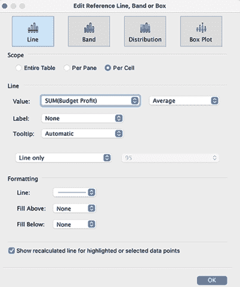

    图 8.1：参考线

6.  让我们再添加一条参考线。这一次，作为一种替代方法，点击 `Analytics`（分析）窗格，将 `Reference Line` 拖放到工作表上。（你显然也可以重复*步骤 4*中的方法。）

7.  在对话框中，选择 `Distribution`（分布），并将 `Scope` 设为 `Per Cell`。将 `Value` 设为 `Percentages`（百分位数），数值为 `90,95,100`，`Percent of` 设为 `SUM(Budget Profit)`。将 `Label` 设为 `None`。单击 `OK`：

    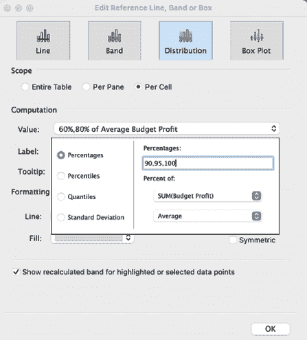

    图 8.2：百分位数

8.  创建一个名为 `Profit to Budget Profit Ratio` 的计算字段，代码如下：

    ```
    SUM([Profit])/SUM([Budget Profit])
    ```

9.  创建另一个名为 `Quota Met?` 的计算字段，代码如下：

    ```
    SUM([Profit])>=SUM([Budget Profit])
    ```

10. 右键单击 `Profit to Budget Profit Ratio`，选择 `Default Properties`（默认属性）| `Number Format`（数字格式）| `Percentage`（百分比）。

11. 将 `Profit to Budget Profit Ratio` 放在 `Marks` 卡中的 `Label`（标签）货架上，将 `Quota Met?` 放在 `Marks` 卡中的 `Color`（颜色）货架上：

    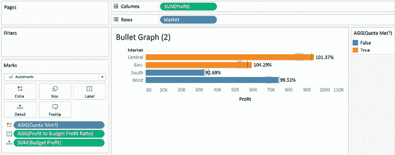

    图 8.3：初步子弹图

在浏览我们目前的结果时，你会注意到该可视化有一些重要方面。例如，参考线和彩色条形清晰地划分了何时达标、何时未达标。此外，百分位数传达了每个市场的实际利润与预算利润的接近程度。然而，也存在一些需要解决的问题：

*   **South**（南部）市场相关的百分比被部分遮挡。
*   参考分布代表的背景颜色被遮挡。
*   条形的颜色不直观。橙色被设为 **True**（真），在本例中表示达标的市场。然而从心理学角度来看，橙色是一种警示色，用于传达问题，因此更直观地关联那些未达标的市场。此外，这些颜色在灰度模式下不易区分。
*   图例中的 **False**（假）和 **True**（真）并不直观。

在即将进行的步骤中，我们将解决这些问题并展示可能的解决方案。

### 子弹图——进阶

为了解决上一节中图表存在的问题，请执行以下步骤：

1.  接续上一个练习，访问屏幕左侧的 `Data`（数据）窗格，右键单击 `Quota Met?`，并按如下方式调整计算：

    ```
    IF SUM([Profit])>=SUM([Budget Profit])
    THEN 'Quota Met'
    ELSE 'Quota Missed'
    END
    ```

2.  如果利润高于预算利润，此计算将生成字符串 `Quota Met`（达标）；如果利润不高于预算利润，则生成字符串 `Quota Missed`（未达标）。这两个字符串可用作图例，比之前的 **True** 和 **False** 更直观。

3.  创建一个名为 `Greater of Profit or Budget Profit` 的计算字段，代码如下：

    ```
    IF SUM(Profit)>SUM([Budget Profit])
    THEN SUM(Profit)
    ELSE SUM([Budget Profit])
    END
    ```

    如果利润多于预算金额，此计算将显示利润金额；如果利润较少，则显示预算金额。这将帮助我们始终显示两者中的较大金额。

4.  将 `Greater of Profit or Budget Profit` 放在 `Columns` 货架上 `Profit` 之后。同时，右键单击该药丸，选择 `Dual Axis`（双轴）。

5.  右键单击 `Greater of Profit or Budget Profit` 的轴，选择 `Synchronize Axis`（同步轴）。

6.  在 `Marks` 卡中，选择标记为 `All` 的面板，并将标记类型设为 `Bar`（条形）。

    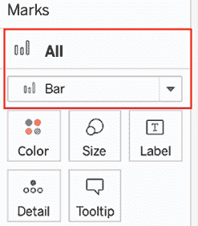

    图 8.4：标记卡

7.  从 `Color` 货架上移除 `Measure Names`（度量名称）。

8.  在 `Marks` 卡中，选择标记为 `AGG(Greater of Profit or Budget Profit)` 的面板。

9.  点击 `Color` 货架，将 `Opacity`（不透明度）设为 `0%`。

10. 在 `Marks` 卡中，选择标记为 `SUM(Profit)` 的面板。


5.  从 `Marks` 卡中移除 `AGG(Profit to Budget Profit Ratio)`，并注意到百分比标签不再被遮挡。

6.  点击 `Color` 货架并选择 `Edit Colors`。在弹出的对话框中，完成以下步骤：

    1.  双击 `Quota Met` 并将颜色设置为白色。

    2.  双击 `Quota Missed` 并将颜色设置为黑色。

7.  在点击每个对话框的 `OK` 并返回主屏幕后，再次点击 `Color` 货架，并为 `Border` 选择黑色。

8.  点击 `Size` 货架，通过向左拖动滑块来缩窄条形的宽度。

9.  右键点击 `Profit` 轴并选择 `Edit Reference Line`。然后将 `Value` 设置为 `90%,95%,100% of Average Budget Profit`：

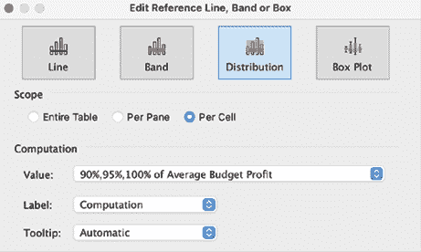

Figure 8.5: Reference line

1.  在同一窗口中，向下移动到 `Formatting` 部分，将 `Fill` 颜色设置为 `Grey Light`。勾选 `Fill Below` 复选框和 `Reverse` 复选框。注意背景颜色现在更容易区分了：

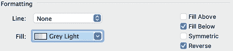

Figure 8.6: Background colors

1.  右键点击标记为 `Greater of Profit or Budget Profit` 的轴并取消选择 `Show Header`。您可能希望进行一些额外的微调，但我们的结果如下所示：

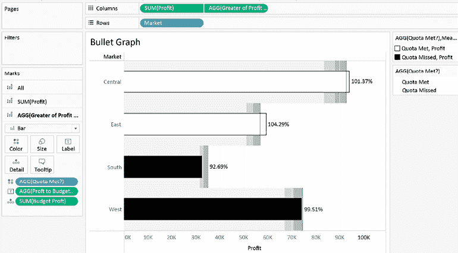

Figure 8.7: Improved bullet graph

请注意，上述每个问题现在都已得到解决：

*   百分比数字不再被遮挡。
*   由于缩窄了条形，背景颜色更容易区分。
*   条形的颜色更加直观。此外，使用黑、白、灰三色规避了因色盲或灰度打印而导致的任何可读性问题。
*   图例中的 `False` 和 `True` 一词已被替换为更具描述性的术语 `Quota Met` 和 `Quota Missed`。

完成本节后，您将了解如何通过微调来改进可视化效果和所选图表类型。无论何时，只要您目前的选择还不能讲完整个故事，就可以这样做。此外，这也是一个卖点。用户喜欢精美的设计和清晰的仪表板。通过使用更高级的技术改进可视化效果，您将能够改进您的叙事和营销。

在下一节中，我们将继续为已知的 `visualizations` 增加复杂性。这次我们将创建饼图和甜甜圈图，并最终将两者结合。

## Pies and donuts

饼图在数据可视化领域通常不受青睐。它们有太多缺点。例如，饼图在矩形屏幕上无法很好地利用空间。矩形树图更合适。此外，饼图上合理的扇区数量相当有限，最好也就六到八个。矩形树图再次胜出，因为它们可以在更细的粒度级别上切片，同时保持实用。最后，使用饼图时，很难分辨两个大小相似的扇区哪个最大。在这方面矩形树图也好不到哪里去；然而，如果观察者理解矩形树图的排序是从左上角到右下角，就可以利用该知识来区分大小差异。当然，条形图完全规避了这个特定问题，因为眼睛可以轻松区分宽度和高度，但难以分辨角度（饼图）和体积（矩形树图）。

尽管存在这些缺点，但由于其普及度，饼图在未来几年内可能仍将在数据可视化中被广泛使用。人们喜欢它们，因为它们不同于老旧、枯燥的条形图。用户熟悉饼图，它们不需要任何解释，并且是展示比例的一种方式——尽管在我看来这不是最好的方式。对于悲观的 Tableau 制作者，最好的办法是忍气吞声。但对于那些愿意探索和突破边界的人来说，可以发掘出饼图的良好用途。以下练习就是对这种探索的一种贡献。

### Pies and donuts on maps

有时需要（或自以为需要）在地图上构建饼图。该过程并不困难（正如您将在以下练习中看到的），但存在一些无法轻易克服的缺点。我们将在练习后讨论这些缺点。

步骤如下：

1.  在与本章关联的工作簿中，导航到名为 `Pie Map` 的工作表并选择 `Superstore` 数据源。

2.  在 `Data` 窗格中，双击 `State` 以创建美国地图。

3.  将 `Sales` 放置在 `Color` 货架上。点击 `Color` 货架并将 `Palette` 更改为 `Grey`：

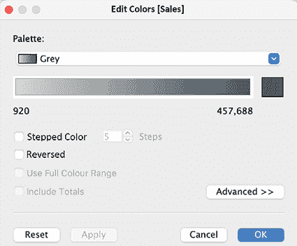

Figure 8.8: Edit Colors

1.  按住 Windows 下的 `Ctrl` 或 Mac 下的 `Command` 键，同时拖动 `Latitude (generated)` 的额外副本到 `Rows` 货架上，以创建两行，每行显示一张地图：

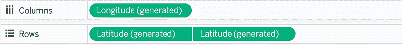

Figure 8.9: Latitude

1.  在 `Marks` 卡中，您会注意到现在有三个面板：`All`、`Latitude (generated)` 和 `Latitude (generated) (2)`。点击 `Latitude (generated) (2)` 并将标记类型设置为 `Pie`：

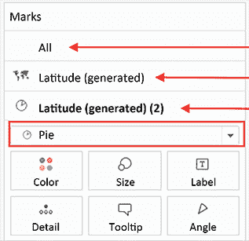

Figure 8.10: Marks card panes

1.  将 `Category` 放置在 `Color` 货架上，将 `Sales` 放置在 `Size` 货架上。

2.  要完成可视化，请右键点击 `Rows` 货架上第二个 `Latitude (generated)` 实例并选择 `Dual Axis`：

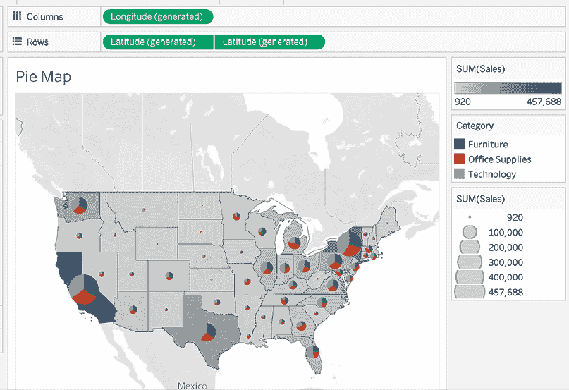

Figure 8.11: Pie map

您能在可视化中发现问题吗？应该立刻能看出两个问题：

*   首先，较小的饼图难以看清。点击 `Size` 图例的下拉菜单并选择 `Edit Sizes` 可以部分解决此问题，但 `Rhode Island` 等较小州份的饼图仍将存在问题。
*   其次，尽管销售额差异巨大，但许多州具有相同的浅灰色背景。

以下方法将解决这些问题，同时增加额外功能。

### Pies and donuts – beyond the basics

以下是在平铺网格地图上创建饼图和甜甜圈图所需的步骤。通过结合不同的方法，我们将能够一次性展示更多信息，而不会使视图过载：

1.  在与本章关联的工作簿中，导航到名为 `Altered Pie Map` 的工作表并选择 `Superstore` 数据源。

2.  创建以下计算字段：

    | **Name** | **Code** |
    | --- | --- |
    | `Category State Sales` | ``` {FIXED State, Category: SUM(Sales)} ``` |
    | `State Max` | ``` {FIXED State : MAX([Category State Sales])} ``` |
    | `Top Selling Category per State` | ``` MAX(If [State Max] = [Category State Sales] then Category END) ``` |

1.  我们需要前两个 `Level of Detail` (`LOD`) 计算和最后一个计算，以在显示每个州最畅销品类的同时，展示每个品类的销售额。

2.  在 `Marks` 卡中，将标记类型设置为 `Pie`。

3.  在 `Data` 窗格中，选择 `States` 数据源。

4.  点击 `Data` 窗格中 `State` 旁边的链接图标，以使用 `State` 作为混合字段：

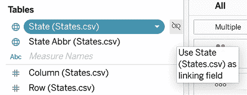

Figure 8.12: Linking dimensions

1.  将 `Column` 拖至 `Columns` 货架，将 `Row` 拖至 `Rows` 货架。

2.  从 `Superstore` 数据源中，将 `Category` 放置在 `Color` 货架上，将 `Sales` 放置在 `Angle` 货架上。

3.  在 `Marks` 卡中将 `State` 放置在 `Detail` 上。

4.  点击 `Size` 货架并根据需要调整大小。


# 瓦片网格地图增强

## 步骤 5：将饼图转换为环形图

此时，您应该能看到一个由饼图组成的美国粗略地图。接下来，我们将通过将饼图更改为环形图来进一步增强图形：

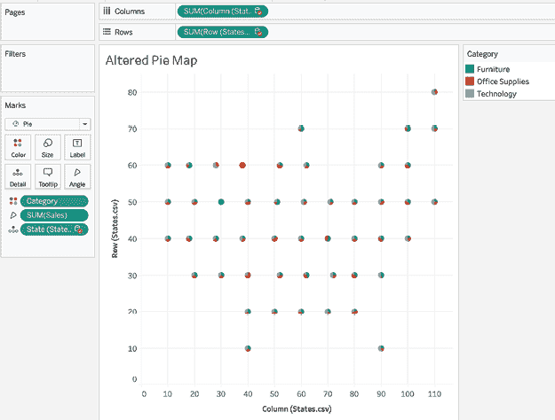

**图 8.13：地图**

### 环形图转换的子步骤

1.  返回 `States` 数据源，并将另一个 `Row` 实例放置在 `Rows` 货架上。
2.  在 `Marks` 卡中，选择 `Row (2)` 并将视图类型更改为 `Circle`。
3.  从 `Superstore` 数据集中，将 `Top Selling Category per State` 放置在 `Color` 货架上：

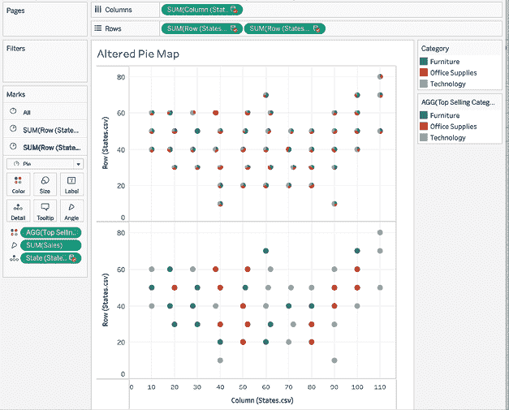

**图 8.14：地图 II**

### 设置销售额标签格式

1.  将 `Sales` 放置在 `Label` 货架上。右键单击您刚放置在 `Label` 货架上的 `Sales` 实例，然后选择 `Format`。在 `Format` 窗口中进行以下调整：

    1.  将 `Numbers` 格式设置为 `Currency (Custom)`，小数位数为 `0`，`Display Units` 设置为 `Thousands (K)`：

    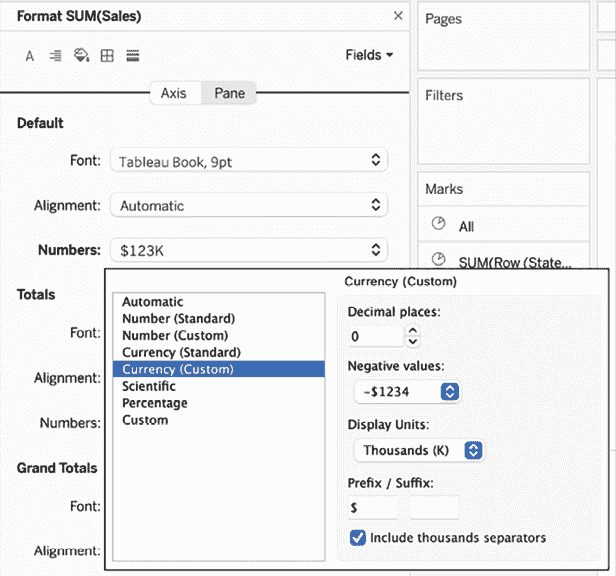

    **图 8.15：格式设置**

    2.  将 `Alignment` 设置为 `Middle Centre`，如下面的屏幕截图所示，以便数字居中显示在圆圈上方：

    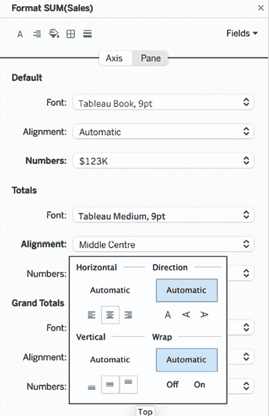

    **图 8.16：对齐方式**

    3.  在 `Rows` 货架上，右键单击第二个 `Row` 实例，然后选择 `Dual Axis`。
    4.  右键单击 `Row` 轴的一个实例，然后选择 `Synchronize Axis`。
    5.  在 `Marks` 卡中的 `Row (2)` 实例内，确保 `Size` 超过 `Marks` 卡中 `Row` 实例的 `Size`，以将饼图显示为外环。
    6.  在 `Marks` 卡的 `Row (2)` 和 `Row` 实例中，单击 `Color` 货架并选择 `Edit Colors`。根据需要调整颜色设置，以便覆盖圆圈（环形图的孔）的颜色能够与底层颜色区分开来，同时仍能识别出哪个 `Category` 销售最好。我选择了以下设置：

    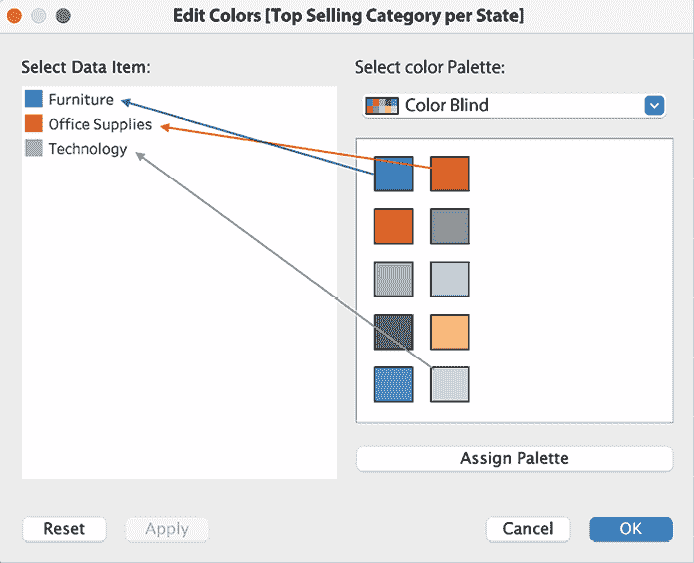

    **图 8.17：颜色选择**

    7.  此外，在 `Color` 货架中，将 `Border` 设置为所需的颜色。我使用了白色。我还将 `Label` 的颜色设置为白色。
    8.  右键单击每个轴并取消选择 `Show Header`。选择 `Format` | `Lines` 并将 `Grid Lines` 设置为 `None`。根据需要进行其他格式更改：

    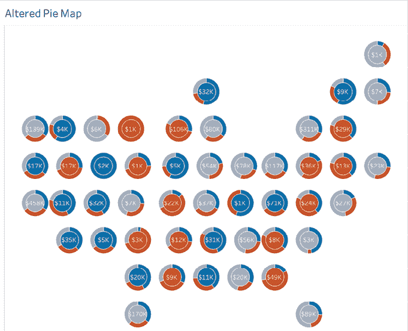

    **图 8.18：瓦片网格地图**

### 结果：瓦片网格地图

乍一看，该可视化可能看起来很奇特。它被称为**瓦片网格地图**，虽然它在数据可视化领域相对较新，但已开始在 NPR 等媒体机构中得到使用。在合适的场景下，瓦片网格地图具有优势。让我们考虑一下前面的练习给我们带来的几个优势。

首先，网格布局结合 `Log Sales` 计算字段，创建了一个一眼就能认出是美国的地图，同时确保各个饼图的大小从最大到最小仅适度变化。因此，每个饼图的每个切片都相当清晰可见；例如，哥伦比亚特区的销售额与加利福尼亚州的销售额一样容易看到。

其次，最终用户可以通过内圆（即环形图的孔）的颜色清楚地看到每个州的最畅销类别。这是通过 `LOD` 计算实现的。得益于 `LOD`，我们能够将最畅销类别与其他两个类别区分开来。由于所有三个类别都位于同一列中，因此需要使用 `LOD` 计算。有关 `LOD` 计算的更多详细信息，请参阅*第 7 章*、*练习详细级别计算*。结果是一个信息密集的可视化，它以实用、直观的方式使用了饼图。

本节演示了一些更具创意的方法，以从不同角度在同一可视化中展示数据。接下来，我们将继续讨论另一种高级可视化——帕累托图。

# 帕累托图

## 历史背景

19 世纪末，一位名为 Vilfredo Pareto 的意大利经济学家观察到意大利 80% 的土地归 20% 的人所有。当他环顾四周时，他在许多意想不到的地方都观察到了这一数学现象。例如，他注意到他花园里 80% 的豌豆是由 20% 的豌豆荚产生的。因此，80/20 法则已进入大众的日常用语。您可以利用这一原则，通过强调最关键的元素或焦点来创建清晰的视觉层次。您也可以将其用作优先级排序工具——您最重要的 20% 任务、数据集和数据质量问题是什么？先处理那些。通过优先排序，您可以集中精力并确保有效沟通。但所有这些都需要另一整本书来阐述。让我们先专注于如何在 Tableau 中将 80/20 现象可视化。在以下练习中，我们将讨论如何构建基本的帕累托图，然后如何扩展该图表以使其更加有用。

## 使用帕累托图

当然，并非每个数据集都遵循 80/20 法则。因此，以下练习考虑的是社区银行的贷款数据，其中 80% 的贷款余额并非由银行 20% 的客户持有。尽管如此，帕累托图仍然是一个非常有用的分析工具。

采取以下步骤：

1.  在与本章关联的工作簿中，导航到名为 `Pareto - Basic` 的工作表，并选择 `Bank data source`。
2.  在 `Data` 窗格中，将 `Account #` 更改为 `Dimension`。将 `Account #` 放置在 `Columns` 货架上，将 `Current Loan Balance` 放置在 `Rows` 货架上。
3.  单击 `Fit` 下拉菜单并选择 `Entire View`。
4.  右键单击 `Account #` 药丸，然后选择 `Sort`。将 `Sort By` 设置为 `Field`，`Sort Order` 设置为 `Descending`，`Field Name` 设置为 `Current Loan Balance`，`Aggregation` 设置为 `Sum`：

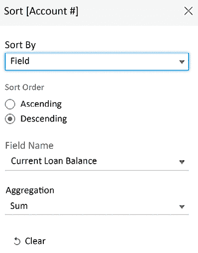

**图 8.19：排序**

5.  右键单击位于 `Rows` 货架上的 `SUM(Current Loan Balance) Δ`，然后选择 `Add Table Calculation`。选择如下面屏幕截图所示的设置：

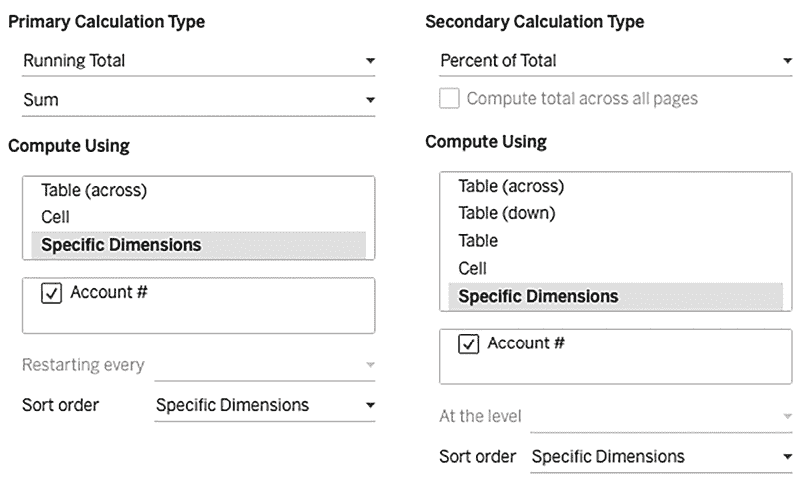

**图 8.20：表计算 I**

6.  将一个 `Account #` 实例拖动到 `Detail` 货架上。
7.  单击 `Color` 货架并将 `Border` 设置为 `None`。
8.  右键单击位于 `Columns` 货架上的 `Account #` 实例，然后选择 `Measure` | `Count (Distinct)`。请注意，此时显示一条垂直线：

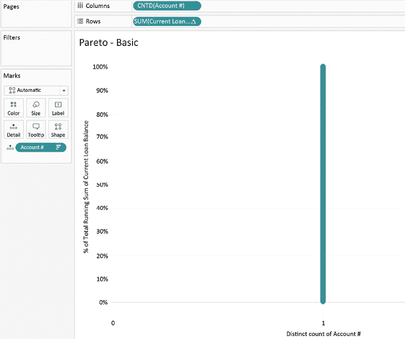

**图 8.21：显示单条垂直线的帕累托图**

9.  再次右键单击位于 `Columns` 货架上的 `CNTD(Account #)` 实例，然后选择 `Add Table Calculation`。配置设置如下面屏幕截图所示：

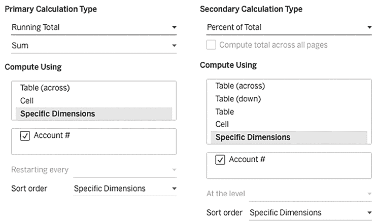

**图 8.22：表计算 II**

10. 单击屏幕左上角的 `Analytics` 选项卡，并执行以下两个步骤：

    1.  将 `Constant Line` 拖动到 `Table` | `SUM(Current Loan Balance) Δ`
    2.  在生成的对话框中，选择 `Constant` 并将 `Value` 设置为 `0.8`，如下面的屏幕截图所示：

    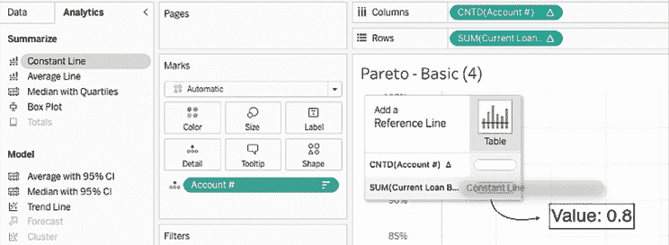

    **图 8.23：常量线**

11. 重复上一步，但有以下不同：

    1.  将 `Constant Line` 拖动到 `Table` | `CNTD(Account #)`
    2.  在生成的对话框中，选择 `Constant` 并将 `Value` 设置为 `0.2`

12. 将 `Current Loan Balance` 拖动到 `Rows` 货架上。将其放置在当前位于 `Rows` 货架上的 `SUM(Current Loan Balance) Δ` 的右侧。请注意，由于单笔贷款的余额远大于其他贷款，轴受到了影响：

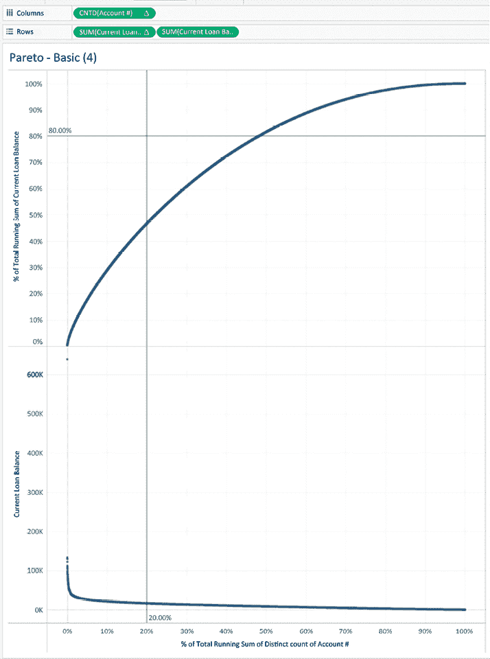

**图 8.24：基本帕累托图**

13. 右键单击 `Current Loan Balance` 轴，然后选择 `Edit Axis`。在生成的对话框中，将 `Scale` 设置为 `Logarithmic` 并关闭窗口。这解决了单笔大额贷款影响轴从而遮挡其他贷款视图的问题。


## 帕累托图表——超越基础

在上一个练习中，我们需要仔细查看，以确定多少比例的账户占多少比例的贷款。以下步骤将展示如何创建一个参数，帮助我们找到交点：

1. 复制上一个练习中的工作表，并将副本命名为**Pareto - Improved**。
2. 通过选择并将两条参考线拖出工作表来删除它们。
3. 将 `SUM(Current Loan Balance) Δ`（表计算）从 `Rows`（行）架拖到 `Data`（数据）窗格。出现提示时，将该字段命名为 `Running % of Balance`。
4. 使用以下设置创建并显示一个参数。该参数将允许我们设置 0 到 100% 之间的任意值，并且我们将能够在帕累托可视化中以颜色查看该区域：

   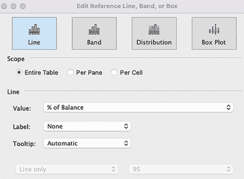

   图 8.27：编辑参数

5. 右键单击新创建的参数，然后选择 `Show Parameter`。
6. 创建以下计算字段：

   **`Running % of Loans`**
   ```
   RUNNING_SUM(COUNTD([Account #]) / TOTAL(COUNTD([Account #])))
   ```

   **`Pareto Split`**
   ```
   IF [Running % of Balance] < [% of Balance] THEN "Makes up X% of Balance" ELSE "Makes up rest of Balance" END
   ```

   **`Pareto Split (label)`**
   ```
   IF LOOKUP([Pareto Split], -1) != LOOKUP([Pareto Split], 0) THEN MID(STR([Running % of Loans] * 100), 1, 5) + "% of loans make up " + MID(STR([% of Balance] * 100), 1, 5) + "% of balance" END
   ```

7. 对帕累托图表上所选区域着色的配置需要一些额外的关注；因此，我们创建了三个计算。借助这些计算，我们可以更改可视化部分的颜色，并添加一些解释性文本以及标签。
8. 选择 `Marks`（标记）卡的 `All`（全部）部分。
9. 将 `Pareto Split`（帕累托分割）拖到 `Detail`（详细信息）架。单击 `Marks`（标记）卡上 `Pareto Split`（帕累托分割）药丸左侧的下拉菜单，然后选择 `Color`（颜色）：

   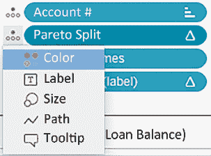

   图 8.28：帕累托分割至颜色

10. 选择 `Marks`（标记）卡的 `Running % of Balance Δ`（余额运行百分比 Δ）部分。将标记类型设置为 `Line`（线）。
11. 将 `Pareto Split (label)`（帕累托分割（标签））拖到 `Label`（标签）架。请注意，预期的标签未显示：

    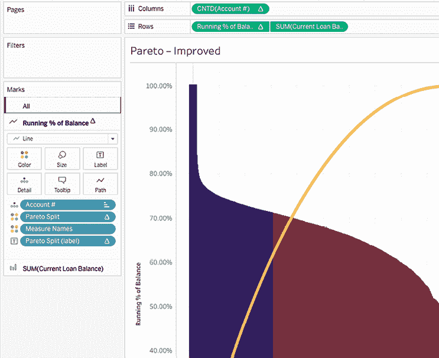

    图 8.29：无标签的帕累托图表

12. 为了解决此问题，首先单击 `Label`（标签）架，然后选择 `Allow labels to overlap other marks`（允许标签与其他标记重叠）。
13. 然后，右键单击 `Marks`（标记）卡上的 `Pareto Split (label)`（帕累托分割（标签）），然后选择 `Compute Using | Account #`（按...计算 | 账户 #）。现在您将看到标签：

    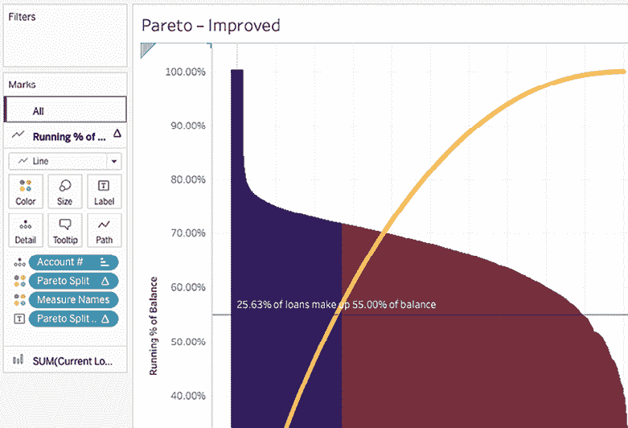

    图 8.30：带标签的帕累托图表

14. 单击屏幕左上角的 `Analytics`（分析）选项卡，然后执行以下两个步骤：
    1. 将 `Reference Line`（参考线）拖到 `Table | Δ Running % of Balance`（表 | Δ 余额运行百分比）：

       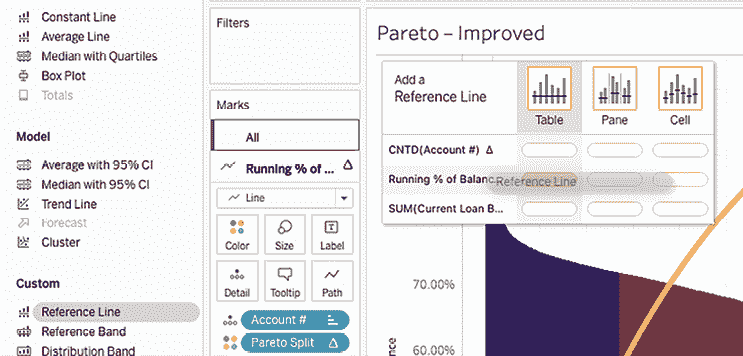

       图 8.31：参考线

    2. 在生成的对话框中，从 `Value`（值）下拉菜单中选择 `% of Balance`（余额百分比），并将 `Label`（标签）设置为 `None`（无）：

       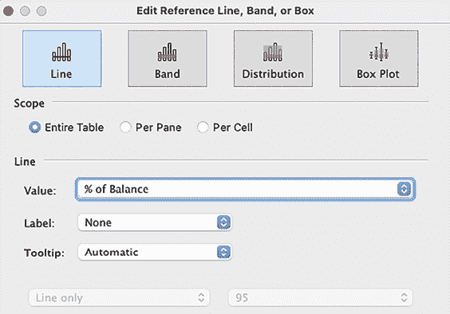

       图 8.32：参考线 II

    3. 根据需要更改颜色、工具提示和格式：

       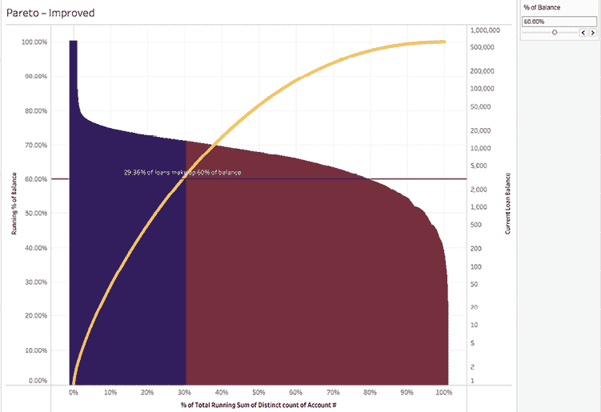

       图 8.33：改进的帕累托

正如您在屏幕截图中所见，最终用户现在有一个单一的参数滑块（位于右上角），用于移动图表上的水平参考线。当最终用户移动参考线时，文本会更新以显示贷款和余额百分比。当最终用户调整参数以垂直传达所考虑贷款的百分比时，颜色也会更新。我们通过创建计算字段 `Pareto Split` 和 `Pareto Split (Label)` 实现了这一点，这些字段结合参数对视图中的数据执行计算。

下一节将讨论一个非常强大但仍很少使用的功能，它将把您的仪表板提升到一个新的水平！想象一下 Tableau 中的街景房屋，当您悬停在每栋房屋上时，您将能够看到租金/购买价格、大小，以及可能的其他特征。您无法想象如何在 Tableau 中实现这一点？好吧，继续阅读！在下一节中，我们将讨论地图、图像，甚至像国际象棋和飞镖这样的游戏的各种示例。

# 自定义背景图像

Tableau 中的自定义背景图像开启了无限潜能。想象一下可视化任何空间的能力。可能性涵盖体育、医疗保健、工程、建筑、室内设计等更多领域。尽管潜力巨大，但在我看来，Tableau 中的背景图像仍未被充分利用。为什么？部分原因是生成可用于背景图像的数据集存在困难。

正如之前讨论的平铺网格地图一样，背景图像需要网格布局来定位 *x* 和 *y* 坐标。在下一节中，我们将介绍如何使用 Tableau 创建一个可以叠加在图像上的网格，以即时识别与 *x* 和 *y* 坐标关联的位置，并相对快速地生成可供 Tableau 访问以进行可视化的数据集。

## 创建自定义多边形

Tableau 原生提供多边形的地理区域包括国家、州/省、县和邮政编码。这意味着，例如，可以轻松创建世界各国的填充地图。只需复制一个国家列表并将其粘贴到 Tableau 中。接下来，将 Tableau 中的视图类型设置为 `Filled Map`（填充地图），并将国家列表放在 `Detail`（详细信息）架上。Tableau 将自动为这些国家中的每一个绘制多边形。


此外，可能会出现特殊的制图需求，要求为地图上通常不包含的区域绘制多边形。例如，组织可能会定义不遵循常规地图边界的销售区域。最后，可能会出现自定义图像的制图需求。Tableau 制作者可以将篮球场或足球场的图像导入 Tableau，并绘制多边形来表示比赛区域的特定部分。要为这些示例中的每一个创建填充地图（Tableau 本身不提供多边形），必须创建自定义多边形。

### 在零岛周围绘制正方形

在本节中，我们将从基础开始，在传说中的零岛周围绘制一个简单的正方形，零岛位于本初子午线和赤道的交汇处。

我们将进阶到一个更稳健的示例，该示例要求为德克萨斯州的每个城市绘制多边形。Tableau 中有一个选项，允许制作者对未知位置 `Show Data at Default Position`（在默认位置显示数据）。选择此选项将导致 Tableau 将所有未知位置的纬度和经度坐标设置为 0（零），从而在世界地图上非洲西海岸外 1,600 公里处创建一个标记。Tableau 开发者亲切地称该区域为零岛。

零岛甚至有自己的 YouTube 视频：[`youtu.be/bjvIpI-1w84`](https://youtu.be/bjvIpI-1w84)。

在此练习中，我们将在零岛周围绘制一个正方形：

1. 在 Excel 中重新创建以下数据集：

| | **A** | **B** | **C** |
|---|---|---|---|
| **1** | **点** | **纬度** | **经度** |
| **2** | 0 | -1 | -1 |
| **3** | 1 | -1 | 1 |
| **4** | 2 | 1 | 1 |
| **5** | 3 | 1 | -1 |
| **6** | 4 | -1 | -1 |

2. 将数据集复制并粘贴到 Tableau 中。这样做会出现一个名为 `Clipboard_...` 的新数据源：

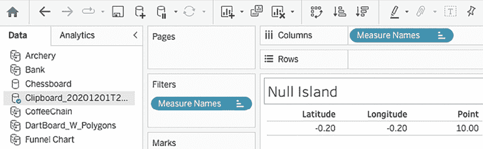

图 8.34：零岛坐标

3. 从工作表中移除所有字段。

4. 将 `Point` 转换为维度。这可以通过右键单击 `Point` 并选择 `Convert to Dimension`（转换为维度），或将其拖动到 `Data`（数据）窗格的维度区域来完成。

5. 双击 `Latitude` 和 `Longitude`。顺序无关紧要；Tableau 会自动将 `Longitude` 放在 `Columns`（列）货架上，将 `Latitude` 放在 `Rows`（行）货架上。

6. 选择 `Map`（地图）| `Background Maps`（背景地图）| `Streets`（街道）。您可能需要稍微缩小一点才能看到陆地边界：

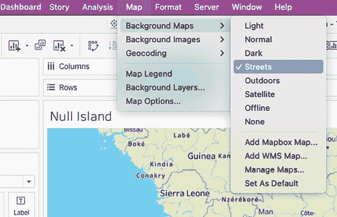

图 8.35：定位零岛

7. 将视图类型更改为 `Line`（线），并将 `Point` 拖放到 `Path`（路径）货架上。您应该会看到以下结果：

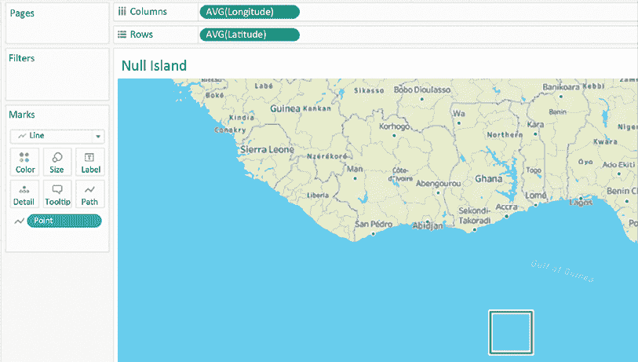

图 8.36：定位零岛 II

8. 返回 Excel 文件，交换包含点 1 和点 2 数据的行，并再次将数据复制到 Tableau 中。

9. 按照 `Steps 2–7`（步骤 2-7）操作并观察生成的图像：

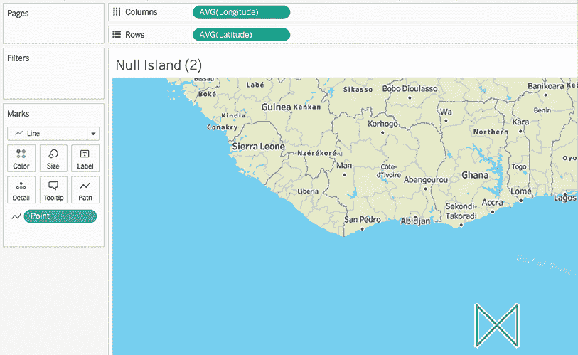

图 8.37：错误勾勒零岛

这个有趣但不正确的图像是由于点顺序不正确而产生的。根据经验法则，在确定点顺序时，选择一个如果您亲自绘制多边形时合理的顺序。如果您无法使用给定的点顺序在纸上绘制所需的多边形，Tableau 也无法做到。

您可能会发现，在 Tableau 中完成此练习相对容易。挑战在于获取正确的数据，特别是多边形点。一个用于生成多边形数据的有用（且免费）工具可以在 [`powertoolsfortableau.com/tools/drawing-tool`](http://powertoolsfortableau.com/tools/drawing-tool) 找到。这是 InterWorks 创建的众多工具之一，有助于解决常见的 Tableau 挑战。

接下来，我们将使用它来显示我们图书馆中哪些书可用，哪些不可用。

### 使用多边形创建交互式书架

我自己不太擅长绘画，但我一直喜欢在 Tableau Public 上看到的那些花哨的多边形背景，它们形状各异，并且能够让 Tableau 与它们交互、根据度量为它们着色，或将操作链接到特定区域。例如，您知道大陆可以重塑为鸡的形状吗？Niccolo Cirone 利用多边形制作了一个 Tableau 仪表板：[`www.theinformationlab.co.uk/2016/06/01/polygons-people-polygon-ize-image-tableau/`](https://www.theinformationlab.co.uk/2016/06/01/polygons-people-polygon-ize-image-tableau/)。

您也想构建花哨的仪表板，但绘画技巧平平，就像我一样？别担心！本节将为您提供工具，无论如何都能实现它。InterWorks 开发了一个类似于数字填色游戏的工具——这是一个无需自己过多绘制即可构建多边形的完美应用程序。您可以在这里找到它：[`cbistudio.interworks.com`](https://cbistudio.interworks.com)。您只需找到一张图片，将其上传到工具中，然后开始沿着线条绘制。

对于此练习，我在互联网上搜索了一张书架的图片。您可以做同样的事情，为该练习找一张图片，或下载我使用的图片，可在此处下载：[`github.com/PacktPublishing/Mastering-Tableau-2023-Fourth-Edition/Chapter08/bookshelf.png`](https://github.com/PacktPublishing/Mastering-Tableau-2023-Fourth-Edition/Chapter08/bookshelf.png)：

1. 打开来自 InterWorks 的免费绘图工具并选择 `Images`（图像）选项：


图 8.38：CBI Studio

2. 上传您的图片，并在 `I’M CREATING`（我正在创建）部分选择 `Polygon`（多边形）。

3. 现在从一本书的边缘开始点击。将出现一个橙点。现在转到同一本书的下一个边缘并再次点击。将沿着书的该边缘绘制一条线，坐标会自动出现在右侧的列表中：

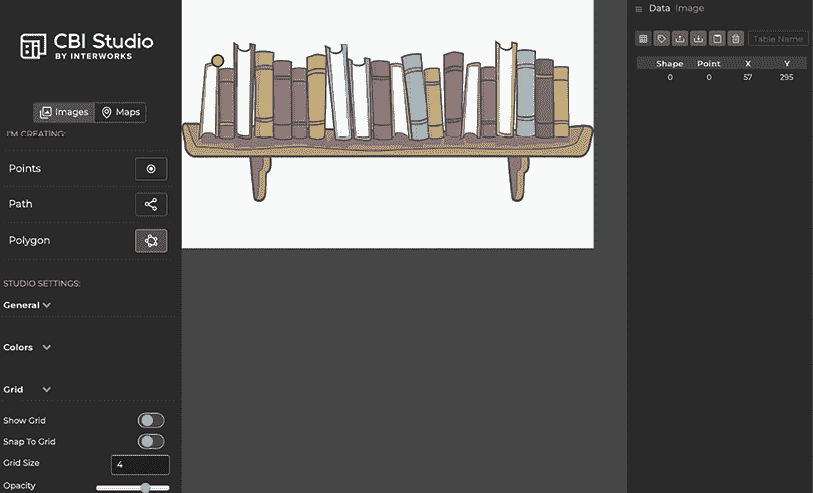

图 8.39：绘图工具

4. 一本书的最后一个点应该位于第一个点（比其余点大）的上方。再次点击第一个点将完成第一个多边形，这由绿色指示：

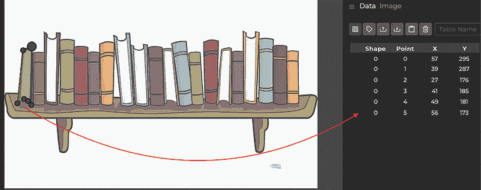

图 8.40：完成多边形

5. 您在其他地方设置的下一个点将获得不同的形状 ID，因此，稍后 Tableau 可以将其区分为不同的形状。请记住，沿着书的外部移动并避免交叉线条。

6. 当您完成书籍轮廓绘制后，以 `.csv` 格式下载数据并保存文件，以便在 Tableau 中用作数据源。我就是这样做的，此外，我还添加了 `Name` 和 `Available` 列。您还可以看到唯一的形状 ID、点 ID（您在屏幕上点击的顺序），以及 `x` 和 `y` 作为图像内位置的表示：

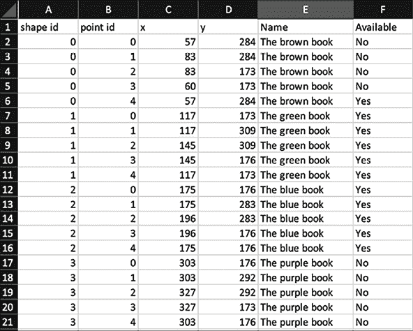

图 8.41：Excel

7. 接下来，在 Tableau 中加载数据，将 `X` 放在 `Columns`（列）上，将 `Y` 放在 `Rows`（行）上。您能认出书架了吗？我在这个练习中只用了四本书；因此，并非全部显示：

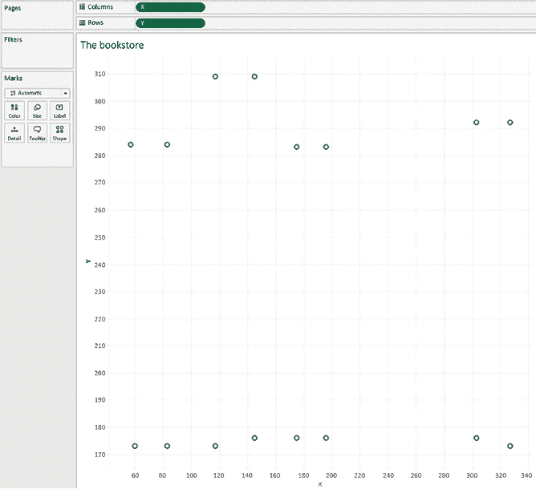

图 8.42：书店

8. 在将图像添加到 Tableau 之前，我们需要 Tableau 设置所需的最外层点的坐标。只需返回绘图工具并测量边缘。记下四个边缘的 `X` 和 `Y` 坐标。它们可能不是精确的角落，但下面的值大致可转换为高度 = `400` 和宽度 = `648`：

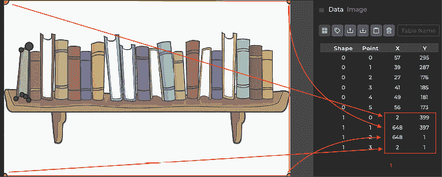

图 8.43：绘图工具

9. 回到 Tableau，点击 `Map`（地图）| `Background Image`（背景图像）并选择 `The bookstore….`。在随后的弹出窗口中，定义名称并上传您在绘图工具中使用的图像。还要填写 `X` 和 `Y` 字段的坐标以表示图像的边缘：

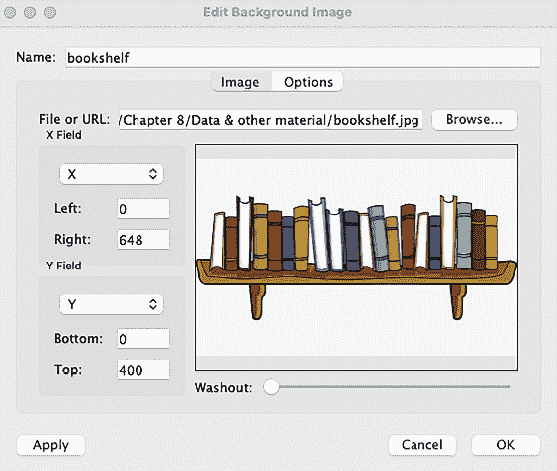

图 8.44：编辑背景图像

10. 点击 `Options`（选项）并选择 `Always Show Entire Image`（始终显示整个图像）。然后关闭此窗口。


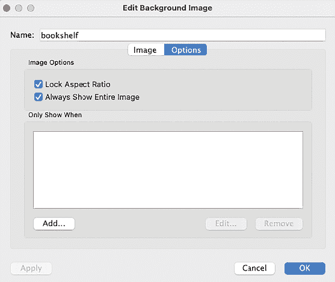

图 8.45：编辑背景图片选项

1. 现在您的图片应该出现在工作表上，周围有匹配的点围绕着书籍：


图 8.46：带有点的书架

1. 要创建环绕线而不是点，请将标记类型更改为 `Line`，并将 `Shape Id` 放在 `Detail` 上，将 `Point Id` 放在 `Path` 上：


图 8.47：带有线的书架

1. 要创建多边形，请将标记类型更改为 `Polygon`，并将 `Color` 货架中的 `Opacity` 设置为 `0%`。

2. 此外，您可以在将这两个字段都放在 `Detail` 货架上后，添加包含书名和可用性的工具提示：

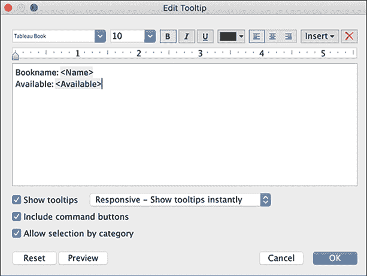

图 8.48：编辑工具提示

1. 如果您将鼠标悬停在书籍上，可以看到名称以及可用性：


图 8.49：使用工具提示

多边形最好的地方在于它们能填充整个区域。在本例中，无论您将鼠标悬停在何处或点击何处，书脊的完整背面都会被覆盖，因为我们绘制的是一个区域，而不是一个点或某种默认形状。这带来了无限的选择；想象一个大型图书馆，其中每本书都是一个多边形，您可以将实时数据连接到多边形数据集，以获取任何书籍的最新可用性。除了书籍，您可以绘制任何东西。我在 Tableau 中见过最多的是平面图、超市货架、办公室布局、分成多部分的形状……多边形确实能让您在可视化方面发挥创意。

如果您手头没有图片，但想为仪表板绘制一些非常特定的内容，可以使用付费或免费软件，如 Adobe Illustrator Draw、Sketch、Sketsa SVG Editor、Boxy SVG、Gravit Designer、Vecteezy Editor、Vectr、Method Draw、Inkpad、iDesign、Affinity Designer、macSVG、Chartist.js、Plain Pattern、Inkscape 等。

在继续之前，让我们将仪表板更进一步：

1. 右键单击 `Name` | `Aliases…`

2. 如图所示更改书籍，然后单击 `OK`：

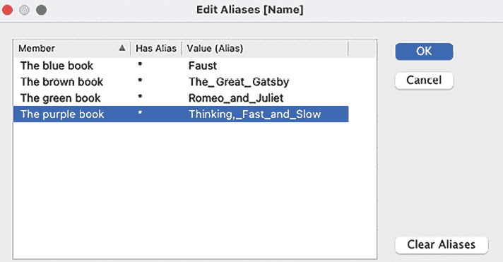

图 8.50：选择另一本书

1. 移除 `The Bookstore` 工作表的 `X` 和 `Y` 轴。

2. 打开一个仪表板选项卡并将其命名为 `The Bookstore`：

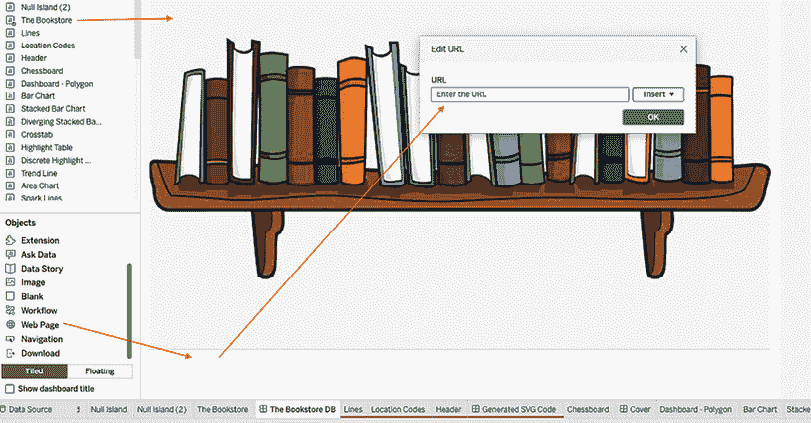

图 8.51：URL

1. 将 `The Bookstore` 工作表拖到仪表板的上半部分，将 `Web Page` 对象拖到下半部分。在 URL 弹出窗口中输入：[`en.wikipedia.org/wiki/`](https://en.wikipedia.org/wiki/)。

2. 选择 `Web Page Object` 并单击箭头；选择 `Add URL Action…`

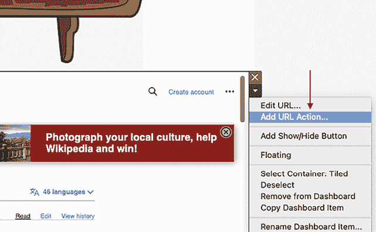

图 8.52：添加 URL 操作…

1. 在 `Actions` 窗口中，通过从箭头下拉菜单中选择此字段，将 `Name` 添加到 URL：

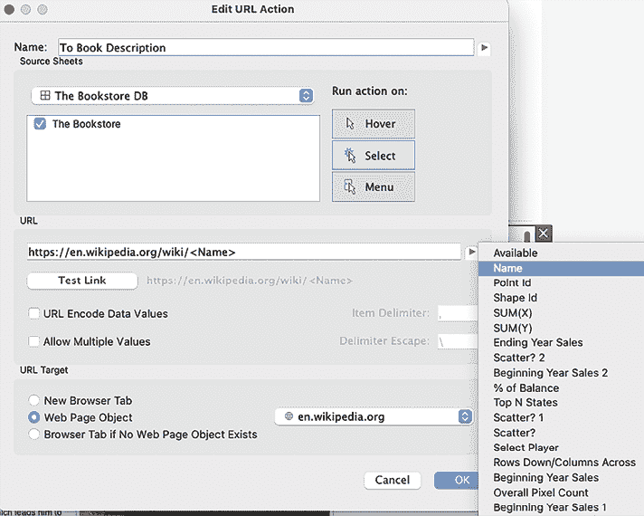

图 8.53：描述筛选器

1. 单击 `OK` 并选择不同的书籍，查看仪表板中 Wikipedia 条目的变化：

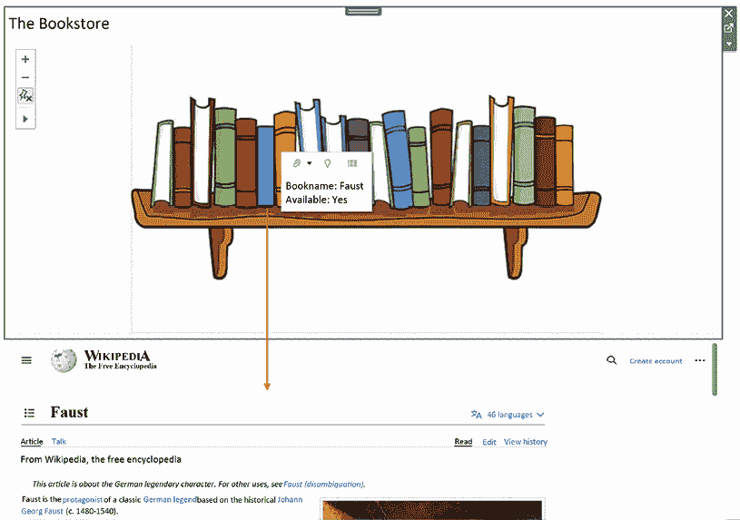

图 8.54：Wikipedia

我相信您现在已经有很多关于如何使用多边形的想法了。也许您想分析一盘国际象棋？我们接下来就来做！

## 在 Tableau 中分析一盘国际象棋

在本练习中，我们将使用 Inkscape。但我们不是在某个工具中绘制图形、将其转换为多边形，然后加载到 Tableau 中，而是在 Tableau 中创建 SVG 文件的代码，在 Inkscape 中加载它以查看是否有效，然后将其转换为多边形，并将带有 `x` 和 `y` 坐标的转换版本重新加载到 Tableau 中以分析一盘国际象棋。通过自己创建 SVG 文件，您将能够识别 Tableau 需要哪些 `X` 和 `Y` 坐标，因此您将始终能够转换 SVG。

### 在 Tableau 中创建 SVG 文件

在本节中，我们将使用 Tableau 生成构建 SVG 文件所需的 XML，该文件可以用矢量图形工具 Inkscape 打开，Inkscape 是开源的，因此可免费使用。访问 [inkscape.org](http://inkscape.org) 下载最新版本。我们还需要 `Chessboard.png` 图片，可在 Packt GitHub 页面获取：[`github.com/PacktPublishing/Mastering-Tableau-2023-Fourth-Edition/Chapter08/Chessboard.png`](https://github.com/PacktPublishing/Mastering-Tableau-2023-Fourth-Edition/Chapter08/Chessboard.png)。请也下载该图片。

通常，多边形在非线性绘图中使用时能展现出更强的威力。然而，在这种情况下，我们的棋盘是一个很好的例子，因为我们将自己创建 Tableau 使用的位置——创建正方形比创建更复杂的形状更容易，因为我们可以使用增量。请注意，以下示例使用的是 10 行 10 列的网格，这当然会生成一个包含 100 个单元格的网格。这在 Inkscape 中运行良好。但是，如果需要大量单元格，可能需要 Adobe Illustrator 等专业图形工具。

### 创建网格

以下练习有多重目的。第一个目的是演示如何使用 Tableau 创建网格。本章提供了另一个使用数据搭建的机会，这在*第 4 章* *了解联接、混合和数据结构*中已讨论过。不同之处在于，那一章使用日期进行搭建，而下一节使用存储桶。此外，本练习需要许多表计算，这将有助于巩固*第 5 章* *表计算简介*中学到的知识。最后，本练习利用了数据密化，这在*第 6 章* *利用 OData、数据密化、大数据、Google BigQuery*中已讨论过。

要开始，请执行以下步骤：

1. 打开一个新的 Tableau 工作簿，并将第一个工作表命名为 `Header`。

2. 使用 Excel 或文本编辑器创建 `Records` 数据集。下面的两行表格代表了 `Records` 数据集的全部内容：

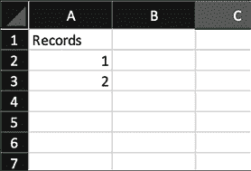

图 8.55：Excel

1. 将 Tableau 连接到 `Records` 数据集：

    * 为方便起见，请考虑使用 `Ctrl` + `C` 复制数据集，并使用 `Ctrl` + `V` 直接粘贴到 Tableau 中。

    * Tableau 可能会将 `Records` 视为度量。将 `Records` 拖到 `Data` 窗格的 `Dimensions` 部分。

2. 创建两个参数。将一个命名为 `Overall Pixel Count`，另一个命名为 `Rows Down/Columns Across`。两者的设置如下：

    * 数据类型：`Integer`

    * 允许的值：`All`

3. 显示这两个参数。将 `Rows Down/Columns Across` 设置为 `10`，将 `Overall Pixel Count` 设置为 `1,000`：

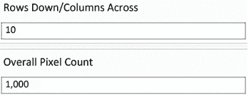

图 8.56：显示参数

1. 创建一个名为 `Concatenate Header` 的计算字段，代码如下：

```
'<?xml version="1.0" encoding="utf-8"?><svg version="1.1" id="Squares"
xmlns="http://www.w3.org/2000/svg"
xmlns:xlink="http://www.w3.org/1999/xlink" x="0px" y="0px" viewBox="0 0 ' +
STR( [Overall Pixel Count] ) + " " + STR([Overall Pixel Count])+ '"
style="enable-background:new 0 0 '+ STR([Overall Pixel Count]) + ' ' +
STR([Overall Pixel Count]) + ';" xml:space="preserve">
<style type="text/css"> .st0{fill:none;stroke:#000000;stroke-miterlimit:10;}
</style>'
```

请注意，在 `Calculated Field` 对话框中输入换行符可能会导致难以从 Tableau 中提取结果。换句话说，请删除所有换行符。

1. 现在我们已经创建了一个框架或模板，它将帮助我们创建多个位置，以便在 Tableau 中绘制网格。

2. 将新创建的计算字段放在 `Text` 货架上。

3. 在工具栏中，选择适应 `Entire View` 以查看结果；您可以看到参数填充了来自 `Concatenate Header` 的 `STR([Overall Pixel Count])`：


图 8.57：Concatenate Header

1. 创建一个名为 `Location Codes` 的新工作表。

2. 创建以下计算字段：


# 计算字段定义

| **名称** | **代码** |
| --- | --- |
| `Rows Down/Columns Across` | ```
[Parameters].[Rows Down/Columns Across]
``` |
| `Which Column?` | ```
LAST()+1
``` |
| `Which Row?` | ```
INDEX()
``` |
| `Grid Size` | ```
[Overall Pixel Count]/LOOKUP([Which Column?],FIRST())
``` |
| `X` | ```
[Overall Pixel Count] - ([Grid Size] * ([Which Row?]))
``` |
| `Y` | ```
[Overall Pixel Count] - ([Grid Size] * ([Which Column?]-1))
``` |
| `Count` | ```
If [Records] = 1 THEN 1 ELSE [Rows Down/Columns Across] END
``` |
| `Decicount` | ```
If [Records] = 1 THEN 1 ELSE [Rows Down/Columns Across] END
``` |
| `Location Codes` | ```
Index()
``` |
| `Concatenate Locations` | ```
'<text transform="matrix(1 0 0 1 ' + STR([X]) + " " + STR([Y]) + ')">' + STR( [Location Codes] ) + '</text>'
``` |

## 步骤说明

1. 创建的计算字段将在后续步骤中用于创建值表，类似于我们在绘图工具中生成的值表。只是现在我们将自己完成，并使用 SVG 代码代替经度和纬度值。

2. 右键单击 `Count` 并选择 `Create` | `Bins`。在生成的对话框中，将 `Size of bins` 设置为 `1`：

   

   **图 8.58：Count 箱**

3. 右键单击 `Decicount` 并选择 `Create` | `Bins`。在生成的对话框中，将 `Size of bins` 设置为 `1`：

   

   **图 8.59：Count 箱 II**

4. 将 `Count (bin)`、`Decicount (bin)`、`Location Codes`、`X` 和 `Y` 放置在 `Rows` 托盘上。请务必按列出的顺序放置这些字段。

5. 如果字段为绿色（表示连续），请右键单击 `Rows` 托盘上的每个字段并将其设置为 `Discrete`。然后：

   * 右键单击 `Count (bin)` 和 `Decicount (bin)`，确保选中 `Show Missing Values`
   * 右键单击 `Location Codes` 并选择 `Compute Using` | `Table (Down)`
   * 将 `X` 的 `Compute Using` 值设置为 `Count (bin)`
   * 将 `Y` 的 `Compute Using` 值设置为 `Decicount (bin)`

   

   **图 8.60：Location Codes 工作表**

6. 将 `Concatenate Locations` 放置在 `Text` 托盘上。

7. 右键单击刚放置在 `Text` 托盘上的 `Concatenate Locations` 实例，选择 `Edit Table Calculations`。

8. 在生成的对话框顶部，注意 `Nested Calculations` 下有四个选项：`Grid Size`、`Which Column?`、`Which Row?` 和 `Location Codes`。按如下方式设置每个选项的 `Compute Using` 定义：

   * **Nested Calculations**: `Grid Size` > **Compute Using**: `Table (down)`
   * **Nested Calculations**: `Which Column?` > **Compute Using: Specific Dimensions**: `Decicount (bin)` > **将此维度移至顶部**
   * **Nested Calculations**: `Which Row?` > **Compute Using: Specific Dimensions**: `Count (bin)` > **将此维度移至顶部**
   * **Nested Calculations**: `Location Codes` > **Compute Using**: `Table (down)`

9. 在工具栏中选择 `Fit Width` 查看结果；您已经可以看到创建了多行。这些行稍后将用于绘制网格：

   

   **图 8.61：Fit Width**

## 创建 Lines 工作表

1. 现在，创建一个名为 **Lines** 的新工作表。

2. 创建以下计算字段：

| **名称** | **Compute Using 设置** |
| --- | --- |
| `H Then V` | ```
Index()
``` |
| `HLine` | ```
Last()
``` |
| `VLine` | ```
Index()-1
``` |
| `X1` | ```
IF [H Then V] = 1 THEN 0 ELSE
[Overall Pixel Count] - ([Grid Size] * ([VLine])) END
``` |
| `Y1` | ```
IF [H Then V] = 2 THEN 0 ELSE
[Overall Pixel Count] - ([Grid Size] * ([VLine])) END
``` |
| `X2` | ```
IF [H Then V] = 1 THEN [Overall Pixel Count] ELSE [Overall Pixel Count] - ([Grid Size] * ([VLine])) END
``` |
| `Y2` | ```
IF [H Then V] = 2 THEN [Overall Pixel Count] ELSE [Overall Pixel Count] - ([Grid Size] * ([VLine])) END
``` |

3. 接下来，按以下顺序将以下字段放置在 `Rows` 托盘上：`Count (bin)`、`Decicount (bin)`、`H Then V`、`HLine`、`VLine`、`Grid Size`、`Which Column?`、`X1, Y1`、`X2` 和 `Y2`。注意每个字段都应转换为离散型。

4. 右键单击 `Count(bin)` 和 `Decicount(bin)`，将每个设置为 `Show Missing Values`。

5. 右键单击 `Rows` 托盘上的其余每个字段，选择 `Edit Table Calculations`。按下表所示设置每个字段的 `Compute Using` 定义：

| **名称** | **嵌套计算** | **Compute Using 设置** |
| --- | --- | --- |
| `H Then V` | `N/A` | ```
Count (bin)
``` |
| `HLine` | `N/A` | ```
Count (bin)
``` |
| `VLine` | `N/A` | ```
Decicount (bin)
``` |
| `Grid Size` | `Grid Size` | ```
Table (Down)
``` |
| `Grid Size` | `Which Column?` | ```
Decicount (bin)
``` |
| `X1, Y1, X2, Y2` | `H Then V` | ```
Count (bin)
``` |
| `X1, Y1, X2, Y2` | `Grid Size` | ```
Count (bin)
``` |
| `X1, Y1, X2, Y2` | `Which Column?` | ```
Count (bin)
``` |
| `X1, Y1, X2, Y2` | `VLine` | ```
Decicount (bin)
``` |

6. 注意某些字段包含嵌套表计算。在这种情况下，`Table Calculation` 对话框顶部将包含一个名为 `Nested Calculations` 的额外选项：

   

   **图 8.62：嵌套计算**

7. `X1`、`X2`、`Y1` 和 `Y2` 需要配置四个嵌套计算。首先打开 `X1` 表计算，然后从 `Nested Calculations` 下拉菜单中选择 `H Then V`，将 `Compute Using` 设置为 `Count (bin)`。然后在同一窗口中，从下拉菜单中选择 `Grid Size` 并输入相应的 `Compute Using` 设置。设置完所有四个下拉菜单后，继续配置 `X2`，执行相同操作。

8. 筛选 `H Then V` 以仅显示 `1` 和 `2`。

9. 创建一个名为 `Concatenate Lines` 的计算字段，代码如下：

   ```
   '<line class="st0" x1="' + STR([X1]) + '" y1="' + STR([Y1]) + '" x2="' + STR( [X2] ) + '" y2="' + STR([Y2]) + '"/>'
   ```

10. 此计算将通过包含 `X1`、`X2`、`Y1` 和 `Y2` 字段来创建一个新字符串。这样我们就可以将一行代码乘以任意数量的行，每行具有特定的 `X1`、`X2`、`Y1` 和 `Y2` 组合。

11. 将 `Concatenate Lines` 放置在 `Text` 托盘上。您的工作表应如下所示：

    

    **图 8.63：Concatenate Lines**

## 导出代码

从刚创建的三个工作表导出代码。

从三个工作表导出代码可能比较棘手，因为 Tableau 可能会尝试为字符串值输入额外的引号。我发现以下方法效果最好：

1. 在 `Count (bin)` 行中选择 `1`
2. 按 `Ctrl` + `A`（Mac 为 `Command` + `A`）选择工作表的所有内容
3. 将光标悬停在视图中的选定文本上，暂停直到出现工具提示命令按钮
4. 选择工具提示右侧的 `View Data` 图标
5. 在生成的 `View Data` 对话框中，选择 `Export All`
6. 使用与每个工作表相同的名称保存 CSV 文件；例如，从 `Header` 工作表导出的数据将命名为 `Header.csv`
7. 对剩余工作表 `Header` 和 `Location Codes` 重复上述步骤


## 创建 SVG 网格

1. 打开你最喜欢的文本编辑器的一个实例，并将其另存为 `Grid and LocationCodes.svg`。

2. 从之前导出并保存的 `Header.csv` 中复制数据，并将其粘贴到 `Grid and LocationCodes.svg` 中。请务必不要包含标题信息；仅包含 XML 代码。例如，在下一个截图中，不要复制第 **1** 行，只复制第 **2** 行：

   

   图 8.64：Excel

3. 使用 Excel，从 `Location.csv` 复制所需数据并将其粘贴到 `Grid and LocationCodes.svg` 中。所需数据仅包含标记为 `Concatenate Locations` 的列。不要包含其他列或标题。仅包含 XML 代码。例如，在以下截图中，我们只复制第 **F** 列：

   

   图 8.65：Excel II

4. 使用 Excel，从 `Lines.csv` 复制所需数据并将其粘贴到 `Grid and LocationCodes.svg` 中。同样，所需数据仅包含标记为 `Concatenate Lines` 的列。不要包含其他列或标题，只包含 XML 代码。

5. 最后，输入 `</svg>` 结束标签以完成 SVG 文件。完整代码已为您方便地添加在 **Generated SVG Code（生成的 SVG 代码）** 选项卡上：

   

   图 8.66：完整代码

6. 现在，在 Inkscape ([`inkscape.org/`](https://inkscape.org/)) 中打开 SVG 文件并观察网格：

   

   图 8.67：Inkscape II

如果由于某种原因您的代码未能创建网格，或者您想使用我创建的版本，您可以在以下 GitHub 页面找到该 SVG 文件以及所有其他数据集：[`github.com/PacktPublishing/Mastering-Tableau-2023-Fourth-Edition/blob/main/Chapter08/GridandLocationCodes.svg`](https://github.com/PacktPublishing/Mastering-Tableau-2023-Fourth-Edition/blob/main/Chapter08/GridandLocationCodes.svg)。

在下一个练习中，我们将介绍一个示例，说明如何在 Tableau 中将网格用于多边形数据源。

### 使用网格生成数据集

熟练的棋手大约在 40 步内完成一局棋。在国际象棋比赛中，通常会记录每局棋的数据，这为数据可视化提供了机会。在本练习中，我们将使用一局国际象棋的数据来可视化棋盘上每个格子被占据的频率：

1. 在与本章关联的工作簿中，导航至名为 `Chessboard` 的工作表。

2. 如果尚未下载，请从本书的 GitHub 存储库下载 `Chessboard.png` 图片。

3. 在 Inkscape 中打开上一个练习中创建的 SVG 文件。

   如果您未完成上一个练习，可以复制本章关联的解决方案工作簿中名为 **Generated SVG Code（生成的 SVG 代码）** 的仪表板上的 XML 代码。将该代码粘贴到文本编辑器中并以 SVG 扩展名保存，然后使用 Inkscape 打开该文件。

4. 在 **Inkscape** 中，按 `Ctrl` + `A`（Mac 为 `Command` + `A`）全选。使用 `Ctrl` + `G`（Mac 为 `Command` + `G`）对选择内容进行编组。

5. 从 **Inkscape** 菜单中，选择 `Layer（图层）` | `Layers and Objects（图层和对象）`。键盘快捷键为 `Shift` + `Ctrl` + `L`（Mac 为 `Shift` + `Command` + `L`）。

6. 在屏幕右侧显示的 **Layers（图层）** 面板中，按 **+** 图标创建一个图层。将该图层命名为 `Chessboard`。然后，创建另一个名为 `Grid` 的图层：

   

   图 8.68：图层

7. 单击视图中的任意线条或数字。在同一线条或数字上右键单击并选择 `Move to layer（移动到图层）`。选择 **Grid（网格）** 图层。

8. 选择 `File（文件）` | `Import（导入）` 并选择 `Chessboard.png` 图片。

   

   图 8.69：图片导入

9. 确保图片放置在 **Chessboard（棋盘）** 图层上，以免遮挡位置代码编号。定位棋盘图片，使位置代码 **81** 居中于棋盘左上角的方格上。由于棋盘仅由 64 个方格组成，它将不会涵盖网格提供的所有 100 个方格：

   

   图 8.70：棋盘

此时，您可以根据每个位置被占据的频率生成数据集。例如，您可能会注意到在一局棋中，位置 81 被占据了 40 步，这种情况下玩家可能根本没有移动过那个车。然而，在另一局棋中，该位置可能仅被占据 10 步，这或许表明玩家在游戏早期进行了易位。将棋局与方格文件分层的目的是确定棋盘上的哪个方格属于哪个字段。

### 可视化国际象棋对局

在本练习中，我们将查看从一局国际象棋生成的数据集，并发现在前几个练习工作基础上如何可视化结果。步骤如下：

1. 在与本章关联的工作簿中，导航至名为 `Chessboard` 的工作表并选择 `Chessboard` 数据源。

   为了执行下一步，您需要下载与本章关联的资源。为此，只需访问本书的 GitHub 存储库链接：[`github.com/PacktPublishing/Mastering-Tableau-2023-Fourth-Edition/tree/main/Chapter08`](https://github.com/PacktPublishing/Mastering-Tableau-2023-Fourth-Edition/tree/main/Chapter08)。

2. 右键单击 `Chessboard` 数据源并选择 `Edit Data Source（编辑数据源）` 以检查数据集。

3. 在询问 **Where is the data file?（数据文件在哪里？）** 的对话框中，导航至随本章资源提供的 `Chessboard.xlsx` 文件。

4. 名为 **Board Grid（棋盘网格）** 的表包含每个位置代码以及与每个位置代码关联的 **X** 和 **Y** 坐标。该数据集取自本章前面创建的 **Location Codes（位置代码）** 工作表。名为 **Squares Occupied（被占据的方格）** 的表包含字段 **Location Code（位置代码）** 和 **Moves Occupied（占据步数）**。**Board Grid** 和 **Squares Occupied** 通过 **Location Code** 使用左连接相连：

   

   图 8.71：连接

5. 在 `Chessboard` 工作表上，选择 `Map（地图）` | `Background Images（背景图片）` | `Chessboard`。

6. 在生成的对话框中，单击 **Add Image（添加图片）** 以添加背景图片。

7. 填写 **Edit Background Image（编辑背景图片）** 对话框，如图所示：

   

   图 8.72：棋盘背景图片

8. 将字段 **X**、**Y**（均作为 **Dimension（维度）**）和 **Location Code** 分别放置在 **Columns（列）**、**Rows（行）** 和 **Detail（详细信息）** 货架上，并将 **Moves Occupied** 字段放在 **Color（颜色）** 上，同时选择 **Marks（标记）** 类型为 **Density（密度）**：

   

   图 8.73：棋盘背景图片 II

9. 右键单击 **X** 和 **Y** 轴，将两者均设置为 **Fixed（固定）**，**Fixed start（固定起点）** 值为 **0**，**Fixed end（固定终点）** 值为 **875**。

10. 编辑 **Y** 轴并将其设置为 **Reversed（反转）**。不要反转 **X** 轴。

    执行此最后一步是因为数据已被构建为镜像大多数图形工具中默认的 **X** 和 **Y** 坐标设置。在这些工具中，左上角是 **X** 和 **Y** 均等于 **0** 的位置。

11. 根据需要调整 **Color（颜色）**、**Size（大小）**、**Shape（形状）** 等：

    

    图 8.74：棋盘

在截图中，圆圈越亮，表示该位置被占据一步的频率越高。圆圈越暗，表示被占据的频率越低。悬停在某个字段上时，占据量也会显示出来。

回顾一下，我们首先创建了一个 SVG 文件。我们通过根据 SVG 文件标准创建三种不同的代码类型 `Header（页眉）`、`Location Codes（位置代码）` 和 `Lines（线条）` 来实现。然后我们将这三段代码复制到文本编辑器程序中，并将它们另存为 SVG 文件。接着我们下载了 Inkscape 应用程序并打开 SVG 文件，以检查并查看我们工作的成果，一个 10x10 的方形网格。


我们在 Inkscape 中添加了一张棋盘图片并将两者对齐。现在我们可以看到哪个方格编号将与哪个棋盘字段关联。就像书架示例一样，有必要识别形状 ID，即棋盘字段 ID。基于棋盘字段 ID，我们能够生成第二个数据集，包含某字段被占据的移动次数。通过将 `Board Grid` 数据集与 `Occupied Moves` 数据集连接，我们得到了一个用例。我们在 Tableau 中添加了一张棋盘背景图片，并在其上绘制了方格，根据国际象棋游戏中这些字段被占据的移动次数对它们进行着色和调整大小。这些数字当然特定于每局游戏，但通过收集多局游戏的数据，我们能够直观地分析国际象棋策略，甚至可能判断谁是更强的玩家。如果你喜欢国际象棋，请随意尝试并比较每局游戏的不同可视化结果，或者看看你是否通常最终得到相同的模式，以及这对你的对手是否也成立。

说到游戏，在下一个练习中，我们将可视化一个飞镖靶。这个练习将比国际象棋练习短。请跟随步骤操作，了解更多关于多边形的知识。

## 在背景图片上创建多边形

在特定可视化点上使用形状对于之前的练习已经足够，但有时使用多边形来勾勒形状可能更有优势。在本节中，我们将在背景图片上使用多边形，与书籍示例不同，我们将填充区域，使得背景图片不再那么必要。

以下是所需步骤：

1. 在与本章关联的工作簿中，导航到名为 `Dashboard - Polygon` 的工作表，并选择 `Dartboard_W_Polygon` 数据源。

   如果你在完成上一个练习时尚未这样做，请下载 GitHub 上提供的图片。将内容解压到你选择的目录。

1. 选择 `Map` | `Background Images` | `Dartboard - Polygon`。在 `Background Images` 对话框中，选择 `Add Image`。按如下所示填写对话框：


图 8.75：飞镖靶背景图片

1. 创建一个具有以下配置的参数：


图 8.76：参数

1. 此参数将用于在玩家 1：`Matthew` 和玩家 2：`David` 之间切换，或显示两者的飞镖命中情况。

2. 通过在 `Data` 窗格底部右键单击上一步创建的参数并选择 `Show Parameter Control` 来显示该参数。

3. 创建一个名为 `Total Hits` 的计算字段，代码如下：

```
[David]+[Matthew]
```

4. 然后，创建一个名为 `Case` 的计算字段，代码如下：

```
CASE [Select Player]
WHEN 1 THEN SUM([Matthew])
WHEN 2 THEN SUM([David])
WHEN 3 THEN SUM([Total Hits])
END
```

5. 将 `Marks` 卡设置为 `Polygon`。

6. 检查 `Data` 窗格，确保 `Point` 和 `Shape` 都是维度（蓝色）。其他字段是度量：


图 8.77：维度和度量

1. 将字段 `X`、`Y`、`Point`、`Shape` 和 `Case` 放置在各自的货架上：


图 8.78：飞镖靶多边形

1. 右键单击每个轴，将 `Range` 设置为从 `0` 到 `650`。

2. 单击 `Color` 货架并选择 `Edit Colors`。按需调整颜色。一种可能性如下截图所示：


图 8.79：自定义发散

你的最终工作表应如下所示：


图 8.80：最终飞镖靶多边形

最终仪表板显示了一个具有不同颜色的飞镖靶。灰色表示该区域在游戏中未被击中，而字段颜色越红，表示被击中的次数越多。通过使用参数，你可以比较 Matthew 的得分与 David 的得分，或显示总命中数，如上一个截图所示。

你可能已经注意到，本练习中多边形的曲线部分并不完全完美。例如，看看靶心周围的三倍环和双倍环区域；你可以看到该区域不是 100% 均匀的。这仅仅是在 Tableau 中使用笛卡尔网格上的点的本质。这意味着 Tableau 基于网格结构，所以我们绘制的每条曲线仍将是连接网格布局上点的许多小线段。你拥有的点越多，点之间的线段越短，你就越有可能均匀地绘制曲线。但如果你跟随书架练习操作过，你会发现制作这样一张背景图片需要付出很多努力。尽管如此，我相信多边形绝对值得。这里我们使用了一些有趣的练习，可能不会增加你日常工作的价值，但想想你在另一个程序中设计的完美着陆页。通过使用多边形，你可以使设计元素可点击和交互。

下一个主题与本章其余部分略有不同。你听说过 Tableau Exchange 吗？Tableau Exchange 是 Tableau 世界中较新的成员，它结合了三个产品：扩展、加速器和连接器。感兴趣吗？继续下一节！

# Tableau Exchange

要访问 Tableau Exchange，请访问此网站：[`exchange.tableau.com`](https://exchange.tableau.com)。


图 8.81：Tableau Exchange

加速器和扩展也可以从 Tableau Server 和/或 Tableau Desktop 内部访问。让我们直接深入 Tableau Exchange，看看它能提供什么！

## Tableau 扩展

扩展是最早的产品，可从 Tableau 仪表板上的 `Object` 窗格访问。基本上，扩展允许你直接在 Tableau 中使用第三方工具。一些精选扩展可在 [`extensiongallery.tableau.com`](https://extensiongallery.tableau.com) 获取，且列表不断增长。

请注意，Tableau 不为扩展提供支持或安全保证/措施。那些 API 由外部方构建，应相应对待。如果你想在工作中使用它们，请先咨询你的 IT 安全团队。

让我们看一个来自 Infotopics 的例子——桑基图扩展。

## 使用扩展

在关联的工作簿中，创建一个名为 `Show me More` 的新工作表并选择 `Coffee Chain` 数据集。现在通过将 `Type` 添加到 `Columns`，`Product Type` 添加到 `Rows`，`Profit` 添加到 `Text` 货架来复现以下工作表布局：


图 8.82：Show me More

我们想为此工作表使用桑基图，这是一种流程图，基于流线的大小显示给定度量和给定维度有多少流入第二个给定维度。在这种情况下，我们想知道 `Regular` 类型产品的 `Profit` 有多少来自 `Coffee`、`Espresso`、`Herbal Tea` 或 `Tea`，以及有多少 `Profit` 可与 `Decaf` 类型关联。

假设你知道如何使用计算字段构建桑基图，但这很耗时。相反，有一个 `extension` 可以做到这一点。以下是使用扩展所需的步骤，最终在构建桑基图时为我们节省时间：

1. 在关联的工作簿中，打开一个 `Dashboard` 选项卡并将其命名为 `Show me More DB`。

2. 将 `Show me More DB` 工作表拖到仪表板上。现在也将 `Extension` 对象拖到仪表板上：


图 8.83：扩展

1. 从 Tableau 2021.1 开始，你将看到以下弹出窗口：


图 8.84：扩展库


# Tableau Exchange

## Show Me More 2.0 扩展

1. 在 **扩展库** 中搜索 **Show Me More 2.0** 扩展。单击它，然后在下一个屏幕上选择 **添加到仪表板**：


图 8.85：Show Me More 2

1. 然后，选择 **开始使用** 并选择 **桑基图** 可视化：


图 8.86：Show Me More II

1. 选择桑基图后，按如下方式配置变量。还有更多选项，如 *图 8.87* 部分所示；请随意尝试：


图 8.87：桑基图设置

1. 单击 **确定** 按钮，完成，你得到了桑基图：


图 8.88：桑基图

除了这个桑基图表，我强烈建议你查看扩展库。那里有许多针对不同用例的扩展；有些是免费的，有些需要付费，但你也可以构建自己的扩展。值得一看！下一节将专门介绍一个特殊的扩展，这是 Tableau 2021.1 中宣传最多的新功能：**Einstein Discovery**。

## 加速器

此功能在更基础的层面上工作：如何设计、构建和组装仪表板。加速器 是来自不同领域、具有不同关注点的预定义仪表板。目前有 100 多个可用，支持多种语言，适用于不同部门、行业和企业应用。你不必从头开始，而是可以通过单击 Tableau Desktop 登录页面或 Tableau Server 上的链接来使用 **加速器** 仪表板：


图 8.89：Tableau 登录页面

在 *图 8.89* 中，左侧的两个仪表板始终显示在 Tableau Desktop 登录页面上，你已经熟悉它们了：`Superstore` 和 `World Indicators` 数据集。旁边可以看到一个戴耳麦的两人图标。那是我加载的第三个加速器仪表板。但看右上角，在红框中，你可以看到一个名为 **更多加速器** 的超链接；单击它。

假设你想使用金融交易数据和一个加速器仪表板来启动项目。搜索 *trading*：


图 8.90：搜索加速器

单击 **Trading by Tableau** 仪表板，将打开一个新的 Tableau 工作簿——包含一个完全构建好的交易仪表板，甚至更好，还有数据映射功能，这意味着你可以用不同的数据替换当前数据，而不会破坏仪表板布局和预构建功能。每个加速器仪表板的描述都包含 *数据映射可能* 或 *不可能* 信息。

当你的新仪表板打开时，你将看到以下弹出窗口：


图 8.91：数据映射器

单击 **开始使用** 并将所需数据集连接到加速器仪表板。

你可以使用此数据集进行测试：[`www.kaggle.com/datasets/georgezakharov/historical-data-on-the-trading-of-cryptocurrencies`](https://www.kaggle.com/datasets/georgezakharov/historical-data-on-the-trading-of-cryptocurrencies)。


图 8.92：数据映射器 II

加载后，你可以开始逐个字段映射：


图 8.93：映射数据

重要的是要知道你不必映射所有字段；但是，如果工作簿中的可视化使用了未映射的列，那些实例将显示为空值。

映射完成后，你的仪表板就可以使用了！抽查确保一切看起来都符合预期，你的工作就完成了！

太棒了，不是吗？这是一个巨大的时间节省工具；我真的很喜欢 Tableau 中的这个新功能。

## 连接器

Tableau Exchange 提供的最后一个部分是 **连接器**。在这里你可以找到连接到 **连接** 面板中未列出的数据库的连接器。

总之，Tableau Exchange 是一个平台，你可以在其中找到各种工具来增强数据分析并快速获得有意义的见解。它提供 Tableau 加速器（由专家创建的预构建仪表板）、扩展（提供 Tableau 原生不具备的功能）以及连接器（允许你连接到默认面板中未列出的数据库）。这是一个真正的免费市场，可以为你的 Tableau 成功提供跳板。

# Einstein Discovery

我们在上一节讨论了 Tableau Exchange；然而，另一个类似的超基础功能也值得关注。但在继续之前，先讲点背景故事。2019 年 8 月，Tableau 被 Salesforce 收购。你们中的大多数人可能都知道 Salesforce 甚至在使用它，但对于其他读者，Salesforce 是一个云原生的 **客户关系管理 (CRM)** 工具。除此之外，该公司还开发了一个分析部分，允许 Salesforce 用户分析来自 CRM 系统和其他数据源的数据。

在收购之前，将 Salesforce 连接到 Tableau 就已经可能了，但 Tableau 2021.1 的新功能是 Salesforce 的分析部分可作为扩展和计算字段集成到 Tableau 中。Tableau 社区对这个功能非常兴奋，因为它具有内置的机器学习能力和实时预测能力。这款软件叫做 Einstein Discovery。

要使用 Einstein Discovery，你需要一个 Salesforce 许可证，更具体地说，需要 Salesforce 的分析许可证。许可证详情请见：[`www.salesforce.com/editions-pricing/crm-analytics/`](https://www.salesforce.com/editions-pricing/crm-analytics/)。

现在，为了让你了解 Einstein Discovery 能为你做什么，我将通过一个假设的用例来演示。在一个供应链数据仪表板上，你发现发货时间可以改进，但不知道哪些因素导致延迟。在这种情况下，你可能决定使用 Einstein Discovery 进行分析。

首先，将 **扩展** 对象拖到仪表板上，就像我们对 **Show me More** 扩展所做的那样。然后选择 **Einstein Discovery** 项，此时会打开一个浏览器窗口要求你登录 Salesforce。完成后，你可以选择要在 Tableau 仪表板上使用的模型。模型（例如机器学习模型）必须事先在 Salesforce 中准备好。然后，Einstein Discovery 将成为你仪表板的一部分，你的工作表将显示在 Salesforce 后台运行的模型输出。在我们的例子中，模型将更容易找到仪表板上用于预测交付时间的相关变量，并推荐你可以采取的改进发货时间的行动。

描述的用例和另一个用例的视频可在 [`youtu.be/dMWuy6mVE_o`](https://youtu.be/dMWuy6mVE_o) 查看。

或者，你可以直接在计算字段中调用 Salesforce 模型。如何操作请见：[`help.tableau.com/current/pro/desktop/en-us/einstein_discovery_predictions.htm`](https://help.tableau.com/current/pro/desktop/en-us/einstein_discovery_predictions.htm)。

如果你想尝试这些新功能，即使没有 Salesforce 许可证也有办法测试新的 Einstein 功能。设置过程较长，但对于想尝试的人，请查看此视频以获取帮助：[`youtu.be/ZReSwXK0reo`](https://youtu.be/ZReSwXK0reo)。


