# 第 9 章：使用地图

## 概要

我们本章首先探讨如何调整常见的可视化类型。具体而言，我们微调了子弹图，探讨了在制图中使用饼图的截然不同的方法，最后微调了帕累托图。接着，我们将注意力转向自定义背景图片，探讨了如何使用 `XML` 构建网格以生成 `SVG` 文件，从而加快生成数据以供背景图片使用。随后，我们通过在背景图片上构建多边形完成了本章，并简要涉足了 Tableau Exchange 的世界。我们讨论了加速器、扩展程序和连接器，还讨论了 `Einstein Discovery`，这是 Salesforce 销售的一个独立产品。

本书无法涵盖所有选项，但既然你现在已经是复制方面的专家了，我在解决方案工作簿中添加了更多包含其他可视化图表的工作表供你练习。你将找到包含条形图、堆积条形图、发散堆积条形图、交叉表、高亮表、离散高亮表、趋势线、面积图、迷你图、组合图、双轴、直方图、箱线图、散点图、填充地图、符号地图、树状图、树形条形图、甘特图、KPI 图表、漏斗图、抖动分布、日历、凸起图、坡度图、瀑布图、目标图和条中条图表的工作表。请务必始终使用最适合你数据的图表，并为你试图讲述的故事增加价值。如果你在决定合适的可视化技术时仍需要一些帮助，我建议你查看 Tableau Public 上发布的以下仪表板：<https://public.tableau.com/en-us/gallery/visual-vocabulary>。该仪表板旨在根据你拥有的数据向你展示应使用哪种可视化类型。

在下一章中，我们将把注意力转向制图，探讨如何在不离开界面的情况下扩展 Tableau 的原生制图功能，以及如何利用其他技术扩展 Tableau 的制图功能。

## 在 Discord 上了解更多

要加入本书的 Discord 社区——你可以在其中分享反馈、向作者提问并了解新版本——请扫描下方的二维码：

<https://packt.link/tableau>


## 简介

当我为初次使用 Tableau 的人举办 Tableau 课程和研讨会时，我发现演示**制图**功能总是大受欢迎，有时甚至会引来赞赏和惊讶的低语。多人曾多次告诉我，Tableau 的制图功能是让他们注意到并更认真地考虑 Tableau 产品的关键特性。Tableau 开箱即用的制图功能强大且灵活。你可能会惊讶于在不离开用户界面的情况下能完成多少工作。但这些开箱即用的功能只是冰山一角。在适当的指导下（我将在本章中尝试提供），你可以超越原生制图功能，探索将极大增强工作簿功能和美观度的技术。

在本章中，我们将讨论以下主题：

*   在不离开 Tableau 的情况下扩展 Tableau 的制图功能
*   创建自定义多边形
*   热力图
*   双轴和地图图层叠加
*   利用其他技术扩展 Tableau 制图
*   替换地图
*   自定义地理编码

Tableau 的默认制图功能是一个重要的卖点。将任何城市、区域、国家或其他地理位置放置在 Tableau 工作表上，你就能得到一张漂亮的地图；将像 `Sales` 这样的度量值放到 `Color` 货架上，你的地图颜色就会根据销售数字发生变化。在接下来的章节中，我们将更进一步，利用 Tableau 提供的不太明显的功能来增强这一能力，比如在地图上测量距离，以及在后台绘制额外数据（例如天气数据）。

## 在不离开 Tableau 的情况下扩展 Tableau 的制图功能

在日常生活中，地图有助于我们更好地理解周围的世界。例如，地图常用于网站、电视或印刷媒体上展示人口统计信息。在这种情况下，制图需求是**静态**的，因为直接目标不需要移动。一些企业只有静态制图需求——例如，零售连锁店可能会创建一个包含地图的可视化，以更好地了解特定区域的销售业绩。在这种情况下，地点之间的移动不是直接需求。

然而，地图通常用于从 A 点导航到 B 点。这种制图需求更为复杂，因为它包含静态需求（附近有什么餐厅？），但也必须提供额外信息，如路线和距离（我怎么去那家餐厅？）。这些**动态**制图需求假定*需要*移动来满足需求。许多企业需要了解路线和里程，即如何从 A 点到达 B 点以及涉及的距离。这些动态制图需求可能差异很大，但大多数需求至少有两个共同点：路线和距离。

在以下练习中，我们将探讨澳大利亚的航线及相关距离。具体而言，我们将介绍如何从 Tableau 提取经度和纬度数值，并结合三角学计算各点之间的里程。在此过程中，我们将利用数据混合、表计算、制图和 `Level of Detail (LOD)` 计算（详细级别计算），进行一项涉及许多高级功能的稳健练习。

请执行以下步骤：

1.  导航至 <https://public.tableau.com/profile/marleen.meier> 以查找并下载与本章关联的工作簿。
2.  打开工作簿并导航至 `Map` 工作表。
3.  在 `Data`（数据）窗格中选择 `Transit Data`（交通数据），双击 `City`（城市），然后在 `Marks`（标记）卡中将 `City` 从 `Detail`（详细信息）更改为 `Label`（标签）。
4.  在下面的屏幕截图中，请注意只有 **Mackay**（麦凯）和 **Brisbane**（布里斯班）两个城市显示出来。此问题取决于你的国家/地区设置，但以下是可能遇到的问题示例。如果你看到它，请点击右下角的 **14 unknown**（14 个未知）：

    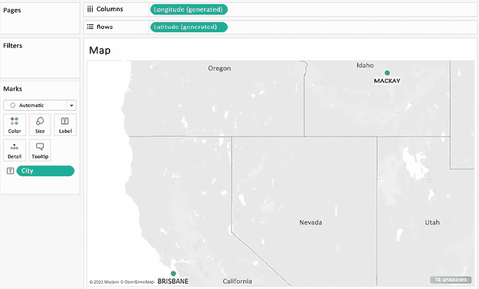

    *图 9.1：澳大利亚*

    > **警告：** 如果你在 **美国**，佛罗里达州的 Melbourne（墨尔本）将会显示。如果你在其他国家，可能会得到不同的结果。

5.  选择 `Edit Locations...`（编辑位置……）：

    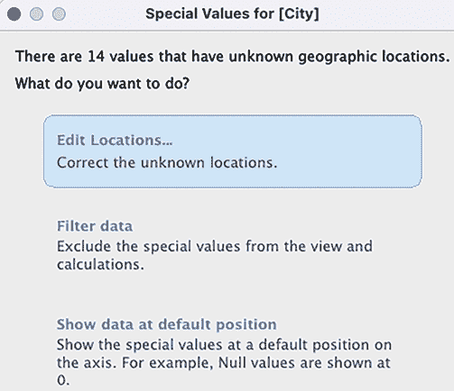

    *图 9.2：编辑位置……*

6.  将 `Country/Region`（国家/地区）更改为 `Fixed`（固定）| `Australia`（澳大利亚）：

    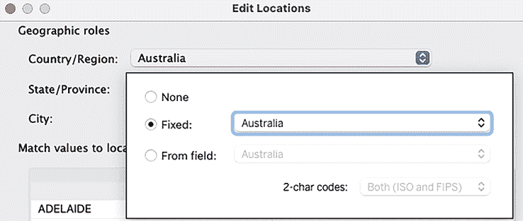

    *图 9.3：选择澳大利亚*

    地图上现在显示了**澳大利亚**：

    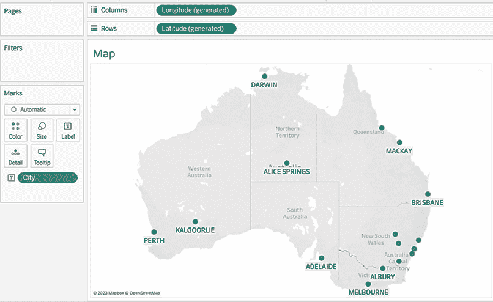

    *图 9.4：澳大利亚*

7.  导航至 `Miles` 工作表，将 `Trip ID`（行程 ID）和 `City`（城市）字段放置在 `Rows`（行）货架上，将 `Latitude (generated)`（生成的纬度）和 `Longitude (generated)`（生成的经度）放置在 `Text`（文本）货架上，如下面的屏幕截图所示：


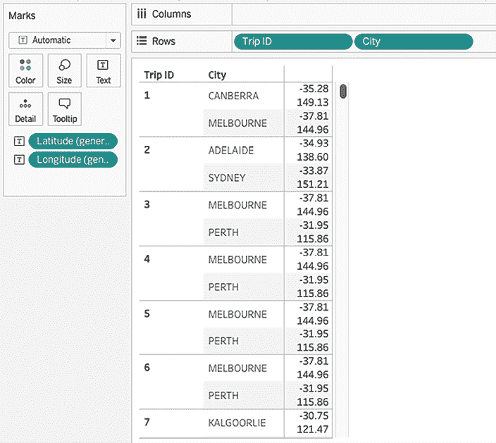

**图 9.5：距离**

您的屏幕应如上一个屏幕截图所示。请注意，交叉表非常杂乱。理想情况下，`Latitude` 和 `Longitude` 应显示在单独的列中。遗憾的是，我们无法使用生成的纬度和经度来实现这一点，因为尽管它们列在 `Data`（数据）窗格的 `Measures`（度量）部分下，但 Tableau 并不将它们视为度量。为了完成此练习，我们需要能够从单独的数据源访问纬度和经度坐标。

1. 为此，首先单击 `Map`（地图）工作表选项卡。
2. 右键单击可视化图表并选择 `View Data`（查看数据）。在生成的对话框中，通过选择每个单元格并单击 `Copy`（复制），复制 `Summary`（摘要）选项卡中的所有数据。
3. 关闭对话框，然后按 `Ctrl` + `V`（Mac 为 `Command` + `V`）在 Tableau 中创建一个新数据集。将生成的数据集（现称为 `Clipboard_[timestamp]`）重命名为 `Lat Long`。此外，将工作表命名为 `Lat Long`。
4. 在 `Lat Long` 工作表中，将 `Latitude (generated)` 和 `Longitude (generated)` 重命名为 `Lat` 和 `Long`。
5. 返回 `Miles`（英里）工作表，并在 `Transit Data`（交通数据）数据源中创建两个计算字段：一个名为 `LAT`，包含代码 `AVG([Lat Long].[Lat])`；另一个名为 `LONG`，包含代码 `AVG([Lat Long].[Long])`。
6. 从 `Marks`（标记）卡上的 `Text`（文本）中移除 `Latitude (generated)` 和 `Longitude (generated)`。
7. 将 `Measure Names`（度量名称）放置在 `Columns`（列）货架和 `Filter`（筛选器）货架上，并选择 `Lat` 和 `Long`。此外，将 `Measure Values`（度量值）放置在 `Text`（文本）货架上。现在，我们可以将纬度和经度视为真正的度量。
8. 创建两个更多的计算字段：一个名为 `Lookup Lat`，包含代码 `Lookup(Lat,-1)`；另一个名为 `Lookup Long`，包含代码 `Lookup(Long, -1)`。将新创建的两个计算字段放置在 `Measure Values`（度量值）货架上。
9. 创建一个名为 `Great Circle Distance Formula`（大圆距离公式）的计算字段，包含以下代码：

```
3959 * ACOS (
SIN(RADIANS([Lat])) * SIN(RADIANS([Lookup Lat]))+ COS(RADIANS([Lat])) * COS(RADIANS([Lookup Lat])) * COS(RADIANS([Lookup Long]) - RADIANS([Long]))
)
```

对于公里，将 `3959` 改为 `6378`。该数字代表地球半径，需要从英里更新为公里。

1. 将新创建的计算字段 `Great Circle Distance Formula` 放置在 `Measure Values` 货架上。
2. 通过单击字段本身并选择 `Compute Using: City`（按以下项计算：City），更改 `Great Circle Distance Formula` 的计算，使其使用 `City` 进行计算。
3. 相应地调整以下计算：

| **名称** | **代码** |
| --- | --- |
| `Lookup Lat` | `IFNULL(LOOKUP(Lat,-1), LOOKUP(Lat,1))` |
| `Lookup Long` | `IFNULL(LOOKUP(Long,-1), LOOKUP(Long,1))` |

1. 选择 `Map` 工作表，将 `Marks` 类型设置为 `Line`（线）。
2. 将 `Trip ID` 放置在 `Detail`（详细信息）货架上。
3. 将 `City` 拖到 `Marks` 卡视图的底部。
4. 将 `Great Circle Distance Formula` 字段放置在 `Tooltip`（工具提示）货架上。再次检查它是否仍设置为 `Compute Using: City`：

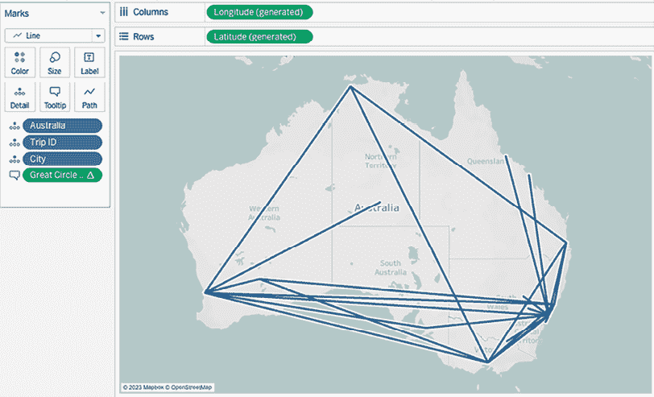

**图 9.6：澳大利亚距离**

1. 创建两个更多的计算字段，一个名为 `Source City`，包含以下代码：

```
{ FIXED [Trip ID]:MIN(IF [Dest/Orig]='Source' THEN City END)}
```

第二个计算字段应名为 `Destination City`，并包含以下代码：

```
{ FIXED [Trip ID]:MIN(IF [Dest/Orig]='Destination' THEN City END)}
```

1. 使用新创建的计算字段按需格式化。特别请注意，在以下屏幕截图中，`Source City` 位于 `Color`（颜色）货架上，而 `Destination City` 用于 `Tooltip` 货架上：

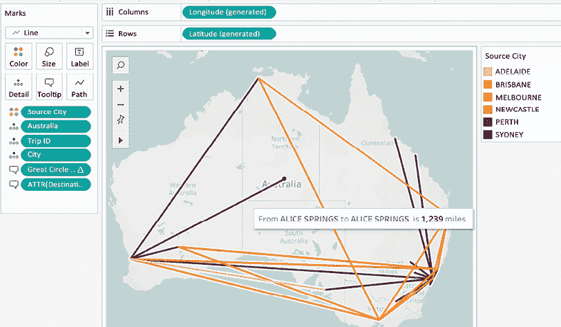

**图 9.7：航班**

总之，我们最初向 Tableau 添加了一个数据集。然后我们需要将每个城市的纬度和经度从工作簿中复制出来，以创建第二个数据源，随后我们将其作为混合数据源用于查找纬度和经度值。借助 LOD 计算，我们可以识别出发城市和目的城市，最后，我们能够使用所谓的大圆公式来测量城市之间的距离。可视化图表中的每种颜色代表一个起始城市；例如，所有绿线测量从珀斯到其他城市的距离。悬停在一条线上时，将显示出发城市、目的城市以及以英里（或公里）为单位测量的距离。

如果您想分析货运路线或任意两点之间的距离，现在您已经确切知道如何在 Tableau 中可视化此类数据。

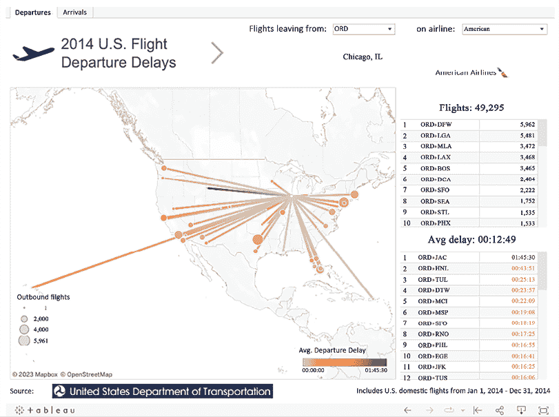

**图 9.8：美国航班出发延误**

在*图 9.8*中，您可以看到另一个类似的可视化图表，绝对值得一看（尝试复制它！）：[`www.tableau.com/solutions/workbook/big-data-more-common-now-ever`](https://www.tableau.com/solutions/workbook/big-data-more-common-now-ever)。

在下一节中，我们将讨论如何利用地图和多边形的组合来进一步扩展我们的 Tableau 工具箱。

# 创建自定义多边形

Tableau 原生提供多边形的地理区域包括全球机场代码、城市、国家、地区、领土、州、省，以及一些邮政编码和二级行政区（相当于县）：美国区号、`Core-Based Statistical Areas`（`CBSAs`，核心统计区）、`Metropolitan Statistical Areas`（`MSAs`，大都市统计区）、国会选区和邮政编码。这意味着，例如，可以轻松创建世界国家的填充地图。只需复制世界国家列表（`Ctrl` + `C`），然后在 Tableau Desktop 的空白工作表上按 `Ctrl` + `V` 将该列表粘贴到 Tableau 中。一个新数据源将添加到右上角的 `Data`（数据）下。接下来，将 Tableau 中的 `View`（视图）类型设置为 `Filled Map`（填充地图），并将国家列表放在 `Detail`（详细信息）货架上。Tableau 将自动为每个数据点绘制多边形：

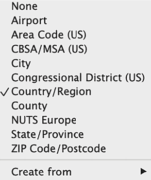

**图 9.9：原生多边形**

有些地理类型 Tableau 不会自动提供多边形。这些包括电话区号。对于这些地理类型，Tableau 将绘制符号地图，而不是填充地图，如下所示：

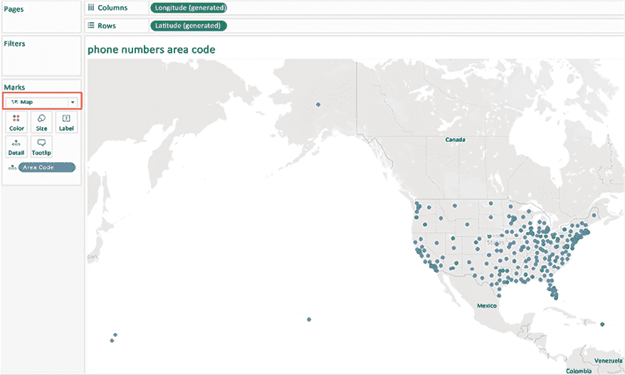

**图 9.10：填充地图失败**

即使选择了 `Filled Map` `Marks` 类型，Tableau 也无法填充地图，因为这些区域的轮廓对 Tableau 来说是未知的。此外，可能会出现特殊的映射需求，要求为地图上通常不包含的区域绘制多边形。例如，组织可能定义不遵循常规地图边界的销售区域。或者，Tableau 作者可能将篮球场或足球场的图像导入 Tableau 并绘制多边形以表示比赛区域的特定部分。另一种替代方案（我们在*第 8 章 超越基础*中详细讨论过）可能是绘制商店中的书架地图。

但除了自己绘制多边形外，还有一些文件类型支持绘制多边形。其中一种文件类型是 `.shp`。在下一个练习中，我们将使用此类文件为德克萨斯州创建多边形。

## 德克萨斯州的多边形

通过处理上述 `.shp` 文件类型的示例，Tableau 可以创建多边形。让我们试一下，在德克萨斯州地图上以多边形形式显示德克萨斯州的人口：


# 第 9 章：在 Tableau 中处理空间数据

## 加载德克萨斯州城市边界

### 下载 Shapefile

1.  打开 **德克萨斯州交通部** 页面：[`gis-txdot.opendata.arcgis.com/datasets/txdot-city-boundaries/explore?location=30.990445%2C-100.168292%2C6.68`](https://gis-txdot.opendata.arcgis.com/datasets/txdot-city-boundaries/explore?location=30.990445%2C-100.168292%2C6.68)。

2.  使用 `Download` 下拉菜单并下载 `Shapefile`：

    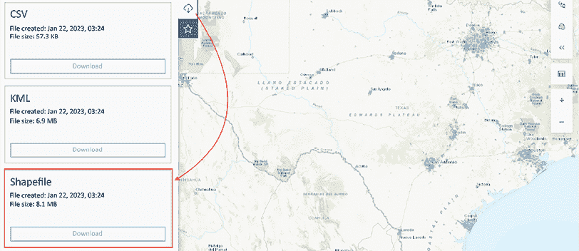

    *图 9.11：德克萨斯州数据*

    在您的 `download` 目录中，您应该能找到多个文件：

    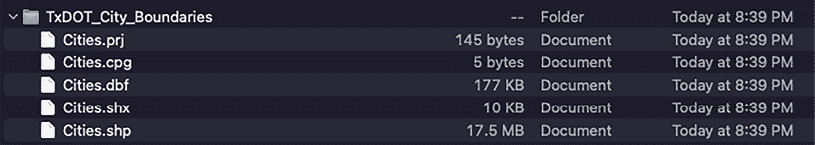

    *图 9.12：德克萨斯州城市边界*

    如果您在文本编辑器中打开 `.shp` 文件，将看到以下内容：

    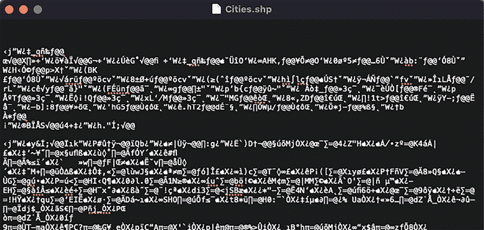

    *图 9.13：文本编辑器中的 .shp*

### 在 Tableau 中加载 Shapefile

1.  幸运的是，Tableau 原生支持读取 `.shp` 文件。在与本章关联的工作簿中，导航到 `City Limits` 工作表并选择 `数据 | 新建数据源 | 文本文件`。

2.  导航到您的 `downloads` 目录或保存德克萨斯州 shapefile 的路径，然后选择 `.shp` 文件：

    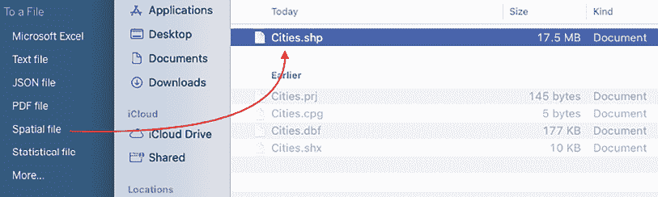

    *图 9.14：加载空间文件*

### 探索几何字段

1.  在下一个屏幕截图中，您可以看到 Tableau 如何读取 `.shp` 文件，以及它如何创建一个名为 `Geometry` 的附加字段，该字段表明我们正在查看该文件中的多边形和多重多边形：

    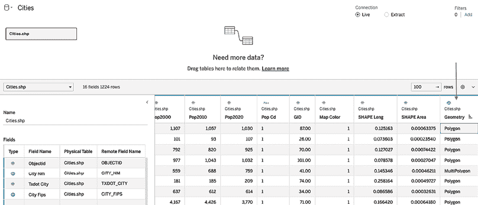

    *图 9.15：几何*

### 可视化多边形

1.  打开一个新工作表并将 `Geometry` 拖放到空白画布上：

    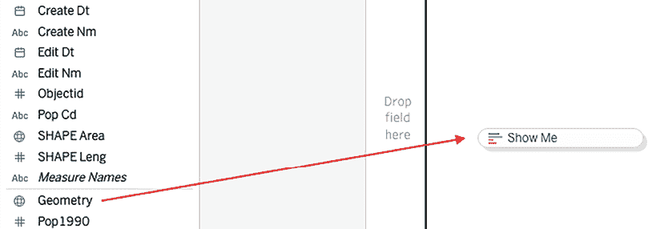

    *图 9.16：添加几何图形*

1.  看看这个！Tableau 立即在德克萨斯州的区域周围创建了多边形：

    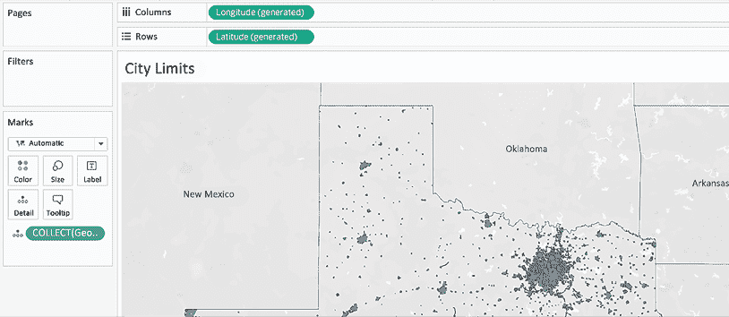

    *图 9.17：德克萨斯州多边形*

1.  请随意通过 `地图 | 背景地图 | 深色` 调整格式。

2.  将 `City Nm` 字段放入 **标记** 卡中的 `详细信息`，将 `Pop2010` 放入 `颜色`。（图 9.17 中使用的颜色是 **温度发散**。）

3.  您的工作表应如下所示：

    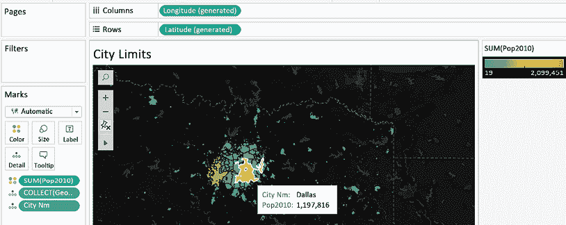

    *图 9.18：德克萨斯州城市边界*

您可以看到，我们现在有了一张漂亮的深色地图，上面叠加了多边形。这些多边形定义了每个城市名称（使用字段 `City Nm`）的区域，由德克萨斯州政府发布。通过将 2010 年人口度量（使用字段 `Pop2010`）放在 `颜色` 货架上，我们还可以看到红色多边形区域在 2010 年拥有最多居民，深绿色区域最少。

您可能不喜欢这些多边形，或者想知道像 `.shp` 这样的空间文件是否只允许您使用多边形。幸运的是，答案是我们可以更改地图，无论它是空间文件还是其他类型。我真的很喜欢用热力图来显示地理密度，所以让我们在下一节中使用它们。

## 热力图

我想与您分享一个功能，它是早期 Tableau 版本的一部分，在处理地理数据时被证明非常有用。它是 **标记** 类型 `密度`，您可以用它来创建热力图。此新功能不限于地图；您也可以将其用于任何其他类型的图表。然而，它对于密集数据最有效，因为在这些数据中模式不易被发现。

以下步骤将演示创建 **热力图** 的示例：

1.  打开与本章相关工作簿中的 `Citylimits` 选项卡。如果您未完成上一个练习，请打开本章解决方案工作簿中的 `Citylimits` 选项卡。

2.  复制该工作表，并将其命名为 `City Limits (2)`。

3.  将 **标记** 卡类型设置为 `密度`：

    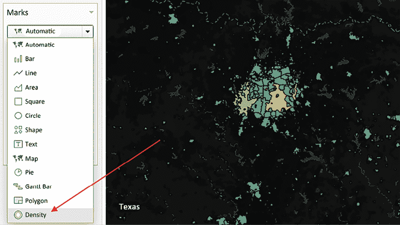

    *图 9.19：德克萨斯州城市密度*

1.  单击 **标记** 卡中的 `颜色` 并选择您喜欢的任何颜色。我选择了 **密度金深色**。

2.  通过将滑块向左拖动来减小 **标记** 卡中的 `大小`。拖动直到您喜欢地图上圆圈的大小：

    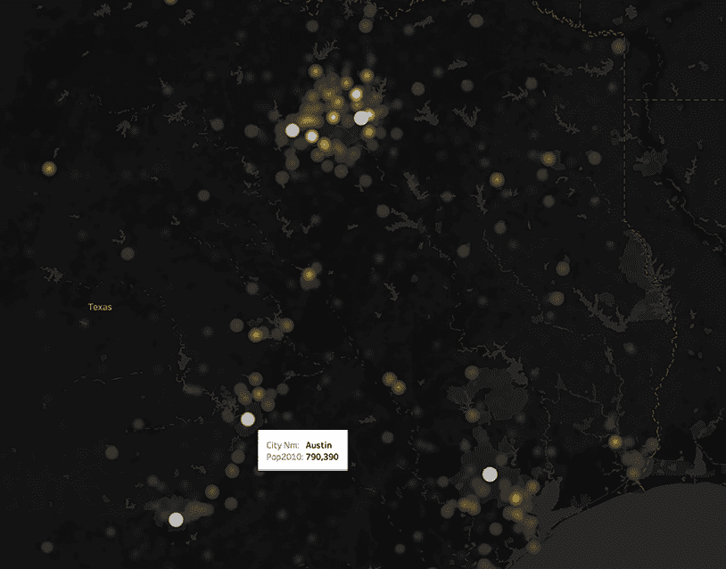

    *图 9.20：热力图*

热力图可以向您显示空间集中度，非常适合非常密集的数据集。在前面的图中，您可以看到我们失去了城市的周围环境、多边形结构；然而，我们仍然可以看到人口稠密的区域，并且现在每个城市的大小相同，使得比较较小与较大的地理位置变得更加容易。并且我们证明了空间文件不需要必须与多边形一起使用。

在 Tableau 2020.4 版本中，添加了另一个功能：地图图层。它们是什么以及用于什么将在下一节中描述。

## 双轴与地图分层

您可能还记得，在前几章的许多不同场合，我们都使用了双轴。双轴可视化也可以通过地图实现，而且更好的是，自 Tableau 2020.4 版本起，地图可以分层。我们只需添加另一个具有相同结构（在本例中为地图）的图层，并且每个图层可以显示不同的数据。

我们将查看两个练习，第一个关于双轴的使用，第二个包含地图图层。

### 使用双轴

让我们开始吧：

1.  首先，我们需要一个数据集。我只是在 Excel 中自己创建了一个；请随意创建您自己的，复制下面屏幕截图中的内容，或从本书的 GitHub 存储库下载文件（[`github.com/PacktPublishing/Mastering-Tableau-2023-Fourth-Edition/blob/main/Chapter09/Freight.xlsx`](https://github.com/PacktPublishing/Mastering-Tableau-2023-Fourth-Edition/blob/main/Chapter09/Freight.xlsx)）。将文件命名为 `Freight.xlsx`：

    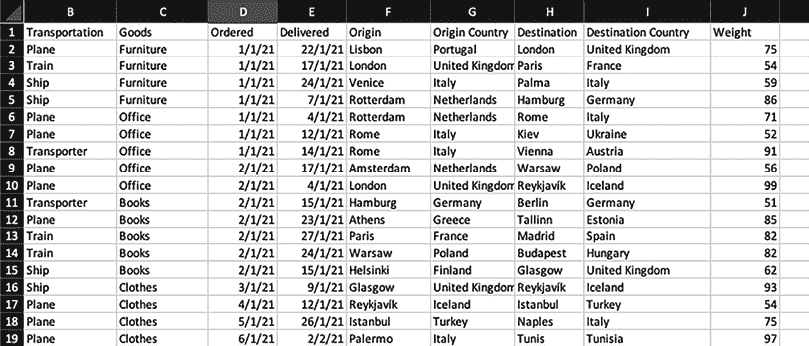

    *图 9.21：Excel*

1.  将新数据集连接到 Tableau 并打开一个名为 `Dual-axis map` 的新工作表。

2.  双击 `Origin Country`，将出现以下地图：

    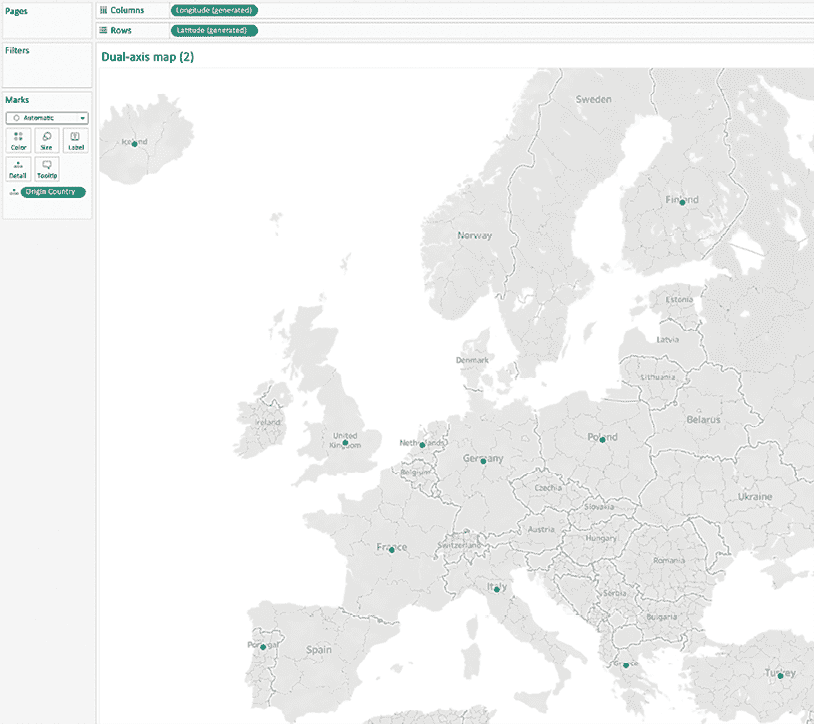

    *图 9.22：双轴地图*

1.  将 **标记** 卡类型更改为填充地图，并将 `Goods` 拖放到 `颜色` 货架上：

    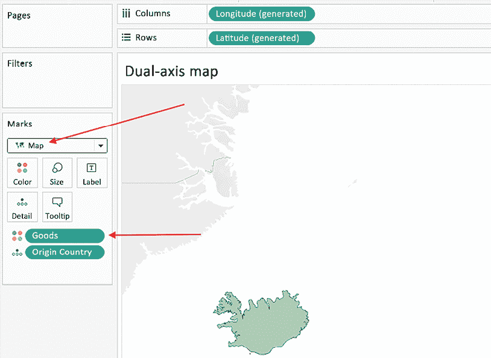

    *图 9.23：双轴地图 II*

1.  单击 `Columns` 货架中的 `Longitude`，按住 `Ctrl`（或 Mac 上的 `Command`），同时将该字段向右移动。您应该已将 `Longitude` 字段的第二个副本复制到了 `Columns` 货架上：

    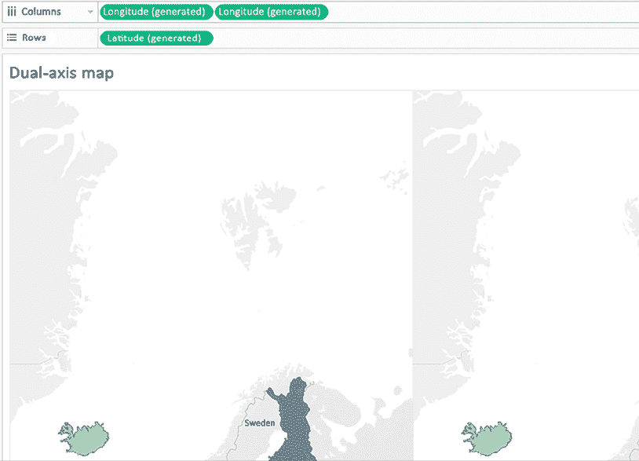

    *图 9.24：复制 Longitude*

1.  您还可以看到 **标记** 卡现在保持两个图层，外加一个额外的 `所有` 图层，就像条形图上的双轴一样：

    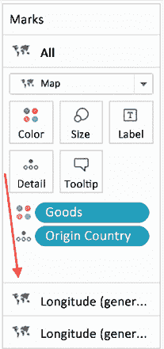

    *图 9.25：标记卡*

1.  在底层中，将 `颜色` 货架上的 `Goods` 替换为 `Origin`，并查看第二个地图现在如何显示代表城市的彩色圆点：

    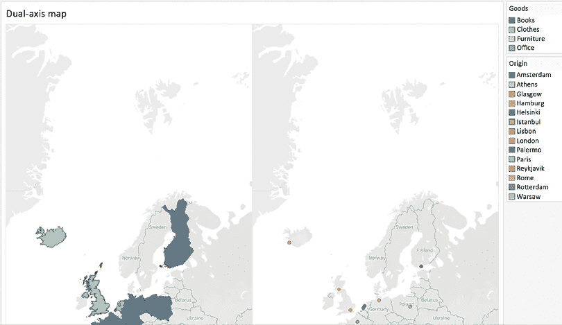

    *图 9.26：双轴地图*

1.  单击 `Columns` 货架中的右侧 `Longitude` 字段并选择 `双轴`。

您创建了第一个分层地图！每个国家的颜色代表其运输的货物类型。圆点表示火车、轮船、飞机或卡车运输的城市：

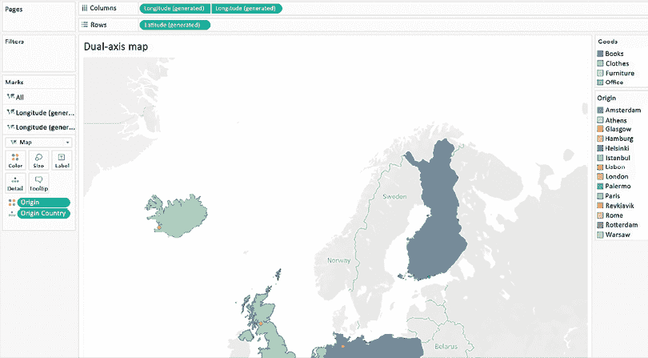

*图 9.27：双轴地图*

完成第一个基础练习后，我们将继续进行一个更复杂的练习，使用更新的地图分层功能。

### 添加地图图层

我们希望用一条从起点城市到目的地城市的线来可视化运输路线。我们还想显示送达时间以及货物重量。我们将继续使用之前的 `freight` 数据集；我们只需要做一些调整：

1.  `freight` 数据集没有经度或纬度，这对于 Tableau 的某些空间计算字段（如我们稍后将需要的 `MAKEPOINT()`）至关重要。打开 Google Maps 并输入数据集中的一个城市，例如 `Lisbon`。在 URL 中，您将能够找到经度和纬度：

    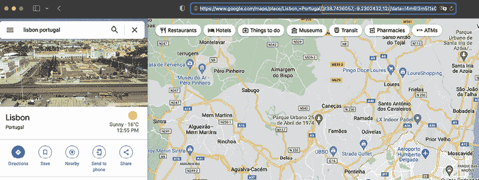

    *图 9.28：Google Maps*

1.  复制它们并将它们添加到一个单独的 Excel 工作表中，如下面的屏幕截图所示，并将其命名为 `latlong`：

    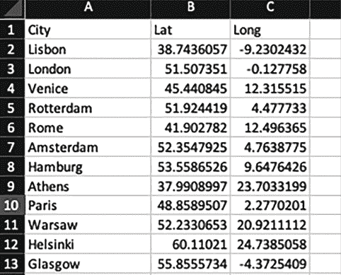

    *图 9.29：Excel*


# 创建四层地图

1. 我们需要使用一个新的 Excel 工作表，因为我们必须为目的地和起点创建空间字段。由于某些城市既是起点也是目的地，我们将创建两个内连接；两次连接都将初始的 `freight` Excel 工作表连接到新创建的 `latlong` Excel 工作表（如果您从 GitHub 下载数据，`latlong` 表是 `Freight.xlsx` 中的第二个选项卡）：

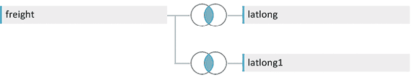

图 9.30：联接

1. 唯一的区别在于第一个联接基于 `Origin` 和 `City`，第二个基于 `Destination` 和 `City`。通过双击名称重命名 `latlong` 数据源，以避免混淆：

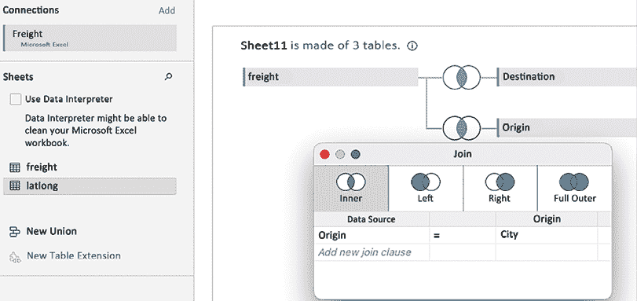

图 9.31：联接 II

1. 打开一个新工作簿并将其命名为 `4-layer map`。创建一个名为 `Line` 的计算字段，代码如下：

```
MAKELINE(MAKEPOINT([Lat (Origin)], [Long (Origin)]), MAKEPOINT([Lat (Destination)], [Long (Destination)]))
```

2. Tableau 的说明显示，要基于空间位置创建点，Tableau 需要经度和纬度，或坐标。

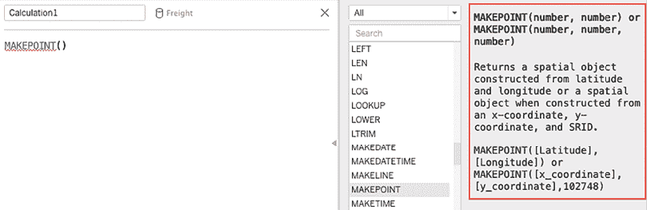

图 9.32：MAKEPOINT

1. 创建另一个名为 `Days to delivery` 的计算字段，代码如下：

```
[Delivered]-[Ordered]
```

2. 双击 `Origin` 文件中的 `City`，地图将出现，但您会遇到 `12 unknown`。点击错误，然后选择 `Edit Locations…`：

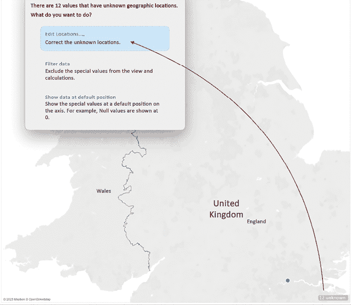

图 9.33：未知城市

1. 您将看到 Tableau 使用 `United Kingdom`（对您可能不同）作为默认国家来查找每个城市，但 Tableau 无法成功匹配，因为我们的数据集包含全欧洲的城市。不要使用 `Fixed` 位置，而是使用 `From field` 选项并选择 `Origin Country`。现在该字段将作为我们数据集中每个城市的国家：

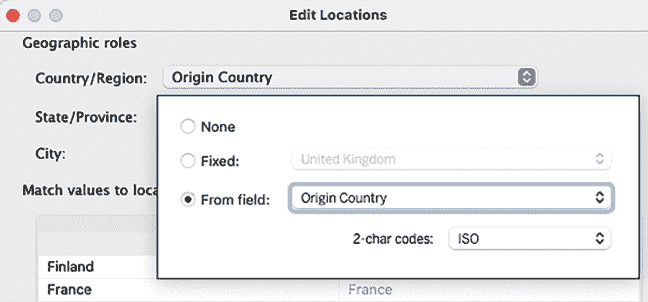

图 9.34：起点国家

1. Tableau 自动将 `Origin Country` 添加到视图的 `Detail` 货架上，并正确显示城市。您也可以通过直接将 `Origin Country` 放置在 `Detail` 货架上来实现上一步：

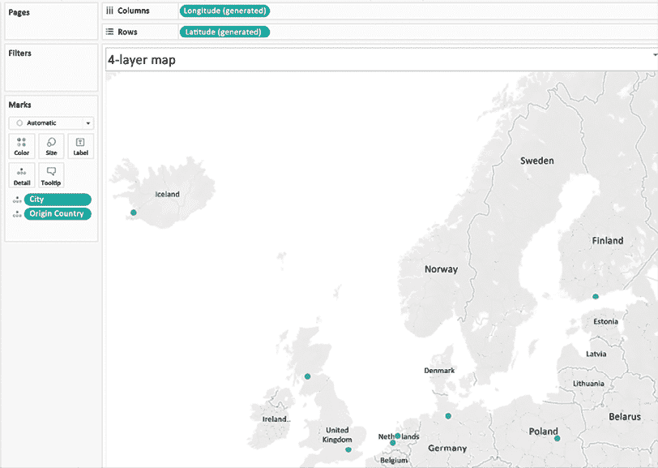

图 9.35：起点城市

1. 由于我们的目标之一是在 `Origin` 和 `Destination` 城市之间绘制线条，因此添加 `Destination` 也是合理的，对吗？双击 `Destination` 将其添加到可视化中。

2. 我们现在在视图中拥有所有 `Origin` 和 `Destination` 城市，但无法区分它们，因为它们都在同一层上。因此，将刚添加的 `Destination` 字段从 `Detail` 货架拖动到视图左上角，直到出现 `Add a Marks Layer` 标志：

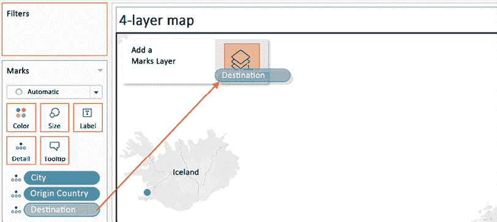

图 9.36：货运 II

1. 您现在将看到 `Marks` 卡显示两层：

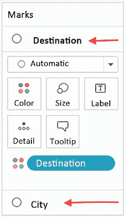

图 9.37：Marks

1. 通过双击名称将 `Destination` 层重命名为 `Destination Country`。

2. 通过将 `Line` 拖到 `Add a Marks Layer` 上添加另一层，并将 `Days to Delivery` 添加到 `Color`。将此层命名为 `Line`，并从 `Marks` 卡下拉菜单中选择 `Automatic` 类型：

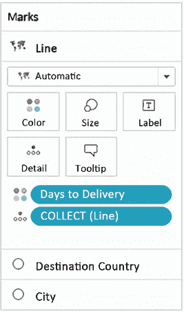

图 9.38：Marks 层

1. 通过将 `City` 拖到 `Add a Marks Layer` 上添加另一层，并将其命名为 `City (2)`。将 `Destination Country` 添加到 `Detail`。从 `Marks` 卡下拉菜单中选择 `Automatic` 类型：

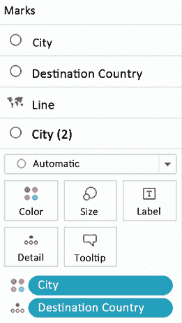

图 9.39：Marks 层

1. 最后，返回 `Destination Country` 层，将 `Destination Country` 改为 `Detail`，并将 `Weight` 放在 `Color` 上。从 `Marks` 卡下拉菜单中选择 `Map`：

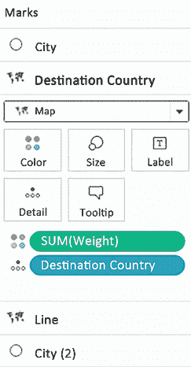

图 9.40：Marks 层

1. 通过拖放按以下顺序排序图层：`Line`、`City`、`City (2)` 和 `Destination Country`。您的工作表现在应如下所示：

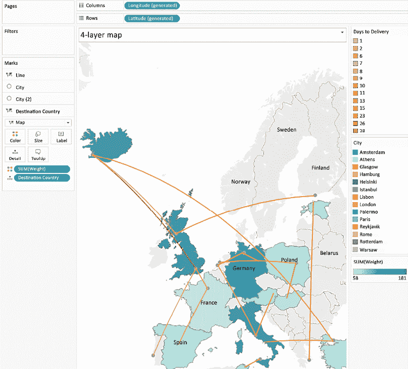

图 9.41：地图

1. 为了使可视化更易于解读，将 `Origin` 放在 `Filters` 货架上，并仅选择您想要的几个起点。

2. 为了区分 `Origin` 和 `Destination`，打开 `City` 和 `City (2)` 地图层，分别将 `City` 和 `City (Destination)` 从 `Detail` 改为 `Shape`。为 `Origin` 选择一种形状，为 `Destination` 选择另一种形状，例如，`Origin` 使用实心圆，`Destination` 使用十字。您也可以通过点击 `Color` 货架为形状着色：

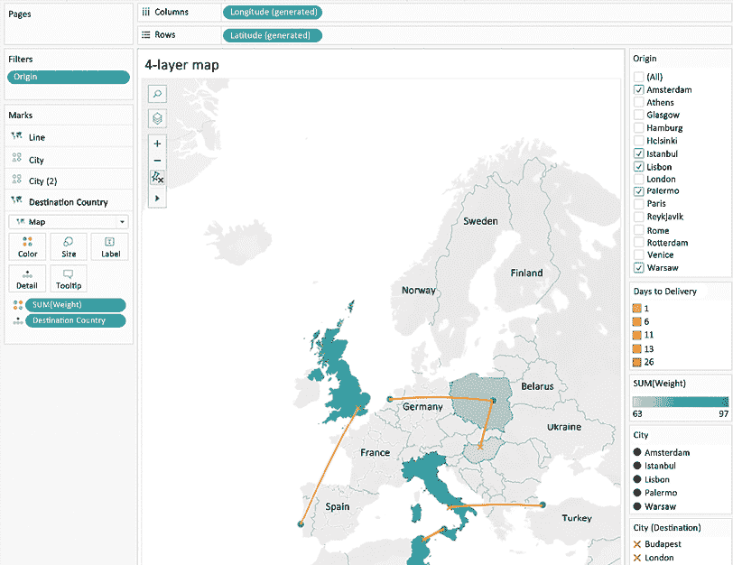

图 9.42：最终分层地图

现在，让我们看看我们创建了什么。我们可以看到货物从每个圆圈运输到十字城市。两个城市由黄到红渐变的线条连接。偏黄表示交付快，偏红表示交付时间长。目的地国家以青绿到深蓝的色彩范围着色。颜色越深，运输过去的重量越大。我们可以轻松发现意大利接收了最重的运输，来自伊斯坦布尔，并在 6 天内送达。最慢的交付是从布达佩斯到华沙，耗时 26 天。

希望这个练习向您展示了分层地图的优势。每一层都允许您以独特的方式使用 `Color`、`Shape`、`Size`、`Label` 和其他 `Marks`，为您的分析开辟新路径。在下一节中，我们将更进一步，在 Tableau 中使用外部技术制作地图。

# 利用其他技术扩展 Tableau 制图功能

接下来，我们将探讨如何使用其他工具扩展 Tableau 的制图功能。Tableau 的开发人员精心创建了一个易于扩展的制图界面。这种可扩展性的某些领域，例如连接到 `Web Map Service` (`WMS`) 服务器，可直接从界面获得；我们将在下一节探讨。

## 使用 WMS 自定义地图

将自定义地图引入 Tableau 的最简单方法是直接从 Desktop 进行。我们需要一个指向 `WMS` 服务器的格式正确的 URL。Tableau Desktop 可以连接到任何支持 `WMS 1.0.0`、`1.1.0` 或 `1.1.1` 标准的 `WMS` 服务器。

寻找此类 URL 列表的好地方是 [`directory.spatineo.com`](http://directory.spatineo.com)，它提供了大量不同制图服务的信息。

以下练习受 Jeffrey A. Shaffer 的文章 *[Building weather radar in Tableau in under 1 minute](https://www.dataplusscience.com/TableauWeatherRadar.html)* 启发。不过，我们将使用不同的地图，我们的来源是 *NASA Earth Observation* 数据 ([`neo.gsfc.nasa.gov/`](https://neo.gsfc.nasa.gov/))。在本练习中，我们将看到，通过在数据集下方绘制额外数据——以背景图像的形式——您将能够为您的业务做出更好的决策。例如，如果您的销售数字取决于好（或坏）天气，或者您的生产面临附近野火的风险，您将能够在一个 Tableau 仪表板中看到所有这些信息：

1. 打开与本章关联的工作簿，通过 Desktop 导航到 `WMS Server` 工作表。

2. 选择 `Superstore` 数据源。

3. 将 `State/Province` 放在 `Detail` 货架上。

4. 复制 `http://neo.gsfc.nasa.gov/wms/wms` URL，然后在 Tableau 中导航到 `Map` | `Background Maps` | `Add WMS Map`。粘贴 URL 并点击 `OK`：

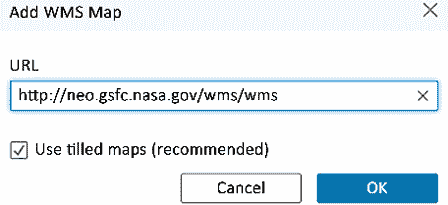

图 9.43：添加 WMS 地图

1. 在 `Marks` 卡中，将 `View` 类型设置为 `Map`。

2. 点击 `Color` 货架以开启 `Border`，将颜色设为白色，并将 `Opacity` 设为 `0%`：

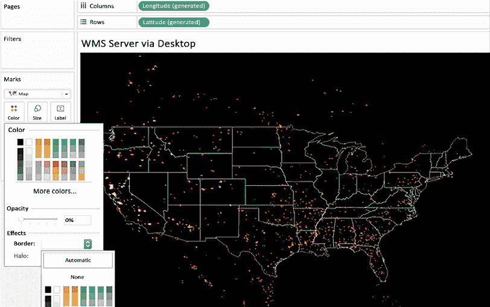

图 9.44：活跃火灾地图


# 探索 Mapbox

Mapbox 提供自定义地图，并与 Tableau 原生集成。要了解如何构建自己的自定义地图，可以查看其网站：<https://www.mapbox.com/>。从 Tableau 2019.3 开始，多种 Mapbox 样式甚至默认可用：

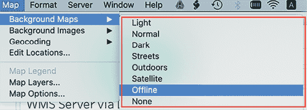

图 9.47：背景地图

除此之外，Mapbox 本身还提供扩展的地图服务，并附带一个 Web 应用程序，使用户能够自定义地图。这种可定制性涵盖字体、颜色、背景图片等。Mapbox 免费提供基础服务，但当然，更多地图和更大的带宽需求将需要付费升级。

此练习将向您展示如何连接到 **Mapbox**：

1.  导航至 <https://www.mapbox.com> 并创建一个帐户。
2.  完成注册并登录 **Mapbox** 后，单击 **Studio** 链接：

    

    图 9.48：Mapbox
3.  单击 **New Style**（新建样式）并开始创建地图。我选择了 **Monochrome**（单色）| **Dark**（深色）| **Customize Monochrome**（自定义单色）。
4.  Mapbox 编辑器应该会打开。根据您的需求调整地图：

    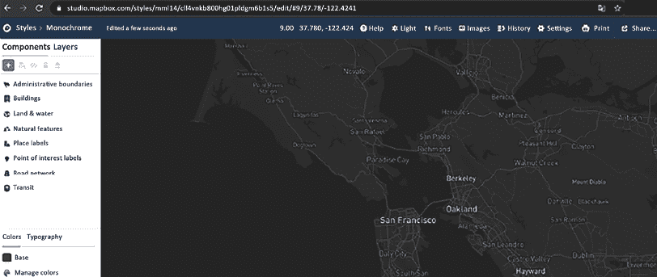

    图 9.49：Mapbox 集成
5.  完成后单击 **Share**（共享）（右上角）。选择 **Third party**（第三方）| **Tableau** 并复制 URL：

    

    图 9.50：Mapbox 集成
6.  在与本章关联的工作簿中，导航到 `Mapbox Classic` 工作表，然后选择 **Map**（地图）| **Background Maps**（背景地图）| **Add Mapbox Map**（添加 Mapbox 地图）。
7.  添加 **Style Name**（样式名称）（我用了 `MasteringTableau`）并粘贴 URL。单击 **OK**（确定）。
8.  选择 `Superstore` 数据源，双击 **State**（州），然后通过 **Map**（地图）| **Background Maps**（背景地图）| **MasteringTableau** 路径选择 **MasteringTableau** 地图样式：

    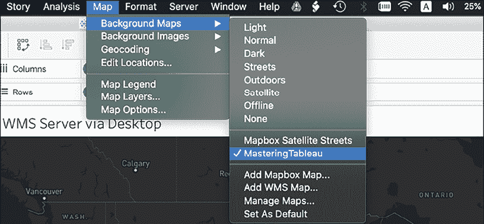

    图 9.51：背景地图

正如您所见，Tableau 使用了我们之前在 Mapbox 中创建的地图。太棒了！这意味着您可以完全按照自己的喜好自定义地图。

关于如何创建自定义地图以及您需要了解的关于 Mapbox 的所有其他信息的手册可以在这里找到：<https://docs.mapbox.com/studio-manual/guides/>。

# 切换地图

我们现在将创建一个仪表板，允许最终用户在我们刚才讨论的各种地图之间进行选择。此练习使用的技术称为 **sheet swapping**（工作表切换）。然而，*第 11 章*、*设计仪表板和可视化最佳实践* 中对此技术进行了更深入的探讨。

让我们看看必要的步骤：

1.  在与本章关联的工作簿中导航到 `MapSwap` 工作表。双击 **State**（州）。将 **Marks**（标记）卡视图设置为 **Map**（地图），单击 **Color**（颜色），将 **Opacity**（不透明度）设置为 **0%**，最后将 **Border**（边框）设置为 **Automatic**（自动）：

    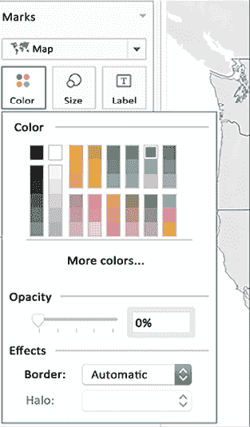

    图 9.52：颜色
2.  复制 **MapSwap** 工作表两次：

    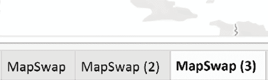

    图 9.53：复制 MapSwap 工作表
3.  选择 **MapSwap** 工作表并导航到 **Map**（地图）| **Background Maps**（背景地图）| **Normal**（普通）。
4.  选择 **MapSwap (2)** 工作表并导航到 **Map**（地图）| **Background Maps**（背景地图）| **Dark**（深色）。
5.  选择 **MapSwap (3)** 工作表并导航到 **Map**（地图）| **Background Maps**（背景地图）| **Satellite**（卫星）。
6.  创建一个名为 **Show Sheet** 的参数，如下所示：

    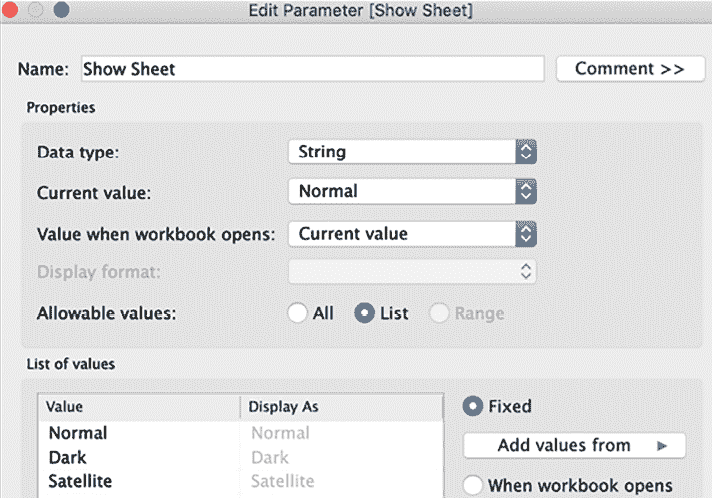

    图 9.54：参数
7.  在 **Data**（数据）窗格中右键单击该参数，然后选择 **Show Parameter Control**（显示参数控件）。
8.  创建一个名为 `Show Sheet Filter` 的计算字段，如下所示：

    ```
    [Show Sheet]
    ```
9.  选择 `MapSwap` 工作表，将 **Show Sheet Filter** 放在 **Filters**（筛选器）架上。选择 **Select from list**（从列表中选择）和 **Normal**（普通）：

    

    图 9.55：工作表筛选器
10. 选择 `MapSwap (2)` 工作表，将 **Show Sheet Filter** 放在 **Filters**（筛选器）架上。这次选择 **Custom value list**（自定义值列表）并输入 `Dark`：

    

    图 9.56：自定义值列表
11. 在 `MapSwap (3)` 工作表上重复上一步，但输入 `Satellite` 而不是 `Dark`。
12. 创建一个仪表板并将其命名为 `db_MapSwap`。在仪表板上放置一个垂直容器。
13. 将所有三个 **MapSwap** 工作表放入垂直容器中并隐藏它们的标题。
14. 选择不同的地图样式，看看地图如何变化：

    

    图 9.57：切换地图

您可能在自己的电脑上，或者 YouTube 等网站、PyCharm 等 IDE 中见过深色/浅色或日间/夜间背景等功能。通过 **MapSwap** 功能，您现在可以在 Tableau 仪表板上为用户提供同样的便利。

# 自定义地理编码

在结束本章之前，我想分享一个几周前在 LinkedIn 上看到的小技巧。描述以下练习的帖子来自 Klaus Schulte，一位德国教授兼 2018 年 *Iron Viz* 冠军。

他分享说他使用自定义地理编码构建了一个网格地图。让我们试着复现它！

从某处下载六边形地图数据或自行创建。对于此练习，您可以使用来自我的 Tableau Public 或 GitHub 的六边形地图数据：<https://github.com/PacktPublishing/Mastering-Tableau-2023-Fourth-Edition/blob/main/Chapter09/hexmap.xlsx>。如果您想自行创建，请查看 *第 8 章*、*超越基础* 中的多边形练习。您可以用创建书籍多边形的相同方式创建该文件：

1.  将 `hexmap` 文件放在 Tableau 资源库的 `Mapsources` 文件夹中。
2.  将 Tableau Desktop 连接到默认的 `Superstore` 数据。
3.  双击 **State/Province**（州/省）：

    

    图 9.58：普通地图
4.  在 **Data**（数据）窗格中单击 **State/Province**（州/省），然后选择 **Geographic Role**（地理角色）| **Hexmap.xlsx**。
5.  单击 **Map**（地图）| **Background Layers**（背景图层），并将 **Washout (%)**（淡化 %）设置为 `100%`。
6.  结果将如下所示：


Figure 9.59: XX（将为 *Figure 9.59*）

那么为什么要费这个劲？因为网格地图能将各州均匀分布，如果不使用它，你就无法区分距离相近的州，也会遗漏一些远距离的州：


Figure 9.60: 如果没有网格地图

感谢 Klaus 提供的这个绝妙技巧！顺便说一句，六边形地图不仅适用于美国。不妨在欧洲、非洲、南美洲或 **亚太** (**APAC**) 地区也试一试！无论何时处理尺寸差异，网格地图都能派上用场。

## 摘要

在本章中，我们探讨了如何在不离开 Tableau 界面的情况下扩展其地图功能，方法是捕获 Tableau 生成的经纬度数据并在 Google 上查找。我们基于 `.shp` 文件为德克萨斯州创建了多边形和热力图，以及一个具有双地图轴的仪表板和另一个包含 4 个地图图层的仪表板。接着，我们探索了使用其他技术扩展 Tableau 地图功能的各种方法。我们连接到了 WMS 服务器，然后探索了 Mapbox 的功能，最后涉足了多边形的世界。

在下一章中，我们将探索如何使用 Tableau 进行演示。具体来说，我们将了解如何从 Tableau 获取最佳图像，如何高效、有效地将 Tableau 与 PowerPoint 结合使用，以及如何直接使用 Tableau 进行演示而无需依赖第三方工具。

## 在 Discord 上了解更多

要加入本书的 Discord 社区——您可以在其中分享反馈、向作者提问并了解新版本发布——请扫描下方的二维码：

[`packt.link/tableau`](https://packt.link/tableau)


