# 10 使用 Tableau 进行演示

所有 Tableau 作者本质上都是讲故事的人。分析数据不仅仅是解谜；更是在寻找一个能产生影响力的故事。主题可以从 Airbnb 到寨卡病毒，可能是令人愉快的消遣，也可能是改变人生的大事，但它们都服务于一个共同需求：讲述一个故事。本章旨在帮助您充实知识工具箱，提供使用 Tableau 制作引人入胜、赏心悦目且极具影响力演示文稿的创意和方法。

本章将探讨以下以演示为中心的主题：

*   从 Tableau 获取最佳图像
*   从 Tableau 到 PowerPoint
*   将 Tableau 嵌入 PowerPoint
*   Tableau 动画
*   用于演示的故事点和仪表板
*   演示资源

## 从 Tableau 获取最佳图像

在本节中，我们将回顾将图像从 Tableau 导出到其他应用程序的选项，并讨论每种方法的优缺点。我们将首先调查各种截图应用程序，然后考虑 Tableau 中直接可用的方法。

在 Tableau 中捕获图像最简单的方法或许是使用屏幕捕获工具。以下是一些不会影响您钱包（即免费）的屏幕捕获工具：

*   **Grab** 是 macOS 原生提供的屏幕捕获实用程序。Grab 位于 **应用程序** 下的 **实用工具** 文件夹中。您也可以通过以下快捷键访问它：*Shift* + *Command* + *3* 用于全屏截图，*Shift* + *Command* + *4* 用于区域截图，以及 *Shift* + *Command* + *5* 用于定时截图。
*   **截图工具** 随 Windows 默认安装，是一个非常简单、功能不繁杂、易于使用且有效的工具。
*   **Greenshot** 是一款开源屏幕捕获工具，功能丰富。请访问 [`getgreenshot.org/`](http://getgreenshot.org/) 下载应用程序并了解更多信息。
*   **Microsoft Office OneNote** 包含屏幕捕获功能。如果您安装了 OneNote，只需按 *Windows* + *S* 即可激活屏幕捕获，或者按 *Windows* + *N* 然后按 *S* 键进行激活。

**通用经验法则**：捕获比所需更大的截图，因为捕获更多像素将提高质量。然后您可以缩小尺寸使其适用，在更小的表面上保留更多像素。（对于非常小的对象，可暂时提高计算机显示器的缩放比例，以获得每平方厘米更多的像素。）

既然我们已经介绍了图像捕获工具，现在让我们看看 Tableau 自带的原生功能。

### Tableau 的原生导出功能

屏幕捕获工具的一个缺点是它们仅限于 **位图**。位图通常足以用于文档或 **PowerPoint** 演示文稿，但放大时会出现像素化。另一方面，矢量图像在放大时不会像素化，因此可能提供更清晰的图像质量。原生情况下，Tableau 包含位图和矢量图像导出选项。这些选项将在以下列表中讨论。

Tableau 可以导出三种格式的图像，可通过 `工作表 | 导出 | 图像` 访问：

*   **SVG** 是撰写本文时 Tableau 提供的唯一矢量图像格式。如果放大时要避免像素化，请使用此格式。如果您的图像包含大量精细细节和纹理，SVG 处于劣势，因为它基于点和路径而非单个像素。
*   **JPEG** 是一种位图格式，适合照片等高分辨率图像，但不太适合低色彩图像（如 Tableau 中典型部署的图像）。以 JPEG 格式从 Tableau 导出图像并放大查看。注意，空白区域（尤其是文本周围的空白区域）包含各种颜色的杂散像素。这些被称为 **伪影** 或 **噪点**。虽然这些像素在不放大时不可见，但对导出图像的整体影响是使其看起来模糊。因此，从 Tableau 导出为 JPEG 几乎从来没有理由。
*   与 JPEG 图像一样，**PNG** 图像也是位图。PNG 格式的优势在于它既适用于照片等高色彩图像，也适用于 Tableau 中典型的低色彩图像。以 PNG 格式从 Tableau 导出图像并放大观察，虽然会发生像素化，但空白区域仅包含白色。与 JPEG 图像不同，没有伪影或噪点出现。在使用位图时，PNG 应被视为首选格式。
*   **BMP** 是一种位图格式，看起来相当不错，但未压缩，因此可能导致图像文件很大。如今，BMP 格式被认为已过时，通常应避免使用。

建议您尝试所有四种格式。幸运的是，Tableau 还为我们提供了将 PDF 作为矢量图像导出的原生功能，以及直接导出到 PowerPoint 的功能。在下一节中，我们将查看 PowerPoint 导出功能及其几种变体。

## 从 Tableau 到 PowerPoint

**PowerPoint** 无处不在。有人可能会争辩说 Prezi 等其他演示工具更优越，但对于许多组织（可能是绝大多数）而言，PowerPoint 仍然是首选软件。

Prezi 是一款可通过网络访问的工具。通常，您不会看到传统幻灯片，而是一个交互式的、动态的演示文稿。网上提供模板，且提供免费和付费层级。您可以在此查看：[www.prezi.com](http://www.prezi.com)。

因此，高效、有效地集成 Tableau 和 PowerPoint 非常重要。可以直接将仪表板导出到 PowerPoint。您可以在 `文件 | 导出为 PowerPoint…` 下找到该选项：

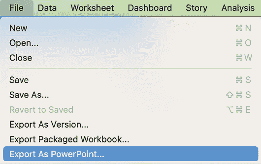

Figure 10.1: 导出为 PowerPoint…

选择后，系统会询问您是要导出当前视图还是工作簿中的工作表选择：

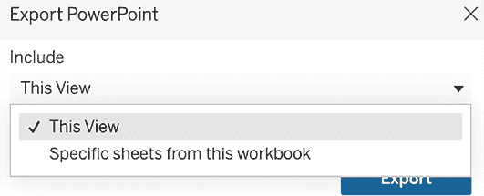

Figure 10.2: 导出 PowerPoint


尝试这两种选项，看看 Tableau 原生导出功能在 PowerPoint 中的呈现效果。如果您愿意多花一点精力，还有其他途径可以创建 Tableau 的 PowerPoint 实现。这些替代方案可能为您带来额外价值。以下练习将探讨实现此目的的各种技巧及其提供的额外价值。

## 创建模板

在第一个以 PowerPoint 为中心的练习中，您将创建一个模板，该模板将在后续练习中使用。它将包含常见的 PowerPoint 元素，如页眉和页脚。模板的尺寸为 1200 x 900，符合 PowerPoint 演示文稿通常使用的 4:3 宽高比。当然，如果您的公司使用其他宽高比，您随时可以调整！让我们看看以下步骤：

1.  访问 [`public.tableau.com/profile/marleen.meier`](https://public.tableau.com/profile/marleen.meier) 以查找并下载与本章关联的工作簿。
2.  创建一个新工作表并选择 `Superstore` 数据集。
3.  将工作表命名为 `Header`。
4.  将 `Sales` 放入 `Marks`（标记）卡中的 `Color`（颜色）货架。
5.  单击 `Marks` 卡中的 `Color`，单击 `Edit Colors...`（编辑颜色），然后选择灰色调色板并将 `Opacity`（不透明度）设置为 `50%`：

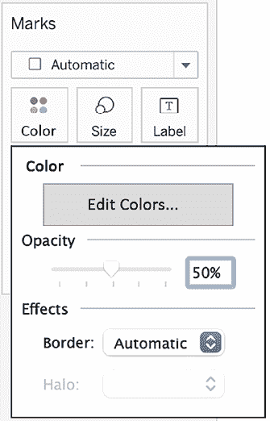

*图 10.3：不透明度*

1.  复制 `Header` 工作表并将副本命名为 `Footer1`。
2.  单击 `Marks` 卡中的 `Color`，单击 `Edit Colors...`，然后选择蓝色调色板：

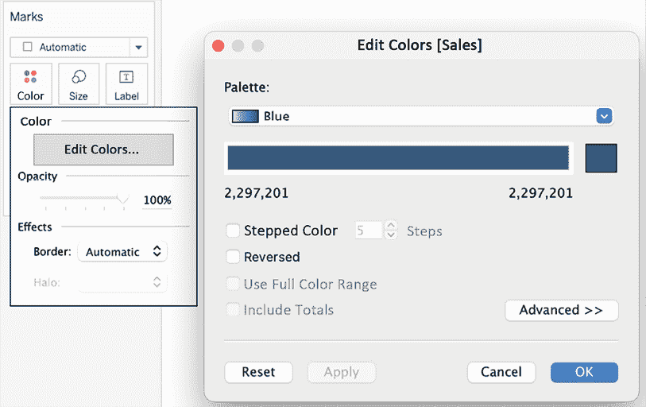

*图 10.4：调色板*

1.  复制 `Footer1` 工作表并将副本命名为 `Footer2`。
2.  单击 `Marks` 卡中的 `Color`，单击 `Edit Colors...`，然后选择灰色调色板并将 `Opacity` 设置为 `50%`。
3.  创建一个名为 `Template` 的新仪表板。
4.  在 `Dashboard`（仪表板）窗格中，将 `Size`（大小）设置为 `Custom size (1200 x 700)`（自定义大小 (1200 x 700)）：

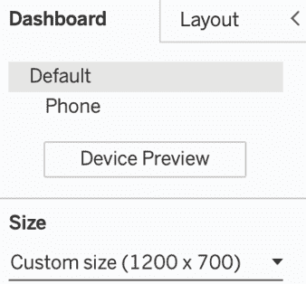

*图 10.5：仪表板的自定义大小*

1.  通过 `Dashboard` | `Show Title`（显示标题）来显示仪表板标题。
2.  双击 `title`（标题）。在生成的对话框中，如有需要，将文本左对齐。
3.  在 `Dashboard` 窗格中，确保选中了 `Tiled`（平铺）。这样可以确保单个工作表保持原位，不会相互重叠：

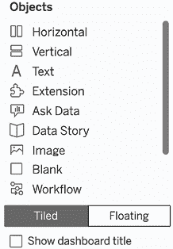

*图 10.6：平铺*

1.  从 `Dashboard` 窗格中，将 `Objects`（对象）面板中的 `Blank`（空白）拖放到仪表板的左侧。小心放置，使其从仪表板顶部延伸到底部，如下截图所示：

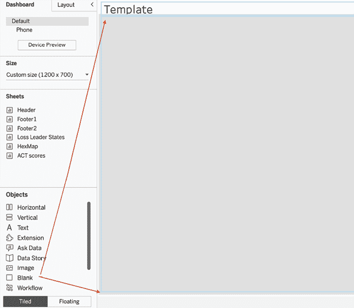

*图 10.7：添加空白区域*

1.  对仪表板的右侧、中间和底部重复上一步。创建底部边距时，请务必将对象定位为从仪表板最右侧延伸到最左侧。您的最终布局应包含四个容器和一个顶部左对齐的标题，如下所示：

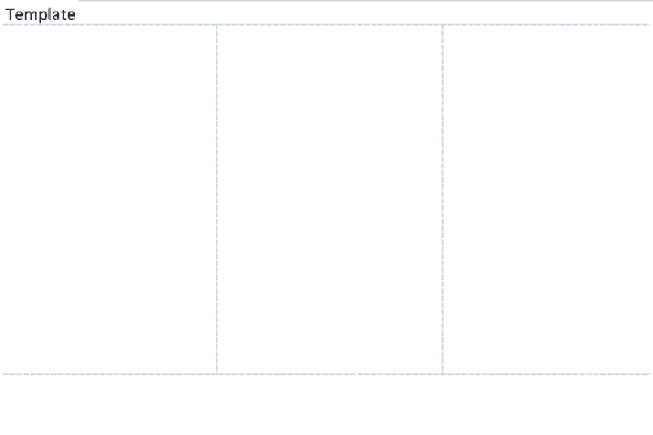

*图 10.8：布局*

1.  调整空白对象的大小以创建合适的边距。这可以通过拖动每个 `Blank` 对象的内边缘（即面向中心的边缘）尽可能向右、向左或向下来实现：

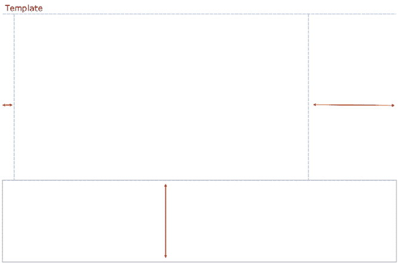

*图 10.9：增大尺寸*

1.  再次更改底部边距，通过选择容器并向下拖动底部线来将高度大约加倍，如 *图 10.9* 中箭头所示。
2.  在 `Dashboard` 窗格的 `Objects` 部分，单击 `Floating`（浮动）。
3.  将 `Header`、`Footer1` 和 `Footer2` 资源拖到仪表板上。放置位置无关紧要；我们稍后将对齐工作表。如果出现 `Sales` 图例，请将其删除。
4.  右键单击每个资源的标题并选择 `Hide title`（隐藏标题）。
5.  在 `Layout`（布局）窗格中，为每个工作表输入以下值：

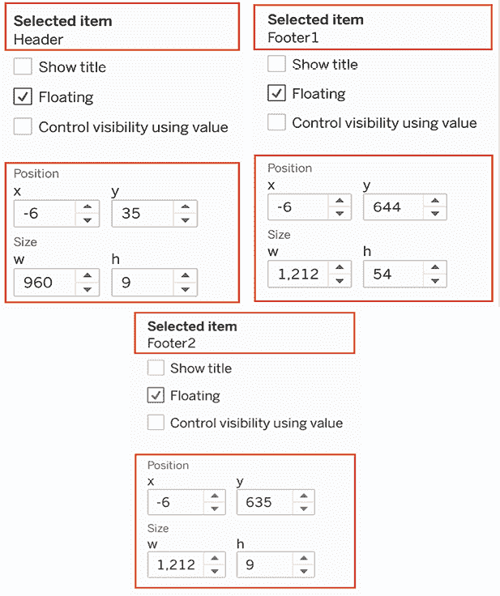

*图 10.10：更改位置*

1.  通过单击工具栏上 `Standard`（标准）一词旁边的 `Fit`（适应）下拉菜单并选择 `Entire View`（整个视图），将每个工作表设置为 `Entire View`：

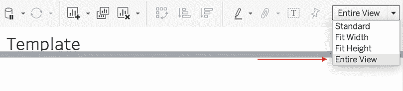

*图 10.11：更改视图*

1.  结果应是在标题下方刚好有一条页眉线，横跨仪表板的 80%，以及底部有两条横跨整个仪表板的横条：

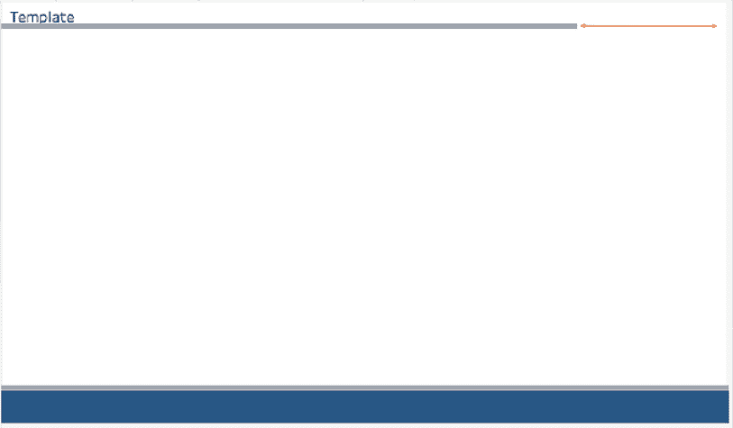

*图 10.12：布局*

1.  单击位于 `Template` 标题下方的容器。
2.  如果您尚未下载本章关联的资源，请立即下载。工作簿中提供了链接。
3.  在 `Objects` 窗格下方选择 `Floating`：

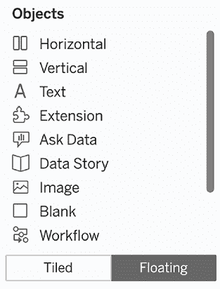

*图 10.13：浮动*

1.  将 `Dashboard` 窗格 `Objects` 部分中的 `Image`（图像）对象拖到仪表板上。出现提示时，选择本章提供的 `tableau-logo.png` 图像：

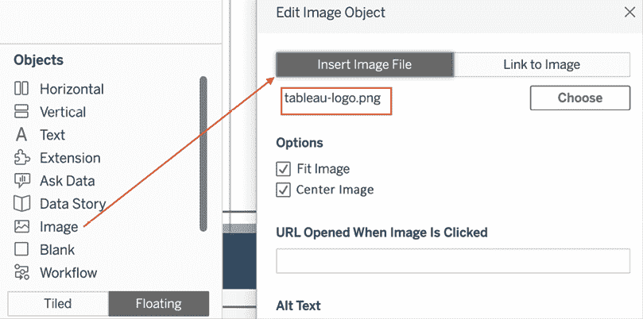

*图 10.14：添加图像*

1.  选择 `Fit Image`（适应图像）和 `Center Image`（居中图像）选项，然后单击 `OK`。
2.  通过 `Layout` 窗格按如下方式定位图像：

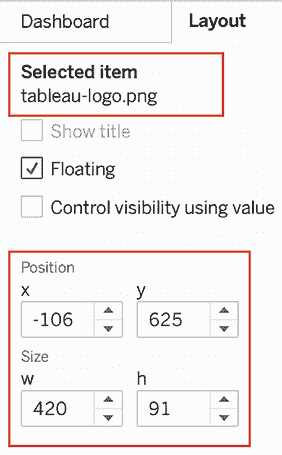

*图 10.15：定位徽标*

您的 PowerPoint 模板现已准备就绪，可以使用了：

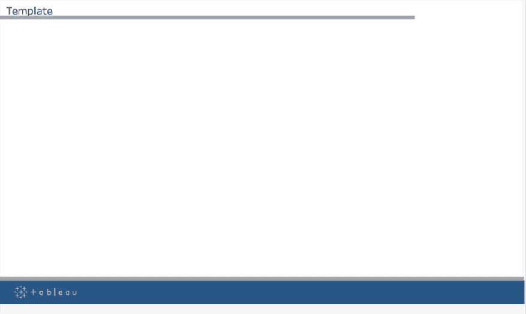

*图 10.16：模板*

现在您拍摄的每个屏幕截图周围都将始终具有相同的设计。这样做会让您的演示文稿看起来更吸引人，您的受众很快就能通过其设计风格识别出您的作品。这样的模板还可以帮助您遵循公司设计规范。作为一个额外的提示，请确保页眉、页脚和图表使用匹配的颜色！

接下来，我们将通过一些示例来查看模板的实际应用。

## 创建用于打印的仪表板

本练习将利用之前创建的模板并结合一个仪表板，使其适合打印和/或演示。提供了基本说明，但具体细节取决于个人偏好：

1.  右键单击名为 `Template` 的选项卡（在上一练习 *Creating a template* 中创建），然后选择 `Duplicate`（复制）。
2.  将复制的仪表板重命名为 `Superstore Loss Leaders`。
3.  使用工作表 `HexMap` 和 `Loss Leaders States` 填充 `Superstore Loss Leaders` 仪表板。（这是我基于 `Superstore` 数据集整理的两个工作表，一个在六边形地图上显示 `Profit Ratio`（利润率），另一个列出 `Bottom 20 Profit States`（利润最低的 20 个州），以确定需要更多努力的地方。）按需求排列。示例布局如下：

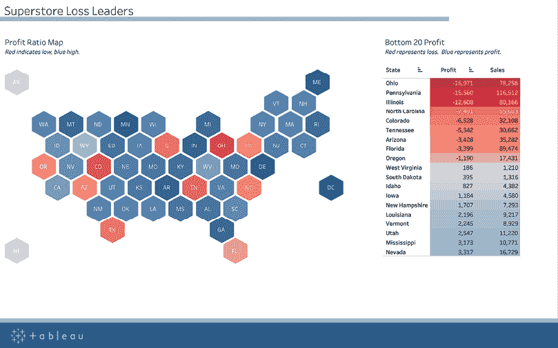

*图 10.17：仪表板和模板*

模板之上的仪表板看起来很棒，不是吗？它立刻看起来更有趣，更值得演示。但您可能会问，为什么我们选择使用那个特定的布局？让我详细说明一下：如果您想以打印版形式展示 Tableau 仪表板，或者必须将仪表板导出到 PowerPoint，请务必记住**所有交互功能都将丢失**。

Tableau 的亮点和最大卖点之一——交互性——在 2D 打印件上无法工作。但显然，您不想重新创建 Tableau Server 上已以某种形式存在的图表，而且您也不必这样做。只需确保您的受众在无法点击字段或悬停以显示更多信息的情况下也能理解该可视化：

* `Tip 1`（提示 1）：*图 10.17* 中的仪表板已调整为模板的颜色，使其看起来像是二者天然属于一组。


### 提示 2：六边形地图

此处使用了 `hexagon map`（`hex map`，六边形地图）代替 Tableau 自带的默认地图。原因在于：按实际比例打印时，东海岸的小州会消失不见，而阿拉斯加和夏威夷距离太远，通常也无法适配在地图上。六边形地图给每个州分配相同的空间，因此即使打印出来，用户也能同时看到阿拉斯加和罗德岛的情况。

### 提示 3：颜色指示器

颜色表明俄亥俄州和科罗拉多州的利润率尤为低下，但受众可能想了解更多详情。这时表格就派上用场了。利润率等于利润除以销售额，表格同时展示了这两个数字，以便受众更全面地了解现状，也能避免他们追问。

### 提示 4：后 20 个州

为避免打印时出现向下滚动条，我仅选择了排名后 20 位的州。如果主题是亏损产品，大概率不需要展示所有表现良好的州。

希望这个例子能给你一些灵感，了解如何为打印准备仪表板！如果打印需求较频繁，建议将其作为一个页面添加到 Tableau Server 上的交互式仪表板中，这样一旦有人索要，随时都能拿得出手。如果你有兴趣复刻六边形地图，请查看*第 8 章 进阶技巧*，或阅读以下文章：`https://www.tableau.com/about/blog/2017/1/viz-whiz-hex-tile-maps-64713`。

接下来，我们将看另一个示例，这次是关于每周 PowerPoint 演示文稿的自动化。

## 半自动化 PowerPoint 演示文稿

前面的练习（*创建模板* 和 *创建用于打印的仪表板*）演示了两种为 PowerPoint 演示文稿生成模板的方法，并提供了一些关于如何调整仪表板以适应打印和/或 PowerPoint 演示文稿的提示。然而，通常你的 Tableau 仪表板并非静态的，下次用到时数据可能已发生变化。你当然可以导出一个包含更新数据的新 PowerPoint 文件，但可能还有其他不想丢失的幻灯片。以下步骤将帮助你以半自动化的方式更新 PowerPoint 演示文稿：

1.  打开之前创建的名为 `Superstore Loss Leaders` 的仪表板。
2.  点击 `仪表板` | `导出图像…`：
    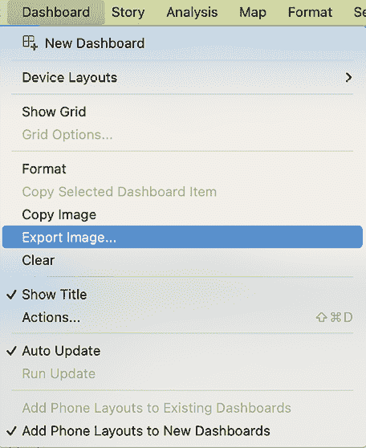
    图 10.18：导出图像…
3.  点击 `确定`，在弹出的对话框中，选择将图像另存为 `SuperstoreLossLeaders.png`。
4.  打开 PowerPoint 演示文稿。打开一张幻灯片。
5.  选择 `插入` 选项卡，然后选择 `图片` | `从文件中插入图片…`：
    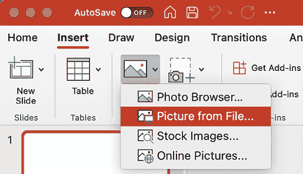
    图 10.19：向 PowerPoint 中插入图片
6.  定位到刚才导出的 PNG 图像。
7.  在 `插入` 对话框中，选择 `插入` 按钮旁边的下拉选择器，Windows 选择 `插入并链接`，Mac 选择 `选项` | `链接到文件` | `插入`。注意此步骤很重要，因为它将允许轻松替换图片，稍后将演示：
    
    图 10.20：链接到文件
8.  将 PowerPoint 演示文稿另存为 `AutoUpdate.pptx`。
9.  关闭 PowerPoint。在 Tableau 中修改仪表板；例如，从表格中移除一个州。
10. 通过 `仪表板` | `导出图像…` 覆盖之前导出的 `SuperstoreLossLeaders.png` 图像。
11. 打开 `AutoUpdate.pptx`，注意观察仪表板的新图像已显示出来。

在 Tableau 培训中，我经常遇到负责每周或每月提供 PowerPoint 演示文稿的人员。这些演示文稿包含需要更新的图表和图形，但整体布局保持不变。前面练习涵盖的技巧能让这个过程快得多。虽然 Tableau Desktop 只允许作者一次更新一张图片，但 Tableau Server 可配置为同时导出多张图片，从而让流程更高效。*第 14 章 探索 Tableau Server 和 Tableau Cloud* 将讨论从 Tableau Server 导出图像的内容。

如果能直接在幻灯片上展示我们的网页浏览器、Tableau Server，并包含所有交互性，那不是更好吗？下一节将介绍这一点，并分享一些相关思考。

## 将 Tableau 嵌入 PowerPoint

可以将 Tableau 直接嵌入 PowerPoint 演示文稿，更准确地说，是可以嵌入一个网页浏览器，通过它访问 Tableau Server 实例。有多种方法可以实现，包括 Web Viewer 应用、名为 LiveWeb 的第三方加载项以及 VBA 代码。

Web Viewer 应用可在 `https://appsource.microsoft.com/en-us/product/office/WA104295828?tab=Overview` 获取。虽然它对 Tableau Public 效果很好，但默认的 Tableau Server 设置禁止通过 Web Viewer 访问。你的 Tableau Server 管理员可以帮助更改设置。LiveWeb（可在 `http://skp.mvps.org/liveweb.htm` 获取）效果也不错，但需要额外安装。你必须从提供的 URL 下载安装程序并启动 PowerPoint。随后你将能向 PowerPoint 功能区添加另一个加载项，进而添加一个将直接在 Tableau 中显示的 Tableau Server URL。网站上也有详细说明。

## 将 Tableau 嵌入 Google Slides

Google Slides 是另一种广泛使用的演示工具，因其基于网页的特性而十分方便。就像在 PowerPoint 中一样，你可以插入图片、音频和视频，但遗憾的是无法插入网页或 Tableau 仪表板。

在撰写本文时，我未找到变通方法。不过，如果你不想在应用间切换，可以将 Google Slides 嵌入 Tableau，即反向操作。这至少将工具限制在一个之内！

让我们试一试：

你需要一个 Google 账号才能执行此操作。

1.  打开 Google Slides，`https://docs.google.com/presentation`，点击 `空白演示文稿` 以打开新演示文稿。
    输入类似以下内容：
    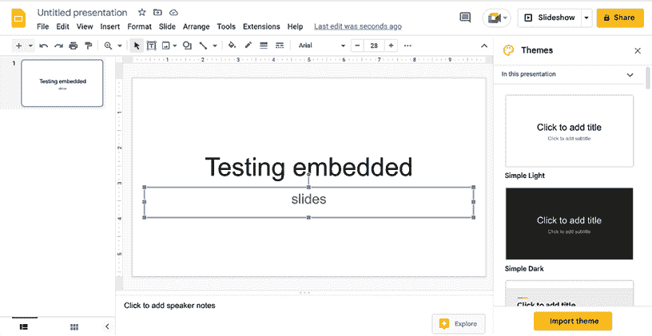
    图 10.21：Google Slides
2.  填充第二页：
    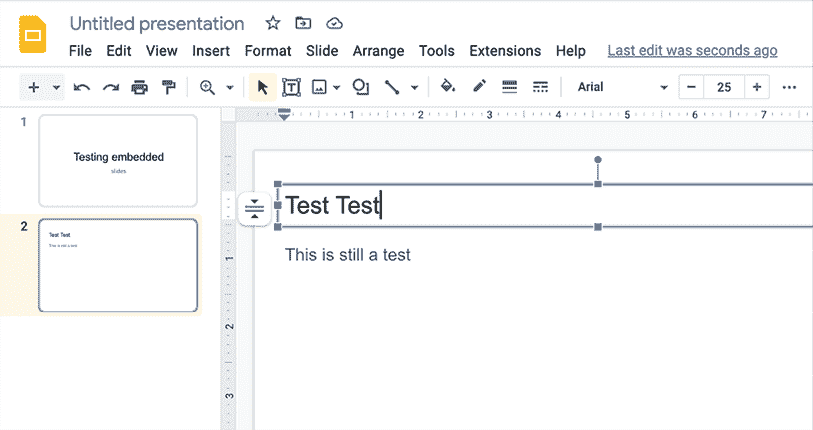
    图 10.22：测试幻灯片
3.  点击 `文件` | `分享` | `发布到网络`。
4.  将下拉菜单 `自动播放幻灯片` 改为 `每分钟`。然后点击 `发布`：
    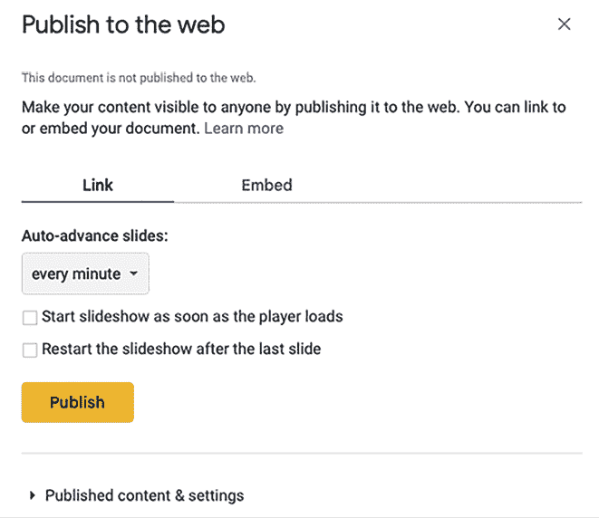
    图 10.23：发布到网络
5.  复制此时出现的 URL。
6.  在 Tableau 工作簿中打开一个新的仪表板页面。
7.  将 `网页` 对象拖放到仪表板上：
    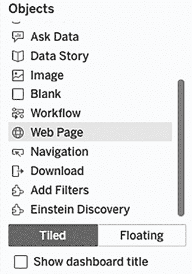
    图 10.24：网页
8.  粘贴之前从 Google Slides 复制的 URL，并移除高亮部分 `&delayms=60000`：
    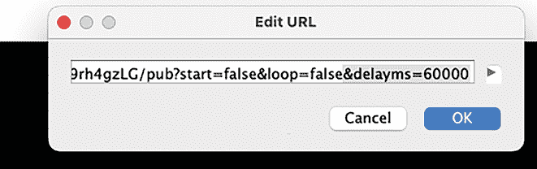
    图 10.25：URL
9.  现在你应该能在 Tableau 中看到你的演示文稿了！幻灯片的控制器位于左下角：
    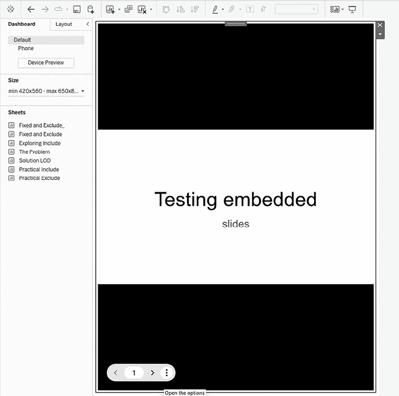
    图 10.26：Tableau 中的幻灯片

在本节中，你学习了如何将 Google Slides 嵌入 Tableau 仪表板，从而使用单一工具而非在两者间切换。接下来，我们将讨论为 Tableau 引入动画的方法，以辅助你的数据故事讲述。

## 为 Tableau 添加动画


# 在 Tableau 中创建动画

在演示文稿中加入动画对于吸引观众非常有效。Hans Rosling 凭借其广受欢迎的 YouTube 视频 *200 Countries, 200 Years, 4 Minutes* ([`youtu.be/jbkSRLYSojo`](https://youtu.be/jbkSRLYSojo)) 完美地实现了这一点。在该视频中，Rosling 利用数据可视化追踪了随时间变化的财富和预期寿命。他将数据可视化与深刻的评论以及对信息传递的热情相结合，使得 Rosling 的视频成为任何有兴趣利用数据制作引人入胜的演示文稿的人必看之作。

动画易于实现，且可通过 Tableau Reader 以及 Tableau Server（自 2020.1 版本起）使用。在撰写本文时，我仅遇到一个缺点：上传到 Tableau Server 的带有动画的工作表将仅提供单一播放速度，而 Tableau Desktop 则显示三种速度。无论如何，这都不应阻止您使用此功能。

以下练习追踪了 1991 年至 2015 年的 ACT 考试分数。完成该练习以学习如何在 Tableau 中创建动画，并探究美国的标准化考试成绩随时间是否有所提高。

执行以下步骤：

1.  打开与本章关联的工作簿，并导航至名为 `ACT 1991–2015` 的工作表。

2.  选择 `ACT` 数据源。

3.  将工作表重命名为 `ACT scores`。

4.  将 `Year` 放入 `Columns`（列）货架，`Score Value` 放入 `Rows`（行）货架，并将 `Score Type` 放入 `Marks`（标记）卡中的 `Color`（颜色）。

5.  右键单击 `Score Value` 轴并选择 `Edit Axis...`（编辑轴）。在生成的对话框中，取消勾选 `Include zero`（包含零值）。

6.  将 `Year` 放入 `Pages`（页面）货架。您的视图应如下所示：

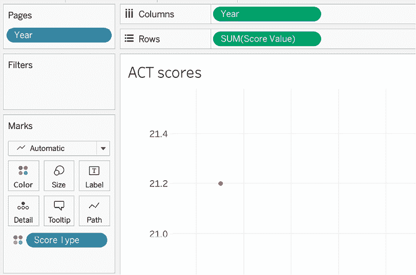

图 10.27：ACT 分数 – 1991

7.  在工作表上出现的 `Current Page`（当前页面）面板中，勾选 `Show history`（显示历史）。单击箭头打开下拉菜单，并按如下截图所示对齐所有参数：

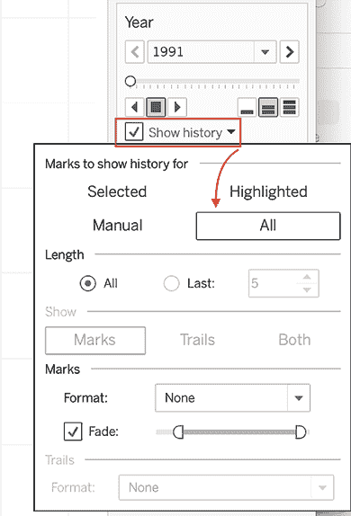

图 10.28：对齐参数

8.  在 `Marks`（标记）卡中，单击下拉菜单将视图类型从 `Automatic`（自动）更改为 `Circle`（圆形）。

9.  再次单击 `Show history`（显示历史）下拉菜单，注意 `Show`（显示）选项和 `Trails`（轨迹）选项现已可用。在 `Show` 下，选择 `Both`（两者）。

10. 单击 `Trails` 下的 `Format`（格式）下拉菜单，然后选择虚线选项：

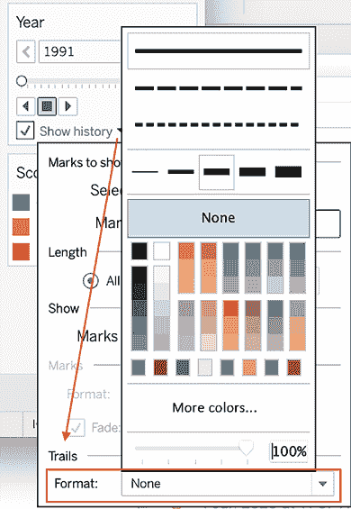

图 10.29：虚线

11. 为了简要延伸在 Tableau 中创建虚线的主题，若要了解如何创建具有不同虚线类型的多条线，请查看 [`boraberan.wordpress.com/2015/11/22/quick-tip-creating-your-own-dashed-line-styles-in-tableau/`](https://boraberan.wordpress.com/2015/11/22/quick-tip-creating-your-own-dashed-line-styles-in-tableau/)，Bora Beran 在那里开创了一种使用计算字段插入空值以实现不同线条效果的方法。

    自 Tableau 2023.2 起，基本折线图已支持虚线和点线。

12. 现在，单击播放按钮，查看 Tableau 如何逐年演示：

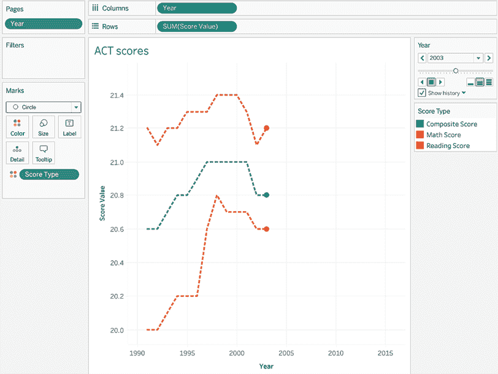

图 10.30：动画

尽管此功能并非深度分析的理想用例，但它确实有助于直观展示随时间的变化，例如在演示或任何其他类型的故事讲述中。我最近一次使用它是为了展示产品集群如何随时间变化，并得出结论：集群不应保持静态。随后，我继续寻找此类集群变化的早期识别方法，以便相应地调整定价和营销策略。

总之，可以在 Tableau 中使用名为 `Pages` 的功能创建动画。希望您能为该功能找到许多用例。接下来，我们将以不同的方式使用动画功能，向您展示如何利用它导出多张图像。

## 使用动画导出多张图像

从时间线导出多张图像可能有必要，原因至少有两个。首先，查看每个时间快照的单独图像可能在分析上具有优势；例如，一个月中每一天的一张单独图像。其次，可能需要在 Tableau 之外创建动画，例如在 PowerPoint 中。

接下来的两个练习 *使用动画导出多张图像* 和 *在 Tableau 中使用动画创建 PowerPoint 动画* 涵盖了这两种场景：

请注意，以下步骤假设已完成上一个练习。

1.  打开与本章关联的工作簿，并导航至名为 `ACT scores` 的工作表：

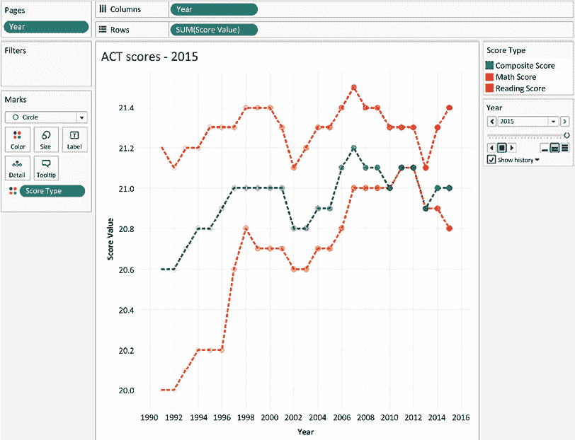

图 10.31：ACT scores 最终版

2.  选择 `File`（文件）| `Page Setup...`（页面设置）。在生成的对话框底部，在 `Pages Shelf`（页面货架）下，选择 `Show all pages`（显示所有页面）：

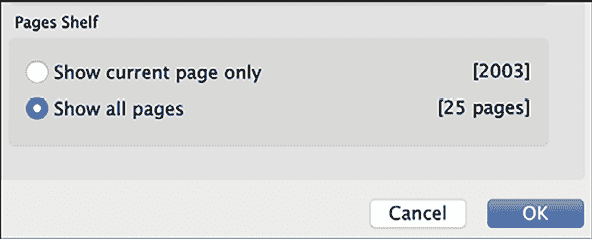

图 10.32：显示所有页面

3.  选择 `File`（文件）| `Print to PDF`（另存为 PDF）。Mac 用户应选择 `File`（文件）| `Print`（打印）。

4.  在生成的对话框中，将 `Range`（范围）设置为 `Active Sheet`（活动工作表）。同时，将方向设置为 `Landscape`（横向）。

5.  单击 `OK`，并将 PDF 另存为 `Animation.pdf` 到您选择的位置。

6.  访问 [`www.pdftoppt.com/`](https://www.pdftoppt.com/)。上传 `Animation.pdf` 并将其转换为 PowerPoint。转换完成几分钟后将发送一封电子邮件。

7.  通过电子邮件中提供的链接下载文件，并在 PowerPoint 中打开它。

8.  在 PowerPoint 中，选择 `File`（文件）| `Save As`（另存为）。在 `Save As type`（保存类型）下拉菜单中，选择 `\*.png`：

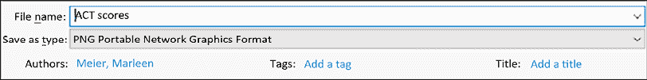

图 10.33：Animation.png

9.  当提示时，选择导出 `All Slides`（所有幻灯片）：

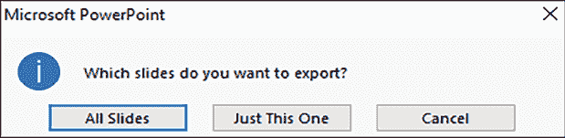

图 10.34：所有幻灯片

10. 保存 PowerPoint 演示文稿。请注意，当 PowerPoint 完成保存时，将显示一个对话框，声明演示文稿中的每张幻灯片均已另存为单独的文件。

11. 根据需要打开并检查保存的 PNG 文件：

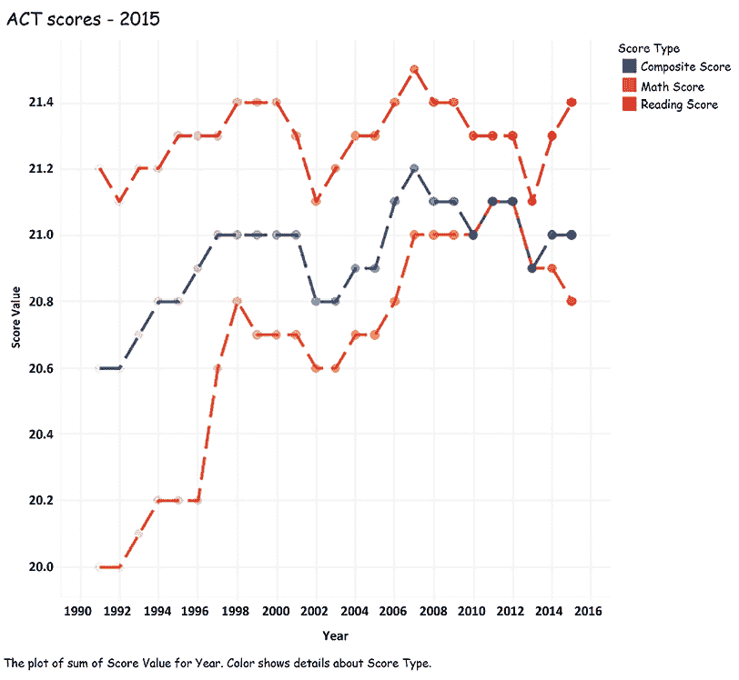

图 10.35：最后一张幻灯片为 .png 格式

通过遵循上述所有步骤，您应该能够一次性保存多张图像。希望这能为您节省时间，尽管这种情况可能不常发生，但了解此选项将使您受益。

## 在 Tableau 中使用动画创建 PowerPoint 动画

本练习将向您展示如何利用上一个练习中保存的大量图像创建动画。因此，我们将使用之前创建的文件在 PowerPoint 中制作动画：

1.  访问上一个练习中从 [`www.pdftoppt.com/`](https://www.pdftoppt.com/) 下载的 PowerPoint 演示文稿。

2.  在 `View`（视图）选项卡中，在 `Presentation Views`（演示视图）组下选择 `Slide Sorter`（幻灯片浏览）。

3.  选择 PowerPoint 演示文稿中除最后一张以外的**所有幻灯片**。

4.  在 `Transition`（切换）选项卡的 `Timing`（计时）组中，设置为在 0.1 秒后自动切换幻灯片：

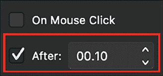

图 10.36：自动切换幻灯片

5.  按 `F5` 查看动画。

这很酷吧？您可以看到类似于在 Tableau 中使用 Pages 看到的模拟效果！为了进一步改进 PowerPoint 中的动画，请考虑以下额外步骤：

*   将初始 PDF 上传至 [`pdfresizer.com/crop`](https://pdfresizer.com/crop) 并按需裁剪大小。

*   如果 PowerPoint 中的动画太慢，很可能是因为保留了所有文本和绘图元素。例如，背景网格由单独的线条组成。渲染所有文本和绘图元素消耗大量资源。请考虑使用 *使用动画导出多张图像* 练习中创建的 PNG 图像创建一个单独的 PowerPoint 演示文稿。这将使动画运行得更快、更流畅。


我希望本节能给您一些关于如何改进和用 PowerPoint 给人留下深刻印象的想法。使用这些新学到的技巧，您可能甚至不再需要 Prezi。不过，如果不提及故事点，本章就不算完整，故事点是一项功能，如果您根本不想使用 PowerPoint，它将大有裨益。

# 故事点和用于演示的仪表板

**故事点**是 Tableau 对 PowerPoint 的回应。因此，两者有着根本的相似之处。PowerPoint 演示提供了一种线性的沟通方式。Tableau 中的故事点也是如此。PowerPoint 演示提供幻灯片，每张幻灯片都是一块空白画布，为用户提供了无限的可能性来传达想法。Tableau 中的故事提供故事点，目的相同。

尽管存在根本相似之处，但重要的是要理解 Tableau 故事点和 PowerPoint 演示通常不扮演相同的角色。各有优势，因此应考虑优缺点列表。

我们可以在下表中查看 PowerPoint 和 Tableau 故事点的优缺点：

| | PowerPoint | | Tableau 故事点 | |
| --- | --- | --- | --- | --- |
| 优点 | 缺点 | 优点 | 缺点 |
| 创建快速简便 | 难以根据底层数据变化自动化 | 随底层数据变化自动更新 | 创建可能更困难 |
| 轻松适配不同分辨率 | 难以创建允许非线性思维的演示 | 轻松允许在演示中途进行非线性探索 | 需要预先考虑分辨率大小 |

那么，在制作演示时，如何决定使用 PowerPoint 还是 Tableau？也许下列清单能帮上忙：

| 何时使用 PowerPoint | 何时使用 Tableau 故事点 |
| --- | --- |
| 观众几乎没有即时反馈机会的演示 | 可能有即时反馈且可能被问到探索性问题的演示 |
| 包含清晰划分要点的一次性演示 | 可重复使用的演示，更新主要基于底层数据变化 |
| 显示器分辨率大小可能无法提前知晓的演示 | 显示器分辨率大小已知或假设的演示 |

创建和使用故事点的基础很简单，而且在撰写本书时，除了基础之外没有太多内容。既然本书专注于更高级的 Tableau 理念和概念，这里将不涉及那些基础知识。如果您需要快速了解故事点基础，我建议阅读以下页面：<https://help.tableau.com/current/pro/desktop/en-us/stories.htm>。

我喜欢故事点，特别是当观众面前打开着他们自己的 Tableau 版本并能跟着自己的操作一步步跟进时，我喜欢使用它们。这是让人们获得更深入理解的好方法，因为它允许您展示比静态截图更复杂的内容。如果您想总体提升演示技巧，请继续阅读下一节。

# 演示资源

在 Tableau 中有效使用故事点或许更多是艺术考量而非技术考量。虽然本书试图始终考虑数据可视化的最佳实践，并鼓励制作美观且用户友好的工作表和仪表板，但有效演示技巧的讨论超出了本书范围。

如果您想提高创建有效演示的能力，请考虑以下资源：

*   **Tableau 故事点**：通过示例学习是无价的。Tableau 上可以找到优秀的故事点示例。要从最引人入胜的示例中学习，请访问 <https://help.tableau.com/current/pro/desktop/en-us/story_example.htm>。
*   **TEDx 演讲**：TEDx 演讲非常适合学习，甚至可以在通勤或离开办公桌时收听。我推荐的一个视频是 Phil Waknell 的 *The 3 Magic Ingredients of Amazing Presentations*：<https://www.youtube.com/watch?v=yoD8RMq2OkU>。
*   **博客**：这里有一篇讨论 Tableau 故事点与良好演示方法相结合的有趣文章：<https://www.artofvisualization.com/blog/10-secrets-perfect-tableau-story>。

尽管这些演示技巧超出了本章范围，但我确实希望前述资源能给您提供思考的素材。

# 摘要

我们本章开始时探讨了各种屏幕捕获工具以及 Tableau 的原生导出功能。接着，我们转向 PowerPoint，探讨了从 Tableau 工作簿创建 PowerPoint 演示的各种方法，甚至探索了如何将 Tableau 的实时实例嵌入 PowerPoint。随后，我们讨论了 Tableau 动画。最后，我们探讨了如何使用故事点和仪表板进行演示。在 *第 11 章*、*设计仪表板和可视化最佳实践* 中，我们将把注意力转向仪表板设计，我们将超越典型仪表板的正常界限，但不会忽视实际应用。

# 在 Discord 上了解更多

要加入本书的 Discord 社区——您可以在其中分享反馈、向作者提问并了解新版本——请扫描下方的二维码：

<https://packt.link/tableau>


# 11

# 设计仪表板和可视化最佳实践

现在，我们将深入探讨数据可视化的基本原则和最佳实践，特别关注仪表板设计。通过探索如何以视觉上引人注目且信息丰富的方式呈现数据，您将获得知识并学习技巧，帮助创建有影响力的仪表板，以有效传达洞察、推动决策并吸引受众。本章受到数据可视化领域几位巨匠的影响：Alberto Cairo 的 *The Functional Art*，Stephen Few 的 *Information Dashboard Design*，Steve Wexley、Jeffrey Shaffer 和 Andy Cotgraeve 合著的 *The Big Book of Dashboards*，William Lidwell、Kritina Holden 和 Jill Butler 合著的 *Universal Principles of Design*，Nancy Duarte 的 *Data Story*，以及 Edward Tufte 的 *The Visual Display of Quantitative Information*。

在本章中，我们将涵盖以下主题：

*   可视化设计理论
*   格式规则
*   颜色规则
*   可视化类型规则
*   保持可视化简洁
*   仪表板设计
*   仪表板最佳实践
*   额外内容

既然我们已经定义了本章的主题，让我们深入设计理论，它将为您提供可应用于您构建的每一个仪表板的规则。

# 可视化设计理论

您的可视化思维过程应始终从最底层的设计基础开始。换句话说，我们将从显示在仪表板上的工作表开始讨论，并确保这些工作表设计良好。

因此，我们的讨论将从可视化设计原则开始，例如以下受 *7 principles of design* 启发的集合：<https://www.turing.com/kb/what-are-the-7-principles-of-design-detailed-breakdown>：

*   **强调**最重要的内容
*   **放大**重要数据点
*   **对齐和平衡**元素，适当使用颜色、大小和纹理


*   使用 `contrast` 突出显示元素或组
*   将颜色或字体的使用 `Limit` 限制在三种以内，以增强品牌识别度并保持可控性
*   使用人眼友好的 `proportions`，如黄金分割
*   让用户的视线沿 `Z` 字形 `moving` 移动
*   使用 `lines` 表示基准或阈值
*   使用 `white space` 进行组织和构建

因此，在下一节 `Formatting rules` 中，我们将探讨各种规则，同时请记住：一旦你掌握了基础知识，就可以打破规则以实现特定目的。

# 格式规则

以下格式规则涵盖 `fonts`、`lines` 和 `bands`。字体当然是一个显而易见的格式考量因素。然而，线条和色带可能不是你通常会处理的东西——但在 Tableau 中，线条和色带肯定应予以考虑。这说明数据可视化与平面设计密切相关，在平面设计中，线条和色带扮演的角色比在 Excel 中重要得多，且格式设置考量的远不止文本布局。

## 保持字体选择简洁

通常，在仪表板上使用一到两种字体是明智的。字体过多会造成混乱的环境，干扰可读性。

标题字体应粗壮结实，而正文字体应易于阅读。在 Tableau 中，选择合适的字体很简单：选择 `Format` | `Font` 以显示 `Format Font` 窗口，查看并选择你喜欢的字体。

Tableau 自带字体总是好用的，如 Tableau Bold、Tableau Book、Tableau Medium、Tableau Light 等。对于特殊场合，我喜欢使用 Corbel 或尝试新字体。

## 按可见性顺序使用线条

我们倾向于按以下顺序排列线条可见性：趋势线、图表线、参考线、下拉线和网格线。例如，趋势线的可见性应高于参考线。可见性通常通过增加线条粗细来增强，但也可通过颜色饱和度，或选择点线或虚线而非实线来增强。让我们按可见性递减的顺序看看各种线条类型：

*   `Trend lines`：趋势线（如果存在）通常是图表上最显眼的线条。趋势线通过 `Analytics` 面板显示，可通过 `Format` | `Lines` 进行调整：
    *   `Use case`：包含许多数据点且随时间大幅波动的时间序列。使用趋势线显示总体方向（随时间增加/减少），从而使用户更容易处理信息。

*   `Chart lines`：图表线（例如时间序列图上使用的线）不应过粗，以免遮盖数据的曲折变化。虽然图表线可通过使用 `Pages` 货架显示为点线或虚线，但通常不建议这样做，因为这可能会降低可见性。图表线的粗细可通过点击 `Marks remove bold` 区域中的 `Size` 货架进行调整：
    *   `Use case`：这是折线图的实际线条。

*   `Reference lines`：通常比趋势线少见，可通过 `Format` | `Reference lines` 进行格式设置：
    *   `Use case`：一条直线，用于显示例如在仪表板视图中至少一个维度上保持静态的阈值。

*   `Drop lines`：不常用。要部署下拉线，请在 `view` 的空白处右键单击并选择 `Drop lines` | `Show drop lines`。接下来，单击视图中的一个点以显示下拉线。要设置下拉线格式，请选择 `Format` | `Drop Lines`。仅当可视化中至少使用了一个坐标轴时，下拉线才相关：
    *   `Use case`：标记从图表上某点到坐标轴的线条。它有助于识别与该数据点关联的具体值。

*   `Zero lines`：这些有时被称为基线，仅当视图包含零或负值，或正数值相对接近零时才显示。通过 `Format` | `Lines` 设置零线格式：
    *   `Use case`：如果你对默认零线不满意，可以对其进行格式设置。它有助于区分正值从何处开始、负值从何处结束（反之亦然）。

*   `Grid lines`：这些应是视图上最淡的线条，甚至可以完全去掉。通过 `Format` | `Lines` 设置网格线格式：
    *   `Use case`：网格线帮助眼睛识别远离坐标轴的数据点的值。使用它们帮助用户更好地理解可视化中的数值。

## 将色带按三到五个一组使用

由长文本表或水平条形图组成的可视化应将维度成员分成三到五个一组。

请遵循以下步骤，体验在 Tableau 中高效使用色带：

1.  导航至 <https://public.tableau.com/profile/marleen.meier> 以查找并下载与本章关联的工作簿。
2.  导航至 `Banding` 工作表。
3.  选择 `Superstore` 数据源，并将 `Product Name` 放置在 `Rows` 货架上。
4.  双击 `Discount`、`Profit`、`Quantity` 和 `Sales`。请注意，完成此步骤后，Tableau 默认每隔一行添加一个色带。这种默认格式适用于短表，但对于长表来说显得杂乱，且可能导致大数据集出现性能问题。
5.  导航至 `Format` | `Shading`，在 `Row Banding` 下设置 `Band Size`，使每个色带包含三到五行文本。请务必为 `Pane` 和 `Header` 设置合适的颜色：

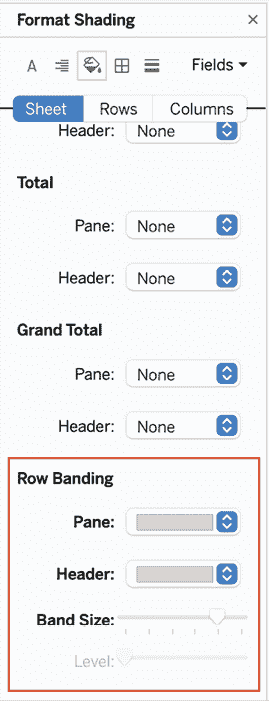

图 11.1：格式阴影

`三到五个一组分组色带` 规则受 Dona W. Wong 影响，她在其著作 `The Wall Street Journal Guide to Information Graphics` 中建议用细线分隔长表或条形图，将条形分成三到五个一组，以帮助读者横向阅读。

# 颜色规则

在一本将以黑白印刷的书中讨论颜色规则似乎略显讽刺（以下载彩色图片，请访问：<https://packt.link/TybKH>。当然，如果你在电子设备上阅读本书，情况可能并非如此）。尽管如此，即使在单色环境中，颜色讨论依然相关。例如，纯黑文本传达的含义与使用灰色变体不同。以下颜色规则列表有助于确保你在各种场景下有效地使用颜色。

## 保持颜色简洁有限

坚持使用基本色调，仅提供少数（也许三到五种）色调变体。在其著作 `The Functional Art: An Introduction to Information Graphics and Visualization` 中，Alberto Cairo 阐述了原因：

> 我们视觉工作记忆的有限容量有助于解释为何不建议在地图和图表上使用超过四五种颜色或象形图来标识不同现象。

## 尊重颜色的心理暗示

世界各地都有根深蒂固的色彩词汇，使其成为第二天性。红色常用于爱情或危险；在一些亚洲国家，它也象征好运，是婚纱的常见颜色。绿色象征好运，而在墨西哥，绿色代表独立。绿灯示意通行，红灯示意停止。同样，仪表板上的颜色通常有特定用途。红色和橙色通常与负面表现关联，而蓝色和绿色与正面表现关联。违背直觉地使用颜色会造成困惑，因此请注意颜色用法、受众及其解读。

## 对色盲友好


# 色觉缺陷与配色规则

快速的谷歌搜索告诉我：“*据估计，全球有 3 亿人患有色觉缺陷。12 名男性中就有 1 名色盲，200 名女性中就有 1 名色盲。*”因此，在你的职业生涯中，你的受众中很有可能会出现色盲或色觉缺陷者。色盲通常表现为无法区分红色和绿色，或蓝色和黄色。红/绿和蓝/黄位于色环的相对两侧。

因此，这些色彩组合给色盲人士带来的挑战，可以使用 Photoshop 等图像编辑软件轻松复现。如果你不是色盲，请将包含这些色彩组合的图像转换为灰度模式并观察。那 8.0% 的男性和 0.5% 的女性色盲人士所面临的挑战将立刻变得显而易见！或者，使用以下网站上传你的仪表盘图像，体验你的用户可能如何看到所用的颜色：[`www.color-blindness.com/coblis-color-blindness-simulator/`](https://www.color-blindness.com/coblis-color-blindness-simulator/)。

## 少用纯色

以下练习产生的颜色应该是非常鲜艳的红、绿、蓝。取决于显示器，你甚至可能发现难以直视这些颜色。这些被称为**纯色**，应少量使用，也许仅用于突出特别重要的项目或警报，例如超出阈值的情况。

请遵循以下步骤：

1.  打开与本章关联的工作簿，并导航到 `Pure Colors`（纯色）工作表。

2.  选择 `Superstore` 数据源，并将 **Category**（类别）同时放置在 **Rows**（行）货架和 **Color**（颜色）货架上。

3.  将 **Fit**（适应）设置为 **Entire View**（整个视图）。

4.  点击 **Color**（颜色）货架并选择 **Edit Colors...**（编辑颜色...）。

5.  在 **Edit Colors**（编辑颜色）对话框中，依次选择各成员——即 **Furniture**（家具）、**Office Supplies**（办公用品）和 **Technology**（技术），并分别选择蓝色、绿色和红色：

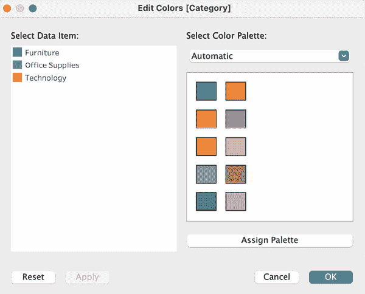

图 11.2：颜色

亲自体验一下直视这些纯色的感受，并选择其他三种不那么鲜艳的颜色进行对比。过于鲜艳的颜色会让眼睛非常疲劳，难以聚焦。然而，颜色过于相似则难以区分。找到一个良好的平衡是关键。

## 选择颜色变化而非形状变化

对于最终用户而言，辨识不同的形状比区分颜色消耗更多的脑力。因此，应使用颜色变化代替形状变化。

请看下面的散点图，作为形状变化的示例：

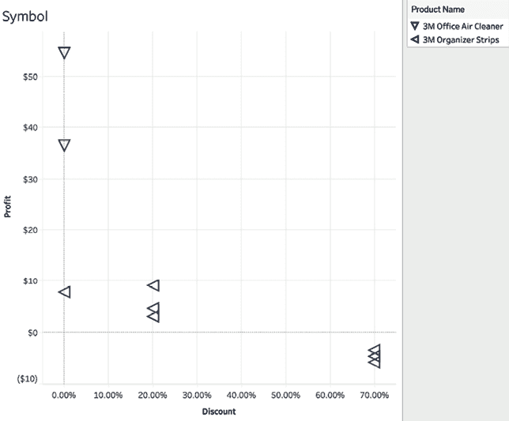

图 11.3：形状变化

再看使用颜色变化的相同图表：

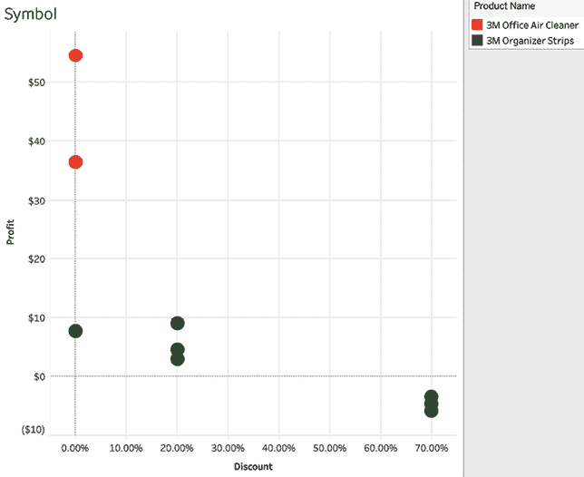

图 11.4：颜色变化

总结配色规则：保持调色板简洁，并注意你所在地区和文化中颜色的含义。同时，考虑到你的受众中可能有色觉缺陷者；工具可以帮助你明智地选择颜色，Tableau 也提供了色盲专用调色板。少用纯色，因为过多的鲜艳色彩会让受众难以聚焦于重要项目。最后，不要在一个视图中使用过多的形状；相反，应使用颜色来区分类别。

# 可视化类型规则

本节值得单独成书，且与讲故事、沟通和说服等许多其他学科相互关联；因此，我们不会在此花费时间深入探讨冗长的可视化类型规则列表，而是重点介绍几个经常被讨论的规则。我们将考虑保持简单形状与复杂形状的对比，以及饼图的有效使用。

## 保持形状简单

过多的形状细节会阻碍理解。这是因为形状细节会将用户的注意力从数据上引开。请考虑以下使用两种不同购物车图像的练习。

让我们看看以下练习步骤：

1.  打开与本章关联的工作簿，并导航到 `Simple Shopping Cart`（简单购物车）工作表。请注意，该可视化是一个散点图，显示了按总销售额和利润排名的前 10 个子类别。

2.  导航到位于 `My Tableau` 存储库中的 `Shapes` 目录。在我的电脑上，路径是 `C:\Users\Marleen Meier\Documents\My Tableau Repository\Shapes`。在你的电脑上找到相应的 Tableau 存储库并打开 `Shapes` 目录。

3.  在 `Shapes` 目录中，创建一个名为 `My Shapes` 的文件夹。

4.  参考工作表注释部分包含的链接，下载与本章关联的素材。在下载的材料中，找到名为 `Shopping_Cart` 和 `Shopping_Cart_3D` 的图像，并将这些图像复制到 `My Shapes` 目录中。

5.  在 Tableau 中，访问 `Simple Shopping Cart` 工作表。

6.  点击 **Shape**（形状）货架，然后选择 **More Shapes**（更多形状）。

7.  在 **Edit Shape**（编辑形状）对话框中，点击 **Reload Shapes**（重新加载形状）按钮：

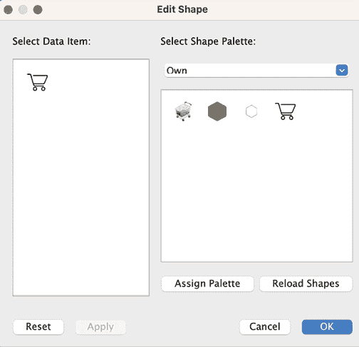

图 11.5：重新加载形状

8.  选择 **My Shapes** 调色板，并将形状设置为 `Shopping_Cart`。

9.  关闭对话框后，点击 **Size**（大小）货架并按需调整。同时，按需调整可视化的其他方面。

10. 导航到 `3D Shopping Cart` 工作表，然后重复上述 *步骤 6-9*。这次不使用 `Shopping_Cart`，而是使用 `Shopping_Cart_3D`。请看以下截图，对比简单购物车和 3D 购物车：

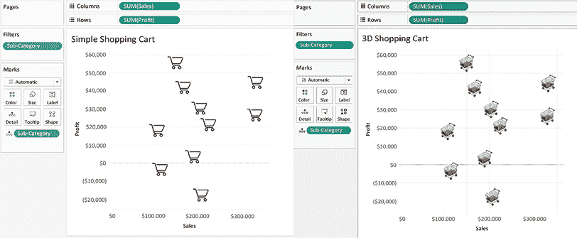

图 11.6：2D 与 3D

对比这两个可视化。哪个版本的购物车更吸引人？你很可能会选择外观 3D 的那个。那么，为什么不选择更吸引人的图像呢？让可视化具有吸引力只是次要考量。主要目标是尽可能清晰高效地展示数据。简单的形状比复杂的形状更容易被快速直观地理解。此外，3D 图像的可爱感会很快消退。

## 少用饼图

爱德华·塔夫特在其著作《定量信息的视觉显示》中对饼图的使用发表了尖刻的批评，他说表格永远比饼图好，因为我们人类无法解读饼图的视觉维度。

数据可视化界的主流情绪很大程度上同情塔夫特的批评。然而，可能存在一些例外——即某些饼图最优的情况。请考虑以下可视化：

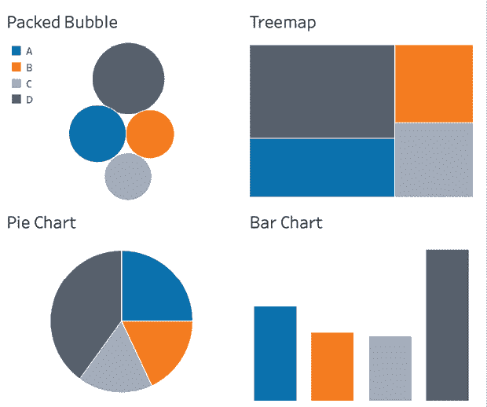

图 11.7：可视化对比

这四个可视化中，哪个最能表明 A 占整体的 25%？显然是饼图！因此，或许将饼图称为“有局限性”并少用它们更为公平，而不是认为它们天生就不可取。

通常，构建可视化是一项平衡的艺术。从书籍、博客、顾问甚至组织内部遇到相互矛盾的指导并不罕见。有人可能坚持利用每一个像素的空间，而另有人则主张简洁和留白。有人建议采用引导式方法，而另有人则推荐构建宽开放的仪表盘，让最终用户自行探索路径。

前卫类型可能渴望晦涩的可视化，而较为保守的人则倾向于遵循惯例。让我们探讨一些更常见的相互竞争的需求，并提出折中方案。

## 使仪表盘简单且稳健


# 奥卡姆剃刀与仪表板复杂度

奥卡姆剃刀原则表明，解决任何问题最简单的方案通常是正确的。然而，有时即使是最简单的方案也相当复杂。这没关系！Tableau 仪表板设计中的复杂性不必被回避。但清楚了解一些基本准则，可以帮助作者在简洁性需求与稳健性需求之间做出明智的权衡：

*   **更频繁的数据更新需要更简单的设计**：某些 Tableau 仪表板可能接近实时。可能会利用第三方技术，强制通过 Tableau Server 显示仪表板的浏览器每隔几分钟刷新一次，以确保显示最新数据。在这种情况下，设计应当相当简单。最终用户必须能立即看到所有相关数据，不应将该仪表板用于广泛分析。反之，每月刷新一次的仪表板可以支持高复杂度，因此可用于深度探索。

*   **最终用户专业度越高，支持的仪表板复杂度越大**：了解你的用户。如果他们想要一目了然的可视化，请保持仪表板简单。如果他们喜欢深度挖掘，请相应设计。

*   **受众越小，设计需要越精准**：如果只有少数人监控某个仪表板，可能需要高度定制化的方法。在这种情况下，规格可能很详细，这既复杂又难以执行和维护。因为小规模用户群有预期，而这些预期在 Tableau 中可能不容易原生实现。

*   **屏幕分辨率与可视化复杂度成正比**：低分辨率设备的用户需要简单交互仪表板。因此，此类仪表板的设计可能相应简单。反之，高分辨率设备支持更高复杂度。

*   **距离屏幕越远，仪表板元素需要越大**：如果仪表板设计用于会议室查看，仪表板上的元素可能需要足够大，以满足远离屏幕人员的观看需求。因此，仪表板可能相对简单。反之，主要在最终用户桌面查看的仪表板可以更复杂。

尽管这些观点都关乎简单与复杂，但请勿将简单等同于容易。一个简单且优雅设计的仪表板，创建难度可能超过复杂仪表板。

正如史蒂夫·乔布斯所言，简单比复杂更难；然而，简单可以移山填海。

## 优秀呈现密集信息

通常，折线图最多应有四到五条线。但有时你可能希望显示许多线。可以通过呈现多条线并赋予最终用户按需高亮的能力来达成妥协。下面的折线图显示了 2000 年至 2012 年各国互联网使用率百分比。用户可选择一个国家，该国线条将变色，从而与其他国家对比。

我们可以在以下屏幕截图中看到此示例：

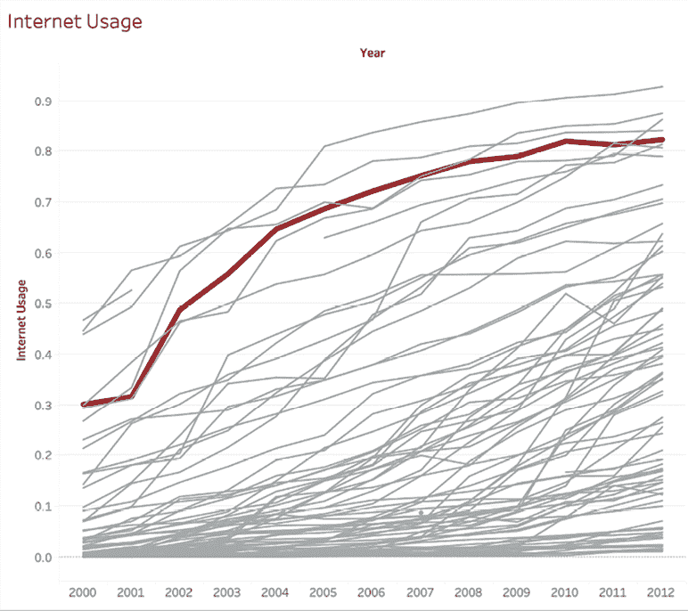

**图 11.8：多线图表**

使用折线图与多线图表时，不应关注一条线与另一条特定线的对比表现，而应关注一条线在众多线中的表现行为。

## 讲好数据故事

在《Data Story》一书中，Nancy Duarte 详细解释了用数据讲故事的各种技巧，许多与前文讨论的可视化设计理论重叠。我们现在聚焦于几个讲故事特有的新方面：

*   **探索数据点，深入钻取更低聚合层级**。可视化工具提示（见本章“在仪表板上最大化文档”节）以及动作（见本章“仪表板最佳实践”节）都是实现此目的的好方法。

*   **关联你的数据**；例如，如果距离、大小、时间或速度难以理解，将其转化为已知事物。或者，“如果太阳像足球一样大，月亮像……那么两者距离就从这里到 x 处。”又如，与其显示毫克单位的糖量，不如呈现为糖块数量，或关联到建议每日摄入量。

*   **运用修辞引导读者走过你的故事视角**，融入情感词汇、反问句和感叹词。

*   **如果你的数据与人类相关——通常确实如此——请将其人性化**。与人交谈，了解问题；随后可在仪表板添加定性信息。注意不要做假设。

你会意识到，讲好故事并非想象中那么容易：

> “几乎一切皆可计数和衡量。在数据中寻宝并发掘出金字塔般的机遇字节，令人振奋……愿你在职业生涯中，既精通数据科学，又掌握沟通数据的艺术。”
>
> —— Nancy Duarte，《Data Story》

你可以选择使用指令式仪表板设计（即引导观看者的仪表板），或构建允许发现众多故事的仪表板。你的选择将因数据集和受众而异。如果你选择创建故事发现平台，请务必采用 Grimwade 在 Alberto Cairo 所著《The Functional Art: An Introduction to Information Graphics and Visualization》中建议的《纽约时报》方法：“提供提示、指针和良好的文档，引导最终用户成功地与你想讲述的故事互动，或成功发现他们自己的故事。”

## 在仪表板上最大化文档

在“讲好数据故事”节中，我们考虑了提供提示、指针和良好文档的建议，但存在一个问题：这些内容占用空间。仪表板空间宝贵。Tableau 作者常被要求在仪表板上塞入更多内容，因此寻找节省空间的方法。以下建议可在最小化占用屏幕空间的前提下，最大化仪表板上的文档：

*   **精心设计标题以实现清晰沟通**：标题是必须的。不仅仪表板和仪表板上的工作表需要标题，图例、筛选器和其他对象也需要。这些标题可用于高效有效的文档。例如，筛选器不应仅显示“市场”。而应显示“选择一个市场”等。注意祈使语句。用户被告知要做什么，这是有益的提示。在标题中添加几个词通常不会影响仪表板空间。

*   **使用副标题传达说明**：副标题会占用一些额外空间，但不必太多。标题正下方的小号斜体字体，是用户寻找指引的显眼位置。例如：“红色代表亏损”。这句话可作为副标题，甚至可能省去图例，从而节省空间。

*   **使用直观图标**：考虑从一个仪表板导航到另一个仪表板的用例。当然，你可以将动作与超链接文本关联，说明其导航到另一仪表板。但这似乎没必要，因为可以将动作与一个小巧、无害的箭头关联（如 PowerPoint 原生使用的），传达相同含义。

*   **将更详尽的文档存储在与帮助图标关联的工具提示中**：应用程序右上角的小问号很常见。我目前正在 Word 中撰写本章，Word 就有这种问号。在 Tableau 仪表板中，灯泡图标常用于相同目的。这清晰地传达了需要额外帮助时去哪里。如下面的练习所示，创建它很容易。

按以下步骤创建信息丰富的工具提示以帮助用户：


1. 打开与本章关联的工作簿并导航至 `Help` 工作表。

2. 将鼠标悬停在工作表上的灯泡图标上，并记下出现的文本：

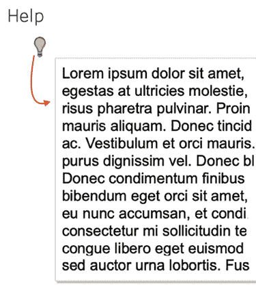

图 11.9：Lorem ipsum

请注意，前面屏幕截图中显示的 *Lorem ipsum...* 文本通常被网页设计师使用，他们从排版工那里借用了它，后者已将这段拉丁文本用作占位符几个世纪了。访问 [www.loremipsum.io](http://www.loremipsum.io) 了解更多信息。

此工作表中的文本是通过 `Worksheet` | `Tooltip` 部署的。可以将此工作表巧妙地放置在仪表板上（例如右上角），以提供非常详细的文档，同时极小地占用空间。

# 可视化类型

另一组重要规则是针对什么数据类型使用什么可视化！仅举几个例子：

*   偏差数据使用脊柱图
*   相关性使用散点图或热力图
*   时间序列使用折线图或地震图
*   排名使用条形图、棒棒糖图或凸凹图
*   分布使用直方图或箱线图
*   整体中的一部分数据使用树图、网格图或瀑布图
*   反映量级使用条形图、雷达图或子弹图
*   空间数据使用流图、点密度图或热力图
*   流向使用桑基图、瀑布图或网络图

此列表远非详尽；如果您想获取有关此主题的更多信息，我强烈建议查看 Andy Kriebel 创建的 *Visual Vocabulary*（可视化词汇表），其灵感源自 *Financial Times* ([`ft-interactive.github.io/visual-vocabulary/`](https://ft-interactive.github.io/visual-vocabulary/))，可在 Tableau Public 上找到：[`public.tableau.com/profile/andy.kriebel#!/vizhome/VisualVocabulary/VisualVocabulary`](https://public.tableau.com/profile/andy.kriebel#!/vizhome/VisualVocabulary/VisualVocabulary)。每个类别包含多种合适的可视化类型；您可以点击给定类别以查看详情：

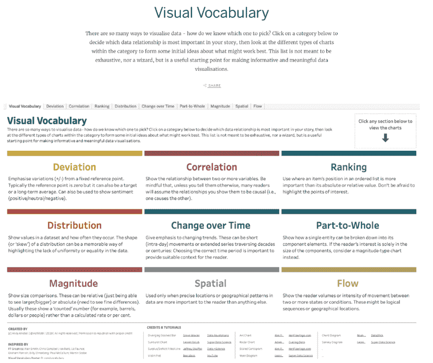

图 11.10：Visual Vocabulary

例如，这是 `Distribution`（分布）类别的详细页面：

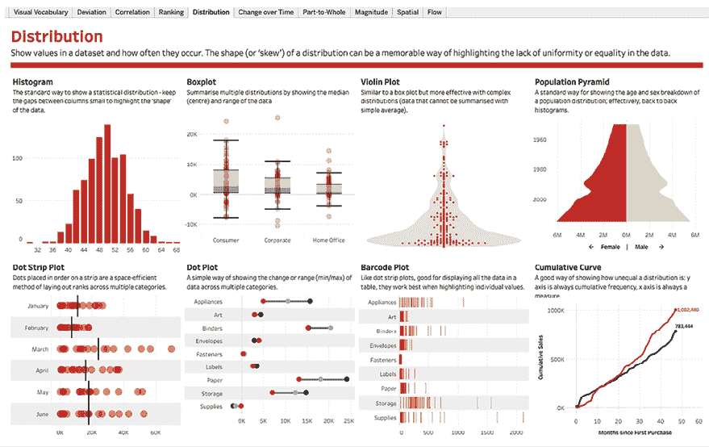

图 11.11：Visual Vocabulary – Distribution

为您的图表选择一个匹配度高的可视化类型是创建优秀仪表板的起点。请将其作为优先事项，花一些时间研究这个主题；这是大多数项目中的关键决策。

# 保持可视化简洁

有些人厌倦了反复看到相同的图表类型。这会导致诸如“我们能不能让仪表板花哨一点？”之类的要求。通常，应抵制此类情绪。正如本章开头所述，为了多样化而引入多样性会适得其反。尽管如此，有时不太常见的可视化类型可能比更流行的类型是更好的选择。这些时候是什么时候？

在以下场景中使用不太常见的图表类型：

*   图表用于吸引最终用户的注意力。
*   该图表类型能更有效地呈现数据。

有时，不太常见的图表类型可以有效地用于吸引最终用户的注意力以达到某个目的，例如幽默、阐明要点或使可视化更令人难忘。Tableau 404 错误页面上就有这样一个例子。导航至 [`www.tableau.com/asdf`](http://www.tableau.com/asdf) 并观察紧凑气泡图中的大脚怪。请注意，此页面会不时更改，因此您可能会看到猫王、外星人或其他可视化内容。

第二点的一个例子是使用树图代替饼图。两者都是非笛卡尔图表类型（`Rows` 或 `Columns` 架上没有字段的可视化），用于显示整体中的一部分。饼图是两者中更常见的，但树图通常能更好地呈现数据。至少有三个原因：

*   树图可以表示更多数据点。
*   树图的矩形特性更高效地利用显示器空间。
*   饼图扇区的大小比树图区块的大小更难区分。

有时，使用不太常见的可视化类型可能会招致抱怨：*我喜欢饼图。给我个饼图！* 在这种情况下，妥协可能是可行的。本章稍后我们将讨论工作表交换。正如您将了解到的，工作表交换可以允许最终用户决定查看哪种可视化类型。最终，如果无法妥协且发工资的人想要一个不太理想的图表类型……好吧，我建议您照做！

# 仪表板设计

现在我们已经完成了可视化理论的讨论，让我们将注意力转向仪表板设计。我们将从一个问题开始：什么是仪表板？这很难回答；然而，许多组织在日常对话中的用法表明，人们对什么是仪表板有明确的概念。此外，搜索引擎结果提供了大量定义。但这些定义可能有显著差异，甚至相互矛盾。

为什么定义仪表板如此困难？部分原因是因为数据可视化作为一个整体，特别是仪表板设计，是一个新兴领域，它结合了许多其他学科。这些学科包括统计分析、平面与网页设计、计算机科学，甚至新闻学。一个拥有如此多组成部分的新兴领域是一个移动的目标，因此难以定义。

就我们的目的而言，我们将从 Stephen Few 的定义开始，该定义首次出现在 2004 年的 *Intelligent Enterprise* 期刊中。他指出，仪表板是我们需要达到的关键统计数据的可视化显示，所有这些细节都在单个屏幕上呈现，以便可以在一处观察这些信息。然后，我们将扩展并调整该定义以适用于 Tableau 仪表板。

虽然这个定义很好，但 Tableau 采取了更广泛的方法。例如，Tableau 仪表板可能包含在单个屏幕上，但可以设计（且非常有效地）为需要滚动。更重要的是，Tableau 仪表板通常是交互式的，这为探索、分析和设计选项打开了一个新世界。因此，让我们尝试一个以 Tableau 为中心的仪表板定义：

*Tableau 仪表板是一个包含一个或多个数据可视化的显示界面，旨在使用户能够快速查看指标。该显示界面可能提供交互元素，如筛选、高亮和下钻功能，从而支持进一步的探索和分析。*

## 仪表板布局

仪表板的布局之所以重要，原因与杂志跨页或网页的布局之所以重要是一样的。将正确的信息放在正确的位置，有助于查看者快速高效地收集信息并得出结论。

为了体会这一事实，请回想一下您上一次不得不在一个构建糟糕的网页中搜寻重要信息的经历。您本可以将时间更好地用于实际应用这些重要信息！

### 黄金比例布局

您可能听说过斐波那契数列或黄金比例。既然距离您上数学课可能已经过去几年了，简短的回顾可能会有所帮助。

斐波那契数列是一系列数字，其中每个数字都是前两个数字之和——例如，1, 1, 2, 3, 5, 8, 13, 21。

当矩形最长边与最短边的比率约为 1.618 时，即可得到黄金矩形。该比率称为黄金比例。在数学上，黄金比例表示如下：

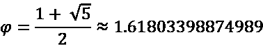

当用斐波那契数列中的每个数字除以前一个数字时，可以看到斐波那契数列与黄金比例之间的联系；例如，取以下数列：

0, 1, 1, 2, 3, 5, 8, 13, 21, 34

这将导致以下结果：


# 仪表板布局

## 黄金比例布局

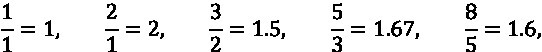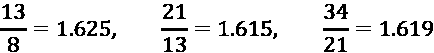

现在，让我们考虑一种使用黄金比例的仪表板布局。这里显示的布局由矩形构成，使得每个矩形的长度或高度都是下一个矩形的 1.618 倍。螺旋线（称为黄金螺旋线）显示出来是为了演示矩形的顺序：

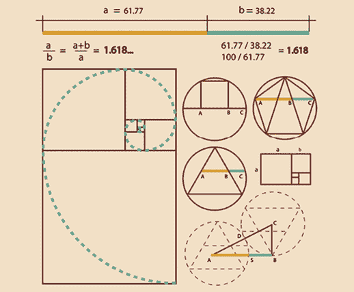

**图 11.12：** 黄金比例 (https://www.pixpa.com/blog/golden-ratio)

斐波那契数列/黄金矩形/黄金比例在自然界和历史中无处不在。许多贝壳和花朵都紧密遵循斐波那契数列。吉萨大金字塔的建造似乎考虑了黄金比例。菲迪亚斯很可能使用黄金比例来设计雅典帕特农神庙的雕像。事实上，帕特农神庙本身就是按黄金矩形比例设计的。即使最近的研究表明该比例无法精确到小数点后，自然界和艺术仍然非常接近其背后的数学原理。

那么，如前图所示，黄金比例代表理想的仪表板布局吗？也许更贴切的说法是，这张图代表了一种可接受的仪表板布局。理想不在于抽象概念中，而在于应用中。仪表板布局有时可能接近黄金比例，但正如我们将看到的，其他仪表板布局可能更适合不同的场景。

这里显示的仪表板（也包含在随附本章的 Tableau 工作簿中）利用了黄金矩形：


**图 11.13：** 黄金矩形

请注意，此示例并未试图将黄金比例延伸到越来越小的矩形中。存在实际限制。

黄金矩形布局特别适合引导观众从较粗的粒度过渡到较细的粒度。在此示例中，仪表板的左侧部分显示最粗的粒度，即 17 个子类别。接下来是地图。最后，散点图显示最细的粒度。创建遵循此路径的操作将为最终用户提供自然的交互体验。例如，最终用户可能会先点击 `Tables`，然后点击 `Pennsylvania` 州，以观察散点图中的异常值。

## 四象限布局

四象限布局将仪表板分成四个大致相等的象限。它易于实现。在空白仪表板上，只需在 `Dashboard`（仪表板）窗格中双击四个工作表即可。结果就是四象限布局，尽管可能需要进行一些小调整以适应图例、筛选器和参数。要查看四象限布局，请参阅*图 11.7* 中的示意图。

## 小倍数布局

小倍数布局在单个仪表板上显示多个视图。与四象限布局一样，小倍数布局只需在 `Dashboard`（仪表板）窗格中双击每个所需的工作表即可实现。

当查看重复使用相同可视化类型的信息时，小倍数很有用。此外，统一的主题也很有帮助；例如，下面的屏幕截图演示了美国各州利润表现的主题。试图用多种可视化类型和多种主题创建小倍数布局可能会很混乱且难以交互：


**图 11.14：** 小倍数布局

有些布局本质上是主题的变体。例如，显示三个视图的布局，其中仪表板上的一个视图占据其他两个视图各自面积的两倍，本质上可能是四象限布局的一种变体。其他布局难以简单分类，且因特定仪表板而异。无论如何，希望这能为您未来设计仪表板提供一些思考素材。

我们在讨论妥协时已经提到了下一节——工作表交换，这是一个非常适合妥协的绝佳功能。如果利益相关者要求您构建一些您知道可能不太好或不符合可视化最佳实践的内容，您可以随时添加工作表交换，让利益相关者满意，同时为其他用户提供替代方案。我们将在下一节中演示一个工作表交换练习。

# 利用工作表交换

工作表选择（通常称为工作表交换）允许 Tableau 作者隐藏和显示可视化图表，以及将工作表移入和移出仪表板。

这些技术已被创造性地使用，并取得了一些非常令人印象深刻的结果。例如，Tableau Zen Master Joshua Milligan 利用工作表选择构建了各种游戏，包括井字棋和二十一点。就我们的目的而言，我们将坚持使用工作表选择来帮助创建符合我们讨论过的设计原则的仪表板。

在*谨慎使用饼图*一节中，我们讨论了饼图和矩形树图，并指出矩形树图是更好的可视化图表。然而，人们通常对饼图更熟悉。作为一种折衷，在第一个练习中，我们将回顾一个允许最终用户选择查看饼图还是矩形树图的示例。

请遵循以下步骤：

1. 打开与本章关联的工作簿，并导航到 `Population Pie`（人口饼图）工作表。

2. 选择 `World Indicators`（世界指标）数据源，并注意名为 `Blank` 的计算字段。该代码由带有一个空格的单引号组成。

3. 将 `Blank` 放在 `Columns`（列）货架上。

4. 在视图中，通过 `Ctrl` + `A` 或拖动选框框住整个饼图来选择所有饼图切片。非笛卡尔可视化类型（例如，`Rows`（行）或 `Columns`（列）货架上没有字段的可视化图表）需要此步骤才能使工作表交换生效。否则，当将工作表放入仪表板上的垂直容器中时，工作表将无法正确拉伸以填满容器的宽度。

5. 右键单击任意饼图切片，然后选择 `Annotate`（注释）| `Mark`（标记）。

6. 在生成的对话框中，删除除 `<Country>` 之外的所有文本：


**图 11.15：** 注释

7. 根据需要定位和格式化注释。请注意，饼图部署到仪表板上后可能需要进一步调整。

8. 创建一个名为 `Select Chart Type`（选择图表类型）的参数，设置如下：


**图 11.16：** 参数

9. 创建一个名为 `Sheet Swap`（工作表交换）的计算字段，包含以下代码：

```
[Select Chart Type]
```

10. 将 `Sheet Swap` 放在 `Filters`（筛选器）货架上，在生成的对话框中选择 `Pie Chart`（饼图）。

11. 右键单击 `Select Chart Type` 并选择 `Show Parameter Control`（显示参数控件）来显示参数。

12. 导航到 `Population Tree`（人口树图）工作表。

13. 将 `Blank` 放在 `Columns`（列）货架上。

14. 将 `Sheet Swap` 放在 `Filters`（筛选器）货架上，在生成的对话框中选择 `Treemap`（矩形树图）。

15. 如果 `Treemap` 未显示为选项，请确保 `Select Chart Type` 参数已切换到 `Treemap`，然后单击 `OK`（确定）：


**图 11.17：** 筛选器

16. 创建一个名为 `Latin American Population`（拉丁美洲人口）的新仪表板。

17. 在 `Dashboard`（仪表板）窗格中，双击 `Vertical`（垂直）以在仪表板上放置一个垂直容器。

18. 在 `Dashboard`（仪表板）窗格中，依次双击 `Population Tree` 和 `Population Pie` 以将它们添加到视图中。

19. 右键单击标题 `Population Tree` 和 `Population Pie`，然后为两者都选择 `Hide Title`（隐藏标题）。

20. 将 `Population Map`（人口地图）和 `Population Change`（人口变化）放在仪表板上，然后按需定位：


**图 11.18：** 仪表板

21. 按住 Shift 键拖动 `Select Chart Type` 参数到 `Treemap` 上方以悬浮控件；按需定位。


2. 删除所有图例和快速筛选器。根据需要设置仪表板中所有元素的格式、文档记录和位置。用户现在可以决定查看 `Treemap` 还是 `Pie Chart`。

下面是包含树图的仪表板示例：


图 11.19：包含树图的仪表板

下面是包含饼图的示例：


图 11.20：饼图

您可以使用工作表交换功能，以防某些用户更偏爱其中一种可视化视图。接下来，我们将创建一个可在仪表板上隐藏的筛选器菜单。在 *Maximizing documentation on a dashboard* 部分中，我们提到仪表板空间非常宝贵。因此，在第二个练习 *Creating a collapsible menu* 中，我们将回顾一个示例，该示例将使用工作表选择功能，允许最终用户显示或隐藏筛选器，从而更有效地利用屏幕空间。

## 创建可折叠菜单

请遵循以下步骤，了解如何向仪表板添加可折叠筛选器菜单：

1. 复制我们在前一个练习中创建的仪表板，并将其重命名为 `Collapsible Menu`。如果您未完成前一个练习，请使用随本章提供的解决方案工作簿中包含的仪表板。

2. 选择仪表板上的任意工作表，然后单击箭头；选择要显示的筛选器 `Country` 和 `Years Only`。


图 11.21：筛选器

3. 这两个筛选器将被放置在仪表板右侧的一个容器中。双击其中一个筛选器顶部中间的两条水平线，以改为选择该容器。周围的线条将变为蓝色。选择 `Add Show/Hide Button`：


图 11.22：添加显示/隐藏按钮

4. 请注意，筛选器旁边会显示一个 `X`。在 `Presentation Mode` 下，现在可以使用此按钮来最小化筛选器：


图 11.23：国家/地区

在本节中，我们了解到，通过使用容器和筛选器，Tableau 可以自动调整容器中所选工作表的大小。此功能可用于营造工作表可被交换的假象。然而，Tableau 实际上只是将一个最小化并将另一个最大化，尽管这在用户眼中是不可见的。很棒，不是吗？

完成此练习后，您可能会想，好吧，从技术上讲，筛选器并未显示在仪表板上，但它们仍然可见于一侧。虽然这在 Tableau Desktop 中是事实，但如果您将工作簿上传到 Tableau Server 实例，您会注意到，单击菜单图标时，筛选器会出现和消失，而不会显示在一侧。

可折叠菜单是一个非常不错的附加功能，有助于简化您的仪表板。如果您阅读过本书的上一版（第三版），您可能会记得那是一个繁琐的过程——与其说是一项功能，不如说是一种变通方法，用于实现可折叠菜单的功能。现在，有了 `Add Show/Hide Button`，这变得轻而易举。用户可以专注于数据，仅在需要时使用筛选器。

# 仪表板最佳实践

可视化最佳实践不仅限于视觉特性；操作、筛选器和数据组织同样重要。本节将提及 Tableau 提供的其中一些功能。每一项功能都将帮助您改善用户体验，或跟踪您所构建的内容——因为有时在使用许多不同工作表时，您可能会迷失方向。

我们将首先讨论六种不同类型的 `Actions`，随后是 `Download` 和 `Navigation Object`，然后是 `Used In feature`，最后是 `Item Hierarchy`。所有这些都有助于获得更好的仪表板构建体验。让我们开始吧！

## 操作

隐含地，我们之前已经讨论过几次这个问题，但现在让我们明确地看看，通过使用 `Actions`，我们在可视化和仪表板设计方面可以实现什么。当您希望用户通过单击或悬停在可视化视图中的数据来进行重定向时，`Actions` 就会发挥作用。如果您有大量数据要显示，但不想将所有数据都放在同一个仪表板上，这会很有帮助。您也不应该这样做，因为这会分散注意力，而且如果是层次结构数据，操作是实现下钻技术的完美方式。

以下部分将解释您可以在 Tableau 中使用的所有不同操作，以添加交互性，从而支持简洁高效的仪表板设计。

### 筛选器操作

在本示例中，我们将使用筛选器操作来显示最初隐藏的数据。这样做可以确保我们一次只展示较小的数据块，用户可以下钻到任何感兴趣的点。请遵循以下步骤：

1. 请打开工作表 `Quantity by State`：


图 11.24：地图

您可以在前面的屏幕截图中看到，每个州代表给定产品的销售数量。但如果单击某个州就能查看更多详细信息，那不是很好吗？为此，我们必须设置操作。

2. 首先，我们需要一个要在操作中使用的第二个工作表。请打开工作表 `Profit by State by Category`：


图 11.25：表格

您可以在前面的屏幕截图中看到，显示了每个州、每个类别及对应的利润。

3. 现在，返回工作表 `Quantity by State` 以启用一项操作，该操作将提示用户转到 `Profit by State by Category` 工作表，然后根据他们单击的州进行筛选。

4. 在 `Quantity by State` 工作表上，选择 `Worksheet` | `Actions`；将出现以下窗口。单击 `Add Action` 按钮并选择 `Filter...`：


图 11.26：筛选器操作

5. 在下一个窗口中，添加一个名为 `Map to table (quantity to profit)` 的筛选器操作，并复制屏幕截图中显示的设置。然后，单击 `OK`：


图 11.27：筛选器操作参数

6. 如果您现在在工作表 `Quantity by State (Source Sheet)` 上单击某个州，Tableau 将在目标工作表中查找相同的 `State` 并相应地进行筛选。以下是单击 `Texas` 后的示例：


图 11.28：已筛选的表格

本节讨论的筛选器操作可用于清理您的仪表板。遵循设计原则通常意味着少即是多，如果您有许多数据点要共享，下钻或筛选器操作可以帮助您实现这一目标。先展示高层级数据，然后在筛选器操作背后展示更详细的数据层。您还可以在标题下方为用户添加一句说明，如 *Click on a state to see more details*。

### 高亮操作

其他选项包括（例如）高亮操作。这对于同一页面上的工作表更有用，因为它只会高亮显示适用的字段。您可以在同一个仪表板上显示所有数据，但高亮操作使用户更容易找到相关数据点。请遵循以下步骤：

1. 请打开仪表板 `Qty & Profit`，它结合了我们之前使用的两个工作表：


图 11.29：仪表板

2. 单击 `Dashboard` | `Actions`，这一次，复制以下 `Highlight Action` 参数：


图 11.30：高亮操作

3. 上述参数意味着，在 `Qty & Profit` 仪表板上，我们的源工作表将是 `Quantity by State`，当悬停在其上时，目标工作表上的相应数据将被高亮显示。在这种情况下，唯一的公共数据是 `State`，因此高亮显示器将只考虑 `State`。结果如下所示：


图 11.31：高亮操作仪表板


将鼠标悬停在地图上的亚利桑那州上，右侧表格中的同一州将会被高亮显示。正如你所见，实现高亮筛选器可以帮助用户更快地找到相关数据点。与导航操作不同，此筛选器应用于同一页面上的工作表，并作为查找值的视觉辅助。

## URL 操作

下一个操作是 URL 操作。此操作允许在仪表板中单击数据点时打开一个 URL。请按以下步骤操作：

1. 转到 `Quantity by State` 工作表并打开 `Worksheet | Actions`（工作表 | 操作）。
2. 删除所有可见的操作。
3. 现在，选择 `Add Action`（添加操作）并选择 `Go to URL...`（转到 URL...）。复制下图所示的所有参数，然后单击 Wikipedia URL 旁边的箭头。来自数据源的字段将会出现，这使你能够向 URL 添加一个字段，该字段将根据仪表板自动返回一个值。选择 `State`（州）：


图 11.32：URL 操作

4. 在 `Quantity by State` 工作表上单击地图上的某个州，看看 Wikipedia 如何打开相应的网页。

当你想向用户展示网站上可用的附加信息时，URL 操作非常有用。你也可以使用经纬度值打开 Google Maps，或将 URL 操作链接到包含法规的内部公司网站，亦或是工单系统。

## 导航操作

下一个操作过去常与按钮结合使用，以给用户提供更具交互性的体验。你不再需要单击选项卡来在页面间切换，而是将添加带有操作的按钮以转到特定工作表：

1. 转到 `Qty & Profit` 仪表板并创建一个名为 `String` 的计算字段，代码为 `"Go back to […]"`。这将很快充当我们的按钮。
2. 打开一个新工作表并将其命名为 `Button`（按钮）。
3. 将计算字段 `String` 通过拖放放置到 `Details`（详细信息）以及 `Label`（标签）上。
4. 从 `Marks`（标记）卡下拉菜单中选择 `Shape`（形状），并选择任何你喜欢的形状（和颜色）。
5. 隐藏标题并禁用 `Tooltip`（工具提示）。
6. 单击 `Label` 并选择 `Bottom-Center Alignment`（底部居中对齐）。结果将如下所示：


图 11.33：按钮

7. 返回 `Qty & Profit` 仪表板，选择 `Floating`（浮动），并将 `Button` 工作表拖到仪表板上——例如，放在左下角：


图 11.34：仪表板上的按钮

8. 单击 `Dashboard | Actions`（仪表板 | 操作）并复制以下参数：


图 11.35：转到工作表操作

9. 单击 `OK`，然后在 `Qty & Profit` 仪表板上单击 `Button` 工作表。

现在它会带你回到 `Latin American Population` 仪表板！自从特定的导航对象发布以来，此操作现在不太常用，但为了完整性了解它仍然很有用。

## 参数操作

接下来是**参数操作**。此操作用于通过单击仪表板中的数据点来更改参数，而不是使用参数控件。请按以下步骤操作：

1. 将 `Categories` 工作表放置在 `Qty & Profit` 仪表板上——例如，放在右上角：


图 11.36：参数操作

2. 单击 `Dashboard | Actions` 并复制以下参数：


图 11.37：参数操作设置

3. 创建一个名为 `Cat Param` 的计算字段，代码如下：

```
If [Parameter Action] = [Category]
Then [Category]
Else ""
END
```

4. 在工作表 `Profit by State by Category` 上将 `Cat Param` 放置在 `Filter`（筛选器）架上，选择空值，并启用 `Exclude`（排除），如下图所示，然后选择 `OK`：


图 11.38：类别筛选器

5. 如果你现在将鼠标悬停在顶部的任何 `Category` 上，下表将相应调整：


图 11.39：按类别筛选的仪表板

## 集合操作

我们将讨论的最后一个操作是集合操作。集合将数据分为两组：`In` 或 `Out`。如果你基于以下列表创建一个名为 animals 的集合：`[cat, tree, dog, leopard, house, car]`，你会将 cat、dog 和 leopard 标记为 `In`，将 tree、house 和 car 标记为 `Out`。然后你可以将该集合作为仪表板的新字段使用。请按以下步骤操作：

1. 转到 `Qty & Profit` 仪表板并选择西部各州 `California`、`Oregon` 和 `Washington`。请注意，弹出窗口右上角显示两个圆环。使用此图标是创建集合的一种方法；请继续单击它：


图 11.40：集合操作

2. 将打开以下窗口；单击 `OK`：


图 11.41：集合

在数据窗格中，创建了一个新字段——一个名为 `West Coast` 的集合。

3. 通过以下方式更改 `Profit by State by Category` 工作表来查看其工作原理：从 `Rows`（行）中移除 `State`，并改为添加 `West Coast`（你可以从筛选器架上移除 `Cat Param` 或保留它；两者均可）：


图 11.42：设置字段状态

`Out` 带中的利润考虑了除 `California`、`Oregon` 和 `Washington` 之外的所有州，而 `In` 带显示的是相对于上述三个州的数字。

4. 返回 `Qty & Profit` 仪表板并选择 `Dashboard | Actions`，将以下参数复制到 `Set Action`（集合操作）中：


图 11.43：集合操作参数

5. 如果你现在单击任意一个或多个州，所有选定的州将成为你集合的 `In` 组。因此，利润数字将显示你所选内容与其余部分的对比利润，如下所示：


图 11.44：集合操作仪表板

6. 你也可以通过单击并选择 `Edit Alias…`（编辑别名……）来重命名 `In` 和 `Out` 值：


图 11.45：编辑别名……

以上就是六种 Tableau 操作；借助**筛选**和**高亮**操作，你可以通过下钻让用户更轻松地找到更详细的信息。**转到工作表**和**转到 URL** 操作可以被视为交互式按钮，将用户重定向到 Web 上或另一个工作表上的附加信息。最后，**更改参数**和**更改集合**操作可用于调整预定义的单个值或多个值，这将允许用户从不同角度与数据进行交互和分析。

## 下载

除了操作之外，用户体验的另一项内容是内置的下载按钮。向仪表板添加此类按钮将允许用户（如果他们愿意）与他人共享图像或屏幕截图，将其用于文档记录或演示目的。添加按钮非常简单；只需按以下步骤操作：

1. 打开仪表板 `Golden Rectangle`，在左下角选择 `Floating`，并将 `Download` 拖到右上角：


图 11.46：下载按钮

2. 在 `Presentation Mode`（演示模式）下，单击（非演示模式下为 `Alt` + 单击）新添加的按钮；将出现一个 `Print to PDF`（打印为 PDF）弹出窗口：


图 11.47：打印为 PDF

3. 单击 `OK`，随后你可以从桌面以 PDF 形式打开仪表板。

就是这么简单！只需一步，就能让许多喜欢打印输出的用户非常满意。

Tableau 工作簿以及 Tableau 仪表板可能会变得非常庞大，具体取决于创建它们所使用的工作表数量。幸运的是，Tableau 通过 `Item hierarchy`（项目层级结构）和 `Used In`（使用位置）等组织功能来帮助我们。

## 项目层级结构


正如我们在 `Creating a collapsible menu` 部分简要提到的，如果你打开 `Latin American Population` 仪表板，你会注意到 `Layout` 窗格左下角的 `Item hierarchy`。点击 `Tiled` 一词旁边的箭头，你将能够看到仪表板的所有不同部分以及每个容器中使用的工作表。你还可以发现容器中的容器以及布局的结构：


图 11.48：展开的项目层级

请尝试在项目层级中保持逻辑顺序。这将使你以后更容易对仪表板进行更改。选择哪种逻辑由你决定；我经常使用的一种是从高层到详细、从最重要到最不重要，或者从宽敞的工作表到较小的工作表。一篇关于保持仪表板整洁的好文章可以在这里找到：[`www.thedataschool.co.uk/joe-beaven/layout-containers-how-to-get-your-item-hierarchy-under-control`](https://www.thedataschool.co.uk/joe-beaven/layout-containers-how-to-get-your-item-hierarchy-under-control)。

## Used In

`Used In` 功能会显示某个工作表被用在哪些仪表板上。只需右键点击一个工作表并选择 `Used In` 即可：


图 11.49：Used In

如果你想对工作表进行更改，此功能特别有用。在执行之前，你可以检查哪些仪表板会受到影响，从而极大地降低破坏现有仪表板的风险。

### Something extra

当我第一次开始使用 Tableau 时，我是 Makeover Monday ([`www.makeovermonday.co.uk`](https://www.makeovermonday.co.uk)) 的忠实粉丝，至今仍是。Makeover Monday 是由 Eva Murray 和 Andy Kriebel 发起的一项活动。每周一，Tableau 社区（即你）会获得一个数据集及其配套的可视化图表，并被要求对其进行改进。这些数据集可能来自报纸或网站等。参与者随后会分析数据集、构建仪表板，并使用话题标签 `#makeovermonday` 在 Twitter 上发布该版本。如果你将社区的作品与原始作品进行比较，你一定能学会分辨哪些仪表板效果最好、你偏爱哪些设计，从而慢慢形成自己的风格，尤其是在参与过程中。

Makeover Monday 前几年的经验总结成了一本同名书籍。2022 年，Makeover Monday 暂停了一下，但现在已以略微不同的形式回归，并由 Andy 独自主导。去看看吧；值得一看。下面是一些示例及我对其有效原因的解释；你会认出我们在本章讨论过的规则（我会用括号标注）：

第一个示例发布于 `The Guardian`，展示了 2020 年 1 月英国出口商品的下降情况。

数据链接：[`data.world/makeovermonday/2021w13`](https://data.world/makeovermonday/2021w13)。


图 11.50：英国出口

### What works?

对于时间序列数据，使用折线图（规则：保持可视化简单）是个好主意。我还喜欢这条线是红色的（规则：颜色的心理暗示），因为该可视化展示的是负面内容——出口的急剧下降。Y 轴指明了这些变化的货币价值，让我作为用户对绝对损失有个概念。

现在让我们看看 Makeover Monday 的参与者们做出了什么：

Kimberly Furdell 创建了 `Figure 11.51` 所示的图表，在不往下多读的情况下，问问自己，与原始可视化相比有什么不同，你更喜欢哪一个，为什么？

可视化链接：[`public.tableau.com/app/profile/kimberly.furdell/viz/UKexportstoEU\_16172321299550/Dashboard1`](https://public.tableau.com/app/profile/kimberly.furdell/viz/UKexportstoEU_16172321299550/Dashboard1)。


图 11.51：脱欧出口

### Why it works better

发表在 `The Guardian` 上的文章故事围绕 2021 年 1 月出口较 2020 年 1 月下降 40% 这一事实展开。在原始可视化中，该数字与上一年相关这一点并不明显，而 Kimberly 的可视化包含足够的信息，使你无需阅读全文即可理解（规则：在仪表板上最大化文档记录）。为了进一步支撑故事情节，Kimberly 在修改图表方面做得非常出色。

该可视化之所以效果更好，是因为 `Y` 轴显示的是百分比。现在，你可以清楚地看到 2021 年 1 月的跌幅比 2020 年更严重，而在原始图表中，由于绝对值的性质，两者看起来相似。增加更多年份的时间序列数据强调了该发展超出了过去几年的范围。她仪表板上的灰线代表各种出口类别，因此，用面积图表示总值，用不那么显眼颜色的折线图表示细节，是个绝妙的主意（规则：呈现密集信息，节制使用纯色）。指示该时期事件的参考线使故事完整（规则：讲故事）。最后，想知道哪个类别对出口急剧下降贡献最大的用户，可以从下拉菜单中选择第二个视图——水平条形图（设计：工作表交换）。

接下来，我们将看另一个 Makeover Monday 挑战以及两个做得更好的例子。

这次我们关注不同知名连锁店各类咖啡中的咖啡因含量。文章和数据最初发布在 [www.which.co.uk](http://www.which.co.uk) 上。

挑战链接：[`data.world/makeovermonday/2023w9`](https://data.world/makeovermonday/2023w9)。

这里可以找到原始可视化，在我看来其实不算太坏：


图 11.52：咖啡

### What works?

咖啡杯图片很棒；不用查看表格或读标题，你就知道这个可视化是关于咖啡的。它能吸引你的注意力。颜色使用有限，但背景不是我最喜欢的；蓝色虽吸睛但与主题无关，且略显刺眼。不过表格效果不错；它很容易比较每个品牌的不同饮品以及不同品牌间的同类饮品（规则：保持简单稳健）。

同时展示咖啡因含量和毫升数信息量几乎过大，本可以更好地归一化。但让我们看看 Tableau 社区做出了什么。

第一个例子 `Figure 11.53` 由 Will Sutton 发布。他创建了一个故事，每一页都是通往改进版本的一步。多棒的主意！

可视化链接：[`public.tableau.com/app/profile/wjsutton/viz/HighStreetCaffeine/ImprovingabarchartMakeoverMonday2023Week9`](https://public.tableau.com/app/profile/wjsutton/viz/HighStreetCaffeine/ImprovingabarchartMakeoverMonday2023Week9)。


图 11.53：标注

### Why it works better

它效果更好的部分原因体现在水平条形图旁边；数字被置于语境中（规则：讲故事）。除此之外，Will 将表格改成了一个非常简单的条形图；他只关注一种饮品，并用深红色标记浓缩咖啡以表示最高的潜在健康风险（规则：使仪表板简单稳健、色彩简单）。他引导用户走过一个故事，而原始表格则为未知问题的语境和答案留下了大量空间。

但我将向你展示一个包含所有咖啡连锁店和所有饮品的重制版；这个是由 Gabriela Comanescu 制作的。

可视化链接：[`public.tableau.com/app/profile/gabriela.comanescu/viz/HowmuchcaffeineisinyourcoffeeMakeoverMonday/Coffee`](https://public.tableau.com/app/profile/gabriela.comanescu/viz/HowmuchcaffeineisinyourcoffeeMakeoverMonday/Coffee)。


图 11.54：咖啡因

## 为什么它效果更好

Gabriela 沿用了原帖的主题，用咖啡图像吸引用户注意。不过，她使用了真实的咖啡豆图片作为可视化背景，而非插画。她的配色非常简洁；字体采用米白色，宛如咖啡表面的奶泡（原则：简洁配色）。但我最喜欢的是她对数据进行了归一化处理。对于所有饮料，她展示的是每 100 毫升含咖啡因毫克数。这使得每种饮料可比，因此用环形条形图绘制它们很合理。几秒内，用户就能找出每种饮料的最高咖啡因含量，并能相互比较。使用环形条形图很巧妙，因为在我看来它像在搅拌咖啡（原则：让仪表盘简洁稳健、呈现密集信息、色彩心理暗示）。

以上是我对 Makeover Monday 的见解，希望现在你也成为粉丝了。如果你发推分享某数据集的你的版本，请标记 `#MasteringTableau`，以便本书读者和我查看你的作品。

最后但同样重要的是，我强烈推荐的另一个页面是 Visual Capitalist（[`www.visualcapitalist.com`](https://www.visualcapitalist.com)）。其仪表盘设计极其完美，你真的应该尝试向它们学习。

# 摘要

本章首先探讨可视化设计理论。我们查看了格式规则、配色规则，以及关于使用哪种可视化类型、避免哪种类型的规则。我们还探讨了当最终用户提出相互矛盾的设计目标时如何妥协。接着，我们讨论了仪表盘设计原则。我们介绍了三种流行布局：黄金矩形、四分布局和小倍数。

随后，我们研究了如何将工作表选择技巧作为良好设计的助力。具体而言，我们探讨了如何让最终用户选择查看哪种可视化类型，以及如何隐藏和显示筛选器以充分利用屏幕空间。接着，我们讨论了为提升用户体验而设的动作和下载按钮，以及项目层级和 `Used In` 功能，该功能对整理仪表盘非常有用。这反过来将有助于改进布局设计。最后，为融会贯通所学，我们分析了三个 Makeover Monday 仪表盘，并基于前文讨论的规则解释了它们为何有效。

下一章，我们将聚焦用例。从数据集到产品将是主题，我们将通过地理空间数据等实践这一过程。你从前几章获得的知识将非常有用！

# 在 Discord 上了解更多

要加入本书的 Discord 社区——你可以在其中分享反馈、向作者提问、了解新版本——请扫描下方二维码：

[`packt.link/tableau`](https://packt.link/tableau)


