# 第 12 章：利用高级分析

本章聚焦高级自助分析。自助分析可视为一种商业智能形式，即鼓励业务人员自行对数据集执行查询，而非将查询请求积压在 IT 团队的待办列表中。随后可进行查询分析，从而获得更多洞见并支持数据驱动决策。但如果你是初次尝试，如何开始创建有用的自助仪表盘？如何从数据集走向产品？你是否曾想过其他人如何着手仪表盘工作、如何清洗数据、如何构思仪表盘设计？如果是，本章正适合你！我想与你分享三个用例，以思路流的形式记录，让你了解我的工作方式。请注意这只是我的个人经验；达到目标的途径有很多。

我们将涵盖以下主题：

*   可视化世界指数相关性
*   芝加哥交通违章的地理空间分析
*   利用距离度量扩展地理空间分析

有了这番介绍，我们可以开始第一个用例了。

## 可视化世界指数相关性

假设你正在处理 `world-indices` 数据集，直属经理给你下达以下任务：

> 为我创建一个仪表盘，让我能轻松发现所有相关的世界指数及其分布。我明早需要用到。

继续阅读前，请花几分钟思考如何应对该任务。该数据集包含 67 列各类指数，如出生登记、排放值、进出口、森林面积等，共 188 行，每行代表一个国家。

记下你的计划步骤，从 [`public.tableau.com/profile/marleen.meier`](https://public.tableau.com/profile/marleen.meier) 打开本章相关工作簿，按步骤操作并计时，以便更好地掌握使用 Tableau 时的时间估算。这样当有人问构建某仪表盘需要多久时，你能确保按时交付并管理预期。

### 绘制散点图

现在，我将演示一种我设想的解决该任务的方法：

1.  首先，我在 `Tableau Prep Builder` 中打开 `world-indices` 文件，以获取数据集更多详情；这有助于我描述数据，也能发现明显的数据缺陷，如空值、重复条目等：

    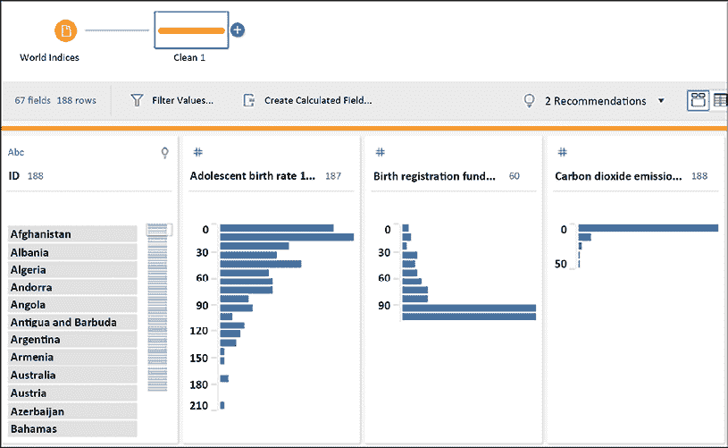

    图 12.1：Tableau Prep Builder

    对于此数据集，我在 Prep Builder 中未发现明显数据质量问题，也不需要进一步准备数据。每国一行——从 `ID` 列均匀分布的条形可见——每国有 65 列不同指数。既然无需数据准备，我决定直接用 `Tableau Desktop` 继续。我关闭 `Tableau Prep Builder` 并打开 `Tableau Desktop`。

2.  我接下来的想法是：如何一次性可视化所有相关性，又不至于信息过载？我有 65 个不同列，组合达 4,225 种。不行，我决定全显示不可行。任务很泛泛；因此我决定采用双参数法，让最终用户自行选择各指数组合。我开始草拟仪表盘外观，得到如下草图：

    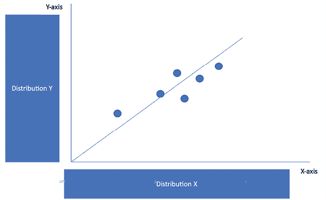

    图 12.2：草图

3.  为执行计划，我先创建两个参数，命名为 `X-Axis` 和 `Y-Axis`，用于定义相应的 `x` 轴和 `y` 轴。

4.  我将两个参数定义为 `String`，并将所有字段名从剪贴板粘贴到两个参数中。为此，我在 Excel 中打开输入文件，将表头行转置为列，按 `Ctrl` + `C`。现在可通过 **从剪贴板粘贴** 选项将数据粘贴到参数中。这能节省时间且不易出错：

    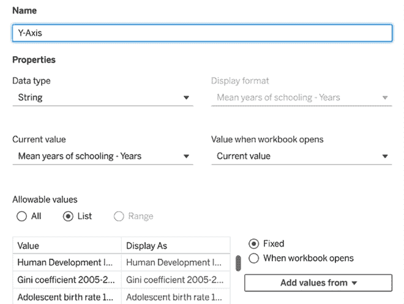

    图 12.3：粘贴到参数

5.  我还希望参数在仪表盘上可见，因此选择 **显示参数**：

    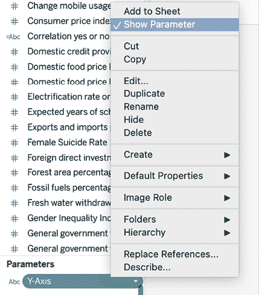

    图 12.4：显示参数

6.  此时若测试参数，不会有任何反应。我们需要一个计算字段，定义当从参数中选择后，Tableau 将选取相应字段。我创建如下计算字段以实现此目的（该字段已包含在 `Starter` 和 `Solution` 工作簿中，方便你使用）：

    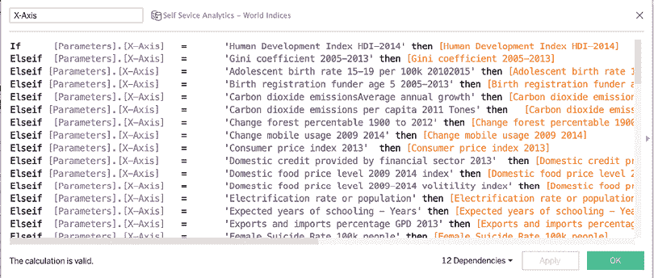

    图 12.5：计算字段

7.  现在我们对 `Y-Axis` 参数做同样的操作。


# 创建带有趋势线的散点图

为了更快地创建 `Y-Axis` 计算字段，请将 `X-Axis` 计算字段复制并粘贴到 Excel 中，然后查找并替换 `` `[Parameters].[X-Axis]` `` 为 `` `[Parameters].[Y-Axis]` ``。

1. 将 `X-Axis` 计算字段拖至 `Columns`（列），将 `Y-Axis` 拖至 `Rows`（行）。同时，将 `ID` 字段放入 `Detail`（详细信息）卡片。

2. 为了查看 Tableau 的相关性分析，将 `Trend Line`（趋势线）拖到工作表上：

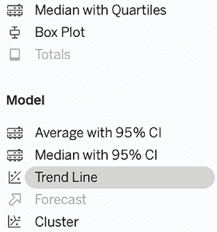

图 12.6：趋势线

1. 带有趋势线的工作表如下所示。当鼠标悬停在趋势线上时，您将看到线的方程、`R-Squared`（R 平方）值和 `P-value`（P 值）的值：

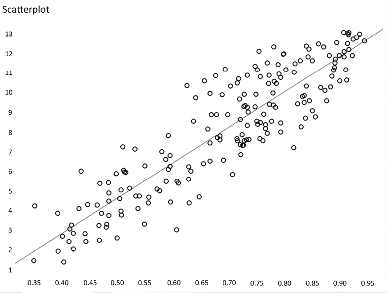

图 12.7：趋势线数值

`Y-Axis` 方程意味着，对于 `x-axis`（x 轴）上的每一点，`y-axis`（y 轴）的值将增加 17.9717，起始于 `x-axis` 上的 0 点和 `y-axis` 上的 -4.33685 点。因此，总体而言，`y-term`（y 项）的增长速度快于（同样在增长的）`x-term`（x 项）。`R-Squared` 值解释了趋势线解释了多少方差（80.81%），最后，`P-value` 解释了模型的显著性。`P-value` 值小于 0.05 被认为是显著的，意味着数据有 5% 的概率是随机遵循趋势线的。上图中的趋势线 `P-value` 小于 0.01%。因此，我们可以放心地假设这两个变量之间存在真实关系。

1. 要查看更多系数，请右键单击该线并选择 `Describe Trend Line…`（描述趋势线……）：

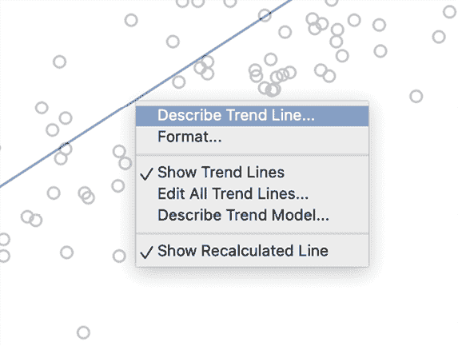

图 12.8：描述趋势线……

将出现以下窗口：

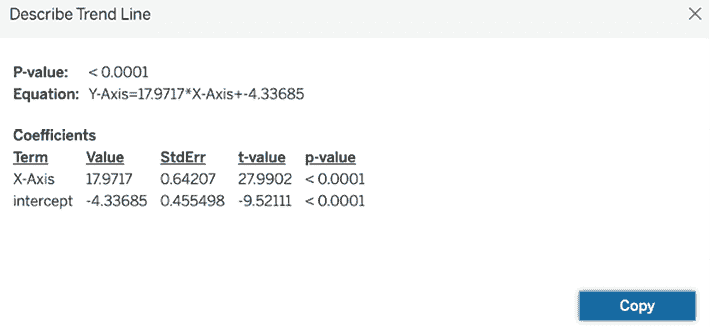

图 12.9：趋势线信息

1. 或者，您可以选择 `Describe Trend Model…`（描述趋势模型……）选项，您将看到以下内容：

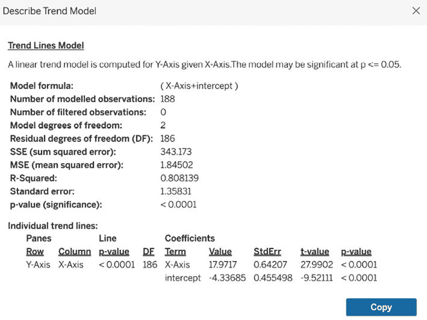

图 12.10：趋势模型信息

如果您想了解更多关于解读趋势线的信息，可以阅读以下文章：[`onlinehelp.tableau.com/current/pro/desktop/en-us/trendlines_add.htm`](https://onlinehelp.tableau.com/current/pro/desktop/en-us/trendlines_add.htm)。

1. 网格线有点分散我的注意力，所以我决定通过右键单击屏幕并选择 `Format…`（格式……）来移除它们：

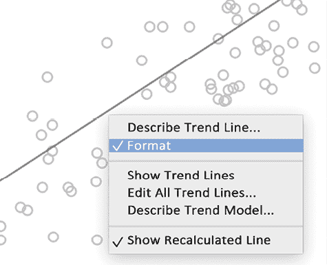

图 12.11：格式设置

1. 我在 `Format`（格式）窗口中选择第五个选项“Lines”（线），并将 `Grid Lines`（网格线）值设置为 `None`（无）：

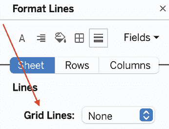

图 12.12：移除网格线

1. 我还将 `Marks`（标记）从 `Automatic`（自动）更改为 `Circle`（圆形），并将颜色更改为黑色。

2. 现在，我认为在散点图上显示每个点代表哪个国家会很有帮助，所以我将 `Marks`（标记）卡片中的 `ID` 字段从 `Detail`（详细信息）更改为 `Label`（标签）；然而，这看起来有点太乱了：

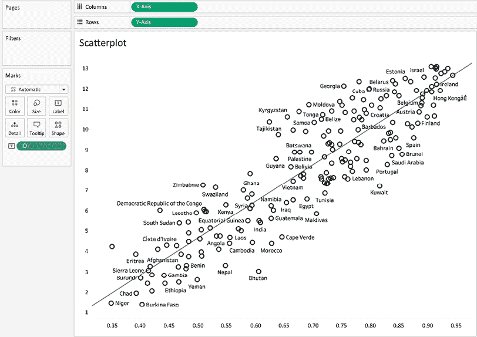

图 12.13：ID 转为文本

1. 我点击撤销箭头，并通过右键单击 `ID` 并选择 `Show Highlighter`（显示高亮器）来添加高亮器功能。现在，最终用户将能够搜索某个国家，该点将在散点图中高亮显示：

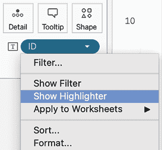

图 12.14：显示高亮器

1. 我还希望在悬停任意点时，国家名称能以红色清晰地显示在工具提示中，我通过在 `Edit Tooltip`（编辑工具提示）中将 `ID` 颜色更改为红色并增大字号来实现这一点：

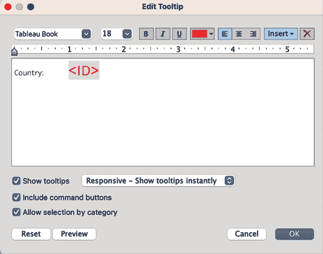

图 12.15：工具提示

结果如下所示：

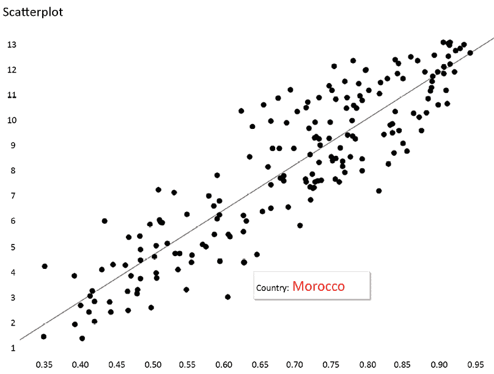

图 12.16：悬停某一点

1. 我已经添加了趋势线，现在我想在视图中显示 `Pearson R`（皮尔逊相关系数），也称为 `R-Squared` 值，以便用户知道两个指标是否相关；但是，无法将 `Describe Trend Line` 或 `Describe Trend Model` 选项设置为始终显示。因此，我将在一个新字段中自行计算该值；我使用 `CORR()` 函数来实现这一点：

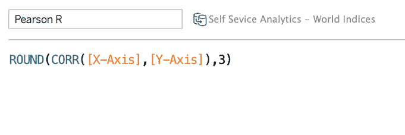

图 12.17：Pearson R

1. 但我想显示一些文本，指示两个变量是否相关，而不是显示数值本身，因为我想让我的仪表板更清晰。因此，我创建了另一个名为 `Correlation yes or no`（相关性是或否）的计算字段，代码如下：

```
IF [Pearson R] > 0.7 then 'The two variables <' + [Parameters].[X-Axis]+ '> and <'+ [Parameters].[Y-Axis]+ '> have a very strong positive correlation of: ' + STR([Pearson R])
ELSEIF [Pearson R] < 0.7 and [Pearson R] > 0.4 then 'The two variables <'  + [Parameters].[X-Axis] + '> and <'+ [Parameters].[Y-Axis]+ '> have a strong positive correlation of: '  + STR([Pearson R])
ELSEIF [Pearson R] < 0.4 and [Pearson R] > 0.2 then 'The two variables <'  + [Parameters].[X-Axis] + '> and <'+ [Parameters].[Y-Axis]+ '> have a moderate positive correlation of: ' + STR([Pearson R])
ELSEIF [Pearson R] <0.2 and [Pearson R] > -0.2 then 'The two variables <'  + [Parameters].[X-Axis] + '> and <'+ [Parameters].[Y-Axis]+ '> have no or a weak correlation of:' + STR([Pearson R])
ELSEIF [Pearson R] < -0.2 and [Pearson R] >-0.4 then 'The two variables <'  + [Parameters].[X-Axis] + '> and <'+ [Parameters].[Y-Axis]+ '> have a moderate negative correlation of: '+ STR([Pearson R])
ELSEIF [Pearson R] < -0.4 and [Pearson R] > -0.7 then 'The two variables <'  + [Parameters].[X-Axis] + '> and <'+ [Parameters].[Y-Axis]+ '> have a strong negative correlation of: ' + STR([Pearson R])
ELSEIF [Pearson R] < -0.7 THEN 'The two variables <'  + [Parameters].[X-Axis] + '> and <'+ [Parameters].[Y-Axis]+ '> have a very strong negative correlation of: ' + STR([Pearson R])
END
```

2. 完成此操作后，我创建一个新工作表，并将 `Correlation yes or no` 放在 `Text`（文本）卡片上。正如您所见，该工作表非常简单：

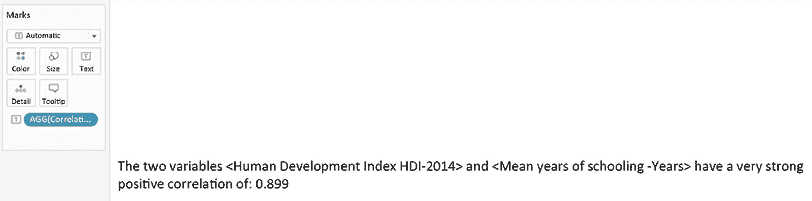

图 12.18：相关性文本

1. 我右键单击标题并选择 `Hide Title`（隐藏标题）。

最后，几乎所有准备工作都已就绪，可以根据本节开头的草图构建仪表板了。只剩下两个轴的分布图还缺失。

# 添加轴分布图

我们已经有了一个好的开端，但现在我想在散点图旁边添加 `x-axis`（x 轴）和 `y-axis`（y 轴）的分布图。我采取以下步骤：

1. 我从 `x-axis` 开始，打开另一个工作表，将 `X-Axis` 拖至 `Rows`（行）。接下来，我单击刚添加的 `X-Axis` 并选择 `Measure | Count`（度量 | 计数）。现在右键单击数据窗格中的 `X-Axis` 并选择 `Create | Bins…`（创建 | 箱……）。在弹出窗口中，点击 `OK`。最后，我将新维度 `X-Axis (bin)` 拖至 `Columns`（列）。

2. 关闭 `Edit Axis [X-Axis]`（编辑轴 [X-Axis]）窗口后，我右键单击 `X-Axis` 并取消选择 `Show Header`（显示页眉），以不再显示页眉。

3. 我在另一个新工作表上继续处理 `Y-Axis`，将 `Y-Axis` 拖至 `Columns`（列）。接下来，我通过单击 `Columns` 上的 `Y-Axis` 并选择 `Measure | Count`（度量 | 计数）来更改它。现在，右键单击数据窗格中的 `Y-Axis` 并选择 `Create | Bins…`（创建 | 箱……）。在弹出窗口中，我点击 `OK`。

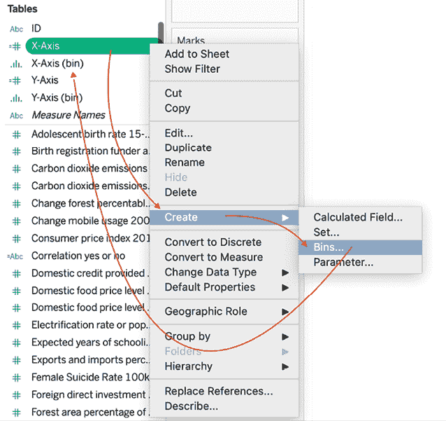

图 12.19：箱

1. 最后，我将新维度 `Y-Axis (bin)` 拖至 `Rows`（行）。

2. 我在 `Marks`（标记）卡片中将颜色更改为灰色，并在页面顶部选择 `Entire View`（整个视图）。

3. `y-axis` 分布应与散点图对齐；因此，我单击 `Y-Axis (bin)` | `Sort`（排序）| `Descending`（降序）。接下来，我右键单击 `Y-Axis` 并取消选择 `Show Header`（显示页眉），以不再显示页眉。

4. 为了将所有内容组合在一起，我打开一个仪表板页面并将其命名为 `Distribution`（分布），然后将 `Scatterplot`（散点图）工作表放在页面底部，将 `Correlation`（相关性）工作表放在仪表板画布顶部。

5. 我将分布工作表添加到散点图的相关侧（`Y-Axis` 添加到 `y-axis`，`X-Axis` 添加到 `x-axis`）。


## 完成散点图仪表板

6. 我也在左下角添加了一个空白区域，以使分布图与散点图的边缘对齐：

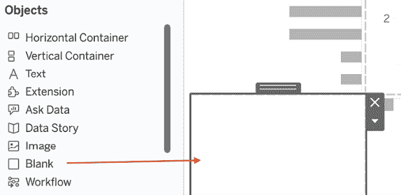

*图 12.20：添加空白*

最终布局如下所示：

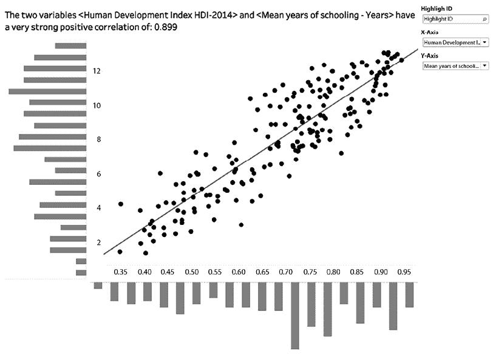

*图 12.21：最终布局*

1. 我想赋予分布图更多含义，并添加一个动作，使其在两个分布图中同时高亮显示所选国家。这样做是为了让用户能看到某个国家在所有国家某一指标范围内的位置，因为在散点图中有时很难看清。另一方面，散点图可用于深入洞察两个指标之间的关系。对于 `Highlight`（高亮）动作，我需要按如下方式设置参数：

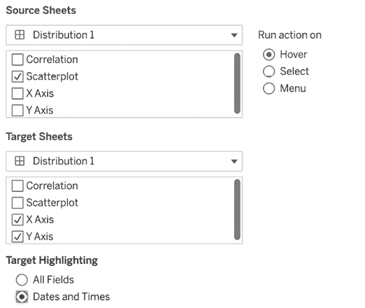

*图 12.22：高亮*

1. 为了让高亮器在 `X-Axis` 和 `Y-Axis` 工作表上生效，请在两个工作表的 `Detail`（详细信息）卡架中添加 `ID`。

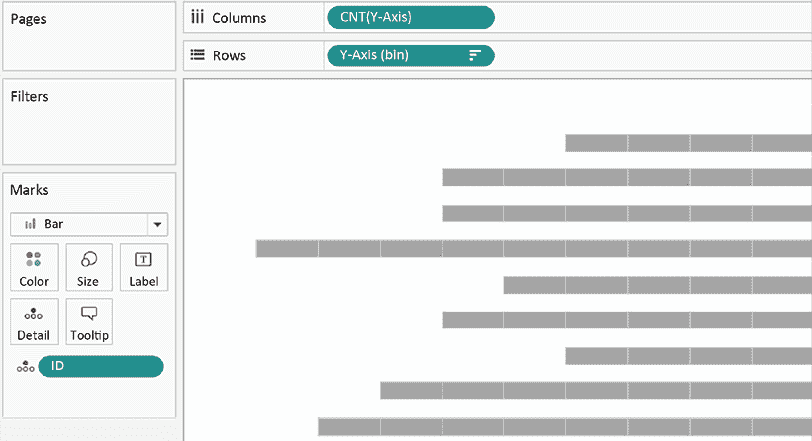

*图 12.23：添加 ID*

现在，请看下面的截图：

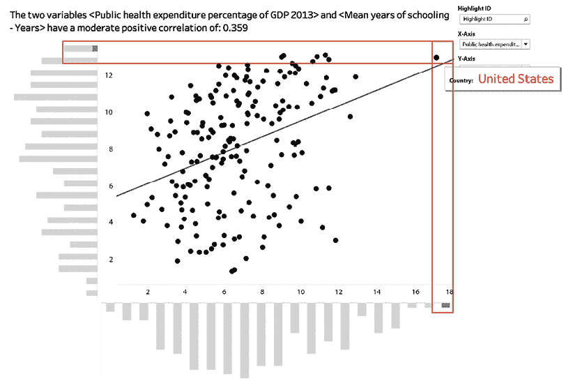

*图 12.24：相关性*

我在 `X-Axis` 上选择了 `Public health expenditure percentage of GDP 2013`（2013 年公共卫生支出占 GDP 百分比），在 `Y-Axis` 上选择了 `Mean years of schooling – Years`（平均受教育年限——年）。我不得不通过在 `Data`（数据）窗格中右键点击 `X-Axis bin`（X 轴分箱）| `Edit`（编辑）| `Suggest Bin Size`（建议分箱大小）| `OK` 来调整其大小。我可以看到，这两个度量的总体相关性呈中度正相关，相关系数为 0.359。但通过悬停在数据点上，你现在可以调查哪些国家对该相关性产生了什么影响。对于靠近趋势线的国家，相关系数更接近真实因素。例如，右上角的美国在 `x-axis`（卫生支出）上的值为 16.8，在 `y-axis`（受教育年限）上的值为 12.76。如果你用 12.76 乘以 0.359（相关系数），得到 4.581，这几乎正是 12.76 和 16.8 之间的差值。现在，如果你搜索塞拉利昂（右下角），会得到 `x` 和 `y` 值 11.4 和 2.9。在这里，用相关系数相乘无法很好地解释这种关系。这在散点图中很容易看出来，因为塞拉利昂远离趋势线。我非常喜欢这个仪表板，因为它简化了变量间的关系，能帮助新手和资深用户理解数据。

## 添加相关性矩阵

在点击浏览仪表板并测试功能后，我意识到很难记住已经尝试过哪些组合，而且我希望能筛选出高度相关的组合。为了解决这个问题，我想在这个工作簿中再添加一个仪表板：一个包含所有组合、按颜色编码且带有筛选选项的相关性矩阵：

1. 首先，我返回 `Data Source`（数据源）选项卡，再次添加相同的数据集，但起一个新名字：`World Indices Correlation Matrix`（世界指标相关性矩阵）。我甚至添加了两次，因为我需要让每个指标都与其他每个指标进行相关性计算：

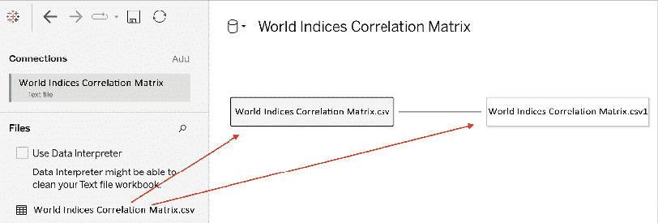

*图 12.25：世界指标相关性矩阵*

1. 使用的键是 `ID`：

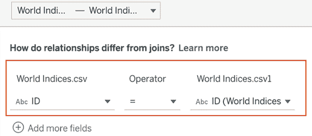

*图 12.26：ID 作为键*

1. 然后，我需要对两个表都进行透视，因为我不再需要每个指标一列，而是需要一列包含所有指标名称，另一列包含所有数值，以便创建一个包含它们各自数据的表。我选择除 `ID` 以外的所有字段并使用 `Pivot`（透视）：

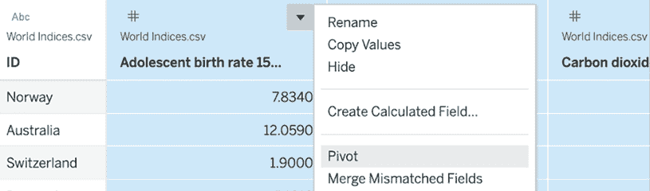

*图 12.27：透视*

1. 这会生成三列。我将 `Pivot Field Values` 重命名为 `Value Index A`，将 `Pivot Field Names` 重命名为 `Index A`：

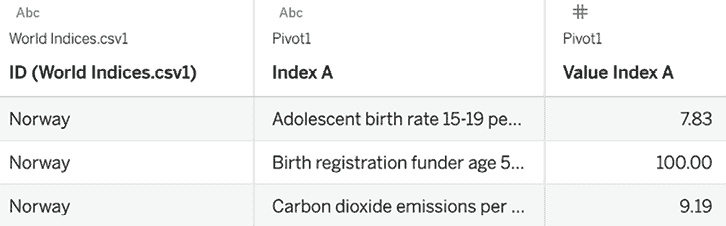

*图 12.28：重命名列*

1. 现在我对第二个表重复此操作，并将列重命名为 `Index B` 和 `Value Index B`。

2. 我打开一个新工作表，将 `Index B` 放入 `Columns`（列），将 `Index A` 放入 `Rows`（行）。我创建一个名为 `Pearson R` 的计算字段，代码为 `CORR([Value Index B], [Value Index A])`，并将其放入 `Filters`（筛选器）、`Color`（颜色）和 `Text`（文本）。右键点击 `Filters` 卡架上的 `Pearson R` 后，我选择 `Show Filter`（显示筛选器）：

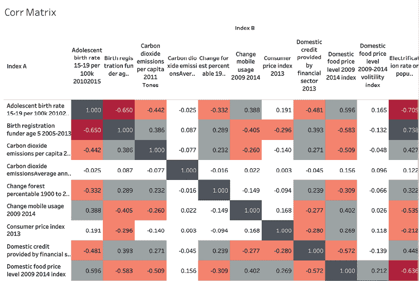

*图 12.29：相关性矩阵*

颜色可按喜好调整；我选择了一个从红到黑的 5 阶配色方案，表示红色字段为负相关，黑色字段为正相关。

1. 我打开一个新的仪表板选项卡并将工作表放入其中。尝试调整筛选器，使其仅显示高度相关的范围 0.89–0.99，以便暂时使用一个较小的数据集进行操作：

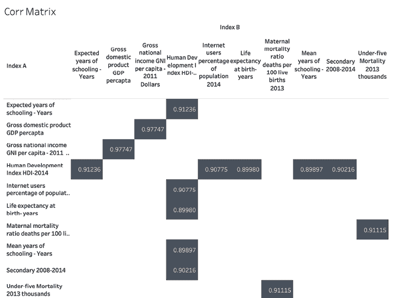

*图 12.30：筛选相关性矩阵*

本节帮助我们创建了一个所有可能组合的热力图，我们对相关性数值进行了颜色编码，并添加了筛选器以聚焦于感兴趣的点。在前面的截图中，你可以看到高度相关的指标。

## 完善仪表板

为了避免任何困惑，我想为用户解释 `Pearson R` 筛选器并完善仪表板：

1. 我首先向仪表板添加文本字段 `Pearson R ranges explained`（Pearson R 范围解释）。如果时间更充裕，我可以像 `X-Axis` 和 `Y-Axis` 字段那样将其制作为下拉参数：

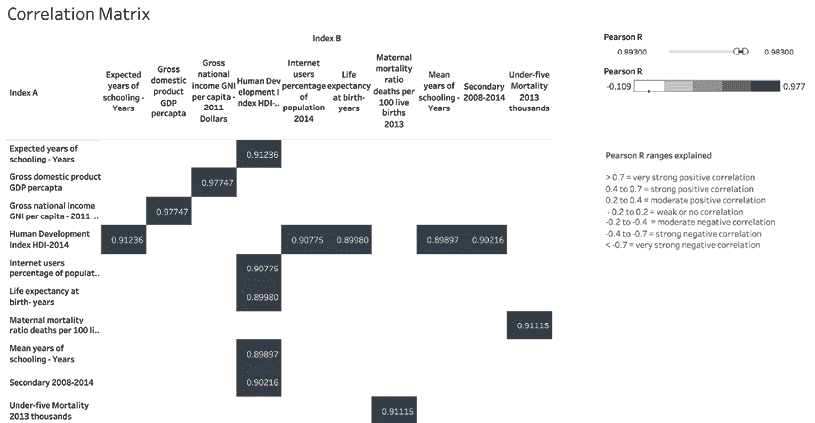

*图 12.31：添加关于 Pearson R 的文本*

1. 为了完成所有工作，需要三个动作。首先，需要两个 `Parameter`（参数）动作，以便点击相关性矩阵来更改 `X-Axis` 和 `Y-Axis` 参数的值，第一个应按如下方式自定义：

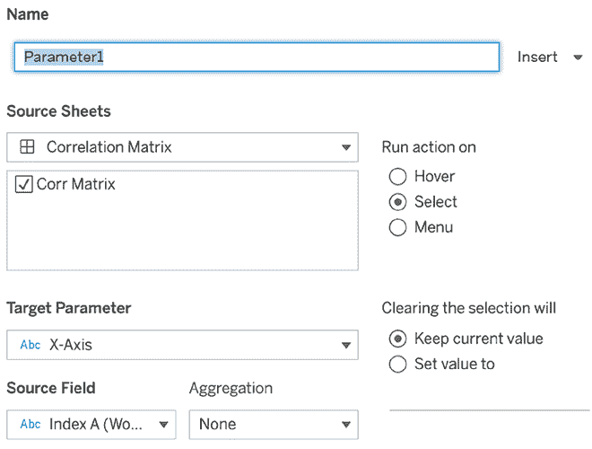

*图 12.32：参数动作 1*

前面截图中的动作会将 `X-Axis` 参数更改为来自 `Index A` 的值。

1. 现在，我按如下方式编辑第二个 `Parameter` 动作：

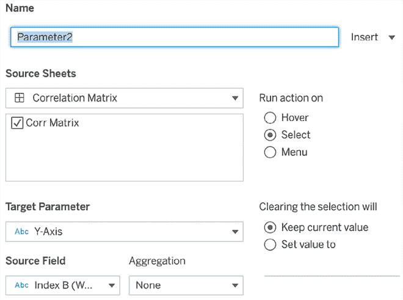

*图 12.33：参数动作 2*

上图中的动作会将 `Y-Axis` 参数更改为来自 `Index B` 的值。

1. 最后，我添加一个名为 `GoToScatterplot` 的 `Sheet Navigation`（工作表导航）动作，允许用户在选择指标组合后切换仪表板：

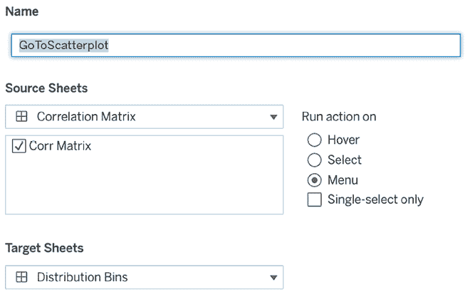

*图 12.34：工作表导航动作*

前面的动作将显示一个菜单以跳转到趋势线仪表板。

1. 用户现在可以选择一个值并点击它。在后台，参数 `X-Axis` 和 `Y-Axis` 将被调整为与该字段相关的两个指标。例如，对于 `Mean years of schooling`（平均受教育年限）和 `Human Development Index`（人类发展指数），会出现一个超链接：

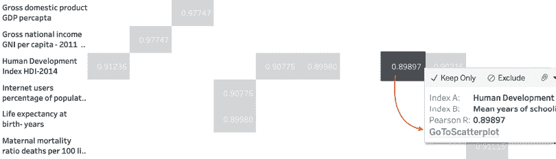

*图 12.35：菜单*

1. 用户将被重定向到带有趋势线的仪表板，该仪表板现已预筛选并显示相同的两个指标：`Mean years of schooling` 和 `Human Development Index`：

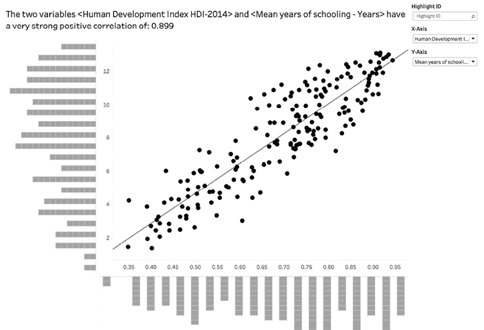

*图 12.36：筛选后的可视化*

由此我们可以看到，所选的两个指标呈 89.9% 的正相关。我们还可以看到 `x-axis` 和 `y-axis` 上每个指标的分布。

这是一个漫长的练习，但我想向你展示我完整的思维过程和仪表板创建方法。如果时间更充裕，我肯定会添加更多见解，例如：

* 为每个指标添加解释
* 为相关性添加更详尽的解释
* 向分析中添加 p 值或其他系数并相应修改文本


别忘了获取反馈，并与利益相关者确认你是否走在正确的轨道上。有些人会先用草图，然后制作草稿，再次征求反馈，直到产品定稿。我倾向于向利益相关者提问，以更好地了解他们的需求，并让他们带我走一遍他们想用 Tableau 仪表板替换或更改的流程。然后，根据复杂程度和时间线，我会展示一个完整版本或中间版本。你应该避免在利益相关者不想要的事情上花费数小时或数天。

但现在，让我们来看一个第二个、较短的用例，它包含地理空间数据。

# 芝加哥交通违章的地理空间分析

这是周三早上；你的经理走进你的办公室，想查看芝加哥去年的红灯违章情况。他们问你能否为此构建一个仪表板。具体来说，你被要求突出显示违章最多的地点，以及芝加哥交通信号灯违章在过去几年是否存在总体趋势。你得到了两个数据集，一个包含摄像头位置，一个包含违章记录，并被告知需要在未来一小时内完成仪表板。你会怎么做？

在继续阅读之前，思考一下你会如何解决这个问题。花五分钟时间，考虑你会采取的步骤，并绘制一个仪表板设计草图。

以下是我将如何操作的概述：

1.  在 Tableau Prep Builder 中打开数据集。
2.  连接这两个数据集。
3.  如有需要，清理数据。
4.  在 Tableau 中打开输出。
5.  如果可能，使用地图可视化摄像头位置。
6.  添加每个摄像头的违章数量。
7.  确定是否存在月度趋势。

以下是我将如何设计仪表板的粗略草图：

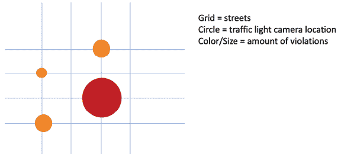

图 12.37：草图

接下来是我将要做的分步说明。相应的 Tableau 仪表板可以从 Tableau Public 下载，Tableau Prep Builder 文件可在 GitHub 上获取（[`github.com/PacktPublishing/Mastering-Tableau-2023-Fourth-Edition/tree/main/Chapter12`](https://github.com/PacktPublishing/Mastering-Tableau-2023-Fourth-Edition/tree/main/Chapter12)），数据集本身在此公开可用：[`data.cityofchicago.org/Transportation/Red-Light-Camera-Violations/spqx-js37`](https://data.cityofchicago.org/Transportation/Red-Light-Camera-Violations/spqx-js37)。

## 准备数据

将两个文件加载到 Tableau Prep Builder 后，我发现基于 `LONGITUDE` 和 `LATITUDE` 的连接毫无进展，因为几乎所有记录都不匹配：

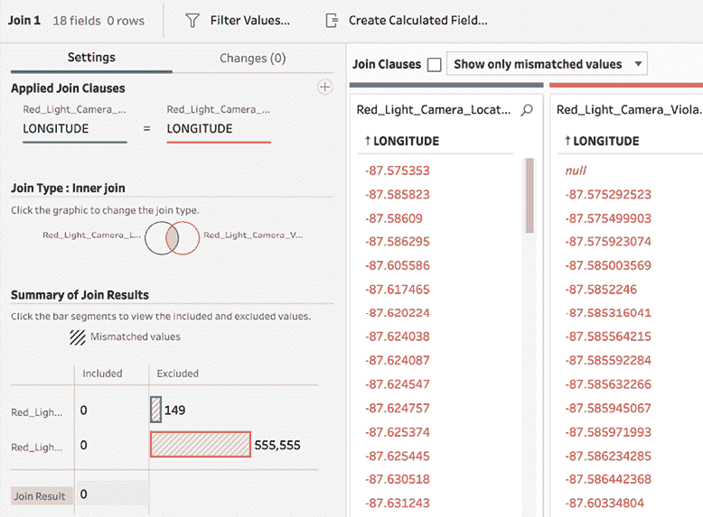

图 12.38：连接 I

我尝试一种不同的方法：基于路口进行连接。这再次导致 `0` 行连接，但这次我明白了原因。在一个数据集中，`INTERSECTION` 值由破折号（`\-`）分隔，而在另一个数据集中，则是 `AND`；此外，一个使用大写字母，另一个则不使用：

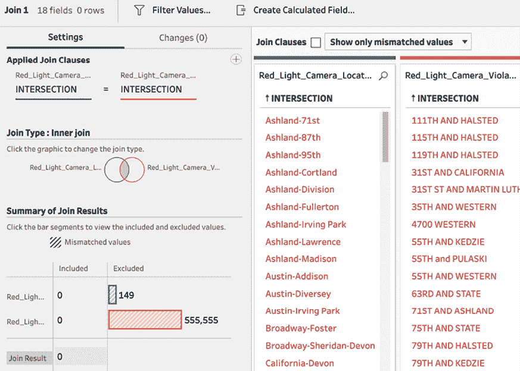

图 12.39：连接 II

我可以添加一个清理步骤，使所有字母大写，并将路口拆分为两部分。我可以对 `\-` 和 `AND` 执行 `Custom Split…`（自定义拆分）：

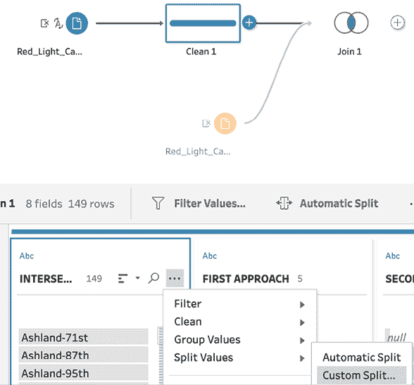

图 12.40：数据准备

然后，我注意到路口顺序不同；例如，`Ashland-71st` 和 `71ST AND ASHLAND`。我可能会考虑重构数据集，并创建一个循环，将两条街道按字母顺序排列在两个拆分中，但我现在没时间做这个。

另一种解决方案是先将拆分 1 与拆分 1 连接，以及拆分 2 与拆分 2 连接。在第二次连接中，我可以将拆分 1 与拆分 2 连接，以及拆分 2 与拆分 1 连接。之后，我可以将这两个连接合并，并创建一个输出文件（或直接将 Prep Builder 数据集加载到 Tableau Desktop）。使用这种方法，我仍然无法包含所有数据，但我将拥有 444,000 行中的 380,000 行。这可能足以大致了解模式。如果还有时间，我可以继续映射剩余的不匹配项。

然而，我决定完全放弃位置数据集，仅使用违章数据集，因为我意识到我只会错过尚未发生违章的位置。目前，违章位置已足够。但是，如果你要确定交通信号灯控制是否停止工作，则必须使用这两个数据集。

## 构建路口地图

我继续在 Tableau 中打开违章数据集：

1.  经度和纬度值不会被自动识别，所以我必须通过点击数据类型图标将两者都更改为 `Number (decimal)`（数字（十进制））：

    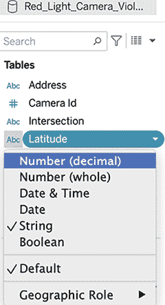

    图 12.41：更改数据类型

2.  然后，我通过点击字段上的下拉箭头（如上图所示）并选择 `Convert to Measure`（转换为度量），将 `Longitude` 和 `Latitude` 字段更改为 `Measure`（度量）。

3.  现在我可以再次点击数据类型图标，将这两个字段更改为 `Latitude`（纬度）和 `Longitude`（经度）：

    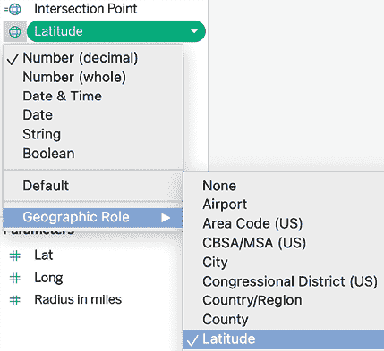

    图 12.42：更改地理角色

4.  通过将 `Longitude` 拖到 `Columns`（列），`Latitude` 拖到 `Rows`（行），`Intersection` 拖到 `Text`（文本）架上，我可视化了红灯位置——至少是那些曾经有过违章的位置：

    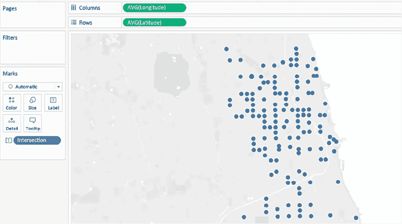

    图 12.43：芝加哥的路口

5.  工作表的名称将为 `Intersection`，既然我在查看违章，我将 `Marks`（标记）卡中的颜色改为红色。最后，我不需要看到路口名称，所以我将 `Intersection` 从 `Text` 改为 `Detail`（详细信息）。

6.  接下来，当地图显示更多细节时我更喜欢，所以我使用 `Background Layers…`（背景图层……）来选择更多选项：

    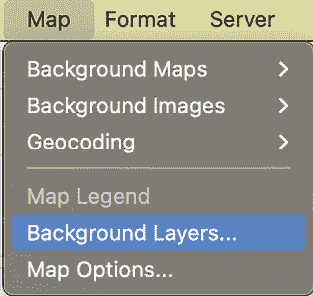

    图 12.44：背景图层……

    选择你想在地图上看到的所有图层：

    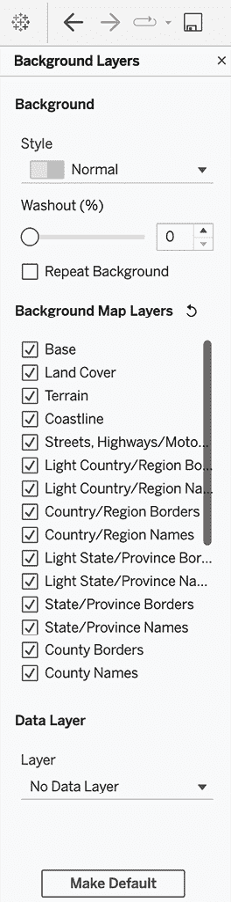

    图 12.45：芝加哥地图

    Tableau 的另一个不错的功能是你可以向视图添加 `Data Layer`（数据图层）。你可以在前面截图的左下角看到该选项。

7.  我使用按 `Census Tract`（普查区）划分的 `Population`（人口）图层，因为我希望它能提供一些细节，说明违章是否发生在人口稠密地区：

    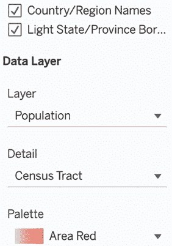

    图 12.46：数据图层

    在下面的截图中，你可以看到它的样子——注意红色越深，表示该区域人口越稠密：

    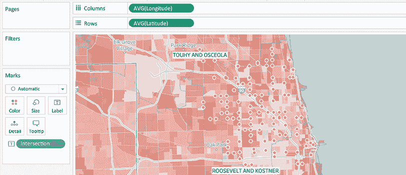

    图 12.47：路口可视化

8.  我将 `MONTH(Violation Date)`（违章日期的月份）添加到 `Pages`（页面）；这样，我的老板可以播放月份，查看违章数量在何时何地发生变化：

    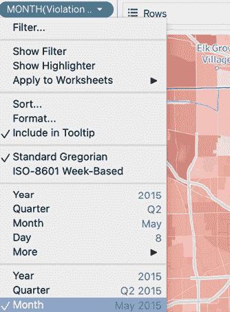

    图 12.48：页面

9.  当然，我需要添加 `Violations`（违章）字段以使 `Pages` 正常工作。我决定使用 Tableau 的 `Density`（密度）功能，以红色作为颜色：

    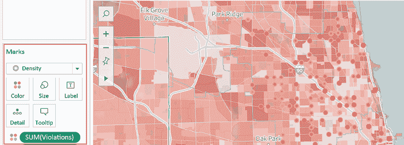

    图 12.49：密度可视化

### 添加相应的热力图工作表

点击 `Pages` 播放按钮后，我注意到某些月份存在模式。我想仔细看看，所以我打开一个新工作表：

1.  我将新工作表命名为 `Heatmap`，将 `MONTH(Violation Date)` 放在 `Columns` 上，`YEAR(Violation Date)` 放在 `Rows` 上。然后，我将 `Violations` 拖到 `Color`（颜色）架上，并选择红金配色，得到如下结果：

    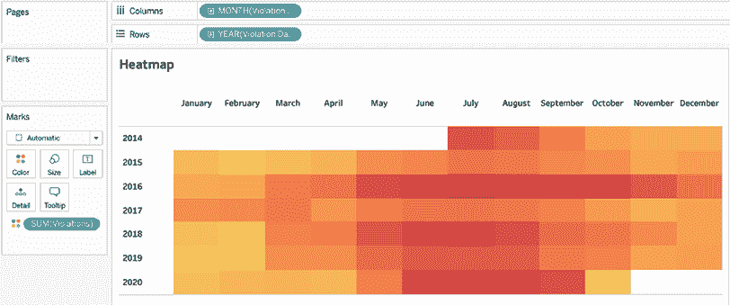

    图 12.50：热力图

    夏季肯定有更多的红灯违章，而 2016 年和 2020 年显示的违章最多。


## 完成仪表板

1.  最后但同样重要的是，我添加了一个名为 `Trend?` 的新工作表。我将 `MONTH(Violation Date)` 拖放到 `Columns`（列）货架上。`Violations`（违章）字段应放置在 `Rows`（行）上。我确保这两个度量均为 `Continuous (green)`（连续型，绿色）。从 `Analytics`（分析）窗格中，我将线性 `Trend Line`（趋势线）拖到工作表上。接下来，我将 `Forecast`（预测）拖入视图：


图 12.51：折线图

在上图中，你可以看到闯红灯违章的总体趋势逐年略有上升。预测显示，夏季闯红灯违章较多的季节性规律很可能会在 2021 年继续。

请随时在 2021 年底查看 Tableau 的预测模型有多准确！芝加哥市的数据集会持续刷新。

时间差不多了，我只是将这三个工作表放到一个仪表板上，将其命名为 `Red-Light Violations`（闯红灯违章），并稍作格式调整；效果如下：


图 12.52：最终仪表板

你可以在 Tableau Public 上找到与本章关联的 Tableau 工作簿中的最终仪表板，链接如下：[`public.tableau.com/profile/marleen.meier/`](https://public.tableau.com/profile/marleen.meier/)。

仪表板还能改进吗？是的，总是可以的。但在第一次迭代后，我的老板可以告诉我是否需要调整，我可以照做。我确信我还能花更多时间来改进它，但大多数情况下，制作仪表板更多的是关于及时交付。与临时问题或一次性练习相比，完整的生产模型完全是另一回事，特别是如果你以敏捷方式工作，将工作拆分为可交付成果，获取反馈，并继续在此基础上工作。

# 使用距离度量扩展地理空间分析

我们的最后一个用例也是基于同一个芝加哥交通数据集的地理空间分析，但这次我们将添加另一个组件。我们将寻找一个新的租住地点，要求在半径 *x* 范围内的路口不超过 *n* 个，且海军码头的距离不超过 *y* 英里。变量 *n*、*x* 和 *y* 应该是交互式的，以便我们进行更改并获得非常灵活的仪表板体验。关于此任务需要提出的问题如下：

*   我们如何将芝加哥的任何给定位置添加到我们的数据集中？目前它只显示路口和违章。
*   我们如何制作 *n*、*x* 和 *y* 变量？
*   我们如何在地图上的任意给定点添加半径指示器？
*   我们如何测量两个可变点之间的距离？

所有这些问题将在以下步骤中得到解答：

1.  返回与本章相关的工作簿。
2.  右键单击名为 `Intersection`（路口）的工作表，然后单击 `Duplicate`（复制）。
3.  将新工作表重命名为 `Rental`（租赁）。
4.  从 `Pages`（页面）中移除 `MONTH(Violation Date)`，从 `Color`（颜色）货架中移除 `SUM(Violations)`，并从标题中移除红色文本（副标题），使工作表如下所示：

    

    图 12.53：路口

5.  将 `Marks`（标记）类型更改为 `Map`（地图）。
6.  单击 `Map`（地图）| `Map Layer`（地图图层），并将 `Data Layer`（数据图层）更改为 `No Data Layer`（无数据图层）：

    

    图 12.54：地图图层

7.  将 `Violation Date`（违章日期）放在 `Filters`（筛选器）货架上，并选择年份 `2020`。
8.  将 `Violations` 拖到 `Color` 货架上，并选择 `Red`（红色）调色板：

    

    图 12.55：编辑颜色

我们现在面前有一张芝加哥地图，其中每个点代表一个 2020 年发生过违章的路口。点越深，表示该路口登记的违章越多。

## 向地图添加度量点

接下来，我们必须添加功能，允许我们在地图上设置一个标记并从那里开始测量。这可以通过创建经度和纬度参数并在计算字段中使用它们来实现：

1.  创建以下参数 `Lat` 和 `Long`：

    

    图 12.56：参数

2.  右键单击每个参数并选择 `Show Parameter`（显示参数）。
3.  创建一个名为 `Address manual`（手动地址）的计算字段：

    ```
    MAKEPOINT([Lat], [Long])
    ```

4.  将 `Address manual` 拖到地图上，放在 `Add a Marks Layer`（添加标记图层）弹窗上方：

    

    图 12.57：添加图层

5.  将新图层的 `Marks` 类型更改为 `Map`。
6.  完成这些步骤后，我们得到了一张包含路口、按颜色编码的违章数量的地图，还有一个可以通过 `Lat` 和 `Long` 参数更改的点。用户可以使用 Google Maps 查找纬度和经度；只需在 Google Maps 上选择一个代表租赁房屋位置的点：

    

    图 12.58：Google Maps

7.  纬度和经度将显示在 URL 和页面底部。将它们输入 `Lat` 和 `Long` 参数，相同的点将出现在我们的 Tableau 地图上：

    

    图 12.59：纬度和经度

## 添加距离线

在接下来的步骤中，我们将添加一个以海军码头为起点的半径和距离线：

1.  创建另一个名为 `Radius in miles`（半径（英里））的参数，并将当前值设置为 `1.1`。
2.  右键单击 `Radius in miles` 参数并选择 `Show Parameter`。
3.  创建一个名为 `Buffer`（缓冲区）的计算字段，它将用作 `Address manual` 点周围的半径：

    ```
    BUFFER([Address manual], [Radius in miles], 'miles')
    ```

4.  将 `Buffer` 字段拖到地图上，就像我们对 `Address manual` 字段所做的那样，放在 `Add a Marks Layer` 弹窗上方。
5.  将此新图层的 `Marks` 类型更改为 `Map`。
6.  单击 `Color`（颜色），将不透明度更改为 `50%`，并选择灰色：

    

    图 12.60：带半径的地图

    下图中的 URL 显示了 `Navy Pier`（海军码头）的坐标 (41.8859088,-87.6064094)：

    

    图 12.61：海军码头

7.  按如下方式创建计算字段：

    ```
    MAKEPOINT(41.892133, -87.604045)
    ```

8.  将 `Navy Pier` 字段拖到地图上，放在 `Add a Marks Layer` 弹窗上方。
9.  将 `Marks` 类型更改为 `Map`。
10. 为了将 `Navy Pier` 连接到我们的 `Address manual` 点并测量距离，创建另一个名为 `Line`（线）的计算字段：

    ```
    MAKELINE([Address manual], [Navy Pier])
    ```

11. 为了测量两者之间的距离，使用以下代码创建一个 `Distance`（距离）字段：

    ```
    DISTANCE([Address manual], [Navy Pier], 'miles')
    ```

12. 将 `Line` 字段放到地图上，放在 `Add a Marks Layer` 弹窗上方。
13. 将新图层中的 `Marks` 类型更改为 `Map`。
14. 将 `Distance` 放在 `Label`（标签）货架上，将度量更改为 `Average`（平均值），然后单击 `Label` 添加文本 `miles`（英里）：

    

    图 12.62：编辑标签

我们的仪表板现在如下所示：


图 12.63：最终仪表板

这就完成了。半径清晰地显示了特定距离内有多少个路口；悬停在点上可以查看路口违章数量。从海军码头到我们当前位置 `Address manual` 的线告诉我们这两个点相距多远。

回答我们开头的问题：

*   *我们如何将芝加哥的任何给定位置添加到我们的数据集中？* *目前它只显示路口和违章*。通过在计算字段中使用 `MAKEPOINT()` 函数。
*   *我们如何制作 n、x 和 y 变量？* 通过使用参数。
*   *我们如何在地图上的任意给定点添加半径？* 通过使用 `BUFFER()` 函数。


* 如何测量两个变量点之间的距离？通过使用 `Distance()` 函数；通过添加 `MakeLine()` 函数，将绘制一条线。

此用例可用于重现某区域内超市数量、学校、公共交通站点等场景。发挥创意，随时将您的仪表板上传到 Tableau Public，别忘了添加 **#MasteringTableau** 标签！

如果您大量处理空间数据，我还建议您查看以下链接：

* [`www.tableau.com/about/blog/2019/6/geospatial-analysis-made-easy-two-new-spatial-functions-makepoint-and-makeline`](https://www.tableau.com/about/blog/2019/6/geospatial-analysis-made-easy-two-new-spatial-functions-makepoint-and-makeline)
* [`www.tableau.com/about/blog/2020/3/seeing-and-understanding-proximity-made-easy-buffer-calculations`](https://www.tableau.com/about/blog/2020/3/seeing-and-understanding-proximity-made-easy-buffer-calculations)

# 总结

在本章中，我们探索了高级自助分析的迷人世界。我们首先了解了自助分析作为一种商业智能形式的概念，它赋予个人直接查询数据集并释放有价值见解的能力。在整个过程中，我们发掘了三个引人入胜的用例，展示了自助分析的威力。我们揭示了世界指数之间错综复杂的相关性，从而更深入地理解全球市场动态。然后我们深入芝加哥交通违章领域，利用地理空间分析发现模式和潜在改进领域。最后，我们扩展了地理空间分析，利用距离度量根据关键变量确定住房位置的最佳半径。

在这些不同场景中，一个关键教训贯穿始终：在着手自助分析项目时，结构良好的方法至关重要。通过仔细规划工作、熟悉数据、运用描述性统计，并根据中间结果调整计划，我们为成功铺平了道路。

请记住，仪表板永远不会真正完成：您随时可以更改内容；受众可能会变；利益相关者的需求可能不同。交付一个具有基本功能的可用可视化，并在获得反馈后继续开发。根据您的积压工作或其他情况，最小可行性产品可能正是您所需要的。

在本章结束之际，我敦促您反思所获得的见解，并考虑如何将这些原则应用到您自己的自助分析工作中。请记住，虽然我的经验可作为指引，但有多条路径可以通往您的目标。拥抱自助分析的力量，用数据武装自己，在追求明智决策的过程中开启无限可能。在这样做的同时，让您的 IT 团队休息一下，让他们专注于超出您范围的更繁重的实施工作。

下一章将专注于提升性能。随着数据越来越多，性能至关重要，可能意味着成功与失败的区别。

## 在 Discord 上了解更多

要加入本书的 Discord 社区——您可以在其中分享反馈、向作者提问并了解新版本——请扫描下方的二维码：

[`packt.link/tableau`](https://packt.link/tableau)


