# 第 13 章：提升性能

一旦人们熟悉了 Tableau 的功能，很快就会遇到另一个类型的问题：性能。您可能都曾经历过盯着屏幕看着*正在加载数据*或*正在执行查询*的情况。但别担心，我们会帮您解决！如果设计得当，Tableau 仪表板即使处理大量数据也能表现良好。

本章将探讨性能的各个方面，旨在赋予您技术，创建加载快速、响应灵敏的工作簿，以应对最终用户的交互。

在本章中，我们将讨论以下主题：

* 理解性能记录仪表板
* 硬件和即时技术
* 连接数据源
* 使用提取数据
* 明智地使用筛选器
* 高效计算
* 提升性能的其他方法

正如您所见，关于性能改进我们有许多主题要涵盖。因此，让我们不再浪费时间，直接深入。我们的第一个主题是性能记录，当您遇到性能下降时，这应该是您首先要查看的内容，因为它有助于您识别所有缓慢的根源。

## 理解性能记录仪表板

Tableau 将性能记录功能作为安装包的一部分，并以名为 `PerformanceRecording.twb` 的仪表板形式提供。该仪表板为 Tableau 作者提供了一种轻松理解和排查性能问题的方法。以下练习和相关讨论点将回顾性能记录仪表板的各个方面，包括如何生成它、如何用它提升性能，以及它是如何构建的。

执行以下步骤：

1. 导航至 [`public.tableau.com/profile/marleen.meier`](https://public.tableau.com/profile/marleen.meier) 以查找并下载与本章关联的工作簿。
2. 导航至 `Types of Events` 工作表。
3. 选择 `Help` | `Settings and Performance` | `Start Performance Recording`。
4. 在 Windows 上按 `F5` 或在 macOS 上按 `Command` + `R` 以刷新视图。
5. 选择 `Help` | `Settings and Performance` | `Stop Performance Recording`。将打开一个新仪表板：

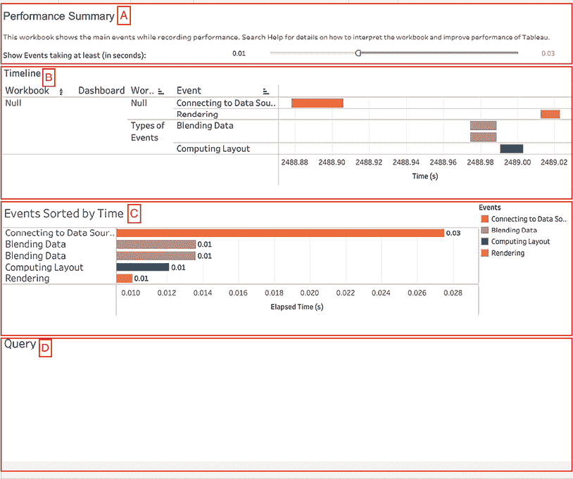

图 13.1：性能摘要

有四个主要部分需要查看：

* **A) 性能摘要** 显示仪表板执行 *步骤 3*（开始性能记录）和 *步骤 5*（停止性能记录）之间发生的所有步骤所需的时间。滑块可用于筛选。
* **B) 时间线** 显示哪个步骤在何时发生以及耗时多久。
* **C)** 步骤也按颜色编码，也可以在 **事件** 条形图中找到。
* **D) 查询** 仅在单击 (**B**) 或 (**C**) 中的任何事件时显示详细信息。

让我们继续下一步：

1. 将 (**A**) 中的 **事件** 时间线滑块拖至最左侧以显示所有事件。
2. 在 **按时间排序的事件** (**C**) 中，点击任何标题为 **执行查询** 的绿色条形。注意 **查询** 部分现在由高亮条形所属的 VizQL 填充：

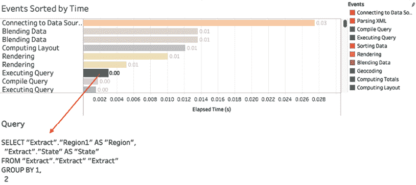

图 13.2：事件

1. 要查看完整查询，请导航到 **查询** 工作表并将适应设置为 **整个视图**（这里的 **查询** 是指 VizQL 查询）。请注意，特别长的查询可能不会完整记录。要查看此类查询的每一行，请参考位于 `My Tableau Repository` 中的日志文件。

前面的步骤旨在让您初步了解性能记录仪表板的用途。我通常用它来检查某个查询是否比其他查询耗时明显更长。然后我查看 **查询** 选项卡上的查询，通过阅读所用字段检查哪部分受影响，尝试更改它，然后再次运行性能仪表板以查看变化。现在，让我们看看更多细节。

如果您从性能记录仪表板访问 `Events` 工作表，将看到不同的事件。我们现在将更详细地讨论这些事件及其对性能的影响：

| **事件类型** | **性能考量** |
| --- | --- |
| `Connecting to Data Source` | 连接数据源时性能不佳可能表明网络延迟或数据库问题，甚至是驱动程序过时。 |


| 生成提取 | 在提取前聚合数据并隐藏未使用的列可提高性能，因为这会分别减少总列数和行数。 |
| 编译查询 | 编译查询性能问题可能表明存在数据库问题。 |
| 执行查询 | 如果查询耗时过长，您可以通过筛选不需要的数据或隐藏未使用的字段来提高性能。有关详细信息，请参阅本章中的*明智地使用筛选器*一节。 |
| 排序数据 | 与排序问题相关的性能问题可能表明视图中标记过多。此排序问题也可能由依赖于视图中数据排序的表计算引起。 |
| 地理编码 | 地理编码性能问题可能表明视图中标记过多、网络延迟问题、硬件配置不佳或显卡性能不足。 |
| 数据混合 | 数据混合性能可通过减少底层数据量或进行筛选来改善。 |
| 计算表计算 | 由于表计算通常在本地执行，复杂的计算可能会占用最终用户计算机的大量资源。 |
| 计算总计 | 计算总计性能可通过减少底层数据量或进行筛选来改善。 |
| 计算布局 | 计算布局性能问题可能表明仪表板包含过多工作表或元素（如图片）。 |

在此概览之后（您随时可以返回查看），我们将深入探究，研究激活性能记录时会发生什么。请注意，以下内容假设作者正在使用 Tableau Desktop 而非 Tableau Server。在*第 14 章* *探索 Tableau Server 和 Tableau Cloud* 中，我们将介绍 Tableau Server 上的性能记录。

记录性能时，Tableau 最初会在 `My Tableau Repository\Logs` 中创建一个名为 `performance_[timestamp].tab` 的文件。此外，Tableau 程序目录中还有一个名为 `PerformanceRecording_new.twb` 的文件，例如 `C:\Program Files\Tableau\Tableau.[version]\Performance`。录制停止后，该文件会自动打开，从而允许作者浏览结果。

我们刚了解了如何记录性能指标，以及如何使用 Tableau Desktop 和 Tableau Server（如果由管理员启用）随附的相关仪表板。在接下来的章节中，我们将逐步指导您了解可考虑的不同选项，以提高整体性能。

# 硬件与即时技巧

尽管 Tableau Desktop 对硬件要求不高，但公司台式机或笔记本电脑性能不足的情况仍时有发生，特别是如果您是所谓的业务用户，日常工作不需要编程工具或大量处理能力。

因此，在本节中，我们将讨论技术要求。根据 [www.tableau.com](http://www.tableau.com)，最新的技术要求如下：

## Windows

| 要求 | 详细信息 |
|-------------|---------|
| 操作系统 | Microsoft Windows 8/8.1、Windows 10 (x64)、Windows 11 |
| 内存 | 2 GB |
| 磁盘空间 | 至少 1.5 GB 可用磁盘空间 |
| CPU | CPU 必须支持 SSE4.2 和 POPCNT 指令集 |

## Mac

| 要求 | 详细信息 |
|-------------|---------|
| 操作系统 | macOS Catalina 10.15、macOS Big Sur 11.4+、macOS Monterey 12.6+（适用于 Tableau 2022.3+）和 macOS Ventura（适用于 Tableau 2022.3+） |
| 处理器 | Intel 处理器或 Apple Silicon 处理器（使用 Rosetta） |
| 磁盘空间 | 至少 1.5 GB 可用磁盘空间 |

现在我们已掌握基础知识，让我们来看看一项可能会无意中拖慢性能的功能，以及如何解决它。我们的第一个即时技巧称为自动更新。

自动更新可通过工具栏上的图标、**工作表** \| **自动更新**，或使用快捷键 Windows 上的 `F10` 或 Mac 上的 `Option` + `Command` + `0` 来访问。自动更新为作者提供了暂停/恢复工作表和/或筛选器自动更新的选项，如果您想对布局进行多项更改，但希望避免 Tableau 在每次更改后都重新加载，这将非常有用，因为每次加载都意味着向底层数据源发送新查询并进行处理，这会消耗处理能力。您只需暂停更新，进行更改，然后再运行一次更新即可。

以下练习演示了其工作原理：

1. 打开与本章关联的工作簿，并导航到 `Auto Updates` 工作表。
2. 在**数据**窗格中，选择 `Superstore` 数据集。
3. 将**州**放置在**行**货架上。
4. 通过工具栏取消选择**自动更新工作表**：

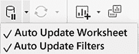

图 13.3：自动更新工作表

5. 将**城市**放置在**行**货架上**州**的右侧。请注意视图不会更新。
6. 通过工具栏启用**自动更新工作表**。视图现在会更新。
7. 右键单击**行**货架上的**州**，然后选择**显示筛选器**。
8. 右键单击**行**货架上的**城市**，然后选择**显示筛选器**。
9. 在**城市**筛选器上，单击下拉菜单，然后选择**多个值** **(列表)** 和**仅相关值**：

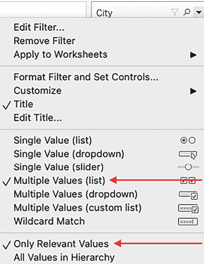

图 13.4：仅相关值

10. 如*图 13.3*所示，取消选择**自动更新筛选器**。
11. 在**州**筛选器中，仅选择**阿拉巴马州**。请注意**城市**筛选器不会更新。
12. 通过工具栏启用**自动更新筛选器**。**城市**筛选器现在会更新。

自动更新非常有用。作者可以暂停自动更新，进行多项更改，然后恢复自动更新，从而节省时间并间接提高性能。

作为旁注，级联筛选器（如**仅相关值**或**上下文中的所有值**）在使用暂停按钮或自动更新时可能不会填充数据，因为它们依赖于首先传递查询。

## 运行更新功能

暂停/恢复自动更新选项右侧的**运行更新**图标旨在刷新一次，同时用户可以保持**自动更新**功能处于禁用状态。以下简短示例有助于阐明此选项：

1. 复制名为 `Auto Updates` 的**上一个**工作表，并将副本命名为 `Run Updates`。
2. 单击**暂停自动更新**图标以暂停所有更新。
3. 在**州**筛选器中随机选择多个州。
4. 单击**运行更新**图标（如*图 13.5*所示），然后选择**更新筛选器**或**更新工作表**。运行更新的快捷键是 Windows 上的 `F9`。macOS 上的快捷键是 `Shift` + `Command` + `0`：


图 13.5：运行更新

5. 在**州**筛选器中随机选择更多州。请注意自动更新仍处于暂停状态。

重申一下，**运行更新**允许 Tableau 作者在保持自动更新暂停的同时间歇性地刷新视图。我们刚才讨论的这两个更新功能将使您作为仪表板开发者的生活更轻松，因为您可以在加载（从而等待刷新数据）之前进行多项更改，但如果您想从根本上解决性能问题，则需要更多工具。下一节将介绍提取，这是一个加快计算和渲染速度的绝佳功能。

## 小型提取

虽然提取将在*使用提取*一节中详细讨论，但在创作时的性能考量背景下提及提取似乎很合适。即使在最佳条件下，处理大型数据源也可能很慢。如果创作时不需要持续访问整个数据集，请考虑创建一个小型的本地提取。尽可能多地创作工作簿，然后在真正需要所有底层数据时，再指向原始数据源。

以下步骤简要展示了此技术的实际操作：


## 创建小型本地提取

1. 在与本章关联的工作簿中，导航至 `Small Local Extract` 工作表。
2. 选择 `数据 | 新建数据源` 以选择所需的数据源。本练习假设使用 `Superstore.xls`（随 Tableau 安装），但您可以使用任何您喜欢的数据集。
3. 将任意字段拖放到 `文本` 货架上。在我的示例中，我使用了 `记录数`，这是一个仅包含数字 1 的计算字段。
4. 右键单击数据源（对我而言是 `Superstore`）并选择 `提取数据…`：

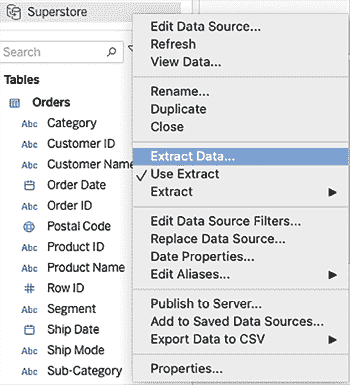

图 13.6：提取数据

5. 在 `提取数据…` 对话框底部，选择 `前`、您的数据源，并选择 `1000`。在下图中，已选择 `订单`，它是超市连接的两个部分之一：

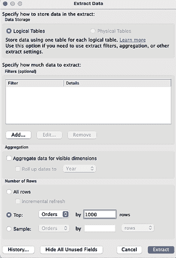

图 13.7：前 N 行

6. 单击 `提取` 按钮，注意记录数现在显示为 `1000` 行。
7. 在 `数据` 窗格中，右键单击 `Superstore` 并取消选择 `使用提取`。注意 `记录数` 已恢复为其原始值。

通过创建一个小型的本地提取，Tableau 作者缓解了两个性能瓶颈：网络延迟和数据集大小。

本节向您介绍了如何临时减小数据集以及如何恢复到原始大小的方法，且均无需离开 Tableau 界面。这是加快仪表板构建过程、避免长时间等待的绝佳方式。在下一节中，我们将讨论如何连接数据源以实现最佳性能。

# 连接数据源

Tableau 的优势之一在于您可以轻松地通过多种方式连接到许多不同的数据源。正如本书前面所述，Tableau 中定义了许多连接器，用于与各种数据源进行交互。此外，这种灵活性不仅限于连接单个表或文件。

尽管 Tableau 让连接各种数据源变得容易，但必须强调的是，Tableau **不是** `Extract, Transform, and Load (ETL)`（抽取、转换、加载）工具。如果需要复杂的连接和复杂的数据混合来生成有用的结果，建议在 Tableau 之外执行 ETL 工作，例如在 `Tableau Prep Builder` 中（有关此服务的更多信息，请参阅 `第 3 章` `使用 Tableau Prep Builder`）。ETL 工作理想情况下将带来更好的数据建模，从而在 Tableau 中实现更轻松的创作和更快的性能。

Tableau 连接数据的四种方式如下：

*   Tableau 可以连接到单个表。这是理想的选择，因为它允许最大的功能性和最简单的故障排除，同时使 Tableau 能够发送最简单的查询，从而实现最佳性能。然而，并不总是能连接到单个表，尽管这很理想，但施加如此严格的限制是不合理的。数据源与报表工具之间的关系在不断变化。一个在数据连接方式上缺乏灵活性的报表工具不太可能成功，无论其最终结果多么优雅美观。
*   第二种选择是关系，这是一种更新、更灵活的组合两个或多个数据集的方式。详细程度将在每个工作表中定义，而不是在 `数据源` 选项卡中，这使得该功能非常强大。
*   Tableau 连接数据的第三种方式是通过连接。单个表可能无法提供所有必要数据，但通过连接两个或多个表，可能访问到所有所需数据。随着连接变得越来越复杂，性能可能会受到影响，故障排除也可能变得困难。幸运的是，Tableau 可以假设参照完整性，因此即使面对复杂的连接也能相当高效地工作。更多信息请见此处：[`help.tableau.com/current/pro/desktop/en-us/joins_xbd_perf.htm`](https://help.tableau.com/current/pro/desktop/en-us/joins_xbd_perf.htm)。
*   最后，Tableau 可以利用数据混合。数据混合通常表现良好，前提是混合的数据源中**不超过一个**是大型数据源，且用于混合的维度成员相对较少。

只要可能，应优先选择关系而非连接，选择连接而非混合。混合多个大型数据源时，性能可能会受到严重影响。当在高基数维度上进行混合时，问题会进一步加剧。此外，数据混合限制了一些功能，例如无法使用来自辅助数据源的维度、行级计算或 LOD 表达式。

然而，也存在例外，此处讨论其中两种：

*   首先，当两个表之间没有共享的公共键时，数据混合具有优势（且通常是必要的）。
*   其次，在某些情况下，交叉连接将不起作用，需要数据混合。例如，当您处理两个具有不同粒度的数据集且关系不可行时，或跨数据库连接不可行时（例如连接到立方体或仅提取的连接），或当您拥有大型数据集且混合能提高性能时，请使用数据混合。

更多信息请见此处：[`help.tableau.com/current/pro/desktop/en-us/multiple_connections.htm`](https://help.tableau.com/current/pro/desktop/en-us/multiple_connections.htm)。

基于这些原因，请将其作为指导原则：如果存在连接选项，通常应避免数据混合。

`第 4 章` `了解连接、混合和数据结构` 提供了关于连接和混合的详细信息。就本章而言，关于连接和混合的讨论将局限于性能考量。

## 高效处理大型数据源

本节将介绍一些数据库调优的基础知识以及高效处理大型数据源的方法。由于该主题更侧重于数据源而非 Tableau，因此不包含练习。

如果您正在连接大型数据源并遇到性能问题，与 `数据库管理员 (DBA)` 交谈可能会有所帮助。

清晰的沟通加上少量的数据库工作可以显著提高性能。谈话应包括数据库调优要点，例如显式定义主键和外键、将列定义为 `not null` 以及建立索引。下面将讨论每一点。

### 定义主键和外键

主键和外键对于连接表至关重要。主键由表中的一列或多列组成。主键应对每一行都是唯一的。在非唯一的行级键上进行连接可能会导致错误的结果，这一点在 `第 4 章` `了解连接、混合和数据结构` 中有所探讨。在数据库中显式定义主键有助于确保每个键值都是唯一的：

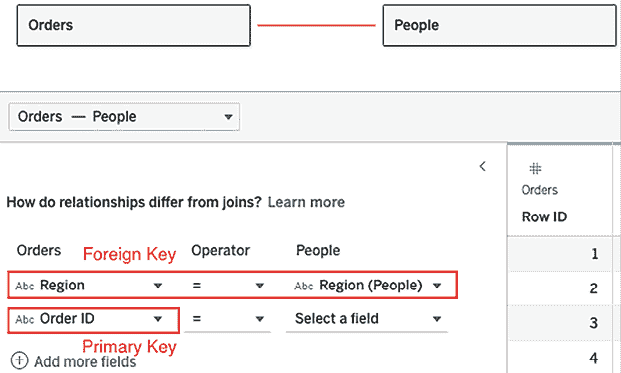

图 13.8：数据库键

外键由表中的一列或多列组成，它们在另一张表中唯一标识行。这种唯一标识是由于一张表中的外键引用了另一张表中的主键而产生的。在数据库中显式定义外键使 Tableau 能够绕过许多完整性检查，从而提高性能。

### 将列定义为 NOT NULL

Tableau 发布了多篇关于性能改进技巧的白皮书 ([`help.tableau.com/current/pro/desktop/en-us/performance_tips.htm`](https://help.tableau.com/current/pro/desktop/en-us/performance_tips.htm))，指出程序员和 Tableau Desktop 都不喜欢 `NULL` 数据。如果可能，请为表中的每一列定义显式的 `NOT NULL`。

在实践中，数据库管理员对于何时适合将列定义为 `NOT NULL`、何时不适合存在争议；然而，有两点是明确的：


主键或外键应定义为 `NOT NULL`。这显而易见，因为主键和外键根据定义必须是唯一的。

此外，任何要建立索引的列都应定义为 `NOT NULL`，否则索引可能无法使用。

索引将在下一节详细讨论。

## 索引

让我们考虑关于索引的两个问题：

*   什么是索引？
*   应该为什么建立索引？

第一个问题对 DBA 来说很容易回答，但对于普通 Tableau 作者来说可能是未知领域。为了澄清，索引是数据库表中选定列的副本，经过优化以实现高效搜索。由于这些复制的列包含指向原始列的指针，因此可以快速访问它们以查找给定行并返回所需数据。

一个小例子可能会有所帮助。根据波音公司的数据，787 梦想客机约有 230 万个零件。想象一个在 `Part_Name` 列中列出所有这些零件的表。你的任务是搜索此列中以“fuse”字符串开头的每个零件。在非索引列上，这将需要检查数据库中的每一行数据。这种搜索可能非常缓慢。幸运的是，索引可用于减少搜索的行数，从而使过程快得多。用于索引的一种结构化数据类型是 `B-tree`。`B-tree` 数据结构是排序的。因此，当使用 `B-tree` 数据结构访问索引以搜索所有以 *fuse* 开头的零件时，不必考虑每一行。相反，数据库可以直接跳到 *fs* 并快速返回所需的行。

现在让我们继续讨论索引的第二个问题。应该为什么建立索引？这个问题可以简明扼要地回答：理想情况下，数据源中用于连接或过滤的所有列都应该建立索引。

尽管在 Tableau 中创建更高效连接有一些基本性能考虑（例如，当左连接足够时避免使用外连接），但连接性能主要由 Tableau 外部决定。因此，为连接中使用的列建立索引通常比为过滤中使用的列建立索引更重要。

继续讨论操作数据源，下一节将介绍 Tableau 如何用于通过提取创建汇总数据集。

# 使用提取

本节将讨论什么是 Tableau 数据提取，以及如何高效构建提取。我的一位同事最近为一家相对较小的移动电话服务提供商提供咨询。尽管公司规模不大，但通话量可能超过 100 万次/天。公司管理层坚持要求能够在 Tableau 工作簿中使用详细的可视化界面查看单个通话。工作簿的性能自然成了一个问题。这种低级别的详细信息真的有必要吗？较少的细节和更快的工作簿是否能带来更好的商业决策？

为了在业务需求与实际性能要求之间取得平衡，企业通常需要确定什么级别的详细信息对报告真正有帮助。通常，详细粒度并非必要。在这种情况下，汇总表可能提供足够的业务洞察，同时实现快速性能。对于移动电话服务提供商，每日通话量快照可能就足够了。即使是每小时快照也会大大减小表的大小并提高 Tableau 的性能。

为了满足这一常见业务需求，提取是由 Tableau Desktop 创建的专有压缩数据源。自发布以来，提取的文件扩展名已从 `.tde` 更改为 `.hyper` 格式。因此，新格式利用了在《第 1 章 回顾基础知识》中讨论的 `Hyper` 引擎。提取可以存储在本地，并由 Tableau 访问以渲染可视化。

考虑以下使提取文件成为提高性能的绝佳选择的要点：

*   提取可以在聚合级别快速生成。
*   提取是列式存储，以列序列的形式记录数据。
*   关系型数据库通常使用 **行存储** 方法存储数据。

在下面的示例中，请注意 **行存储** 非常适合返回单个行，而 **列存储** 更适合返回聚合数据。

这是一个示例表：

| | **表** | | | |
|---|---|---|---|---|
| | **Instrument** | **Store** | **Price** |
| Row 1 | Selmer Trumpet | North | $3,500 |
| Row 2 | Conn French Horn | East | $4,500 |
| Row 3 | Getzen Trombone | South | $2,500 |
| Row 4 | Miraphone Tuba | West | $9,000 |

这是数据库中的 **行存储** 表：

| **Row 1** | Selmer Trumpet |
|---|---|
| | North |
| | $3,500 |
| **Row 2** | Conn French Horn |
| | East |
| | $4,500 |
| **Row 3** | Getzen Trombone |
| | South |
| | $2,500 |
| **Row 4** | Miraphone Tuba |
| | West |
| | $9,000 |

这是数据库中的 **列存储** 表：

| **Instrument** | Selmer Trumpet |
|---|---|
| | Conn French Horn |
| | Getzen Trombone |
| | Miraphone Tuba |
| **Store** | North |
| | East |
| | South |
| | West |
| **Price** | $3,500 |
| | $4,500 |
| | $2,500 |
| | $9,000 |

我希望你能看到，在 **列存储** 表中，某个属性的每第 *n* 行组成第一行。例如，`Instrument` 的第一行、`Store` 的第一行和 `Price` 的第一行都与一个条目相关，而在 **行存储** 表中，属于同一条目的所有行都按连续顺序排列。

总结一下本节迄今所学，提取使用压缩技术减小文件大小，同时保持性能，并利用内存和硬盘空间实现最佳性能。使用数据库实时连接时，这两点都无法实现——因此，当数据库无法满足性能要求时，提取可以提高仪表板的性能。

## 构建提取

本节将从性能角度讨论提取。提取的其他方面（如计划和增量刷新）不在本节讨论范围内，更多信息请参阅：<https://help.tableau.com/current/pro/desktop/en-us/extracting_refresh.htm>。

正如我们在前面的“小型提取”节中讨论的，提取是通过 `Data` | `[Data Source]` | `Extract Data` 创建的。从生成的对话框中，我们可以执行以下操作：

*   **按需筛选提取**：有时需要精确反映数据源的提取，但通常筛选各种字段仍会用所需数据填充提取，同时缩小大小并提高性能。要添加筛选器，只需单击 `Add...` 访问与工作表中使用的 `Filter` 对话框相同的对话框。

*   **聚合到视图中表示的粒度级别**：聚合不仅减小文件大小，从安全角度也有帮助。如果不聚合，提取将使用行级数据构建。因此，Tableau 作者应注意，如果在构建提取时未选择聚合，任何敏感的行级数据都可访问：


*   **减少行数**：正如“小型提取”节所示，减少行数可让作者创建小型本地提取以快速构建工作簿，之后可访问原始数据源进行完整分析：

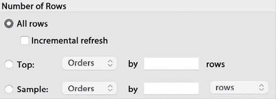


*   `Hide all unused fields`：此选项会从提取文件中排除工作簿中未使用的所有列。这可以显著减小提取文件的大小并提高性能：


图 13.11：隐藏字段

采取这四项措施后，性能应立即得到改善。请随意使用 `performance-recording tool`（性能记录工具）并创建同一数据源的不同提取文件来自行测试。稍后将讨论聚合和 `performance-recording actions`（性能记录操作）的使用。

## 聚合

以下练习将使用来自单个数据源的两个聚合数据，一个位于 `State`（州）级别，另一个位于 `City`（城市）级别。这些聚合数据源将用于创建两个工作表。这些工作表将与第三个包含行级信息的工作表一起放置在一个仪表板上。最后，将创建筛选器操作以将这三个工作表关联起来。练习的目的是演示如何将小型提取文件与较大的数据集结合使用，以创建性能更佳的仪表板：

1.  打开与本章关联的工作簿，并导航至 `State Agg` 工作表。
2.  在 `Data`（数据）窗格中，选择 `State Agg` 数据源。
3.  通过将 `State` 放置在 `Detail`（详细信息）货架上，并从 `Marks`（标记）卡中选择 `Filled Map`（填充地图），创建一个填充地图。
4.  右键单击 `State Agg` 数据源，然后选择 `Extract Data`（提取数据）。
5.  请注意，Tableau 会显示一条错误消息，指出找不到引用的文件。您可以指向 Tableau 自带的 `Superstore` 实例，或使用通过 GitHub 链接提供的实例：`https://github.com/PacktPublishing/Mastering-Tableau-2023-Fourth-Edition/tree/main`。
6.  连接到数据源后，Tableau 将显示 `Extract Data`（提取数据）对话框。在该对话框中，选择 `Aggregate data for visible dimensions`（聚合可见维度的数据）和 `All rows`（所有行）。单击 `Hide All Unused Fields`（隐藏所有未使用字段）按钮，然后单击 `Extract`（提取）：

    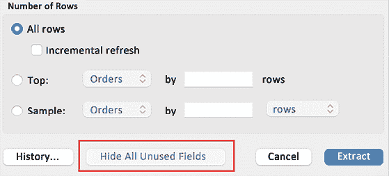

    图 13.12：提取数据

    请注意，生成的提取文件仅包含 `State`。另请注意，数据已被聚合，因此无法获取底层数据。

1.  导航至 `City Agg` 工作表。
2.  在 `Data`（数据）窗格中，选择 `City Agg` 数据源。请注意，此数据源已被提取，因此仅包含 `State`、`City` 和 `Sales`。另请注意，数据已被聚合，因此无法获取底层数据。
3.  将 `City` 放置在 `Rows`（行）货架上，`Sales` 放置在 `Text`（文本）货架上，`State` 放置在 `Detail`（详细信息）货架上。别忘了包含 `State`，即使它不在视图中显示。必须使用它，以便练习结束时创建的仪表板能正常工作。
4.  导航至 `Row Detail` 工作表并选择 `Superstore` 数据集。
5.  创建一个显示 `Customer Name`（客户名称）、`Order ID`（订单 ID）、`Row ID`（行 ID）、`Profit`（利润）和 `Sales`（销售额）的交叉表视图。快速创建此视图的一种方法是双击每个字段。
6.  导航至 `Agg Dash` 仪表板，并将这三个工作表均放置在仪表板上。
7.  在 `Superstore` 和 `City Agg` 数据源之间，创建 `City` 和 `State` 的混合关系：

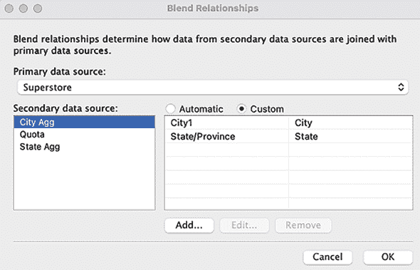

图 13.13：混合

1.  通过 `Dashboard`（仪表板）| `Actions`（操作）| `Add Action`（添加操作）| `Filter`（筛选器）创建以下操作：

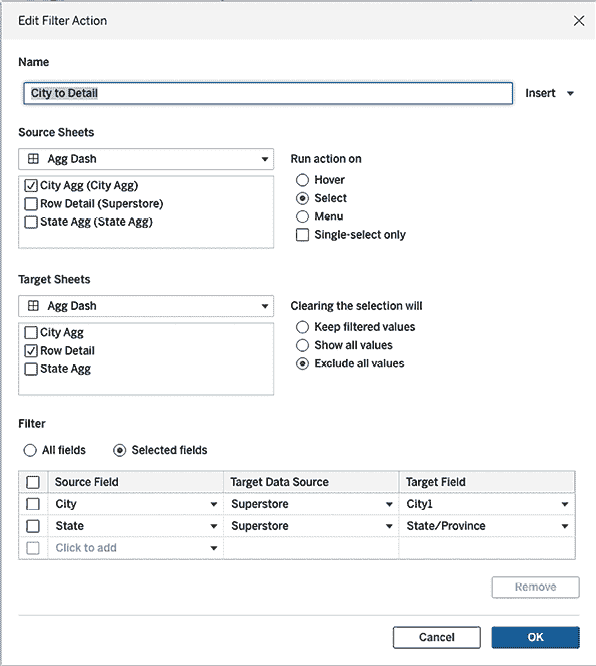

图 13.14：添加 City 到 Detail 操作

1.  通过 `Dashboard`（仪表板）| `Actions`（操作）| `Add Action`（添加操作）| `Filter`（筛选器）创建以下操作：

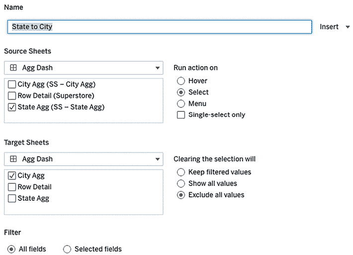

图 13.15：添加 State 到 City 操作

1.  创建这两个操作后，在仪表板中，单击 `State` 字段。
2.  然后，单击 `City` 字段。
3.  单击 `City Agg` 工作表的空白区域，以排除 `Row Detail` 上的所有值。
4.  单击 `State Agg` 工作表的空白区域，以排除 `City Agg` 上的所有值。
5.  按需格式化仪表板：

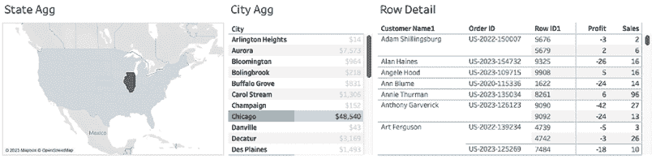

图 13.16：仪表板上的操作

完成此练习后，请注意，生成的仪表板之所以性能良好，原因如下：

*   用户首次打开仪表板时，仅显示 `State Agg`。这有两个性能优势。首先，打开仪表板时仅显示单个工作表（而不是每个工作表）会导致更少的初始查询和更少的渲染。其次，访问小型提取文件比访问较大的数据源更快。
*   由于 `City Agg` 工作表也在访问小型提取文件，因此当用户单击某个州时，`City Agg` 工作表将快速出现。
*   当用户单击 `City` 时，会向仅包含该城市信息的数据源发起调用。将提取相对较少的数据，因此即使对于较大的数据集，性能也应良好。

除了使用聚合提取文件外，还应考虑良好性能实践的另一个方面。该仪表板不包含 `quick filters`（快速筛选器）。通常，在仪表板上使用 `quick filters` 是不必要的。如果仪表板上的工作表可用于筛选，这些工作表基本上可以起到双重作用。也就是说，工作表可以在提供有价值分析的同时，充当仪表板上其他工作表的筛选器。与使用 `quick filters` 相比，这代表了性能的提升，因为添加 `quick filters` 会导致向底层数据源发送额外的查询。

在前面的仪表板中，每个工作表引用不同的数据源。因此，您可能会问，操作筛选器如何能跨不同数据源发挥作用？答案可以在筛选器操作对话框中找到。如 `图 13.14` 和 `图 13.15` 所示，所有字段均被视为 `Target Filters`（目标筛选器）。Tableau 只是简单地匹配每个数据源中同名的字段。提取文件可以经过优化以获得更好的性能结果。我们将在下一节介绍这一点。

## 优化提取文件

优化通过在可能的情况下物化计算字段来加速性能。这意味着 Tableau 会在提取文件中为计算字段生成值，以便查找这些值而不是计算它们。如果您使用 `table calculations`（表计算），Tableau 每次更改视图时都必须计算这些值。

请注意，并非所有计算字段都会被物化。不被物化的字段包括 `table calculations`（表计算）、可变或不稳定的函数（如 `NOW()` 和 `TODAY()`）以及使用 `parameters`（参数）的计算字段。

首次创建提取文件时，它会自动进行优化。换句话说，计算字段会在可能的情况下自动物化。然而，随着时间的推移，计算字段可能会被修改，导致提取文件丢失物化字段。此时，请打开 `Data`（数据）| `[Data Source]`（数据源）| `Extract`（提取），然后单击 `Compute Calculations Now`（立即计算计算字段）以重新生成物化字段：

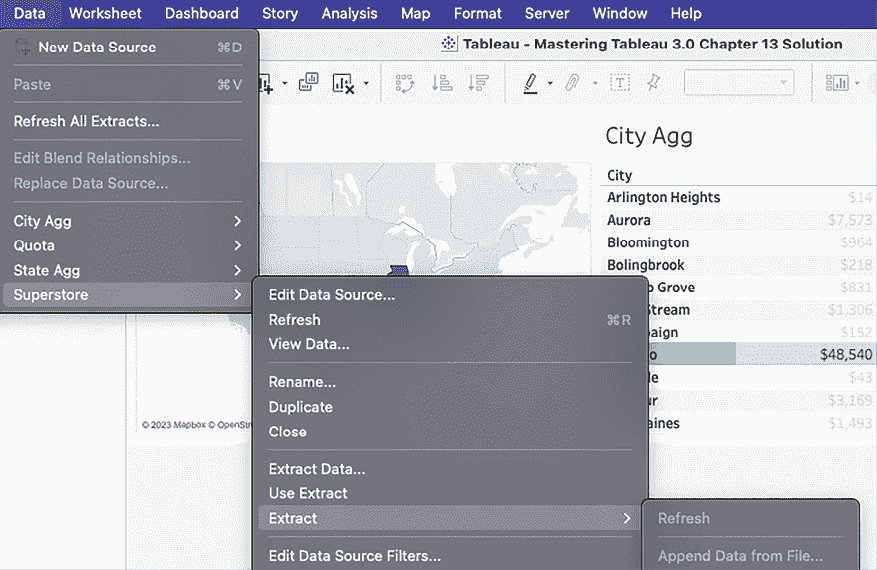

图 13.17：计算计算字段

如果提取文件设置为在 `Tableau Server` 上刷新，则每次刷新时都会自动优化提取文件。

最后，如果您在仪表板中使用了 `parameters`（参数），请检查是否可以消除它们并改用 `calculations`（计算字段）以提高性能。此外，如果 `calculations` 无法作为一个整体被物化，请对其进行拆分。将可物化的部分放在一个 `calculated field`（计算字段）中，将不可物化的部分放在另一个中。如果 `calculation` 的部分内容可以在提取文件创建期间计算，您将获得性能提升。

使用提取文件的优势已详细讨论，现在让我们继续看看如何充分利用筛选器。

# 明智地使用筛选器


# Tableau 筛选器与性能

筛选器通常能提升 Tableau 的性能。例如，当使用维度筛选器仅查看西部地区时，查询会被传递给底层数据源，从而仅返回该地区的信息。通过减少返回的数据量，性能得以提升。这是因为数据变少意味着网络带宽负载降低、数据库处理需求减少，以及本地计算机处理需求减少。

筛选器也可能对 Tableau 的性能产生负面影响。例如，使用 `only relevant values`（仅相关值）会导致额外的查询被发送到底层数据源，从而拖慢响应时间。此外，从高基数维度创建快速筛选器也会损害性能。

Tableau 的筛选器按特定顺序执行，使用时请牢记这一点。以下流程图连同一个时长一小时的演示链接，可能有助于您彻底掌握该概念：[`help.tableau.com/current/pro/desktop/en-us/order_of_operations.htm`](https://help.tableau.com/current/pro/desktop/en-us/order_of_operations.htm)：

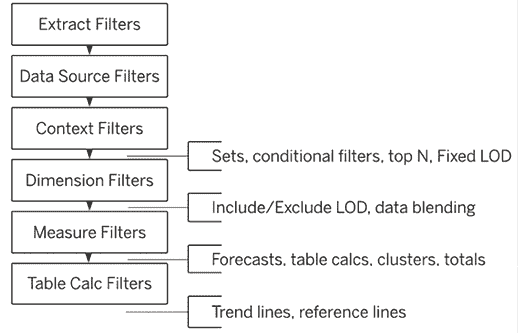

图 13.18：筛选操作顺序

本节其余内容将逐步遵循操作顺序。读完后，您将了解在何种情况下使用哪种筛选器，以使仪表板达到最佳性能。

## 提取筛选器

提取筛选器从提取的数据源中移除数据。简单来说，数据不存在了。因此，通过减少数据总量来提升性能。由于提取的数据使用 Tableau 专有的列式数据集，性能也可能因此得到改善。

此外，提取始终是扁平化的，与使用联接连接数据集相比，这将具有性能优势。要创建提取筛选器，首先选择 `Data` | `Extract Data`（数据 | 提取数据）。在生成的对话框中，选择添加筛选器。

## 数据源筛选器

数据源筛选器应用于整个工作簿。例如，如果您创建一个数据源筛选器，移除 `Country`（国家）维度除 USA 以外的所有成员，则 `Country` 维度将仅包含 USA，这适用于工作簿中的所有工作表。

数据源筛选器提升性能的方式与维度和度量筛选器相同；即数据源筛选器会导致 Tableau 向底层数据源生成查询，从而限制返回的数据。返回的数据越少，通常处理和渲染速度越快。数据源筛选器提供的另一个优势是创作简便。例如，如果 Tableau 作者预先知道整个工作簿将以 USA 为中心，创建数据源筛选器就省去了为使用该数据源的工作簿中的每个工作表应用维度筛选器的麻烦。

另请注意，数据源筛选器在流程中发生得相当早。所有计算（包括在维度和度量筛选器触发前渲染的使用固定 LOD 表达式的计算）都遵守数据源筛选器。

要创建数据源筛选器，请单击 `Tableau Desktop` 左下角的 `Data Source`（数据源）选项卡。然后，单击页面右上角的 `Add`（添加）链接：

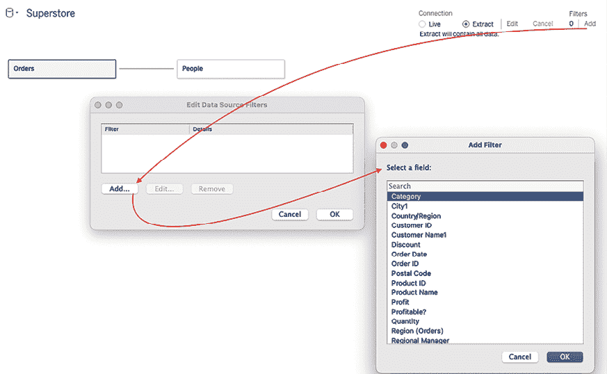

图 13.19：添加筛选器

## 上下文筛选器

上下文筛选器的创建方法很简单：右键单击 `Filter`（筛选器）架构上的字段，然后选择 `Add to Context`（添加到上下文）：

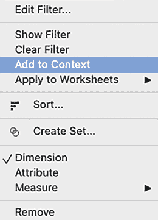

图 13.20：上下文筛选器

维度筛选器和度量筛选器是相互独立的。每个筛选器独立查询数据源并返回结果。而上下文筛选器则会强制维度筛选器和度量筛选器依赖于它。在某些情况下，这种行为有助于（且必须）获得正确答案。例如，如果 Tableau 作者访问 `Superstore` 数据集，并对 `Product Names`（产品名称）使用筛选器以返回单个类别中销量前 10 的产品名称，则必须将 `Category`（类别）定义为上下文筛选器。否则，`Product Names` 筛选器将返回总体前 10 名。因此，上下文筛选器能提升性能。

## 维度筛选器和度量筛选器

维度筛选器和度量筛选器可以提升性能。由于无论是维度筛选器还是度量筛选器，都会导致 Tableau 向底层数据源生成查询，从而限制返回的数据，因此性能得以提升。简单来说，返回的数据集越小，性能越好。

然而，维度筛选器和度量筛选器也可能降低性能。因为 Tableau 不仅为了显示可视化而向底层数据源生成查询，还为了显示筛选器而生成查询，所以显示的筛选器越多，性能越慢。此外，高基数维度上显示的筛选器会抑制性能。（成员很多的维度称为高基数。）考虑一个显示数据集中每个客户的筛选器示例。此类筛选器的性能可能很慢，因为必须找到并返回底层数据集中的每个客户，然后 Tableau 必须在筛选器中渲染并显示每个客户。

在视图中使用两个或多个维度或度量筛选器时，可以使用相关筛选器来限制显示的选项。例如，如果视图包含城市和邮政编码的筛选器，后者可以设置为显示 `Only Relevant Values`（仅相关值）：

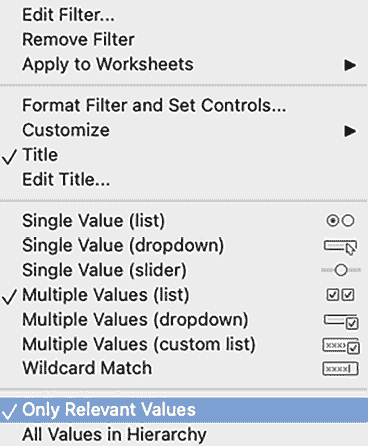

图 13.21：仅相关值

这对最终用户有利，因为它会调整显示的邮政编码数量，仅反映与第一个筛选器中所选城市相关的邮政编码。然而，使用相关筛选器会导致额外的查询被发送到数据源，从而可能降低性能。

## 表计算筛选器

将表计算用作筛选器，其带来的性能提升与维度或度量筛选器不同。如前所述，维度和度量筛选器会减少返回的数据集，而表计算筛选器不会。在 Tableau 处理流程中，表计算要在数据从数据源返回*之后*才渲染。这意味着表计算无法用于生成查询以限制返回的数据。或者换个说法，表计算筛选器会导致返回与给定维度或度量相关的所有数据，随后 Tableau 在返回的数据集上执行筛选器。

为演示这一点，请执行以下步骤：

1.  打开本章关联的工作簿，并导航到 `Late Filter`（后置筛选器）工作表。
2.  在 `Data`（数据）窗格中，选择 `Superstore` 数据源。
3.  创建一个名为 `Cust Name Tbl Calc` 的计算字段，代码如下：

    ```
    LOOKUP( MAX( [Customer Name] ),0 )
    ```

4.  将 `Customer Name` 放入 `Rows`（行）架构。
5.  将 `Cust Name Tbl Calc` 放入 `Filters`（筛选器）架构，并限制为仅显示 `Aaron Bergman`。
6.  将 `Sales` 放入 `Text`（文本）架构。
7.  右键单击 `Sales`，选择 `Quick Table Calculation` | `Rank`（快速表计算 | 排名）。

在此练习中，完整的客户列表被返回给 Tableau，随后 Tableau 部署筛选器。本质上，使用 `Cust Name Tbl Calc` 作为筛选器仅仅是隐藏了底层数据。这很有用，因为返回的 `Aaron Bergman` 排名是正确的。仅按 `Customer Name` 筛选会导致 `Aaron Bergman` 的排名为 `1`。遗憾的是，正确的结果伴随着性能损失。在此练习中运行性能记录器将显示表计算对性能产生负面影响。


幸运的是，随着 LOD 计算的出现，使用表计算作为筛选器通常已不再必要。LOD 是包含或排除当前视图之外数据的计算字段。更多信息请参阅*第 5 章*，*介绍表计算*。

## 使用操作代替筛选器

提升性能的另一种方法可能是使用操作代替筛选器。您可以开发一个仪表板，首先显示高层概览，仅当用户选择某内容时才深入细节。其机制类似于我们在*聚合*部分展示的内容；不过，聚合是按工作表进行的，而非在数据源本身上进行。通过在高层概览中选择一个标记，将触发一个操作。用户可以深入查看详细信息，但详细程度将仅逐步增加。因此，一次加载的数据会更少。

关于此主题的精彩演示可在 [`youtu.be/veLlZ1btoms`](https://youtu.be/veLlZ1btoms) 找到。或者如果您有兴趣了解更多关于热-温-冷方法的信息，请随时阅读这篇文章：[`gemshare.org/2019/08/16/hot-warm-cold-data-architecture-best-practices/`](https://gemshare.org/2019/08/16/hot-warm-cold-data-architecture-best-practices/)。

接下来我们将讨论的主题涉及计算。如何以最高效、性能最佳的方式编写计算？

# 高效计算

计算的构建方式可能不同，却能实现相同的功能。请看以下示例，它展示了 `IF` 语句如何被更简单的代码替代：

| 场景 I | 场景 II |
| --- | --- |
| 创建一个包含以下代码的计算字段：`IF SUM (Profit) > 0 THEN 'Profitable' ELSE 'Unprofitable' END` 将该计算字段放置在 `Color`（颜色）卡架上。 | 创建一个包含以下代码的计算字段：`SUM (Profit) > 0` 将该计算字段放置在 `Color`（颜色）卡架上。在生成的图例中右键单击 `True` 和 `False` 并将其重命名为 `Profitable` 和 `Unprofitable`。 |

由于这两个场景都能返回期望的结果，应该使用哪一个？决定因素是性能。本节将探讨在创建计算字段时该做什么和避免什么，以最大化性能。

## 优先考虑代码值

使用布尔值或数字的计算比使用日期的计算性能更高。反过来，使用日期的计算又比使用字符串的计算性能更高。这不仅适用于 Tableau，也适用于整个计算机科学领域。

基于此信息，上表中列出的**场景 II** 比**场景 I** 性能更高。**场景 I** 导致 Tableau 创建一个查询，要求数据源引擎处理字符串以报告盈利能力，而**场景 II** 仅发送 1 和 0 来确定盈利能力。**场景 II** 的第三步（即将 `True` 和 `False` 别名为 `Profitable` 和 `Unprofitable`）仅仅是聚合数据集从数据源返回后发生的标签更改，这对 Tableau 来说既快速又简单。

## 详细级别计算或表计算

在某些情况下，**详细级别** (`LOD`) 计算可能比表计算快，反之亦然。如果您不确定，请两者都试一试，看哪个性能更好。当然，您也可以运行性能记录。此外，如果它们并非真正需要，则两者都不使用。请参考下图，它解释了何时选择哪种计算：

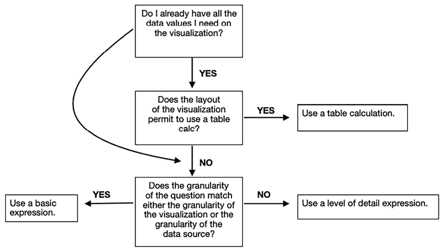

图 13.22：选择计算类型

此图以及关于选择计算类型的更多建议，可在 [`www.tableau.com/about/blog/2016/4/guide-choosing-right-calculation-your-question-53667`](https://www.tableau.com/about/blog/2016/4/guide-choosing-right-calculation-your-question-53667) 访问。

# 提升性能的其他方法

为了结束本章，让我们考虑一下提升性能的其他几种可能性。

## 避免仪表板过度拥挤

通常，最终用户希望在仪表板上一次性看到所有内容。虽然这可能被认为是有益的，但往往并非如此。考虑在仪表板上包含一个大型交叉表。翻阅数页详细信息是否增加了仪表板的分析价值？答案可能是“否”。此外，仪表板上过多的信息可能会掩盖重要的洞察。委婉地主张精简仪表板，既可能带来更好的决策，也能提升性能。

## 固定仪表板尺寸

仪表板可以设置为精确尺寸、`Range`（范围）或 `Automatic`（自动）。`Exact size`（精确尺寸）性能更快，因为一旦 Tableau Server 为一位最终用户渲染了视图，该渲染结果就会保留在缓存中，并可供访问该仪表板的下一位最终用户复用。另一方面，`Automatic` 和 `Range` 会导致 Tableau Server 尝试确定每位最终用户使用的分辨率大小并相应地渲染仪表板。这意味着 Tableau Server 不会为下一位最终用户使用存储在缓存中的仪表板实例。这反过来又会影响性能。

## 使用 Tableau Prep Builder

这之前提到过，但非常相关，所以我要重复一遍：**如果需要复杂的联接和复杂的数据混合来生成有用的结果，建议在 Tableau 之外执行 ETL 工作**，例如在 Tableau Prep Builder 中（有关此服务的更多信息，请参阅*第 3 章*，*使用 Tableau Prep Builder*）。ETL 工作理想情况下将带来更好的数据建模、聚合数据，或包含您原本必须在 Tableau Desktop 中创建的额外列的数据，因此使用 Prep Builder 可实现更轻松的创作和更快的 Tableau 性能。

## 设定预期

如果最终用户期望近乎即时的性能，那么任何达不到此标准的表现都会令人失望。提前解释复杂的、面向细节的仪表板可能性能不佳，至少有两方面的帮助。首先，通过解释可能的性能问题，可能会达成妥协，从而创建一个不那么复杂但仍能提供有价值信息的仪表板。其次，如果仪表板必须复杂且面向细节，至少最终用户已被告知在与其交互时可能需要耐心等待。

## 工作簿优化器

最后，对于我们这些“懒人”——或者可以说是“高效者”——Tableau 在不久前发布了一个极好的功能：工作簿优化器。它根据一组规则检查您的工作簿，并会以三类类别响应：采取行动、需审查和通过。因此，它利用广为人知的 RAG（红-黄-绿）或红绿灯系统为您完成性能检查。

在撰写本文时，规则包括：计算长度、使用多数据源的计算、仪表板尺寸未固定、筛选器使用条件逻辑、筛选器使用“仅相关值”、实时数据连接、数据源中的多重连接、嵌套计算、非物化计算、数据源数量、筛选器数量、布局容器数量、LOD 计算数量、仪表板中的视图数量、工作簿工作表数量、未使用的数据源、未使用的字段、使用数据混合、使用日期计算和使用分组。但我确信未来会有更多规则出现，拥有高性能仪表板将变得越来越容易。您可以通过选择 `Server | Run Optimizer`（服务器 | 运行优化器）来访问工作簿优化器功能：

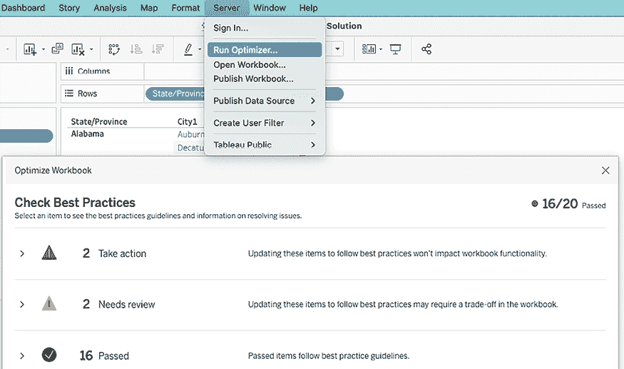

图 13.23：运行优化器


## 摘要

我们本章开始时讨论了性能记录仪表板。这很重要，因为后续的许多练习都利用性能记录仪表板来检查底层查询。接下来，我们讨论了硬件和即时技术，旨在传达良好 Tableau 性能的硬件考量，以及在缺乏最佳硬件的情况下，从任何计算机中榨取最佳性能的技巧。

随后，我们介绍了使用数据源，包括联接、混合以及高效使用数据源。接着讨论了如何尽可能高效地生成和使用提取。通过这三个部分聚焦数据源，我们了解了使用远程数据集或提取时的最佳实践和应避免的事项。下一节探讨了各类筛选器和计算的性能影响。最后，我们研究了其他性能考量，探讨了关于仪表板性能的更多想法以及设定预期。

在下一章中，我们将把注意力转向 Tableau Server。Tableau Server 是一个内容丰富的话题，足以单独成书；因此，我们的探索将仅限于从 Tableau Desktop 制作者角度出发的 Tableau Server。

## 在 Discord 上了解更多

要加入本书的 Discord 社区——您可以在其中分享反馈、向作者提问并了解新版本——请扫描下方的二维码：

[`packt.link/tableau`](https://packt.link/tableau)


