# 第 14 章：探索 Tableau Server 和 Tableau Cloud

Tableau Server 和 Tableau Cloud 是在 Tableau Desktop 和/或 Tableau Public 中创建的内容的共享、分发和协作在线解决方案。其优势包括提供一个环境，让最终用户可以安全地查看、探索和刷新实时及计划的数据可视化。Tableau Server 和 Tableau Cloud 的主要区别在于 Tableau Server 需要您自行维护，而 Tableau Cloud 由 Tableau 完全托管在云端，并由 Amazon Web Services 基础设施提供支持。为便于阅读，我们将统称两者为 Tableau Server。

本章范围仅限于 Tableau Desktop 制作者与 Tableau Server 的交互。安装和升级、身份验证和访问、安全配置以及命令行实用程序等主题与 Tableau Desktop 制作者与 Tableau Server 的交互无关，因此本章不包含这些内容。不过，帮助文档相当详尽。也可以考虑观看 Tableau Software 关于 Tableau Server 的一些视频（例如 `https://www.youtube.com/c/tableausoftware/search?query=Tableau%20Server`）。如果您对此处列出的任何主题或任何其他 Tableau Server 主题有疑问，请务必访问在线帮助网站 `https://www.tableau.com/support/help`。

本章将探讨以下主题：

*   将数据源发布到 Tableau Server
*   Web 制作
*   在 Tableau Server 上维护工作簿
*   更多 Tableau Server 设置和功能

Tableau Server 是将贵公司的 Tableau 采用提升到新高度的绝佳方式。您脑海中最重要的问题可能是：如何将 Tableau 仪表板从 Desktop 带到 Server？这正是我们将在第一节中向您展示的内容。

## 将数据源发布到 Tableau Server

因此，您购买了 Tableau Desktop，成为了一名专业的仪表板开发人员，现在想与同事分享您的工作。他们都需要 Tableau Desktop 许可证和安装才能查看您的可视化吗？幸运的是，答案是：不需要！共享 Tableau 仪表板的最佳方式是在 Tableau Server 上。这样，您的同事只需一个 Tableau Server 查看者许可证，这比开发者许可证便宜得多，并且他们可以充分与您构建并上传到 Server 的仪表板进行交互。Tableau Server 许可证模型中不同角色的详细说明请见此处：`https://help.tableau.com/current/server/en-us/license_manage.htm`。

本章假设读者拥有具有足够权限的 Tableau Server 访问权限，可发布数据源并在 Web 制作环境中编辑。如果您没有 Tableau Server 访问权限，但想完成本章练习，请考虑下载试用版，截至撰写时，它提供为期两周的完整功能。

但如何将仪表板从 Desktop 上传到 Server？让我们看看以下步骤，了解如何将数据源发布到 Tableau Server：

1.  导航至 `https://public.tableau.com/profile/marleen.meier` 以查找并下载与本章关联的工作簿。
2.  导航至 `Publish` 工作表。
3.  确保数据源为 `My Superstore`。
4.  如果尚未登录，请单击 `Server | Sign In…` 登录到您的 **Tableau Server** 实例：

    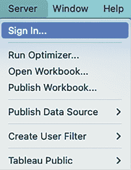

    **图 14.1：** 服务器—登录…

5.  在 `数据` 窗格中，选择 `My Superstore` 数据源。
6.  选择 `Server | Publish Data Source | My Superstore`：

    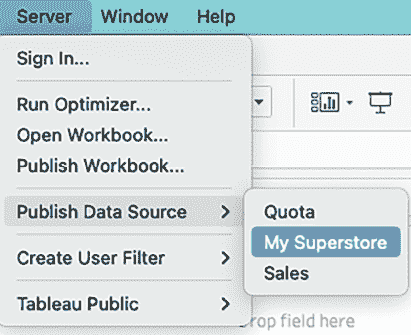

    **图 14.2：** 服务器—发布数据源

7.  在生成的对话框中，输入您所需的设置。

如果您的 Tableau Server 上有不同的项目，可以选择将数据源发布到哪个项目。如果您愿意，也可以更改名称或添加描述，这非常方便，特别是当您有许多不同的数据源并希望允许用户查找他们需要的数据源时。通过添加标签，您将添加一个元数据层，允许 Tableau Server 用户根据标签搜索给定的数据源。您还可以更改权限。您的设置可能是不同用户属于不同组，因此您可以在此选择允许哪个组拥有哪些权限。最后，您可以立即连同数据源一起上传工作簿，使两者都可在 Tableau Server 上使用。

### Tableau 文件类型

我们将通过考虑各种 Tableau 文件类型来继续讨论 Tableau Server。这似乎是一个令人惊讶的切入点，但随着阅读的深入，您会发现，清晰理解文件类型为 Tableau Desktop 制作者高效、有效地与 Tableau Server 交互提供了基础知识。

之前讨论的与理解如何与 Tableau Server 交互相关的文件类型将被深入探讨。与理解 Tableau Server 无关的文件类型将仅简要介绍。某些文件类型（例如与许可证激活相关的类型）将不予考虑。

#### Tableau 数据源

现在让我们看看 Tableau 中可用的各种数据源。请看下面的 Tableau 数据文件：


## Tableau 数据源 (.tds)

*   **文件格式类型**：XML。
*   **包含内容**：元数据。
*   **有用原因**：`.tds` 文件很重要，因为它允许 Tableau 作者定义默认格式和聚合、计算字段、数据类型、字段类型等。此外，`.tds` 文件可以发布到 **Tableau Server**，从而供环境中的其他作者访问。这实际上使 `.tds` 文件成为一本指南，确保整个组织的一致性。这一重要功能将在 *Tableau Server 架构* 部分进行更全面的探讨。
*   **生成方式**：可以通过在 **数据** 窗格中右键单击数据源并选择 `添加到已保存的数据源...`，然后在生成的对话框中选择 `Tableau 数据源` 来生成 `.tds` 文件。通过 `服务器 | 发布数据源 | [数据源]` 发布到 Tableau Server 时，也可以生成 `.tds` 文件。*将数据源发布到 Tableau Server* 部分演示了如何发布 `.tds` 文件和 `.tdsx` 文件。
*   **访问方式**：通常在两个位置之一访问 `.tds` 文件类型。首先，它可以存储在 `我的 Tableau 资源库 | 数据源` 中。存储在此目录中时，`.tds` 文件将显示在 **开始** 页面左侧的 **已保存的数据源** 部分下。`.tds` 文件常存储的第二个位置是 **Tableau Server**。导航到 `数据 | 新建数据源` 并选择 **Tableau Server**，允许 Tableau 作者指向已发布到 Tableau Server 的 `.tds` 和 `.tdsx` 文件。

## Tableau 打包数据源 (.tdsx)

*   **文件格式类型**：压缩。
*   **包含内容**：元数据和数据提取。
*   **有用原因**：`.tdsx` 文件很有用，因为它可以同时访问元数据和数据。Tableau 作者可以将位于 **Tableau Server** 上的 `.tdsx` 文件作为数据源进行访问，从而无需工作簿直接连接到外部数据源。已发布的 `.tdsx` 文件可以放入计划中，以便定期从底层数据源更新。
*   **生成方式**：可以通过在 **数据** 窗格中右键单击数据源并选择 `添加到已保存的数据源...`，然后在生成的对话框中选择 `Tableau 打包数据源` 来生成 `.tdsx` 文件。与 `.tds` 文件一样，通过 `服务器 | 发布数据源 | [数据源]` 发布到 Tableau Server 时，也可以生成 `.tdsx` 文件。详见下一练习部分。
*   **访问方式**：访问 `.tdsx` 文件的方式与 `.tds` 文件相同。首先，它可以存储在 `我的 Tableau 资源库 | 数据源` 中。存储在此目录中时，`.tdsx` 文件将显示在 **开始页面** 左侧的 **已保存的数据源** 部分下。`.tdsx` 文件常存储的第二个位置是 **Tableau Server**。选择 `数据 | 新建数据源` 并选择 **Tableau Server**，允许 Tableau 作者指向已发布到给定 **Tableau Server** 实例的 `.tds` 和 `.tdsx` 文件。

## Tableau 工作簿 (.twb)

*   **文件格式类型**：XML。
*   **包含内容**：元数据和架构。架构定义了工作簿中的可视化图表。请注意，在此上下文中，架构是指定义工作簿视觉组件的 XML，包括工作表上显示的可视化图表以及仪表板和故事的布局。
*   **有用原因**：`.twb` 文件类型是 Tableau 作者最常使用的文件类型。创建指向实时数据集的可视化图表需要它。因此，实时解决方案将使用此文件类型。
*   **生成方式**：通过 `文件 | 另存为` 创建 `.twb` 文件，然后在生成的对话框中选择 `.twb` 文件类型。
*   **访问方式**：可以通过 **Tableau Desktop** 打开 `.twb` 文件，或通过指向 **Tableau Server** 实例的浏览器访问。由于 `.twb` 文件是 XML 格式，因此可以通过文本编辑器打开、查看和更新。

## Tableau 打包工作簿 (.twbx)

*   **文件格式类型**：压缩。
*   **包含内容**：元数据、架构，以及可选的一个或多个数据提取。
*   **有用原因**：使用 **Tableau Reader** 需要 `.twbx` 文件类型。当访问 **Tableau Server** 不直接连接的数据源（如平面文件、Microsoft Excel 和 Access 文件）时，也可以在 **Tableau Server** 中有效地使用它。`.twbx` 文件的缺点将在下文讨论。
*   **生成方式**：通过 `文件 | 另存为` 创建 `.twbx` 文件，然后在生成的对话框中选择 `.twbx` 文件类型。
*   **访问方式**：可以通过 **Tableau Desktop** 打开 `.twbx` 文件，或通过指向 **Tableau Server** 实例的浏览器访问。由于 `.twbx` 文件是压缩文件，因此也可以通过压缩工具（如 WinZip 或 7-Zip）解压。

## 其他文件类型

您应该熟悉的其余文件类型与 **Tableau Server** 没有特别关系，因此将在此简要讨论。**Tableau Desktop** 提取与 **Tableau Server** 版本之间可能存在一些兼容性问题。完整的兼容性场景列表可参见 <https://help.tableau.com/current/desktopdeploy/en-us/desktop_deploy_compatibility.htm>。

让我们看看以下其他文件类型：

*   **Tableau 数据提取**：可以通过以下方式生成 `.hyper` 文件：如果在 **Tableau Desktop** 中打开 `.twb` 文件，则可以通过在 **数据** 窗格中右键单击数据源并选择 `提取数据` 来创建 `.hyper` 文件。选择所需选项后，Tableau 将提供一个对话框供作者将文件保存到指定位置。提取文件可用于创建数据源的本地快照，以获得更快的创作体验。同一个本地快照也是可移植的，因此可用于脱机环境。
*   **Tableau 书签**：可以通过 `窗口 | 书签 | 创建书签` 生成 `.tbm` 文件。它可用于跨多个工作簿复制工作表，也可用于跨多个工作簿共享格式。
*   **Tableau 地图源**：在第 9 章 *使用地图* 中，我们讨论了 Mapbox 和 WMS 的用法；如果您想保存这些仪表板，可以采用 `.tms` 格式。
*   **Tableau 首选项源**：`.tps` 文件可用于创建自定义调色板。当组织希望在 Tableau 工作簿中使用其配色方案时，这会很有帮助。Tableau 使用的 `.tps` 文件称为 `Preferences.tps`，位于 `我的 Tableau 资源库` 中。因为它是 XML 格式，所以可以通过文本编辑器进行修改。Matt Francis 在 <https://wannabedatarockstar.blogspot.com/> 发布了一篇有用的博客，清楚地解释了如何调整此文件。您也可以参考 Tableau 帮助页面。

既然我们已经讨论了不同的文件类型，接下来让我们谈谈 Web 创作。

# Web 创作


# Tableau Server 上的 Web 制作

将仪表板发布到 Tableau Server 后，该如何对其进行编辑？Tableau 提供了两种选项。第一种选项下，拥有访问权限和下载权限的你和其他所有人都可以下载仪表板，在 Tableau Desktop 中编辑，然后通过新上传覆盖 Tableau Server 上的最新版本。另一种选项是在 Server 上实时编辑仪表板。此功能称为 **Web 制作**。Web 制作是 Tableau Server 的一项功能，它提供了一个类似于 Tableau Desktop 的创作界面。最初，Web 制作界面功能有限，但每个版本都会引入更多功能。因此，Tableau Server Web 制作环境与 Tableau Desktop 之间的功能差距已缩小。Web 制作环境为创建和应用表计算提供了强大的功能，并提供了创建仪表板的功能。

截至撰写时，Tableau Server Web 制作环境中仍完全缺少某些功能，但以下链接将为您提供现有功能的概览，对比 Tableau Desktop 和 Tableau Server Web 制作功能：[`help.tableau.com/current/pro/desktop/en-us/server_desktop_web_edit_differences.htm`](https://help.tableau.com/current/pro/desktop/en-us/server_desktop_web_edit_differences.htm)。

接下来，两个简短的练习将演示如何访问 Tableau Server 中的创作环境。请记住，Tableau Server 管理员需要向用户授予相应的权限才能执行此操作。

## 使用 Web 制作编辑现有工作簿

让我们执行以下步骤，在 Tableau Server 上编辑现有工作簿：

1. 登录 Tableau Server 实例。
2. 选择我们在“将数据源发布到 Tableau Server”部分上传的 `My Superstore` 数据源。
3. 选择 `New, Workbook`（新建，工作簿），基于已发布的数据源创建工作簿：

   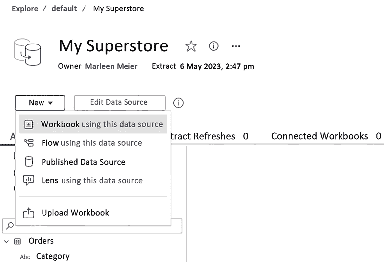

   图 14.3：已发布的数据源

4. 将 `Category` 拖到 `Columns`（列），将 `Profit` 拖到 `Rows`（行）。
5. 现在点击 `File | Publish As…`（文件 | 另存为发布…），在弹出窗口中为工作簿选择一个名称（我命名为 `Test`），然后点击 `Publish`（发布）：

   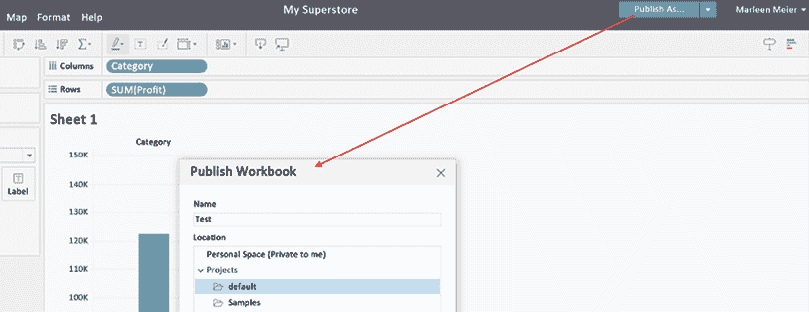

   图 14.4：发布工作簿

6. 如果现在返回 Tableau Server 的默认文件夹，你将看到一个名为 `Test` 的额外工作簿，位于 `My Superstore` 已发布数据源旁边：

   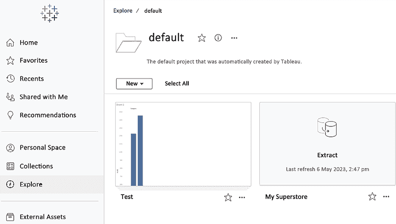

   图 14.5：工作簿视图

7. 如果你想继续编辑 `Test` 工作簿，只需在 Tableau Server 上打开它并选择 `Edit`（编辑）按钮：

   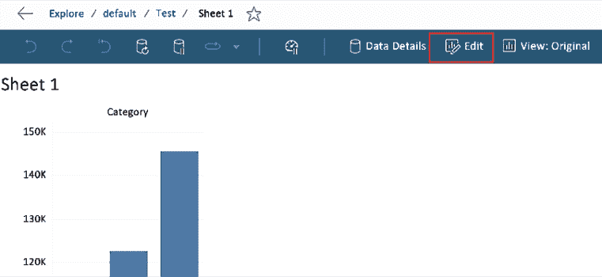

   图 14.6：Web 制作

就这么简单。

到目前为止，我们已发布数据集，在 Tableau Server 上基于该数据集构建了工作簿，你或许甚至已经编辑了该工作簿。如果还没编辑，别担心，我们将在下一个练习中进行。

## 了解 Tableau Server Web 制作环境

让我们执行以下步骤，了解 Tableau Server Web 制作环境：

1. 访问与本章关联的工作簿，并注意 `Sales & Quota` 工作表：

   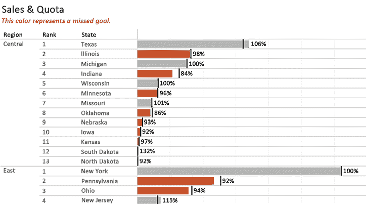

   图 14.7：Web 制作 II

2. 通过点击 `Server | Publish Workbook`（服务器 | 发布工作簿）将工作表发布到 Tableau Server 实例。在出现的窗口中，将工作簿重命名为 `Sales & Quota`，并确保仅上传 `Sales & Quota` 工作表：

   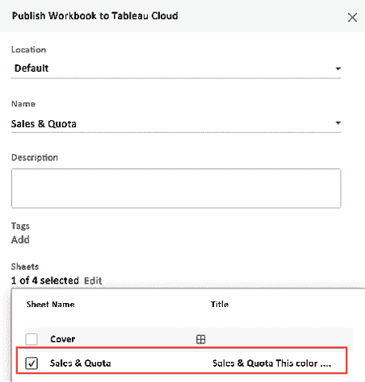

   图 14.8：发布工作簿

3. 将出现以下弹出窗口：

   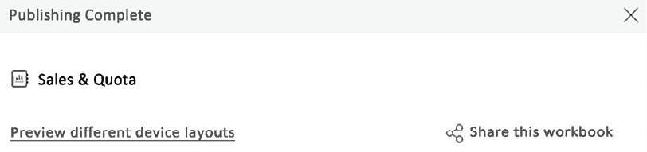

   图 14.9：发布工作簿 II

4. 通过点击 `Sales & Quota` 已发布视图在 Tableau Server 上打开工作表，然后点击 `Edit`（编辑）以访问 Web 制作：

   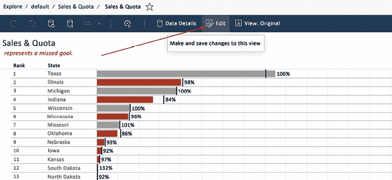

   图 14.10：访问 Web 制作

5. 从这里开始，你应该会看到一个类似于你在 Tableau Desktop 中习惯使用的界面。这就是 Web 制作的全部意义——你拥有大部分 Tableau Desktop 的在线功能，甚至不需要打开 Tableau Desktop，只要你的工作簿已发布到 Tableau Server。让我们试一试！

6. 你可能注意到的第一件事是，即使我们没有发布 `Cover` 或 `Publish` 工作表，它们在 Web 制作视图中也是可见的。你可以右键点击其中任何一个，通过选择 `Publish`（发布）使该工作表对没有 Web 制作访问权限的 Tableau Server 用户可用：

   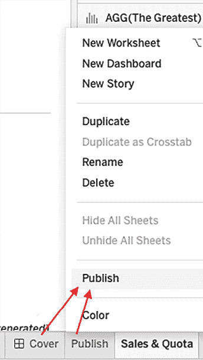

   图 14.11：Web 制作

7. 接下来，在 `Sales & Quota` 选项卡上，按住键盘上的 `Ctrl` (Windows) 或 `Command` (macOS) 键，同时将 `Quota Met?` 字段拖到 `Rows`（行）货架上：

   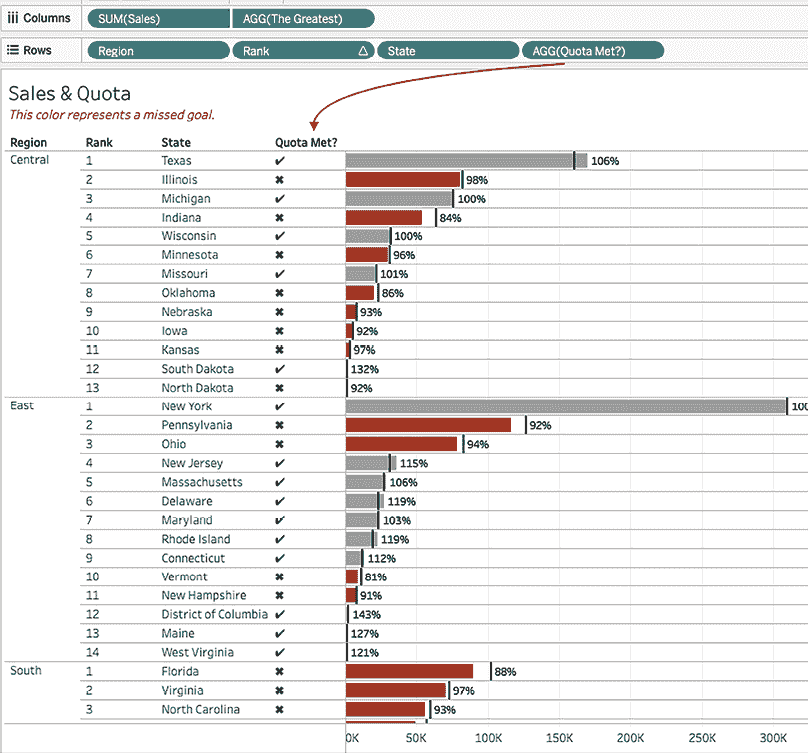

   图 14.12：Web 制作 II

8. 你将看到视图中出现叉号和勾号。这表明我们不仅可以用颜色指示是否达标，还可以用这个简单的计算字段在视图中用标记指示：

   ```
   IF SUM([Sales]) >= [Quota] THEN "✗" ELSE "✓" END
   ```

   请随意尝试你在 Tableau Desktop 中习惯轻松处理的其他操作，包括以下内容：

   * 创建计算字段
   * 添加筛选器
   * 调整工具提示
   * 创建新工作表
   * 创建仪表板

编辑完成后，尝试点击右上角的叉号。你将看到你的更改在仪表板中不可见。再次点击 `Edit`（编辑）返回 Web 制作模式，瞧！`Quota Met?` 仍然显示在 `Rows`（行）货架上。根据你的服务器设置，Tableau 会自动保存，但你必须使用 `Publish`（发布）按钮才能让更改对查看者在 Server 上可见。

# 在 Tableau Server 上维护工作簿

我们讨论了仪表板编辑选项和自动保存，但尚未讨论如何跟踪更改，并确保在生成新信息的过程中不会丢失重要信息。本节将提供关于如何在 Tableau Server 上维护工作簿的帮助，从修订历史开始。

## 修订历史

作为 Tableau 仪表板开发人员甚至 Tableau Server 管理员，你希望确保用户始终查看正确的数据。但有时会发生这种情况：你编辑了一个仪表板，编辑后仪表板显示错误信息。用户打电话给你，要求立即恢复旧仪表板。该怎么办？使用修订历史！

Tableau Server 自带修订历史功能，确保每个工作簿和数据源的过去 25 个版本均可检索。Tableau Server 管理员可以启用或禁用此设置。在 Tableau Desktop 中，如果你尝试上传一个与之前上传的文件同名的工作簿或数据源，Tableau Desktop 将显示警告，如 `Workbook name is already in use`（工作簿名称已被使用）：

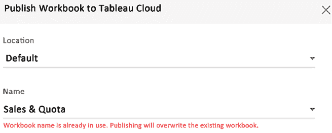

图 14.13：覆盖数据源

发布将覆盖现有数据源。如果你继续上传，修订控制将被激活，文件的先前版本将作为修订版保留并可访问。要在 Tableau Server 中访问单个工作簿和数据源的修订历史，只需选择你上传的任何数据源或工作簿，然后点击右下角的三个点。在弹出菜单中，选择 `Revision History...`（修订历史...）：

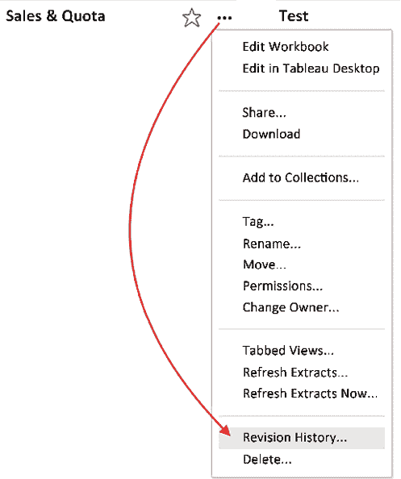

图 14.14：修订历史...

这将打开一个对话框，你可以在其中选择要恢复的先前版本：

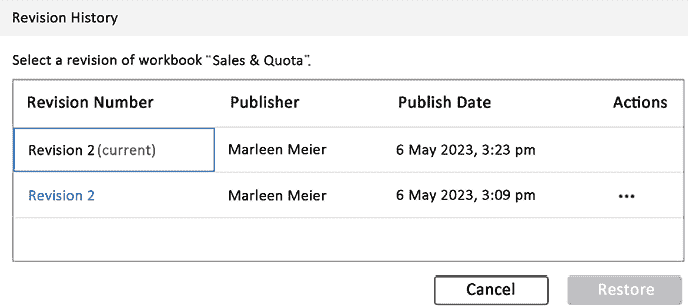

图 14.15：修订历史 II


修订历史记录非常有用！我希望你不必经常用到它们，但拥有这些选项总是好的。许多组织接下来的问题是，如何确保用户只能看到他们应该看到的内容，而不仅仅是发布到 Tableau Server 上的所有内容？一种解决方案是用户筛选器。我们接下来将讨论这个主题！

## 用户筛选器

学生们经常问我类似以下的问题：我有负责不同区域的销售经理。重要的是销售经理只能看到他们自己的指标；也就是说，不能看到其他销售经理的指标。为了实现这一点，我是否必须为每个销售经理创建单独的工作簿？

幸运的是，答案是否定的。Tableau 提供了用户筛选器，允许 Tableau 制作者确保每个销售经理只能看到他们有权查看的信息。为了演示这一点，请执行以下步骤：

1.  此练习需要 Tableau Server 上有不止一个用户。因此，请继续在 Tableau Server 上通过点击 `Users | Add Users` 创建至少一个额外用户。我使用了我拥有的第二个电子邮件地址来完成此操作：
    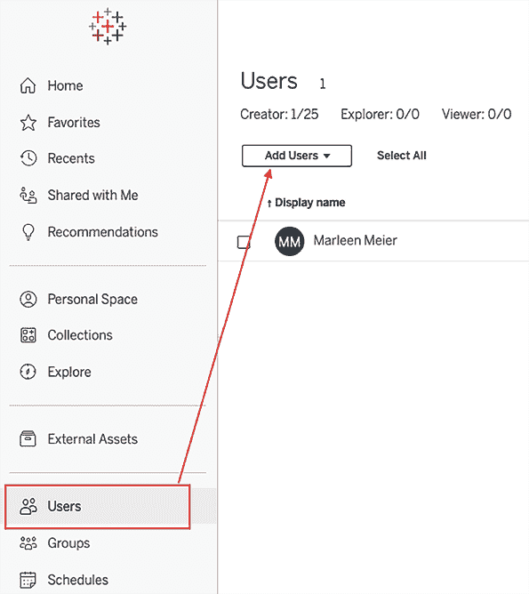
    图 14.16：添加用户
2.  作为一个可选步骤，你可以更改帐户的显示名称。要更改帐户的显示名称，请登录 [`www.tableau.com/`](https://www.tableau.com/)，点击 `User | Edit Account`，并对名和姓条目进行所需的更改。
3.  作为第二个可选步骤，你可以将用户组分配给筛选器，而不仅仅是分配单个用户。为此，你可以创建不同的组，如下所示：
    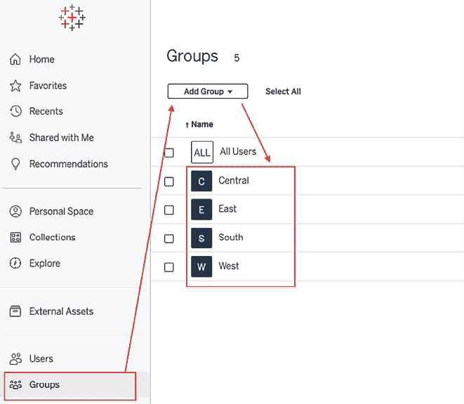
    图 14.17：添加组
4.  然后，你可以通过选择一个用户，然后在 `Actions` 下选择 `Group Membership…`，将 Tableau Server 实例上的用户划分为 `Central`、`East`、`South` 和 `West` 区域：
    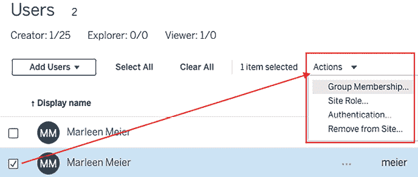
    图 14.18：添加组 II
5.  现在，访问与本章关联的工作簿并导航到 `View Level User Filter` 工作表。请注意，该视图是美国的字段地图，`State` 在 `Detail` 卡架上，`Region` 在 `Color` 卡架上，`Sales` 在 `Label` 卡架上。
6.  通过 `Server | Sign In from Tableau Desktop` 登录到 Tableau Server 实例。
7.  选择 `Server | Create User Filter | Region...`（仅可从 Tableau Desktop 访问）：
    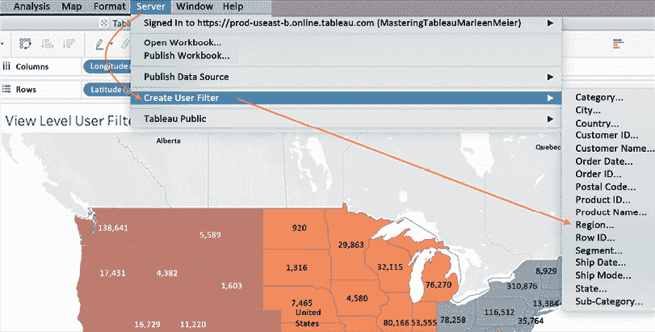
    图 14.19：创建用户筛选器
8.  在生成的 `User Filter` 对话框中，你现在可以将单个用户或组分配给一个区域。将用户筛选器命名为 `Sales Region` 并点击 `OK`：
    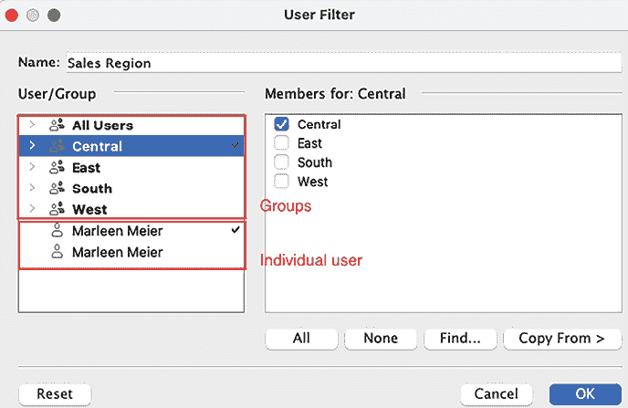
    图 14.20：用户筛选器
9.  请注意，`Sales Region` 现在实际上已添加到 `Data` 窗格的 `Sets` 部分：
    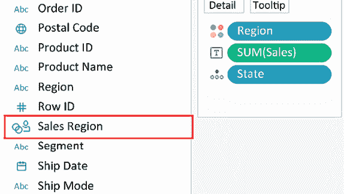
    图 14.21：添加的集合
10. 将 `Sales Region` 放置在 `Filters` 卡架上。
11. 在状态栏的右侧部分，点击下拉菜单以访问用户筛选器：
    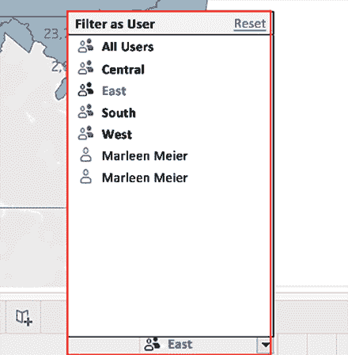
    图 14.22：在筛选器间切换
12. 选择不同的组或用户，并注意显示的结果会根据图 14.20 的设置而变化。

一旦工作簿发布到 Tableau Server，访问该工作簿的用户将只能看到筛选器允许的信息。这也可以应用于数据源级别的已保存数据源。

有一个重要事项需要注意：与仅向 `Filters` 卡架添加维度筛选器相反，你可能需要考虑将 `Sales Region` 添加到 `Data Source` 筛选器。这很重要，因为任何拥有 Web 制作权限的用户都可以直接从 `Filters` 卡架中移除筛选器。在本练习中，该用户随后将能够查看每个区域的指标。然而，数据源筛选器无法通过 Web 制作环境移除，因此更安全。此外，数据源筛选器适用于整个工作簿，这进一步保护了数据。但是，如果你未启用 Web 制作功能，`Filters` 卡架也能实现其目的。

有关筛选器和 Tableau 操作顺序的更多详细信息，请查看*第 13 章* *提升性能*。

# 更多 Tableau Server 设置和功能

仪表板发布后，用户可以设置警报、认证数据源、订阅、向仪表板添加评论等，具体取决于他们的权限。本节将在两个不同地方解决不同的功能：在工作表上和在视图上。除此之外，Tableau Server 还有许多其他功能，特别是站点管理员的设置，这些——遗憾的是——不在本书范围内。

## 工作表级别的功能

*工作表级别的功能*是指选择一个项目和特定工作表后可用的设置，如下所示：
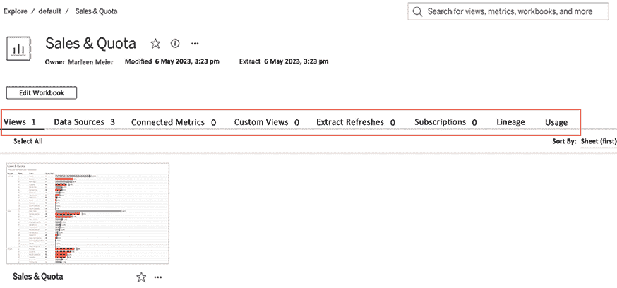
图 14.23：Tableau Server

在此级别，我们看到八个不同的选项卡，我们将在接下来的几页中讨论它们。

### 视图

视图显示在一个工作簿中发布的所有工作表或仪表板的缩略图。将工作簿上传到 Tableau Server 时，你可以选择应显示在此处的所有视图：
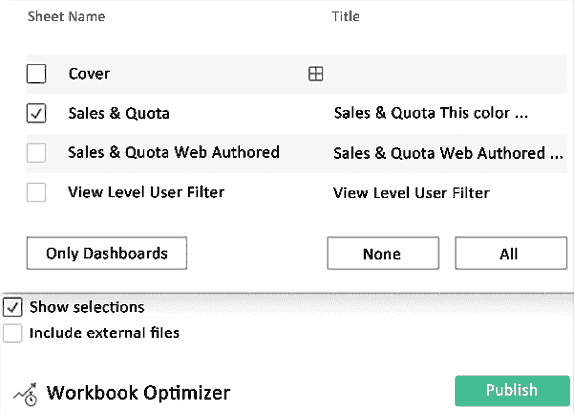
图 14.24：发布工作簿

通过点击视图旁边的三个点，将显示更多选项，如下截图所示：
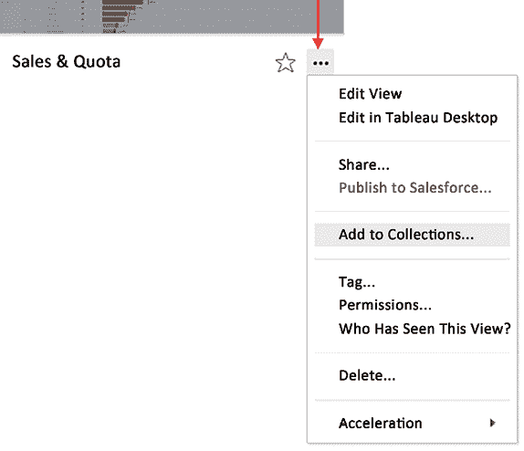
图 14.25：选项

不同的选项不言自明：你可以编辑视图（也称为 Web 制作，我们在本章前面讨论过），你可以与其他用户共享视图，Tableau 将发送一封包含图像和超链接的电子邮件给你共享视图的用户。你还可以添加标签，这将帮助其他用户找到该视图，你可以检查哪个用户或组有权打开该视图以及谁查看过此视图，最后，你可以删除它。显示哪些选项取决于 Tableau Server 中的配置，因此你的管理员可以启用或禁用不同的功能以显示，否则它们可能会变灰。

### 数据源

下一个选项卡是**数据源**。它将提供创建此工作簿所用数据源的概览：
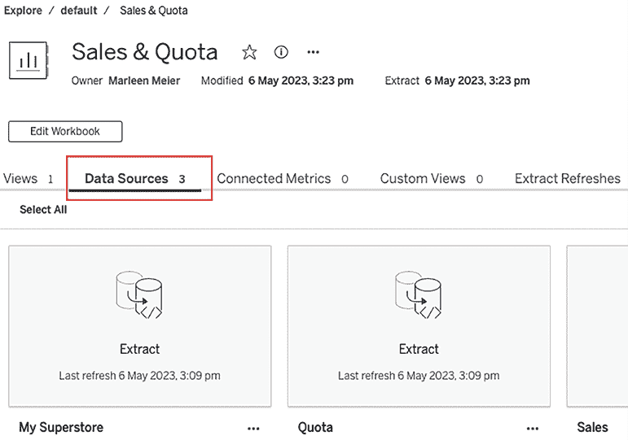
图 14.26：数据源

你将能够看到使用了哪种类型的数据源；例如，实时连接的提取，通过点击每个源旁边的三个点，你将再次看到更多设置，具体取决于你的 Tableau Server 设置：
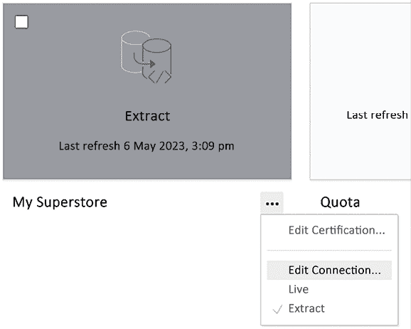
图 14.27：数据源 II

### 关联指标

接下来是关联指标。这是一个相对较新的功能。要查看指标，你首先必须在视图中设置它们。我们将在本节的第二部分介绍这一点，但基本上，它允许你选择不同仪表板和视图的片段，并将这些数据点作为指标组合起来以监控你的数据。指标利用视图中的特定数据标记。因此，你可能需要调整视图以显示你想要使用的那个标记。

例如，如果你有一个包含过去一年每日利润的仪表板，但你的指标应仅显示最后一个利润数据点，你将不得不创建一个新视图，以便在指标中使用明确的最后一个利润，即使该数据已经是初始视图的一部分。然而，一个巨大的优势是你不需要连接到不同的数据源，因为不同工作簿中已设置的连接将被利用。

有关指标的更多详细信息，请访问：[`www.tableau.com/about/blog/2020/5/introducing-metrics-headlines-your-data`](https://www.tableau.com/about/blog/2020/5/introducing-metrics-headlines-your-data)。


## 提取刷新

当使用提取作为数据源时，您可以在将工作簿上传到 Tableau Server 时定义刷新计划，甚至在发布工作簿后也可以定义。不同的计划可以由您的服务器管理员设置。例如，如果您将提取刷新设置为每天上午 7 点运行，Tableau Server 将在上午 7 点访问数据源（可能是 SQL 数据库），加载数据，作为回报，您将在 Tableau 仪表板中看到最新数据。根据数据量和数据源类型，使用提取的性能往往优于实时连接，但请注意，仪表板中的数据永远只能与您最新的提取一样新。

## 订阅

订阅可以在视图级别设置；我们将在下一节介绍这一点。但在工作簿级别，您将能够查看特定工作簿的所有活动订阅。

## 血缘

血缘是 Tableau Server 上另一个相对较新的功能。它仅通过 Data Management（数据管理）附加组件提供，需额外付费，并将向您显示数据源的依赖关系。

有关血缘的更多信息，请查看 <https://help.tableau.com/current/server/en-us/dm_lineage.htm>。

## 使用情况

**使用情况** 选项卡可让您深入了解有多少人查看了您的仪表板，以及有多少其他用户将您的仪表板添加为收藏夹。

使用情况数据也可以从 Tableau 数据库访问，因此可用于进一步分析。

最后，请注意工作簿页面上的三个点，其中包含更多选项以及我们之前见过的选项：

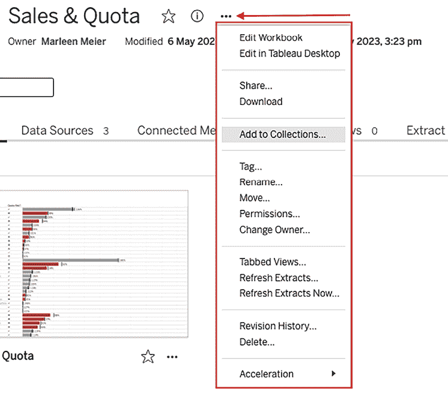

图 14.28：选项

同样，您能使用哪些选项取决于 Tableau Server 管理员授予您的权限。

当选择基于已发布数据源时（如本章开头我们发布到 Tableau Server 的 `My Superstore` 数据源），可用选项看起来会略有不同：

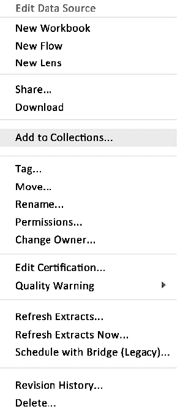

图 14.29：选项 II

大多数项目不言自明，但我想指出 **质量警告**，它在 Data Management 附加组件中可用，需额外付费。此功能将允许您提醒数据的每个用户或任何基于该数据的工作簿在使用时格外小心。

根据设置，Tableau Server 将显示各种类型的警告，例如 **已弃用**、**数据过时**、**维护中** 和 **敏感数据**，这些可从下拉菜单中选择。

您还可以决定是仅在数据源上显示类型，还是也在相关工作簿上显示。以下是仅在数据源上显示的示例：

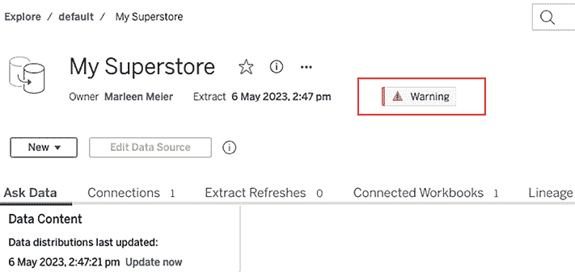

图 14.30：数据质量警告

这是在工作簿级别警告外观的示例：

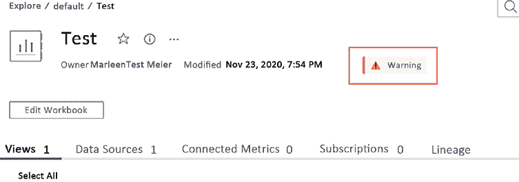

图 14.31：数据质量警告 II

甚至在打开视图时也是如此：

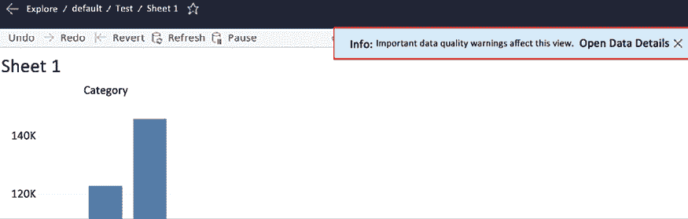

图 14.32：数据质量警告 III

这是一个非常强大的功能，展示了 Tableau 如何随着每个版本发布变得更加成熟。数据质量是许多数据战略的焦点，也是所有分析的基础。Tableau Server 适应了这一点，并为您提供了将随着您的数据战略和质量措施一起成长的功能。

## Ask Data

在我们继续介绍视图级别之前，最后一项是 **Ask Data**，它仅适用于 Tableau Server。要访问 **Ask Data**，请选择一个已发布的数据源并点击第一个选项卡。现在有趣的部分开始了，Tableau Server 将帮助您基于 **自然语言处理** (**NLP**) 构建可视化：

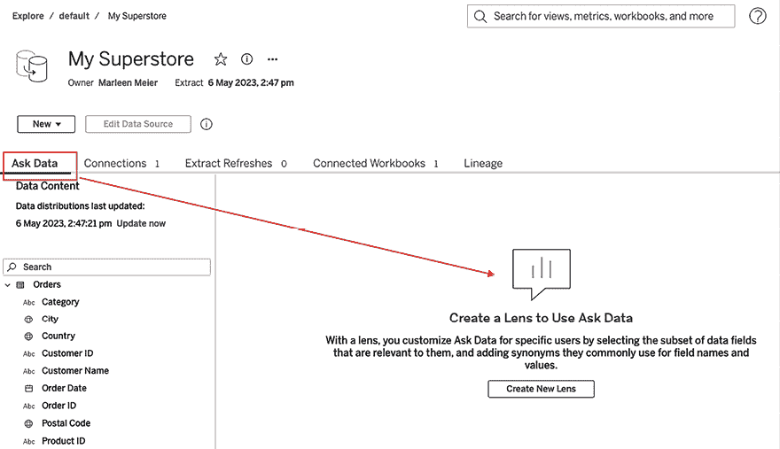

图 14.33：Ask Data

在左侧，您可以看到所有可用字段，在中间，您可以创建一个所谓的 **镜头**。镜头可以是用户或组特定的，其目的是让用户更容易提出正确的问题，从而使用 NLP 在数据源上检索正确的信息。因此，这是一种更结构化、更受管控的 NLP 方法。您甚至会看到更多弹出的提示：

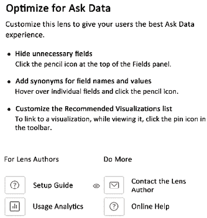

图 14.34：Ask Data II

但回到创建镜头。首先，选择您想提供给用户的字段：

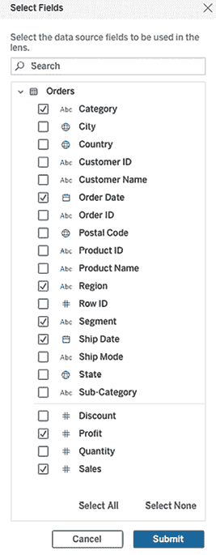

图 14.35：选择字段

提交您的设置，看看右侧的 **数据** 窗格发生了怎样的变化——它现在变得更加有限：

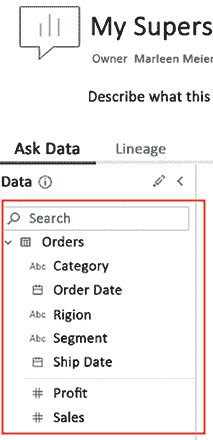

图 14.36：数据

现在，您的用户可以开始询问信息，例如：

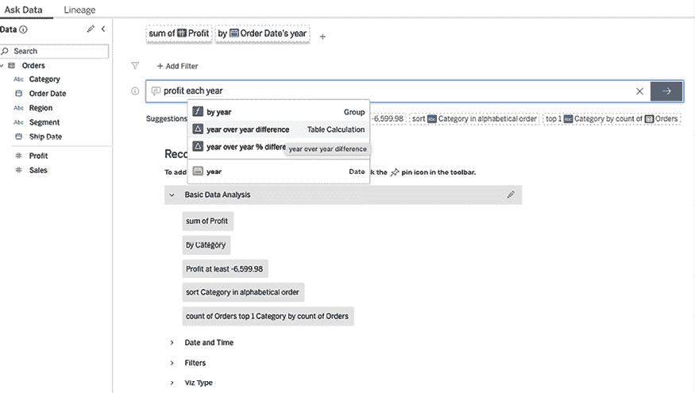

图 14.37 Ask Data III

您可以看到我输入了 `profit each year`，Tableau 提出了四个不同的选项供选择。我选择了第三个并点击箭头按钮。看看现在发生了什么：

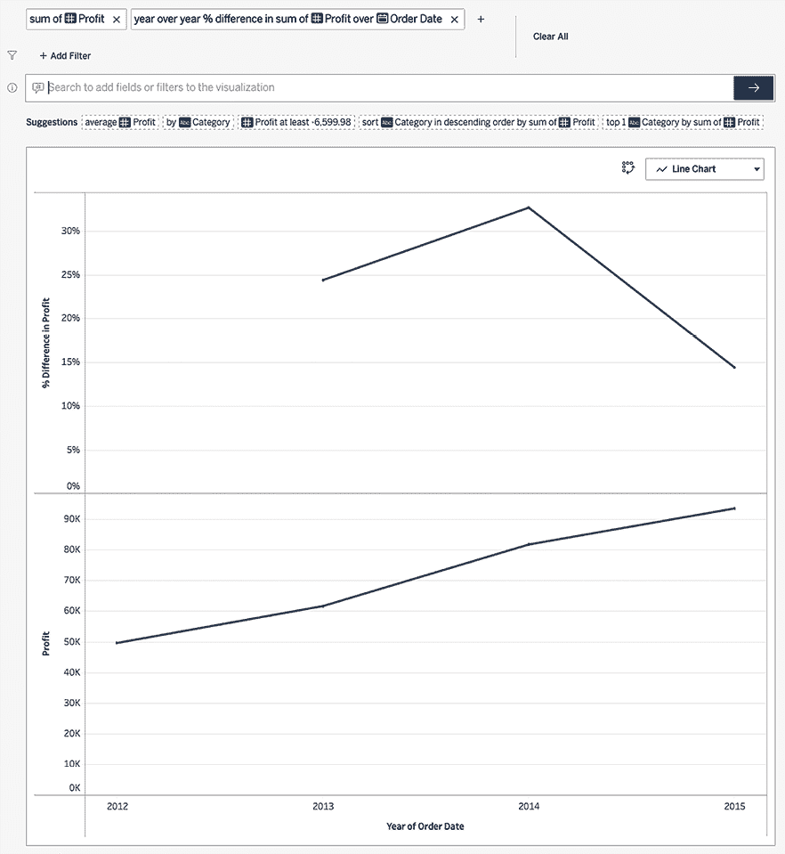

图 14.38：Ask Data 图表

Tableau Server 创建了一个视图。您还可以为数据集中的每个条目添加同义词，并尝试 Tableau 为您提供的许多建议之一。

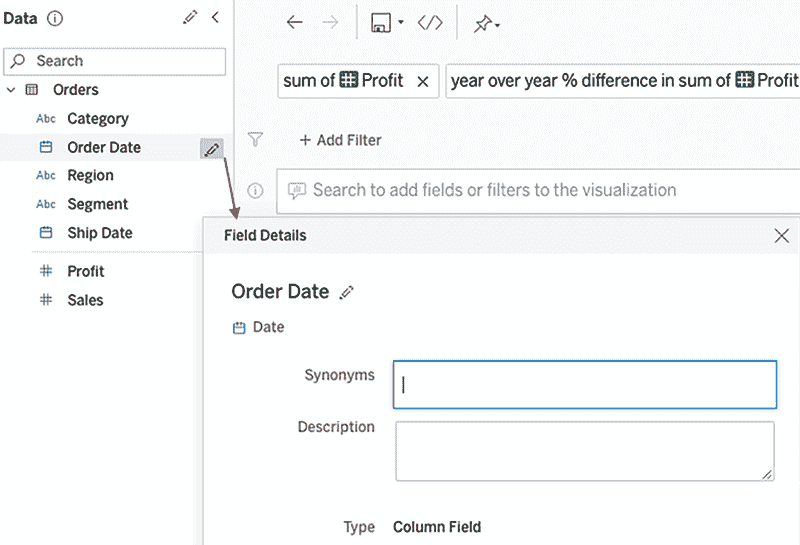

图 14.39：字段详细信息

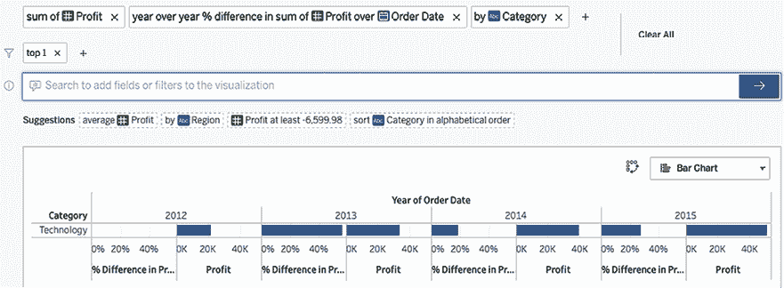

图 14.40：Ask Data 绘图

**Ask Data** 多酷啊？在我看来，这个功能特别强大，因为尽管 Tableau 非常直观，但许多人不像您那样精通数据。提供高质量数据集并将其发布到 Tableau Server，将允许更多人变得数据驱动并自行执行快速分析。这将帮助您专注于更复杂的仪表板，而临时性问题可以使用此功能来回答。

Tableau 自带更多自助洞察功能；请查看 *第 13 章*、*提高性能* 以获取更多详细信息。

## 视图级别的功能

我们已经介绍了工作簿级别的所有设置，现在我们将更仔细地查看较低级别——视图。视图看起来类似这样，红框中的设置是本节关注的重点：

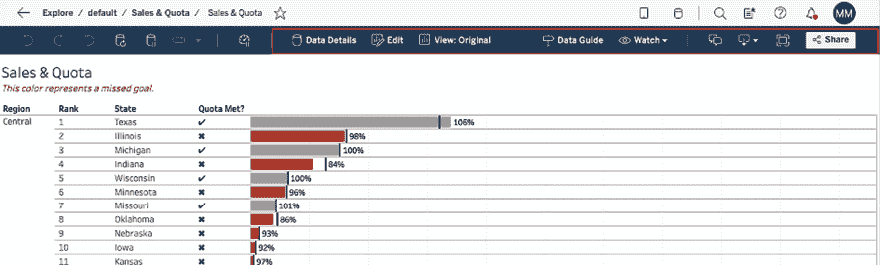

图 14.41：视图级别功能

### 数据详细信息

**数据详细信息** 选项卡将显示视图中使用的数据源的更多详细信息。此功能在 Data Management 附加组件中可用，需额外付费。右侧出现的弹出窗口有三个不同的部分：**此工作表的视图**、**数据源** 和 **使用中的字段**：

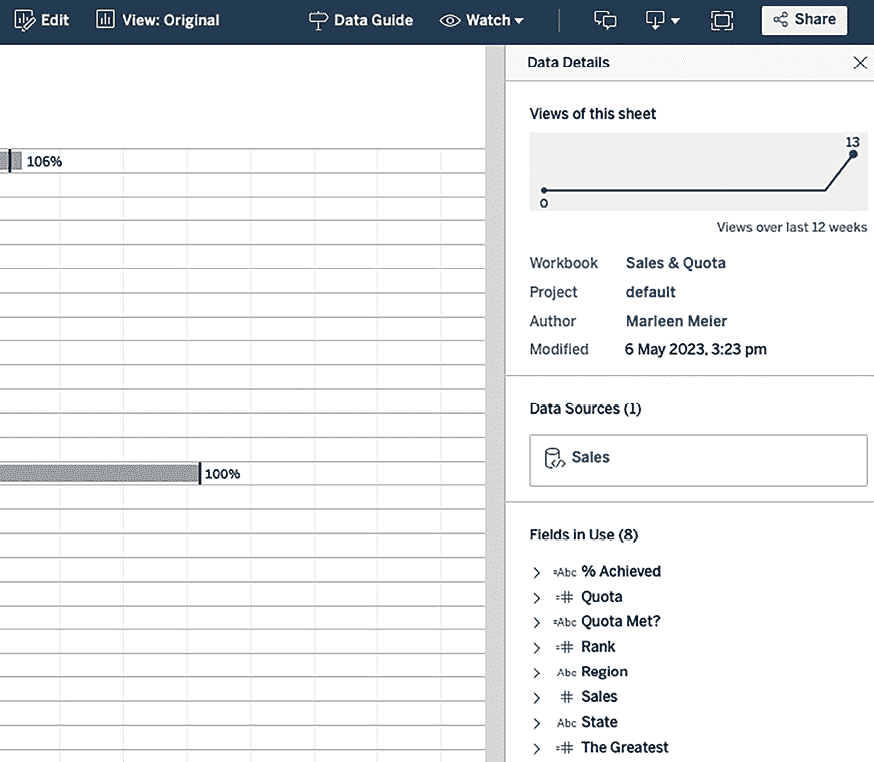

图 14.42：数据详细信息

在最后一部分，您将有单独打开每个字段的选项。如果是计算字段，将显示计算公式；如果是来自原始数据源的字段，将显示数据类型和描述（如果已添加描述）：

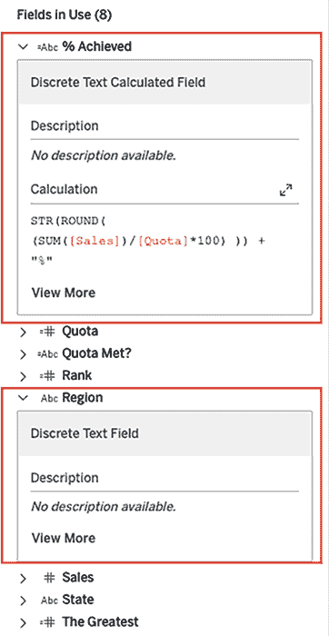

图 14.43：数据详细信息 II

### 编辑

您已经知道这个了。**编辑** 允许您进入 Tableau Server 上的 Web 创作环境。

### 视图

**视图** 选项卡允许您添加除默认视图之外的视图并保存它。下次打开仪表板时，您可以通过点击此选项卡选择您创建的视图，保存的设置将一次性全部应用。您的视图可能包含特定的筛选器选择、不同于默认视图的参数选择，以及对您最重要的集合。您无需每次打开视图时更改筛选器、参数和集合，而是可以使用 **视图** 选项卡：

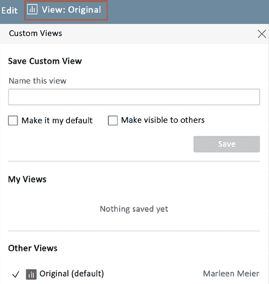

图 14.44：自定义视图

### 数据指南

**数据指南** 是仪表板中数据的摘要。不言自明，不是吗？！

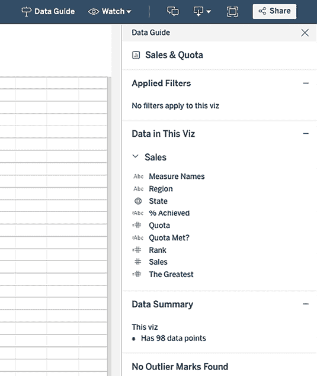

图 14.45：自定义视图

### 关注

**关注** 包含 **订阅**、**指标** 和 **警报**：

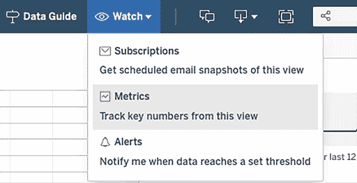

图 14.46：自定义视图

### 警报

截至撰写时，警报只能设置在连续数值轴上。然而，Tableau 论坛上正在讨论一些想法，将增加设置警报的灵活性。


# 第 14 章：Tableau Server 功能

在 Tableau Ideas 论坛中，用户可以写下他们对未来版本的想法，社区可以为其投票。得票较高的想法很有可能很快就会被采纳。您可以在此处找到该论坛：[`community.tableau.com/community/ideas`](https://community.tableau.com/community/ideas)。

点击 `Alerts` 按钮，右侧将显示文本：

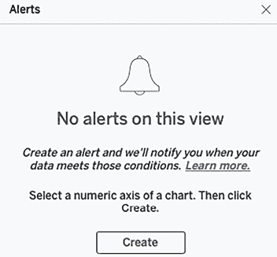
*图 14.47：警报*

选择数值轴（如 `Sales`）后，将出现一个新的弹出窗口，您可以在其中输入条件和阈值。此外，还可以指定阈值检查的频率：

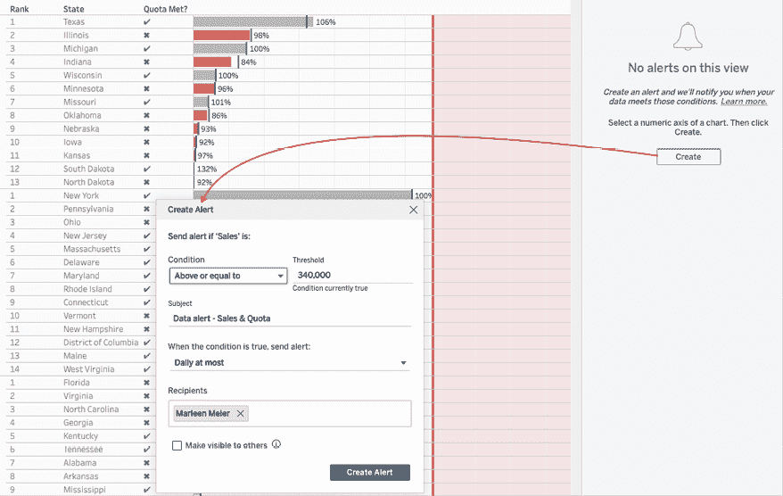
*图 14.48：警报 II*

如果设置了警报，则该警报中指定的所有用户和组将在阈值被突破时收到一封电子邮件。该邮件将包含一张静态图片和一个指向 Tableau Server 上交互版本的链接。

`Metrics`：如前所述，这是一个相对较新的功能。要创建指标，请在任意视图中选择一个标记，然后单击 `Metrics` 选项卡。视图右侧将打开以下屏幕：

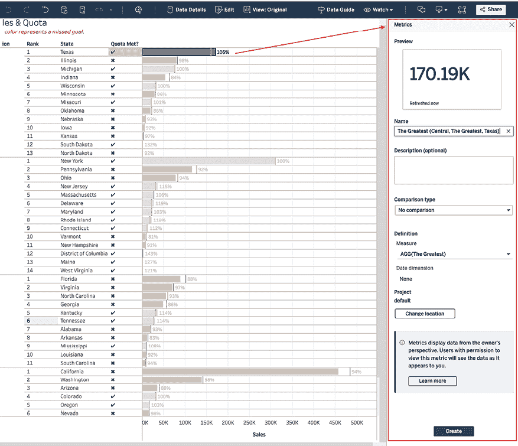
*图 14.49：指标*

`Metrics` 功能与 Tableau Mobile 集成得非常好，因此可用于向任何人展示关键绩效指标，无论他们身在何处。单击 `Create` 后，可以从保存该指标的项目中访问指标视图。

`Subscribe`：订阅旨在用于频繁的电子邮件更新。其工作方式与警报类似；可以订阅人员或组，他们将在设定的时间收到一封包含相关仪表板概览的电子邮件。计划可以由管理员预定义：例如，每天早上 7 点。

`Share`：单击 `Share` 后，将打开一个弹出窗口，允许您将视图的 URL 共享给 Tableau Server 已知的任何人。该人员将收到一封包含链接的电子邮件。请确保该用户有权访问该项目，否则他们将无法打开视图：

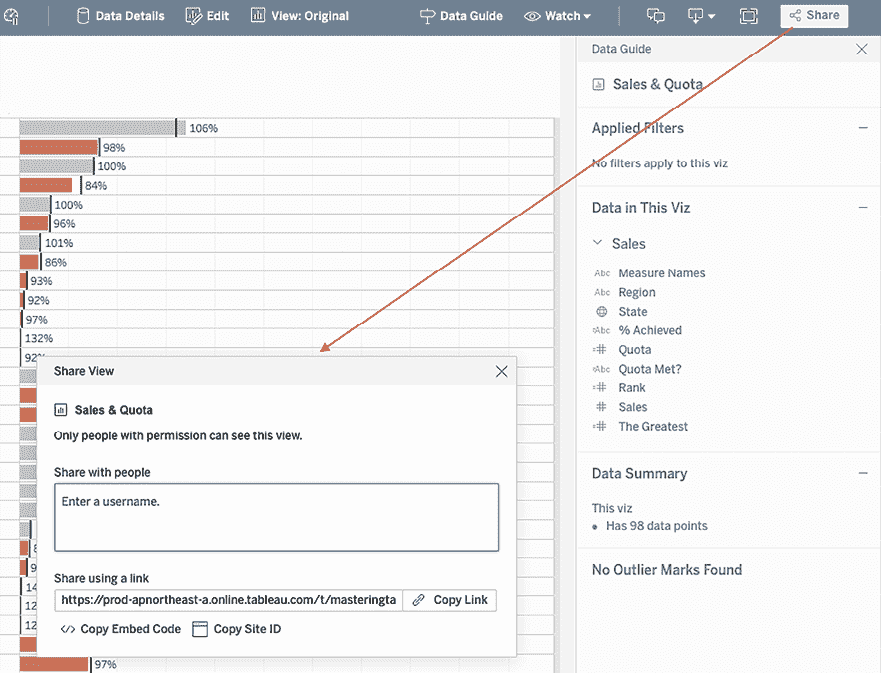
*图 14.50：共享视图*

`Download`：Tableau Server 还提供下载功能。根据管理员的配置，您可以选择不同的格式进行下载：


*图 14.51：下载*

`Comments`：最后但同样重要的是，您可以对视图进行评论——无论是原始视图还是编辑后的视图均可。为此，请单击右上角的 `Comments` 按钮：


*图 14.52：评论*

您可以在评论中使用 `@colleaguesname` 提及同事，他们将收到一封包含您评论的电子邮件。您也可以向评论中添加屏幕截图。

## 摘要

本章首先介绍了 Tableau Server 设置，我们了解到修订历史功能可以为防止意外覆盖文件提供安全网。我们探讨了 Tableau Server Web 创作环境，并将其与 Tableau Desktop 进行了比较。本节的主要目的是建立知识库，以确定哪些人员应拥有 Tableau Desktop 许可证，以及哪些人员只需使用 Tableau Server 的 Web 创作功能即可。

然后我们讨论了用户筛选器。用户筛选器使 Tableau 作者能够确保用户只能访问他们有权访问的数据。最后，我们了解了一些实用功能，如警报、订阅、评论等。

在下一章中，我们将跳出 Tableau 的世界，探讨如何将其与 R 和 Python 集成。编程集成知识将帮助 Tableau 作者完成超出 Tableau 能力范围的分析任务，同时仍使用 Tableau 可视化结果。

## 在 Discord 上了解更多

要加入本书的 Discord 社区——您可以在其中分享反馈、向作者提问并了解新版本——请扫描下方的二维码：

[`packt.link/tableau`](https://packt.link/tableau)


