# 第 15 章：集成编程语言

在 14 章充满 Tableau 功能和练习的内容之后，我们还缺少什么？正确，就是那个能开启全新机会世界的功能：编程集成！如果您需要一个 Tableau 计算字段原生不支持的函数，并且您知道如何编写代码，就可以求助于编程集成。确切地说，支持两种语言：`R` 和 `Python`。

想象一下这样的场景：您处理一个金融数据集，想要向 Tableau 仪表板添加一个期权定价公式。您查阅公式，发现拥有所有必需变量，如行权价、股价和波动率，但还需要一个概率密度函数，这在 Tableau 中找不到。在这种情况下，您可以求助于编程集成，在 `R` 或 `Python` 中运行计算并返回输出——很棒，不是吗？现在想象第二个场景：您正在做一个情感分析项目。您可以在 Tableau 外部使用 `Python` 计算情感，然后将输出作为模型的输入，但如果能在 Tableau 中完成所有这些不是更好吗？通过使用编程工具集成，您可以做到。

在本章中，我们将涵盖以下主题：

*   集成编程语言
*   `R` 安装与集成
*   实现 `R` 功能
*   `Python` 安装与集成
*   实现 `Python` 功能

## 集成编程语言

集成如何赋能 Tableau？这是通过计算字段实现的。Tableau 动态地与 `Rserve` 或 `TabPy` 交互以传递值并接收结果。正如我们在 `Chapter 3` `Using Tableau Prep Builder` 中看到的，`Tableau Prep Builder` 也具有 `R` 和 `Python` 集成！所以，让我们不要浪费时间，直接开始吧。

基本的 Tableau 到 `R` 和 Tableau 到 `Python` 集成非常简单：视图基于计算字段显示数据，借助该字段，Tableau 将数据分别推送到 `Rserve` 或 `TabPy`，然后通过表计算检索结果：

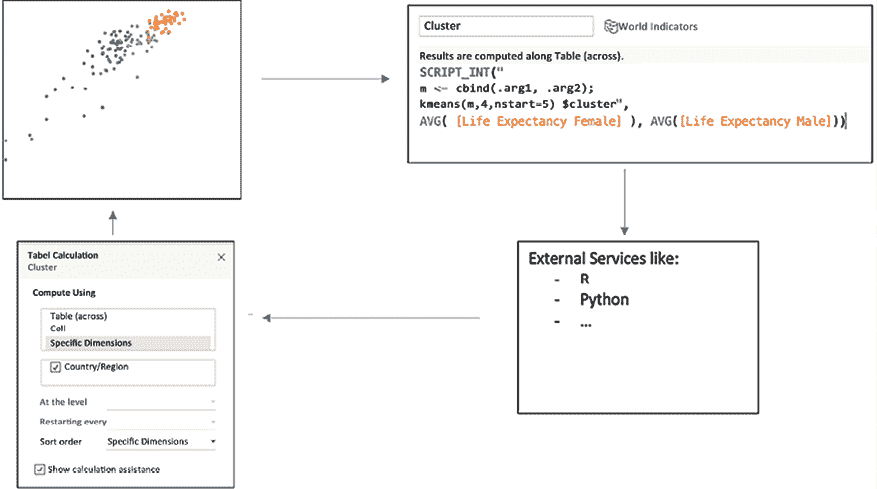
*图 15.1：Tableau 外部服务*

自然，无论您是在 `Tableau Desktop` 上查看工作簿，还是通过 `Tableau Server` 查看，如果您想运行 `R` 和 `Python` 计算，则 `Rserve` 或 `TabPy` 必须可访问。

为了正确理解集成，让我们也看看 `Tableau/R 工作流` 作为示例。下图中使用的术语（您可能不熟悉）将在本章中逐一解释：

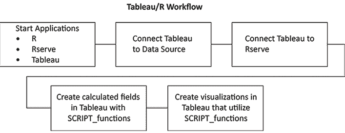
*图 15.2：Tableau/R 工作流*

前面的屏幕截图同样适用于 `Python`。让我们从 `R` 开始，因为它是最早可用的集成。

## R 安装与集成

为了充分理解 Tableau 和 `R` 如何协同工作，掌握全局至关重要。为了便于理解，在深入探讨计算字段和 `R` 脚本细节之前，我们将在本节中介绍高层概念和信息。

安装 `R` 通常不难，但不仅仅是双击可执行文件那么简单。要成功将 Tableau 与 `R` 连接，您需要确保权限设置正确，并且各种组件（一些是必需的，一些只是锦上添花）都已正确实施。我们将介绍基础知识，回顾安装过程中面临的一些典型挑战，并提供故障排除指导。

执行以下步骤安装 `R`：

1.  通过访问 [`www.r-project.org/`](http://www.r-project.org/) 下载 `R`，单击 `download R` 超链接，然后选择一个 `CRAN mirror`。请注意，`R` 在 Linux 或 Unix 环境中运行效果最佳；但是，为了学习 `R` 并开始使用 Tableau/`R` 功能以完成本章练习，安装 Windows 版本已足够。


# R 安装与集成

## 安装 R

2. 通过双击下载的可执行文件来安装 R。

3. 打开 R。

安装 R 时可能会出现各种问题。例如，您可能会因 R 工作目录权限不足而遇到问题。当您尝试安装 R 包时，此问题可能首次显现。要解决该问题，请在 R 中使用 `getwd()` 函数确定工作目录。接下来，通过 `setwd()` 更改工作目录，或者在操作系统层面（取决于您更习惯哪种方式）为工作目录设置适当的读取和执行权限。

问题也可能因安全系统和端口配置问题而产生。默认情况下，Tableau 将通过端口 `6311` 连接到 Rserve。或者，在 Tableau 中连接到 R 时，您可以指定其他端口。

[`www.r-project.org/`](http://www.r-project.org/) 上的文档提供了关于克服各种安装难题的详细信息。

## 使用 RStudio Desktop

虽然不是必需的，但 RStudio Desktop 提供的用户界面比随 R 安装的默认 R GUI 更好。RStudio 包含一个控制台，具有智能代码完成功能（即 IntelliSense），一个工作区浏览器，可轻松访问文件、包和帮助，一个数据查看器，以及更多功能，所有这些都在一个统一的环境中：

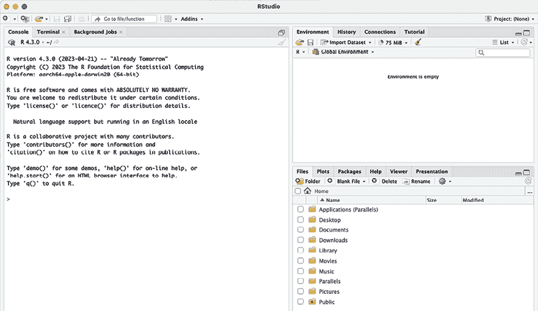

**图 15.3：RStudio**

RStudio 的开源版本足以满足许多用途。您可以通过 [`posit.co/download/rstudio-desktop/`](https://posit.co/download/rstudio-desktop/) 下载该应用程序。只需在桌面版和 R GUI 版本中自行选择您更喜欢的一个即可。

## 启动 Rserve

打开 R：

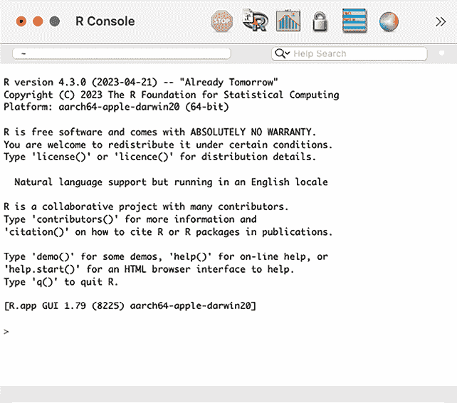

**图 15.4：R GUI**

要与 Tableau 建立连接，您需要启动 Rserve。从技术上讲，Rserve 是一个单独的包；但是，默认情况下，它会随 R 一起安装：

*   要确保已安装 `Rserve` 包，请在 R 中输入以下命令：

    ```
    rownames(installed.packages())
    ```

*   应会列出多个包，包括 `Rserve`。如果由于某种原因 `Rserve` 包未随您的 R 实例一起安装，可以通过以下方式安装：

    ```
    install.packages("Rserve")
    ```

*   要启动 `Rserve`，请输入 `library(Rserve); Rserve()`。

分号（`;`）在 R 中代表新的一行代码：

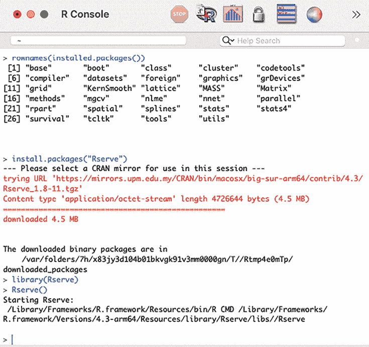

**图 15.5：Rserve 初始化**

## 将 Tableau 连接到 R

现在您已成功安装 R 并启动 Rserve，准备好将 Tableau 连接到 R。在 Tableau 中，选择 **帮助** | **设置和性能** | **管理分析扩展连接…**：

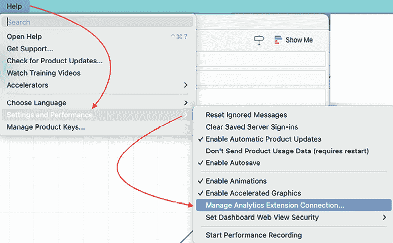

**图 15.6：分析扩展**

**管理分析扩展连接** 屏幕将打开；选择 **RServe**。以下屏幕截图中的默认设置适用于大多数本地安装：

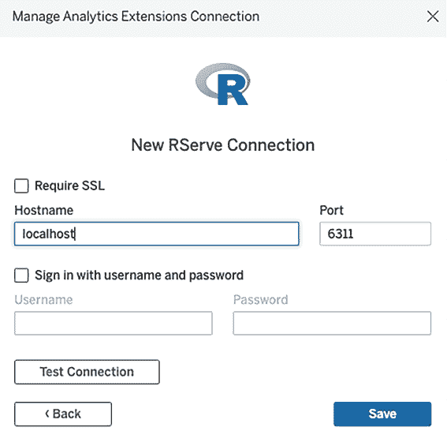

**图 15.7：分析扩展连接**

虽然将 Tableau 与 R 集成不需要与 R 界面进行任何交互，但您可能希望在将代码嵌入 Tableau 之前，先在 GUI（如 R GUI 或 RStudio）中试运行您的 R 代码。这将使您能够利用与 R 语言相关的有用附带功能，如帮助、示例和针对 R 定制的样本数据集。请注意，Tableau 中的计算字段编辑器仅充当 R 代码的传递通道，不提供任何支持。

# 实现 R 功能

## SCRIPT_ 函数概述

现在我们已成功将 Tableau 与 R 连接，让我们在 Tableau 中编写一些代码来调用 R。在 Tableau 中，打开 **计算字段编辑器**。注意以 `SCRIPT_` 开头的函数类，如下截图所示：

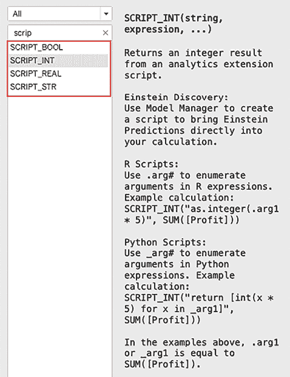

**图 15.8：SCRIPT_ 函数**

`SCRIPT_` 函数由 Tableau 用于调用 R。函数名称传达了返回结果的数据类型；`SCRIPT_REAL` 返回浮点值，`SCRIPT_BOOL` 返回真或假值，依此类推。

`SCRIPT_` 函数的语法如下图所示：

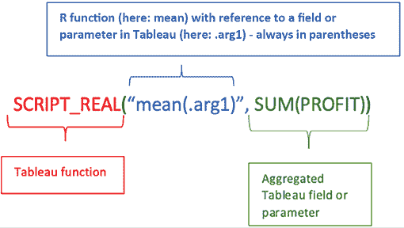

**图 15.9：R 脚本语法**

前面的示例代码计算平均利润，但我们将在下一节中看到更多示例。让我们首先使用 R 集成来复现 Tableau 功能，从而证明 R 正常工作。

## 在 R 中复现 Tableau 原生功能

在我们的第一个练习中，我们将使用 Tableau 中的 `AVG`、`MEDIAN` 和 `STDEV` 函数，并将结果与 R 的 `mean`、`median` 和 `sd` 函数进行比较。这将使您能够练习 `SCRIPT_` 函数，开始理解 R 语法，并比较 Tableau 生成的结果与 R 生成的结果。

### 设置工作簿

执行以下步骤：

1.  导航至 [`public.tableau.com/profile/marleen.meier/`](https://public.tableau.com/profile/marleen.meier/) 以查找并下载与本章关联的工作簿。

2.  导航至 `median | mean | sd` 工作表。

3.  选择 `Superstore` 数据源。

4.  创建以下以 Tableau 为中心的计算： 

    *   `Tab Avg`：`WINDOW_AVG(SUM(Sales))`

    *   `Tab Median`：`WINDOW_MEDIAN(SUM(Sales))`

    *   `Tab Stdev`：`WINDOW_STDEV(SUM(Sales))`

5.  将 **Region** 维度放在 **Rows** 货架上，将 **Sales** 放在 **Text** 货架上。

6.  双击 **Tab Avg**、**Tab Median** 和 **Tab Stdev**。它们现在将出现在 **Measure Values** 货架上：

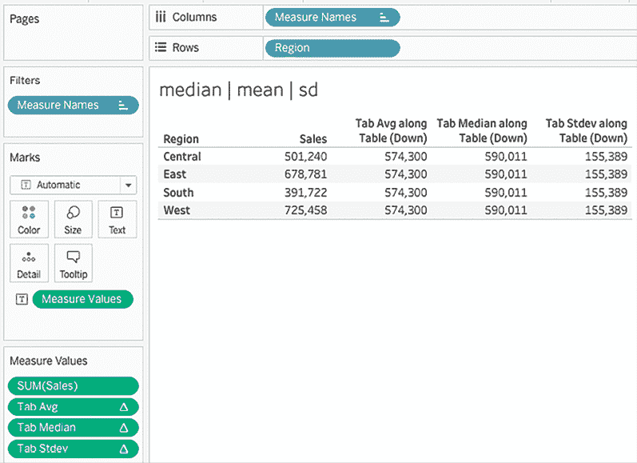

**图 15.10：测试 R**

### 配置 R 连接

1.  确保 R 已按 *R 安装与集成* 部分的说明安装、连接并正在运行。

2.  如果您尚未安装 `Rserve` 包，请在 R 界面中输入 `install.packages("Rserve")` 以安装 `Rserve` 包。

3.  接下来，在 R 界面中输入 `library(Rserve); Rserve()`。您可能会看到以下错误：

    ```
    Fatal error: you must specify '--save', '--no-save' or '--vanilla'
    ```

    在这种情况下，请输入 `Rserve(args = "--no-save")`。R 要求您在会话结束后选择保存、不保存或组合（vanilla）（不保存是我的首选，但其他两个也可以）。

4.  按 *R 安装与集成* 部分所示将 R 连接到 Tableau。完成后，返回 Tableau 并单击 **测试连接** 按钮查看是否有效：

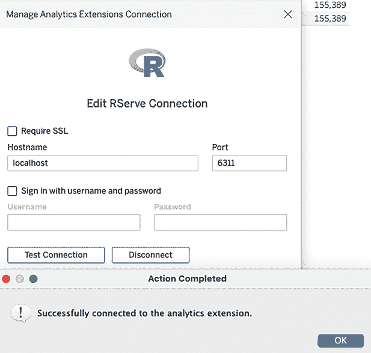

**图 15.11：测试 R 连接**

5.  单击 **确定** 关闭窗口。

### 创建 R 计算

1.  在 Tableau 中创建以下以 R 为中心的计算。请注意，R 函数（如 `mean`）区分大小写： 

    *   `R - mean`：`SCRIPT_INT("mean(.arg1)", SUM(Sales))`

    *   `R - median`：`SCRIPT_REAL("median(.arg1)", SUM(Sales))`

    *   `R - sd`：`SCRIPT_INT("sd(.arg1)", SUM(Sales))`

2.  将每个 R 计算字段放在 **Measure Values** 货架上，并进行排列，使相同类型的计算相邻但交替显示 Tableau 计算和 R 计算；例如，**Tab Avg** 然后 **R – mean** 然后 **Tab Median** 然后 **R – median**，依此类推。由于 `SCRIPT_` 函数被归类为表计算（稍后详述），请确保每个 R 计算字段实例以及 Tableau 计算字段实例都使用 **Compute Using** 设置为 **Table (Down)**：

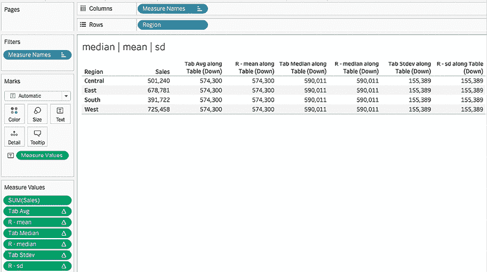

**图 15.12：Tableau 与 R 输出对比**

### 比较结果

1.  观察 Tableau 和 R 函数显示的结果相同。

请注意，中位数计算中 `INT` 已被 `REAL` 替换，这表明正如名称所暗示的，`SCRIPT_REAL` 使用浮点值，而 `SCRIPT_INT` 使用整数。在中位数的情况下，`SCRIPT_INT` 函数会导致舍入差异——亲自试一试看看！


这是我们与 R 集成的第一个练习——很简单，对吧？本练习的目的主要是向您展示 R 计算有效，因此我们对比了三个相同的计算，每个计算分别由 Tableau 和 R 完成。换句话说，复制 Tableau 功能以证明 R 集成按预期工作。下一个练习将是我们无法用 Tableau 内置功能完成的事情（截至撰写时）。我们将计算一个包含两个以上变量的回归分析。

# 使用 R 进行回归计算

简言之，回归分析是一种估计变量关系的技术。有几种类型的回归分析，其中最流行的是线性回归。正如下面的屏幕截图所示，线性回归估计一条最适合数据的线，并且是 Tableau 中的内置函数。

您只需要在**行**和**列**上放置两个度量，以及一个维度来对视图中的点进行分区。然后，转到**分析**并将**趋势线**拖到屏幕上，选择**线性**：

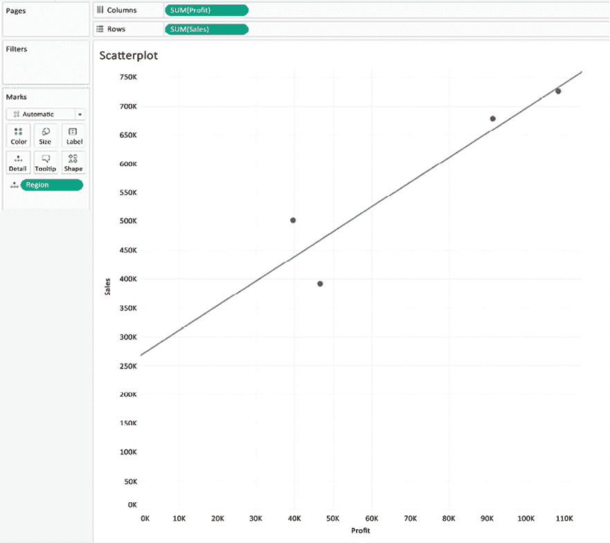

图 15.13：散点图

请注意，此屏幕截图来自 Tableau。您可以通过单击与本章关联的工作簿中的**散点图**工作表来访问它。这是一个简单的散点图，已开启趋势线。在 Tableau 中，趋势线默认为线性，但也包括对数、指数和多项式选项，这些都是回归分析的示例。通过在使用趋势线的可视化中访问**工作表** | **导出** | **数据**，您可以生成一个包含视图中标记的预测值和残差的 **Access** 数据库。但这是一个繁琐的过程，无法为线性回归的更严格用途提供稳健、动态的解决方案。使用 R 可提供更大的灵活性。

线性回归可以使用单个或多个变量。单变量方程非常适合学习，但多变量方程通常是实际应用所必需的。以下练习包含多变量方程。我们的目标是确定 `COUNT(Quantity)`、`SUM(Sales)` 和 `AVG(Discount)` 的线性回归模型与**利润**的拟合程度：

1.  导航到 `Regression` 工作表。
2.  选择 `Superstore` 数据源。
3.  通过将**利润**放在**列**架上、**州**放在**行**架上，并通过将**州**也放在**筛选器**架上按**利润**之**和**筛选**前 10** 来构建基本布局：

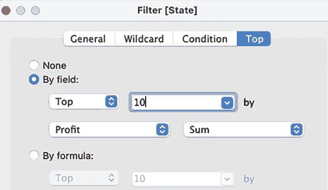

图 15.14：筛选前 10

4.  创建一个名为 `Profit_Expected` 的计算字段，使用以下代码：

```
SCRIPT_REAL(" 
x <- lm(.arg1 ~ .arg2 + .arg3 + .arg4) 
x$fitted",
SUM(Profit), COUNT(Quantity), SUM(Sales), AVG(Discount)
)
```

    该函数的细节将稍后解释。

5.  创建一个名为 `% Diff` 的计算字段，计算 `SUM(Profit)` 和 `Profit_Expected` 之间的百分比差异：

```
SUM(Profit)/Profit_Expected - 1
```

6.  创建一个名为 `Profit_Expected (residuals)` 的计算字段，以美元形式返回 `SUM(Profit)` 和 `Profit_Expected` 之间的差异：

```
SCRIPT_REAL(" 
x <- lm(.arg1 ~ .arg2 + .arg3 + .arg4) 
x$residuals", 
SUM(Profit), COUNT(Quantity), SUM(Sales), AVG(Discount))
```

7.  将 **Profit_Expected** 放在**列**架上，紧邻 **Profit**。然后，单击其中一个并启用**双轴**。
8.  右键单击一个轴并选择**同步轴**。
9.  在**标记**卡的 `SUM(Profit)` 部分，将 `% Diff` 拖到**颜色**架上。同时选择**红黑发散**调色板以及**阶跃颜色**中的 `2` **步数**。这样，所有正值将为黑色，所有负值将为红色。确保选择**条形图**作为视图类型。

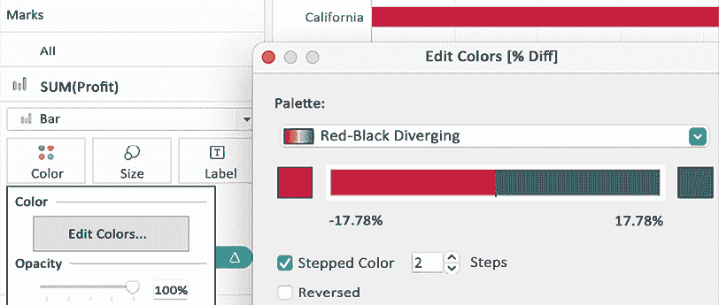

图 15.15：颜色编码

10. 从菜单中选择**分析** | **堆叠标记** | **关闭**。
11. 在**标记**卡的 `Profit_Expected` 部分，将 `Profit_Expected (residuals)`、`% Diff` 和 `Profit_Expected` 移动到**标签**架上。确保选择**甘特条形图**作为视图类型。
12. 仔细检查所有表计算（由三角形符号指示：`Profit_Expected (residuals)`、`% Diff` 和 `Profit_Expected`）是否都使用**州**进行计算：

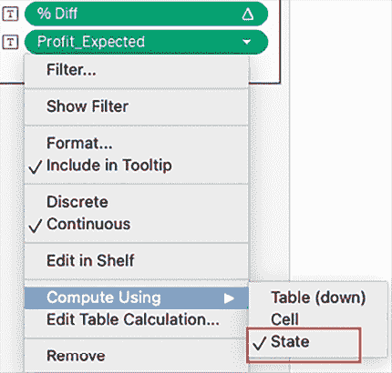

图 15.16：使用计算

13. 单击**标签**和**文本**部分中的三个点并按您的喜好编辑标签：

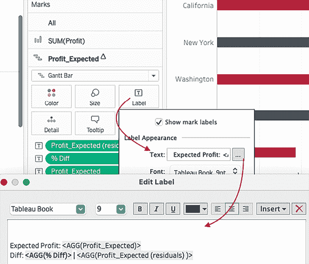

图 15.17：预期利润

根据需要调整**条形图**和**甘特条形图**的大小并观察结果：

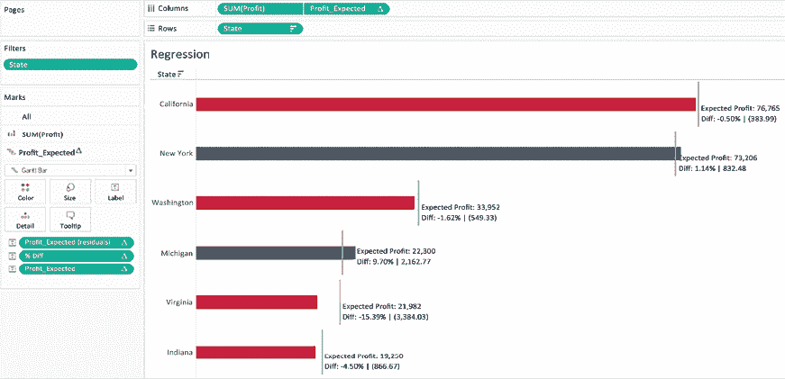

图 15.18：回归

*图 15.18* 中的可视化显示了实际利润、预期利润以及两者之间差异的对比。此计算在零售市场中特别有用，也适用于任何公司的财务规划。

现在我们已经完成了练习，让我们花点时间考虑一下本练习中使用的一些代码：

| 代码 | 说明 |
| --- | --- |
| `SCRIPT_REAL` | 此 Tableau 函数调用 R 引擎并返回浮点值。 |
| `"x <- lm(.arg1 ~ .arg2 + .arg3 + .arg4); x$residuals"` | 这是一个 R 表达式，包含一个变量、一个函数和一个参数，然后返回预测值。 |
| `x <-` | 这是由后续 R 函数填充的变量。 |
| `lm(.arg1 ~ .arg2 + .arg3 + .arg4)` | 此 R 函数用于拟合线性模型。它可用于根据参数提供的变量返回回归。括号中的信息称为参数，用于拟合模型。具体而言，波浪号（`~`）左侧是响应变量，右侧是模型。因此，这是一个多变量线性回归，其中 `.arg1 = SUM(Profit)`，`.arg2 = COUNT(Quantity)`，`.arg3 = SUM(Sales)`，`.arg4 = AVG(Discount)`。用英语表述，该参数可读作 `SUM(Profit)` 由 `COUNT(Quantity)`、`SUM(Sales)` 和 `AVG(Discount)` 的组合项建模。 |
| `x$fitted` | `lm` 函数作为其模型对象的一部分返回许多值，包括系数、残差、秩和拟合值。`x$fitted` 引用将数据传递给模型后生成的拟合值。 |
| `", SUM(Profit), COUNT(Quantity), SUM(Sales), AVG(Discount))` | 这些是用于填充 `.arg#` 变量的参数。请注意，双引号（`"`）表示传递给 R 的代码结束，逗号（`,`）表示 Tableau 函数的后半部分，即表达式。 |

在成功实现回归后，我们现在将研究另一种常用于区分数据集内子集的统计方法，称为聚类。

# 在 Tableau 中使用 R 进行聚类

聚类用于从较大的数据集中选择具有相似特征的较小数据子集。例如，考虑一个营销场景。您有一个庞大的客户群，计划向其发送广告材料；然而，成本限制您无法向每个客户发送材料。对数据集进行聚类将返回具有相似特征的客户分组。然后您可以调查结果并选择目标群体。


# 聚类

聚类的主要方法包括层次聚类和 `k`-means。层次聚类更彻底，因此也更耗时。它生成一系列模型，范围从包含所有数据点的 `1` 到每个数据点都是单独模型的 `n`。`k`-means 聚类是一种更快的方法，由用户或其他函数定义聚类数量。例如，用户可以选择从一千个成员的数据集中创建四个聚类。

Tableau 包含聚类功能。您可以在 **Analytics（分析）** 选项卡下找到此功能。Tableau 中的聚类实现基于四大支柱：

*   可靠的方法论
*   可重复的结果
*   快速的处理时间
*   易用性

请务必查看此处的更多详细信息 ([`help.tableau.com/current/pro/desktop/en-us/clustering.htm`](https://help.tableau.com/current/pro/desktop/en-us/clustering.htm)) 以及随附解决方案工作簿中的 **Clustering (Tableau native)（聚类 (Tableau 原生)）** 选项卡。

Tableau 开发团队可以通过多种方式实现聚类。例如，R 提供了许多使用不同方法的聚类包。Tableau 作者可能有充分的理由选择其中一种不同的方法。例如，使用 Tableau 原生聚类功能时，聚类结果始终相同。但它们不必相同。通过使用 R 进行聚类，底层数据和视图可能保持不变，但每次刷新时聚类结果可能不同，因为该函数会在遍历整个数据集之前就停在最佳结果（局部最小值）处。为了性能而在所谓的局部最小值和全局最小值之间做权衡已被证明是值得的。但根据数字的顺序，每次运行函数时局部最小值可能不同。如果您在寻找标记可能在聚类之间切换的边缘情况，这可能对您有利。下面的示例探讨了这种情况。

## 练习：使用 R 创建聚类

本练习的目标是根据出生率和婴儿死亡率，将世界各国分成四个聚类：

1.  导航到 `Cluster (R)`（聚类 (R)）工作表。
2.  选择 `World Indicators`（世界指标）数据源（此数据集随 Tableau 一起提供，可在 **Saved Data Sources（已保存的数据源）** 下找到）。
3.  通过将 **Infant Mortality Rate（婴儿死亡率）** 放在 **Columns（列）** 货架上，将 **Birth Rate（出生率）** 放在 **Rows（行）** 货架上，将 **Country/Region（国家/地区）** 放在 **Details（详细信息）** 货架上来构建初始视图。

    右键单击每个轴并选择 **Logarithmic（对数）** 并取消选择 **Include Zero（包含零）**。这将使数据点分布更均匀，并有助于使可视化效果更美观且更易读：

    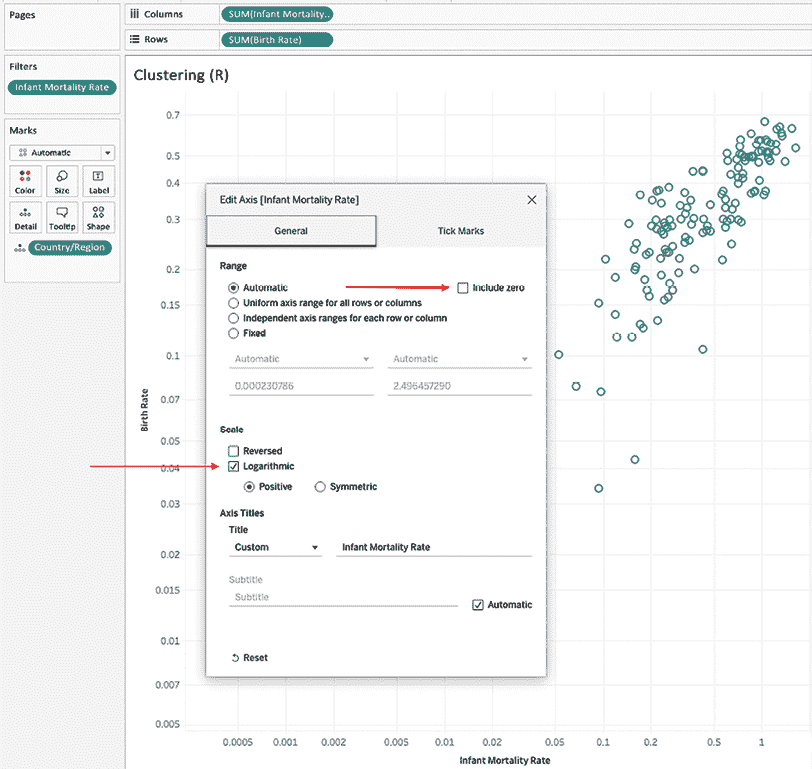

    *图 15.19：聚类*

4.  创建一个名为 `Cluster` 的计算字段，代码如下：

    ```
    SCRIPT_INT("
    m <- cbind(.arg1, .arg2); 
    kmeans(m,4,nstart=5)$cluster",
    AVG( [Life Expectancy Female] ), AVG([Life Expectancy Male]))
    ```

    该代码的详细信息将在本练习结束时解释。

    将刚创建的 **Cluster** 字段拖到 **Detail（详细信息）** 和 **Color（颜色）** 货架上。请注意，`Rserve` 引擎会抛出错误：

    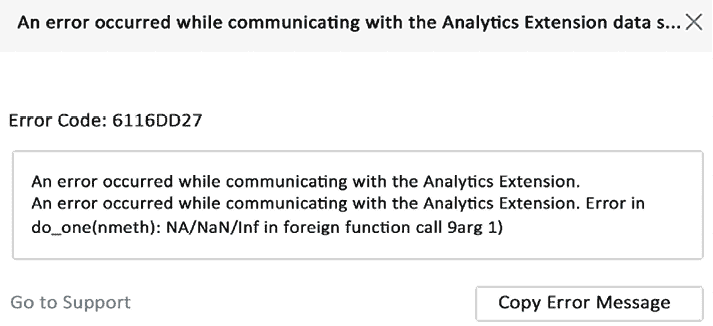

    *图 15.20：错误处理*

    这是因为底层数据集中存在空值。例如，数据不包含 *Puerto Rico*（波多黎各）的 **Infant Mortality Rate（婴儿死亡率）**。

    如果您在其他度量中遇到此错误，相同的解决方案适用。

    要修正此错误，将一个 **Infant Mortality Rate（婴儿死亡率）** 实例拖到 **Filters（筛选器）** 货架上。在 **Filter（筛选）** 对话框中，按如下所示选择值以移除所有低于 `0.01` 的值：

    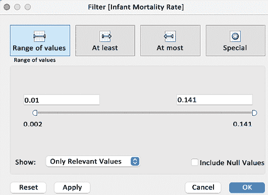

    *图 15.21：筛选器*

5.  确保将 **Cluster** 设置为 **Discrete（离散）**，并将 **Compute Using（按...计算）** 设置为 **Country/Region（国家/地区）**，以避免另一个错误：`error in k-means (m, 4, nstart = 5): more cluster centers than distinct data points`。

6.  结果视图应如下截图所示：

    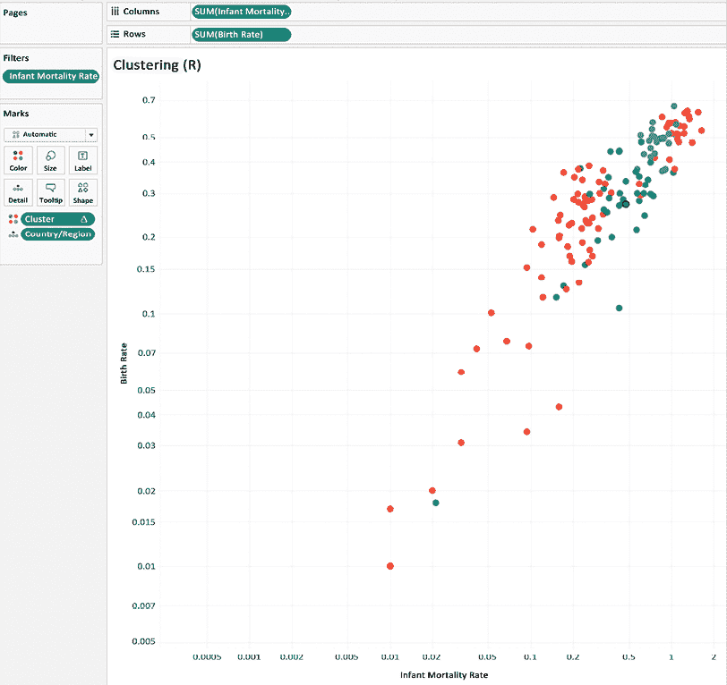

    *图 15.22：聚类*

7.  按下 `F5` 并观察聚类随每次刷新而变化。

## 代码解释

现在我们已经完成了练习，让我们花点时间考虑一下我们看到的一些代码：

| Code | Description |
|------|-------------|
| `SCRIPT_REAL` | 此 Tableau 函数调用 R 引擎并返回浮点值。 |
| `"m <- cbind(.arg1, .arg2); kmeans(m,4,nstart=1)$cluster"` | 这是包含变量、函数和参数并返回聚类的 R 表达式。 |
| `m <-` | 这是由后续 R 函数填充的变量。 |
| `cbind` | 此 R 函数将以下 `.arg#` 变量合并为列。 |
| `(.arg1, .arg2)` | 括号内的变量称为参数。每个变量包含向量信息。具体而言，`.arg1 = AVG( [Infant Mortality Rate] )` 且 `.arg2 = AVG([Birth Rate])`。 |
| `kmeans(m,4,nstart=1)$cluster` | `kmeans` 声明聚类方法。`m` 包含由 `cbind` 参数创建的向量。整数 `4` 声明聚类数量。`nstart` 声明随机集的数量。 |
| `", AVG( [Infant Mortality Rate] ), AVG([Birth Rate]))` | 这些是用于填充 `.arg#` 变量的参数。请注意，双引号 (`"`) 标志着传递给 R 的代码的结束，逗号 (`,`) 标志着 Tableau 函数的后半部分，即表达式。 |

我们实现了什么？我们能够根据预期寿命将数据集中的国家分为四个子组。我们在散点图上展示聚类结果，使用两个度量：婴儿死亡率和出生率。这样，我们可以同时间接分析四个度量，在本例中为 **Infant Mortality Rate（婴儿死亡率）**、**Birth Rate（出生率）**、**Country/Region（国家/地区）** 和 **Life Expectancy（预期寿命）**。R 聚类基于 `k`-means 方法，这与 Tableau 默认聚类不同，并且可以调整为任何可在 R 中执行的方法。

## 量位数简介

量位数常被认为与四分位数同义。它们不是。量位数是构成均匀划分的值总体的集合。四分位数是量位数的一种——五分位数、三分位数和十分位数也是如此。要理解量位数如何均匀划分值总体，想象将总体乘以 1/4、2/4、3/4 和 4/4，您将得到 4 个四分位数。要得到五分位数，您将总体乘以 1/5、2/5、3/5、4/5、5/5，依此类推。

Tableau 允许您通过右键单击轴并选择 **Add Reference Line（添加参考线）** | **Distribution（分布）** | **Computation（计算）** | **Quantiles（量位数）** 来查看量位数：

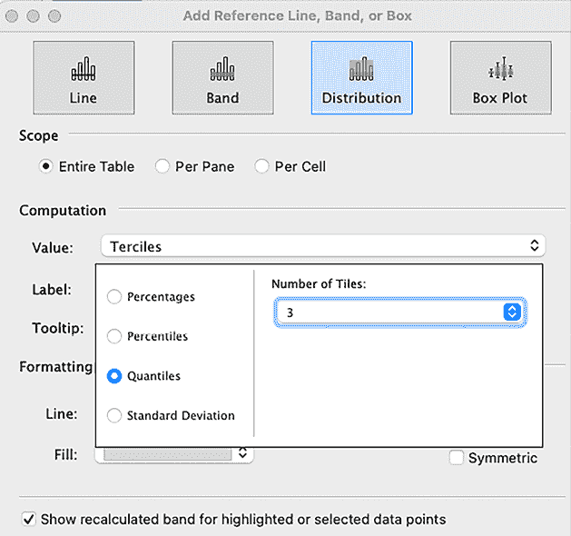

*图 15.23：三分位数*

但您也可以将分位数的数量更改为 4、5 或任何其他数字，以创建四分位数、五分位数等。然而，通过这种方式访问的量位数功能非常有限。主要原因是参考线不会生成可放置在货架上的度量。这限制了可视化选项。通过 R 生成量位数极大地扩展了这些选项。

本练习的目标是通过 R 创建 `n` 个量位数，以按销售额查看客户分布。我们将通过创建参数来进一步扩展练习，这些参数将总数据集中的成员数量限制在给定的百分位数范围内。最后，我们将通过添加抖动来微调可视化效果。

## 练习：使用 R 创建量位数

让我们看看以下步骤：

1.  导航到 `Quantiles`（量位数）工作表。
2.  选择 `Superstore`（超级商店）数据源。
3.  在 **Marks（标记）** 卡上将视图类型更改为 **Shape（形状）**。
4.  将 **Sales（销售额）** 拖到 **Rows（行）** 货架上，将 **Customer Name（客户名称）** 拖到 **Details（详细信息）** 货架上，将 **Region（区域）** 拖到 **Color（颜色）** 货架上：

    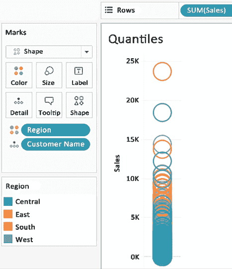

    *图 15.24：量位数*


# 分位数分析练习

## 步骤

### 1. 创建分位数参数
创建并显示一个名为 `Number of quantiles` 的参数，设置如下：

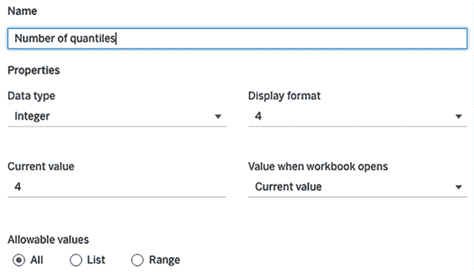

图 15.25：分位数参数

### 2. 显示参数
右键单击创建的参数，选择 `Show Parameter`。

### 3. 创建分位数计算字段
创建一个名为 `Quantiles` 的计算字段，代码如下：

```
SCRIPT_REAL("
x <- .arg1;
y <- .arg2[1];
m <- c(1:y)/y;
n <- length(x);
z <- c(1:n); for (i in c(1:n)) z[i] <- 0;
for (j in c(1:y)) for (i in c(1:n)) z[i] <- if (x[i] <= quantile(x,m)[j] && z[i] == 0 ) j else z[i];
z;"
, SUM(Sales), [Number of quantiles])
```

本练习结束时将解释该代码的详细内容。

### 4. 转换为离散型
右键单击新创建的计算字段 `Quantiles`，选择 `Convert to Discrete`。

### 5. 创建百分位数参数
创建并显示两个参数：`Select Percentile Bottom Range` 和 `Select Percentile Top Range`。两者使用以下设置：

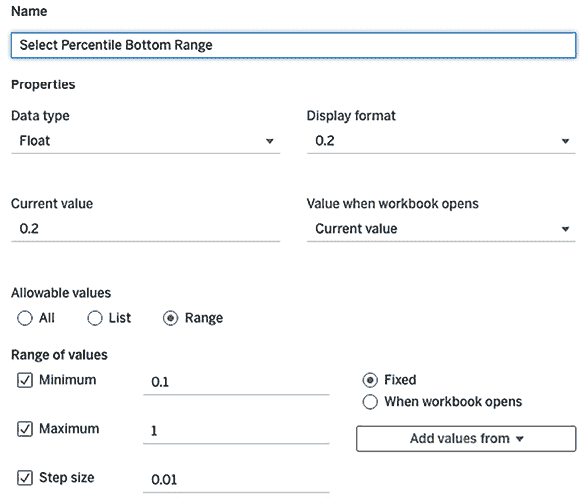

图 15.26：百分位数参数

### 6. 显示百分位数参数
右键单击这两个新创建的参数，选择 `Show Parameter`。

### 7. 创建百分位数计算字段
创建一个名为 `Percentile` 的计算字段，代码如下：

```
RANK_PERCENTILE(SUM([Sales])) < [Select Percentile Top Range] 
AND
RANK_PERCENTILE(SUM([Sales])) > [Select Percentile Bottom Range]
```

### 8. 构建视图
将 `Quantiles` 拖至 `Columns` 货架，并将 `Compute Using` 设置为 `Customer Name`。

将 `Percentile` 拖至 `Filters` 货架，单击 `OK`，然后将 `Compute Using` 设置为 `Customer Name`。再次打开筛选器并选择值 `True`。

## 回顾
那么，让我们回顾一下迄今为止所做的工作。我们绘制了每个区域的销售值，然后添加了一个 R 脚本，从销售点云中创建分位数。我们还创建了一个参数，让我们选择要在视图中查看多少个分位数，因为我们了解到分位数不一定非要是四分位数，也可以是三分位数、五分位数或更多。

接下来我们将看到该视图的实际效果，并添加抖动。

## 使用抖动增强

### 1. 添加索引字段
您可能希望添加以下额外步骤以进一步增强可视化效果。要使用抖动，请创建一个索引计算字段 `Index()`，并将该字段放在 `Columns` 货架上。将 `Compute Using` 设置为 `Customer Name`。请务必取消选择 `Show Header`，以免 `Index` 在视图中显示。

### 2. 配置坐标轴
右键单击每个轴，选择 `Logarithmic` 并取消选择 `Include Zero`。您的屏幕上应显示如下内容：

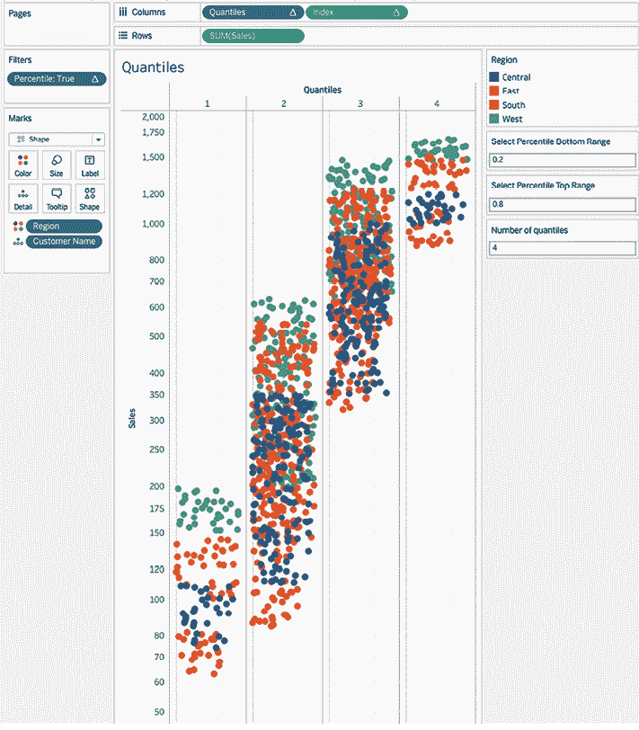

图 15.27：分位数仪表板

## 仪表板解读
在上图中，您可以看到我们决定显示四个分位数（使用 `Number of quantiles` 参数），因此它们被称为四分位数。通过将 `Index()` 函数添加到列中，我们能够将分位数分成四个组成部分。从该仪表板得出的一个结论是，在每个四分位数中，西部地区的销售额最高，南部地区最低。然而，中部和南部地区在第三四分位数中非常接近。基于此信息，我们可以进一步分析这些特定地区发生了什么，以及为什么与其他地区相比，中部地区在该四分位数中的销售额下降了。

## 代码解释
现在我们已完成练习，让我们花点时间考虑一下本练习中所见代码的一些内容：

| 代码 | 说明 |
|------|------|
| `SCRIPT_REAL` | 此 Tableau 函数调用 R 引擎并返回浮点值。 |
| `x <- .arg1;` | `x` 是我们将基于其创建分位数的变量。在本例中，该变量为 `[Sales]`。 |
| `y <- .arg2[1];` | 此变量设置分位数计数。`[1]` 强制设置单个数字而非向量。 |
| `m <- c(1:y)/y;` | `m` 将概率从 `1:y` 均匀分布。 |
| `n <- length(x);` | 这设置了循环的大小。下文将讨论循环。 |
| `z <- c(1:n); for (i in c(1:n)) z[i] = 0;` | `z` 通过将所有内容设置为 0 来设置初始响应向量。 |
| `for (j in c(1:y)) for (i in c(1:n)) z[i] = if (x[i] <= quantile(x,m)[j] && z[i] == 0 ) j else z[i];` | 对于每个分位数，我们遍历 `z` 向量，并对每个条目测试 `x` 的值是否小于该分位数的上限。如果 `x` 之前已设置，则保留它。否则，`z[i]` = 该分位数 (`j`)。 |

在本练习中，您看到通过使用 R，可以扩展 Tableau 的默认功能（如聚类），并为仪表板用户提供更大的自由度，以回答使用仪表板时出现的新问题，因为他们可以更改参数并查看可视化效果的变化。现在我们已经了解了一些可能的 R 使用案例，是时候讨论一个值得您关注的问题了：将编程集成与 Tableau 结合使用所带来的性能挑战。

# 性能挑战

R 脚本是表计算。与所有表计算一样，这意味着您只能使用视图中的字段。此外，正确设置分区和寻址非常重要；否则，您可能会得到意外的结果。

在*分位数简介*部分，您可能已经注意到，使用 `Number of quantiles` 参数设置的分位数越多，显示结果所需的时间就越长。这是因为 R 在 `Quantile` 计算字段中为每个分位数运行一次循环迭代。例如，如果 `Number of quantiles` 参数设置为 `1`，循环仅启动一次。如果设置为 `2`，则运行两次，依此类推。经验法则是：R 代码针对每个分区执行一次。分区越多，性能越慢。因此，在使用 R 代码时，应尽可能减少分区数量。

这是本章的 R 部分。希望您喜欢，并能从中获得灵感，提出自己的想法来扩展我们迄今共享的功能。现在我们将继续介绍另一种非常著名的编程语言：Python。幸运的是，Tableau 也有与 Python 的集成层。

# Python 安装与集成

Python 是一种解释型编程语言，以其可读性强而闻名。首次发布于 1991 年，距今已有一段时间（比大多数人猜测的要长），由 Guido van Rossum 开发。`TabPy` 是一项外部服务，允许您将 Python 与 Tableau 连接——类似于 `Rserve`。通过使用 `TabPy`，您可以将 Tableau 仪表板中的字段传递给 Python，执行计算，并将结果作为新计算字段发送回 Tableau。或者，您也可以在计算字段中调用在 Python 中实现的函数。关于 `TabPy` 的更详尽文章请见此处：[`tableaumagic.com/tableau-and-python-an-introduction`](https://tableaumagic.com/tableau-and-python-an-introduction)。

安装 Python 通常不难，但不仅仅是双击可执行文件那么简单。要成功将 Tableau 与 Python 连接，您可能需要安装一些库并在命令行上执行命令。以下段落将指导您完成此过程。

## 安装 Python

安装 Python 的最简单方法是执行以下步骤：

1.  下载例如带有 Python 3.10 版本的 Anaconda：[`www.anaconda.com`](https://www.anaconda.com)。任何其他 Python 解释器也可以。

## 集成 TabPy

要集成 Python 和 Tableau，需要一些额外步骤：

1.  打开例如 Anaconda 中的 Jupyter Notebook 并编写：

    ```
    !pip install tabpy
    ```

    或者，在您的 Python 目录中于命令行或终端（Mac 系统）执行以下命令：

    ```
    pip install tabpy
    ```


1.  通过命令行或终端（Mac 系统）导航至 `TabPy` 的安装目录，并在命令行或终端界面中输入 `tabpy`：

    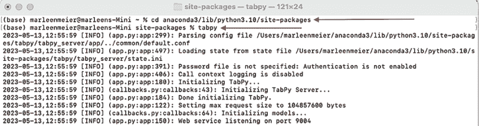

    **图 15.28：** 启动 TabPy

2.  现在您已连接到 `tabpy` 服务器，在运行 Tableau 和 Python 组合功能时，该服务器必须保持开启状态。

3.  如果您在使用 TabPy 时遇到任何其他问题（例如版本不兼容），快速在 Google 上搜索通常能解决问题。

4.  打开 Tableau，选择 **帮助** | **设置和性能** | **管理分析扩展连接**，**服务器** 选择 `localhost`，**端口** 输入 `9004`：

    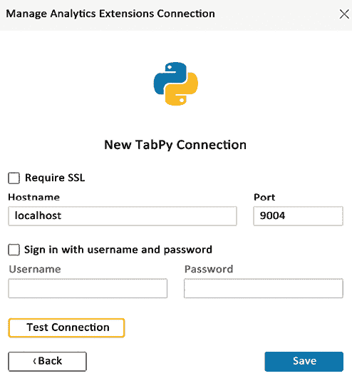

    **图 15.29：** 分析扩展连接

5.  正如您在上一个截图中所见，如果您有安全顾虑或进行更大规模的企业级部署，可以设置用户名、密码和 SSL。

6.  点击 **测试连接**，您应该会看到以下弹窗：

    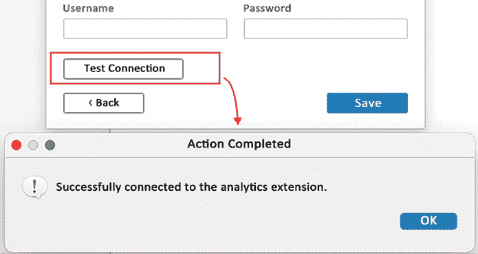

    **图 15.30：** 测试分析扩展

有关如何启动并运行 TabPy 的完整文档，请访问 <https://github.com/tableau/TabPy>。如果您不想或无法在自己的机器上安装 TabPy，Tableau 还提供了一个 Docker 容器，可安装最新版本的 TabPy。更多信息请见此处：<https://hub.docker.com/r/emhemh/tabpy/>。

# 实现 Python 功能

正如 R 语言一样，TabPy 在 Tableau 中使用 `SCRIPT_` 函数。在接下来的章节中，我们将练习使用 TabPy 并探讨多种用例。使用 TabPy 的 Tableau 计算与 R 语言非常相似。对于 TabPy，重要的是在计算字段中添加 `return` 语句，并注意参数以下划线表示而非点号：

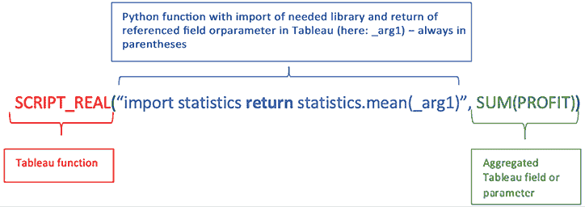

**图 15.31：** Python TabPy 语法

这将在接下来的练习中体现；我们将首先研究随机数生成器。

## Random 和随机正态分布

许多计算可通过计算字段轻松访问，其他则通过表计算——还有一些隐藏函数。之所以隐藏，是因为这些函数尚未完全支持或测试；因此使用时需谨慎。例如，如果您尝试寻找 `Random` 函数，将找不到。但您仍可以使用 `Random()` 函数，如下所示：

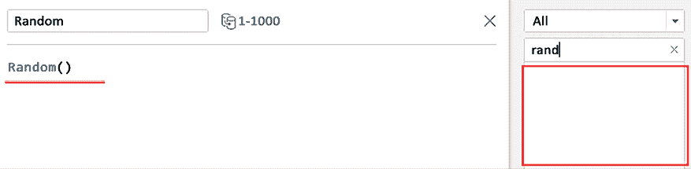

**图 15.32：** Random

另一种选择是使用 TabPy 获取 `Random` 函数。我们将结合变量 `mu` 和 `sigma` 来研究随机数和随机正态分布。这将使我们能够从一个分布中抽取随机数，这是一种常用于统计学和定量建模等领域的方法，用于模拟、复现或计算概率；`mu` 和 `sigma` 分别是定义分布的均值和标准差。

### 生成随机数

执行以下步骤，创建一个具有特定底层分布（由均值和标准差定义）的随机变量点云：

1.  创建一个 Excel 表，包含一列 `Index`，行数据为数字 1-1,000。这是为了获得一个初始数据集，拥有我们想要用于随机数生成器的行数。

2.  保存文件并将 Tableau 连接到此 Excel 表。您应该会看到一个名为 **Index** 的导入度量（就像您 Excel 文件中的表头一样）。

3.  按照 *Python 安装与集成* 中的说明将 Tableau 连接到 Python。

4.  创建一个名为 `Random` 的计算字段，内容如下：

    ```
    SCRIPT_REAL("
    from numpy import random as rd 
    return rd.random(_arg1[0]).tolist()",
    SIZE()
    )
    ```

5.  将 **Index** 拖至 **行**，将 **Random** 拖至 **列**。

6.  在 **分析** 选项卡上禁用 **聚合度量**。

    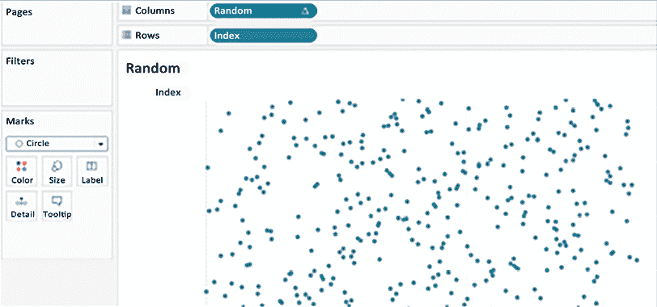

    **图 15.33：** 随机数可视化

在上述截图中，您可以看到 1,000 个随机数据点。让我们看看本练习中用于生成此可视化的一些代码：

| 代码 | 说明 |
| --- | --- |
| `SCRIPT_REAL` | 此 Tableau 函数调用 Python 引擎并返回浮点值。 |
| `"from numpy import random as rd` | 在此代码部分，我们需要 Python 库 `numpy`，并从该库中获取 `random` 模块，我们将其加载为较短的名称 `rd`。 |
| `return` | 此命令仅用于返回值。 |
| `rd.random(_arg1[0]).tolist()"` | 在此步骤中，我们调用之前导入的模块 `rd`。从 `rd` 模块中检索 `random` 函数。`_arg1[0]` 是在给定特定值时激活该函数所必需的。最后，我们通过添加 `.tolist()` 将所有检索到的值放入一个值列表中。 |
| `SIZE()` | 这是将替换 `_arg1` 的值，而 `_arg1` 是 `random` 函数所需的。我们使用 `SIZE()` 来满足要求，因为它将返回分区中的行数，足以从函数获取一个随机数。 |

我们恰好得到了 1,000 个数字，因为我们初始的 Excel 表有 1,000 行。通过使用计算字段，您可以向数据框添加列，但不能添加行。因此，我们需要一个数据源来为我们提供数据架构。在下一节中，我们将学习如何指定从正态分布中抽取的随机数。

### 随机正态分布

现在，让我们复现一个具有正态分布的随机变量。此技术常用于统计建模以计算概率。随机正态值可以代替或补充您已收集的观测值。一旦我们知道如何使用正态分布，您就可以扩展这些知识在 Tableau 中创建其他分布：

1.  复用上一练习的工作簿。

2.  创建一个 `Random Normal` 计算字段：

    ```
    SCRIPT_REAL("
    from numpy import random as rd 
    mu, sigma = 0, 1
    return (rd.normal(mu, sigma, _arg1[0])).tolist()
    ",
    SIZE()
    )
    ```

3.  将 **Random Normal** 放在 **列**，将 **Index** 放在 **行**。

4.  在 **分析** 选项卡上禁用 **聚合度量**。

5.  选择 **标记** 类型为 **圆圈**。您现在可以看到一个包含 1,000 个正态分布数据点的图表：

    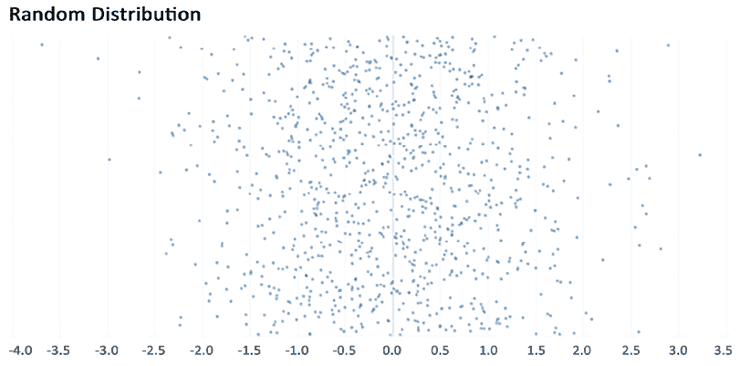

    **图 15.34：** 正态分布可视化

为了给用户更多灵活性，您还可以向视图添加与 Python 集成交互的参数。例如，创建以下两个参数：

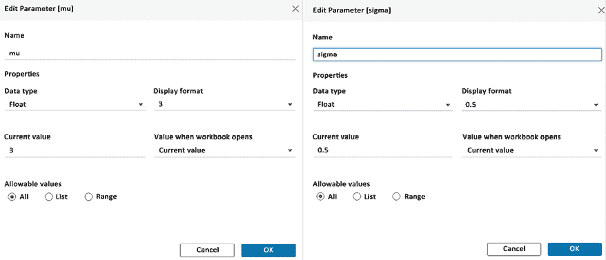

**图 15.35：** sigma 和 mu 参数

然后，创建一个名为 `Random Normal Param` 的计算字段，内容如下：

```
SCRIPT_REAL("
from numpy import random as rd 
mu, sigma = _arg2, _arg3
return (rd.normal(mu, sigma, _arg1[0])).tolist()
",
SIZE(), [mu], [sigma]
)
```

将参数控件添加到视图中，以便用户决定要传递哪些变量给 Python：

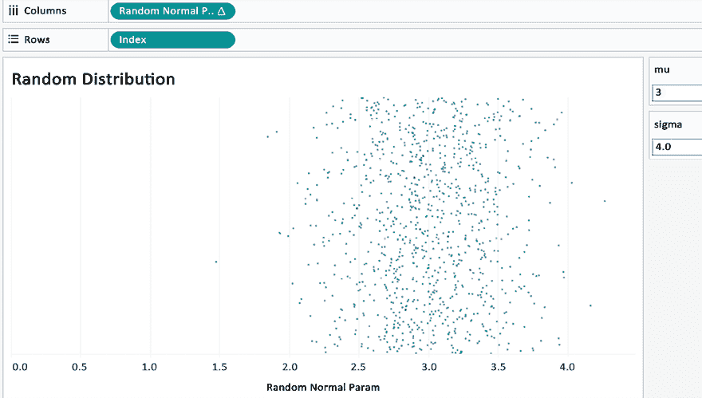

**图 15.36：** 最终正态分布工作表

与我们之前的正态分布可视化相比，您可以在上述截图中看到，通过将 `mu` 参数更改为 10，我们将均值改为 10，从而可以向任意方向移动整个点云。有了 Tableau 中可用的随机数，您可以（例如）可视化蒙特卡洛模拟，这在许多实际应用中被使用，因为它可以模拟可能的概率结果，从而帮助相关方理解风险和不确定性的影响。

有关如何在 Tableau 中计算蒙特卡洛模拟的更多信息，请访问此处 – <https://jacksontwo.com/exploring-python-tableau> – 更多通用的蒙特卡洛内容请见此处：<https://www.ibm.com/topics/monte-carlo-simulation>。


### 来自先前练习的关键代码行

| 代码 | 说明 |
|------|-------------|
| `SCRIPT_REAL` | 此 Tableau 函数调用 Python 引擎并返回一个浮点值。 |
| `"from numpy import random as rd` | 在代码的这一部分，我们需要 Python 库 `numpy`，并从该库中获取 `random` 模块，我们将使用较短的名称 `rd` 来加载它。 |
| `mu, sigma = _arg2, _arg3` | 此部分定义我们将使用 `_arg2` 和 `_arg3` 来引用 `mu` 和 `sigma`。 |
| `return` | 此命令仅用于返回一个值。 |
| `rd.normal(mu, sigma, _arg1[0])).tolist()` | 在此步骤中，我们调用之前导入的模块 `rd`。从 `rd` 模块中，我们获取 `random` 函数。`_arg1[0]` 用于在给定特定值时激活该函数。可选值为 `mu` 和 `sigma`。这次我们也将使用这两个值。最后，我们通过添加 `.tolist()` 将所有检索到的值放入一个值列表中。 |
| `SIZE(), [mu], [sigma]` | 这是将替换 `_arg1`、`_arg2` 和 `_arg3` 的值。就像之前一样，我们使用 `SIZE()` 来激活函数。可选值 `mu` 和 `sigma` 将指向我们之前创建的参数。 |

完成与 `TabPy` 的前两个练习后，我们学习了如何在 Tableau 中使用随机数。接下来，我们将随机数更改为从正态分布中抽取的随机数，并向仪表板添加了参数，以便用户可以更改正态分布的 `mu` 和 `sigma`。当然，你也可以将 `TabPy` 中的函数更改为其他分布。

## 计算情感分析

除了机器学习和人工智能，另一个术语的使用越来越多：**自然语言处理**（**NLP**）。这是机器理解单词及其含义的过程。情感分析属于这一类别；该技术有不同的形式，但其中一种是测量极性，即说话者持有积极还是消极的观点。用例包括例如评论、推文、评论、情节、歌词等数据集。让我们来看看！

此练习基于 Brit Cava 的想法，他使用了来自前 100 首歌曲歌词的 Makeover Monday 数据来尝试 Tableau-Python 集成。你可以在此处找到博客文章：[`www.tableau.com/about/blog/2016/12/using-python-sentiment-analysis-tableau-63606`](https://www.tableau.com/about/blog/2016/12/using-python-sentiment-analysis-tableau-63606)。让我们使用这个包含一百万条新闻标题的澳大利亚广播公司数据集来复现它：[`www.kaggle.com/datasets/therohk/million-headlines`](https://www.kaggle.com/datasets/therohk/million-headlines)。

1. 导航到与本章关联的工作簿中的 `Sentiment Analysis` 选项卡。
2. 连接到 `Headlines` 数据源。
3. 将 Tableau 连接到 Python。
4. 创建一个 `Sentiment Score` 计算字段。格式（例如缩进文本）很重要：

```
SCRIPT_REAL("
from nltk.sentiment import SentimentIntensityAnalyzer 
text = _arg1
scores = []
sid = SentimentIntensityAnalyzer() 
for word in text:
    ss = sid.polarity_scores(word) 
scores.append(ss['compound'])
return scores "
,ATTR([headline_text]))
```

5. 创建一个 `Color Coding` 计算字段：

```
IIF ([Sentiment Score] >= 0, 'Positivity', 'Negativity')
```

6. 将 `publish_date` 放在 `Rows` 架上，以及 `MONTH(publish_date)`。
7. 将 `Sentiment Score` 放在 `Columns` 上。
8. 将 `Color Coding` 添加到 `Color` 架。将 `headline_text` 添加到 `Details`。最后，从视图上的 `Analytics` 窗格拖动一条平均线（`Per Cell`）：

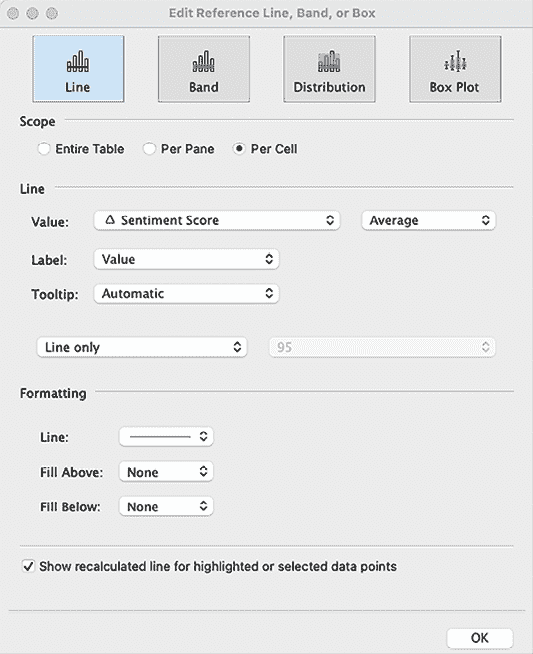

图 15.37：情感得分

根据需要限制数据，考虑电脑的性能。我展示了 2019-2021 年，仅包括 1 月、2 月、11 月和 12 月，以比较年初和年末的差异：

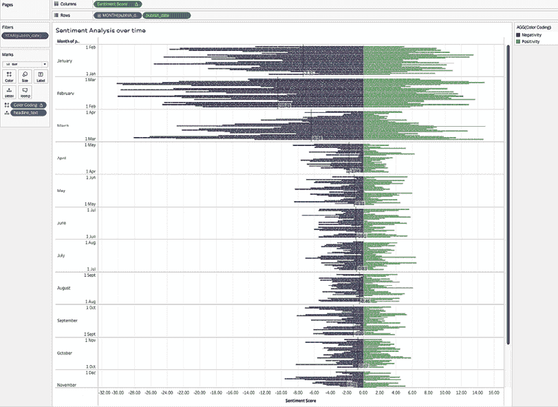

图 15.38：工作表

到目前为止，我们已经加载了数据集，并创建了一个使用预训练情感分析器的 Python 计算，它告诉我们标题是负面还是正面撰写的。在前面的图中，我们将所有内容汇总在一起，你可以看到在 2021 年的每个月中，负面新闻占主导地位，其中 2 月最差（平均得分 -10.45），12 月最积极（平均得分 -0.14）。现在我们将继续检查新闻最常报道的内容。

为了了解 ABC 新闻中最常讨论的主题，我们必须统计使用的单词。也许在 Tableau 中有一种方法可以做到这一点，通过将 `headline_text` 字段拆分为单个单词、透视和计数，但这肯定是一个繁琐的过程。而且有足够的库可以删除停用词并将单词还原到其核心形式，例如，horse = horses。因此，我们将部署另一个模型。请遵循以下步骤：

1. 创建一个 `Start` 参数。这将帮助我们稍后定义我们要搜索的时间段：

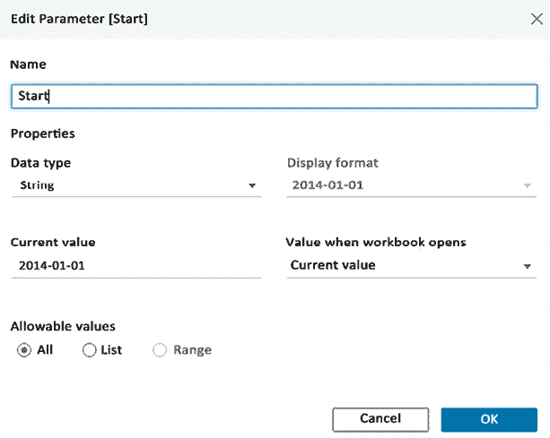

图 15.39：开始

2. 此外，创建一个 `End` 参数：

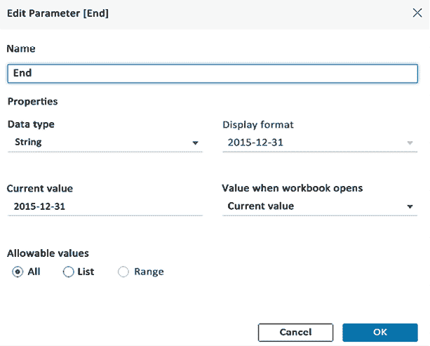

图 15.40：结束

3. 在 Tableau 工作簿中名为 `most common words` 的新选项卡上显示这两个参数。

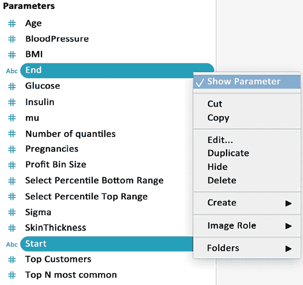

图 15.41：工作表

4. 接下来，你将不得不在你选择的 Python IDE（例如 `Jupyter Notebook`）中编写代码。目前，复制以下代码。解释将在本节末尾给出（不要忘记将此行 `df = pd.read_csv('abcnews-date-text.csv')` 中的位置更改为你的文件副本所在的确切位置：

```
from tabpy.tabpy_tools.client import Client
client = Client('http://localhost:9004/')
def common_words(_arg1, _arg2):
    
    #load all required libraries
    import pandas as pd
    import nltk
    from nltk.corpus import stopwords
    from nltk.tokenize import word_tokenize
    from nltk.probability import FreqDist
    from nltk.sentiment import SentimentIntensityAnalyzer 
    df = pd.read_csv('abcnews-date-text.csv')
    df['publish_date'] = pd.to_datetime(df['publish_date'], format='%Y%m%d')
    
    #convert the Tableau input date to a readable format
    _arg1 = pd.to_datetime(_arg1, format='%Y-%m-%d')[0]
    _arg2 = pd.to_datetime(_arg2, format='%Y-%m-%d')[0]
    df = df.set_index('publish_date')
    #empty lists to be filled
    scores = []
    filtered_sentence = []
    
    # Select the rows between two dates
    in_range_df = df[df.index.isin(pd.date_range(_arg1, _arg2))]
    #loading english stop words
    stop_words = set(stopwords.words('english'))
    text = in_range_df['headline_text']
    #most used words
    for row in range(0, len(in_range_df)):
        text =  in_range_df['headline_text'][row]
        word_tokens = word_tokenize(text)
        for w in word_tokens:
            if w not in stop_words:
                filtered_sentence.append(w)
    #calculate the frequency of each word
    fdist = FreqDist(filtered_sentence)
    #extract the N most common words
    most_common_words = fdist.most_common(3)
    return str(most_common_words)
client.deploy('common_words', common_words,'Retrieves the most common words', override = True)
```

由于缩进特别重要，这里有一张它应该是什么样子的截图；你也可以看到我将 `abcnews` 文件的位置指定为 `/Users/marleenmeier/Downloads/abcnews-date-text.csv`，因为我的文件位于那里：


## 练习：使用 TabPy 分析文本数据

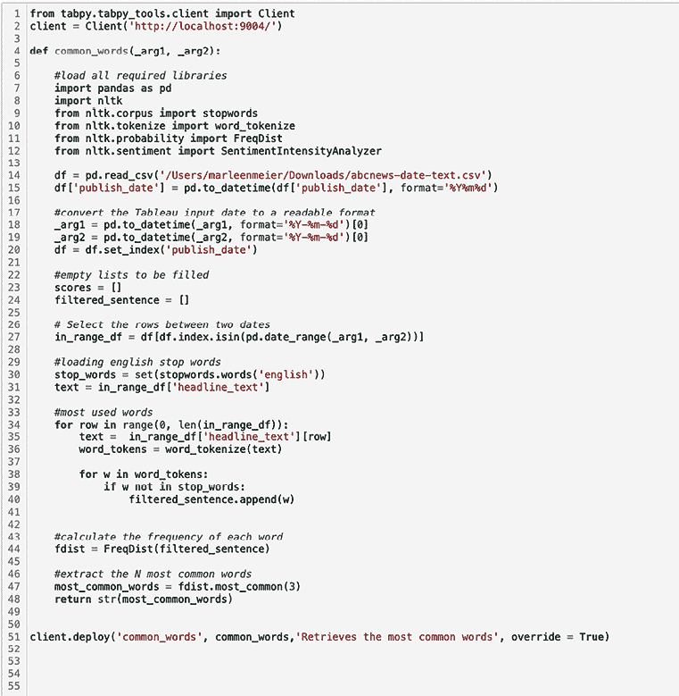

**图 15.42：代码**

1.  现在运行 Python 脚本。

2.  返回 Tableau 仪表板中的“最常用单词”选项卡，创建以下计算字段 `common words`：

    ```
    MODEL_EXTENSION_STR("common_words", "_arg1, _arg2", [Start], [End])
    ```

    你也可以像上一个练习那样使用 `SCRIPT_STR` 函数，但对于已部署的 TabPy 模型，Tableau 还提供了更简单的 `MODEL_EXTENSION` 函数语法。

3.  将 **common words** 拖入 **Rows**，查看你的第一个结果；在 2014 年 1 月至 2015 年 12 月之间，单词 *new* 在 ABC 新闻标题中出现了 4,909 次，*police* 出现 4,307 次，*man* 出现 4,171 次。你看到前 3 个是因为代码中指定了前 3 个，我们稍后会检查代码。不过，你可以将其改为任何数字！

4.  尝试调整 **Start** 和 **End** 日期，看看会发生什么！这里还有两个例子；还要注意单词计数本身，2020 年排名第一的单词 (*coronavirus*，8,383 次) 的使用频率是 2014 年至 2015 年排名第一的单词 (*new*，4,909 次) 的两倍：

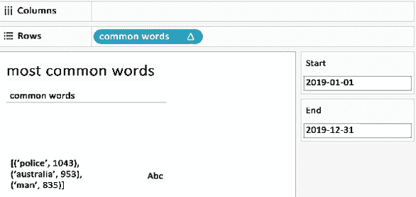

**图 15.43：单词 II**

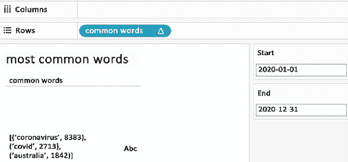

**图 15.44：单词 III**

如果你想继续在此基础上工作，可以将前 N 个作为模型输入参数，如果你只想查看特定情感的前 N 个，还可以加入情感得分。

在本练习中，我们展示了 Tableau 可以分析文本数据的情感，这是我们之前未见过的。为此，我们需要将 Tableau 与 Python 连接，这通过外部服务 TabPy 实现。Python 可以使用诸如 `nltk.sentiment` 之类的库——本例中我们就用了它。该包的详细说明见此处：[`www.nltk.org/api/nltk.sentiment.html`](https://www.nltk.org/api/nltk.sentiment.html)。还有许多其他情感分析库，但 `nltk` 常用于演示和学习。请随意尝试其他库！

让我们揭开本练习中包含的新代码实例的神秘面纱：

| 代码 | 说明 |
| --- | --- |
| `SCRIPT_REAL` | 此 Tableau 函数调用 Python 引擎并返回浮点值。 |
| `from nltk.sentiment import SentimentIntensityAnalyzer` | 此部分需要 Python 库 `nltk`，并从该库的 `sentiment` 模块加载 `SentimentIntensityAnalyzer` 函数。 |
| `scores = []`<br>`text = _arg1`<br>`sid = SentimentIntensityAnalyzer()`<br>`ss = sid.polarity_scores(word)` | 此部分定义 `_arg1` 称为 `text`，`scores` 为空列表（稍后在代码中填充），`sid` 指代 `SentimentIntensityAnalyzer` 函数，`ss` 为每个单词得分的引用。 |
| `scores.append(ss['compound'])` | 此步骤将极性得分填充到空的 `scores` 表中。 |
| `return scores` | 此处将填充后的 `scores` 表作为输出返回给 Tableau。 |
| `ATTR([Dialog])` | `_arg1` 指定为 Tableau 工作簿中的 `Dialog` 字段。 |
| `from tabpy.tabpy_tools.client import Client`<br>`client = Client('http://localhost:9004/')` | 此部分将 Tableau 连接到 Python 实例。 |
| `import pandas as pd`<br>`import nltk`<br>`from nltk.corpus import stopwords`<br>`from nltk.tokenize import word_tokenize`<br>`from nltk.probability import FreqDist`<br>`from nltk.sentiment import SentimentIntensityAnalyzer` | 此处加载所有必需的库。 |
| `df = pd.read_csv('abcnews-date-text.csv')`<br>`df['publish_date'] = pd.to_datetime(df['publish_date'], format='%Y%m%d')` | 接下来读取 `abcnews` 文件。 |
| `_arg1 = pd.to_datetime(_arg1, format='%Y-%m-%d')[0]`<br>`_arg2 = pd.to_datetime(_arg2, format='%Y-%m-%d')[0]`<br>`df = df.set_index('publish_date')` | 然后将输入转换为模型可读的格式。 |
| `scores = []`<br>`filtered_sentence = []` | 此部分创建两个列表，将在 `for` 循环中填充。 |
| `in_range_df = df[df.index.isin(pd.date_range(_arg1, _arg2))]` | 现在将数据筛选为开始日期和结束日期之间。 |
| `stop_words = set(stopwords.words('english'))`<br>`text = in_range_df['headline_text']` | 幸运的是，英语停用词现成可用；此步骤加载它们。 |
| `for row in range(0, len(in_range_df)):`<br>`text = in_range_df['headline_text'][row]`<br>`word_tokens = word_tokenize(text)`<br>`for w in word_tokens:`<br>`if w not in stop_words: filtered_sentence.append(w)` | 此部分将剩余标题转换为计算频率所需的标记，最后将非停用词存入 `filtered_sentence` 列表。 |
| `fdist = FreqDist(filtered_sentence)` | 使用开头加载的库之一，现在可以获取每个单词的频率。 |
| `most_common_words = fdist.most_common(3)`<br>`return str(most_common_words)` | 既然有了频率，就可以提取最常用的单词。 |
| `client.deploy('common_words', common_words, 'Retrieves the most common words', override = True)` | 最后部署模型，以便从 Tableau Desktop 调用。 |

我们已经见过嵌入式 Python 代码：创建计算字段并使用数据集中的字段作为输入。但如果你想使用包含许多代码行和变量的大型模型，或需要预先训练模型怎么办？这会超出 TabPy 的能力吗？不会！因为除了嵌入式代码，我们还能在 Tableau 外部编写 Python 脚本。

## 使用 TabPy 部署模型

有时脚本太长，无法在计算字段中使用，或者你需要在不同数据集或扩展数据集上进行预先训练，而不只是 Tableau 中的数据集。这时可以换一种方式使用 TabPy。你可以在 Tableau 外部用 Python 编写模型并部署到 Tableau，从而在 Desktop 内部调用。

在即将到来的示例中，我们将构建一个推荐系统，输入 7 个参数（年龄、BMI、怀孕次数、血压、葡萄糖、胰岛素和皮褶厚度）预测 Pima 印第安女性患糖尿病的可能性。数据集来自 *J.W. Smith, J.E. Everhart, W.C. Dickson, W.C. Knowler, and R.S. Johannes* 1988 年的研究，链接如下：[`www.ncbi.nlm.nih.gov/pmc/articles/PMC2245318/`](https://www.ncbi.nlm.nih.gov/pmc/articles/PMC2245318/)。

我们将在 Jupyter Notebook 或你偏好的 **集成开发环境** (**IDE**) 中开始编写代码。请跟随以下步骤：

### 步骤 1：导入 TabPy 客户端

首先导入 `tabpy` 客户端，以建立 Python-Tableau 连接：

```
from tabpy.tabpy_tools.client import Client
client = Client('http://localhost:9004/')
```

### 步骤 2：导入库和数据

接下来导入所有必需的库和数据。确保将数据集名称替换为文件的完整路径（例如 `H:/Documents/Diabetes.csv` 而不是 `Diabetes.csv`）：

```
import numpy as np
import pandas as pd
from sklearn import ensemble
from sklearn.model_selection import train_test_split
df = pd.read_csv("Diabetes.csv", sep = ',')
df = df[['Pregnancies', 'Glucose', 'BloodPressure', 'SkinThickness', 'Insulin', 'BMI', 'Age', 'Outcome']]
```

### 步骤 3：拆分数据集

现在将数据集拆分为四部分：两个测试数据集用于检查模型准确性，两个训练数据集用于训练模型：

```
X_train, X_test, y_train, y_test = train_test_split(df.drop(['Outcome'], axis = 'columns'), df['Outcome'], test_size = 0.2)
```


# 使用 TabPy 和 Tableau 部署糖尿病预测模型

## 模型训练与评估

### scikit-learn 梯度提升分类器参考

如果您对更多细节及该代码背后的数学原理感兴趣，请查看 [`scikit-learn.org/stable/modules/generated/sklearn.ensemble.GradientBoostingClassifier.html`](https://scikit-learn.org/stable/modules/generated/sklearn.ensemble.GradientBoostingClassifier.html)。

### 训练模型

接下来，我们将从 `sklearn` 加载 `GradientBoosting` 模型并拟合数据；随后我们可以立即可视化得分，该得分可被解读为模型预测正确值的总百分比：

```
gb = ensemble.GradientBoostingClassifier()
gb.fit(X_train, y_train)
gbscore = gb.score(X_test, y_test)
print('gradient boost: ' + str(round(gbscore*100,2)))
```

### Jupyter 中的完整代码

这是 Jupyter 中的完整代码：

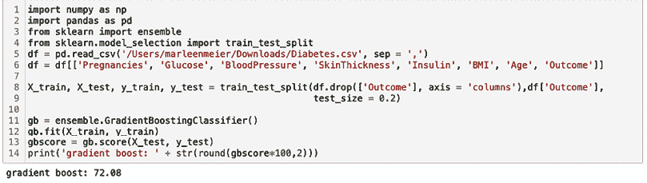

*图 15.45：Python 脚本*

至此第一阶段结束，我们的模型在 72.08% 的案例中预测了正确的结果，即患有糖尿病或未患糖尿病。这是一个相当不错的结果。为了进一步改进，我们可以增加更多数据（按行），扩展输入变量（按列），或创建新特征，如变量间的比率（隐藏信息可通过此方式被强调）。但目前我们可以继续使用该模型，因为最终我们想要预测某人患糖尿病的可能性百分比。让我们切换到 Tableau：

## 与 Tableau 集成

### 创建参数

本练习不需要数据集，因为所有数据都在 Jupyter Notebook 中。在 Tableau 中，您可以随意选择一个，因为我们不会用到它。在一个名为 `Diabetes` 的新 Tableau 工作表中，创建以下七个参数：

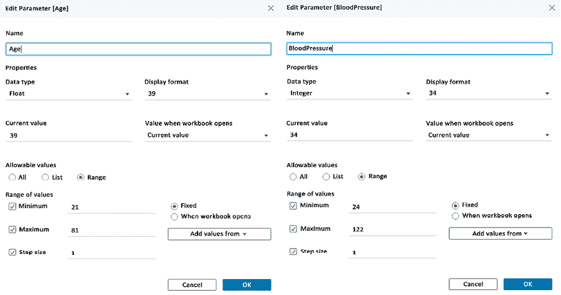

*图 15.46：Age 和 BloodPressure 参数*

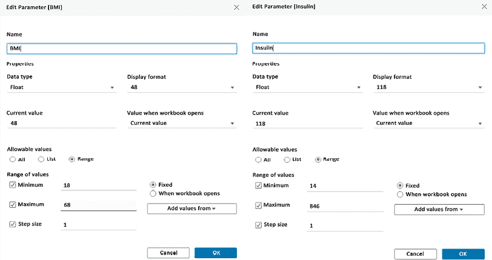

*图 15.47：BMI 和 Insulin 参数*

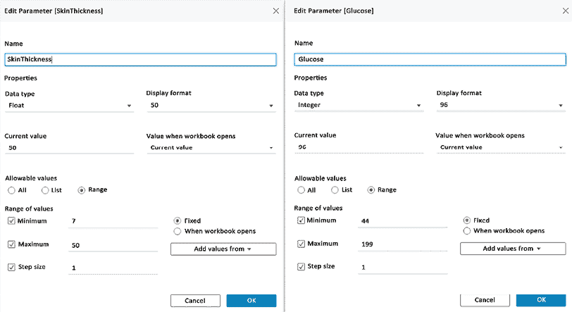

*图 15.48：SkinThickness 和 Glucose 参数*

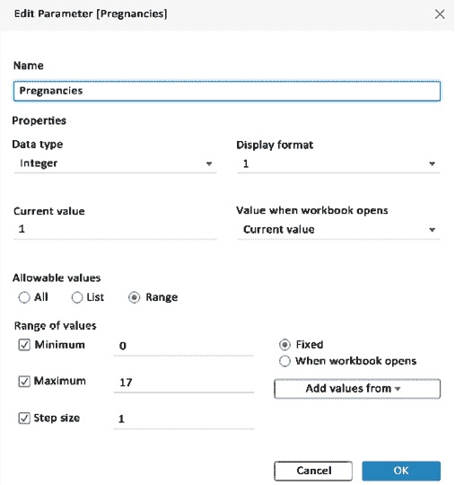

*图 15.49：Pregnancies 参数*

### 显示参数

创建完所有七个参数后，全选它们并点击 `Show Parameter`（显示参数）：

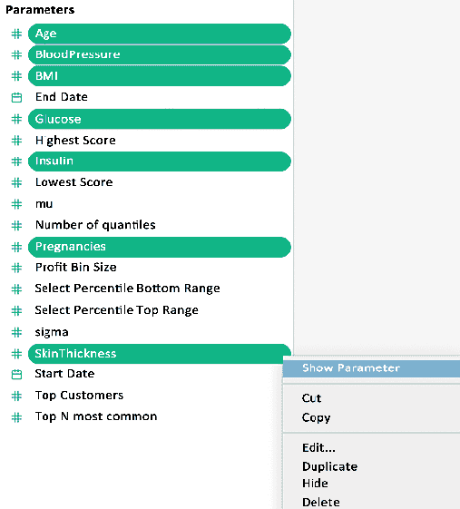

*图 15.50：显示参数*

### 在 Jupyter 中定义预测函数

请返回 Jupyter 并执行最后两段缺失的代码，以创建一个调用我们模型的函数：

```
def diabetes_predictor(_arg1, _arg2, _arg3, _arg4, _arg5, _arg6, _arg7):
    import pandas as pd
    row = {'Pregnancies': _arg1, 'Glucose': _arg2, 'BloodPressure':
           _arg3, 'SkinThickness': _arg4, 'Insulin': _arg5, 'BMI': _arg6,
           'Age': _arg7}
    test_data = pd.DataFrame(data=row, index=[0])
    predprob_diabetes = gb.predict_proba(test_data)
    return [probability[1] for probability in predprob_diabetes]
```

### 将函数部署到 TabPy

最后，将函数部署到 TabPy 的那行代码：

```
client.deploy('diabetes_predictor', diabetes_predictor, 'Predicts the chances of a Pima female having diabetes', override=True)
```

这在 Jupyter 中显示如下：


*图 15.51：部署函数*

### 验证部署

要检查模型是否已部署，请在浏览器中输入 `https://localhost:9004/endpoints`。这将列出已部署到您机器上 TabPy 的所有模型：


*图 15.52：部署函数*

返回 Tableau，再次确认与 TabPy 的连接是否仍处于活动状态。

### 创建计算字段

创建一个名为 `Diabetes predictor` 的计算字段，如下所示：

```
SCRIPT_REAL("
return tabpy.query('diabetes_predictor', _arg1, _arg2, _arg3, _arg4, _arg5, _arg6, _arg7)['response']",
[Pregnancies], [Glucose], [BloodPressure], [SkinThickness], [Insulin], 
[BMI], [Age]
)
```

您可以看到，既然我们在 Python 中完成了所有编码，我们只需告诉 Tableau 返回一个名为 `diabetes_predictor` 的 TabPy 查询，然后添加函数所需的所有变量的 *n* 个引用，最后在末尾添加 `['response']`。

或者，由于 TabPy 上部署的模型还支持 `MODEL_EXTENSION_BOOL`、`MODEL_EXTENSION_INT`、`MODEL_EXTENSION_REAL` 和 `MODEL_EXTENSION_STR` 函数，您也可以使用以下代码：

```
MODEL_EXTENSION_REAL("diabetes_predictor", "_arg1, _arg2, _arg3, _arg4, _arg5, _arg6, _arg7", 
[Pregnancies], [Glucose], [BloodPressure], [SkinThickness], [Insulin], [BMI], [Age]
)
```

第二段代码稍短且更直观；不过两者都有效！

### 可视化预测

现在将字段 `Diabetes predictor` 放入 `Text`（文本）货架并观察结果：


*图 15.53：交互式 TabPy 糖尿病工作表*

通过向左右滑动参数，您将看到患糖尿病的可能性发生变化。计算字段通过 TabPy 将参数数据发送到 Python，在那里您的数据将被拟合到模型中。结果将被发送回来，您便可以看到它。当然，您可以围绕它构建完整的仪表板。示例可在 Tableau 网站上找到：[`www.tableau.com/about/blog/2017/1/building-advanced-analytics-applications-tabpy-64916`](https://www.tableau.com/about/blog/2017/1/building-advanced-analytics-applications-tabpy-64916)。

如果您想了解更多关于 Python 语言本身的信息，一个好的资料来源是 [`www.w3schools.com/python/default.asp`](https://www.w3schools.com/python/default.asp)。该网页将逐步引导您了解 Python 语法。但 Tableau 让这变得更简单，因为一组函数已经为您编写好了。

## 预部署的 TabPy 函数

并非所有人都喜欢在 Tableau 外部编程，因此 Tableau 生成了一组广泛使用的预部署函数，您可以开箱即用。您仍需执行一行代码，*仅一次*！但这就是您在 Python 本身中所需做的全部。可用的函数包括 ANOVA、T 检验、情感分析和 PCA，但 Tableau 多次提到未来可能会推出更多函数。您可以在此处找到文档：[`tableau.github.io/TabPy/docs/tabpy-tools.html`](https://tableau.github.io/TabPy/docs/tabpy-tools.html)。

### 部署默认模型

但让我们演练一下步骤：

在您的 Jupyter Notebook 中，执行 `tabpy-deploy-models` 并查看这四个函数已安装：


*图 15.54：部署 TabPy 默认模型*

### 使用预部署函数

您可以通过在浏览器中输入 `http://localhost:9004/endpoints` 来再次确认，您应该能看到所有已部署的模型。

就这样；在 Tableau 的计算字段中调用函数现在就像下面这样简单（以调用 `ttest` 示例函数为例）：

```
tabpy.query('ttest', _arg1, _arg2)['response']
```

### 挑战：比较情感得分

我向您发起挑战，比较 TabPy 默认部署模型的情感得分与我们创建的那个：它们有差异吗？如果有，有何不同？

## 连接到外部工具

从 Python，您可以直接连接到，例如：

*   DataRobot ([`www.tableau.com/solutions/datarobot`](https://www.tableau.com/solutions/datarobot))
*   Dataiku ([`www.dataiku.com/partners/tableau/`](https://www.dataiku.com/partners/tableau/))
*   MATLAB ([`www.mathworks.com/products/reference-architectures/tableau.html`](https://www.mathworks.com/products/reference-architectures/tableau.html))

这些都是有助于使您的数据分析更轻松的付费第三方工具。如果您可以从 R 和 Python 连接到另一个外部工具，您也可以分别通过 `Rserve` 和 `TabPy` 将该功能利用回 Tableau。如果您对这种类型的连接感兴趣，或者想复习部署函数的主题，您可以查看这个视频 – [`youtu.be/0BN_Y2CxdYY`](https://youtu.be/0BN_Y2CxdYY) – 在视频中，Tableau 前高级分析产品经理 Nathan Mannheimer 解释了我们讨论的所有内容。


您在编程集成方面的个人目标是什么？如果您有好的想法，欢迎与 Tableau 社区分享。

## 磨练您的 R 和 Python 技能

你们中的一些人可能会因使用代码而感到不知所措，并在 Tableau 中使用 R 或 Python 之前寻找更简单的学习方式。网站 [www.geeksforgeeks.org](http://www.geeksforgeeks.org) 会向您介绍这两种语言，并允许您在网站上练习编程，无需任何安装。

## Einstein Discovery

如果您是 Salesforce 用户并购买了 Einstein Discovery 许可证，则可以使用另一套开箱即用的模型。AI 驱动的模型随 Einstein Discovery 提供，并可与 Tableau 工作流集成。这种组合可用于为您的 Salesforce 数据生成强大的洞察。例如，您可以根据 Salesforce 中的数据预测销售额，并将其直接加载到 Tableau 中，然后在您熟悉的 Tableau Server 实例上共享这些洞察，从而将所有仪表板保留在一个地方。由于 Salesforce 和 Tableau 都是 Salesforce 套件的一部分，我想提及这一点；然而，这也是另一种需要额外许可证的软件，因此我决定不深入探讨其用法（事实上，凭借您在本章所学的知识，您可以在无需额外成本的情况下复制其大部分功能）。如果您有兴趣了解更多，我建议您查看 tableau.com 上的以下页面及子页面：[`www.tableau.com/products/einstein-discovery`](https://www.tableau.com/products/einstein-discovery)。

# 总结

本章仅涉及使用 R 和 Python 选项的皮毛。完成本章后，您现在应该能够从 Tableau 连接到 Python 和 R，并识别和编写这两种编程语言在 Tableau 中的基本语法。最重要的是，您现在拥有足够的技能来利用 R 和 Python 函数在 Tableau 中的强大功能，从简单的平均值计算到回归，一直到实现您自己的机器学习模型。虽然我们涵盖了安装、集成和工作流，以及一些更流行的函数和用例，但还有更多内容待探索。事实上，Tableau 编程集成的可能性在 BI 社区中仍很大程度上是未知领域。

数据可视化领域的勇敢者正在突破极限，但仍有大量工作要做。对于希望提升职业选择的读者来说，精通这两个包可能会提供巨大的优势。未来还有更多精彩内容！

在 2023 年 Tableau 大会上，公司传递了一个明确的信息：Tableau 将继续开发其高级分析和 AI 能力。新宣布的产品如 Tableau GPT 以及随之而来的 Tableau Pulse 让我对即将到来的惊人功能感到迫不及待。在此处查看预期功能摘要：[`www.tableau.com/blog/data-innovations-tableau-conference-2023`](https://www.tableau.com/blog/data-innovations-tableau-conference-2023)。

虽然下一章遗憾的是本书的最后一章，但我们仍有时间探讨另一个热门话题。除了高级分析，数据治理是一个日益重要的探索领域。法规和不断增加的数据安全风险迫使公司更加重视结构良好的指南和质量检查。我们将在 `第 16 章` `开发数据治理实践` 中向您介绍 Tableau 的另一面。

# 在 Discord 上了解更多

要加入本书的 Discord 社区——您可以在其中分享反馈、向作者提问并了解新版本——请扫描下方二维码：

[`packt.link/tableau`](https://packt.link/tableau)


