# 第 16 章：开发数据治理实践

这最后一章与其他章节略有不同。我们将不讨论在 Tableau 仪表板或 Tableau Server 上使用的功能，而是讨论 Tableau 中与数据治理相关的数据能力——谁有权访问哪些数据，谁查看了哪个仪表板以及频率如何，仪表板的数据组件是什么，数据来自哪里，等等。

我们将讨论以下主题：

*   什么是数据治理？
*   数据治理原则
*   Tableau 中的数据治理
*   实操示例

近期，特别是过去 20 年，数据治理变得愈发重要，这显示了该领域日益成熟。在早期，数据治理纯粹是 IT 任务，通常仅限于数据编目；而今天的数据治理是由许多人共同承担的任务。公司存储的数据越多，雇佣的分析师越多，数据使用越多，就需要越多的规则和指南。如今，公司因缺乏适当的数据治理而被罚款，大规模数据安全漏洞和数据泄露越来越频繁地登上头条新闻。因此，许多机构（如欧盟）已采用包含数据治理作为主要支柱之一的数据保护法律法规。例如欧盟的 GDPR 和加州的 CCPA。

即使您主要对构建仪表板和共享数据洞察感兴趣，保护数据也正在并将继续成为整个公司的共同努力。了解政策和法规、知道如何使用数据治理工具并负责任地行事对您来说也是必要的。因此，我将这最后一章献给数据治理以及 Tableau 在此领域提供的所有内置功能。让我们开始吧！

## 什么是数据治理？

数据治理关乎遵循法规和行业标准生成和实施与数据相关的政策。其主要目标是保证信息的实用性、可访问性和安全性。加强数据治理可带来更好的数据分析，让分析师高枕无忧，确保他们依赖的数据源自可靠来源，经过验证，并经历了严格的数据质量评估等措施。

在 [www.tableau.com](http://www.tableau.com) 网站上，您可以找到一份白皮书，向 Tableau 用户介绍数据管理，包括数据治理：[`www.tableau.com/learn/whitepapers/tableau-data-management`](https://www.tableau.com/learn/whitepapers/tableau-data-management)。

如果您更喜欢视频，可以在以下链接找到演示：[`www.tableau.com/products/data-management#content-446367`](https://www.tableau.com/products/data-management#content-446367)。

白皮书和视频都讨论了此设置：

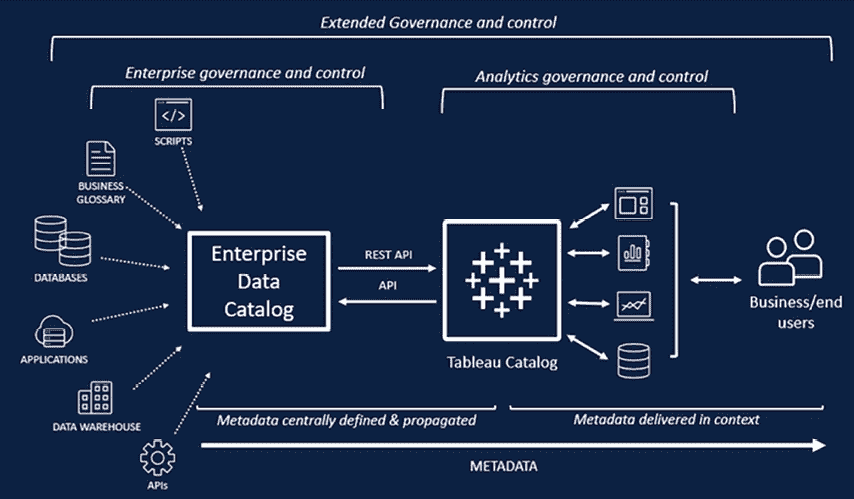

图 16.1：Tableau 数据管理

一般来说，数据治理涵盖确保数据质量、解决数据安全和隐私问题、建立数据政策和标准、指派数据管家、遵守法规以及记录数据资产等关键方面。

**那么为什么数据治理很重要？** 稳健的数据治理可带来更高的数据质量、更低的数据管理成本和更广泛的数据访问。它增强了数据合规的可信度，从而带来更好的决策、更高的运营效率和更低的风险。Tableau 可以成为数据治理框架内用于数据可视化和分析的宝贵工具，同时遵循经过验证的政策和指南。

## 数据治理原则

如果您计划从事数据治理工作，您应该知道数据治理原则通常是整个工作的核心和灵魂。为了说明这一点，让我们以 GDPR ([`gdpr-info.eu/`](https://gdpr-info.eu/)) 中概述的七项原则为例，探讨如何利用 Tableau 有效地执行它们：

*   合法性、公平性和透明性
*   目的限制
*   数据最小化
*   准确性
*   存储限制

* 完整性和保密性
* 问责制

## 合法性、公平性和透明度

这要求为提供商品或服务而收集的个人信息必须合法、公平地获取，并告知个人其使用目的。此外，个人信息只能在获得个人明确同意的情况下收集，并必须保留同意记录。

## 目的限制

个人信息应仅为特定、合法的目的而收集，不得用于不同或不兼容的目的，除非获得明确同意。

## 数据最小化

个人信息的处理应限制在实现预期目的所必需的范围内。

## 准确性

个人信息必须准确收集，并定期更新维护以减轻对个人的风险；任何不准确的信息应及时更正或删除。

## 存储限制

个人信息仅应在实现处理目的所需的期间内保留，除非为科学、归档或公共利益目的而需要，在此情况下可存储更长时间。

## 完整性和保密性

GDPR 中的完整性要求维护准确可靠的个人数据，而保密性则要求保护个人数据免遭未经授权的访问和披露，确保隐私权得到维护。

## 问责制

对于成功的数据治理方法而言，问责制至关重要，因为它提供了方向和有效性；建立由所有部门代表（包括高级管理人员）组成的数据治理委员会，对于确保跨组织责任以及数据流程和政策的制定与执行必不可少。在下一节中，让我们看看 Tableau 如何帮助我们遵守这些原则。

# Tableau 中的数据治理

Tableau 提供了一系列功能和能力，有助于支持组织内的数据治理计划，作为一种补充工具，与数据治理原则保持一致。

以下许多功能仅在购买 Tableau Server 的数据管理加载项（`https://www.tableau.com/products/data-management`）时可用。阅读本章其余部分时请注意这一点。

## 数据源连接

Tableau 的数据源连接功能允许组织通过连接各种数据源来建立集中式数据治理，促进值得信赖且经过策划的数据管理方法。

数据源连接使遵守 GDPR 的 `完整性和保密性` 原则变得更加容易，因为数据存储安全，且访问可受控。

## 数据访问控制

Tableau 使管理员能够管理用户对数据源和仪表板的访问，实施用户和组权限，以确保只有授权人员才能访问特定数据资产并与之交互。

数据访问控制使遵守 GDPR 的 `完整性和保密性` 原则变得更加容易，因为访问可集中管理，从而得到限制。

## 数据安全

Tableau 提供数据加密、`单点登录` (`SSO`) 认证以及与身份管理系统集成等安全功能，通过强制执行策略和保护敏感信息来增强数据安全性。

数据安全使遵守 GDPR 的 `完整性和保密性` 原则变得更加容易，因为安全漏洞（从而导致敏感数据被非法访问）将受到限制。

## 元数据管理

Tableau 协助元数据的创建和管理，提供数据定义、描述和血缘详情等有价值的上下文信息。此功能通过增强对数据资产的理解和控制来支持数据治理计划。

元数据管理使遵守 GDPR 的 `准确性` 原则变得更加容易，因为元数据变更可被轻松检测到。

## 数据认证

Tableau 允许用户认证和推广可信的数据源和仪表板，表明数据已通过质量保证，可用于分析和决策。此认证流程确保用户能够访问可靠且受治理的数据资产。

数据认证使遵守 GDPR 的 `准确性` 原则变得更加容易，因为所有用户都可以信任经过认证的数据在准确性和时效性方面受到监控。

## 版本控制

Tableau 提供版本控制功能，使组织能够跟踪对仪表板和数据源所做的更改，通过提供对修改的可见性并促进审计追踪流程来推动数据治理。

版本控制使遵守 GDPR 的 `合法性、公平性和透明度` 原则变得更加容易，因为其具有审计追踪功能。

## 监控和审计

Tableau 的监控和审计功能使管理员能够跟踪用户活动、访问模式和数据使用情况，有助于识别潜在的合规问题，并确保遵守数据治理政策。

监控和审计使遵守 GDPR 的 `合法性、公平性和透明度` 原则变得更加容易，因为它们帮助我们遵守规则和法规。

## 协作与文档

Tableau 通过提供注释、标注和文档附件等功能来支持协作与文档记录，使用户能够直接在 Tableau 环境中记录和讨论数据资产、定义及治理相关信息。

协作与文档使遵守 GDPR 的 `问责制` 原则变得更加容易，因为注释和标注在用户之间可见且共享。

虽然 Tableau 提供了数据治理能力，但组织拥有超越 Tableau 平台的全面数据治理策略和框架至关重要。Tableau 的功能可以增强更广泛的数据治理计划并与之保持一致，但应将其集成到总体治理计划中，以最大限度地提高有效性。

# 实操示例

在本章的最后一部分，您可以亲自尝试一些数据治理功能；请随意在您的 Tableau Server 版本中跟随操作。

## 认证数据源

认证数据源涉及通过验证其质量、准确性和合规性的流程，将其指定为值得信赖的可靠资产。这种认证能建立信任、确保数据质量、支持合规、促进一致性、强化数据治理、增强决策、便利数据发现，并由组织内的数据治理团队或专家执行。

您可以通过以下步骤在 Tableau 中认证数据源：

1. 打开 Tableau Server。
2. 打开一个数据源。
3. 点击数据源名称旁边的三个点。
4. 选择 `编辑认证…`：

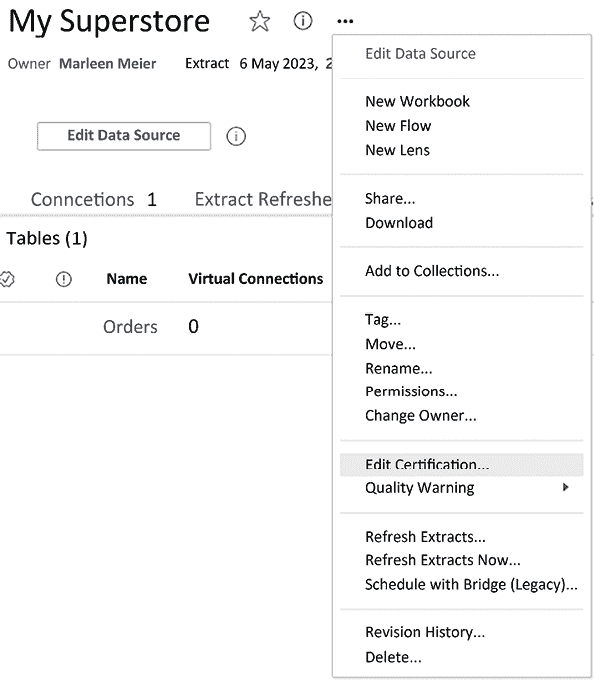

图 16.2：认证

1. 现在您可以输入一条对数据源用户可见的消息，说明认证原因或类似内容。输入的内容取决于贵公司商定的政策。点击 `保存`。

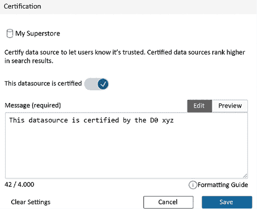

图 16.3：认证消息

1. 在数据源所有者和日期旁边，您现在将看到一个指示，表明此数据源已通过认证：

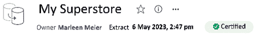

图 16.4：已认证

经过认证的数据源有助于决策，使分析师和业务用户对所使用的数据更有信心，从而获得更精准的洞察、做出更明智的决策并取得更好的业务成果。

## 数据质量警告

# 数据质量警告

数据质量警告是突出显示数据集质量中潜在问题或异常的通知，由不完整或缺失的数据、不一致性、异常值、数据完整性问题、验证失败或过时信息触发。这些警告表明需要进一步调查和数据清洗，以确保正确的分析和决策，强调了解决数据质量问题以获得可靠见解的重要性。

## 设置数据质量警告

您可以按照以下步骤设置数据质量警告：

1. 打开 Tableau Server。
2. 打开数据源。
3. 点击数据源名称旁边的三个点。
4. 选择 `Quality Warning`，然后在 `Quality Warning …` 或 `Extract Refresh Monitoring …` 之间选择。
5. `Data Quality Warning` 弹出窗口将如下所示：

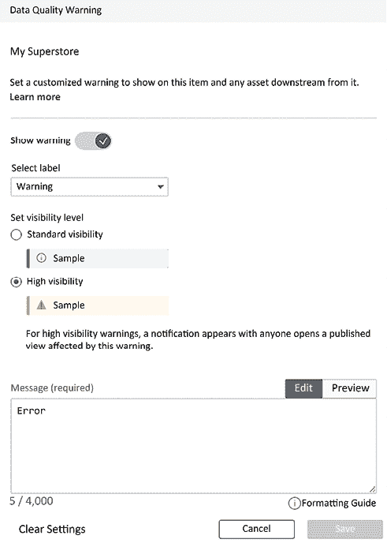

**图 16.5：数据质量警告**

1. 从这里，从下拉菜单 `Select label` 中选择五个标签之一：

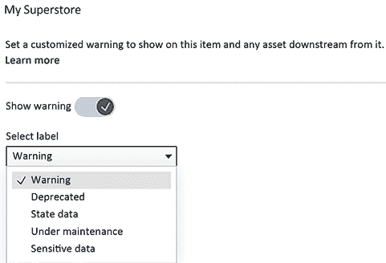

**图 16.6：选择标签**

1. `Extract Refresh Monitoring` 弹出窗口看起来非常相似，只是没有下拉菜单：

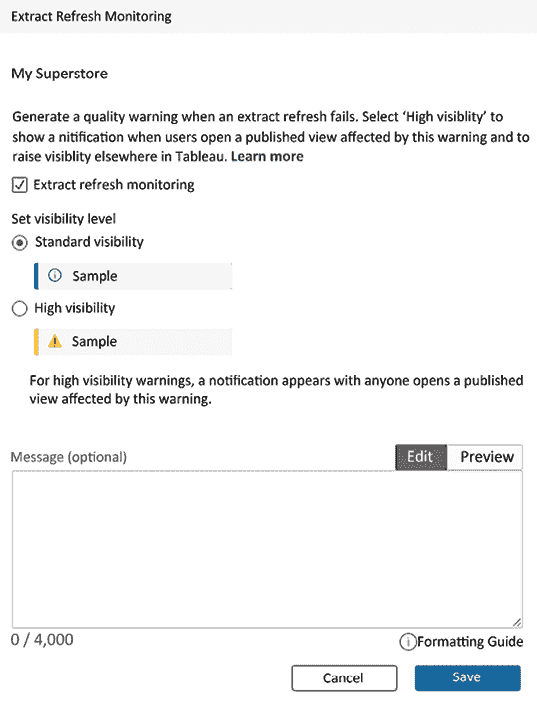

**图 16.7：提取刷新监控**

1. 在这两种情况下，`Warning` 指示器都会出现在数据源概览页面上：

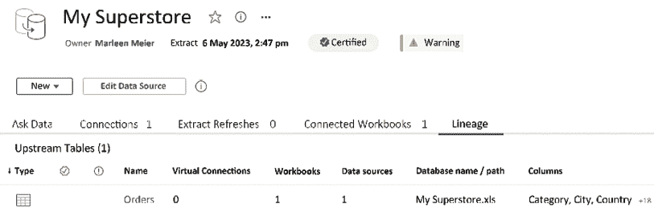

**图 16.8：警告**

1. 如果计划提取失败，您也可以查看 `Schedules` 概览页面：

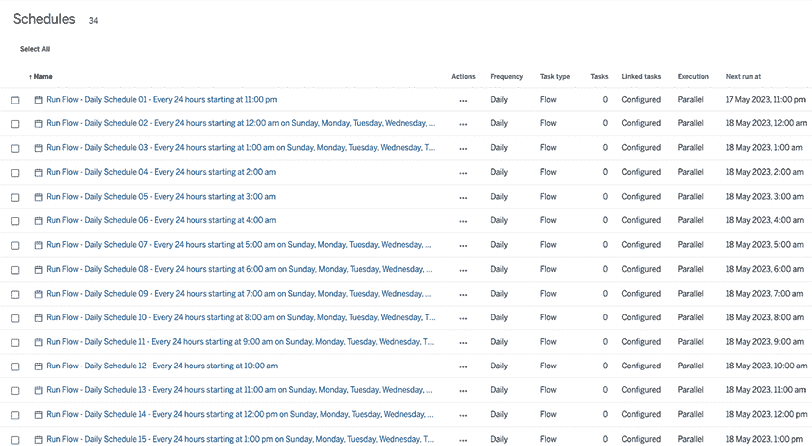

**图 16.9：计划**

## 摘要

数据质量警告作为指示器，表明数据在用于分析、报告或决策之前可能需要进一步调查或清洗。它们有助于发现可能影响分析结果准确性、可靠性和有效性的潜在数据问题。解决数据质量警告通常涉及数据清洗、错误纠正，并确保数据符合所需的质量标准。

重要的是要注意，必须对数据质量警告采取行动，因为它们可能影响从数据得出的见解的可靠性和有效性。解决数据质量问题并保持高质量数据对于做出明智决策和从数据分析中得出准确结论至关重要。

# Tableau 血缘

数据血缘很重要，因为它建立了对数据的信任，有助于数据质量管理和问题解决，便于影响分析，支持法规合规，加强数据治理和管理实践，协助故障排除和调试，并实现成功的数据和系统集成。数据血缘提供了对数据流的透明度、理解和控制，有助于改进数据治理和决策过程。

## 查看血缘

要查看血缘，您可以在 Tableau Server 上打开任何类型的概览页面、数据源、准备流程、工作表、工作簿等，然后查看 `Lineage` 选项卡：

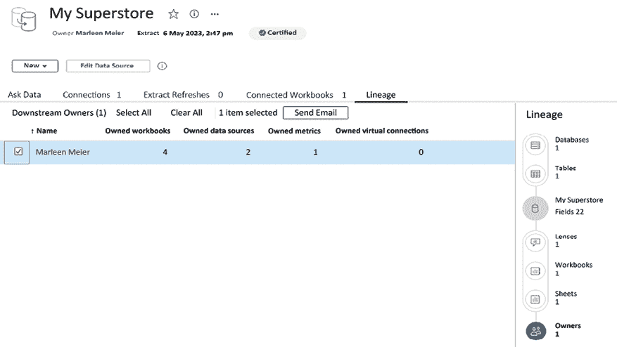

**图 16.10：Tableau 血缘**

右侧面板提供了有关相应血缘的所有详细信息。从这里，您可以点击任何给定的组件，并将被重定向到该组件。

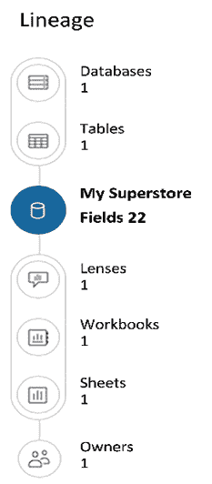

**图 16.11：详细血缘**

## 列血缘

从表视图中，您甚至可以检查列在哪里被使用；首先，转到一个表：

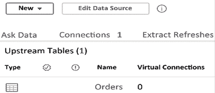

**图 16.12：上游表**

然后，点击任意列。观察右侧面板如何显示列 `City` 用于 `Databases` 和 `Tables`，但未在其他地方使用：

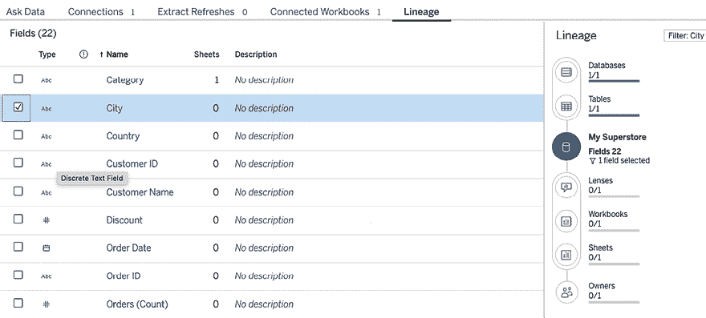

**图 16.13：列血缘**

## 摘要

总体而言，数据血缘提供了对数据流的透明度、理解和控制。它支持数据质量管理、合规工作和决策过程。通过记录数据的血缘，组织可以改进其数据治理实践，增强数据可信度，并降低与数据管理和分析相关的风险。

# 数据详情

Tableau 中的 `Data Details` 可帮助您和您的用户了解已发布仪表板中的数据。要访问它，在任意仪表板上，点击左上角的 `Data Details`，观察右侧弹出的详细信息：

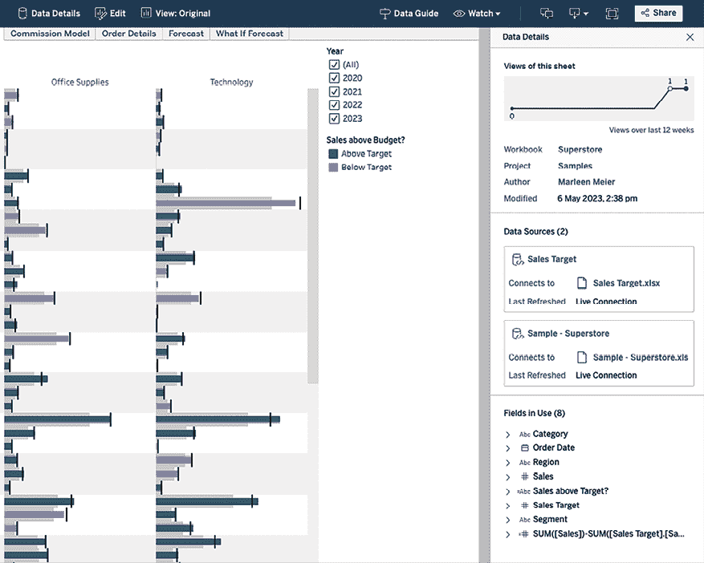

**图 16.14：Tableau 数据详情**

几秒钟内，`Data Details` 即可让您查看随时间变化的视图、数据源和正在使用的字段。

# 数据指南

数据指南（如数据字典或数据参考指南）是一种文档资源，提供关于数据元素结构、内容和含义的详细信息。它对于数据理解、一致性、集成、质量评估、治理、协作、培训和文档编制非常重要。数据指南增强了数据管理实践，促进了数据素养，并支持组织内有效的数据利用。

## 探索数据指南

要探索数据指南，请在 Tableau Server 上打开一个仪表板，然后点击蓝色顶栏右侧部分的 `Data Guide` 按钮：

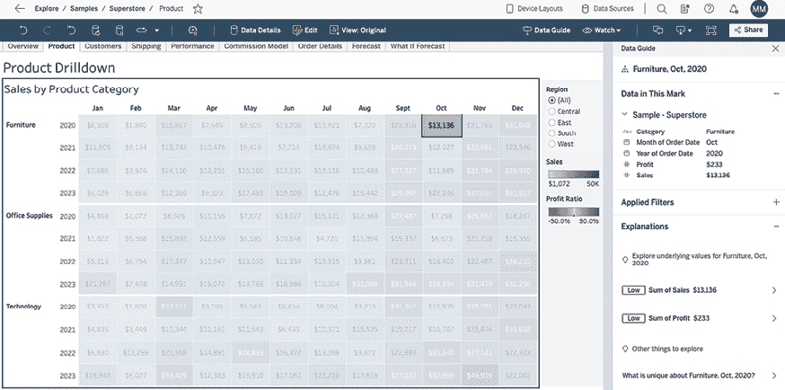

**图 16.15：数据指南**

通过在视图中选择一个标记，数据指南会自动填充关于该数据点和所用筛选器的详细信息，以及解释。您已经在本书前几章的 `Explain Data` 中了解过此功能，但数据指南使标记的解释和探索变得前所未有的简单。

## 示例

这里还有一个示例，清楚地展示了 Tableau 如何弥合单个数据点与整个数据集平均值之间的差距：

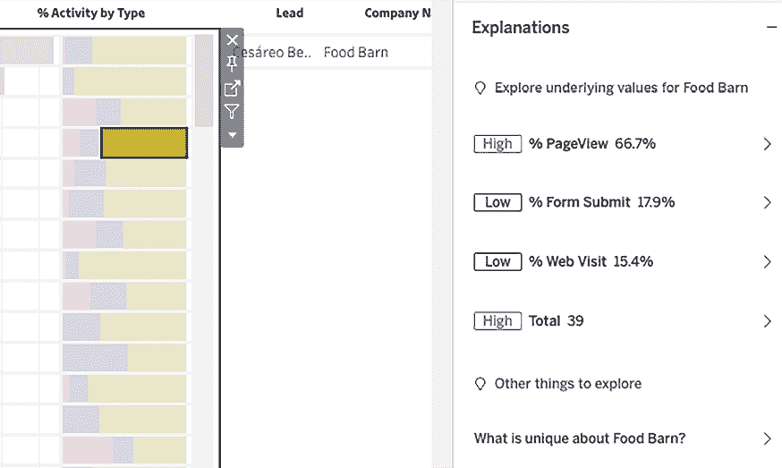

**图 16.16：解释**

通过点击单个箭头，会出现更多信息：

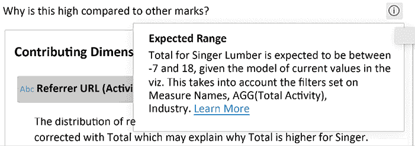

**图 16.17：文本解释**

您甚至可以生成图表来证明该观点：

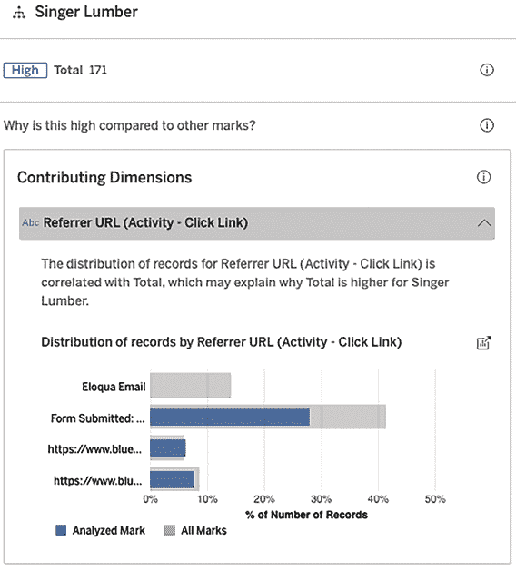

**图 16.18：贡献维度**

## 添加描述

数据指南还允许您为用户添加描述和资源：

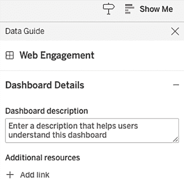

**图 16.19：描述**

## 结语

这是 Tableau 数据治理领域的最后一个示例。这是一个巨大的主题，远远超出了 Tableau 的范围，因此我们只是通过了解 GDPR（众多数据法规之一）、Tableau 中的数据治理功能，最后一些实际应用，仅仅触及了表面。这个主题真值得单独写一本书，但我简要地在这里提及它，是为了分担责任，因为即使您作为一名 Tableau 开发人员，也有责任并能在保护数据安全方面发挥作用。希望最后一章能给您足够的思考素材，让您在开发精美仪表板时开始更多地关注数据治理。

现在我们已经读完了这本书，回顾一下我们的旅程：从将数据加载到 Tableau、创建第一个可视化、执行第一个函数开始。我们接着熟悉了详细级别和表计算，了解了 Tableau Prep Builder、Tableau Server 和通用可视化最佳实践，最后一轮我们学习了高级分析并利用 Tableau 编程工具集成的力量。

这留给我只有一个问题：您的下一个 Tableau 项目会是什么？欢迎在 Tableau Public 上分享，别忘了添加标签 `#MasteringTableau`。我想祝贺大家参与并投入到这个学习过程中！无论您有更多问题、意见或反馈，欢迎联系我或 Tableau 社区。祝您在个人 Tableau 职业生涯中取得巨大成功。

愉快地使用 Tableau！

# 在 Discord 上了解更多

要加入本书的 Discord 社区——您可以在其中分享反馈、向作者提问并了解新版本——请扫描下方的二维码：

[`packt.link/tableau`](https://packt.link/tableau)

[packt.com](http://packt.com)

订阅我们的在线数字图书馆，即可全权访问 7,000 多本书籍和视频，以及行业领先的工具，帮助您规划个人发展并提升职业生涯。欲了解更多信息，请访问我们的网站。

# 为什么要订阅？

*   通过来自 4,000 多位行业专业人士的实用电子书和视频，减少学习时间，增加编码时间
*   利用专为您打造的技能计划改善学习效果
*   每月免费获取一本电子书或视频
*   全文搜索，轻松访问关键信息
*   复制粘贴、打印和书签内容

在 [www.packt.com](http://www.packt.com)，您还可以阅读免费技术文章合集，订阅各类免费时事通讯，并获得 Packt 书籍和电子书的独家折扣和优惠。

# 您可能感兴趣的其他书籍

如果您喜欢这本书，可能会对 Packt 的以下其他书籍感兴趣：

**使用 Tableau 进行数据建模**

Kirk Munroe

ISBN: 9781803248028

*   展示 Tableau 发布的数据源和嵌入式连接
*   在数据编目和自然语言查询中应用 Ask Data
*   通过动手练习了解 Tableau Prep Builder 的功能
*   使用示例通过 Tableau Desktop 对数据建模
*   利用 Tableau Server 和 Tableau Cloud 制定受控数据策略
*   为 Ask 和 Explain Data 优化数据模型

**Learning Tableau 2022 – 第五版**

Joshua N. Milligan

ISBN: 9781801072328

*   开发惊艳的可视化图表，清晰解释复杂数据
*   构建交互式仪表板，推动可操作的用户洞察
*   探索数据模型功能并关联来自各种来源的数据
*   创建和使用计算来解决问题并丰富分析
*   通过数据聚类、分布和预测实现智能决策
*   通过扩展、脚本和 CRM Analytics（前身为 Einstein Analytics）中的 AI 扩展 Tableau 的原生功能
*   利用 Tableau Prep Builder 强大的数据清洗和构建功能
*   分享您的数据故事，建立信任和行动的文化

# Packt 正在寻找像您这样的作者

如果您有兴趣成为 Packt 的作者，请访问 [authors.packtpub.com](http://authors.packtpub.com) 立即申请。我们已与数千名像您一样的开发人员和技术专业人士合作，帮助他们与全球技术社区分享见解。您可以提交一般申请，申请我们正在招募作者的特定热门主题，或提交您自己的创意。

# 分享您的想法

现在您已读完 *Mastering Tableau 2023 - 第四版*，我们非常期待听到您的想法！如果您在亚马逊购买了此书，请[点击此处直接前往该书的亚马逊评论页面](https://packt.link/r/1803233761)并分享您的反馈，或在您购买的网站上留下评论。

您的评论对我们和技术社区至关重要，将帮助我们确保提供优质内容。
