# 回顾基础知识

Tableau 是用于解决 **商业智能（BI）** 和分析挑战的领先工具之一。通过本书，您将掌握 Tableau 在 BI 领域各种范式中的功能和产品。作为畅销 _《精通 Tableau》_ 系列的更新，本书涵盖了 Tableau 的基本概念、数据准备以及使用 Tableau 进行计算，一直到 **机器学习（ML）** 用例、数据治理以及 Tableau 2026 中的 AI 功能。

本版本附带新数据集，用于学习 Tableau 2026 最新功能的所有内容。我们将探讨 AI 驱动的分析，并探索数据治理功能，以保证您工作簿的出色数据质量。读完本书后，您将掌握 Tableau 的高级产品及其最新更新，直至 Tableau 2026 版本。

对于 Tableau 初学者来说，本章应该能帮助他们快速上手；不过，由于本书面向高级主题，因此花在基础知识上的时间相对较少。如需更全面地了解基础主题，请参阅 _《学习 Tableau》*，由 约书亚·米利根 编著，Packt 出版社出版。

如果您想要在 Tableau 的界面和核心功能方面打下坚实基础——具体来说，如果您想学习如何在 Tableau 中导航、连接数据以及设计您的第一个工作表和仪表板，请继续阅读。这些技能是本书后面更高级主题的垫脚石。本章的目标是让您熟悉 Tableau 的环境，以便开始构建基本而有效的可视化。读完之后，您将有信心开始探索更高级的功能和工作流。

在本章中，我们将讨论以下主题：

- 创建工作表和仪表板
- 将 Tableau 连接到您的数据
- **度量名称**和**度量值**
- 三个基本的 Tableau 概念
- 将数据导出到其他设备

现在，让我们通过探索 Tableau 中的工作表和仪表板创建来开始。

> > **注意**
> >
> > **您的购买包含免费 PDF 副本 + 独家额外内容**
> >
> > 您的购买包含本书的 DRM-free PDF 副本、7 天 Packt+ 图书馆试用（无需信用卡）以及其他独家额外内容。请参阅 *前言* 中的 *随书赠送的免费权益* 部分，立即解锁它们并最大化您的学习。

## 创建工作表和仪表板

Tableau 的核心是 **工作表** 和 **仪表板**。工作表包含单个可视化，而仪表板包含一个或多个工作表。此外，工作表和仪表板可以组合成 **故事**，以通过演示环境向最终用户传达特定见解。最后，所有工作表、仪表板和故事都整理在 **工作簿** 中，可以使用 Tableau Desktop、Server、Reader 或 Tableau 移动应用访问。

在本节中，我们将探讨如何创建工作表和仪表板。我们的意图是传授基础知识，但也会提供一些可能对资深 Tableau 用户有所帮助的见解。

## Tableau 公共版

此时，我想向您介绍 **Tableau 公共版**（https://public.tableau.com）。它是一个基于 Web 的仪表板集合，也是一个创作者平台，允许您在无需许可证或安装的情况下设计精美的仪表板。虽然它不具备 **Tableau 桌面版** 的所有相同功能，但您可以安装 Tableau 公共版本以跟随本书中的大多数示例进行操作。

即使您使用 Tableau 桌面版，我也建议创建一个 Tableau 公共版个人资料，用于分享您创建的、认为世界不容错过的所有仪表板。不过，最棒的是，您可以下载其他人创建的许多仪表板，在自己的 Tableau 版本中打开它们，并开始学习和复制。总而言之，Tableau 公共版是开发仪表板的免费选项，但提供的数据源连接性和功能可用性有限。不过，它确实提供下载和共享可视化内容的绝佳平台。

> > **提示**
> >
> > 从 2026 年第一季度开始，Tableau 桌面版也可以免费使用，并提供扩展的数据源连接性和功能可用性，但使用它将不允许您在任何地方发布仪表板，甚至不能发布到 Tableau 公共版。

## 创建工作表

在创建工作表之前，我们需要先创建一个可视化来填充它。在最根本的层面上，Tableau 中的可视化是通过将一个或多个字段放置在一个或多个区（shelf）上来创建的。例如，请注意，以下图表中创建的可视化是通过将 基准情况 放置在标记卡的文本区上生成的：

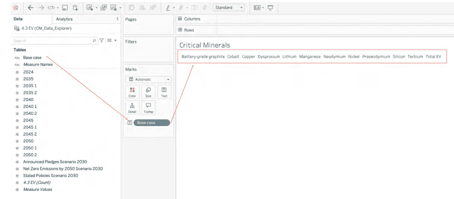

图 1.1: 标记卡

在下一小节中，您将有机会在自己的 Tableau 工作簿中跟随操作。让我们开始吧！

## 创建可视化

现在，让我们通过一个练习来探索创建可视化的基础知识：

- 1. 导航至 https://github.com/PacktPublishing/Mastering-Tableau-2026/tree/main/Chapter01 以定位并下载与本章关联的工作簿。或者，您可以在此处找到该工作簿：https://github.com/PacktPublishing/Mastering-Tableau-2026/tree/main/Chapter01。
- 2. 双击下载的工作簿打开文件。
- 3. 该仪表板连接到 IEA.org 的 CM_Data_Explorer 数据源，提供全面的全球能源统计和见解。这个数据集非常适合学习 Tableau，因为它包含有关能源生产、消耗及相关指标的多样化真实世界数据点，让您可以练习构建有意义且可操作的可视化内容。对于这个首个练习，我们将使用电子交通工具（EV）数据，位于 4.3 EV 选项卡下。将数据源从工作表窗格拖动到画布（启用“使用数据解释器清理”）：

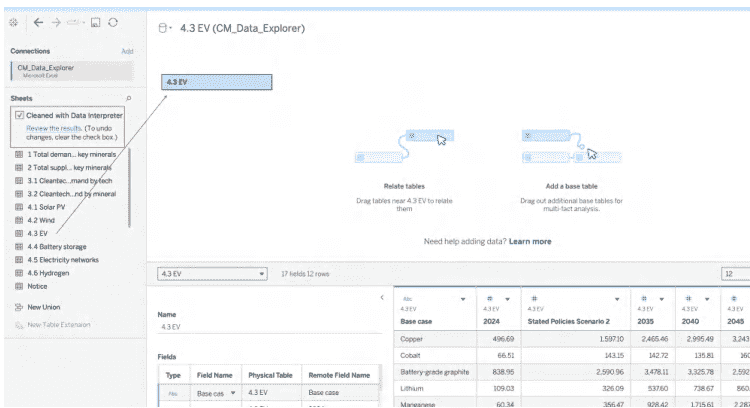

图 1.2: 数据源

- 4. 单击 **需求矿物 2024 对比 2030（净零）** 工作表标签，并在左侧的 **数据** 窗格中定位 **基准情况**：

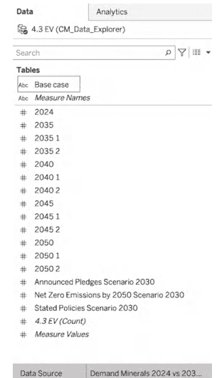

图 1.3: 数据窗格

- 5. 将基准情况拖动到行区：

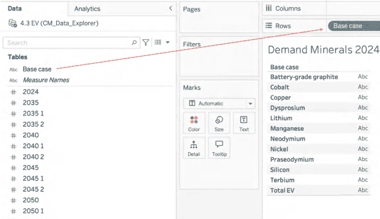

图 1.4: 将基准情况拖动到行区

- 6. 将 2024 和 净零排放 2050 情景 2030 拖动到列区，并查看 2024 年至 2030 年矿物需求增加的对比，以实现 2050 年净零排放（名称更改为 SUM(2024) 和 SUM(Net Zero Emissi... 将在下一节“超越默认行为”中解释）：

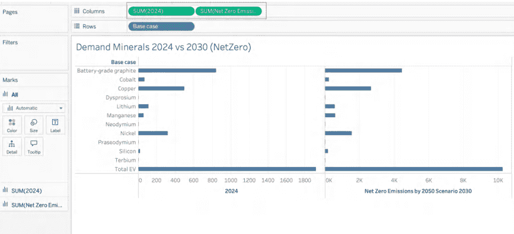

图 1.5: 2024 年与 2030 年关键矿物需求

为了更清晰地了解还需要多少关键矿物，请单击列区中的任一药丸并选择双轴。这将把两个图表合并为一个。

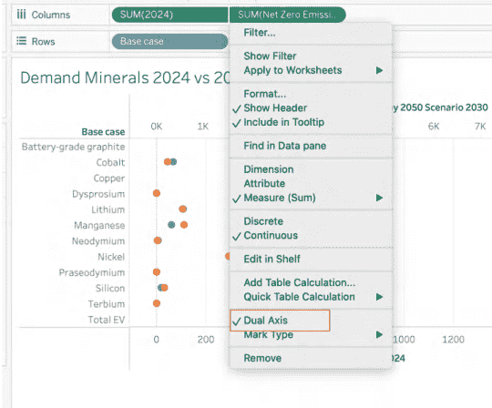

图 1.6: 双轴

- 7. 现在，单击两个 x 轴中的任意一个并选择 **同步轴**，以便用户更轻松地比较两个不同的数据点。

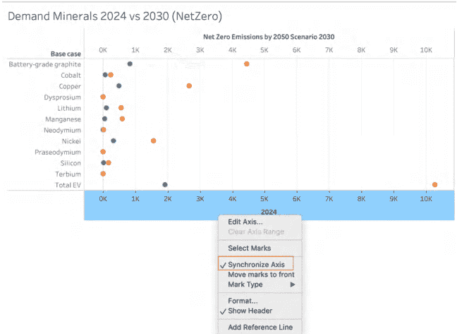

图 1.7: 同步轴

- 8. 在 **标记** 卡中，选择 **全部**，这意味着更改将应用于两个药丸，并选择 **柱状图** 作为可视化类型：

页面 | 列 | SUM(2024) | SUM(Net Zero Emissi..
行 | 基准情况
筛选器
标记
全部
柱状图
颜色 大小 标签
详细信息 提示工具
度量名称
SUM(2024)
SUM(Net Zero Emi..
Demand Minerals 2024 vs 2030 (NetZero)
基准情况
0K 1K 2K 3K 4K 5K 6K
Net Zero Emissions by 2050 Scenario
电池级石墨
钴
铜
镝
锂
锰
钕
镍
镨
硅
铽
电动汽车总量
2024

图 1.8: 选择柱状图

- 9. 接下来，在 **标记** 卡中单击 **SUM(2024)**，然后单击 **大小**，将 2024 年矿物需求的大小更改为最大（最右侧选项）。您将看到蓝色柱子出现在橙色柱子下方：

## 关键矿物需求 2024 vs 2030（净零）

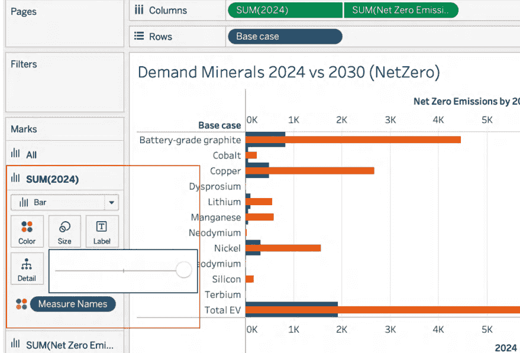

图 1.9: 大小变化

这是您的第一个可视化！通过单击 **SUM(2024)** 或 **SUM(Net Zero Emi...** 字段来随意更改柱状图的颜色，也可以更改 **Marks** 卡中的任何其他参数。请随意尝试，创建您最想要的可视化，以表示在遵循 2050 年净零排放情景的情况下，电动汽车对 2024 年与 2030 年关键矿物不断增长的需求。

> **注意**
> 
> 您想出了任何有趣的可视化吗？欢迎将它们分享到 Tableau Public。如果希望本书的其他读者能找到它们，请添加 #MasteringTableau 标签——分享即关爱！

当您通过将不同字段拖放到不同的货架上来探索 Tableau 的行为时，您会注意到 Tableau 会以默认行为做出响应。但是，这些默认值可以被覆盖，我们将在接下来的内容中探讨。

## 超越默认行为

在前一个练习“创建可视化”中，您可能已经注意到，Marks 卡最初显示为“自动”。这意味着 Tableau 提供的是默认视图。通过从下拉菜单中选择不同的选项（我们通过选择“条形图”来实现），可以轻松覆盖默认视图；请参见图 1.9。通过更改 Marks 卡上的这些设置，我们可以调整数据的显示格式。

另一种默认行为可以在将字段拖到货架上时观察到。例如，将度量拖放到货架上通常会产生 SUM( ) 聚合，它会将所有值汇总到最高聚合级别。如果没有维度存在，则为所有值的总和。如果 Marks 卡上存在维度，则该同一维度将充当最高聚合级别。在“创建可视化”中，您看到数值 2024 和“2050 年净零排放情景 2030”是按先前添加的维度“基准情况”进行聚合的。在图 1.6 中，您可以看到数值是按关键矿物汇总的；例如，在 2024 年，制造电动汽车所需的铜需求量为 497。

在 Windows 中，您可以通过右键单击并拖动“数据”窗格中的字段到货架上来覆盖此默认行为。Tableau 将显示一个对话框以及各种聚合选项。

如果您在使用 macOS，可以将字段拖放到位置后右键单击它，然后通过更改度量来调整默认行为。此方法在 Windows 上也适用。另一种选择是，在左侧“数据”窗格中右键单击字段，然后选择“默认属性 | 聚合”。

## 排序与嵌套排序

既然您已熟悉拖放字段药丸的基础知识，并了解 Tableau 的默认聚合行为，大多数用户接下来想要做的就是对数据进行排序，以便就最小值和最大值等方面得出初步结论。请导航到“嵌套排序”选项卡，尝试按“旅游入境”下的数字对区域进行排序，但要分别针对每一年进行排序。

对您有效吗？

在 Tableau 中，排序和嵌套排序可以通过单击每个轴标签旁的图标来完成：

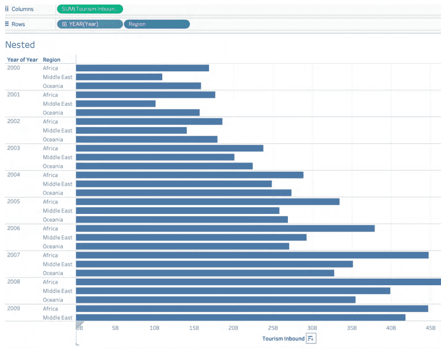

图 1.10: 排序

要再次确认排序方式，请将光标移到 **Region** 字段上，直至右下角出现箭头，然后选择 **Sort...**：

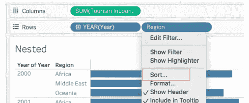

图 1.11: 排序设置

从下拉菜单中选择 **Nested** 以及所需的 **Field Name** 值和 **Aggregation** 类型：

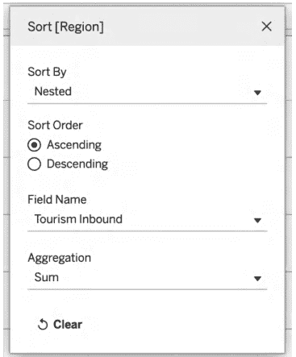

图 1.12: 嵌套排序

现在您将看到，从 2000 年到 2005 年，中东的入境游客少于大洋洲。但是，在 2006 年，情况发生了变化，中东的入境游客多于大洋洲。这就是嵌套排序。在完成并理解排序和嵌套排序后，您将能够以最合理的方式呈现数值，从而立即为仪表板增加价值。现在，我们可以进入下一个主题：Tableau 自带的不同默认图表类型，可通过 **Show Me** 功能使用。

## Show Me

**Show Me** 可以帮助 Tableau 新手创建所需的可视化，例如条形图、直方图和面积图。它允许 Tableau 作者只需单击按钮即可从输入数据创建可视化。要了解其工作原理，请参阅以下截图，该截图使用了 **“替换默认值”** 工作表。可以通过单击任何 Tableau 工作表右上角的 **Show Me** 按钮来访问此视图：

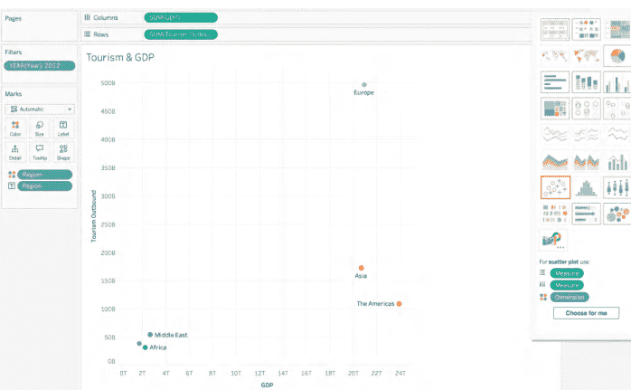

图 1.13: “显示我”

**Show Me** 中未置灰的每个图标都代表一种可视化，只需单击即可创建。例如，在上述截图（图 1.13）中，Tableau 作者可以选择单击散点图图标，以创建显示 2012 年某区域 **GDP** 与 **旅游出境** 之间关系的图表。

**Show Me** 选项会根据视图中部署的选定字段进行高亮显示。

**Show Me** 可用于以下几个方面：

- **效率**：熟练的 Tableau 作者已经知道如何创建基本可视化类型。**Show Me** 会自动化这些基本类型，因此可用于加快生产速度。
- **灵感**：确定可视化数据集的有效方法可能具有挑战性。**Show Me** 可以帮助 Tableau 作者快速考虑各种选项，从而应对这一挑战。
- **教育**：经验不足的 Tableau 作者可以访问 **Show Me** 以更好地了解各种可视化的创建方式。通过阅读 **Show Me** 底部显示的帮助文本并相应调整字段药丸的位置，可以学到很多知识：

## Show Me

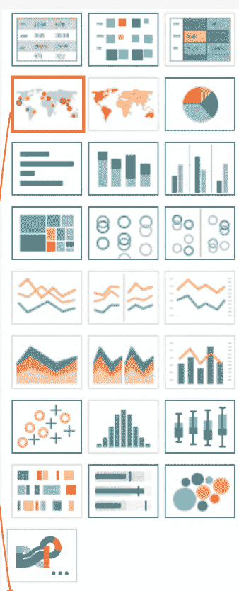

用于地图：

- 地理维度
- 度量
- 由我选择

图 1.14: “显示我”

这三个原因展示了 Show Me 在工作表创建中提供的强大功能；但是，请注意不要将其作为依赖。如果您在不了解每个可视化是如何创建的情况下单击各个选项，不仅是在捷径式地跳过学习过程，还可能生成您无法理解、因而也无法向利益相关者解释的结果。

一旦您对结果感到满意，并确信所选可视化对您的数据叙事有足够的强调，您的工作表即可进入下一轮开发。我们已经了解了一些基本的可视化创建和配置技术，现在让我们看看如何将多个工作表分组到一个仪表板中。

## 创建仪表板

如前所述，仪表板包含一个或多个工作表，但仪表板远不止是静态呈现。它们是 Tableau 交互性的重要组成部分。在本节中，我们将使用工作表填充仪表板，然后部署操作以实现交互性。

让我们开始构建一个仪表板。

## 构建仪表板

要构建我们的第一个仪表板，我们将再次使用本章开头的电动汽车数据。我想使用“净零排放”情景，它展示了为了实现到 2050 年实现净零排放的目标，在 2030 年需要多少关键矿物。仪表板将分为三个部分：**“什么是净零？”**、预测，以及关于相关矿物和电动汽车生产商承诺的其他信息。

构建仪表板的步骤如下：

- 1. 在本章的工作簿中，导航到 **“构建仪表板”** 选项卡。

> 请注意仪表板左下角旁边的 **“浮动”** 和 **“平铺”** 按钮。如果选择 **“平铺”**，您的工作表将自动调整大小；而选择 **“浮动”** 后，则不会再发生这种情况，您的工作表会在仪表板周围“浮动”。这是仪表板上工作表布局的一种自由形式，是一种强大的功能，尤其是在与透明背景结合使用时。请注意，还可以通过在仪表板中每个工作表右侧的 **“更多选项”** 下拉菜单中选择来实现浮动。

- 2. 对于我们的第一个仪表板，请选择 **“平铺”**。

- 3. 在 **对象** 窗格中，位于 *图 1.15* 的左侧，双击 **垂直容器** 对象。这将帮助我们创建三个部分：

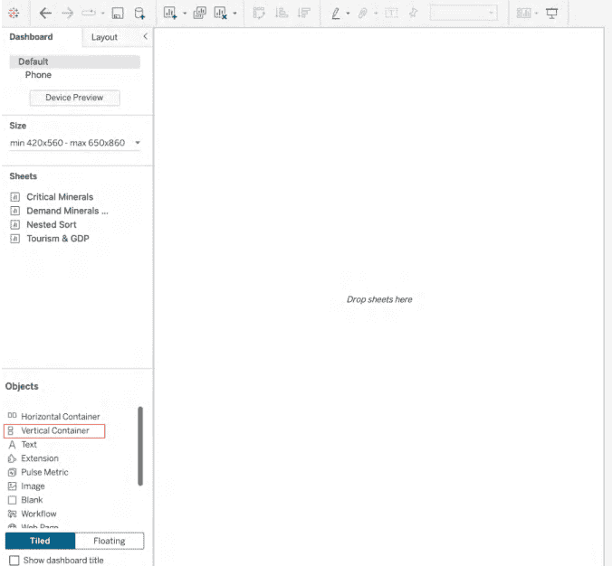

### 图 1.15: 创建仪表板

> > **注意**
>
> 双击后，您将看到一个蓝色轮廓，指示容器已放置。容器用于一组工作表，这些工作表会自动调整以在仪表板上水平相互排列或垂直上下排列。随时可以单击容器内的空白区域来选择容器。蓝色轮廓将再次出现。选定的容器可以拖动到仪表板上的不同位置，替换现有工作表或共享空间。

- 4. 接下来，将 **网页** 对象拖入容器的上半部分。放置位置由灰色阴影区域指示：

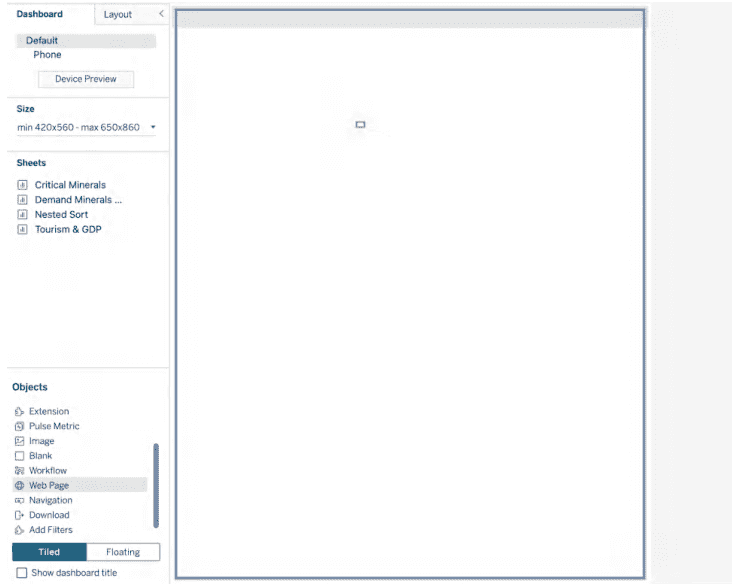

### 图 1.16: 移动工作表

- 5. 将出现一个 URL 弹出窗口。键入 https://netzeroclimate.org/what-is-net-zero-2/。

> > **注意**
> > Tableau 在将工作表和容器等元素拖放到仪表板上时提供的灰色阴影有助于指示元素将放置的位置。在将元素放置到仪表板上时，请花时间仔细观察，否则结果可能出乎意料。

- 6. 接下来，将 **水平容器** 对象拖放到先前添加的 **网页** 对象正下方：

### 图 1.17: 拖动水平容器对象

- 7. 现在，将 Demand Minerals... 工作表拖入水平容器中：

### 图 1.18: 拖动工作表

- 8. 在其旁边，放置另一个 **网页** 对象（使用以下 URL：wikipedia.org）：

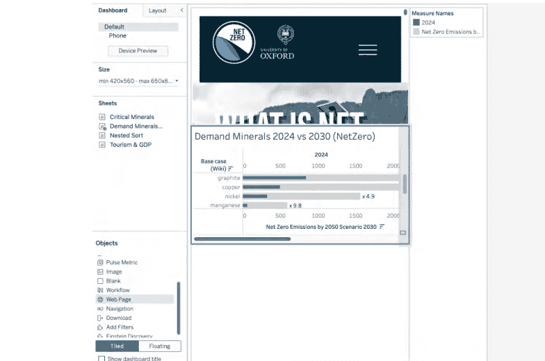

### 图 1.19: 放置另一个网页对象

- 9. 最后，在水平容器下方放置一个 **文本** 对象：

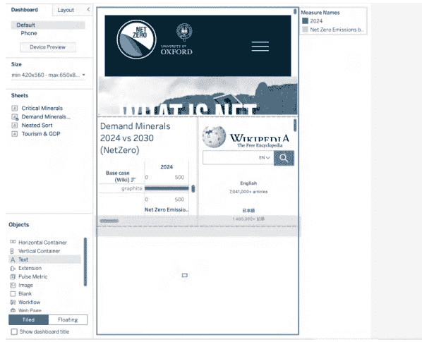

### 图 1.20: 在水平容器下方放置 **文本** 对象

- 10. 添加来自 *EV Magazine* 网站的文本：

## 主要汽车制造商承诺 2030–2035 年目标

许多主要制造商已设定 SBTi 批准的目标，其中许多直接涉及电动汽车的开发和销售。

- 大众汽车计划到 2030 年将 2018 年基准线的范围 1 和 2 排放量削减 50.4%。对于范围 3，其目标是每辆车公里减少 50% 的轻型车辆排放量。
- 福特汽车公司承诺到 2035 年将 2017 年基准年的范围 1 和 2 排放量减少 76%，每辆车公里减少 50% 的范围 3 排放量。
- 奔驰集团目标到 2030 年将范围 1 和 2 排放量减少 50%，并削减 42% 的范围 3 使用阶段排放量。
- 丰田汽车目标到 2035 年将 2019 年基准年的范围 1 和 2 排放量削减 68%。它还目标到 2030 年将乘用车和轻型商用车的范围 3 排放量减少 33.3%，并减少中型和重型卡车 11.6% 的排放量。
- 宝马集团承诺到 2030 年将每生产一辆车的范围 1 和 2 排放量（基准年 2019）下降 80%。它还目标削减 50% 的车辆使用范围 3 排放量，并减少 22% 的购买商品、服务和上游分销的范围 3 排放量。
- 沃尔沃集团计划到 2030 年将 2019 年基准年的范围 1 和 2 排放量削减 60%，并将每公里车辆使用的范围 3 排放量减少 52%。

### 图 1.21: 添加文本

- 11. 现在您可以开始根据需要格式化仪表板了。以下提示可能会有所帮助：

- 双击 **文本** 对象以更改字体，不要忘记添加来源。
- 通过选择左上角的仪表板来更改宽度和高度值：

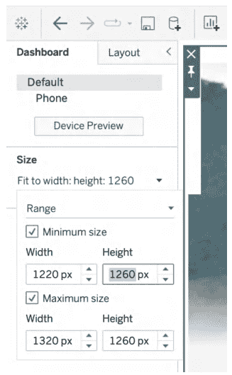

### 图 1.22: 更改宽度和高度

- 在选中 **文本** 对象的同时，单击 Tableau Desktop/Public 左上角的 **布局**，然后选择背景颜色。
- 如果仪表板底部仍有空白区域，请单击其内部，然后单击 **X** 将其删除。
- 在磁块之间添加 **空白** 对象，以获得更整洁的外观和手感。
- 添加仪表板标题并更改字体。
- 更改工作表标题以使其更有意义。
- 通过选择并单击 **X** 来删除右侧的 **度量名称** 容器。
- 在 Tableau 上方控制栏中选择 **Demand Minerals...** 工作表和 **适应宽度**。这将收缩或扩展工作表以完美适应其空间。
- 通过将鼠标悬停在每个元素之间的边缘上，然后单击并拖动来调整屏幕上元素的大小。拖动容器的边缘以调整每个工作表的大小。
- 由于我们使用了容器，您还可以选择一个容器，然后使用 **均匀分布内容**：

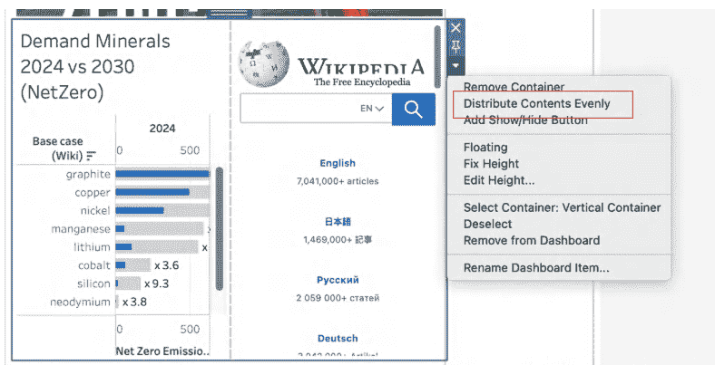

### 图 1.23: 选择均匀分布内容

这是我目前的仪表板版本。

您刚刚创建了第一个仪表板！在下一部分中，我们将添加更多功能，使仪表板更具交互性和意义。

## 向仪表板添加交互性

Tableau 的主要优势之一是它为最终用户提供的交互性。仪表板不仅仅用于查看；它们是用于交互的。在本练习中，我们将向之前练习中创建的仪表板添加交互性：

- 1. 在仪表板上选择 **Demand Minerals...** 工作表，然后单击右侧的下拉箭头，这将打开一个菜单。在那里，选择 **筛选器**，然后选择 **基本情况 (Wiki)**：

二氧化碳 (CO2) 排放需要从 2010 年水平到 2030 年下降约 45%，并在 2050 年左右实现净零排放。全球变暖与碳量成正比，只要全球排放量持续存在，地球就会继续变暖，由全球变暖造成的损害将继续升级。

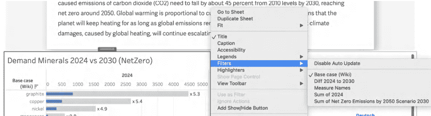

### 图 1.24: 添加筛选器

- 2. 现在，选择新创建的筛选器窗口，再次单击下拉选项箭头，并选择多值 (下拉)，如图 1.25 所示：

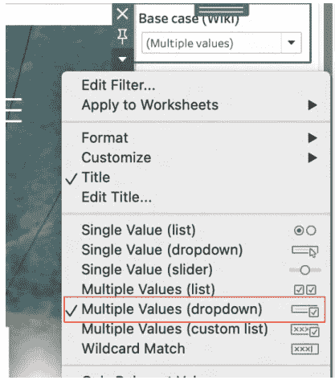

### 图 1.25: 筛选器设置

- 3. 取消选择 - 值。

- 4. 最后，导航到仪表板 | 操作...。在对话框中，单击添加操作 | 转到 URL... 并创建 URL 操作，如下所示：

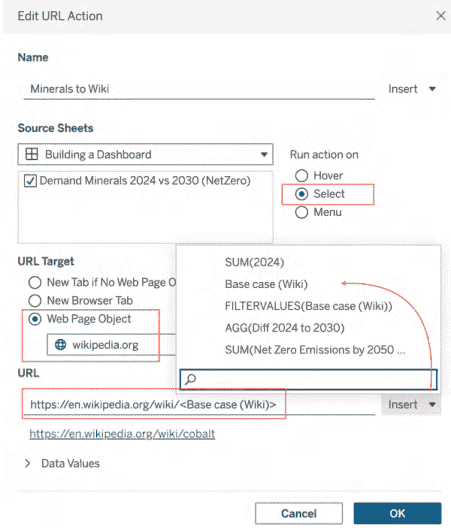

### 图 1.26: 创建 URL 操作

当用户在 Demand Minerals... 工作表中单击矿物名称时，此操作将为每个矿物加载相应的维基百科页面。您需要确保选择了正确的 **网页** 对象 (wikipedia.org)，并将基本情况 (Wiki) 字段作为后缀插入到 Wikipedia URL 中。这将使 URL 根据仪表板中选定的值而变化。在图 1.26 中，您可以在 URL 下方看到一个蓝色示例：https://en.wikipedia.org/wiki/cobalt。这是选择 "cobalt" 时的结果。我从原始基本情况字段创建了基本情况 (Wiki) 字段，并将大写更改为小写，还将 "Battery-grade graphite" 更改为 "graphite"，以符合维基百科的逻辑。在第 13 章“提升性能”中，将更详细地讨论此主题。

> 在 Tableau 中，筛选器用于根据某些条件对基础数据进行子集化，而操作筛选器允许用户通过单击可视化元素来交互式地筛选数据。

完成前面的仪表板练习后，您现在应该能够单击仪表板上的矿物名称来观察交互性。您还应该能够通过 Tableau 仪表板与 wikipedia.org 和 netzeroclimate.org 网页进行交互。

如需了解更多高级仪表板技巧，请务必查看第 10 章“设计仪表板和可视化最佳实践”。

想看一个非常酷的净零可视化吗？查看詹姆斯·埃斯帕诺尔、萨拉·库和托马斯·博克撰写的*净零的黑暗面*，网址为 https://public.tableau.com/app/profile/james.espanol1478/viz/DarkSideofNetZero_jespanol/TheDarkSideofNetZero。

图 1.27: 净零的黑暗面

总而言之，你已经学习了如何将现有工作表以及平铺或浮动对象放置在仪表板上。你通过拖放，以及使用容器、筛选器和操作筛选器，更改了仪表板布局。这些核心活动在全书中会多次重复，因此随时欢迎回到本章并重复练习步骤！

接下来，你将学习如何将自己的数据连接到 Tableau 并处理它。

## 将 Tableau 连接到你的数据

撰写本书时，Tableau 的数据连接菜单包含超过 100 种不同的连接类型，涵盖多种文件类型、数据库、云服务和 Web 数据源。我们不会详细介绍每种连接类型，但将介绍基础知识。所有 Tableau Desktop 连接器的官方文档可在 https://www.tableau.com/support/help 上找到。

在 Tableau Desktop 内打开新的 Tableau Desktop 实例（文件 | 新建）时，你会注意到工作区左上角有一个**连接到数据**链接。单击该链接即可连接到数据。从计算机上的应用程序位置打开 Tableau 的新实例会立即显示蓝色的**连接**窗格。或者，你可以单击工具栏上的**新建数据源**图标。

虽然在后续章节中我们将连接到其他数据源，但在此，我们将讨论限制在连接到 Microsoft Excel 和文本文件。

## 连接到文件

让我们看看如何使用 Excel 示例连接到文件：

- 1. 在 Tableau 中，导航至 数据 | 新建数据源 | Excel 以连接随 Tableau Desktop 安装的 Sample - Superstore 数据集（它应位于硬盘上的 我的 Tableau 存储库 | 数据源 下）。

- 2. 双击 Orders 工作表。

- 3. 单击新建工作表选项卡，如图 1.28 所示：

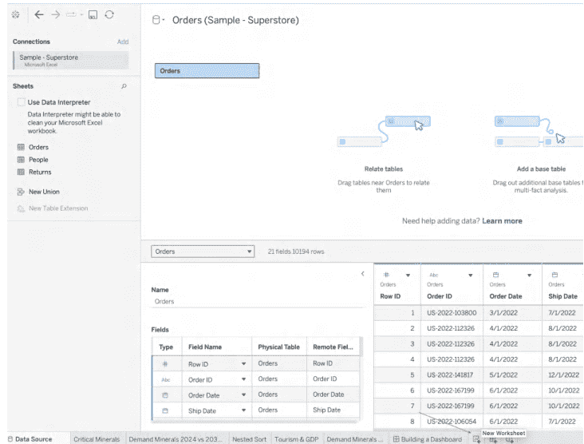

图 1.28: 新建工作表

- 4. 通过右键单击并选择重命名，将新建的选项卡重命名为 Orders。

- 5. 将 Discount 放置在 标记 卡的 文本 书架上。

- 6. 双击 Profit 和 Sales：

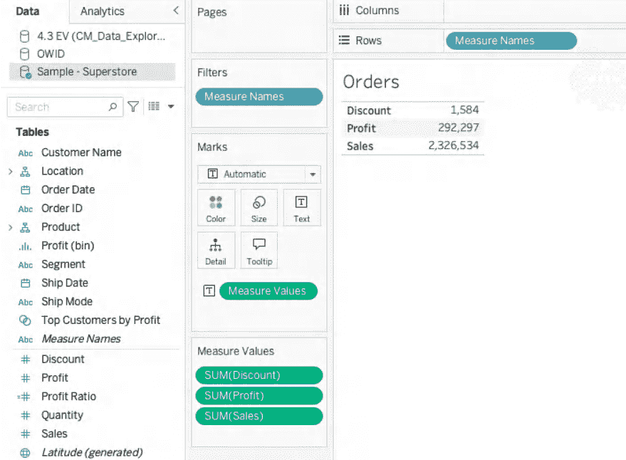

图 1.29: Orders

如果要连接到 CSV 文件，可以使用**文本文件**选项。本书稍后（例如，在第 11 章 _利用高级分析_ 中）我们也将连接到空间文件。

在本节中，我们学习了如何连接到文件。我们将在下一节继续介绍另一种重要的连接类型——Tableau Server。

## 连接到 Tableau Server

连接到 **Tableau Server** 或许是最重要的服务器连接类型，因为它经常用于提供比其他方式可能实现的更高性能。此外，连接到 Tableau Server 使作者不仅能接收数据，还能获取有关如何解释这些数据的信息——例如，给定字段应被视为度量还是维度。

我们将在本章后面的*维度和度量*部分讨论这些术语之间的区别。

以下是连接到 Tableau Server 的步骤：

- 1. 要完成此练习，需要访问 Tableau Server 实例。如果你无法访问 Tableau Server，请考虑在本地计算机上安装试用版。

- 2. 在与此章关联的工作簿中，导航至 **连接到 Tableau Server** 工作表。

- 3. 右键单击 **Sample - Superstore** 数据源，并选择 **发布到服务器...**：

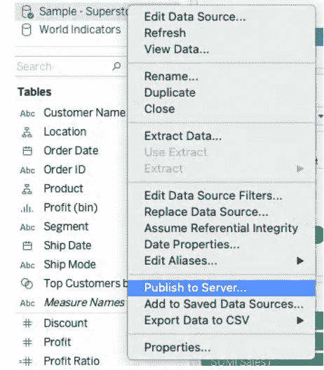

图 1.30: 发布到服务器...

- 4. 登录 Tableau Server 并按照提示完成数据源的发布。

- 5. 打开新的 Tableau Desktop 实例，选择 **数据 | 新建数据源 | Tableau Server**，然后搜索你刚刚发布的 **Sample - Superstore** 数据集并连接。

完成上述两个练习后，让我们讨论最相关的点——即，**元数据**。

元数据通常被定义为*关于数据的数据*。在上述情况下，数据源名称、默认聚合和默认数字格式都是多个作者之间一致性的示例。

例如，如果你更改字段名称，然后将数据源发布到 Tableau Server，新字段名称将保留，因为 Tableau 会记住对元数据所做的更改。这一点很重要，例如，如果你的公司有关于在显示货币时使用小数点的政策；如果所有 Tableau 作者都从指向所有格式都已预定义的数据源开始构建工作簿，则该政策将很容易遵守。

本书稍后，我们将连接到其他服务器类型，例如 Google BigQuery，但所有服务器的处理方式基本相同且非常简单。如果你还有疑问，随时可以查阅 https://www.tableau.com/support/help 上的官方 Tableau 文档。

现在，关于连接的最后一块缺失拼图是保存的数据源。请也跟着此步骤操作。

## 连接到保存的数据源

在本地计算机上连接到保存的数据源，与连接到在 Tableau Server 上发布的数据源非常相似。与本地数据源关联的元数据定义与 Tableau Server 上一样被保留。当然，由于数据源是本地的而不是远程的，发布过程不同。

让我们通过以下示例探索创建本地数据连接的步骤：

- 1. 在与此章关联的工作簿中，导航至 **Orders** 选项卡。

- 2. 在 **数据** 窗格中，右键单击 **Sample - Superstore** 数据源，并选择 **添加到保存的数据源**。

- 3. 使用生成的对话框，将数据源另存为 **Superstore**，位置在硬盘上的 **我的 Tableau 存储库 | 数据源**。

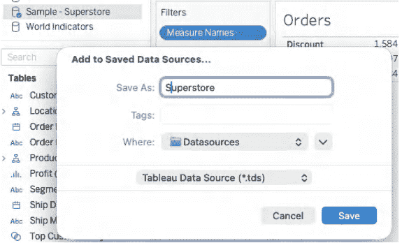

图 1.31: 保存数据源

- 4. 单击屏幕左上角 **显示开始页 Tableau** 图标，并观察新保存的数据源：

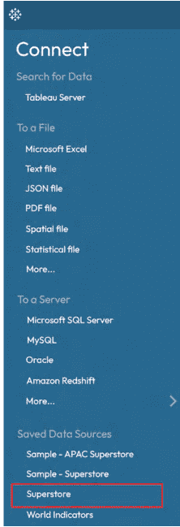

图 1.32: 保存的数据源

你可以保存一个指向 Tableau Server 上已发布数据源的本地数据源。首先，连接到 Tableau Server 上的已发布数据源。然后，在工作区中右键单击数据源，并选择 **添加到保存的数据源**。现在，你可以直接从开始页连接到 Tableau Server！

既然我们已经了解了如何连接到文件、Tableau Server 和保存的数据源，我们将继续旅程，深入了解 **度量名称** 和 **度量值** 的更多详细信息。

## 度量名称和度量值

我经常观察到以下场景：新 Tableau 作者创建工作表并将度量拖动到 文本 书架。他们将第二个度量拖动到视图的各个位置，并得到似乎完全不可预测的结果。这种经验对作者来说非常令人沮丧，因为在 Microsoft Excel 中实现这一点非常容易！好消息是，在 Tableau 中实现这一点也很容易。它只需要一种不同的方法。

**度量名称** 和 **度量值** 是 Tableau 中的生成字段。它们不存在于基础数据中，但对于创建多种视图来说必不可少。可以根据其在 **数据** 窗格中的位置及其名称来推断，**度量名称** 是一个维度，其成员由基础数据集中每个度量的名称组成。**度量值** 包含数据集中每个度量的数字或值。

本节将观察这些生成字段独立使用时会发生什么，然后观察它们如何协同工作以优雅地创建视图。让我们通过一个练习来探索：

- 1. 在本章关联的工作簿中，导航到 MeasureNames/Values 工作表，并确保已选中 Sample - Superstore 数据源。
- 2. 将度量值拖至文本区，观察结果；所有四个值都将重叠打印：

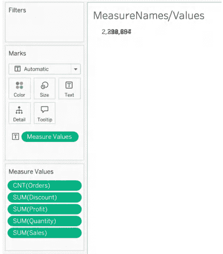

图 1.33：度量值

- 3. 单击工具栏上的清除工作表图标以清空工作表：

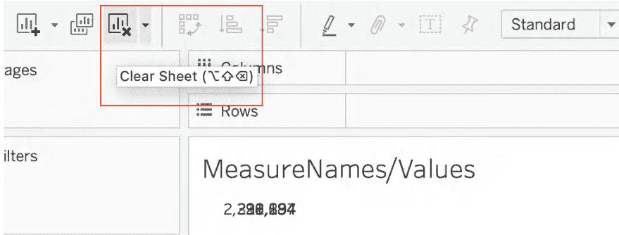

图 1.34：清除工作表

- 4. 现在，将**度量名称**拖至**行**区，观察视图仅显示**无度量值。**

- 5. 将**度量值**拖至**文本**区。注意度量及其关联值的列表；四个值中的每一个都分别在各自的行中打印：

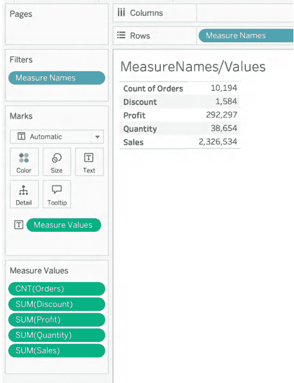

图 1.35：度量值列表

或许，**度量名称**与**度量值**之间的关系最好通过类比来解释。考虑几双袜子和一个带隔层的袜子抽屉。*步骤 2* 相当于将袜子随意堆在一起。结果嘛，是混乱不堪。*步骤 4* 相当于一个带隔层的空袜子抽屉。隔层都已就位，但袜子在哪里呢？*步骤 5* 是一个装满整齐摆放袜子的带隔层抽屉。**度量名称**就像袜子抽屉。**度量值**就像袜子。两者独立使用时，用处不大。但合在一起使用，可以以多种方式应用。

## 度量名称和度量值快捷方式

Tableau 提供了多种快捷方式，可用于快速创建所需的可视化。如果您是该软件的新手，这种快捷方式行为起初可能不直观，但您会逐渐理解。让我们使用下面的练习来探索如何使用快捷方式快速部署度量名称和度量值：

- 1. 在本章关联的工作簿中，导航到 MeasureNames/Values ShrtCts 工作表。

- 2. 将利润拖到标记卡上的文本区。

- 3. 在视图中将销售额直接拖到利润之上（将出现显示我）：

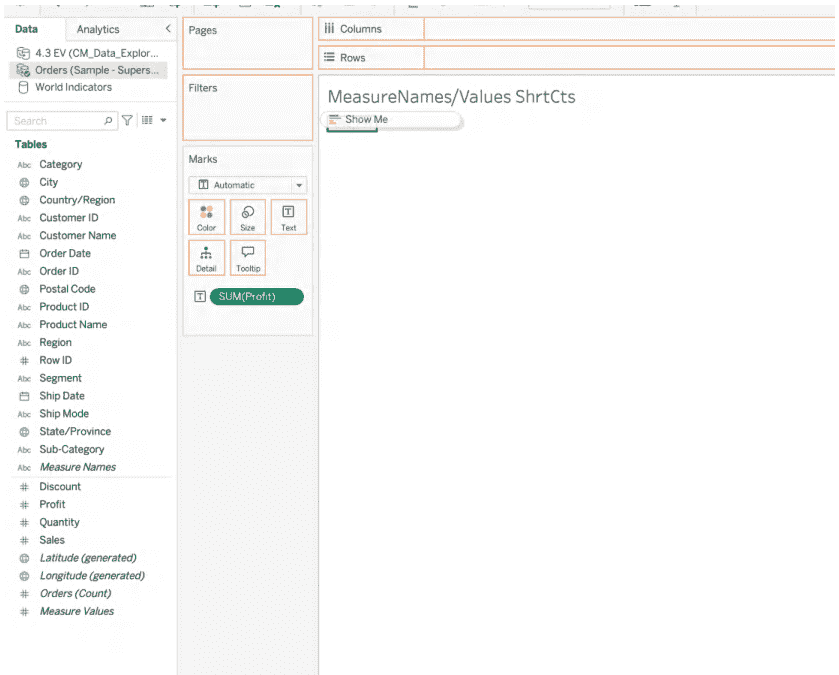

图 1.36：显示我和度量

- 4. 观察结果，包括**度量值**区的出现、**度量名称**在**行**和**筛选器**区上的部署，以及**度量值**在**文本**区上：

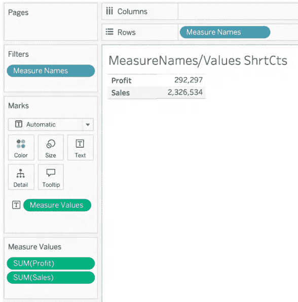

图 1.37：度量值出现

本练习的步骤 2 中发生了多件事。在视图中将销售额数字放在利润数字之上后，Tableau 执行了以下操作：

- 1. **在筛选器区部署度量名称**：右键单击并打开**度量名称**筛选器，然后点击**编辑筛选器...**。观察仅选中了**销售额**和**利润**。这将视图限制为仅显示这两个度量。

- 2. **在行区部署度量名称**：**度量名称**充当带隔层的容器——即类比中的袜子抽屉。由于筛选器的存在，仅显示**销售额**和**利润**的行。

- 3. **显示度量值区**：**度量值**区在某种程度上是冗余的。尽管它清楚地显示了视图中显示的度量，但它本质上充当访问筛选器的一种简便方式。您可以直接将度量拖入或拖出**度量值**区来调整筛选器，从而显示/隐藏其他度量值。您还可以更改**度量值**区内的顺序，以更改视图中度量的顺序。

- 4. **在文本区部署度量值：** 度量值只是定义将显示在每行中的数字——在此例中，与**销售额**和**利润**相关联的数字。

如果可视化包含轴，则部署**度量名称**和**度量值**的快捷方式要求将第二个度量放置在初始度量轴之上。在*图 1.38*中，**订单日期**位于**列**区，**销售额**位于**行**区。请注意，截图是在**利润**放置在 y 轴之上时拍摄的：

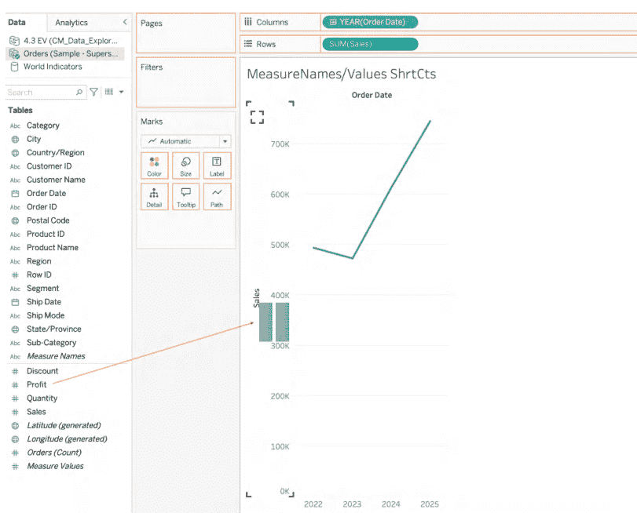

图 1.38：轴快捷方式

生成的工作表如图 1.39 所示：

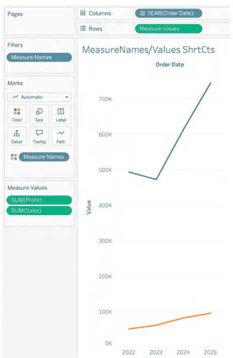

图 1.39：双折线图

本节让我们更好地理解了**度量名称**和**度量值**。在您的 Tableau 职业生涯中会更多地接触这些概念，但既然您已成功掌握基础知识，那我们就继续学习另外三个对您的学习曲线有帮助的概念。

## 三个基本的 Tableau 概念

掌握 Tableau 的重要途径之一是三个基本概念。在本节中，我们将逐一讨论：

- 维度和度量
- 行级别、汇总级别和表格级别计算
- 连续值和离散值

我们将从定义维度和度量开始。

### 维度和度量

Tableau 将底层数据源中的每个字段分类为**维度**或**度量**。维度是定性数据，也可以说是分类数据。度量是定量数据或可聚合的数据。度量通常是数字，但也可以是聚合的非数字字段，例如 MAX ( Date )。维度通常是文本、布尔值或日期字段，但也可以是数字，例如 Count。维度通过将数字切分为不同的部分/类别来赋予其意义。没有维度的度量大多毫无意义。

让我们来看一个示例以更好地理解：

- 1. 在本章关联的工作簿中，导航到**维度和度量**工作表。

- 2. 将**订单数 (计数)**拖至**标记卡**上的**文本**区。结果大多毫无意义。结果为**10,194**，但如果没有通过一个或多个维度对度量进行切分所提供的上下文，就无法真正理解其含义：

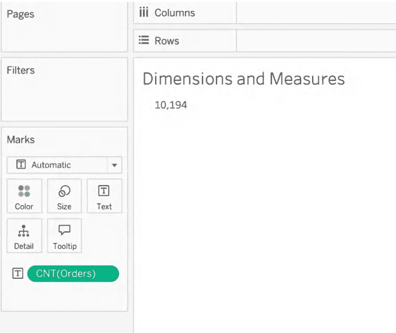

图 1.40：无上下文的工作表

- 3. 将**区域**放置在**列**区，将**订单日期**放置在**行**区：

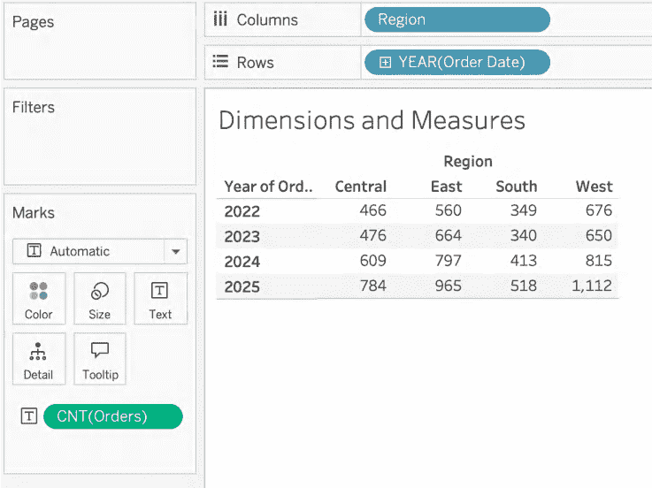

| 订单日期年份 | 中部 | 东部 | 南部 | 西部 |
| :--- | :--- | :--- | :--- | :--- |
| 2022 | 466 | 560 | 349 | 676 |
| 2023 | 476 | 664 | 340 | 650 |
| 2024 | 609 | 797 | 413 | 815 |
| 2025 | 784 | 965 | 518 | 1,112 |

图 1.41：维度和度量

如图 1.41 所示，步骤 3 带来了意义。将区域和订单日期放置在列和行区上可提供上下文，从而赋予可视化以意义。

### 行级别、汇总级别和表格级别计算

Tableau 中存在三种计算级别：行级别、汇总级别和表格级别。要理解这三种级别的工作原理，重要的是要了解 Tableau 的处理流程。我们将通过一个示例来说明，该示例考虑订单数据集中的记录数和数量字段。

在早期版本的 Tableau 中，记录数是自动创建的字段。现在不再是这种情况；因此，请通过选择 分析 | 创建计算字段 并在其中键入 1 来创建名为记录数的计算字段：

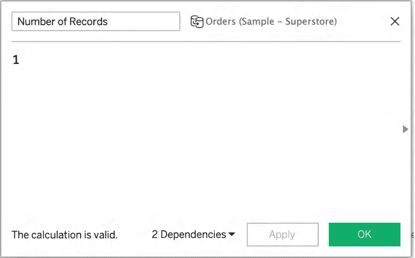

图 1.42：记录数

请考虑以下计算类型：计算字段和查询。将其与常用语言 SQL 进行比较，将有助于我们更好地理解如何解释 Tableau 计算。请注意，出于本示例的目的，SQL 有所简化。

让我们更深入地了解三种计算级别，并考虑下表中的示例：

| 计算类型 | Tableau 中的计算字段 | 传递给数据源的查询 |
| --- | --- | --- |
| 行级别 | 记录数 / 数量 | SELECT Number of Records / Quantity FROM Orders |
| 汇总级别 | [记录数] / SUM(Quantity) | SELECT [Number of Records], SUM(Quantity) FROM [Orders] |

| 计算类型 | Tableau 中的计算字段 | 传递给数据源的查询 |
| :--- | :--- | :--- |
| 表级别 | WINDOW_SUM([Number of Records])/Quantity)) | SELECT [Number of Records], SUM(Quantity) FROM [Orders] |

表 1.1: 计算层级

对于行级别和聚合级别的计算，计算实际上是由数据源引擎完成的，因为 Tableau 是一个内存工具。Tableau 仅显示结果。然而，表级别计算并非如此。尽管传递给数据源的表级别计算查询与聚合级别计算的查询相同，但 Tableau 会对返回的结果执行额外的计算。让我们通过使用相同的计算字段进行练习来进一步探讨这一点。

让我们查看以下步骤并开始练习：

- 1. 在与此章关联的工作簿中，导航到 Row_Agg_Tbl 工作表。
- 2. 通过单击左上角数据部分中的 Orders，连接到 Orders 数据源。

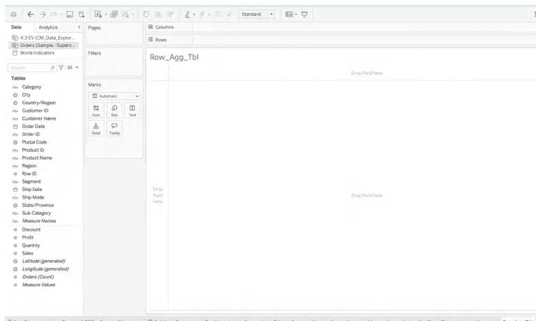

图 1.43: 连接到 Sample - Superstore 数据集

- 3. 选择 Analysis | 创建计算字段 以创建以下计算字段。请注意，每个必须单独创建；也就是说，在此上下文中不可能创建一个包含所有三个计算的单个计算字段：
- o. 将第一个计算命名为 Lev–Row 并输入以下代码：[Number of Records]/[Quantity]。
- o. 接下来，将第二个计算命名为 Lev–Agg 并输入以下代码：SUM([Number of Records])/SUM([Quantity])。
- o. 最后，将第三个计算命名为 Lev–Tab 并输入 WINDOW_AVG([Lev–Agg])。
- 4. 在数据窗格中，右键单击刚刚创建的三个计算字段，并选择 默认属性 | 数字格式。
- 5. 在出现的对话框中，选择 百分比 并单击 确定。
- 6. 将 Order Date 置于 列架 上。
- 7. 将 Measure Names 置于 行架 上，并将 Measure Values 置于 标记卡上的 文本。
- 8. 除 Lev–Row、Lev–Agg 和 Lev–Tab 之外排除所有值，方法是将它们从 度量值架 拖出，或从 度量名称筛选器 中删除：

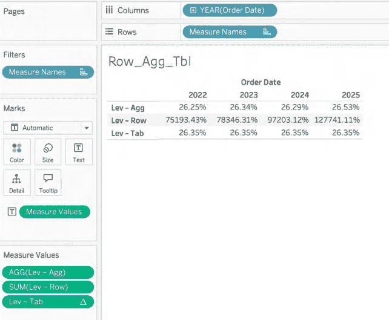

图 1.44: 计算级别

让我们详细拆解这些值：

- **Lev–Agg** 是聚合级别的计算。计算由数据源引擎完成。[Number of Records] 的总和除以 [Quantity] 的总和。计算结果可能对 Tableau 作者有用。

- **Lev–Row** 是行级别的计算。计算由数据源引擎完成。[Number of Records] 字段除以底层数据中每一行的 [Quantity] 字段。然后将结果跨所有行求和。当然，在这种情况下，行级别计算不能提供有用的结果；但是，由于新的 Tableau 作者可能在真正需要聚合级别计算时错误地创建行级别计算，因此此处包含了此示例。

- **Lev–Tab** 是表计算。部分计算由数据源引擎完成，即聚合。Tableau 基于工作表中显示的数据的维度和详细程度，对数据源引擎返回的结果执行额外计算。具体来说，**Lev–Agg** 的结果被求和，然后除以维度中的成员数量。对于前面的示例，这是如下内容：

(26.29% + 26.34% + 26.3% + 26.55%)
4

再次强调，在这种情况下，结果并不特别有用，但确实展示了初学者 Tableau 作者应该具备的知识。

## 连续值与离散值

连续和离散不是 Tableau 特有的概念。确实，两者在许多领域都可以观察到。请考虑以下两条河流的示例：River-Liquid 和 River-Ice。River-Liquid 中水正在流动。River-Ice 由冰块组成。你能理论上对 River-Ice 中的冰块进行排序吗？可以！有什么办法可以对 River-Liquid 中的水进行排序吗？换句话说，你能从河底舀一些水桶，将这些桶运到上游，再将水倒回 River-Liquid，然后说“我对河中的水进行了排序”吗？不可以。

River-Liquid 中的 H²O 处于连续形式；即，水。River-Ice 中的 H²O 处于离散形式；即，冰。

在考虑了自然界中的连续和离散示例后，让我们将注意力重新转回 Tableau。Tableau 中的连续和离散可以通过以下七个注意事项更清晰地理解：

- **连续为绿色，离散为蓝色**：在 **数据** 窗格中选择任何字段，或将任何字段放置在架上，你会发现它要么是绿色，要么是蓝色。此外，与字段关联的图标也要么是绿色，要么是蓝色。

- 连续始终是数值。离散可能是字符串。

- 连续和离散与维度和度量并非同义：

- 新的 Tableau 作者经常将连续与度量、离散与维度混淆。它们并非同义。度量可以是离散或连续的。

- 此外，如果维度是数字，它可以是离散或连续的。为了证明这一点，请在 Tableau 中右键单击任何数字或日期字段，并注意你可以对其进行转换：

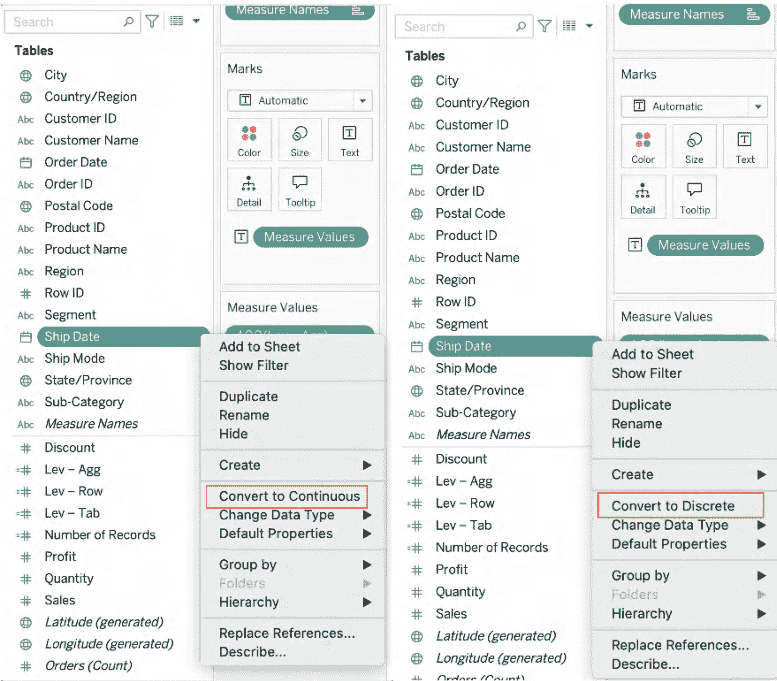

图 1.45: 在离散和连续之间转换

- 离散值可以排序。连续值不能：可排序/不可排序行为最容易通过日期和类似 Sum(Sales) 的度量来观察，如以下示例所示：

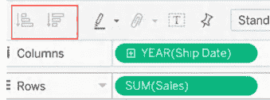

图 1.46: 左：连续（不可排序）；右：离散（可排序）

- **连续颜色为渐变。离散颜色为独立：** 以下示例将 **Sales** 显示为连续，然后显示为离散。注意颜色呈现的差异。截图的左部分显示连续结果为渐变，右部分显示离散结果为颜色鲜明的类别：

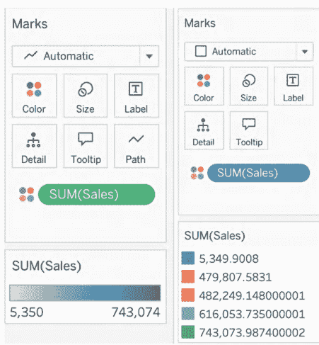

图 1.47: Sales 作为连续（左）和离散（右）

- **连续药片可以放置在离散药片的右侧，但不能放置在左侧，因为离散药片定义了聚合级别：**
  - 当 **Year** 为离散时，Tableau 作者可以将 **Region** 放置在 **Year** 的右侧
  - 当 **Year** 为连续时，Tableau 作者无法将 **Region** 放置在 **Year** 的右侧

- **连续创建轴，离散创建标题：** 请注意以下截图右部分中，**Order Date** 为连续，且 **Year of Order Date** 轴被选中。由于 **Year of Order Date** 是轴，整个 x 平面被选中。然而在左部分，**Year(Order Date)** 为离散，且 2014 被选中。由于 2014 仅是标题，因此仅选中它而非整个 x 平面。**图 1.48** 显示了离散日期。

### 工作表 12

页面 列 YEAR(Ship Date) 行 SUM(Sales)

筛选器 标记 条形 颜色 大小 标签 详细信息 提示 SUM(Sales)

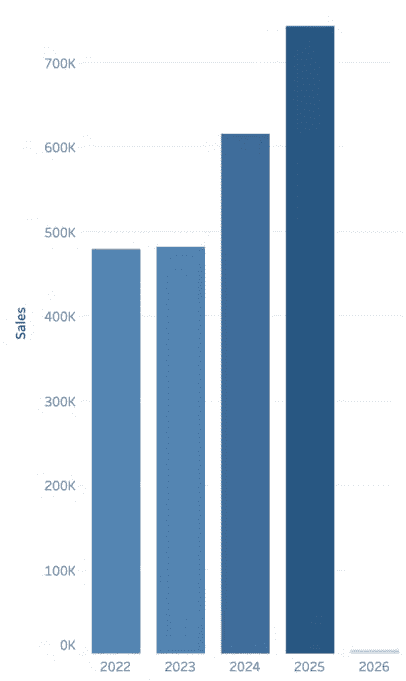

图 1.48: 离散日期

图 1.49 显示了连续日期。

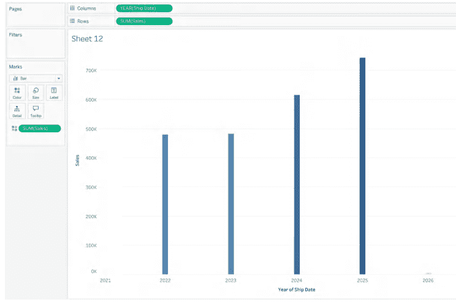

图 1.49: 连续日期

恭喜——你刚刚掌握了 Tableau 中的三个重要概念：度量和维度、计算层级，以及离散值和连续值。仅凭这些知识，你就能创建第一个仪表板。我强烈鼓励你这样做；在玩弄这些工具时，学习曲线会非常陡峭，并且通过练习你会迅速建立信心！这也将帮助你跟上后面章节的内容。

要结束基础部分，我们将介绍将仪表板导出到其他设备。即使你目前还不觉得准备好这样做，这也能完成 Tableau Desktop 的基础演示，并提供整体的原始雏形。然后我们可以在后续章节中继续改进所有细节！

## 将数据导出到其他设备

当仪表板按预期显示时，开发人员有多种共享工作的选择。上传到 Tableau Server 是最可能的选项。最终用户可能不会仅在笔记本电脑上查看结果；他们也可能使用平板电脑或手机。

## 将数据导出到移动设备

开发仪表板时，Tableau Creator 提供了查看设备设计器或设备预览的选项。只要您处于仪表板选项卡中，就可以在此处找到：

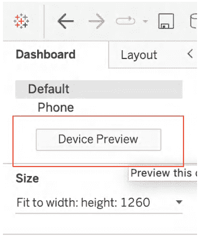

图 1.50：设备预览

Tableau 自带默认手机设置。如有需要，可以点击 Phone，然后点击三个点来调整这些默认设置。进入设备设计器模式后，选择设备类型选项，您将获得最常见机型的选项。请注意，您只能使用仪表板默认布局中的工作表。例如，如果要为平板电脑添加默认布局，请进入设备设计器模式，选择 Tablet，并移动内容，使您希望在平板电脑上看到的工作表位于设备框架内。满意后？则将新布局（如图 1.50 所示）添加到工作簿中。它将出现在左上角区域的 Default 下方。用户现在可以在从 Tableau Server 打开工作簿时选择所需的设计。

不仅可以在移动设备上方便地查看您的项目，还可以使用 Tableau Mobile 随时随地处理它们！我们将在下一节中介绍这一点。

## Tableau Mobile

为支持灵活办公，Tableau 创建了一款可从 App Store 或 Google Play 下载的应用，名为 Tableau Mobile。将其安装在手机和平板电脑上后，您可以选择将应用连接到 Tableau Server 或 Tableau Online。请发布本章中“构建仪表板”部分创建的仪表板，发布到上述两个实例中的任意一个。如果您对发布有疑问，请参阅第 13 章 探索 Tableau Server 和 Tableau Cloud，以获取进一步说明。

在登陆页面底部，点击 **Explore** 以查看刚刚发布的所有视图。点击 **Building a Dashboard** 视图，查看之前创建的仪表板。最精彩的部分还在后面。仪表板完全交互，因此请尝试下拉筛选器或 **Medals** 筛选器。另外，尝试点击标记并选择 **Keep Only**。点击右上角的工作簿图标（从左数第一个图标），将显示您创建的所有其他工作表，从而可以在工作表之间切换：

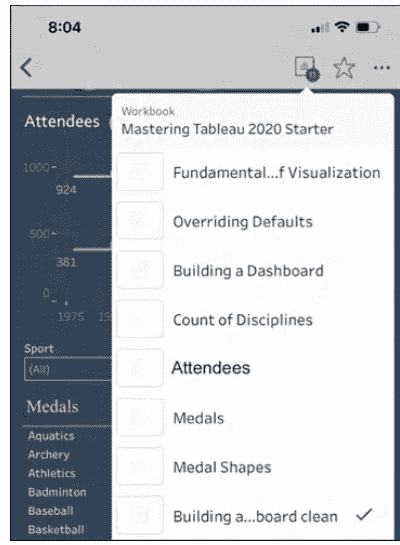

图 1.51：工作表选择

现在，如果点击右上角的三个点，会出现更多选项，例如 **Revert**、**Alert**、**Subscribe** 等等。要了解 Tableau Server 上也可用的不同选项的更多信息，请参阅 _第 13 章 探索 Tableau Server 和 Tableau Cloud_。目前，我们可以得出结论：Tableau Mobile 让您无论身在何处都能轻松查看喜爱的仪表板。

## 使用基础知识的跟随式仪表板

为让您有另一个机会练习 Tableau 技能，我为您准备了以下练习。直接跟随操作即可！我们将使用来自 **Our World in Data (OWID)** 的 **Global CO2 Emissions by Country** 数据集。

此数据集非常适合用于练习 Tableau，因为它包含各国的年度 CO2 排放量、人口和人均值；非常适合学习比较、趋势和地理可视化：

- 1. 访问 https://github.com/owid/co2-data 处的 OWID CO2 数据集存储库并下载 CSV 文件。
- 2. 将文件保存在计算机上。我将其命名为 OWID.csv。
- 3. 打开 Tableau Desktop。
- 4. 在开始页面，单击 连接 | 到文件 | 文本文件。
- 5. 选择下载的 OWID.csv 文件：

需要添加数据方面的帮助？了解更多

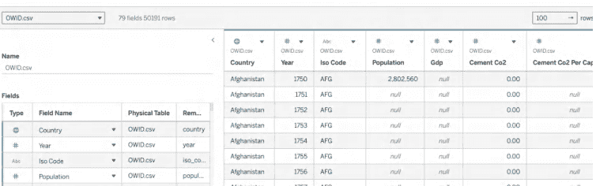

图 1.52：OWID.csv

- 6. 打开新工作表，将 Year 拖到 Columns 容器，将 Co2 拖到 Rows 容器，并将工作表命名为 Emission Trends。
- 7. 若要仅包含未进行任何聚合的国家（例如所有经济合作与发展组织 (OECD) 国家），请将 ISO Code 移至 Filter 容器并取消选择 Null 值。再次点击筛选器，然后选择 应用到工作表 | 使用此数据源的所有工作表。

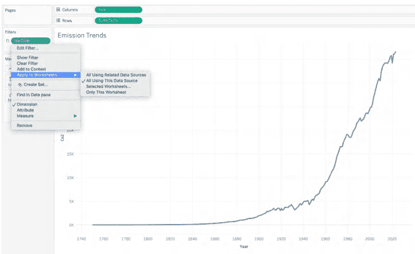

图 1.53：排放趋势

您现在已完成三个工作表中的第一个。折线图显示排放趋势。

- 8. 接下来，添加新工作表，并将 **Country** 拖到 **Rows** 容器。同时，将 **Co2** 拖到 **Columns** 容器。然后，将 **Year** 拖到 **Filter** 容器，并筛选最近一年（例如 2023）。确保您的 **Year** 字段为离散型（蓝色）。
- 9. 现在，将图表按降序排序，并为工作表指定标题 **Top Emitters: <Year>**。通过将 <Year> 变量添加到标题，标题将根据您选择的年份自动调整。**ISO Code** 筛选器继承自 **Emission Trends** 工作表，因为我们已将该筛选器应用于使用 OWID 数据的所有工作表：

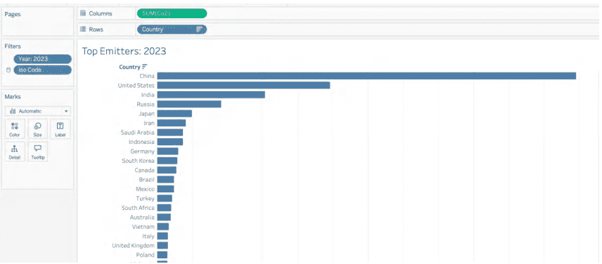

图 1.54：排名

- 10. 为补充最后一部分，打开新工作表，并将 **Country** 拖到 **Marks** 卡的 **Detail** 中。Tableau 将其识别为地理字段，并创建世界地图。
- 11. 接下来，将 **Co2_per_capita** 拖到 **Color**，将 **Year** 拖到 **Filter** 容器，并将筛选器设置为与第二个工作表 **Top Emitters** 中使用的相同年份。
- 12. 调整颜色刻度以突出差异（例如，颜色越深 = 人均排放量越高）。我将此工作表命名为 World Emission: <Year>。

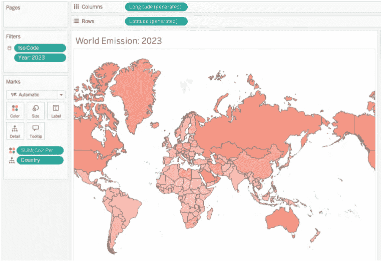

图 1.55：世界排放

要从三个工作表进入交互式仪表板，必须执行以下操作：

- 13. 通过单击页面底部的相应选项卡打开新仪表板。
- 14. 从左侧窗格中，将工作表（**Emission Trends**、**Top Emitters**、**World Emission**）拖到画布上。
- 15. 将它们以整洁的网格布局排列：**Emission Trends**（左上角）、**Top Emitters**（右上角）、**World Emission**（底部）：

### Emission Trends

### Top Emitters: 2023

### World Emission: 2023

图 1.56：仪表板

- 16. 添加标题，例如 Global CO2 Emissions Dashboard。
- 17. 点击仪表板上的 Top Emitters 工作表，然后选择 Filters | Year：

### Top Emitters: 2023

图 1.57：筛选器

- 18. 点击新创建的筛选器，然后选择 **Multiple Values (dropdown)**：

图 1.58：筛选器 2

- 19. 同样，在同一筛选器中点击 **Apply to Worksheets | Selected Worksheets**，并也选择 **World Emission** 工作表：

图 1.59：将筛选器应用到工作表

- 20. 要清理仪表板，请点击世界地图（右下角）上的 **1 unknown** 按钮，并选择 **Filter Data**。

图 1.60：应用筛选器

- 21. 最后，点击 World emission 工作表，然后选择右侧的筛选器图标，以将地图用作两个上方工作表的筛选器：

图 1.61：用作筛选器

结果是您自己的排放仪表板，显示一个折线图，用于比较 **国际标准化组织** (ISO) 国家随时间的变化排放量，以及一个条形图，显示最近一年 CO2 排放量最高的国家，并带有筛选选项以选择数据集中存在的任何其他年份。最后，您拥有一个突出显示人均排放量的世界地图，点击任何给定国家时，该地图也可用作筛选器。

此组合可全面了解全球排放并支持交互式探索。希望您喜欢！随意添加更多功能，并将其上传到您的 Tableau Public 个人资料。

## 摘要

在本章中，我们介绍了 Tableau 的基础知识。我们从一些基本术语开始，然后研究了创建工作表和仪表板的基础知识。我们关注默认行为以及如何覆盖该行为，并探讨了一些最佳实践。接着，我们回顾了 **Measure Names** 和 **Measure Values** 的基本原则。之后，我们探索了三个基本 Tableau 概念：维度和度量；行级、聚合级和表级计算；以及连续值和离散值的概念。特别是，需要理解行级和聚合级计算由数据源引擎计算，而表级计算由 Tableau 处理。最后，我们了解了如何为其他设备（如手机或平板电脑）调整仪表板，并观看了 Tableau Mobile 的实际应用。

在下一章中，我们将继续探索 Tableau，查看数据。我们将考虑如何使用 Tableau 的数据处理引擎 Hyper 准备数据，并探索一些有用的数据准备模型和技术。

## 获取本书的 PDF 版本和更多内容

扫描二维码（或访问 packtpub.com/unlock）。按名称搜索此书，确认版本，然后按照页面上的步骤操作。

**立即解锁**

*注意：请保管好您的发票。直接从 Packt 购买不需要发票。*

