# 清理您的数据

您是否曾想过，您的数据是否足够可靠以供分析？几乎所有处理数据的人都会面临这个问题。这就是为什么本章侧重于 *数据准备*；将数据准备好以进行有意义分析的基本过程通常称为 *数据清理*。

在本章结束时，您将了解良好的数据质量是什么样子，如何识别数据集中的问题，以及如何使用 Tableau 2026 应用实用的清理技术。总体目标是帮助您在使用真正支持可靠结论的数据时建立信心。

这些信息很重要，因为即使是最先进的分析也依赖于准备充分且准确的数据。学习如何评估和清理您的数据将节省时间、减少错误，并提高您洞察的可信度。

在本章中，我们将讨论以下主题：

- 准备数据集
- 浏览数据
- 清理混乱的数据

现在，让我们深入探讨这个迷人的主题，目标是丰富我们对数据质量的理解。

## 准备数据集

Tableau 可以有效地用于各种数据准备阶段：

1. 数据收集/摄入：我是否可以访问正确的数据？
2. 数据剖析/浏览：我的数据是什么样子的？
3. 数据清理：我的数据是否足够可靠以供分析？
4. 数据转换：我的数据是否为我需要回答的问题构建了结构？
5. 数据集成：我是否正确且一致地合并数据？
6. 数据丰富：我是否有足够的上下文来获得有意义的洞察？
7. 数据验证：我可以信任输出结果吗？
8. 数据加载和发布：数据对利益相关者是否可访问且可用？

不幸的是，单靠一章不足以深入探讨 Tableau 在每个阶段的应用方式。确实，如此深入的探讨可能值得整本书！因此，本章的重点将放在第 2 步和第 3 步——数据剖析和数据清理上——因为这些任务历史上占据了数据准备工作量的高达 60%。我们的目标是学习如何使用 Tableau 来简化该过程。

## 浏览数据

Tableau 是一个用于简单浏览数据的非常有效的工具。有时在浏览过程中，您可能会发现基于现有字段清理数据或填充不完整数据的方法。有时，遗憾的是，根本没有足够的拼图碎片来拼凑出一个完整的数据集。在这种情况下，Tableau 可用于准确传达缺失的内容，而这反过来可能激励组织更充分地填充底层数据。

在本练习中，我们将探讨如何使用 Tableau 快速发现数据集中每个字段的空值百分比。接下来，我们将探讨如何从现有字段推断数据以填补缺失。

## 建立空值

各位一定都遇到过这种情况：您正在查看一个数据集，发现一些值缺失了。或者您可能会看到 null。但现在该怎么办？让我们探索一些选项。

以下是浏览数据的步骤：

1. 如果您尚未这样做，请导航至 https://github.com/PacktPublishing/Mastering-Tableau-2026/tree/main/Chapter02 以查找并下载与此章相关的工作簿。
2. 导航至名为 **Surveying & Exploring Data** 的工作表。
3. 将 **Region** 和 **Country** 拖到 **Rows** 书架。观察在某些情况下，**Region** 字段对某些国家/地区具有 null 值：

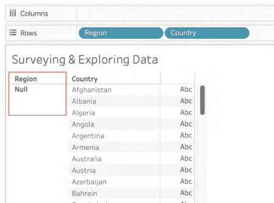

图 2.1：空区域

4. 右键单击并编辑名为 **Select Field** 的参数。请注意，**Data type** 字段设置为 **Integer**，我们可以观察到一个包含数据集中每个字段名称条目的列表：

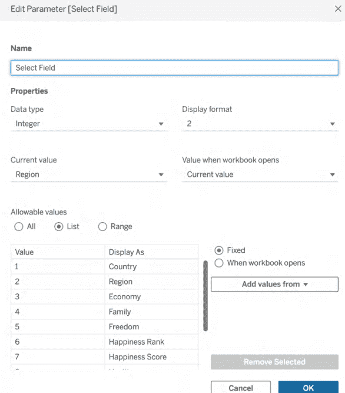

图 2.2：编辑参数

5. 在 **Data** 窗格中，右键单击我们刚刚创建的参数，然后选择 **Show Parameter Control**。创建一个名为 **% Populated** 的计算字段，并编写以下计算：

```
SUM([Number of Records]) / TOTAL(SUM([Number of Records]))
```

6. 在 **Data** 窗格中，右键单击 **% Populated**，然后选择 **Default Properties | Number Format**...

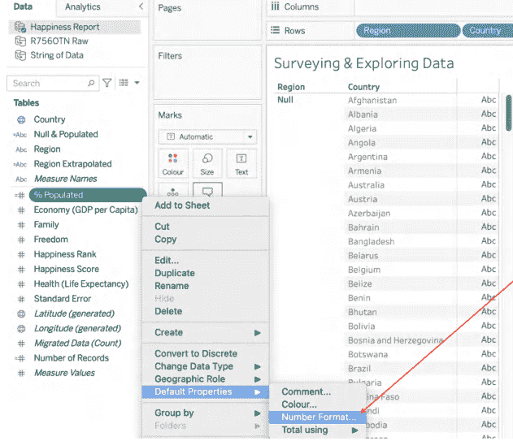

图 2.3：调整默认属性

7. 在弹出的对话框中，选择 **Percentage**。

8. 创建一个名为 **Null & Populated** 的计算字段，并添加以下代码。请注意，完整的 CASE 语句相当冗长，但也具有重复性。在需要冗长但重复计算的情况下，考虑使用 Excel 来更快速且准确地编写代码。通过使用 Excel 的 CONCATENATE 函数，您可能能够节省时间并避免拼写错误。

在以下代码块中，代码行仅代表总体的一部分，但应足以让您生成完整内容：

```
CASE [Select Field]
WHEN 1 THEN IF ISNULL ([Country]) THEN 'Null Values' ELSE
'Populated Values' END
WHEN 2 THEN IF ISNULL ([Region]) THEN 'Null Values' ELSE
'Populated Values' END
WHEN 3 THEN IF ISNULL ([Economy (GDP per Capita)]) THEN 'Null Values' ELSE
'Populated Values' END
WHEN 4 THEN IF ISNULL ([Family]) THEN 'Null Values' ELSE
'Populated Values' END
WHEN 5 THEN IF ISNULL ([Freedom]) THEN 'Null Values' ELSE
'Populated Values' END
WHEN 6 THEN IF ISNULL ([Happiness Rank]) THEN 'Null Values' ELSE
'Populated Values' END
WHEN 7 THEN IF ISNULL ([Happiness Score]) THEN 'Null Values' ELSE
'Populated Values' END
WHEN 8 THEN IF ISNULL ([Health (Life Expectancy)]) THEN 'Null Values' ELSE
'Populated Values' END
WHEN 9 THEN IF ISNULL ([Standard Error]) THEN 'Null Values' ELSE
'Populated Values' END
END
```

9. 从 Rows 书架中删除 Region 和 Country。

10. 将 Null & Populated 放在 Rows 和 Colour 书架上，将 % Populate 放在 Columns 和 Label 书架上：

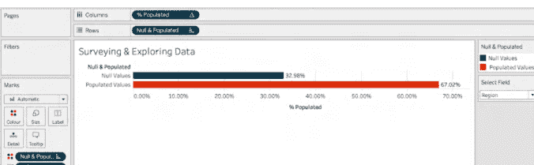

图 2.4：已填充的值

11. 如果需要，将 Null Values 的颜色更改为红色，将 Populated Values 的颜色更改为绿色。您可以通过单击 Marks 卡片中的 Colour，然后单击 Edit Colours 来实现此操作。

12. 单击工作表中 Select Field 参数右上角的箭头，然后选择 Single Value List。

13. 在 Select Field 参数中选择各种选项，并注意某些字段的空值百分比很高。例如，在以下图表中，32.98% 的记录没有 Region 的值：

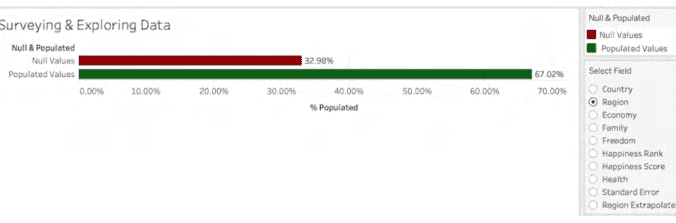

图 2.5：比较空值和已填充的值

基于此练习，让我们探讨如何使用相同的数据集来清理和推断现有数据。

## 推断数据

本练习将在前一个练习的基础上进行扩展，通过清理现有数据并从已知信息填充一些缺失数据。我们将假设我们知道哪个国家属于哪个区域。我们将利用该知识来修复 **Region** 字段中的错误，并使用 Tableau 填补缺失。

从前一个练习结束的地方开始，创建一个名为 **Region Extrapolated** 的计算字段，并使用以下代码块：

```
CASE [Country]
WHEN 'Afghanistan' THEN 'Southern Asia'
WHEN 'Albania' THEN 'Central and Eastern Europe'
WHEN 'Algeria' THEN 'Middle East and Northern Africa'
WHEN 'Angola' THEN 'Sub-Saharan Africa'
WHEN 'Argentina' THEN 'Latin America and Caribbean'
WHEN 'Armenia' THEN 'Central and Eastern Europe'
WHEN 'Australia' THEN 'Australia and New Zealand'
WHEN 'Austria' THEN 'Western Europe'
//complete the case statement with the remaining fields in the data set
END
```

为了加快创建冗长计算字段的繁琐过程，您可以将数据下载到 Excel 文件，并通过连接各个部分来创建计算字段，如下图所示：

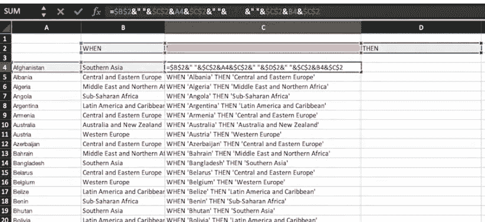

图 2.6：在 Excel 中编译计算


你可以将它们从 Excel 复制到 Tableau 中。但是，就此练习而言，我创建了一个名为 **备份** 的备份字段，它可以在与此章相关联的 Tableau 工作簿中找到，该工作簿包含 **区域** 外推字段所需的完整计算。随时使用。 **解决方案** 仪表板也包含所有国家/地区。因此，你也可以从该文件中复制 **区域外推** 字段。

向 **选择字段** 参数中添加 **区域外推** 选项：

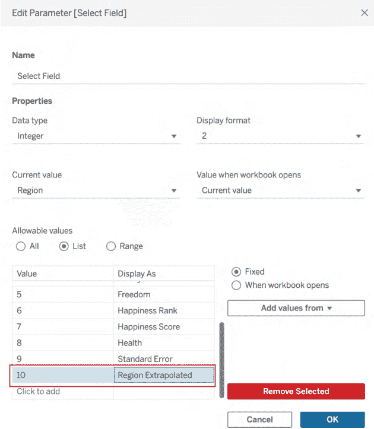

图 2.7: 将区域外推添加到参数中

将以下代码添加到 **空值与已填充** 计算字段中：

```
WHEN 10 THEN IF ISNULL ( [Region Extrapolated] ) THEN 'Null Values' ELSE 'Populated Values' END
```

请注意，**区域外推** 字段现已完全填充：

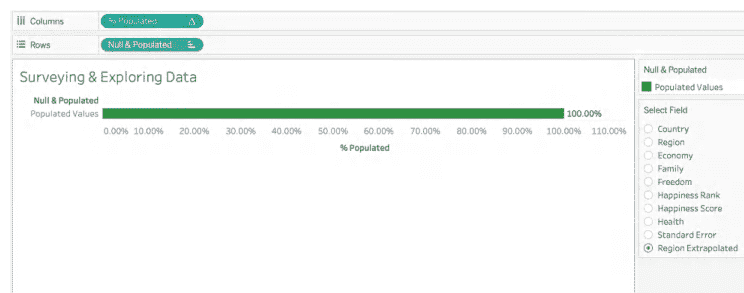

图 2.8: 已完全填充的区域外推字段

现在，让我们考虑一下以前练习中的一些具体细节。

请看下面的代码块。请注意，完整的 CASE 语句有好几行长。以下是一个代表性部分：

```
CASE [% Populated]
WHEN 1 THEN IF ISNULL ([Country]) THEN 'Null Values' ELSE
'Populated Values' END
...
```

此 CASE 语句是一个行级计算，它会考虑数据集中的每个字段，并确定哪些行已填充、哪些行未填充。例如，在前面代码的代表性行中，会对 **国家/地区** 字段的每一行进行空值计算。这样做的原因是，计算字段会向现有数据添加一个新列——仅在 Tableau 中，而不在数据源本身中——并且每一行都会获得一个值。这些值可以是 N/A 或空值。

以下代码相当于快速表计算“百分比总计”：

```
SUM([Number of Records]) / TOTAL(SUM([Number of Records]))
```

结合 **空值与已填充** 计算字段，它可以让我们查看有多少百分比的字段实际包含了值。

> **注释**
> 养成从头开始编写表计算的习惯是个好主意，即使有可用的等效快速表计算也是如此。这将帮助你更清晰地理解表计算。

以下 CASE 语句是一个示例，说明如何使用一个或多个字段来推断另一个字段应该是什么：

```
CASE [Country]
WHEN 'Afghanistan' THEN 'Southern Asia'
... END
```

例如，数据集中的 **区域** 字段有大量空值，即使是现有数据也存在错误。基于我们对业务的了解（即哪个国家/地区属于哪个区域），我们能够使用 **国家/地区** 字段，利用准确信息使数据集的填充率达到 100%。

空值几乎存在于每个大型真实数据集中。了解每个字段中存在多少个空值，对于确保你提供准确的 **商业智能 (BI)** 至关重要。当最终结果不会受到重大影响时，容忍某些空值可能是可以接受的，但过多的空值可能会使结果无效。然而，如这里所示，在某些情况下，可以使用一个或多个字段来推断应填入填充不足或填充错误字段的值。

如本节所示，Tableau 使你能够有效地向数据团队传达哪些值缺失、哪些值错误，以及可能的变通方法对整体数据挖掘工作有多宝贵。接下来，我们将研究一些更混乱、不是以整齐列格式组织的数据。别担心——Tableau 可以帮你解决。

## 清理混乱的数据

美国政府为各种官僚流程提供了有用的文档。例如，**美国卫生与公众服务部 (HHS)** 提供 **ICD-9** 代码列表，也称为 **国际疾病和相关健康问题统计分类** 代码。不幸的是，这些代码并不总是以易于访问的格式提供。

举例来说，让我们来看一份名为 R756OTN 的实际 HHS 文档，可以在 https://www.cms.gov/Regulations-and-Guidance/Guidance/Transmittals/downloads/R756OTN.pdf 处找到。

### 清理数据

导航到此工作簿中的 **清理数据** 工作表，并执行以下步骤：

- 1. 在 **数据** 窗格中，选择 **R756OTN 原始** 数据源：

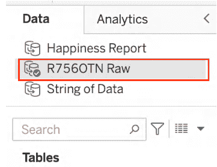

图 2.9: 选择原始文件

- 2. 将 **诊断** 拖到 **行** 书架并选择 **添加所有成员**。单击 **AZ** 图标以对 **诊断** 列进行排序。请注意某些行中出现的垃圾数据：

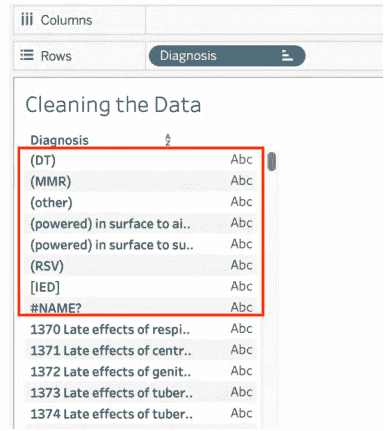

图 2.10: 将诊断添加到行

- 3. 创建一个名为 **DX** 的计算字段，使用以下代码：

```
SPLIT( [Diagnosis], "", 1 )
```

- 4. 创建一个名为 **空值查找** 的计算字段，使用以下代码：

```
INT(MID([DX], 2, 1))
```

- 5. 在 **数据** 窗格中，将 **空值查找** 从 **度量值** 拖到 **维度**。

- 6. 将 **诊断**、**DX** 和 **空值查找** 拖到 **行** 书架。当 **诊断** 字段中的第二个字符不是数字时，请注意会返回 **Null**：

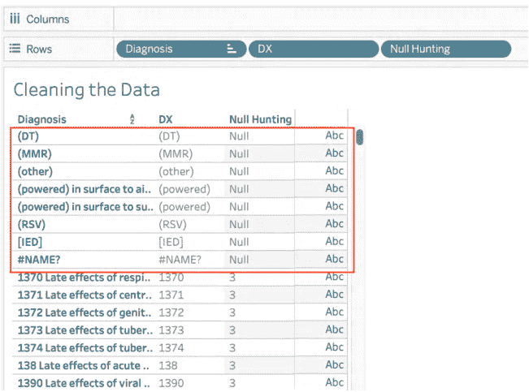

图 2.11: 在行上排序字段

- 7. 创建一个名为 **从 ICD 代码中排除** 的计算字段，包含以下代码：

```
ISNULL([Null Hunting])
```

- 8. 像在第 1 章中演示的那样，清除工作表中的所有字段，并将 **标记** 卡设置为 **形状**。

- 9. 将 **从 ICD 代码中排除** 放置到 **行**、**颜色** 和 **形状** 书架上，然后将 **DX** 放置到 **行** 书架上。请注意标记为 **True** 的行：

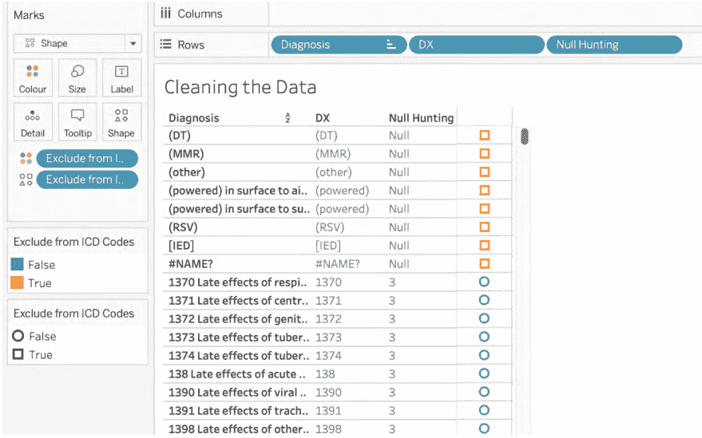

图 2.12: 排除垃圾数据

- 10. 为了排除垃圾数据（即 **从 ICD 代码中排除** 等于 **True** 的那些行），请将 **从 ICD 代码中排除** 放置到 **筛选器** 书架上并取消选择 **True**。

- 11. 创建一个名为 **诊断文本** 的计算字段，包含以下代码：

```
REPLACE([Diagnosis],[DX] + "","")
```

- 12. 将 **诊断文本** 放置到 **DX** 之后的 **行** 书架上。此外，从 **行** 书架和 **标记** 卡中移除 **从 ICD 代码中排除**，并将标记类型设置为 **自动**：

| DX | Diagnosis Text |
|---|---|
| 138 | 急性脊髓灰质炎后遗症 |
| 326 | 颅内脓肿或化脓性感染后遗症 |
| 412 | 陈旧性心肌梗死 |
| 650 | 正常分娩 |
| 677 | 妊娠、分娩和产褥期并发症的后遗症 |
| 1370 | 呼吸系统或未指明结核病后遗症 |
| 1371 | 中枢神经系统结核病后遗症 |
| 1372 | 生殖泌尿系统结核病后遗症 |
| 1373 | 骨和关节结核病后遗症 |
| 1374 | 其他特定器官结核病后遗症 |
| 1390 | 病毒性脑炎后遗症 |
| 1391 | 沙眼后遗症 |
| 1398 | 其他和未指明的传染病和寄生虫病后遗症 |

图 2.13: 观察清理后的数据

现在我们已经完成了练习，让我们花点时间来考虑一下我们使用的代码。

SPLIT 函数是在 Tableau 9.0 中引入的：

```
SPLIT([Diagnosis], "", 1 )
```

如 Tableau 有关该函数的帮助文档中所述，该函数的作用如下：

> 根据分隔符从字符串的开头或结尾提取字符，从字符串中返回子字符串。

该函数还可以在 **数据源** 选项卡中直接调用，方法是单击列标题并选择 **拆分**。要从字符串的末尾提取字符，标记号（即函数末尾的数字）必须为负数。

请考虑以下代码，我们使用它来创建 **空值查找** 字段：

```
INT(MID([DX],2,1))
```

MID 的用法非常简单，与 Excel 中的相应函数大致相同。但是，在此处使用 INT 可能会让人困惑。使用 INT 函数对字母字符进行强制转换会导致 Tableau 返回 Null。这令人满意地实现了我们的目的，因为我们只需要通过查找空值来发现那些不是以整数开头的行。

ISNULL 函数是一个布尔函数，在值为 Null 时仅返回 TRUE：

```
ISNULL([Null Hunting])
```


在创建 **诊断文本** 字段时使用了 REPLACE 函数：

```
REPLACE([Diagnosis],[DX] + "","")
```

此计算字段使用 DX 中隔离的 ICD-9 代码，从 **诊断** 字段中删除相同的代码，从而提供一个相当干净的描述。请注意术语 *相当干净*。已删除的行最初与较长的描述相关联，因此包含回车符。由此产生的额外行正是我们在此练习中删除的行。因此，在此解决方案中，使用 REPLACE 计算对较长的描述进行截断。

此练习的最终输出可以是将 Tableau 中的数据导出为额外的数据源。随后，这些数据可用于 Tableau 和其他工具以满足未来的报告需求。例如，**DX** 字段在数据混合中可能很有用。

Tableau 是否提供了更好的方法来解决前一种方案中与截断数据相关的问题？有！让我们将注意力转向下一个练习，我们将在其中考虑正则表达式函数。

## 提取数据

虽然如上一个练习所示 *清理数据*，SPLIT 函数可用于清理数据，但正则表达式函数功能更强大，代表了 Tableau 传统专注于可视化和分析的范围扩展到包含数据清理功能。让我们看一个示例，该示例要求我们在 Tableau 中处理一些相当混乱的数据。我们的目标是提取电话号码。

以下是步骤：

- 1. 如果您尚未下载，请从 https://github.com/PacktPublishing/Mastering-Tableau-2026/tree/main/Chapter92 下载 **第 2 章** 工作簿并在 Tableau 中打开它。
- 2. 选择 **提取数据** 选项卡。
- 3. 在 **数据** 窗格中，选择 **字符串数据** 数据源，并将 **字符串数据** 字段拖动到 **行** 卡上。观察与提取电话号码相关的挑战：

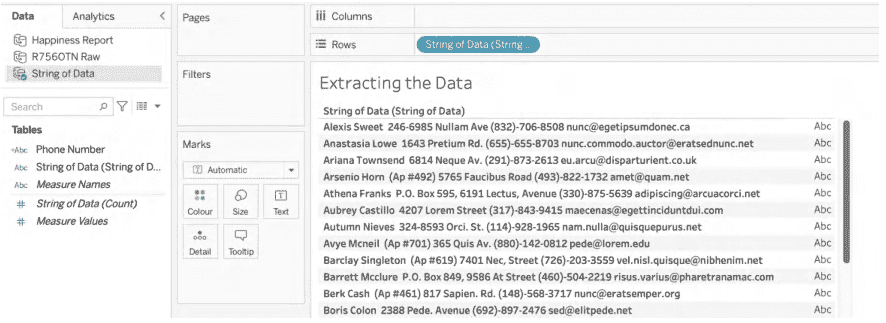

- 4. 单击 **查看数据** 按钮并复制几行来访问底层数据：

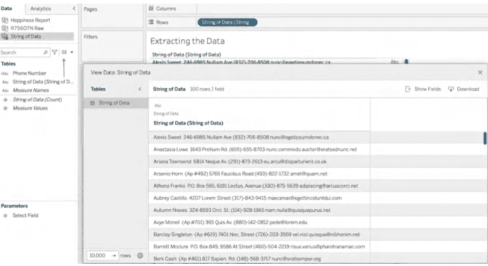

图 2.15：访问底层数据

- 5. 导航到 http://regexpal.com/ 并将数据粘贴到标记为 **测试字符串** 的窗格中；即第二个窗格：

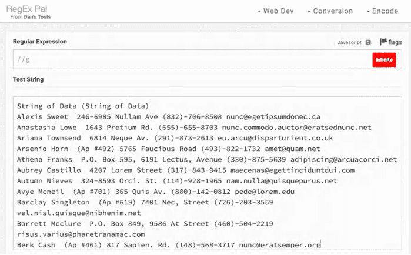

图 2.16：RegEx Pal

- 6. 在第一个窗格（标记为 **正则表达式** 的窗格）中，键入以下内容：

```
([0-9]{3}) - [0-9]{3} - [0-9]{4}
```

- 7. 返回 Tableau 并使用以下代码块创建名为 **电话号码** 的计算字段。请注意计算字段中嵌套的正则表达式：

```
REGEXP_EXTRACT([String of Data (String of Data)], '(\\(([0-9]{3})\\)-[0-9]{3}-[0-9]{4}) ')
```

- 8. 将 **电话号码** 放置在 **行** 卡上，并观察结果：

| 字符串数据 (字符串数据) | 电话号码 | |
|---|---|---|
| Alexis Sweat 246-6985 Nullam Ave (832)-706-8508 nunc@etegitpsumdonec.ca | (832)-706-8508 | Abc |
| Anastasia Lowe 1643 Pretium Rd. (655)-655-8703 nunc.commodo.auctor@eratasednunc.net | (655)-655-8703 | Abc |
| Ariana Townsend 6814 Neque Av. (291)-873-2613 eu.arcu@disparturient.co.uk | (291)-873-2613 | Abc |
| Arsenio Horn (Ap #492) 5765 Faucibus Road (493)-822-1732 amet@quam.net | (493)-822-1732 | Abc |
| Athena Franks P.O. Box 595, 6191 Lectus, Avenue (330)-875-5639 adipiscing@arcuacorci.net | (330)-875-5639 | Abc |
| Aubrey Castillo 4207 Lorem Street (317)-843-9415 maecenas@egestinciduntdui.com | (317)-843-9415 | Abc |
| Autumn Nieves 324-8593 Orci. St. (114)-928-1965 nam.nulla@quisquepurus.net | (114)-928-1965 | Abc |
| Ayve Mcneill (Ap #701) 365 Quis Av. (880)-142-0812 pede@lorem.edu | (880)-142-0812 | Abc |
| Barclay Singleton (Ap #619) 7401 Nec, Street (726)-203-3559 vel.nisl.quisque@nibhenim.net | (726)-203-3559 | Abc |
| Barrett Mcclure P.O. Box 849, 9586 At Street (460)-504-2219 risus.varius@pharetraanamac.com | (460)-504-2219 | Abc |
| Berk Cash (Ap #461) 817 Sapien. Rd. (148)-568-3717 nunc@eratemper.org | (148)-568-3717 | Abc |
| Boris Colon 2386 Pede. Avenue (692)-897-2476 sed@elitpede.net | (692)-897-2476 | Abc |
| Brady Armstrong 651-255 Dui Rd. (766)-679-1355 eget.metus@egetmetus.co.uk | (766)-679-1355 | Abc |
| Brenden Murray 816-1192 Fringilla Rd. (738)-548-7286 neque.non.quam@purus.org | (738)-548-7286 | Abc |
| Breanna York 2456 Nullam Road (713)-794-9922 risus.donec@ametfaucibus.net | (713)-794-9922 | Abc |
| Catherine Hess (Ap #134) 8538 Fringilla, St. (541)-955-2468 a.dui.cras@lectusantedictum.ca | (541)-955-2468 | Abc |
| Chancellor Sellers 522-3985 Vehicula Rd. (175)-854-2222 nec.cursus@orciutsagittis.net | (175)-854-2222 | Abc |
| Charissa Ochoa 960-8336 Dignissim Av. (410)-709-3045 augue@sit.org | (410)-709-3045 | Abc |
| Chastity Spencer 873-2646 Praesent St. (806)-616-0063 eget.nisi@ac.ca | (806)-616-0063 | Abc |
| Ciara Rios 529-8517 Tellus St. (374)-422-2206 aliquet.magna@egestasnuncsed.org | (374)-422-2206 | Abc |

图 2.17：提取数据最终视图

现在，让我们更详细地考虑前一个练习中的一些具体内容。

考虑以下代码块：

```
REGEXP_EXTRACT([String of Data], '()')
```

此处故意排除了表达式模式，因为将在稍后详细介绍。' ( ' ) 代码充当表达式模式的占位符。本示例中使用的 REGEXP_EXTRACT 函数在 Tableau 帮助文档中的描述如下：

Returns a substring of the given string that matches the capturing group within the regular expression pattern.

使用此函数时，请牢记以下几点重要注意事项：

- 请注意，截至撰写本文时，Tableau 文档未说明如何确保函数的模式输入部分正确分隔。对于本示例，请务必在模式输入部分周围包含 ' ( ' )，以避免输出为 null。
- 在本身嵌套在 VizQL 查询中的计算字段内嵌套可能会影响性能（如果嵌套/聚合层级过多）。
- 有许多正则表达式网站允许您输入自己的代码，并根据您提供的示例数据即时反馈来帮助您。http://regexpal.com/ 只是其中一个网站，请按需搜索以找到满足您需求的网站！

现在，请考虑以下表达式：

```
\(([0-9]{3}))[0-9]{3}-[0-9]{4}
```

在此上下文中，\ 表示下一个字符不应被视为特殊字符，而应被视为普通字符。在我们的示例中，我们实际上是在查找左括号。[0-9] 实例仅声明我们正在查找一位或多位数字。或者，请考虑使用 \d 以实现相同的结果。{3} 实例表示我们正在查找三个连续数字。

与模式开头的左括号一样，\ 字符将右括号指定为普通字符。– 字符是专门查找连字符的普通字符。表达式模式的其余部分应根据前面的信息可以解读。

回顾本练习后，您可能好奇如何仅返回电子邮件地址。根据 http://www.regular-expressions.info/email.html，符合 RFC 5322 标准的电子邮件地址的正则表达式如下：

```
(?:[a-z0-9!#$%&'*+/=?^_`{|}~-]+(?:\.[a-z0-9!#$%&'*+/=?^_`{|}~-]+)*|"(?:[\x01-\x08\x0b\x0c\x0e-\x1f\x21\x23-\x5b\x5d-\x7f]|\\[\x01-\x09\x0b\x0c\x0e-\x7f])*")@(?:(?:[a-z0-9](?:[a-z0-9-]*[a-z0-9])?\.)+[a-z0-9](?:[a-z0-9-]*[a-z0-9])?|\[(?:(?:(2(5[0-5]|[0-4][0-9])|1[0-9][0-9]|[1-9]?[0-9]))\.){3}(?:(2(5[0-5]|[0-4][0-9])|1[0-9][0-9]|[1-9]?[0-9])|[a-z0-9-]*[a-z0-9]:(?:[\x01-\x08\x0b\x0c\x0e-\x1f\x21-\x5a\x53-\x7f]|\\[\x01-\x09\x0b\x0c\x0e-\x7f])+)\])
```


> **注意**
>
> 电子邮件并不总是符合 RFC 5322 标准，因此可能需要额外工作才能真正清理电子邮件地址数据。

虽然我不会尝试详细解释这段代码，但你可以在 http://www.regular-expressions.info/email.html 上阅读所有相关内容，这是了解正则表达式更多知识的绝佳资源。另外，YouTube 上有几个有用的正则表达式教程。

本练习的最终输出可能应用于增强现有源数据。**数据转储**，例如本示例，不属于数据仓库；然而，即使是重要且必要的数据也可能隐藏在这样的转储中，Tableau 可以有效地用于提取它们。

## 摘要

我们在本章开头讨论了 Tableau 数据处理引擎。这说明了 Tableau 在处理数据时提供的灵活性。了解数据处理引擎非常重要，以确保您的数据挖掘工作得到智能聚焦。否则，您的努力可能会浪费在与 Tableau 无关的活动上。

接下来，我们重点介绍了数据准备。我们考虑使用 Tableau 进行调查，也用于清理数据。正则表达式函数所代表的数据清理功能尤其引人入胜，值得进一步调查。

在完成我们首次以数据为中心的讨论后，我们将继续学习 *第 3 章，Tableau Prep Builder*，探讨 Tableau 市场上引入的较新功能之一。Tableau Prep Builder 是一个专用的数据预处理界面，能够进一步减少您在预处理上所需的时间。我们将了解 Tableau Prep Builder 提供的清理、合并、筛选、连接和其他功能。

## 加入我们在 Discord 上的社区

加入我们社区的 Discord 空间，与作者和其他读者讨论：

https://discord.gg/VXpz9YPUtW


## 3
