# 使用 Tableau Prep Builder

Tableau Prep Builder 随 Tableau Desktop 2018.1 版本推出，但我们可以将 Tableau Prep Builder（以下在本章中简称为 Prep）用于什么呢？该工具的核心目的是数据准备。好消息是，Prep 与 Tableau Desktop 以及 Tableau Server 完全兼容。这意味着您可以在 Prep 中执行作业，只需单击一下按钮即可清理数据。此外，Prep 与其“老大哥” Tableau Desktop 一样具有可视化特性，这意味着您可以以完全可视化的格式查看数据准备的每一步。

因此，让我们深入了解图形用户界面（GUI），并惊叹于另一款高端产品，它将使您能够获得初步的数据洞察，从而更快地决定您的数据集是否值得分析。Prep 将为更顺畅的 Tableau Desktop 体验铺平道路。

在本章中，将讨论以下主题：

- 连接到数据
- Prep GUI
- 数据质量
- Prep 的其他选项
- 导出数据

为了开始使用，我们需要加载数据。如何在 Prep 中执行此操作将在以下部分中介绍。

> **注意**
> **您的购买包含免费 PDF 副本 + 独家额外内容**
> 您的购买包含本书的 DRM-free PDF 副本、Packt+ 库的 7 天试用（无需信用卡）以及其他独家额外内容。请参阅前言中的“随书免费权益”部分，即可立即解锁并最大化学习效果。

## 连接到数据

如果您熟悉 Tableau Desktop，那么 Prep 对您来说将是小菜一碟。操作和界面非常相似，如果 Prep 中有可用的连接器，那么连接数据（无论是文本文件、数据库还是提取文件）的工作方式都相同。乍一看，您可能甚至察觉不出 Prep 与 Tableau Desktop GUI 之间的差异，这提供了一个方便的优势，即您可以立即开始数据准备。

要开始使用，请先打开 Prep 并单击 + 打开文件。将出现以下屏幕：

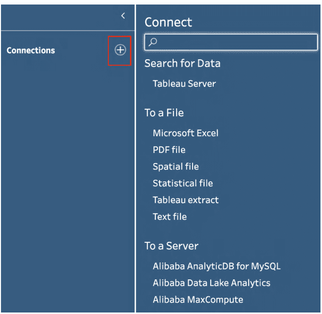

图 3.1：连接到数据

从前面的截图中，我们可以看到，您可以在搜索栏中选择要连接的数据类型。与 Tableau 一样，Prep 的库中包含多种数据库。

现在，让我们通过一个实践练习来连接数据集。本练习需要以下数据集：
https://www.kaggle.com/airbnb/boston。请下载 calendar.csv、listings.csv 和 reviews.csv。
或者，您可以从 Tableau Public 上与本章关联的存储库下载它们：https://github.com/PacktPublishing/Mastering-Tableau-2026/tree/main/Chapter03。

首先，我们将从 calendar.csv 文件开始。通过与文本文件建立连接，然后选择 .csv 文件，将其添加到空白 Prep 画布中。您现在将看到以下屏幕：

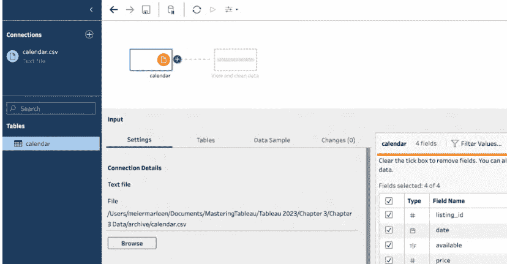

图 3.2：输入数据

恭喜——您刚刚建立了第一个 Prep 连接。在此，您可以根据需要操作和可视化已连接的数据集！

在以下部分中，我将更详细地介绍 GUI。

## Prep GUI

用户体验是一个重要的话题，不仅在构建仪表板时如此，在使用 Tableau 的其他方面时也是如此。Tableau 最大的卖点之一，一向是 GUI 易于使用，这也是客户喜爱 Tableau 的原因之一。

Prep GUI 有两个需要查看的重要画布。将数据连接到 Prep 后，工作区会立即分割为几个部分：

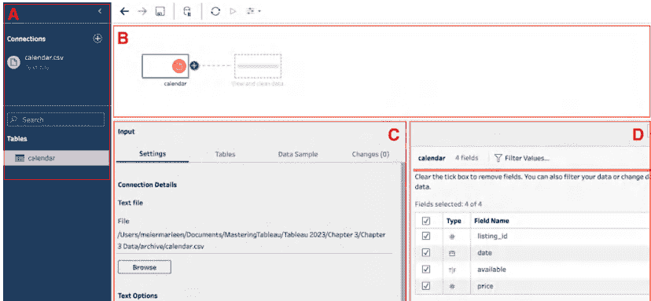

图 3.3：Prep 工作区部分

让我们看看从前面的截图中可以看到什么：

- A：连接窗格，显示所选位置可用的输入文件。
- B：流程窗格，显示您当前的 Prep 流程。这始终以输入步骤开始。
- C：输入窗格设置，为您提供多个选项来配置输入。
- D：输入窗格示例，显示您移动到连接窗格的字段，包括示例值。

在输入窗格 (C) 中，您可以使用通配符合并（多个文件）功能添加同一目录中的多个文件。另外，您可以限制 Prep 将打印的样本集，以提高性能。在输入窗格示例 (D) 中，您可以选择和取消选择要导入的字段，并更改其数据类型。数据类型选项示例为字符串、日期或数字。

第二个 GUI 是概况窗格。选择所需的输入数据后，在流程窗格中单击 + 并选择 Add: Clean Step。现在概况窗格将随数据网格一起出现：


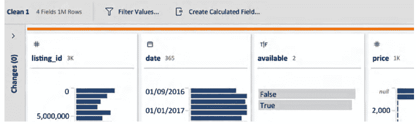

图 3.4：清理数据

在前面的截图中，概况窗格以两个部分显示数据源中的每个列。上半部分显示聚合。例如，第 2 列 date 按日期显示每个日期的行数，以小直方图的形式呈现。可以通过单击列名旁边的排序图标（当鼠标悬停在列上时出现的小型条形图）并选择一项来对所有列进行排序。以 available（第 3 列）中的 True 为例。所有相关功能将被高亮显示：

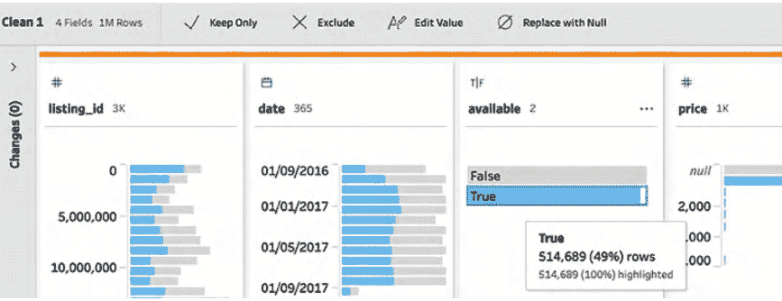

图 3.5：可视化筛选

这让您在开始清理数据之前，就有机会了解数据的一些情况。在下面的截图中，概况窗格下半部分会按数据源中的形式显示每一行：

| listing... | 日期 | 可用 | 价格 |
|---|---|---|---|
| 4583526 | 16/02/2017 | True | 195 |
| 4583526 | 15/02/2017 | True | 195 |
| 4583526 | 14/02/2017 | True | 195 |
| 4583526 | 13/02/2017 | True | 195 |
| 4583526 | 12/02/2017 | True | 195 |
| 4583526 | 11/02/2017 | True | 195 |
| 4583526 | 10/02/2017 | True | 195 |

图 3.6：数据概览

迄今为止，我们看到，在 Prep 中加载数据后，可以通过单击某个列中的字段或条形来应用可视化筛选器。下半部分窗格始终会显示行级别选择的数据源。接下来，我们将继续添加更多数据源。

让我们从一个实践示例开始：

- 在 calendar.csv 文件旁边，连接以下文件：
  - listings.csv
  - reviews.csv
- 现在，将它们拖动到流程窗格中：


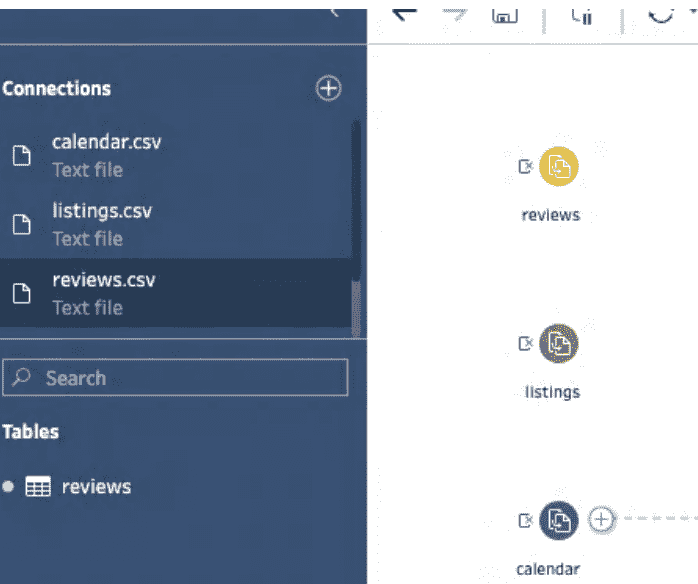

图 3.7: 多个表输入

你能回答以下问题吗？

- 有多少个房源在描述中使用了单词 "beach"？
- 标记为 "exact location" 的公寓占比是多少？
- 哪一天录入的评论最多？

没有像 Prep 这样的工具，找到这类问题的解决方案要困难得多。Prep 使我们的数据分析之旅更快速、更轻松，这正是我鼓励你花额外时间学习 Prep 以及 Tableau Desktop 的原因！

> **注意**
> 
> 解决方案可以在与本章相关的工作簿中找到，链接如下：https://github.com/PacktPublishing/Mastering-Tableau-2026/tree/main/Chapter03。

在这里，举个例子，我对日期使用了排序功能，以便回答第三个问题：哪一天录入的评论最多？


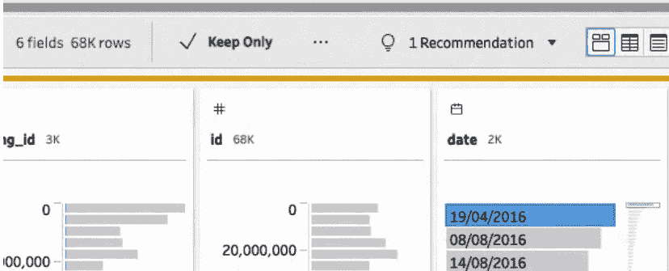

图 3.8: 按日期排序

正如你所见，对该字段进行排序后，日期会按条目数量排序，从而非常容易回答这个问题：哪一天录入的评论最多？点击几次后，它就开始变得很自然，不是吗？

你对数据集所做的所有更改都可以在概要窗格左侧追溯。但不要忘记为每个步骤添加一个适当的名称：这样会让其他人和你自己更容易理解你的过程。

那么，让我们继续了解 Prep 的数据质量功能。

## 数据质量

Prep 自带许多不同的功能。有时，你可能会使用许多不同的工具来准备数据集，以使其达到你想要的形状。其他时候，你可能只需运行一个聚合（一个功能）就完成了。这真的取决于数据集本身和预期输出。事实是，你的 Prep 输出数据越接近 Tableau Desktop 可视化所需的数据，VizQL 在 Tableau Desktop 上运行就越高效。Tableau Desktop 中的查询越少，仪表板生成就越快。

对我来说，Prep 最好的地方在于它可以处理大量数据。有时，我甚至会用它处理我不想在 Tableau Desktop 中可视化的数据集，只是为了快速概览，例如，有多少行包含特定单词，需要多少列，如果我过滤特定值，日期范围会发生什么变化，等等！几分钟之内，我就能获得原本需要通过数据库查询或 Excel 函数花费更长时间才能获得的洞察。我希望在本章结束时，你能将数据准备所花的时间减少一半（至少）。我们将把准备功能分为五个子类别：清理、合并和连接、聚合、旋转和脚本。让我们从清理数据开始！

## 清理数据

我们在 Prep GUI 部分之前见过以下画布。要创建清理步骤，用户只需单击输入旁边的 + 并选择 Add: Clean Step。在清理步骤中，可以执行多个操作，例如过滤或创建计算字段。还要注意 Prep 给你的建议：

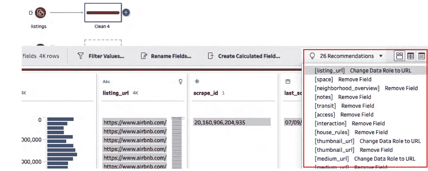

图 3.9: 建议

Prep 分析列内容并提出可能适合数据的更改。例如，列 listing_url 被识别为网页，因此 Prep 建议将其更改为数据角色 URL。listing_url 之后的第二、第三及多个建议是删除某些列。这可能是因为该列不包含任何数据或仅包含少量数据。列表还在继续。

此功能非常有用，尤其是对于不熟悉的数据集。我的工作方式是查看建议，检查它们是否合理，然后执行更改——或者不执行。不要盲目信任这些建议，但它们可以指出你可能会错过的数据缺陷。

数据通常很混乱，涉及空值、手动输入的拼写错误、不同的格式、另一个系统的更改等等。因此，你必须先理清混乱，然后才能从分析或仪表板中获得可靠的结果。我们将查看如何在列级别清理数据。

一旦在清理步骤中选择了一个值，你就有 Keep Only、Exclude、Edit Value 或 Replace with Null 选项：


图 3.10: 快速访问

这些更改都不会更改数据源本身。Prep 就像一个中间步骤，或者是原始数据源和你的 Tableau Desktop 之间的过滤器。此表将带你了解图 3.10 中显示的选项：

| 选项 | 它的作用 | 示例 |
|---|---|---|
| 仅保留（Keep Only） | 筛选数据以仅显示包含所选值的行。所有其他行均隐藏。 | 在"国家/地区"列中选择"德国"并选择仅保留；你现在只能看到德国客户。 |
| 排除（Exclude） | 筛选数据以删除包含所选值的所有行。 | 选择"德国"并选择排除；你看到除"德国"以外的所有国家/地区。 |
| 编辑值（Edit Value） | 将所选值更改为其他值（一种重命名或更正形式）。 | 选择"Germny"（拼写错误）并选择编辑值；你输入"德国"，所有实例均会更新。 |
| 替换为 Null（Replace with Null） | 将所选值替换为 null（缺失值）。 | 选择"未知"并选择替换为 Null；所有"未知"条目都变为空/null。 |

表 3.1: 处理数据的选项

使用图 3.10 中所示的选项排除一个值，只会将其从 Prep 中删除。但是，如果以后将其用作 Tableau Desktop 的输入，就没有办法将该特定值添加回来。此选项将仅保留在 Prep 中。

另一个稍微隐藏的选项是单击列标题旁边的省略号 (...)（如图 3.11 所示）并选择 Clean：


图 3.11: 更多选项

此 Clean 功能基于列的数据类型运行。在上述截图中，数据类型为字符串（由 Abc 图标指示）。对于其他数据类型，该选项将置灰，因为 Clean 仅适用于字符串。该选项允许你使用另外八个清理功能：

- 转为大写
- 转为小写
- 删除字母
- 删除数字
- 删除标点符号
- 修剪空格
- 删除多余空格
- 删除所有空格

可以在每个列标题上方更改数据类型；你会在列名称上方找到一个符号，可以单击它进行更改，就像在 Tableau Desktop 中一样：

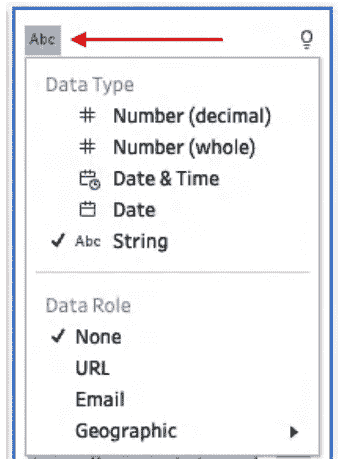

图 3.12: 更改数据类型

在 Prep 错误解释某列数据类型时，这非常有用。错误分配的数据类型可能会影响你对其执行的计算以及 Tableau Desktop 如何可视化该列。

在即将到来的部分中，我们将练习合并多个数据集。例如，你可能想要将订单数据与发货数据合并（使用连接），或者将 2020 年销售数据追加到 2019 年销售数据集中（使用合并）。要了解如何操作，请继续阅读！

## 合并和连接

我们现在将连接三个数据集，以便可以一起分析和可视化它们。三个数据集（listings.csv、reviews.csv 和 calendar.csv）的性质需要连接而不是合并。但是，我仍然会向你演示合并的步骤，以便你知道何时需要它！

## 添加合并

Tableau 中的合并是将数据追加到现有数据集。想象你有两个 Excel 文件。两者的标题完全相同，但一个包含 2019 年的数据，另一个包含 2020 年的数据。如果将 2020 年数据合并到 2019 年数据中，你将 2020 文件的行追加到 2019 文件的行下方。要执行合并，两个数据集需要几乎相同的布局/标题。为什么是"几乎"？你将在以下练习中看到：

- 1. 开始此练习之前，你的 Prep 流程窗格应如下所示：


图 3.13: 流程窗格

- 2. 通过单击 listings 数据集旁边的 + 添加一个清理步骤。你可以根据偏好右键单击步骤并选择 Edit Color 来更改每个步骤的颜色。

- 3. 选择列 host_identity_verified 并过滤 True：


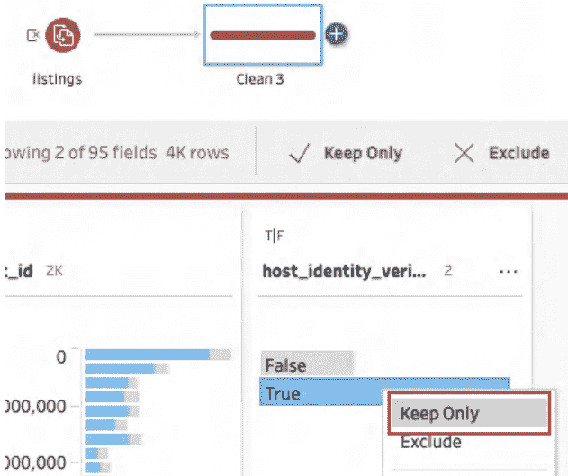

图 3.14: 筛选 True

- 4. 现在，创建一个名为 DatasetA_ID 的计算字段，仅包含字符串 ' A '：

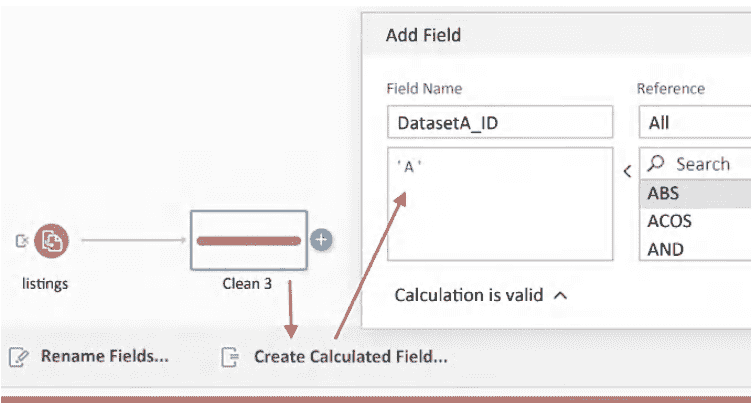

图 3.15: 创建计算字段

- 5. 使用相同的 listings 数据创建第二个清理步骤，这次在 **host_identity_verified** 列上筛选 **False**：

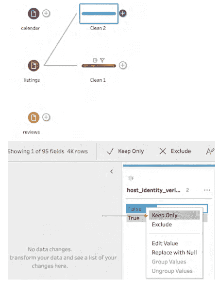

图 3.16: 筛选 False

- 6. 创建一个名为 DatasetB_ID 的计算字段，仅包含字符串 'B'，使用与图 3.15 所示相同的流程。通过右键单击并点击 **重命名** 来重命名步骤，有助于跟踪应用的更改。您的流应如下所示：

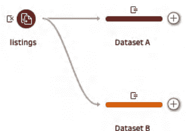

图 3.17: 可视化流

- 7. 您现在已创建两个可使用合并（union）进行组合的数据集，且不会更改原始数据。通过单击 **数据集 A** 旁边的 + 并选择 **合并**，或将一个步骤拖到另一个步骤上（**数据集 B 置于数据集 A 之上** 或反之），来合并这两个数据集：

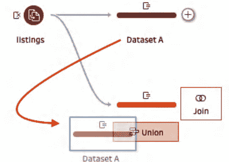

图 3.18: 合并

- 8. 单击 **合并 1** 并查看屏幕左下角的输入详细信息，以检查所有字段是否匹配：

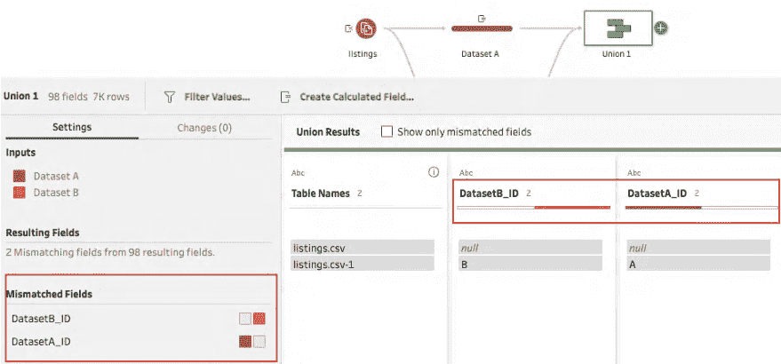

图 3.19: 可视化检查

- 9. 在前面的截图中，您可以看到左侧有关合并的信息。从上到下：**输入** 及其各自的颜色（这些与流窗格中的相同）、**结果字段**，显示 2 个不匹配字段，最后是 **不匹配字段** 本身：**DatasetA_ID** 和 **DatasetB_ID**。每个不匹配字段旁边的颜色显示，我们的 **DatasetB_ID** 字段不存在于 **DatasetA** 中，而 **DatasetA_ID** 字段不存在于 **DatasetB** 中。

- 10. 在这种情况下，我们知道尽管命名约定不同，这些列仍可追加。两个字段更好的名称本可以是 **数据集_ID**（您可以回退几步尝试一下）。届时 Prep 不会显示任何不匹配。但就我们在此处而言，可以直接将一个字段拖放到另一个字段上以合并它们，从而授予 Prep 将其视为一个列的权限：

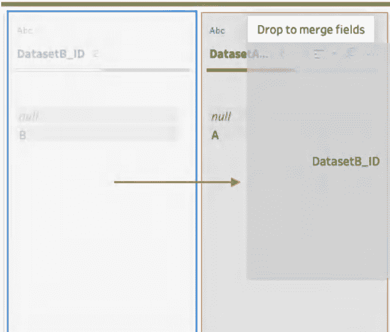

图 3.20: 合并字段

- 11. 观察 **结果字段** 现在显示 0 个不匹配，以及两个数据集的颜色现在如何在列标题下方的条中表示：

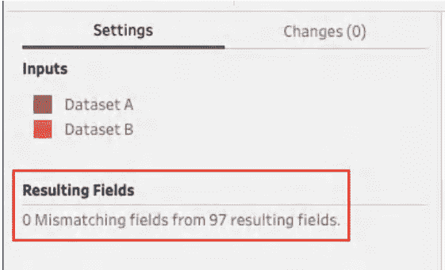

图 3.21: 颜色编码

- 12. 通过选择并右键单击合并步骤，将其从 **合并 1** 重命名为 **listings2**，如果需要，还可以选择并右键单击合并步骤并点击 **添加描述** 来添加描述——您现在所做的所有额外努力，日后在复制、文档编写和说明方面都将派上用场。

恭喜；您的第一个合并已成功。我们首先将原始 listings 数据集拆分为两个，然后再将它们合并为一个。像我们在这里所做的那样，将布局相同的数据相互堆叠，是合并的典型任务。

## 通配符合并

与上一节中将一个数据输入拖放到另一个数据输入上不同，您还可以告知 Prep 从预定义目录中合并哪些文件。通常，部门有一个共享位置，用于存储例如名为 Jan2023Revenue、Feb2023Revenue、Mar2023Revenue 等的 Excel 文件。如果您遇到此类场景，可以执行以下操作：

- 1. 将 Prep 连接到您想要使用的任一文件。

- 2. 单击输入数据图标并选择 **表** 选项卡。您现在可以看到，可以根据特定条件创建合并。

- 3. 我将选择同一目录中所有以星号（*）开头并以 **2023Revenue.xlsx** 结尾的匹配文件名，如您所见，一月、二月和三月都将包含在内，您还可以使用 **文件** 和 **工作表** 筛选器过滤输入，完成后单击 **应用**。

这就是通配符合并功能。它非常强大！试试看吧。

## 添加连接

现在，我们将继续在同一流窗格中工作并专注于连接。快速回顾一下，连接是水平追加数据。经验法则是，合并增加行数，而连接更改列数：

- 1. 将 **listings2** 拖放到 **reviews** 上，直到出现 **连接** 选项。


图 3.22: 连接

- 2. 为连接选择 reviews 中的 listing_id 和 listings2 中的 id。请注意，可以通过单击 **连接类型** 下的文氏图来更改连接类型：

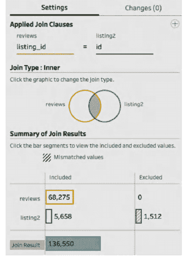

图 3.23: 连接的可视化检查

- 3. 前面的概述告诉我们，reviews 数据集的所有 68,275 行都匹配到了 listings2 数据集中的一行。但是，我们确实有来自 listings2 数据集的 756 个不匹配。因此，我们的连接结果总计为 68,275 行。但可能并非所有 listings 都有评论，因此我们可以安全地假设连接按预期工作。

- 4. 另一种检查方法是将连接更改为全外连接，并在以后在 Tableau Desktop 中深入研究数据。要实现全外连接，只需单击两个圆的外边缘：


图 3.24: 全连接

- 5. 如果您想查看即时结果，只需例如右键单击连接符号（由文氏图图标表示，如以下截图所示），即可通过在 Tableau Desktop 中选择预览来查看 Tableau Desktop 中的数据：

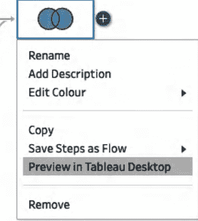

图 3.25: 预览

- 6. 我们还可以重命名步骤；让我们将连接的名称更改为 lis&rev。

到目前为止，我们已经了解了如何清理数据以及如何使用合并和连接。合并部分教会了我们如何垂直追加数据或将其堆叠在一起。连接部分允许我们水平合并数据或将其并排放置。更具体地说，我们能够将 listings 与其各自的评论合并。我们没有两个数据集，而是创建了一个数据集，使我们能够查找 listings 评论，并在同一行中查看有关 listings 本身的所有数据，例如 listings 类型、卧室数量、是否有海景，等等。

接下来，让我们继续进行聚合步骤。

## 聚合

当您想要更改数据的粒度时，会使用聚合。在我们的数据集中，每条评论对应一行。但是，我们想看看在波士顿从事 Airbnb 业务时间更长的房东是否比最近开始业务的房东有更多的评论。为此，我们需要获取每个房东开始提供 listings 的年份的汇总评论数。host_since 字段会提供有用信息，reviewer_id 字段也是如此。对于后者，我们将计算留下评论的不同评论者数量。让我们开始吧！

当前的流窗格如下所示：

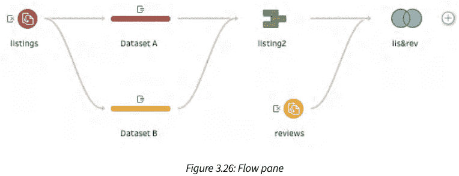

要汇总评论数量，请执行以下步骤：

- 1. 首先，单击 lis&rev 旁边的 + 号并选择 **聚合**：

- 2. 这将打开一个名为 **聚合 1** 的窗口。我们的目标是查看自房东开始提供 listings 以来每年有多少人评论了住宿；因此，请执行以下操作。

  - 1. 使用 **其他字段** 窗格中的搜索字段（如图 3.28 左侧所示），通过拖放将 host_since 字段添加到 **分组字段** 中。

  - 2. 通过拖放将 reviewer_id 添加到 **聚合字段**，同样如此。请注意，默认聚合为 SUM，如右侧箭头所示：


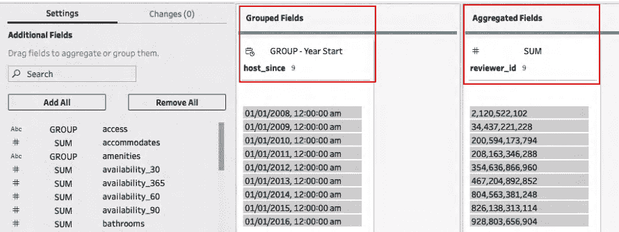

图 3.28: 聚合字段

3. 单击“聚合字段”下的 SUM，将 reviewer_id 聚合更改为 Count Distinct：

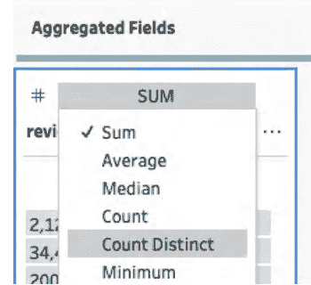

图 3.29: Count Distinct

4. 这将把默认聚合（Sum，即对每条评论进行计数）更改为 Count Distinct，即对不同的 reviewer ID 聚合进行计数。这样我们就可以关注有多少不同的评论者留下了评论。这只是一个随意的选择；请随意尝试其他聚合方式，观察数据的变化。

让我们通过右键单击流程窗格上的 Aggregate 步骤并选择“在 Tableau Desktop 中预览”来查看 Tableau Desktop 预览：

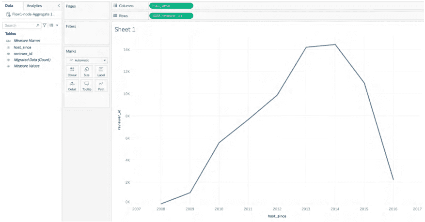

图 3.30: 房东图表

在前面的截图中，我们可以看到每个 host_since 日期的不同值计数。当然，在此特定示例中，Tableau Desktop 也可以按 host_since 日期计算评论数，如果这些是拖放到视图中的唯一字段且未借助 Prep 的帮助。但在将数据导入 Tableau Desktop 之前进行聚合的好处是，需要导入的数据更少；因此，有可能实现更好的性能。如果您想继续在 Prep 或 Tableau Desktop 中分析该数据集，现在可以提出进一步的问题，例如：

- 哪种类型的住宿按周入住而非按日入住可享受最高折扣？
- 住宿的大小与月租金之间是否存在相关性？
- 有多少房东（以百分比计）拥有超过一个房源？

## 多行计算

让我分享一个在最近版本中迅速成为我最喜欢的功能之一。从 Tableau Prep 2023.2 开始（并在 2024 版本中得到增强），您现在可以直接在 Prep 流中执行多行计算。可以将其视为将表计算（如移动平均值、与上一行的差值以及百分比差异）从 Tableau Desktop 带入数据准备层。

在 Tableau Desktop 中，表计算在查询返回后计算。这对于小型数据集来说工作良好，但对于较大的数据，您可能会注意到：

- 仪表板加载更慢，因为计算在视图中进行
- 筛选器可能会以意外的方式更改计算的行为
- 如果不创建复杂的嵌套表计算，就无法在后续计算中使用结果

通过将这些计算移至 Prep，您将获得三个绝妙的好处：

- **仪表板更快：** 繁重的工作在数据到达 Tableau Desktop 之前就已完成
- **结果可预测：** 筛选器不会更改计算的方式
- **可重复使用的输出：** 结果成为您可用于后续计算的另一个字段

让我们来看看如何使用多行计算。

在任何“清理”步骤中，选择一个字段，单击“更多选项”菜单（三个点），您将找到三个新选项：

- **差值：** 计算当前行与另一个值之间的差值
- **百分比差值：** 同上，但以百分比表示
- **移动计算：** 在灵活的行集中返回求和或平均值

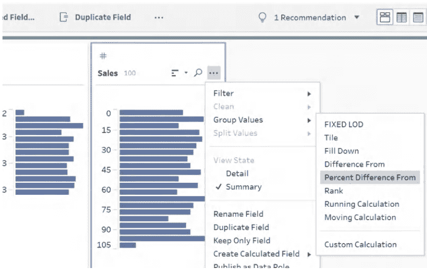

图 3.31: 多行计算

让我们通过按地区计算 3 个月销售移动平均的示例来演示。

使用已成为我们可靠伙伴的 Superstore 数据：

1. 在聚合的销售数据之后添加一个“清理”步骤（单击 + 并选择“清理步骤”）
2. 找到 Sales 字段，单击三个点，并选择“移动计算”
3. 将出现一个配置面板。魔法就在这里发生，为每个部分选择以下内容：
   - **按字段分组：** 选择 Region（这样可确保各地区的月份分别计算）
   - **排序字段：** 选择“销售年份”，然后选择“订单月份”（均升序）
   - 结果类型：将此更改为 Moving AVG（而非默认的 Moving SUM）
   - 前期值：输入 2（以包含当前月加上前两个月）
4. 为新字段指定描述性名称，例如“各地区 3 个月销售移动平均”
5. 现在，在发布此数据源后，您的仪表板使用者可以随意按月份筛选，而无需担心移动平均值重新计算不正确。它已经集成到数据中了。

> **提示：** 如果您的时间轴存在缺口（缺少月份），请考虑在应用移动计算之前使用 **新建行** 步骤来填充日期。这样可确保平均值真正具有代表性。

我们在此结束本节，回顾一个仅由 9 个数据点组成的图表，该图表是通过将近 64,000 行 reviewer_id 数据按房东开始提供房源的年份进行聚合而创建的。图表讲述了一个故事；64,000 行单独的数据讲不出故事。这就是为什么始终减少数据并在可能时进行聚合如此重要的原因。在下一节中，我们将讨论另一个重要功能：数据透视。

## 数据透视

您是否遇到过这样的情况：将字段拖放到 Tableau Desktop 的行区和列区上，但可视化结果却不符合您的预期？很可能您需要旋转数据，或者更确切地说，对其进行数据透视。如果您期望位于同一列、分布在多行中的数据，反而出现在多列中，那么就需要进行数据透视。以下示例将展示数据透视的必要性。

对于我们的数据透视示例，我们将使用另一个数据集。您可以在 https://github.com/PacktPublishing/Mastering-Tableau-2026-/blob/main/Chapter03/Excel_Pivot.xlsx 找到它。该数据集非常简单，如下所示：

| | A | B | C | D |
|---|---|---|---|---|
| 1 | 日期 | 蓝色 | 绿色 | 黄色 |
| 2 | 1 | 3 | 4 | 3 |
| 3 | 2 | 4 | 7 | 4 |
| 4 | 3 | 3 | 5 | 2 |
| 5 | 4 | 2 | 6 | 3 |
| 6 | 5 | 3 | 5 | 2 |
| 7 | | | | |

图 3.32: Excel 输入

该数据包含在五天内观察到的三种不同颜色，各出现若干次。此数据是数据透视有助于整理数据的典型示例，因为多列具有相同的用途——B、C 和 D 均为观察值。如果您要可视化此表格，它可能如下所示：

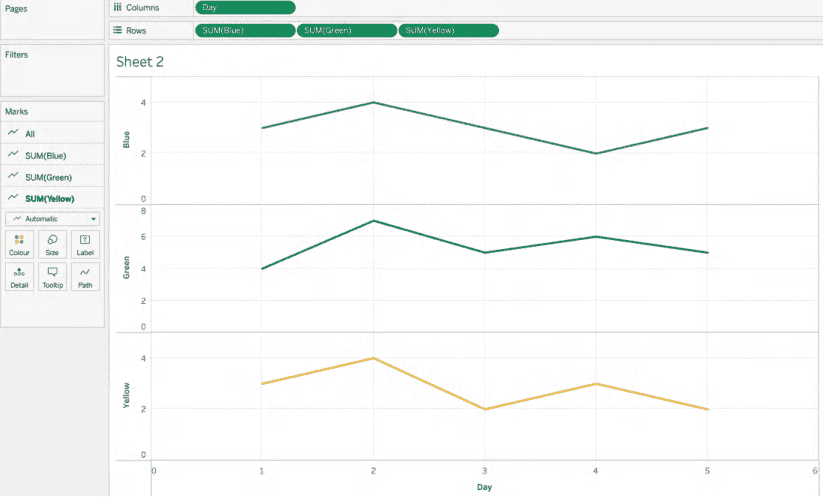

图 3.33: 数据透视 1

但您可能会问，既然配色方案已指明观察到了哪种颜色，将所有三条线放在同一张图表中（即在一个折线图中为每种颜色使用单独的线条）不是更好吗？让我们来实现这一点！

首先将 PivotDataSet 连接到 Prep，然后按照以下步骤对数据进行数据透视：

1. 从 Prep 连接到我们刚刚创建的 Excel 文件，并将 **PivotDataSet** 添加到流程窗格，单击输入数据步骤旁边的 +，并选择 **数据透视**。将出现名为 **Pivot 1** 的新步骤：


图 3.34: 添加数据透视步骤

2. 在流程窗格中单击 Pivot 1 步骤，图 3.35 将出现在 Prep 窗口底部。从步骤 I 所示的字段窗格中选择所有三种颜色，并将其拖动到已数据透视字段窗格，如步骤 II 所示：

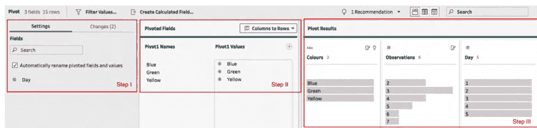

图 3.35: 数据透视步骤

3. 现在，查看前面截图中步骤 III 所示的数据透视结果窗格，通过右键单击并选择“重命名”，将 Pivot1 Names 重命名为 Colors，将 Pivot1 Values 重命名为 Observations。现在单击 Pivot 1 旁边的 +，瞧，我们现在有了一个名为 Clean 1 的干净表格：

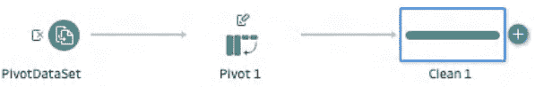

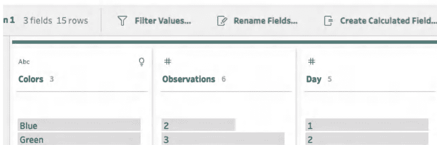

图 3.36: 数据透视结果


- 4. 还记得我们开头的问题吗？现在，我们的折线图可以以不同的方式创建，如图 3.37 所示。请注意，Colors 现在是一个维度，而 Observations 是它们自己的字段，这与之前它们位于每种颜色的列标题下不同：

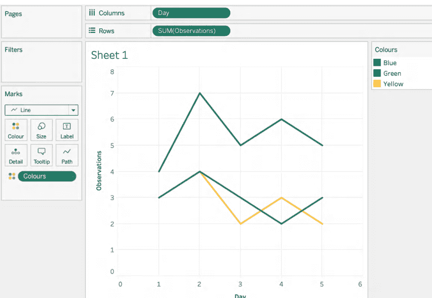

图 3.37: 轴心折线图

这是透视的一个简单用例，但此处的技术可以迁移到任何其他数据集。Prep 内置了推荐功能。每当你在列的右上角看到一个灯泡图标时，请查看一下，看看推荐是否适用于你的需求。


图 3.38: 修剪空格

在此示例中，Tableau 建议我们删除所有前导和尾随空格，这正是我们需要的！正如这里所示，查看推荐总是值得的。

完美；你已掌握 Prep 的主要功能。然而，如果你需要进一步的数据准备，可能会想知道该做什么。别担心；Prep 已为你考虑周全。脚本是 Prep 最新添加的功能，也是所有功能中最强大的；它几乎是无限的！继续阅读，探索 Prep 的脚本功能。

## Scripting

我们接下来要讨论的脚本功能是 Tableau 最近添加的功能之一。我们之所以接下来讨论它，是因为 Python 或 R 等编程语言为你提供了无限的灵活性。如果你发现自己触及了 Prep 功能的边界，可以回退到脚本，编写自己的代码来实现你想要的任何操作。

要使用它，你首先需要在 Tableau 之外连接到 Python（或 R）。以下步骤基于适用于 Python 的 https://help.tableau.com/current/prep/en-us/prep_scripts_TabPy.htm 或适用于 R 的 https://help.tableau.com/current/prep/en-us/prep_scripts_.R.htm 中的说明。

对于此练习，我们将使用 Boston Airbnb 数据集，更具体地说是 calendar 表。从 https://www.kaggle.com/airbnb/boston 下载此数据集，并在 Prep 中连接到 calendar 表。

现在，让我们退一步，将 Python 连接到 Prep：

- 1. 从 python.org 下载并安装 Python（或从 https://www.r-project.org/ 下载并安装 R）。
- 2. 在终端或命令行中执行以下命令以下载并安装 TabPy：

```
pip install tabpy
```

- 3. 或者，如果使用 R，打开 R 并执行：

```
install.packages("Rserve", , "http://rforge.net")
```

- 4. 通过在命令行/终端中输入以下命令打开 TabPy：

```
tabpy
```

或者，在 R GUI 中，输入：

```
library(Rserve)
Rserve()
```

- 5. 返回 Prep，单击 calendar 表右侧的 +，然后添加 Clean 步骤。
- 6. 添加名为 PythonTest 的计算字段（如果你选择尝试 R，请改用 RTest），字符串值为 "Test"：

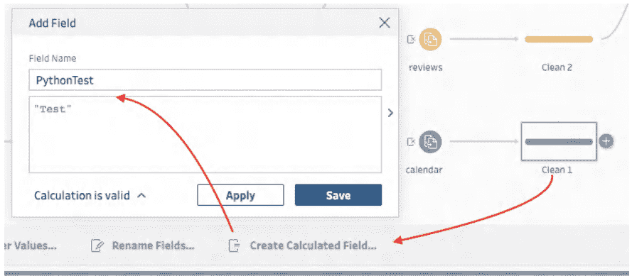

- 7. 现在，单击 Clean 1 步骤右侧的 +，然后添加 Script。
- 8. 通过选择 Script 步骤，底部的设置窗格（见图 3.39）将为你提供连接到 Rserve 或 TabPy 的选项。Rserve 是 R 的 Tableau 服务器，TabPy 是 Python 的 Tableau 服务器。
- 9. 通过选择 Rserve 或 Tableau Python (TabPy) Server 来选择你的连接类型。
- 10. 然后打开 帮助 | 设置和性能 | 管理分析扩展连接。
- 11. 在即将出现的窗口中，通过使用 localhost 和端口 9004 将 Prep 连接到 TabPy（如果使用 R，请在连接类型下选择 Rserve，并在同一个弹出窗口中使用 localhost 和端口 6311 连接到 Rserve），然后单击 登录：
如果使用加密的 Rserve 服务器，端口 4912 是默认端口。

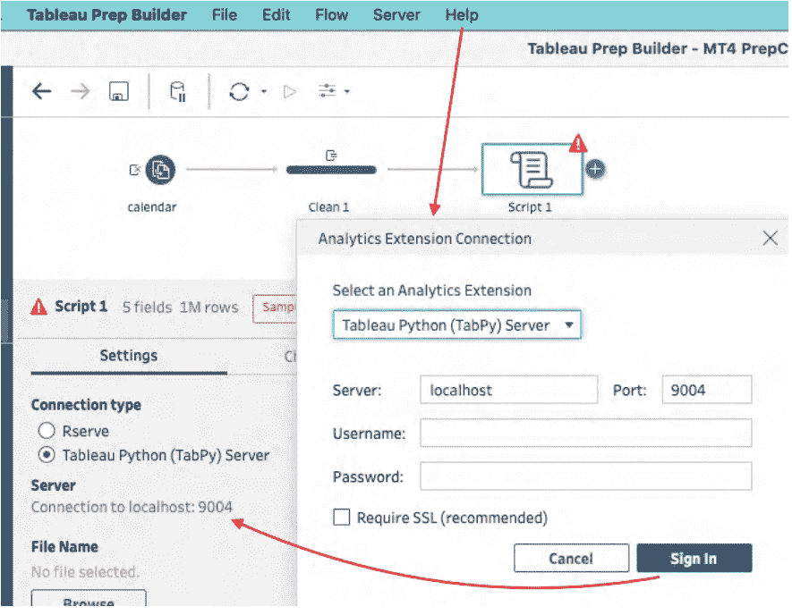

图 3.40: TabPy 服务器

- 12. 接下来，如果尝试 Python，请创建一个包含以下代码的 .py 文件，并确保缩进完全相同：

```
def ChangeString(df):
    df['PythonTest'] = 'Python'
    return df
```

图 3.41: .py 文件

或者，创建一个包含以下代码的 .R 文件：

```
ChangeString <- add_column(
    .data,
    .before = 'Test'
    .after = 'R') {
    return (data.frame ())
}
```

- 13. 我们刚刚创建的脚本旨在更改 Prep 中的现有列，并根据你选择的语言，将每一行从 Test 重命名为 Python 或 R。
- 14. 我们将继续使用 Python 脚本。返回 Prep，浏览我们刚刚创建的 .py 文件，并将函数名添加到 Prep 界面中。我将该文件命名为 PrepTableau.py，函数名为 ChangeString，如上一步所定义：

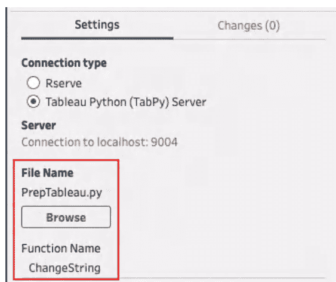

图 3.42: 添加函数

- 15. 观察 PythonTest 列已从 Test 更改为 Python：


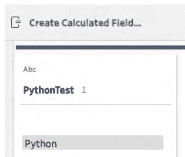

图 3.43: PythonTest

我们的小实验成功了！尽管我们使用了非常简单的示例，但它表明脚本功能是有效的，你可以尽情发挥创造力，探索使用脚本还能实现什么。示例包括从计算逆正态分布到使用情感分析或聚类进行机器学习等方方面面。

你可能已经注意到，我们在脚本本身中没有导入 pandas，但仍然使用了 pandas DataFrame。这是因为 pandas 导入随 TabPy 一起提供。打开 TabPy 后，你可以在命令行/终端中看到这一点：

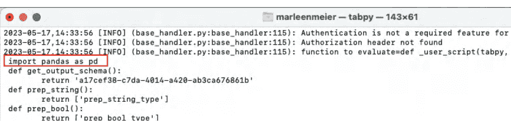

图 3.44: 命令行中的 pandas 导入

如果你想在脚本中使用其他库，可以在命令行/终端中使用 pip install 进行安装。之后只需重新启动 TabPy，你也就可以使用它们了。记住，请始终先在终端/命令行中打开 TabPy，否则 Prep 将无法执行脚本。

在撰写本文时，Prep 尚不支持将脚本作为输入——不过，你可以使用一个虚拟 .csv 文件作为权宜之计，并在其后立即在流中添加脚本。

> > **Note**
> >
> > Tableau Cloud 用户的重要说明：
> >
> > 截至 2026 年，在 Tableau Cloud 中运行带有脚本步骤的流尚不受支持。脚本步骤（Python 或 R）仅在 Tableau Prep Builder 桌面版中有效。你可以将这些流发布到 Tableau Server（如果配置正确），但 Tableau Cloud 目前不会在流中执行脚本。
> >
> > 如果你需要在云环境中使用 Python 或 R 转换，你的工作流如下：
> >
> > - 在 Prep Builder 桌面版中运行脚本
> > - 将生成的数据源发布到 Tableau Cloud
> > - 安排输入数据的定期刷新，但脚本步骤本身不会在云端运行
> >
> > 我想提及这一点，因为没有什么比构建一个带有 Python 逻辑的精美流，却发现它无法在你需要的位置运行更令人沮丧的了。请相应规划！

## Additional options with Prep

本节将讨论一些更小的独立功能，这些功能非常强大且全新。有些人可能一直在使用 Prep，从最初版本开始。随着每个版本的发布以及更多用户和反馈的提供，Tableau 能够制定出利益相关者（如你和我）真正希望看到的功能优先级列表。接下来的主题是其中一些最佳示例。这些功能在最初版本中均不存在，但它们使产品更好、更有价值、更完整。现在你可以保存流的一部分并重复使用它，将数据写回外部数据库，刷新数据集的部分内容，并使用 Tableau Data Management 附加组件安排流。让我们更仔细地看一下，并从 "insert flow" 功能开始。

### Insert flow

Prep 中的一个选项是将现有流添加到你自己的流中。例如，假设有人已经处理过 Boston Airbnb 数据集，并仅创建了高亮显示步骤的流：

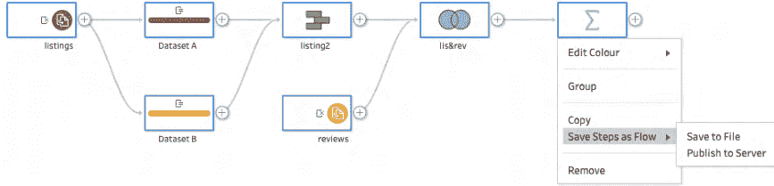

图 3.45: Save to File

你可以通过右键单击并选择 Save to File 将希望插入流中的步骤保存下来，如图 3.45 所示。这些步骤可以通过在画布上右键单击、选择 Insert Flow，并浏览之前下载的 .tfl 文件，将其重新插入你的流中：


Figure 3.46: 插入流

此功能非常适合共享工作并重用已创建的步骤。接下来，我们将探讨另一种功能，它允许您刷新 Prep 流中使用的数据：增量刷新。

## 为 Web 流启用自动保存

还记得过去每隔几分钟就疯狂按 Ctrl+S，生怕电脑会崩溃的日子吗？借助 Web 创作，那些日子大多已经一去不复返了。

在 Tableau Prep Web 创作中编辑流时，您的工作会作为草稿每隔几秒钟自动保存。起初我也不相信，但这是事实，您可以关闭浏览器，几小时后回来，您的流仍然停留在您离开的地方。

草稿仅对您可见，并在角落中带有微妙的“草稿”徽章标记。您的同事看不到您未完成的工作，因此您可以自由地进行实验，而无需担心发布不完善的内容。

一旦您对流满意，请单击 **发布**。这将创建一个永久版本。而且这里更棒的是：Tableau 保留了修订历史记录。您可以从“修订历史记录”对话框中访问以前的版本，如果您犯了错误，可以回滚。

> **注意**
> 需谨慎注意：
>
> 您的管理员可以禁用自动保存（尽管我极少见到这种情况）。如果自动保存已关闭，您将需要手动保存草稿。但老实说，在 2026 年，没有自动保存地工作感觉就像骑没有刹车的自行车：可能，但何必呢？

## 增量刷新

Prep 2020.2 引入了增量刷新功能。在完成流并添加输出后，您可以决定是要执行完全刷新还是增量刷新，以及要使用哪个字段作为指标。假设您有一个特定疾病每日感染数据的数据集。每天结束时，您希望将来自卫生部数据库的新数据添加到您的数据集中。那么，您打算怎么做呢？

通常，您会在添加最新数据点后加载整个数据集，全部加载。但是，早于那天的数据点没有任何变化；它们将保持不变，并且您之前已经加载过它们了。因此，重新加载整个数据集是资源的浪费。增量刷新只会加载新数据点，并将它们添加到已随许多天积累的现有数据中。您可以想象这将节省多少时间和精力。与完全刷新相比，这是一种更可持续的方式来保持数据的最新状态。

我们将在以下工作流中查看一个示例。重要的是，**输出**步骤是流的一部分：


图 3.47：增量刷新

要添加增量刷新，请执行以下步骤：

- 1. 单击数据输入步骤，向下滚动 **设置** 选项卡，直到看到 **增量刷新** 选项。
- 2. 然后，选中 **启用增量刷新** 复选框：

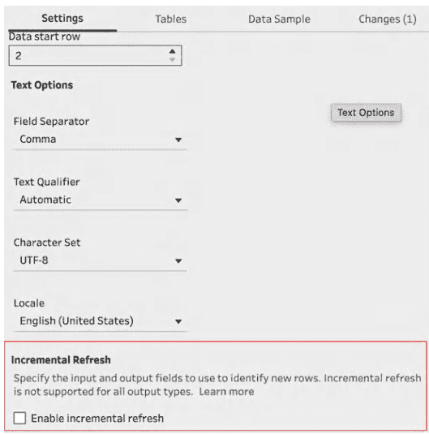

图 3.48：设置增量刷新

- 3. 单击 **启用增量刷新** 复选框后，将出现一个下拉列表。此下拉列表包含 Prep 认为作为数据刷新指标有用的所有字段。例如，选择 **日期** 字段。它是完美的字段，因为一旦将新日期添加到原始数据源，刷新将开始。
- 4. Prep 还会询问您输出中将表示 **日期** 列的输出字段。在我们的例子中，它仍然是 **日期**：

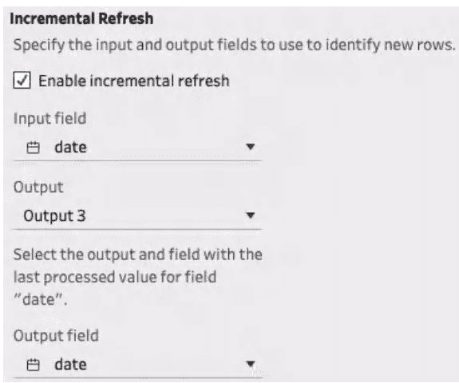

图 3.49：选择输出字段

- 5. 设置完成后，再次单击 **输出** 步骤，并注意您现在可以通过单击 **运行流** 选项上的下拉菜单来选择您偏好的此流的刷新类型（完全刷新或增量刷新）：

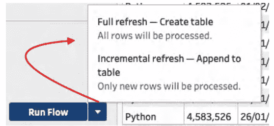

图 3.50：刷新选项

您刚刚学习了如何设置数据刷新（无论是完全刷新还是增量刷新）。这将帮助您可持续地使用计算资源，并始终保持数据的最新状态。接下来，我们将介绍另一个值得探索的 Tableau 功能——批量重命名。

## 批量重命名

这个功能真是个节省时间的好帮手！只需选择要重命名的任意数量的列，右键单击，然后选择 **重命名字段**。将打开一个新视图，允许您为每个选定的列添加前缀或后缀，也可以替换其中特定的文本。

然后，您还可以利用 **查找文本** 功能，或自动重命名可能在后续阶段进入的所有新字段，例如，因为 IT 向您的数据集添加了额外的列。

## Tableau Prep Conductor

借助 **Tableau Prep Conductor**，您可以将 Prep 流发布到 Tableau Server，将其安排在特定时间运行，并始终拥有更新的数据。Conductor 包含在 Tableau 数据管理加载项中，并不随 Tableau Desktop 或 Prep 一起提供。

> 有关更多信息，请查看 https://www.tableau.com/products/add-ons/data-management。

## 命令行自动化

这里有一个功能，可能会让您感觉自己像个真正的高级用户。从 2020.4.1 版本开始，发布流或在 Web 上手动运行流不再需要数据管理加载项。但您是否知道，也可以从命令行运行 Prep 流？

您为什么想要这样做？

假设您有一个需要每天晚上凌晨 2 点运行的流，但您的 Tableau Server 没有用于调度的数据管理加载项。您可以设置一个简单的 cron 作业（在 Mac/Linux 上）或任务计划程序（在 Windows 上）来自动运行您的流。这是无需企业价格标签的自动化。

其工作原理：

```
tableau-prep-cli run flow.tfl
```

您可以提供 JSON 文件来定义输入或输出数据连接的凭据，使其适合于自动化管道：

```
tableau-prep-cli run myflow.tfl --connection-credentials credentials.json
```

credentials.json 文件将包含类似的内容：

```
{
  "connections": [
    {
      "id": "input-connection-id",
      "username": "your_username",
      "password": "your_password"
    }
  ]
}
```

您需要知道：

- tableau-prep-cli 工具随 Tableau Prep Builder 一起安装
- 您可以在安装了 Prep Builder 的任何计算机上运行流
- 虽然调度需要 Tableau Server 上的数据管理加载项，但命令行执行为自定义自动化提供了灵活性

这个功能并非适合所有人，但对于那些需要它的人来说，这是一个救命稻草。

## 导出数据

最后但同样重要的是，我们可能需要导出数据。我们之前看到，在流窗格中右键单击一个符号，可以在 Tableau Desktop 中预览数据：

- 1. 如果您希望流按计划运行或将其保存到某个位置，最好使用 **添加 | 输出**。
- 2. 执行此操作后，将出现以下屏幕：

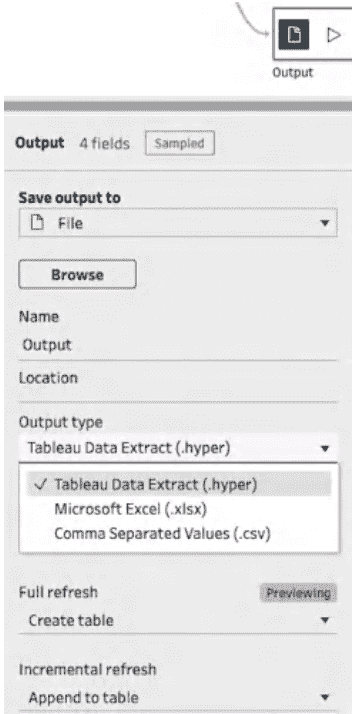

图 3.51：保存到文件

- 3. 您现在可以将数据保存到文件，还可以将其保存为 .hyper 格式的 Hyper 文件、.xlsx 文件（Tableau 2021.1 中的新功能）或 .csv 文件。
- 4. 另一个选项是将新生成的数据源直接发布到 Tableau Server，并使其对其他用户可用。对于此选项，请从下拉列表中选择 **将为数据源发布**，而不是 **保存到文件**。
- 5. 将 Prep 输出保存的第三个选项已添加到 Tableau 2020.3 —— 将生成的数据写入外部数据库。如果您想这样做，请从下拉列表中选择 **数据库** 表选项。在撰写本文时，有七个数据库与回写功能兼容，但将根据用户需求添加更多数据库。

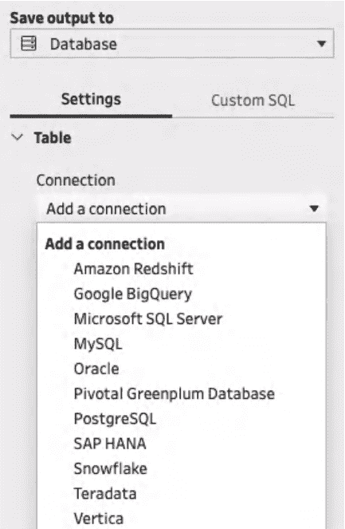

图 3.52：保存到外部数据库

自 Tableau 2022.3 版本起，您也可以将数据写回 CRM Analytics。为此，您需要一个 Salesforce 帐户和相应的许可证。因此，我们不会进一步讨论此选项，但如果您是 Salesforce Analytics 用户，请查看此功能！

自 2024 年起，Prep 通过一种优雅的变通方法支持了更复杂的回写操作。虽然 Prep 没有原生的 UPSERT 按钮（更新现有行，插入新行），但您可以使用临时表和自定义 SQL 来实现此功能。

现在，您可能会想：什么时候会用到这个？

想象一下，您正在将客户反馈从调查平台导出到您的数据仓库。人们有时在提交后会编辑他们的响应。简单的增量刷新会错过这些编辑，而完全刷新效率低下。UPSERT 解决了这个问题，既更新现有行又插入新行，让您两全其美。


### 在 Prep 中实现 UPSERT:

- 1. **输入最近数据**：将输入步骤配置为仅拉取最近的记录（例如，最近 14 天内可能发生编辑的记录）

- 2. **写入临时表**：使用 **输出** 步骤将数据写入暂存表，而不是最终目标表

- 3. **输出后添加自定义 SQL**：在 **输出** 步骤的“自定义 SQL”选项卡中（查找 **“后”** 部分），编写你的 MERGE 语句：

```
MERGE INTO target_table AS target
USING temp_table AS source
ON (source.id = target.id)
WHEN MATCHED THEN
UPDATE SET target.value = source.value
WHEN NOT MATCHED THEN
INSERT (id, value) VALUES (source.id, source.value);
```

这种方法让你完全控制数据如何合并到最终目标。这有点高级，但一旦设置好，就会运行得非常出色。

本节向我们展示了如何保存工作以及，更重要的是，如何保存 Prep 流程的输出。在我看来，能够将输出保存到外部数据库是最佳新功能，因为这是以结构化、有条理的方式与他人共享我的输出的最简单方式。这样，不仅我，其他用户也可以处理准备好的数据，节省额外的工作。该流程随后不仅可以由我重复使用，任何人都可以使用。

### 摘要

本章首先介绍了 Prep。我们查看了 GUI 以及如何将数据连接到它。之后，我们进行了一些关于数据准备的练习。这可以分为五个部分：数据清理、联合和连接、聚合、透视和脚本。我们还考虑了几种额外选项来提高数据的实用性，包括从其他流程插入步骤以及增量刷新。为了完善本章关于 Prep 的内容，我们研究了导出数据。在这里，我们看到新数据集可以保存为文件或数据提取，写回到外部数据库，或直接推送到 Tableau Server。

就像 Tableau Desktop 一样，Prep 非常自解释且具有高度可视性。颜色、符号和高亮显示使你轻松上手这个提取、转换和加载工具，这对于在主 Tableau 界面上处理数据之前准备数据来说非常宝贵！

在下一章中，我们将继续探索 Tableau 中的数据。我们将通过研究连接、混合和数据结构来探索如何为 Tableau 准备数据。

### 获取本书的 PDF 版本和更多内容

扫描二维码（或访问 packtpub.com/unlock）。按书名搜索此书，确认版本，然后按照页面上的步骤操作。


立即解锁

*注意：请准备好发票。直接从 Packt 购买不需要发票。*
