# 了解连接、混合和数据结构

将 Tableau 连接到数据通常不仅仅是连接到单个数据 **源** 中的单个表。你可能需要使用 Tableau 来连接来自单个数据源的多个表。为此，我们可以使用 **连接**，当给定键值匹配时，它会将一个数据集的行与另一个数据集的行组合起来。你还可以连接来自不同数据源的表，或者联合具有类似元数据结构的数据。

有时，你可能需要合并不共享共同行级键的数据，这意味着如果你在行级别（例如在连接中）匹配两个数据集，你会重复数据，因为一个数据集中的行数据（例如城市）比另一个数据集（可能包含国家/地区）的详细程度要高得多。在这种情况下，你需要混合数据。此功能允许你，例如，显示每个国家/地区的城市数量，而无需将城市数据集更改为国家/地区级别。

此外，你可能会发现有时需要创建到单个数据源的多个连接，以便以不同方式透视数据。这可以通过操作数据结构来实现，它可以帮助你使用同一数据集从不同角度进行数据分析。这可能是发现难以或仅凭单一数据结构无法回答的问题所必需的。

在本章中，你将学习如何处理跨越多个表的数据，以及 Tableau 如何帮助你将这些表合并在一起以支持有意义的分析。与依赖单个扁平文件不同，现实世界的数据集通常包括多个相关表，每个表代表同一故事的不同方面。本章将引导你了解在 Tableau 中连接此类数据的核心技术，包括使用关系、连接和联合，并理解何时适用每种方法。

本章结束时，你将能够自信地构建多表数据模型，合并来自多个来源的数据，并设计从这些连接数据集中汲取见解的仪表板。这些技能对任何使用现代数据结构的分析师来说都是必不可少的，因为它们使你能够回答更丰富的问题，避免因聚合不正确而导致的错误，并构建准确反映底层业务逻辑的分析。

在本章中，我们将讨论以下主题：

- 关系简介
- 使用连接
- 理解联合
- 我们还需要混合吗？
- 探索操作顺序
- 脚手架简介
- 理解数据结构

在 2020.2 版本中，Tableau 添加了一项功能，允许你在不指定两种方法之一（即关系）的情况下进行连接或混合。我们将首先解释这一新功能，然后再深入研究连接、混合等的详细内容。

## 关系简介

尽管本章将主要关注连接、混合和数据结构操作，但让我们先介绍一下关系：一项自 Tableau 2020.2 以来提供的新功能，也是 Tableau 社区期待已久的功能。它是数据画布中的新默认选项；因此，我们将首先研究属于数据模型逻辑层的关系，然后再深入研究在物理层上运行的连接和联合功能。

> **注意**
>
> 要了解有关 Tableau 数据模型的物理层和逻辑层的所有信息，请访问 Tableau 帮助页面：
> https://help.tableau.com/current/server/en-us/datasource_datamodel.htm.
>
> 目前，你可以将逻辑层视为能够更智能地计数。想象一个具有唯一客户名称的客户表和一个记录了数百个订单的订单表。在逻辑层中，一个有多个订单（因此订单表中有多个订单 ID 和客户 ID 行）的客户名称将被计为一个客户，因为逻辑层很智能并能识别客户名称，而物理层会为每个订单计一个客户，因此如果客户下过多次订单，它会将同一客户计为多个客户。你只能通过计算不同值来解决这个问题（在使用逻辑层时不需要这样做）。

在以下屏幕截图中，你可以看到数据源画布，左侧是两个数据集通过关系组合在一起，右侧是相同的数据集使用连接组合在一起。请注意，关系仅在表（订单、人员和退货）之间显示一条线，而连接则通过两个圆圈指示连接类型：

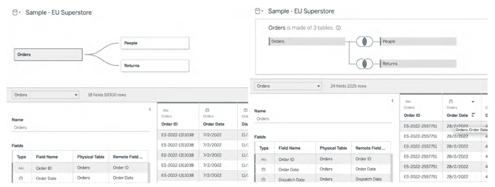

图 4.1：数据源画布上的关系和连接

一个关键区别是，底部的数据预览在关系中仅显示所选表中的数据，而在使用连接时会显示所有数据。这是合理的，因为关系中的数据粒度可能会根据你在仪表板中使用的字段而变化。然而，连接具有固定的粒度级别，由你选择的连接类型和连接子句定义。

关系是 Tableau Desktop 的默认设置。但是，如果你仍想使用连接功能，可以将数据集拖动到数据源画布，单击下拉箭头，然后选择 **打开...**：

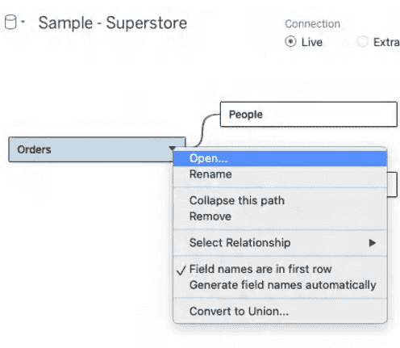

图 4.2：从关系画布到连接画布

这将打开数据集，如同你在 2020.2 之前的 Tableau 版本的 **数据** 窗格中看到的那样，你将能够以旧方式使用连接，我们将在 *使用连接* 部分中描述。


两个数据集之间关系（基于逻辑层）的连线由于其看起来像 *有嚼劲* 的意大利面而被称为 **面条** —— 真让人垂涎！Tableau 会在你将第二个数据源拖放到数据源画布时立即检测出关系，但如果需要，你可以点击面条本身来添加更多键列或移除和调整它们：

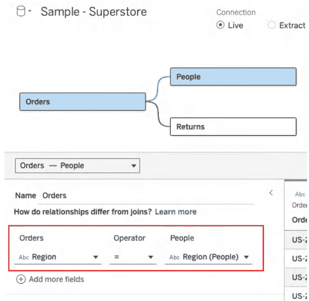

图 4.3：关系键

如果在 Tableau 2020.2 或更高版本中打开较旧的仪表板，你会看到合并的数据将显示为 **已迁移**。这是有意为之。只需点击已迁移的数据源，Tableau 就会从逻辑层切换到物理层，这意味着你将看到基于连接的数据源画布，而不是关系画布。

查看工作表时，你也会注意到差异。在新的关系布局中，列首先按表名划分，然后按数据源拆分为维度和度量，而在连接中，列被划分为维度和度量，并按表名拆分。

关于关系，总结来说，新的数据源布局使合并数据集变得容易得多，而且你不需要事先决定是要连接还是混合。习惯了旧版 **数据源** 窗格的人可能需要一点时间来适应新的灵活性，但对于新的 Tableau 用户来说，从一开始就使用不同的数据集会容易得多。尽管如此，我们仍将在下一部分介绍连接，尤其是因为该功能仍然是 Tableau 物理层的一部分。

## 使用连接

本书假设你具备连接的基础知识，具体包括内连接、左外连接、右外连接和全外连接。如果你不熟悉连接的基础知识，可以考虑学习 [W3Schools 的 SQL 教程](https://www.w3schools.com/sql/default.asp)。基础知识并不困难，所以你很快就能上手。

以下截图显示了三个相关的数据集：

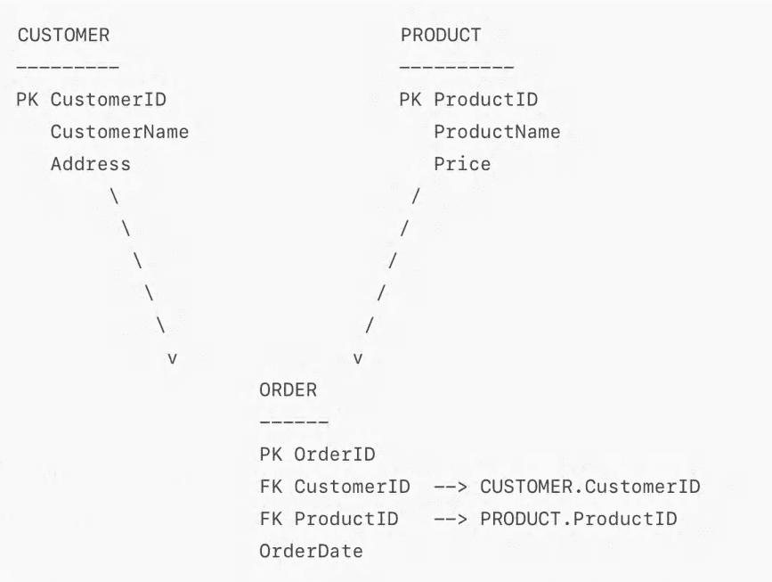

图 4.4：相关数据集

为了更好地理解 Tableau 在连接多个表时对数据所做的操作，让我们来探索连接查询。

## 连接查询

以下截图是图 4.4 中已连接数据集的表示：

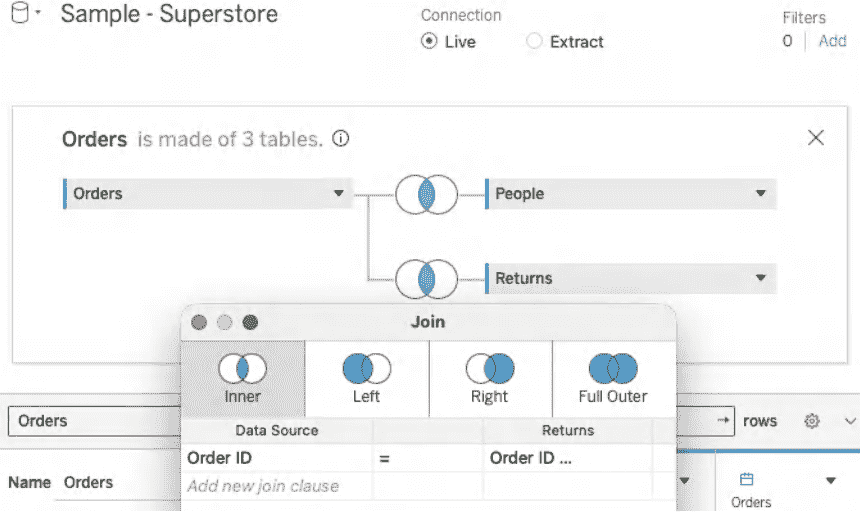

图 4.5：连接裁剪

上一张截图表示 **Orders** 表和 **Returns** 表之间的内连接，它们通过公共键 **Order ID** 进行内连接。**Orders** 和 **People** 在公共键 **Region** 上进行连接。

为了更好地理解刚才描述的内容，我们将继续进行连接裁剪练习。我们将查看 Tableau 在使用这两个表构建简单视图时生成的 SQL 查询，这将向我们展示 Tableau 在我们简单拖放时在幕后所做的操作。

请按照以下步骤操作：

- 1. 从 https://github.com/PacktPublishing/Mastering-Tableau-2026/tree/main/Chapter04 定位并下载本章关联的工作簿。
- 2. 选择 **连接裁剪** 工作表并单击 **Sample - EU Superstore Join** 数据源。
- 3. 在菜单中，选择 Help，然后是 Settings and Performance，接着是 Start Performance Recording：


图 4.6：开始性能录制

- 4. 将 People 拖放到行架，并将 Sales 放置到文本架：

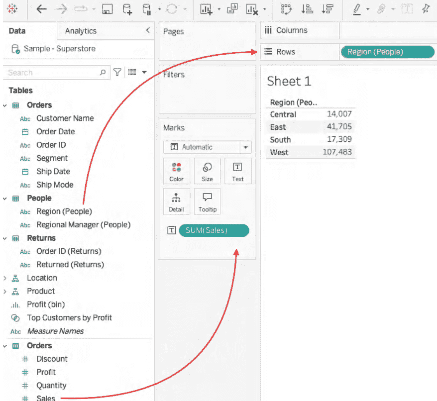

图 4.7：拖放

- 5. 通过 Help，然后是 Settings and Performance，最后是 Stop Performance Recording 来停止录制。
- 6. 在生成的 Performance Summary 仪表板中，将时间滑块拖动到 0.0000 并选择前两个绿色条：Executing Query。现在，你会看到 Tableau 生成的两个 SQL 查询：

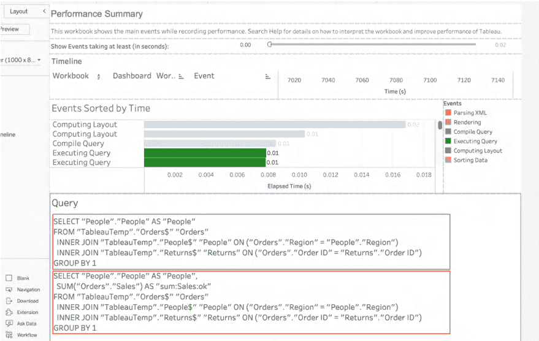

图 4.8：性能录制

到目前为止，我们已将 Tableau 连接到我们的数据集，然后创建了一个非常简单的工作表，显示了每个人的销售数量。但是，为了让 Tableau 显示人员姓名和销售金额，它需要从两个不同的表中获取数据：**Orders** 和 **People**。*图 4.8* 中的性能录制显示了构建仪表板每个步骤所需的时间以及向数据库发送了哪个查询。由于我们先将一个维度拖放到工作表，然后再拖放一个度量，因此我们会看到两个查询。第二个查询组合了这两个拖放的字段；因此，我们将重点介绍后者。让我们详细看一下：

```
"SELECT "People"."Region" AS "Region",
SUM("Orders"."Sales") AS "sum:Sales:ok"
FROM "TableauTemp"."Orders$" "Orders"
INNER JOIN "TableauTemp"."People$" "People" ON ("Orders"."Region" = "People"."Region")
INNER JOIN "TableauTemp"."Returns$" "Returns" ON ("Orders"."Order ID" = "Returns"."Order ID")
GROUP BY 1"
```

请注意，表之间生成了一个内连接。这是 Tableau **连接功能** 幕后的一个视图。

在讨论完技术细节后，让我们来看看仪表板本身中的连接。

## 连接计算

在 Tableau 中，可以基于计算连接两个文件。你会使用此功能来解决两个数据源之间的不匹配。计算连接可以在每个连接的下拉菜单中访问。

请参阅以下截图：

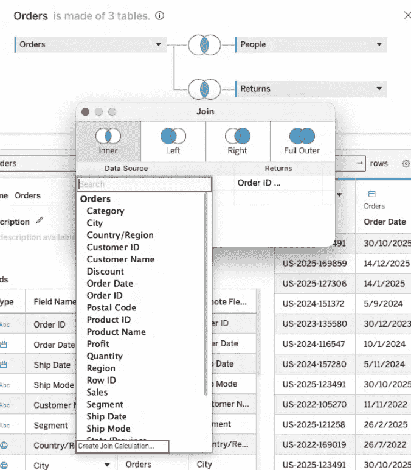

图 4.9：创建连接计算...

作为示例，假设一个数据集包含一个名为 **First Name** 的列和另一个名为 **Last Name** 的列。你希望将其连接到第二个数据集，该数据集有一个名为 **Name** 的列，包含姓和名。连接这两个数据集的一种方法是在第一个数据集中创建一个类似于以下内容的 **连接计算**：

```
[First Name] + ' ' + [Last Name]
```

现在，在第二个数据集中选择 **Name** 列，你的键应该就匹配了！

如果你想了解更多关于计算连接的信息，请查看 [Tableau 帮助页面](https://help.tableau.com/current/pro/desktop/en-us/joining_tables.htm#use-calculations-to-resolve-mismatches-between-fields-in-a-join)。

## 空间连接

Tableau 还支持 **空间连接**。这意味着你可以连接 MapInfo 表以及 Shape、Esri、KML、TopoJSON 和 GeoJSON 文件中的空间字段。你也可以使用 CSV 或 Excel 文件，并通过 Tableau MAKEPOINT 函数将数据转换为空间数据（参见 _第 11 章，利用高级分析_）。在实践中，想象两个数据集：一个关于流域位置，由空间字段指示，另一个包含水禽目击位置的数据集，也在空间列中。Tableau 允许你连接这两个数据集，否则这很难实现，因为大多数程序不支持空间数据。

要在空间列上进行连接，你需要从 **Join** 下拉菜单中选择 **Intersects** 字段，该选项仅在处理空间数据时可见。

有关在 Tableau 中连接空间文件的更多信息，请阅读 Tableau 的以下资源：

- https://help.tableau.com/current/pro/desktop/en-us/maps_spatial_join.htm
- https://www.tableau.com/about/blog/2018/8/perform-advanced-spatial-analysis-spatial-join-now-available-tableau-92166
- https://help.tableau.com/current/pro/desktop/en-us/maps_spatial_join.htm
- https://help.tableau.com/current/pro/desktop/en-us/examples_spatial_files.htm

作为横向连接的替代方案，你可能需要垂直连接，也称为 **合并**。合并的典型用例是可视化存储在多个文件或表中的随时间变化的数据。你可能有一份每日报告，其列结构相同，但每天作为新文件收集，存储在每月或每年的文件夹中。

合并这些文件比逐一查看它们能提供更多洞察！你将能够分析趋势以及每日或每年的变化，或执行年初至今分析。因此，我们将在下一部分深入介绍 Tableau 中的合并操作。


## 理解联合

有时，您可能希望分析存储在不同文件中但具有相同元数据结构的数据——例如，来自不同年份、不同月份或不同国家的销售数据。您不需要复制粘贴数据，而是可以对它们执行联合函数。我们在第 3 章《使用 Tableau Prep Builder》中已经涉及过这个话题，但联合基本上是指 Tableau 将新行数据追加到具有相同标题的现有列中。对于接下来的练习，我们将使用 FIFA 数据（来自 PlayStation 游戏，而非世界杯）。数据来自 Kaggle (https://www.kaggle.com/datasets/stefanoleone992/fifa-22-complete-player-dataset?resource=download) 并以多个 CSV 文件的形式提供；每个 CSV 包含 1 年的数据，并且男性/女性也分开存储。

为了我们的分析，我们希望将所有文件合并为一个。因此，我们需要通过以下步骤执行联合：

- 1. 从 GitHub (https://github.com/PacktPublishing/Mastering-Tableau-2026/tree/main/Chapter04) 或 Kaggle (https://www.kaggle.com/datasets/stefanoleone992/fifa-22-complete-player-dataset?resource=download) 下载 CSV 文件。
- 2. 在本章所属的仪表板中，打开“连接到数据”窗格，然后单击“文本文件”：


Figure 4.10: 文本文件

- 3. 在计算机上找到下载的 FIFA 数据，并连接到其中的任何一个文件。
- 4. 通过将左侧窗格中的第二个文件拖放到初始文件上，直到出现 **Union** 单词来创建联合——这是一个标志，表明当您现在放下数据时，数据将用于联合：

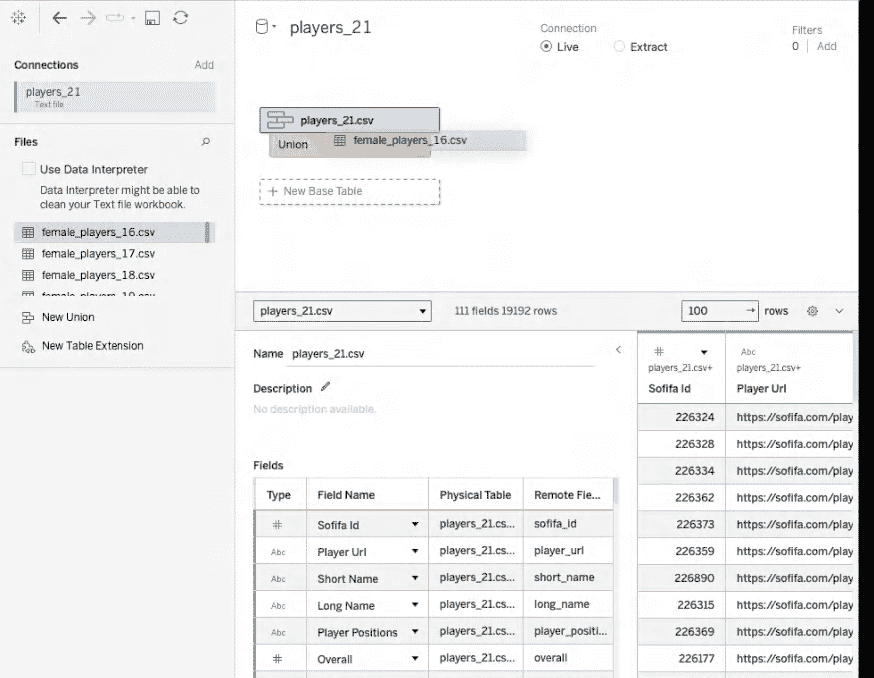

Figure 4.11: 联合

- 5. 或者，单击主数据集的箭头，然后选择 **Convert to Union**…


Figure 4.12: 转换为联合…

- 6. 在以下弹出窗口（图 4.13）中，用户可以通过拖放或使用通配符联合来单独选择应包含在联合中的所有数据表，通配符联合将根据命名约定包含特定目录中的所有表——* 号代表任何字符。players* 示例将包括任何以 players 开头的文件。同样，female* 将包括所有以 female 开头的文件，* 将包括所有文件：

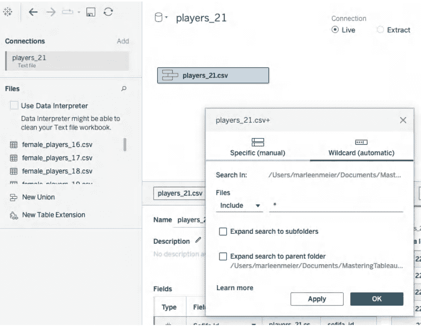

Figure 4.13: 选择所有数据

联合用于合并相似且可以相互追加的数据。它们最常用于多个数据文件，每个文件都有不同的日期戳、不同的区域、不同的经理等。通过使用联合，您希望使数据集更加完整。我们看到，Tableau 允许通过拖放以及右键单击初始数据源来进行联合。我们还讨论过使用拖放或通配符将一个或多个其他数据集合并的联合。图 4.14 展示了一个典型的联合示例：

| 数据集 A | | | 数据集 B | | | 联合 | | |
|---|---|---|---|---|---|---|---|---|
| 销售 2021 | | | 销售 2022 | | | 销售 2021&2022 | | |
| 年份 | 月份 | 销售额 | 年份 | 月份 | 销售额 | 年份 | 月份 | 销售额 |
| 2021 | 12 | 639 | 2022 | 12 | 4323 | 2021 | 12 | 639 |
| 2021 | 11 | 3758 | 2022 | 11 | 5757 | 2021 | 11 | 3758 |
| 2021 | 10 | 6836 | 2022 | 10 | 4444 | 2021 | 10 | 6836 |
| 2021 | 9 | 1721 | 2022 | 9 | 625 | 2021 | 9 | 1721 |
| 2021 | 8 | 5942 | 2022 | 8 | 191 | 2021 | 8 | 5942 |
| 2021 | 7 | 9853 | 2022 | 7 | 6480 | 2021 | 7 | 9853 |
| 2021 | 6 | 7338 | 2022 | 6 | 4231 | 2021 | 6 | 7338 |
| 2021 | 5 | 6144 | 2022 | 5 | 2696 | 2021 | 5 | 6144 |
| 2021 | 4 | 7285 | 2022 | 4 | 4600 | 2021 | 4 | 7285 |
| 2021 | 3 | 7560 | 2022 | 3 | 6999 | 2021 | 3 | 7560 |
| 2021 | 2 | 561 | 2022 | 2 | 8123 | 2021 | 2 | 561 |
| 2021 | 1 | 7844 | 2022 | 1 | 9602 | 2021 | 1 | 7844 |
| | | | | | | 2022 | 12 | 4323 |
| | | | | | | 2022 | 11 | 5757 |
| | | | | | | 2022 | 10 | 4444 |
| | | | | | | 2022 | 9 | 625 |
| | | | | | | 2022 | 8 | 191 |
| | | | | | | 2022 | 7 | 6480 |
| | | | | | | 2022 | 6 | 4231 |
| | | | | | | 2022 | 5 | 2696 |
| | | | | | | 2022 | 4 | 4600 |
| | | | | | | 2022 | 3 | 6999 |
| | | | | | | 2022 | 2 | 8123 |
| | | | | | | 2022 | 1 | 9602 |

Figure 4.14: 联合

让我们来看看需要记住的要点：

- • 联合通过创建额外行来追加数据。
- • 联合应包含具有许多共同列的数据集。
- • 联合仅应用于存储在多个数据源中且结构相同的数据。
- • 使用联合时要留意性能。联合中的每个额外数据集都会增加 Tableau VizQL 查询语言的复杂度。

既然您刚刚成为联合专家，是时候继续了解 Tableau 提供的下一个功能：**混合**了！混合可帮助您合并粒度不同的数据集。请考虑数据集之间的*一对多*关系。一个数据集每行有一个唯一键；另一个数据集每个键有多行。为了避免在前者数据集中复制行，Tableau 在关系成为软件包的一部分之前很久就部署了混合功能。

## 我们还需要混合吗？

关系使数据混合的需求稍微少一些，它可以被视为旧版功能。但是，为了完整性以及针对较旧的 Tableau 版本（2020.2 以下），让我们在以下各节中考虑数据混合的摘要。简而言之，数据混合允许您将多个不同的数据源合并到单个视图中。理解以下四点将使您掌握有关数据混合的要点：

- • 数据混合通常用于合并来自多个数据源的数据。虽然从 Tableau 10 开始，多个数据源之间可以进行连接，但在某些情况下，数据混合仍然是合并两个或更多数据源数据的唯一可行选项。在以下各节中，我们将看到一个演示此类情况的实际示例。

- - 数据混合需要一个共享维度。日期维度通常是混合多个数据源的可行候选项。
- - 数据混合先聚合再匹配。另一方面，连接先匹配再聚合。
- - 数据混合不支持来自次要数据源的维度。尝试使用次要数据源的维度会导致视图中出现 * 实例或空值。此规则有个例外，我们将在“添加次要维度”部分稍后讨论。

既然我们已介绍关系、连接和联合，我希望将您的注意力稍微转移到工作簿中的数据结构上。您可能已设置完美的连接或联合，开始将字段拖放到工作簿画布上，使用了筛选器，使用了计算字段，然后得到了一些意外结果。Tableau 表现正常，只是不符合您的期望。这是为什么呢？！在这里，操作顺序至关重要。了解何时应用哪个筛选器以及这如何影响您的数据是必不可少的。因此，接下来是操作顺序。

## 探索操作顺序

数据混合难道不等同于左连接吗？这是新 Tableau 作者经常提出的问题。答案当然是否定的，但让我们来探讨一下区别。以下示例很简单，甚至有些轻松愉快，但它确实展示了因错误连接导致的错误聚合可能带来的深远后果。

我们将探讨 Tableau 中聚合发生的顺序。这将帮助您更有效地使用混合和连接。

本示例中，我们将使用以下数据：

| 裤子 | | 衬衫 | |
|---|---|---|---|
| 销售人员 | 裤子销售额 | 销售助理 | 衬衫销售额 |
| Tanya | 100 | Tanya | 50 |
| Tanya | 100 | Tanya | 50 |
| Zhang | 100 | Zhang | 50 |
| Zhang | 100 | Zhang | 50 |

Figure 4.15: 裤子和衬衫销售


在这些表格中，列出了两个人：**塔尼亚** 和 **张**。在一个表格中，这些人是 **销售人员** 维度的成员，在另一个表格中，他们是 **销售助理** 维度的成员。此外，**塔尼亚** 和 **张** 均销售了价值 $200 的裤子和 $100 的衬衫。让我们探索 Tableau 连接这些数据的新方式，以更好地理解连接和数据混合。

查看与此练习相关的电子表格时，您会注意到有其他列。这些列将在后续练习中使用。

请执行以下步骤：

- 1. 在与此章节相关的工作簿中，右键单击 **裤子** 数据源，并单击 **查看数据** 查看数据。对 **衬衫** 数据源也执行相同操作。

- 2. 通过右键单击并选择 **编辑数据源** 打开 **连接** 数据源，并观察 **裤子** 和 **衬衫** 表之间的连接，使用 **销售人员/销售助理** 作为公共键：

### 连接

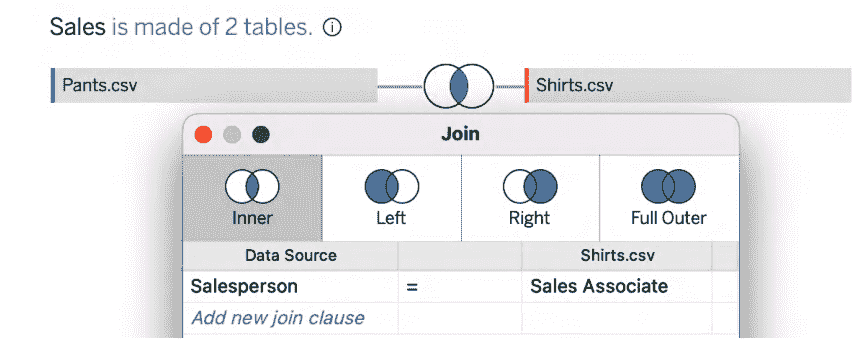

### 图 4.16：连接

- 3. 在 **裤子** 工作表中，选择 **裤子** 数据源，并将 **销售人员** 放置于 **行** 书架，将 **裤子金额** 放置于 **文本** 书架：

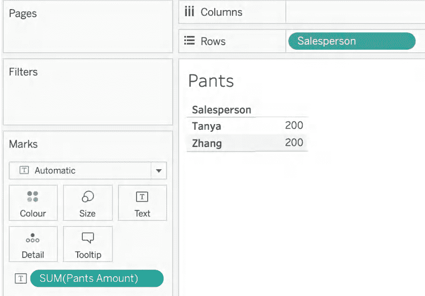

### 图 4.17：设置工作表

- 4. 在 **衬衫** 工作表中，选择 **衬衫** 数据源，并将 **销售助理** 放置于 **行** 书架，将 **衬衫金额** 放置于 **文本** 书架：

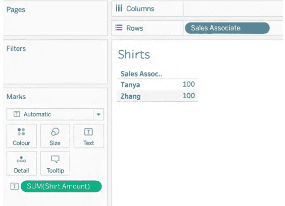

### 图 4.18：衬衫

- **5.** 在 **连接** 工作表中，选择 **连接** 数据源，并将 **销售人员** 放置于 **行** 书架。接下来，双击 **裤子金额** 和 **衬衫金额** 将两者都放置于视图中：

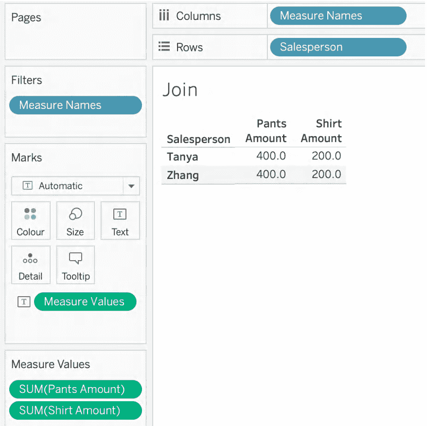

### 图 4.19：连接

- **6.** 在 **混合裤子—主要** 工作表中，选择 **裤子** 数据源，并将 **销售人员** 放置于 **行** 书架，将 **裤子金额** 放置于 **文本** 书架：

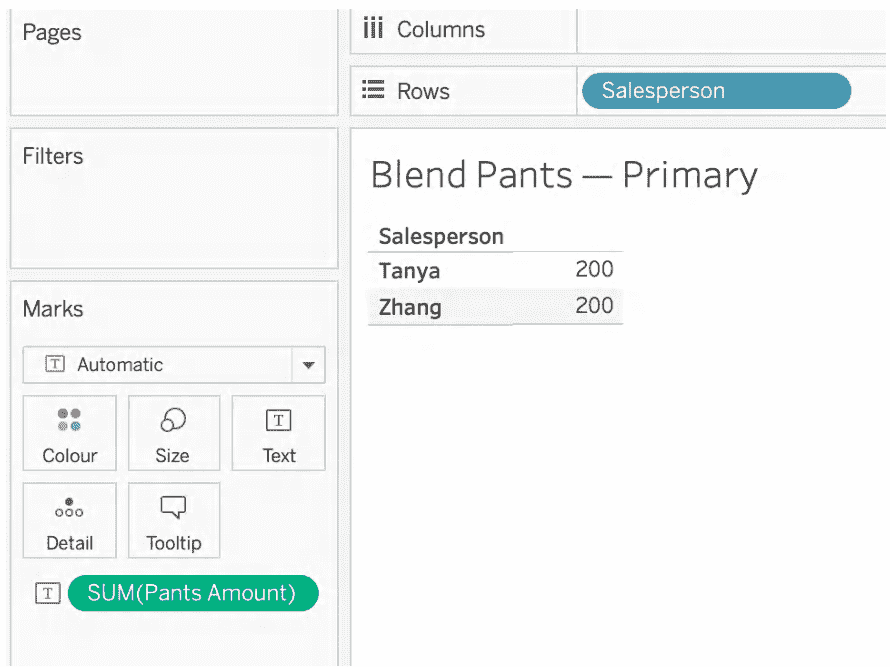

### 图 4.20：混合裤子

- 7. 留在同一工作表中，从左侧的数据源窗格中选择 Shirts 数据源，并双击 Shirt Amount。如果弹出错误消息，请单击确定。

- 8. 从菜单栏选择 Data，然后选择 Edit Blend Relationships...


### 图 4.21：编辑混合关系...

- 9. 在生成的对话框中，将 **裤子** 选择为 **主数据源** 值，将 **衬衫** 选择为 **次要数据源** 值，然后单击 **自定义** 单选按钮，如 **图 4.22** 所示，然后单击 **添加**...

- 10. 在左列中选择 **销售人员**，在右列中选择 **销售助理**。左列表示来自 **主数据源** 选择的数据，右列表示 **次要数据源** 选择中可用的所有数据。

- 11. 删除所有其他链接（如果有），然后单击 **确定**。对话框中的结果应与以下屏幕截图中显示的内容一致：

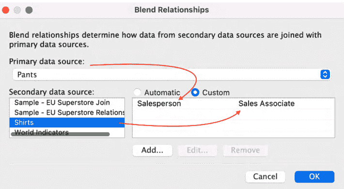

### 图 4.22：混合关系

> 注意
> 迄今为止我们所做工作的小结：我们正在使用三个数据源：**裤子**、**衬衫** 和 **连接**，其中 **连接** 由 **裤子** 和 **衬衫** 组成。我们还创建了一个以 **裤子** 为主数据源的混合，并使用 **销售人员** 和 **销售助理** 作为键将它们连接起来。
>
> 请勿因名称 **混合关系** 而混淆。这与逻辑层关系无关。它只是弹出窗口的名称。

回到练习，继续执行以下步骤：

- **12.** 在 **混合衬衫—主要** 工作表中，选择 **衬衫** 数据源，并将 **销售助理** 放置于 **行** 书架，将 **衬衫金额** 放置于 **文本** 书架：

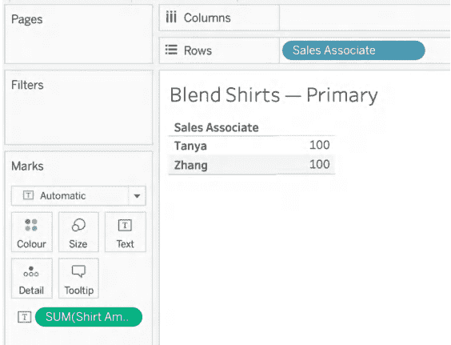

### 图 4.23：混合衬衫—主要

- 13. 在同一工作簿中，选择 Pants 数据源，确保 Salesperson 旁边的链接图标已连接/为红色，并双击 Pants Amount 将其添加到视图：

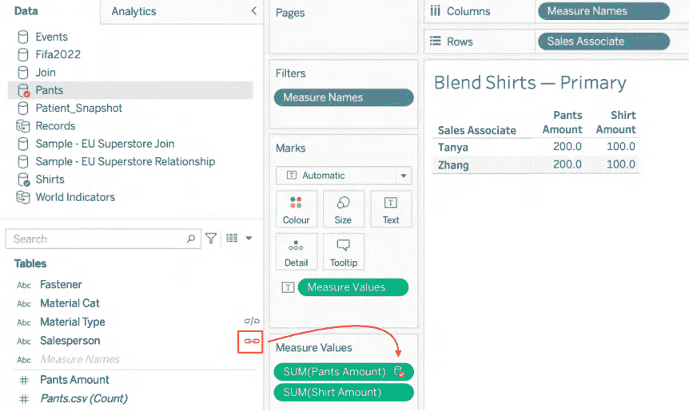

### 图 4.24：完成工作表

- 14. 将所有五个工作表放置在一个仪表板上。按需格式化和排列。现在，让我们比较以下屏幕截图中五个工作表的结果：

裤子
销售人员
塔尼亚 200
张 200

衬衫
销售助理
塔尼亚 100
张 100

连接
销售人员 裤子金额 衬衫金额
塔尼亚 400.0 200.0
张 400.0 200.0

混合裤子 — 主要
销售人员
塔尼亚 200
张 200

混合衬衫 — 主要
销售助理 裤子金额 衬衫金额
塔尼亚 200.0 100.0
张 200.0 100.0

### 图 4.25：比较

在上述屏幕截图中，连接工作表的结果是预期结果的两倍。为什么？因为连接首先匹配公共键（在本例中为 销售人员/销售助理），然后聚合结果。在公共键上找到的匹配越多，问题就越严重。如果在公共键上找到多个匹配，结果将呈指数级增长。两个匹配会产生平方结果，三个匹配会产生立方结果，依此类推。这种指数效应在以下屏幕截图中以图形形式表示：

| 销售人员 | 销售助理 | 连接 | 裤子金额 | 衬衫金额 |
|---|---|---|---|---|
| 塔尼亚 | 塔尼亚 | 塔尼亚 | 100 | 50 |
| 塔尼亚 | 塔尼亚 | 塔尼亚 | 100 | 50 |
| 塔尼亚 | 塔尼亚 | 塔尼亚 | 100 | 50 |
| | | 塔尼亚 | 100 | 50 |
| 张 | 张 | 张 | 100 | 50 |
| | | 张 | 100 | 50 |
| 张 | 张 | 张 | 100 | 50 |
| | | 张 | 100 | 50 |

### 图 4.26：连接

另一方面，混合功能更高效，但在混合能够正常工作之前，我们必须编辑数据关系，以便 Tableau 能够使用 **销售人员** 和 **销售助理** 字段连接两个数据源。如果这两个字段名称相同（例如，**销售人员**），Tableau 将自动提供一个选项，以使用这些字段在数据源之间进行混合。

混合裤子—主要和混合衬衫—主要工作表的结果是正确的。没有指数效应。为什么？因为数据混合首先聚合两个数据源的结果，然后在公共维度上匹配结果。

在此例中，它是 销售人员/销售助理，如以下屏幕截图所示：

| 销售人员 | SUM(裤子金额) | 销售助理 | SUM(衬衫金额) | 混合 | 裤子金额 | 衬衫金额 |
|---|---|---|---|---|---|---|
| 塔尼亚 | 200 | 塔尼亚 | 100 | 塔尼亚 | 200 | 100 |
| 张 | 200 | 张 | 100 | 张 | 200 | 100 |

### 图 4.27：混合结果

本练习让我们看到，连接可以改变数据结构，因此使用时要小心，并非常清楚哪些列适合作为键。此外，在连接数据之前和之后都要进行检查，这可以简单到行数计数并验证是否为预期结果。

混合有优点也有缺点；例如，添加维度并不那么简单。我们将在下一节中探讨有关次要维度的更多细节。

## 添加次要维度

数据混合虽然特别适用于连接不同的数据源，但也有局限性。最需要了解的重要局限性是，数据混合无法启用来自次要数据源的维度。此限制有一个例外；也就是说，有一种方法可以添加来自次要数据源的维度。让我们进一步探讨这一点。

数据源中除了 **销售人员**/**销售助理** 和 Shirt Amount/**裤子金额** 之外还有其他字段。我们将在本练习中引用这些字段：

- 1. 在与此章节相关的工作簿中，选择 **添加次要维度** 工作表。
- 2. 选择 **衬衫** 数据源。


- 3. 为 **衬衫** 和 **裤子** 数据源添加 **材料类型** 之间的关系，执行以下步骤:

- 1. 选择 **数据**，然后选择 **编辑关系**。
- 2. 确保 **衬衫** 是主数据源，**裤子** 是辅助数据源。
- 3. 选择 **自定义** 单选按钮。
- 4. 单击 **添加...**
- 5. 在左右两列中选择 **材料类型**:

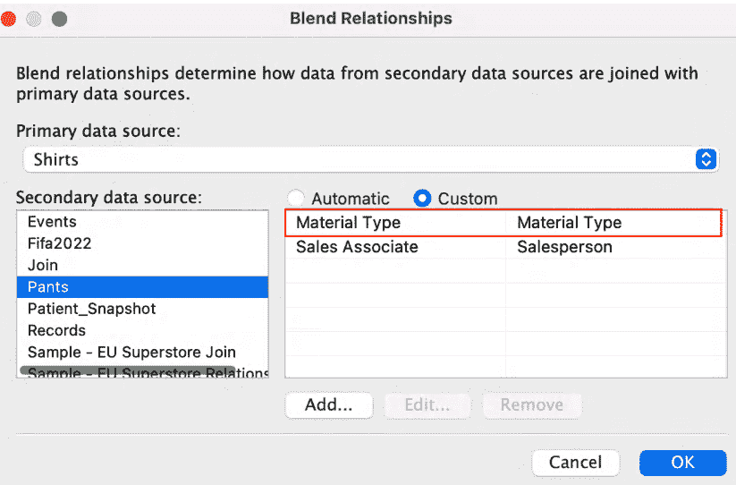

图 4.28: 自定义混合关系

- 6. 单击 **确定** 返回视图。
- 4. 将 **材料类型** 放置在 **行** 卡上。
- 5. 选择 **裤子** 数据源，并确保 **数据** 窗格中 **材料类型** 旁边的链接图标已激活，且 **销售人员** 旁边的链接图标已停用。如果图标是灰色的断开链接，则表示未激活。如果它是橙色的连接链接，则表示已激活:

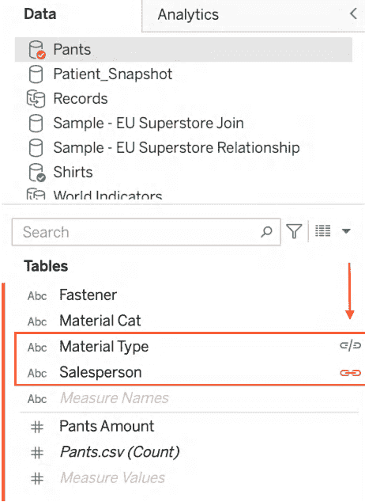

图 4.29: 衬衫和裤子

- 6. 如下所示，在行卡上将 **材料类别** 放置在 **材料类型** 之前，将 **紧固件** 放置在 **材料类型** 之后:

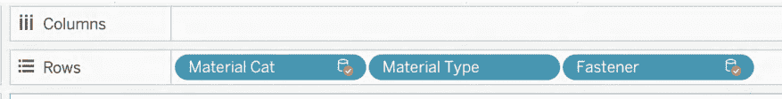

### 添加辅助维度

| 材料类别 | 材料类型 | 紧固件 | |
|---|---|---|---|
| 技术 | 聚丙烯腈 | 按钮 | Abc |
| | 聚酯 | 触扣 | Abc |
| 传统 | 羊毛 | * | Abc |

图 4.30: 辅助维度

材料类别是来自辅助数据源的维度。数据混合不支持启用来自辅助数据源的维度。为什么在这种情况下它有效？原因有几个：

- **材料类别** 和 **材料类型** 之间存在一对多关系；也就是说，**材料类型** 维度的每个成员与 **材料类别** 维度的一个且仅一个成员匹配。
- 视图基于 **材料类型** 而非 **材料类别** 进行混合。这一点很重要，因为 **材料类型** 的粒度低于 **材料类别**。尝试基于 **材料类别** 对视图进行混合，不会将 **材料类型** 启用为辅助维度。
- 主数据源中 **材料类型** 维度的每个成员在辅助数据源中也存在。

**紧固件** 也是来自辅助数据源的维度。图 4.35 在某个单元格中显示 *，从而表明 **紧固件** 未按维度应有方式工作；也就是说，它未对数据进行切片，如第 1 章 回顾基础 中所述。显示星号的原因是 **羊毛** 关联了多个 **紧固件** 类型。**按钮** 和 **触扣** 显示是因为 **聚丙烯腈** 和 **聚酯** 在底层数据中各只有一种 **紧固件** 类型。

如果使用混合，请确保您的主要目的是合并度量值，并且不需要详细级别的维度。在创建仪表板之前了解这一点尤其有用，以便相应地做好准备。您的数据需要额外的准备工作（请参阅第 3 章 使用 Tableau Prep Builder），因为连接和混合都无法为您带来预期的数据结构。或者，您可以利用支架，这是一种使用辅助数据源的技术——我们将在下一节中讨论此方法。

## 介绍支架

**支架** 是一种通过混合引入第二个数据源来重塑和/或扩展初始数据源的技术。支架可以扩展 Tableau 的功能，以满足原本可能极其困难或完全不可能的可视化和分析需求。在 Tableau 中率先使用支架的 Joe Mako 讲述了一个故事，他使用该技术使用四个工作表重新创建了一个仪表板。原始仪表板未使用支架，需要精心像素对齐的 80 个工作表。

支架支持的众多可能性之一是扩展 Tableau 的预测功能。Tableau 的原生预测功能有时因缺乏高级性而受到批评。可以使用支架来解决这一批评。

步骤如下：

- 1. 在与本章相关的工作簿中，选择 **支架** 工作表并连接到 **世界指标** 数据源。
- 2. 使用 Excel 或文本编辑器，创建 **记录** 数据集。以下两行表格完整表示了 **记录** 数据集：

| | A | B |
|---|---|---|
| 1 | 记录 | |
| 2 | | 1 |
| 3 | | 2 |
| 4 | | |
| 5 | | |

图 4.31: Excel 文件

- 3. 将 Tableau 连接到数据集。
- 4. 为加快速度，请考虑使用 Ctrl + C 直接从 Excel 复制数据集，并使用 Ctrl + V 将其直接粘贴到 Tableau 中。
- 5. 在 Tableau 中创建一个名为 **开始日期** 的参数，设置如下图所示。注意截图中的高亮部分，您可以通过这些部分设置所需的显示格式:

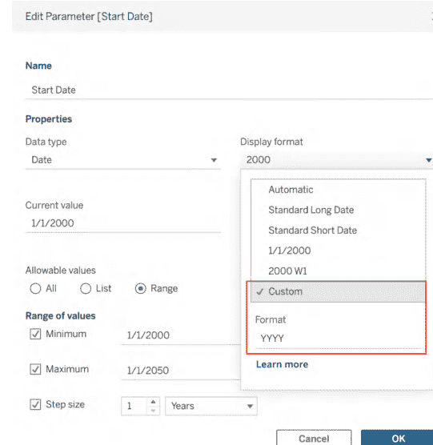

图 4.32: 显示格式

- 6. 创建另一个名为 **结束日期** 的参数，设置相同。
- 7. 在 **数据** 窗格中，右键单击刚刚创建的 **开始日期** 和 **结束日期** 参数，并选择 **显示参数**:

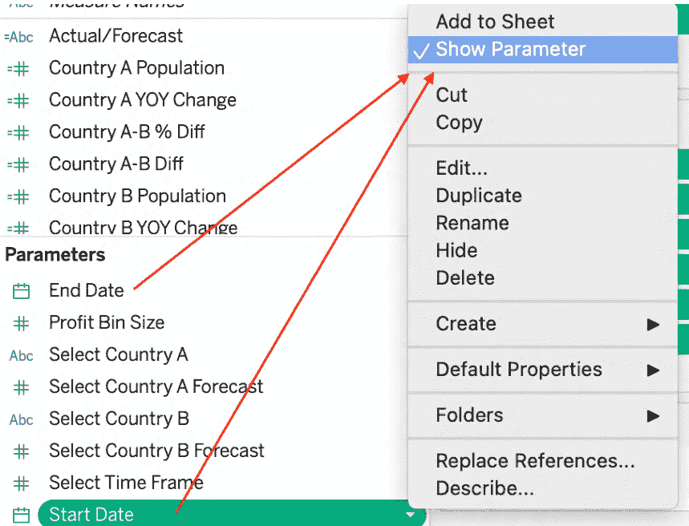

图 4.33: 显示参数

- 8. 根据需要设置开始日期和结束日期；例如，2000-2027:

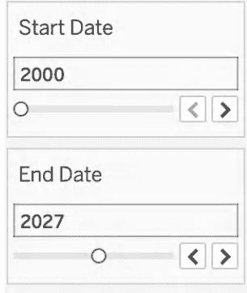

图 4.34: 开始日期和结束日期

- 9. 选择 **记录** 数据源并创建名为 **日期** 的计算字段，使用以下代码:

```
IIF([Records]=1,[Start Date],[End Date])
```

- 10. 将 **日期** 字段放置在 **行** 卡上。
- 11. 右键单击 **行** 卡上的 **日期** 字段，并选择 **显示缺失值**。请注意，开始日期和结束日期设置之间的所有日期现在都显示:

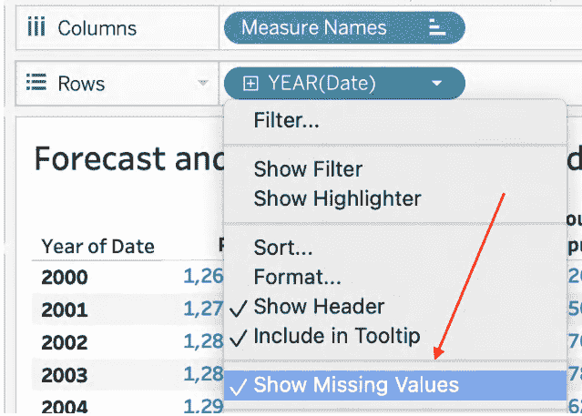

图 4.35: 显示缺失值

- 12. 创建名为 **选择国家 A** 的参数，设置如下图所示。请注意，国家列表是通过 **从字段添加值** 按钮添加的:

编辑参数 [选择国家 A]

名称 选择国家 A 属性 数据类型 字符串 当前值 中国 允许的值 列表

| 值 | 显示为 |
| --- | --- |
| 阿富汗 | 阿富汗 |
| 阿尔巴尼亚 | 阿尔巴尼亚 |
| 阿尔及利亚 | 阿尔及利亚 |
| 美属萨摩亚 | 美属萨摩亚 |
| 安道尔 | 安道尔 |
| 安哥拉 | 安哥拉 |
| 安提瓜和巴布达 | 安提瓜和巴布达 |

- 事件
- Fifa2022
- 连接
- 裤子
- 患者快照
- 示例 - 欧盟超市 连接
- 示例 - 欧盟超市 关系
- 衬衫
- 世界指标
- 参数
- 从剪贴板粘贴

图 4.36: 从字段添加值

- 13. 创建另一个名为 **选择国家 B** 的参数，设置相同。
- 14. 创建名为 **选择国家 A 预测** 的参数，设置如下图所示:

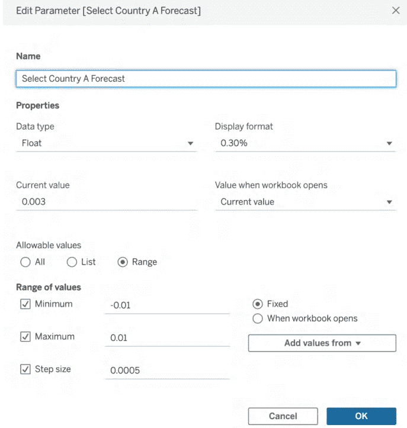

图 4.37: 编辑参数

- 15. 创建另一个名为 **选择国家 B 预测** 的参数，设置相同。
- 16. 在 **数据** 窗格中，右键单击刚刚创建的四个参数（**选择国家 A**、**选择国家 B**、**选择国家 A 预测** 和 **选择国家 B 预测**），并选择 **显示参数**:

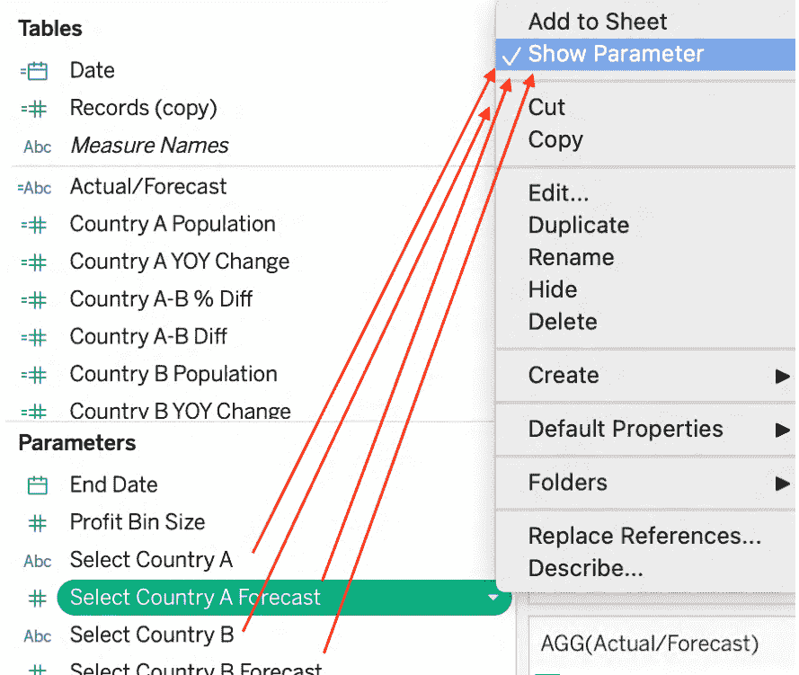

图 4.38: 显示参数

- 17. 确保 **世界指标** 数据源中的 **日期** 字段部署了橙色链接图标。这表明它已用作链接字段:

- 租赁快照
- 记录
- 示例 - 欧盟超市 连接
- 示例 - 欧盟超市 关系
- 衬衫
- 世界指标

搜索

文件夹

- 人口 0-14
- 人口 15-64
- 人口 65+
- 人口总数
- 城市人口

- 国家
- 日期
- 地区
- 度量值名称

图 4.39: 链接

- 18. 在 **世界指标** 数据集中，创建以下计算字段:

国家 A 人口:

```
IIF([Country] = [Select Country A],[Population Total] ,NULL)
```

国家 B 人口:

```
IIF([Country] = [Select Country B],[Population Total] ,NULL)
```

- 19. 在 **记录** 数据集中，创建以下计算字段:

实际/预测:

```
IIF(ISNULL(AVG([World Indicators].[Population Total])),"Forecast","Actual")
```


### A 国人口：
```
IF [Actual/Forecast] = "Actual" THEN SUM([World Indicators].[Country A Population]) ELSE PREVIOUS_VALUE(0)
* [Select Country A Forecast] + PREVIOUS_VALUE(0)
END
```

### A 国同比变化：
```
(([Country A Population] - LOOKUP([Country A Population], -1)) /
ABS(LOOKUP([Country A Population], -1))
```

### B 国人口：
```
IF [Actual/Forecast] = "Actual" THEN SUM([World Indicators].[Country B Population]) ELSE PREVIOUS_VALUE(0)
* [Select Country B Forecast] + PREVIOUS_VALUE(0)
END
```

### B 国同比变化：
```
(([Country B Population] - LOOKUP([Country B Population], -1)) /
ABS(LOOKUP([Country B Population], -1))
```

### A-B 差异：
```
[Country A Population] - [Country B Population]
```

### A-B 百分比差异：
```
[Country A-B Diff]/[Country A Population]
```

- 20. 在“数据”窗格中，右键单击“A 国同比变化”、“B 国同比变化”和“A-B 百分比差异”，选择“默认属性 | 数字格式...”，将默认数字格式更改为百分比：

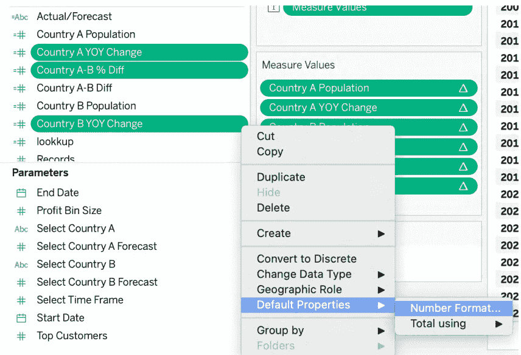

### 图 4.40: 默认属性

- 21. 在选中“Records”数据源的情况下，分别将 Actual/Forecast、度量值和度量名称字段放置于“颜色”、“文本”和“列”货架上：

## 中国和印度的预测与对比

| 日期年份 | A 国人口 | A 国同比变化 | B 国人口 | B 国同比变化 | A-B 差异 | A-B 百分比差异 |
|---|---|---|---|---|---|---|
| 2000 | 1,262,645,000 | | 1,042,261,758 | | 220,383,242 | 17.45% |
| 2001 | 1,271,850,000 | 0.73% | 1,059,500,888 | 1.65% | 212,349,112 | 16.70% |
| 2002 | 1,280,400,000 | 0.67% | 1,076,705,723 | 1.62% | 203,694,277 | 15.91% |
| 2003 | 1,288,400,000 | 0.62% | 1,093,786,762 | 1.59% | 194,613,238 | 15.11% |
| 2004 | 1,296,075,000 | 0.60% | 1,110,626,108 | 1.54% | 185,448,892 | 14.31% |
| 2005 | 1,303,720,000 | 0.59% | 1,127,143,548 | 1.49% | 176,576,452 | 13.54% |
| 2006 | 1,311,020,000 | 0.56% | 1,143,289,350 | 1.43% | 167,730,650 | 12.79% |
| 2007 | 1,317,885,000 | 0.52% | 1,159,095,250 | 1.38% | 158,789,750 | 12.05% |
| 2008 | 1,324,655,000 | 0.51% | 1,174,662,334 | 1.34% | 149,992,666 | 11.32% |
| 2009 | 1,331,260,000 | 0.50% | 1,190,138,089 | 1.32% | 141,121,911 | 10.60% |
| 2010 | 1,337,705,000 | 0.48% | 1,205,624,648 | 1.30% | 132,080,352 | 9.87% |
| 2011 | 1,344,130,000 | 0.48% | 1,221,156,319 | 1.29% | 122,973,681 | 9.15% |
| 2012 | 1,350,695,000 | 0.49% | 1,236,686,732 | 1.27% | 114,008,268 | 8.44% |
| 2013 | 1,354,747,085 | 0.30% | 1,251,526,973 | 1.20% | 103,220,112 | 7.62% |
| 2014 | 1,358,811,326 | 0.30% | 1,266,545,296 | 1.20% | 92,266,030 | 6.79% |
| 2015 | 1,362,887,760 | 0.30% | 1,281,743,840 | 1.20% | 81,143,920 | 5.95% |
| 2016 | 1,366,976,424 | 0.30% | 1,297,124,766 | 1.20% | 69,851,657 | 5.11% |
| 2017 | 1,371,077,353 | 0.30% | 1,312,690,263 | 1.20% | 58,387,089 | 4.26% |
| 2018 | 1,375,190,585 | 0.30% | 1,328,442,546 | 1.20% | 46,748,038 | 3.40% |
| 2019 | 1,379,316,157 | 0.30% | 1,344,383,857 | 1.20% | 34,932,300 | 2.53% |
| 2020 | 1,383,454,105 | 0.30% | 1,360,516,463 | 1.20% | 22,937,642 | 1.66% |
| 2021 | 1,387,604,467 | 0.30% | 1,376,842,661 | 1.20% | 10,761,807 | 0.78% |
| 2022 | 1,391,767,281 | 0.30% | 1,393,364,773 | 1.20% | -1,597,492 | -0.11% |
| 2023 | 1,395,942,583 | 0.30% | 1,410,085,150 | 1.20% | -14,142,567 | -1.01% |
| 2024 | 1,400,130,410 | 0.30% | 1,427,006,172 | 1.20% | -26,875,761 | -1.92% |
| 2025 | 1,404,330,802 | 0.30% | 1,444,130,246 | 1.20% | -39,799,444 | -2.83% |
| 2026 | 1,408,543,794 | 0.30% | 1,461,459,809 | 1.20% | -52,916,015 | -3.76% |
| 2027 | 1,412,769,425 | 0.30% | 1,478,997,327 | 1.20% | -66,227,901 | -4.69% |

### 图 4.41: 预测设置

- 22. 调整 **度量值** 货架，使其显示的字段与以下屏幕截图一致。另外，确保每个字段的 **使用计算对象** 设置为 **表格（向下）**：

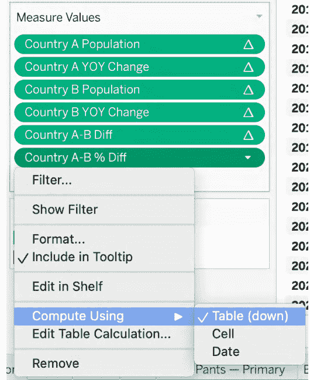

### 图 4.42: 使用计算对象

迄今为止我们取得了什么成果？我们创建了一个重复的数据结构，允许我们在两个独立的列中比较两个国家，尽管原始数据集中的数据只在一列。这种设置使我们能够提出更高级的问题。

为了演示这一点，让我们来问：*印度的人口何时会超过中国*？您可以按需设置参数——我选择 0.45% 和 1.20% 作为平均年度增长率，但您可以自由选择任何您认为对某个国家最合适的参数。在图 4.43 中，您可以看到，当中国和印度的增长率分别为 0.45% 和 1.20% 时，印度到 2024 年的人口将超过中国。您可以通过查看 **A 国人口** 和 **B 国人口** 列来观察这一点。橙色表示预测，蓝色表示来自我们数据集的实际数据：

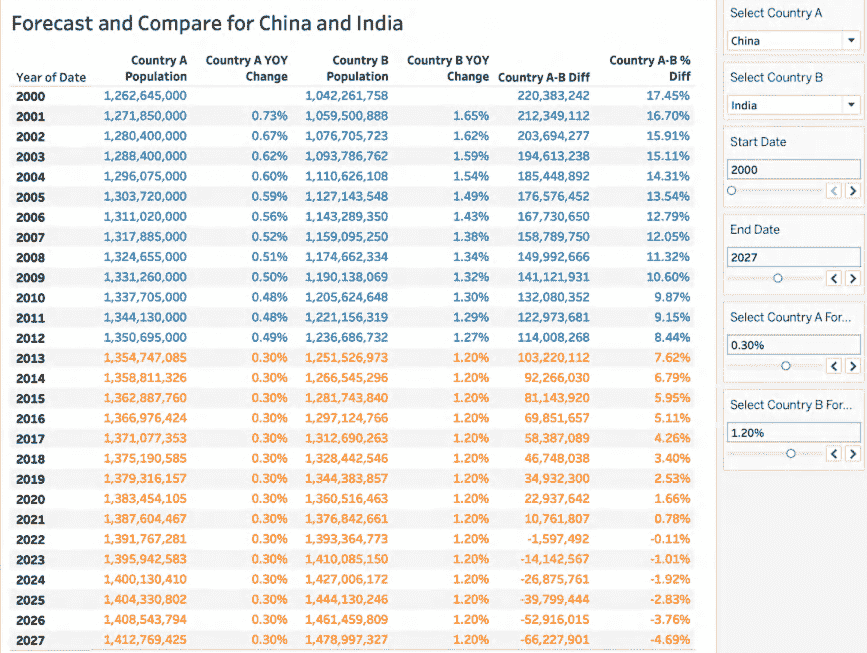

### 图 4.43: 预测仪表板

我们显然已经领先多年；如果我告诉您，2020 年中国的人口为 1,439,323,776，印度的人口为 1,380,004,385，您能否使用这个仪表板找出 2012 至 2020 年中国和印度的实际平均增长率？在 Tableau Public 上分享您的结果，并使用 #MasteringTableau 标签！

本练习的关键之一是数据支架（data scaffolding）。数据支架会生成数据源中不存在的数据。World Indicators 数据集仅包含 2000 至 2012 年的日期，显然，Records 数据集不包含任何日期。通过使用 Start Date 和 End Date 参数结合计算的 Date 字段，我们能够生成所需的任何日期集。我们不得不混合数据，而不是使用连接或合并，以保持原始数据源完整，并在 World Indicators 本身之外创建所有其他数据。

实际的数据支架发生在将 Date 字段放置于“行”货架后，从 Date 字段下拉列表中选择“显示缺失值”。这使得 Start Date 和 End Date 之间的每一年都能显示，即使底层数据中没有匹配的年份。第 6 章“利用 OData、数据致密化、大数据和 Google BigQuery”将更详细地探讨与数据支架（即数据致密化）非常相似的内容。

让我们更深入地研究本练习中的几个计算字段，以更好地了解预测的工作原理：

- **实际/预测：**

```
IIF(ISNULL(AVG([World Indicators].[Population Total])),"Forecast","Actual")
```

上述代码用于确定 **世界指标** 数据集中是否存在数据。如果日期在 2012 年之后，则不存在数据，因此返回 Forecast。

- **A 国人口：**

```
IF [Actual/Forecast] = "Actual" THEN SUM([World Indicators].[Country A Population]) ELSE PREVIOUS_VALUE(0)
* [Select Country A Forecast] + PREVIOUS_VALUE(0) END
```

如果需要预测来确定值（即日期在 2012 年之后），则会执行此代码的 ELSE 部分。PREVIOUS_VALUE 函数返回上一行的值，将结果乘以预测值，然后加上上一行。

让我们看下表中的示例：

- 上一行值 (PRV)：1,000
- 预测 (F)：0.01
- PRV * F：0
- 当前行值：1,010

在 **A 国人口** 计算字段中需要注意的一个重要事项是，预测非常简单：将上一个人口乘以给定的预测数字并汇总结果。在不更改逻辑整体结构的前提下，这段代码可以使用更复杂的预测进行修改。

这些练习表明，借助一些其他技巧和技术，数据混合在您的数据项目中可以发挥巨大作用。最后，我们将总体讨论数据结构，以便您更好地理解 Tableau 正在做什么以及如何实现可视化目标。

## 理解数据结构

合适的数据结构不易定义。诚然，有一些基本规则。例如，长格式数据通常优于宽格式数据。列众多的宽数据集可能难以处理，而相同数据若结构化为列较少但行更多的长格式，通常更易于处理。

然而，情况并非总是如此！某些业务问题更容易用宽数据结构来回答，这就是问题的关键所在。业务问题决定了合适的数据结构。如果一种结构能回答所有问题，那很好！然而，您的问题可能需要多种数据结构。Tableau 中的 **透视** 功能可帮助您即时调整数据结构，以回答不同的业务问题。


开始此练习前，请确保您理解以下几点：

- Tableau 中的数据透视仅限于 Excel、文本文件和 Google Sheets；否则，您必须使用自定义 SQL 或 Tableau Prep
- 在数据库术语中，Tableau 中的透视称为取消透视（unpivot）

现在我们已经澄清了 Tableau 中透视的工作原理，请想象这个场景：作为一家医院的业务分析师，您正将 Tableau 连接到患者数据的每日快照。您有两个问题：

- 任何给定日期发生了多少事件？例如，有多少患者在某一天入院？
- 事件之间过去了多少时间？例如，患者在医院多天住院的平均时长是多少？

要回答这些问题，请执行以下步骤：

1. 在与本章相关的入门工作簿中，选择 Time Frames 工作表，并在数据窗格中选择 Patient_Snapshot 数据源。
2. 单击标记卡中的下拉菜单，并选择条形图作为图表类型。
3. 在数据窗格中右键单击以创建名为 Select Time Frame 的参数，设置如下截图所示：

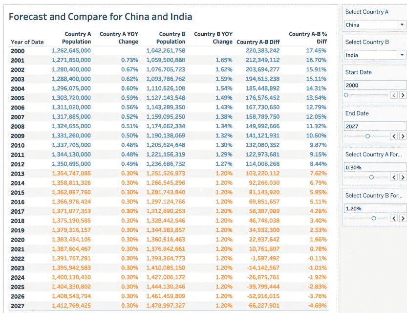

图 4.44: 参数

4. 右键单击刚刚创建的参数并选择显示参数。
5. 在数据窗格中右键单击以创建名为 Selected Time Frame 的计算字段，使用以下代码：

```
CASE [Select Time Frame]
WHEN 1 THEN DATEDIFF('day',[Check-in Date],[Discharge Date])
WHEN 2 THEN DATEDIFF('day',[Surgery Date],[Discharge Date])
WHEN 3 THEN DATEDIFF('day',[Check-in Date],[Surgery Date])
END
```

6. 将患者类型字段拖动到过滤器货架并选中住院患者。
7. 将入院日期字段拖动到过滤器货架并选择日期范围。另外，右键单击生成的筛选器并选择显示筛选器。
8. 右键单击入院日期并拖动到列货架，选择月日年。
9. 右键单击选定时间范围并拖动到行货架，选择平均值。
10. 右键单击选定时间范围并拖动到颜色货架，选择平均值。按需设置颜色。
11. 执行这些操作后，您的工作表应如下所示：

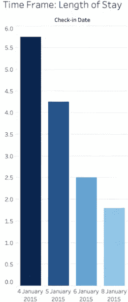

图 4.45: 初始仪表板

12. 右键单击 **选定时间范围平均值** 轴并选择 **编辑轴...**，如下截图所示。然后，删除标题：

时间范围：住院时长

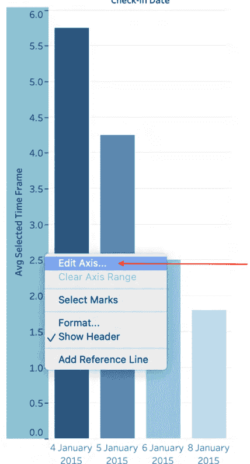

图 4.46: 编辑轴...

13. 选择 **工作表 | 显示标题**。通过插入 **选定时间范围** 参数来编辑标题，如下截图所示：

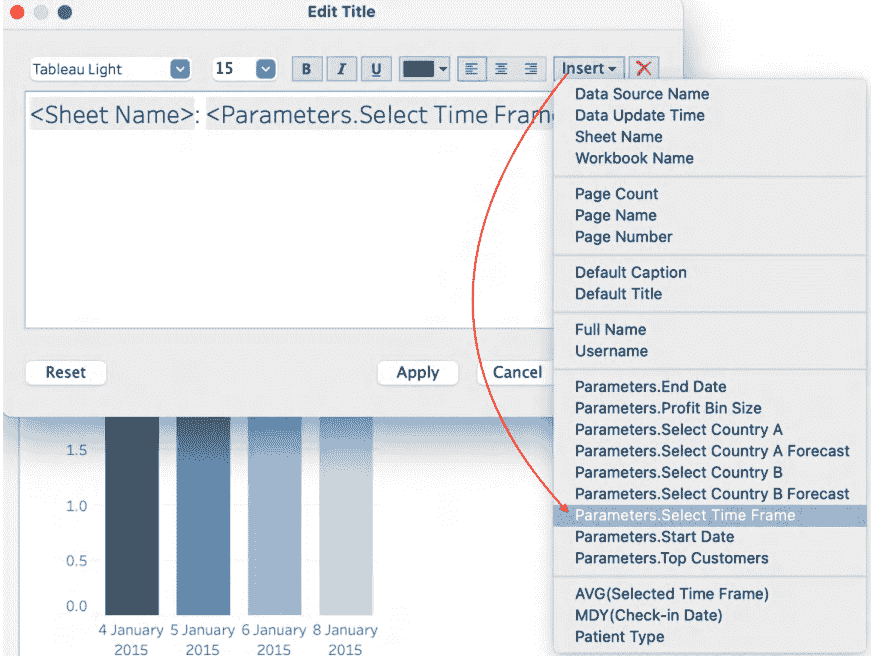

图 4.47: 添加参数

该数据结构非常适合此练习的第一部分。您能够快速创建可视化。唯一中等难度的部分是设置与相关参数关联的 **选定时间范围** 计算字段。

这允许最终用户选择他们想要查看的时间范围：

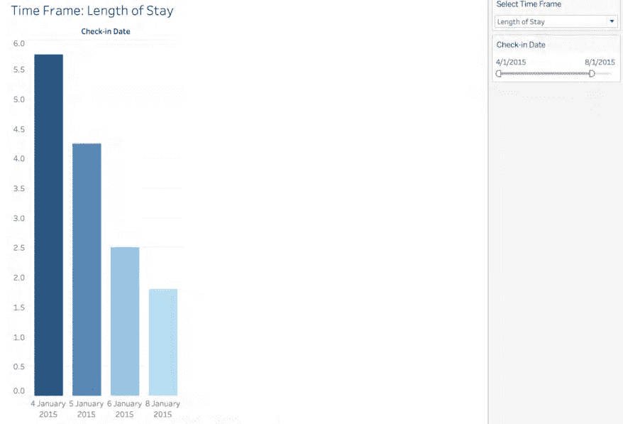

图 4.48: 仪表板

然而，如果您需要找出每天有多少人参与某种类型的事件，会怎样？

使用当前数据结构来回答这个问题相当困难，因为每个患者一行，且该行中包含多个日期。在图 4.49 中，您可以看到差异：右侧是我们当前的数据结构，左侧是将使按天计算事件变得更容易的数据结构：

| 患者 | 事件 | 日期 | | 患者 | 事件 A 日期 | 事件 B 日期 | 事件 C 日期 |
|---|---|---|---|---|---|---|---|
| U | A | X | | U | X | Y | Z |
| U | B | Y | | V | Y | X | |
| U | C | Z | | | | | |
| V | A | Y | | | | | |
| V | B | X | | | | | |

图 4.49: 患者数据结构

因此，在本练习的第二部分，我们将尝试通过数据透视采用不同的方法：

1. 在与本章相关的入门工作簿中，选择 **按日期的事件** 工作表。
2. 在 **数据** 窗格中，右键单击 **患者快照** 数据源并选择 **复制**。
3. 将副本重命名为 **事件**。
4. 右键单击 **事件** 数据源并选择 **编辑数据源...**:

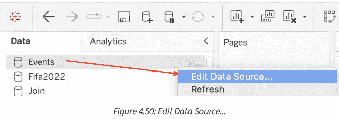

5. 执行以下步骤:
   1. 使用 **Shift** 或 **Ctrl + 单击** 选择所有五个日期字段。
   2. 为所选字段中的任意一个选择下拉选项，并选择 **透视**:

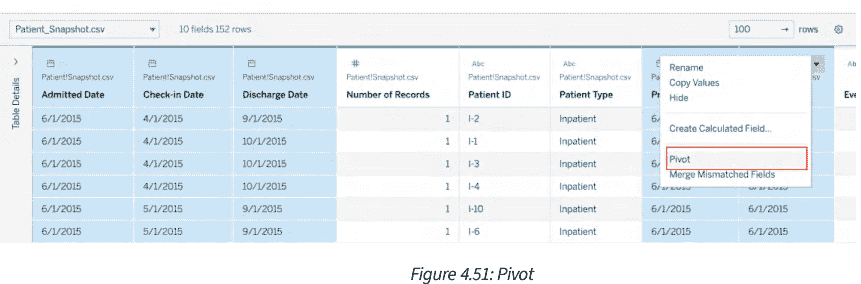

   3. 透视功能将转置行和列，我们将得到类似于图 4.49 左侧的数据结构。将透视后的字段重命名为事件类型和事件日期。
   4. 选择按日期的事件工作表，右键单击，并将事件日期字段拖动到行货架，选择月日年。
   5. 在行货架上将事件类型放在事件日期之后。
   6. 右键单击患者类型并选择显示筛选器。
   7. 将记录数拖动到列货架。

从此，您的工作表应如下所示：

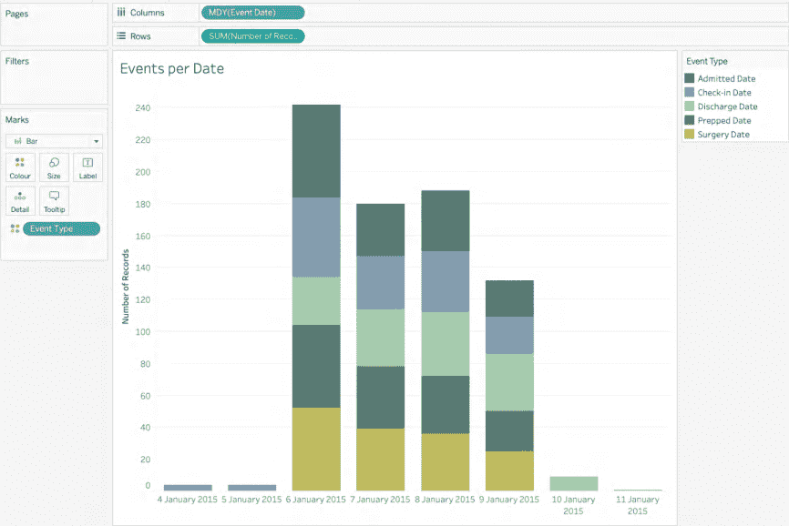

图 4.52: 按日期的事件

原始数据结构不太适合此练习；然而，在复制数据源并透视后，按天计算事件的任务变得非常简单，因为我们只能使用三个字段：事件日期、记录数和事件类型。这是主要收获。如果您发现自己在为看似简单的业务问题创建可视化时遇到困难，请考虑透视。

## 使用关系进行跟随式仪表板练习

我们将现在在一个跟随式仪表板练习中应用您的关系知识。我们将使用的数据集来自一个名为 Chinook 的虚构音乐商店。我们将使用艺术家、流派、销售和员工数据。

开始此练习之前，请从 https://www.kaggle.com/datasets/anurag629/chinook-csv-dataset 下载数据。

1. 在 Tableau 中，首先连接到 Artist.csv 文件。
2. 现在，将 Album.csv 文件拖动到 Artist.csv 文件右侧，直到出现连接线，将两个 CSV 在关系中链接。使用 ArtistId 字段作为两个数据集之间的连接键。

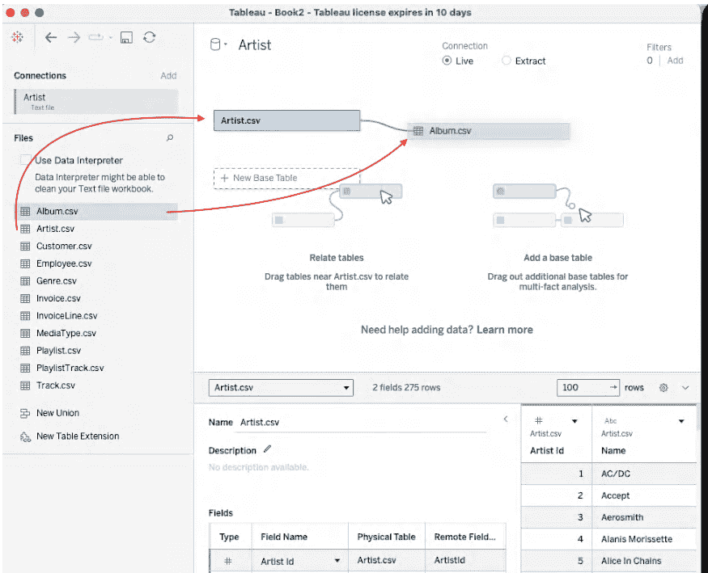

图 4.53: 关系

3. 如下截图所示连接更多数据集，并使用相应的键:

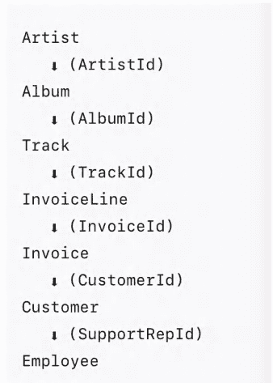

图 4.54: 关系键

4. 此外，按如下方式将 Genre.csv 文件链接到 Track.csv 文件的 GenreId 字段：

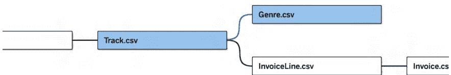

图 4.55: 添加流派

5. 现在，打开一个新工作表并将其命名为按艺术家的销售。
6. 将 Artist.Name 拖动到行。
7. 将 Invoice.Total 拖动到列。

8. 通过单击视图中 **总计** 的排序图标按降序排序。

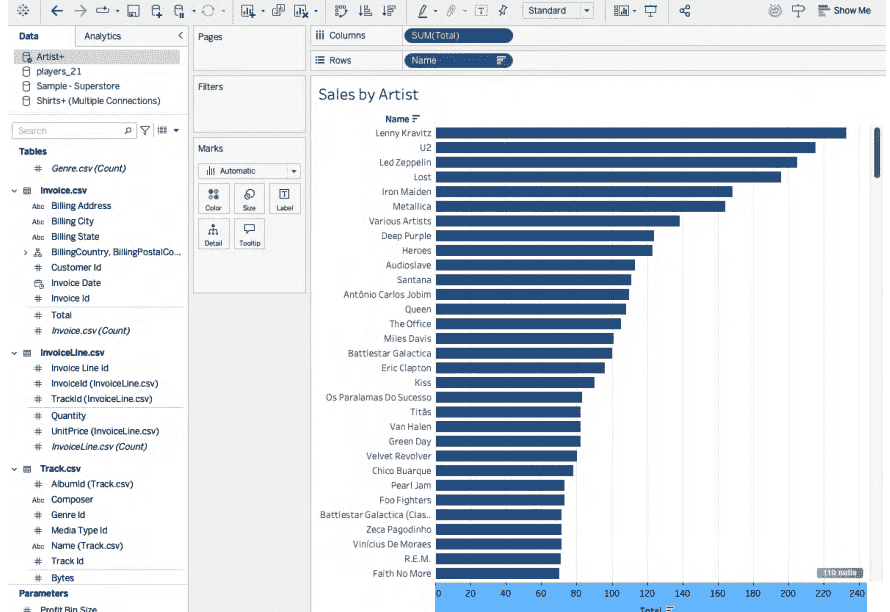

图 4.56: 按艺术家的销售

9. 创建第二个工作表并将其命名为 **按流派的销售**。
10. 将 **流派名称** 拖动到 **行**。
11. 将 **发票行单价** 拖动到 **列**。

12. 将 InvoiceLine.Quantity 添加到 **标记** 卡的 **提示信息** 中。

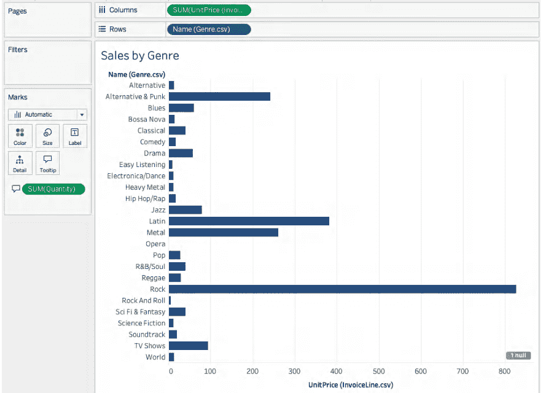

图 4.57: 按流派的销售

13. 最后，创建第四个工作表并将其命名为 **按国家/地区的销售**。
14. 将 Customer.Country 拖动到 **行**。
15. 将 Invoice.Total 拖动到 **列**。

16. 按降序排序。

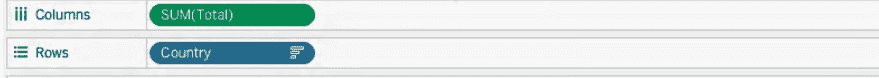

按国家/地区的销售

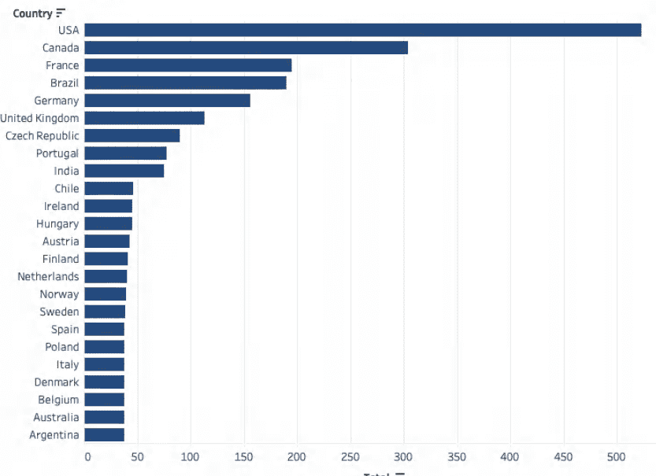

图 4.58: 按国家/地区的销售

17. 现在，创建一个仪表板并按创建顺序将工作表添加到左上角、右上角和底部。
18. 向仪表板添加艺术家名称、流派名称和国家/地区的筛选器。


## 按艺术家划分的销售

- Lenny Kravitz
- U2
- Led Zeppelin
- Lost
- Iron Maiden
- Metallica
- Various Artists
- Deep Purple
- Heroes
- Audioslave
- Santana
- Antônio Carlos Jobim
- Queen

## 按流派划分的销售

- 另类
- 另类与朋克
- 蓝调
- 波萨诺瓦
- 古典
- 喜剧
- 戏剧
- 轻音乐
- 电子/舞曲
- 重金属
- 嘻哈/说唱
- 爵士
- 拉丁

- 名称 (全部)
- 名称 (Genre.csv) (全部)
- 国家 (全部)

## 按国家划分的销售

- 美国
- 加拿大
- 法国
- 巴西
- 德国
- 英国
- 捷克
- 葡萄牙
- 印度
- 智利
- 爱尔兰
- 匈牙利
- 奥地利

图 4.59：仪表盘

在本跟随式仪表盘构建练习中，你构建了一个仪表盘，演示了如何在 Tableau 中使用关系来建模多表数据、结合多个连接数据集的洞察，并探索艺术家、专辑、客户和国家之间的销售表现。

## 摘要

本章以关系介绍开头，接着讨论了连接，并发现了 Tableau 用于生成相应数据的查询。当需要合并格式相同且存储在多个工作表或数据源中的数据时，合并（Unions）非常有用。

随后，我们回顾了数据混合，以清晰地了解它与连接的区别。我们发现，数据混合的主要限制是不允许从辅助来源使用维度；不过，我们也发现这条规则有例外。我们还讨论了支架（scaffolding），它可以使数据混合出奇地有效。

最后，我们讨论了数据结构，并了解了透视（pivoting）如何使困难或不可能的可视化变得容易。在完成第二次以数据为中心的讨论后，下一章将讨论表计算、分区和寻址。

## 加入我们的 Discord 社区

加入我们社区的 Discord 空间，与作者和其他读者交流：

https://discord.gg/VXpz9YPUTW


