# 表计算简介

Tableau 中的表计算主题如此丰富深奥，单凭这一点完全可以成为一本书的主题。探索每个表计算函数的各种选项以及表计算的各种应用方式，是一项有趣且有价值的工作。在审阅本章示例时，你无疑会遇到可应用于日常工作的技巧；不过，你可能会难以理解某些技巧为何有效。本章旨在提供思考表计算的方式，这些方式将在你掌握这一迷人主题的旅程中证明很有用。在此过程中，还将考虑一些实际示例。

在为本章审阅的几十篇博客、论坛帖子、会议场次、文章和白皮书中，Jonathan Drummey 的博客文章（http://drawingwithnumbers.artistart.org/at-the-level-unlocking-the-mystery-part-1-ordinal-calcs/）“在层级中 – 揭示谜团第 1 部分：序号计算”是理解分区和寻址（即表计算的 DNA）的各种细微差别最清晰、最具洞察力的文章。在本章中，我们将讨论以下主题：

- 分区和寻址方向
- 方向性和非方向性寻址
- 探索每个唯一的表计算函数
- 函数的应用

让我们深入探讨，并以表计算的一般定义及两个由此产生的问题开始本章，我们将在本章结束时回答这些问题。

你的购买包含免费 PDF 副本 + 专属额外内容

你的购买包含本书的 DRM-free PDF 副本、Packt+ 图书馆 7 天试用（无需信用卡）以及额外的专属内容。请参阅前言中的“随书免费权益”部分，立即解锁并最大化你的学习。

## 分区和寻址方向

如第 1 章“回顾基础知识”中所讨论，计算字段可分为行级别、聚合级别或表级别。对于行级别和聚合级别计算，底层数据源引擎完成大部分（如果不是全部）计算工作，Tableau 仅对结果进行可视化。对于表计算，Tableau 同样依赖底层数据源引擎和机器上的可用 RAM 来执行计算任务；不过，在该工作完成并返回数据集后，Tableau 在呈现结果之前会进行额外处理。

让我们来看表计算的定义，如下：

表计算是对缓存数据集执行的函数，该缓存数据集是 Tableau 向数据源发出查询后生成的。

此缓存不仅仅是查询返回的结果。Tableau 可能会调整返回的结果。我们将在第 6 章“利用 OData、数据密集化、大数据和 Google BigQuery”中讨论这一点；Tableau 可能会通过数据密集化扩展缓存，但通常这是由用户驱动的。在表计算术语中，缓存称为分区。

考虑缓存的结构很重要。缓存中的数据集是工作表中使用的表，像所有表一样，由行和列组成。这一点对于表计算尤其重要，因为表计算可能在沿着缓存移动时计算。`previous_value()` 表计算在缓存结构变化时会发生变化，因为它会检索当前值之前的值，而这非常主观。它是按日期、值还是字母顺序排在前面？由你决定使用寻址和分区来告诉 Tableau 如何构建缓存。

大多数表计算都需要考虑缓存结构。这种表计算称为方向性表计算。或者，表计算可以基于整个缓存进行计算，而不考虑寻址和分区。例如，`total()` 表计算将计算总值，该值在缓存顺序变化时不会改变。另一个例子是 `size()`、`script_` 和 `model_` 函数。这种表计算称为非方向性表计算。

> 请注意，在 Tableau 文档中，缓存中的数据集通常被称为分区。本章的结构旨在提供一个简单的架构，以便理解表计算。

“表计算函数简介”部分探讨了每个唯一的表计算函数。“函数的应用”部分探讨了如何通过分区和寻址维度将表计算应用于视图。

## 方向性和非方向性寻址

我们将通过列出不同的表计算函数来开始本节。

Tableau 提供了广泛的表计算，但如果我们将考虑范围缩小到表计算函数的唯一组，就会发现只有 11 个：

- LOOKUP
- PREVIOUS VALUE
- RUNNING
- WINDOW
- FIRST
- INDEX
- LAST
- RANK
- SIZE
- TOTAL
- SCRIPT & MODEL

如“分区和寻址方向”一节中所述，表计算函数在缓存上操作，因此如果缓存数据发生变化，结果可能会随之变化，具体取决于表计算的类型：方向性或非方向性。在接下来的练习中，我们将看到方向性和非方向性表计算函数的实际应用。

让我们深入了解方向性和非方向性表计算：

1. 导航至 https://github.com/PacktPublishing/Mastering-Tableau-2026/tree/main/Chapter05
   以查找并下载与本章相关的工作簿。
2. 连接到 Sample – Superstore 数据集。
3. 创建一个 Directional/Non-Directional 工作表。

4. 创建计算字段，如下表所示：

| 名称 | 计算 | 说明 |
|---|---|---|
| 查找 | LOOKUP(SUM([Sales]), -1) | 注意此计算中包含 -1。这指示 Tableau 从上一行检索值。 |
| 大小 | SIZE() | SIZE 函数返回分区中的行数。因此，如下图所示，大小等于总行数。 |
| 窗口求和 | WINDOW_SUM(SUM([Sales])) | 窗口求和函数 (WINDOW_SUM(expression, [start, end])) 可以方向性或非方向性地操作。由于本示例不包含 [start, end] 选项，因此它以非方向性方式操作。 |
| 带起止的窗口求和 | WINDOW_SUM(SUM([Sales]), 0,1) | 如 [start, end] 选项的包含所示，此窗口函数示例以方向性方式操作。 |
| 运行总计 | RUNNING_SUM(SUM([Sales])) | 由于 RUNNING 函数在计算时会考虑前一行，因此其本质上以方向性方式操作。 |

5. 将类别和运输方式放在行货架上。

6. 双击销售额、查找、大小、窗口求和、带起止的窗口求和和运行总计，以填充视图，如下图所示：

| 类别 | 运输方式 | 沿表的查找（向下） | 沿表的运行总计（向下） | 销售额 | 沿表的大小（向下） | 沿表的窗口求和（向下） | 带起止的窗口求和 |
|---|---|---|---|---|---|---|---|
| Furniture | First Class | 110,761 | 110,761 | 110,761 | 12 | 2,326,534 | 149,909 |
| | Same Day | | 149,909 | 39,149 | 12 | 2,326,534 | 200,655 |
| | Second Class | 39,149 | 311,416 | 161,506 | 12 | 2,326,534 | 604,838 |
| | Standard Class | 161,506 | 754,748 | 443,332 | 12 | 2,326,534 | 544,957 |
| Office Supplies | First Class | 443,332 | 856,372 | 101,625 | 12 | 2,326,534 | 130,715 |
| | Same Day | 101,625 | 885,463 | 29,090 | 12 | 2,326,534 | 192,034 |
| | Second Class | 29,090 | 1,048,406 | 162,943 | 12 | 2,326,534 | 601,178 |
| | Standard Class | 162,943 | 1,486,641 | 438,235 | 12 | 2,326,534 | 577,601 |
| Technology | First Class | 438,235 | 1,626,007 | 139,366 | 12 | 2,326,534 | 200,398 |
| | Same Day | 139,366 | 1,687,039 | 61,033 | 12 | 2,326,534 | 203,254 |
| | Second Class | 61,033 | 1,829,261 | 142,222 | 12 | 2,326,534 | 639,495 |
| | Standard Class | 142,222 | 2,326,534 | 497,273 | 12 | 2,326,534 | 497,273 |

图 5.1：表计算

7. 图 5.1 中的表格显示，大小函数和窗口求和函数是唯二的非方向性函数。所有其他函数都取决于方向呈现一个数字。例如，查找会向下移动并打印实际字段之前的值。您可以单击任何表计算字段上的三角形并选择“编辑表计算”来更改方向。

本练习是表计算的两个类别的示例：方向性和非方向性。现在，我们将逐个考虑表计算函数。遗憾的是，篇幅不允许我们探索所有表计算；然而，为了获得工作理解，考虑除一个之外的所有独特选项组应该足够了。以 Script_ 开头的四个表计算以及六个 Model_ 函数，将在第 14 章“集成编程语言”中介绍。

虽然我在编写时在每个部分末尾添加了现实世界场景，但跟随练习的重点是展示表计算功能，并考虑每个函数如何与缓存中的数据集（也称为分区）进行方向性或非方向性交互。

以下练习将逐个向我们展示每个表计算；在每个部分末尾，您将找到我对现实世界场景的看法。

## 查找和总计

以下工作表的目标是显示在 2013 年最后两天进行过购买的客户，以及 12 月份的相关绝对销售额和相对销售额。

在以下表中，LOOKUP 的行为是方向性的，而 TOTAL 是非方向性的。在结果中很容易注意到这种行为。按以下步骤操作：

- 1. 在与此章关联的工作簿中，导航到 查找/总计 工作表。
- 2. 将客户名称和订单日期拖到行货架上。通过右键单击并选择“天”以及“离散”，将订单日期设置为 月/日/年 离散。
- 3. 将订单日期放在筛选器货架上，选择仅查看 2025 年 12 月，并将日期格式选择为 月/年。
- 4. 创建以下计算字段：

| 名称 | 计算 |
| :--- | :--- |
| 查找间隔时间 | DATEDIFF('day', LOOKUP(MAX([Order Date]), 0), MAKEDATE(2025, 12, 31)) |
| 总销售额百分比 | SUM(Sales)/TOTAL(SUM([Sales])) |

- 5. 右键单击 总销售额百分比，选择“默认属性 | 数字格式”，将数字格式设置为带两位小数的百分比。
- 6. 将 查找间隔时间 放在筛选器货架上，并选择 0 到 1 的范围。
- 7. 双击 销售额 和 总销售额百分比，将两个字段都放置在视图上。
- 8. 按需要设置格式：

| 客户名称 | 订单日期的日期 | 沿表的总销售额百分比（向下） | 销售额 |
|---|---|---|---|
| Chuck Clark | 2025 年 12 月 30 日 | 0.25% | 209.3 |
| Erica Bern | 2025 年 12 月 30 日 | 0.04% | 34.6 |
| Harry Olson | 2025 年 12 月 30 日 | 0.00% | 3.0 |
| Jill Matthias | 2025 年 12 月 30 日 | 0.00% | 3.0 |
| Patrick O'Donnell | 2025 年 12 月 30 日 | 0.55% | 466.8 |

图 5.2：总销售额

让我们考虑一下前面工作表的工作原理：

- 对订单日期的筛选确保返回到 Tableau 的数据集仅包含 2025 年 12 月的数据。
- 总销售额百分比 SUM([Sales])/TOTAL(SUM([Sales]))) 包含 TOTAL(SUM([Sales])) 计算字段，它返回整个数据集的总销售额。将 SUM([Sales]) 除以该总数可返回总数的百分比。
- 查找间隔时间：DATEDIFF('day', LOOKUP(MAX([Order Date]), 0), MAKEDATE(2025, 12, 31)) 将返回一个整数，反映 LOOKUP 函数返回的日期与 2025 年 12 月 31 日之间的差异。请注意，LOOKUP 函数的偏移量为零。这导致每行返回与该行关联的日期。这与方向性和非方向性表计算不同，后者包含偏移量为 -1 的 LOOKUP 函数，导致视图中的每行返回与上一行关联的数据。

乍一看，您可能认为可以通过从筛选器货架中删除 查找间隔时间 并调整 [订单日期] 的筛选以仅显示 12 月最后两天来简化此工作簿。但是，如果这样做，总销售额百分比将在视图的所有行中加起来等于 100%，这将无法满足工作簿的目标。将 查找间隔时间 视为不是筛选，而是隐藏 12 月除最后两天外的所有日期。这种隐藏确保计算 总销售额百分比 所需的数据位于缓存/分区中的数据集中。

现实世界场景：我使用查找的次数比总计更多。两者在使用 Tableau 时都非常宝贵。我们已经看到，您使用查找来处理变化；您可以思考月度利润对比、今天与去年今天的员工人数、每周每天的网站点击量差异等等。

对于表计算 总计，每当您想要显示某事物的总数，同时仍在仪表板中显示某些聚合级别时，都可以使用它。图 5.2 中的 总计百分比 实际上就是完美的例子。

## 上一个值

以下工作表的目标是返回每年销售额的汇总值，并设定下一年的销售目标。请注意，已提供两个选项来确定下一年的销售目标，以演示 PREVIOUS_VALUE 与 LOOKUP 的区别。另请注意，PREVIOUS_VALUE 的行为是方向性的。

让我们来看看步骤：

- 1. 在与此章关联的工作簿中，导航到 上一个值 工作表。
- 2. 创建以下计算字段：

| 名称 | 计算 |
|---|---|
| 下一年目标_上一个值 | PREVIOUS_VALUE(SUM([Sales])) * 1.05 |
| 下一年目标_查找 | LOOKUP(SUM([Sales]), 0) * 1.05 |

- 3. 将订单日期放在行货架上。
- 4. 双击 销售额、下一年目标_上一个值 和 下一年目标_查找，将每个都放置在视图上。
- 5. 按需要设置格式，或如下图所示（通过拖动 度量值 中的药丸，视图中的顺序会相应改变，如下图所示）：

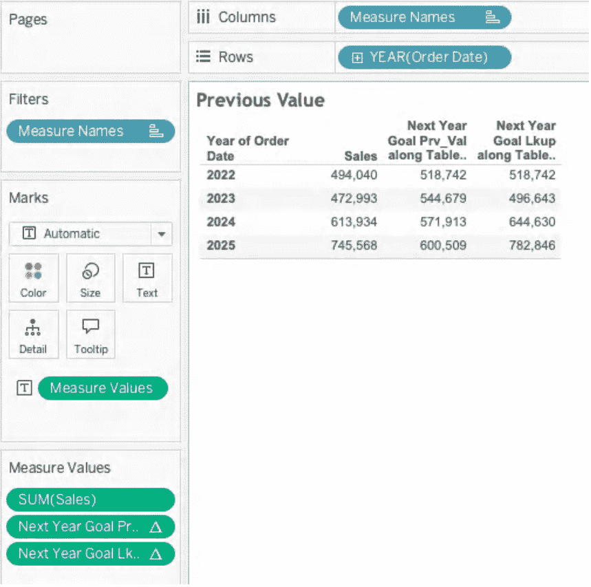

## 图 5.3：下一年

让我们考虑前面的工作表是如何工作的：

- Next Year Goal Prv_Val: PREVIOUS_VALUE(SUM([Sales])) * 1.05 应用于本工作表，它检索每一行之前的结果并增加 5%。换句话说，目标是所有年份每年稳定增长 5%。
- Next Year Goal Lkup: LOOKUP(SUM([Sales]),0) * 1.05 也应用于本工作表；该计算在当前年份销售额的基础上增加 5%。换句话说，明年的目标是比当年销售额高 5%。不考虑往年数据。

为了更好地理解此练习，请考虑前面截图中与 2025 年关联的值。Next Year Goal Prv_Val 是通过 2024 年的 Next Year Goal Prv_Val 计算得出的；即：$613,934 x 1.05。另一方面，Next Year Goal Lkup 是通过 2024 年的销售额计算得出的；即：$745,568 x 1.05。

现实场景：假设您想要外推一个数据点，并从该新值继续外推；为此，您使用 Previous_Value。一个示例是支付频繁票息的债券。如果您的债券面值为 100，且支付 4% 的半年期票息，您可以使用 Previous_Value 计算债券的最终价值，就像我们在上一个练习中使用 Next Year Goal Prv_Val 一样。

## 运行

以下工作表的目标是显示数据集中每个月与 SUM(Profit) 相比的运行最小利润、运行平均利润和运行最大利润。

以下示例演示了 Running 函数的方向性行为：

- 1. 在与此章关联的工作簿中，导航到 Running 工作表。
- 2. 创建以下计算字段：

| 名称 | 计算 |
| :--- | :--- |
| Running Min | RUNNING_MIN(SUM([Profit])) |
| Running Max | RUNNING_MAX(SUM([Profit])) |
| Running Avg | RUNNING_AVG(SUM([Profit])) |

- 3. 将订单日期放置于列书架，并将其设置为月/年 连续。将度量值放置于行书架。
- 4. 从度量值书架中删除所有度量值实例，除了 Running Min、Running Max、Running Avg 和 Profit。
- 5. 将 SUM(Profit) 从度量值书架移动到行书架。右键单击 SUM(Profit) 并选择双轴。
- 6. 按需格式化。

让我们考虑前面的工作表是如何工作的：

- Running Min: 前面的截图中可见 RUNNING_MIN(SUM([Profit]))，它将当前的 SUM(Profit) 与到目前为止记录的最小 SUM(Profit) 进行比较。如果当前的 SUM(Profit) 小于迄今记录的最小 SUM(Profit)，则当前的 SUM(Profit) 将替换最小的 SUM(Profit)。
- Running Max: RUNNING_MAX(SUM([Profit])) 的运作方式与 Running Min 类似，只不过它查找的是最大值。
- Running Avg: RUNNING_AVG(SUM([Profit])) 根据从起始到当前月的每个月计算平均 SUM(Profit)。

现实场景：同样，此表计算有大量示例。考虑年初至今的利润、基于出生的人口数量（不要忘记减去死亡人数）、当前的开放支持工单数量等等。

## 窗口

以下工作表的目标是显示 WINDOW 函数的方向实例和非方向实例。

请按照以下步骤操作：

- 1. 在与此章关联的工作簿中，导航到 **窗口** 工作表。
- 2. 创建以下计算字段：

| 名称 | 计算 |
|---|---|
| Win Avg Directional | WINDOW_AVG(SUM([Profit]),-2,0) |
| Win Avg Non-Directional | WINDOW_AVG(SUM([Profit])) |

- 3. 将订单日期放置于 **列** 书架，并将其设置为 **月/年 连续**。将度量值放置于 **行** 书架。
- 4. 从 **度量值** 书架中删除所有度量值实例，除了 **Win Avg Directional**、**Win Avg Non-Directional** 和 **利润**。
- 5. 从 **数据** 窗格中，将另一个 **利润** 实例拖放到 **行** 书架上。右键单击 **行** 书架上的 **利润** 实例，并选择 **快速表计算 | 移动平均**。右键单击 **行** 书架上的 **利润** 实例，并选择 **双轴**。
- 6. 右键单击标记为 **利润的移动平均** 的轴，并选择 **同步轴**。
- 7. 按需格式化，或如下一个截图所示：

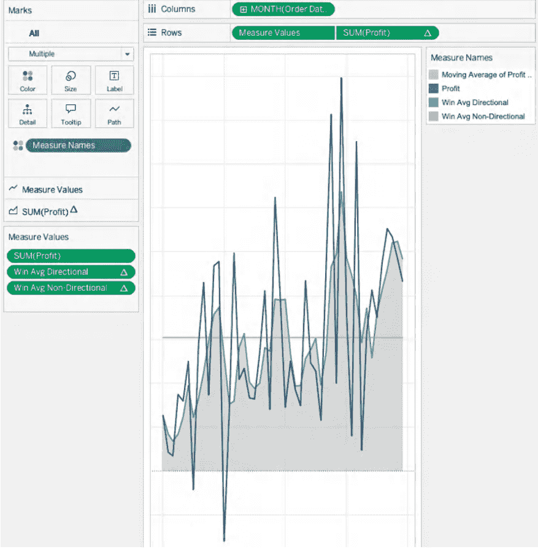

## 图 5.4：窗口

让我们考虑前面的工作表是如何工作的：

- Win Avg Directional: WINDOW_AVG(SUM([Profit]), -2, 0) 的起点为 -2，终点为 0，这意味着 Tableau 将基于当前月及前两个月的 SUM([Profit]) 平均值创建一个点。将 0 更改为 2 将导致每个点的平均值基于前 2 个月、当前月和接下来的 2 个月进行计算。双击行书架上的 Profit 实例以查看底层代码。（这是通过右键单击并选择快速表计算 | 移动平均而转换为表计算的 Profit 实例。）请注意，该计算与为 **Win Avg Directional** 创建的代码相同。但是，如果您右键单击两个药丸并选择 **编辑表计算**，您会注意到生成的对话框不同。与 **利润** 关联的对话框具有更多选项，包括更改前一值和下一值的功能。更改 **Win Avg Directional** 的前一值和下一值需要调整计算字段。
- Win Avg Non-Directional: WINDOW_AVG(SUM([Profit])) 与视图中的水平线相关联。请注意，它不依赖于方向。相反，它是缓存/分区中数据集内所有聚合 **利润** 值的平均值生成的单一值，因此无论数据点的顺序如何，它都将保持相同。

现实场景：您为什么想要使用窗口平均值？例如，因为您想要平滑异常值。窗口平均值为您的数据提供了稳定的表示。单个高点或低点将被移除。如果您分析股票价格，您会发现价格在一年内可能会有所不同！通过使用窗口平均值，或者更确切地说是窗口标准差，作为早期预警指标，您将能够更清晰地看到价格跳变，并作为投资者采取行动。然而，稳定的增长或下降将落入移动区间。使用固定区间无法实现这一点。

## 首先和最后

以下工作表的目标是显示 Superstore 数据集中最畅销商品的第一个和最后一个实例。请注意，以下示例演示了 FIRST 和 LAST 函数的方向性行为。

请按照以下步骤操作：

- 1. 在与此章关联的工作簿中，导航到 **首先/最后** 工作表。
- 2. 创建以下计算字段：

| 名称 | 计算 |
|---|---|
| First | FIRST() |
| Last | LAST() |
| First or Last | FIRST() = 0 OR LAST() = 0 |

- 3. 将 **产品名称** 放置于 **筛选器** 书架，选择 **顶部** 选项卡，并按 **销售额之和** 选择 **前 1**，如下一个截图所示：

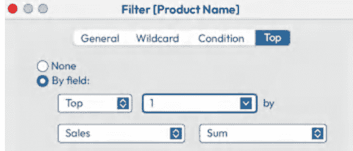

## 图 5.5：顶部筛选器

- 4. 将 First or Last 放置于筛选器书架，并在生成的对话框中选择 真。
- 5. 将产品名称和订单日期拖放到行书架上。
- 6. 将订单日期设置为月/日/年 离散。
- 7. 双击销售额、First 和 Last 以将各自放置于视图中。
- 8. 右键单击 First、Last 和 First or Last，并选择 计算方式 | 表（向下）。
- 9. 按需格式化：

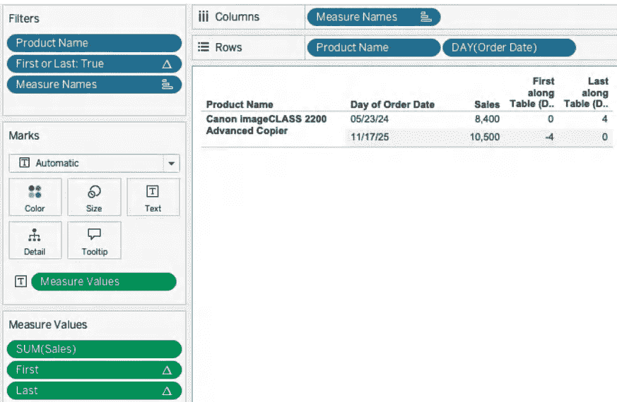

## 图 5.6：首先和最后

让我们考虑前面的工作表是如何工作的：

- First: FIRST() 从 0 开始，向下计数到缓存中数据集的最后一行。在前面的截图中，请注意 Canon imageCLASS 的第一个实例发生在 05/23/24。FIRST() 从 0 到 -4 的范围表明，缓存中的数据集或窗口缓存中有五个 Canon imageCLASS 实例。
- Last: LAST() 从缓存中数据集的最后一行开始，向下计数到 0。在前面的截图中，请注意 Canon imageCLASS 的最后一个实例发生在 11/17/25。LAST() 从 4 到 0 的范围表明，缓存中的数据集中有五个 Canon imageCLASS 实例。
- First or Last: FIRST() = 0 OR LAST() = 0，当放置于筛选器书架并设置为 真 时，将隐藏所有匹配行的实例，除了第一个和最后一个。
视图中包含 Row ID 字段，以确保显示 Canon imageCLASS 的第一个和最后一个实例。否则，如果第一个或最后一个日期上有多个 Canon imageCLASS 实例，销售数字将反映多个值。为视图中的每个表计算设置 计算方式 为 表（向下）非常重要。计算方式与 寻址 相同，将在 应用函数 部分中详细讨论。

现实场景：您可以使用此类计算来计算每个季度最后 5 个订单之间的时间，以查看订单之间的时间在白天是增加还是减少。然后，这可以帮助改善营销或更高效地安排帮助台工作时间。

## 索引

以下工作表的目标是列出美国底层数据集中拥有超过 50 个邮政编码的州。

请注意，以下示例演示了 INDEX 函数的方向性行为，并可以将其视为行计数：

- 1. 在与此章关联的工作簿中，导航到 Index 工作表。
- 2. 将 标记 卡设置为 圆圈。
- 3. 将 州 放置于 行 书架，将 邮政编码 放置于 详细信息 书架。
- 4. 创建一个名为 Index 的计算字段，代码为：INDEX()。将 Index 拖放到 筛选器 书架，并选择 范围值 筛选器。通过将滑块移动到最小值 50，选择仅查看 50 或更大的值。

5. 右键单击 Index 并选择 Edit Table Calculation。选择 Specific Dimensions 并勾选 Postal Code：

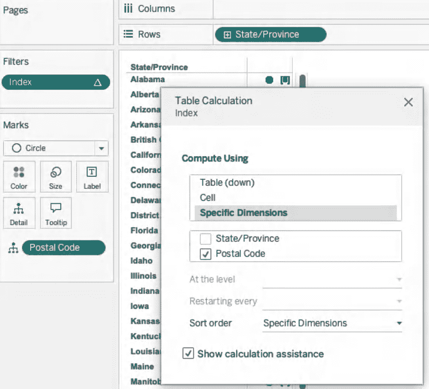

图 5.7: Index

6. 选择 Analysis | Stack Marks | Off，然后查看：

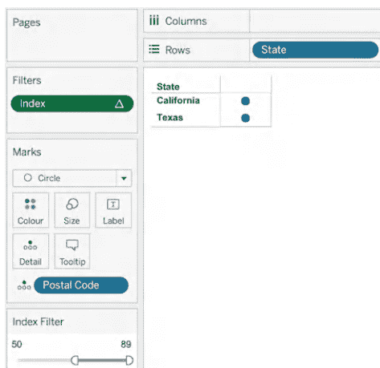

图 5.8: 最终索引

让我们考虑一下前一张工作表的工作原理：

**Index**: INDEX() 从 1 计数到 *n*。因此，它具有方向性。在此例中，由于分区和寻址设置的结果，**Index** 正在计算邮政编码。（分区和寻址将在 *应用函数* 部分中详细讨论。）将 **Index** 筛选器设置为仅显示 50 或更大的值，可确保缓存显示的分区/数据集中仅包含拥有 50 或更多邮政编码的州。

实际场景：我最常将 **Index** 与 **First** 和 **Last** 互换使用。

## 排名

以下工作表的目标是显示每个区域的销量前三的商品。本示例将演示 RANK 如何与缓存中的数据集方向性地交互：

- 1. 在与本章相关的工作簿中，导航到 **Rank** 工作表。

- 2. 将 **Product Name** 放置到 Filters 书架，选择 **Top** 选项卡，并按 **Sum of Sales** 选择 **Top 3**：

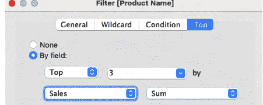

图 5.9: 筛选器

- 3. 将 Region 和 Product Name 放置到 Rows 书架，将 Sales 放置到 Columns 书架。

- 4. 请注意，每个区域仅显示两个项目：

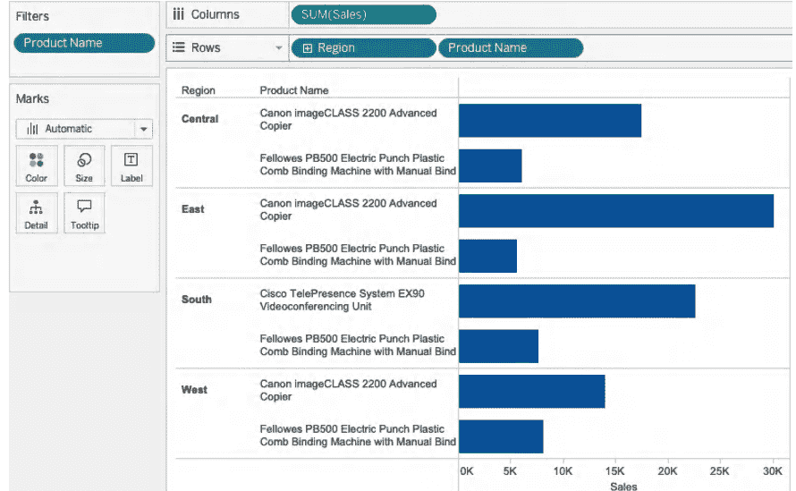

图 5.10: 查看前两个项目

- 5. 创建名为 Rank 的计算字段，代码为 Rank(SUM(Sales))。在 Rows 书架上将 Rank 拖放到 Region 和 Product Name 之间。

- 6. 请注意，在将 Rank 放置到 Rows 书架上的两个 pill 之间之前，需要先将其转换为离散型。实现此操作的一种方法是将 Rank 放置到 Detail 书架，右键单击该 pill，然后选择 Discrete。

- 7. 右键单击 Rank 并选择 Compute Using | Product Name。

- 8. 从 Filters 书架中移除 Product Name。

- 9. 按住 Ctrl 键（Mac 上按 Option 键），然后右键单击并将 Rank 从 Rows 书架拖动到 Filters 书架。在将 pill 从一个书架拖动到另一个书架时按住 Ctrl 键会创建该 pill 的副本。当然，如果不按 Ctrl 键，只会移动该 pill。在显示的对话框中，选择 1、2 和 3。按需要设置格式：

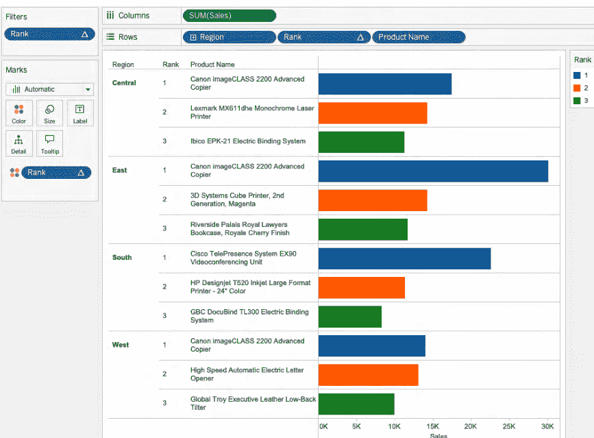

图 5.11: 排名

让我们考虑一下前一张工作表的工作原理：

- - 如果您按照本练习的逐步说明操作，您会注意到，在将 Region 和 Product Name 放置到 Rows 书架并筛选仅显示前三个产品名称后，生成的可视化中每个区域仅显示了两个产品。这是因为 Product Name 上的筛选器显示的是总体前三名产品，但碰巧其中两个总是出现在每个区域。但我们实际上希望按区域显示前三名，而不是总体前三名。为解决此问题，我们使用了 Rank 表计算函数。

- - 让我们了解其工作原理。无需手动编写 Rank(Sum(Sales)) 函数，只需右键单击任何书架上 Sales 的实例，选择 Quick Table Calculation | Rank，即可自动生成相同代码。请注意，Rank 正在计算每个区域内的产品名称数量。这表明 Rank 表计算对缓存/分区中的数据集进行方向性操作。

实际场景：当我想要过滤不断变化的视图（并将其划分为子部分）时，我会使用 Rank —— 例如，我博客文章上每篇文章的最后三条评论。或者，当我想要展示随时间变化的行为时，例如过去 2 年内排名前 10 的产品。这将生成一个排名漂移图。

## 大小

以下工作表的目标是显示 Superstore 数据集中拥有五个或更少城市的所有州。本示例将演示 SIZE 如何利用缓存中的整个分区/数据集，因此具有非方向性。我们还将使用 FIRST 表计算函数（具有方向性）来清理视图。

请按以下步骤操作：

- 1. 在与本章相关的工作簿中，导航到 Size 工作表。

- 2. 将 Analysis | Stack Marks 设置为 Off。

- 3. 创建以下计算字段：

| 名称 | 计算 |
| --- | --- |
| Size | SIZE() |
| 城市计数 | IF FIRST() = 0 THEN [Size] ELSE NULL END |

- 4. 将 State 拖放到 Rows 书架，City 拖放到 Detail 书架，City Count 拖放到 Text/Label 书架，Size 拖放到 Detail 书架。

- 5. 右键单击 Size 筛选器并选择 Compute Using | City。将 Size 从 Marks 卡移动到 Filters 书架。

- 6. 在显示的对话框中，选择"最多"值为 5：

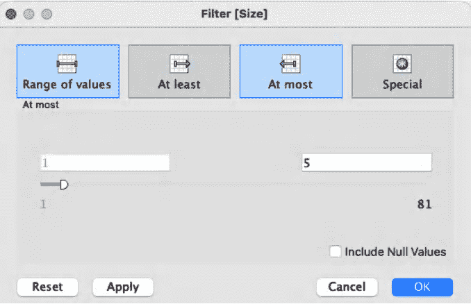

图 5.12: 最多

- 7. 在 Marks 卡上，右键单击 City Count 并选择 Edit Table Calculation。在 Nested Calculations 下，选择 City Count。

- 8. 选择 Compute Using | Specific Dimensions 并勾选 City：

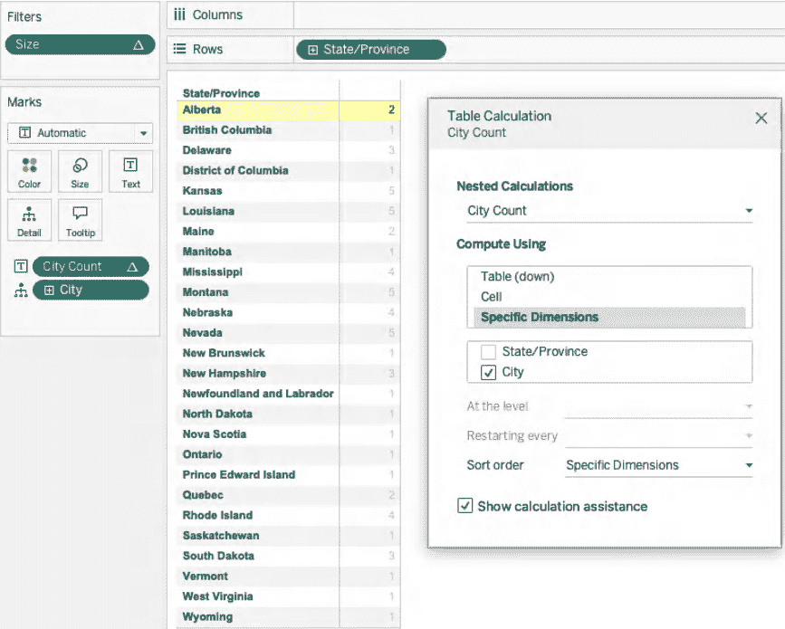

图 5.13: 特定维度

- 9. 现在再次使用 Nested Calculations 下的下拉列表并选择 Size。然后，选择 Compute Using | Specific Dimensions 并勾选 City。

- 10. 观察最终视图：

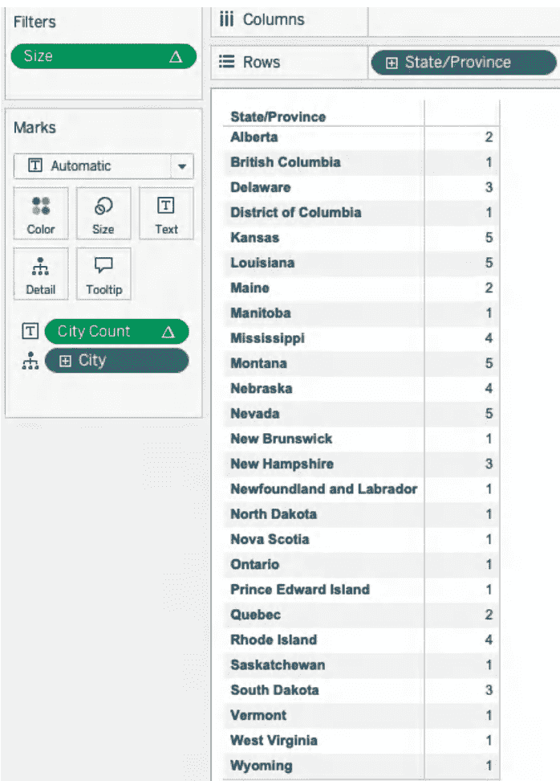

图 5.14: 最终工作表

让我们考虑一下前一张工作表的工作原理：

- - **Size**: Size() 基于缓存中的分区/数据集生成一个单一数字，例如，Delaware 为 3。该数字会随分区和寻址设置而变化，但不会随分区内的移动而变化。因此，它表现为非方向性。

**City Count:** 字段 IF FIRST() = 0 THEN LOOKUP([Size],0) ELSE NULL END 并非严格必需。您可以改为直接将 **Size** 放置到 **Text/Label** 书架。但是，如果您这样做，会发现视图中的数字看起来是粗体。这是因为数字实际上被重复并相互叠加。使用 FIRST() = 0 可确保仅显示一组数字。

请注意，前一练习中有 **Nested Calculations** 选项，这是因为 Size 计算字段在 City Count 计算字段中被引用。

实际场景：**Size** 可能是最不常用的。我坦率地认为，除非是为了解释和演示，否则我从未使用过它。但我看到其他人使用 **Size** 的方式如下：启用**总计**列视图后，**Size** 可以生成非默认聚合（如标准差）。只需使用以下公式：if size()=1 then sum({STDEV([Sales])}) else sum([Sales]) end。

如果您对表计算欲罢不能，这里还有更多场景：

https://www.tableau.com/blog/top-10-tableau-table-calculations

在介绍完不同的表计算后，我们将看到如何在计算的分区（范围）和寻址（方向）中对其进行操作。

## 应用函数

目前为止，我们已探讨了两个主要问题中的第一个：_函数是什么？_ 现在我们将进入下一个问题：_如何应用函数？_

让我们尝试通过以下三个选项来理解该问题，它们都是 INDEX 函数的应用：

| 类别 | 消费者 | | 企业 | | 家庭办公 | | | 类别 | 消费者 | 企业 | 家庭办公 |
|---|---|---|---|---|---|---|---|---|---|---|---|
| 家具 | | 1 | | 2 | | 3 | | 家具 | | 1 | | 1 | | 1 |
| 办公用品 | | 1 | | 2 | | 3 | | 办公用品 | | 2 | | 2 | | 2 |
| 技术 | | 1 | | 2 | | 3 | | 技术 | | 3 | | 3 | | 3 |
| | | | | 类别 | 消费者 | 企业 | 家庭办公 |
| | | | | 家具 | | 1 | | 2 | | 3 |
| | | | | 办公用品 | | 4 | | 5 | | 6 |
| | | | | 技术 | | 7 | | 8 | | 9 |

图 5.15: 应用

INDEX 函数在这三张截图中均被使用；然而，在每张截图中的应用方式不同。第一张和第二张截图均显示 **1, 2, 和 3**，但方向性不同。第三张截图的范围是 **1 到 9**。因此，在每种情况下，INDEX 是如何应用的？

回答这个问题可能会令人困惑，因为 Tableau 使用了不同的术语。在 Tableau 本身中，表计算应用的方式可能被称为沿行运行、沿列移动、按计算使用，或者 **分区（范围）** 和 **寻址（方向）**。出于我们的目的，我们将使用分区和寻址这两个术语，并将根据 Tableau 文档（https://help.tableau.com/current/pro/desktop/en-us/calculations_tablecalculations.htm）在此定义它们：

定义如何对计算进行分组（即定义计算所作用的数据范围）的维度称为分区字段。表计算在每个分区内单独执行。其余用于执行表计算的维度称为寻址字段，并确定计算的方向。

基本上，这意味着分区定义了正在使用的字段，例如 Segment。如果您有跨三个类别划分的三个细分市场，可以分别查看每个组合、一个细分市场内的所有类别，或一个类别内的所有细分市场。您查看的方式就是 Tableau 所称的寻址。

如果在视图中使用了表计算，您可以右键单击它并选择 **编辑表计算**。这样做后，您将看到一个对话框，其中允许选择特定维度。如果某个维度被选中，则它被寻址。如果未被选中，则它被分区。

在下图中查看示例：

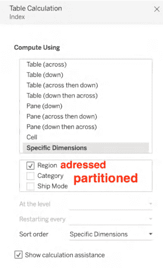

图 5.16：寻址和分区

Tableau 提供了许多开箱即用的分区和寻址设置，包括 Table（向下）、Table（横向）、Pane（向下）和 Cell。我们偶尔会引用这些选项，但不会进行详细评述。这引出了我们的第一条分区和寻址准则：

*不要使用 Tableau 提供的开箱即用的分区和寻址设置，包括 Table（横向）和 Pane（向下）。强制自己单击特定维度并手动定义分区和寻址，以便您清楚了解每个表计算是如何应用的。*

前面准则有几点注意事项：

- 有一个例外，即 **Cell**。使用分区和寻址无法在视图中寻址单个单元格。相反，有必要将 **按计算使用** 设置为 **Cell**，或在 **表计算** 对话框中选择 **Cell**。令人惊讶的是，按每个单元格寻址表计算可能很有用。本章关联的工作簿中的 **百分比占比** 工作表提供了一个示例。在那里，它用于显示分为两个类别的每个单元格的 100%。
- 如果为给定表计算设置了分区和寻址，然后向视图中添加维度，通常，Tableau 不会自动调整分区和寻址设置；它们被锁定。但是，在使用 **Table（向下）**、**Pane（横向）** 等选项时，Tableau 会在向视图中添加维度时自动进行调整。

这引出了我们的下一条准则：

*在为表计算设置分区和寻址之前，将所有所需的维度放置在所需的货架上。*

遵循这些准则有助于确保您始终清楚表计算是如何应用的。起初可能需要更长时间，但最终，您将更好地控制表计算并能够更快地开发。

## 构建游乐场

为更好地理解分区和寻址在 Tableau 中的行为，我们将创建一个简单、受控的环境，让您直接观察其效果。让我们搭建一个简单的游乐场环境，以便快速高效地探索分区和寻址：

- 1. 在本章关联的工作簿中，导航到 **游乐场** 工作表。
- 2. 将 **类别** 放置在 **行** 货架上，将 **索引** 计算放置在 **标签** 货架上。
- 3. **索引** 计算只是 `Index()`。单击与 **索引** 关联的下拉菜单并选择 **编辑表计算**。在弹出的对话框中，单击 **特定维度**。
- 4. 最佳定位屏幕组件。可参考以下截图中的一种可能设置：

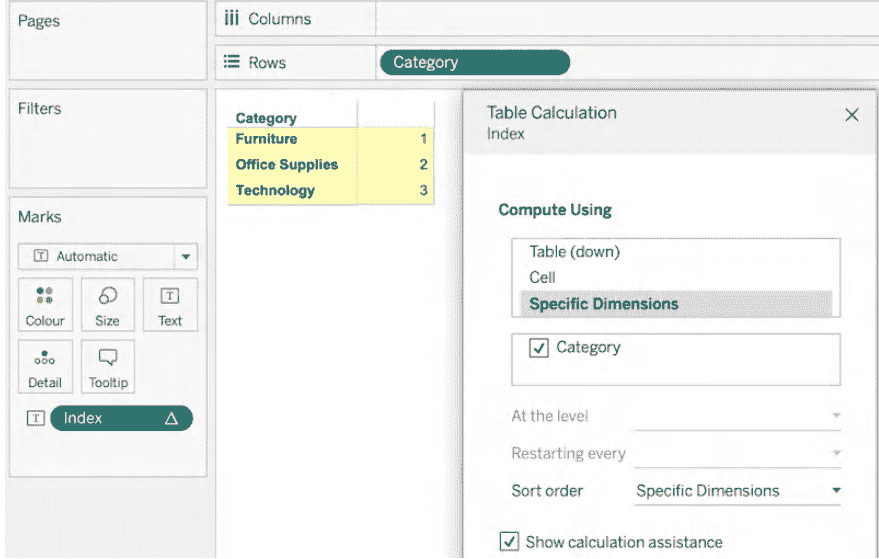

图 5.17：构建游乐场

如图 5.17 所示，我们创建了一个显示三个类别（家具、办公用品、技术）的工作表。通过将索引字段添加到文本货架，我们满足了使用表计算的最低要求，即一个维度和一个表计算。现在，我们可以更改表计算中使用的计算方式，并观察可视化中的变化。后来，我们将探索更复杂的示例；但是，始终从简单开始，并慢慢增加复杂程度，以完全理解发生了什么。

在接下来的页面中，我们将广泛使用我们的游乐场并根据需要对其进行修改。但是，为了效率，我们需要将讨论范围限定在游乐场及其相关讨论上。讨论将局限于行和列货架上的维度以及文本货架上的 INDEX 函数。

我们可以探索不同货架上的各种函数及其提供的不同选项。例如，将日期字段放置在页面货架上会导致使用 TOTAL 函数的表计算，显示一个计算所有页面总计的选项。遗憾的是，在一个章节中不可能探讨每一个可能的细微差别，但如果您对这个主题感兴趣，欢迎查看 Tableau 帮助页面以获取更多内容和示例：https://help.tableau.com/current/pro/desktop/en-us/functions_functions_tablecalculation.htm。

### 使用一个维度的分区和寻址

让我们使用我们的游乐场，以最简单的示例开始探索分区和寻址：

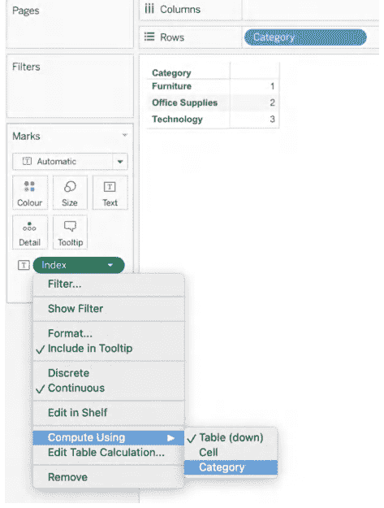

图 5.18：按计算使用 | 类别

在这个简单示例中，寻址 **类别** 会导致 **类别** 维度的每个成员被计数。这表明寻址一个维度确定了计算的方向。在我们的示例中，我们有表计算索引，但 **索引** 取决于分区和寻址，如我们之前所学。 **类别** 在 **行** 货架上充当分区。我们将数据分为三部分：**家具**、**办公用品** 和 **技术**。现在，我们还为 **表计算** 寻址 **类别**。我们通过从 **按计算使用** *图 5.18* 中选择 **类别** 来完成此操作。现在 **表计算** 将应用于类别，因此计数为 1、2 和 3 个类别。

如果选择 **按计算使用 | 单元格**，则分为三个类别的分区仍会保留在视图中——您仍会看到 **家具**、**办公用品** 和 **技术**——但计数将按每个单元格进行，而不是针对整个 **类别** 维度。因此，**索引** 将计数 1，然后移动到下一个单元格并计数 1，再下一个单元格，再次计数 1：

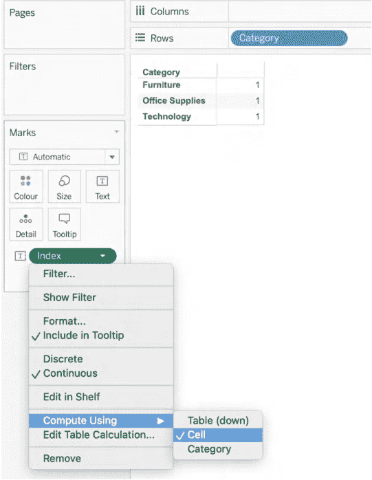

图 5.19：按计算使用 | 单元格

现在，让我们考虑不仅涉及一个，而是两个维度的分区和寻址。

### 使用两个维度的分区和寻址

在对两个或多个维度进行分区和寻址时，将提供两个额外选项：At the level 和 Restarting every。您可以将此场景比作按大洲计算所有国家的任务。在此场景中，At the level 将是国家，因为您计算的不是街道或树木，而是国家。Restarting every 将是大洲。在为一个大洲计算完国家后，您将为下一个大洲重新从 1 开始：

图 5.20：两个维度

“在级别处”和“重新开始于”都允许作者从下拉菜单中选择维度。“在级别处”允许作者选择在哪个级别进行递增，顾名思义，“重新开始于”允许作者选择在哪些维度上重新开始。这里的示例将为您的理解提供上下文。

请注意，“在级别处”还有一个额外选项：最深层。在这种情况下，将“在级别处”设置为最深层与选择运输方式相同。这引出了我们的下一条准则：

没有必要在“在级别处”下拉菜单中选择最底层的维度。它始终与最深层相同。

若要重现此处列出的迭代，您需要对试验环境进行一些更改。除了将类别放在行书架上、将索引放在标签书架上之外，还需将运输方式放在行书架上。我们不会涵盖包含一个或多个维度在列书架上的迭代，因为这些可能性的行为大体相同。

在考虑和/或复制以下选项时，请注意寻址顺序很重要。对于示例 3-5，类别排在寻址列表的第一位。对于选项 6-8，运输方式排在列表的第一位。

在第一个示例中，按如下方式配置分区和寻址设置：

- 分区：类别
- 寻址：运输方式
- 在级别处：-
- 重新开始于：-

这将生成以下可视化效果：

| 类别 | 运输方式 | |
|---|---|---|
| 家具 | 头等舱 | 1 |
| 家具 | 当日达 | 2 |
| 家具 | 二等舱 | 3 |
| 家具 | 标准班 | 4 |
| 办公用品 | 头等舱 | 1 |
| 办公用品 | 当日达 | 2 |
| 办公用品 | 二等舱 | 3 |
| 办公用品 | 标准班 | 4 |
| 技术 | 头等舱 | 1 |
| 技术 | 当日达 | 2 |
| 技术 | 二等舱 | 3 |
| 技术 | 标准班 | 4 |

图 5.21：示例 1

此处，我们按类别统计了运输方式。

在第二个示例中，按如下方式配置分区和寻址设置：

- 分区：运输方式
- 寻址：类别
- 在级别处：-
- 重新开始于：-

这将生成以下可视化效果：

| 类别 | 运输方式 | |
|---|---|---|
| 家具 | 头等舱 | 1 |
| 家具 | 当日达 | 1 |
| 家具 | 二等舱 | 1 |
| 家具 | 标准班 | 1 |
| 办公用品 | 头等舱 | 2 |
| 办公用品 | 当日达 | 2 |
| 办公用品 | 二等舱 | 2 |
| 办公用品 | 标准班 | 2 |
| 技术 | 头等舱 | 3 |
| 技术 | 当日达 | 3 |
| 技术 | 二等舱 | 3 |
| 技术 | 标准班 | 3 |

图 5.22：示例 2

在此示例中，我们按运输方式统计类别。

在第三个示例中，按如下方式配置分区和寻址设置：

- 分区：-
- 寻址：类别, 运输方式
- 在级别处：最深层
- 重新开始于：无

这将生成以下可视化效果：

| 类别 | 运输方式 | |
|---|---|---|
| 家具 | 头等舱 | 1 |
| | 当日达 | 2 |
| | 二等舱 | 3 |
| | 标准班 | 4 |
| 办公用品 | 头等舱 | 5 |
| | 当日达 | 6 |
| | 二等舱 | 7 |
| | 标准班 | 8 |
| 技术 | 头等舱 | 9 |
| | 当日达 | 10 |
| | 二等舱 | 11 |
| | 标准班 | 12 |

图 5.23：示例 3

此次，我们统计**类别**和**运输方式**的组合。

在第四个示例中，按如下方式配置分区和寻址设置：

- 分区：-
- 寻址：类别, 运输方式
- 在级别处：最深层
- 重新开始于：类别

这将生成以下可视化效果：

| 类别 | 运输方式 | |
|---|---|---|
| 家具 | 头等舱 | 1 |
| | 当日达 | 2 |
| | 二等舱 | 3 |
| | 标准班 | 4 |
| 办公用品 | 头等舱 | 1 |
| | 当日达 | 2 |
| | 二等舱 | 3 |
| | 标准班 | 4 |
| 技术 | 头等舱 | 1 |
| | 当日达 | 2 |
| | 二等舱 | 3 |
| | 标准班 | 4 |

图 5.24：示例 4

此处，我们统计类别和运输方式的组合，并在每个新类别处重新开始计数。

在第五个示例中，按如下方式配置分区和寻址设置：

- 分区：-
- 寻址：类别, 运输方式
- 在级别处：类别
- 重新开始于：无

这将生成以下可视化效果：

| 类别 | 运输方式 | |
|---|---|---|
| 家具 | 头等舱 | 1 |
| | 二等舱 | 1 |
| | 标准班 | 1 |
| 办公用品 | 头等舱 | 2 |
| | 二等舱 | 2 |
| | 标准班 | 2 |
| 技术 | 头等舱 | 3 |
| | 二等舱 | 3 |
| | 标准班 | 3 |

图 5.25：示例 5

我们统计出现在类别级别的类别和运输方式的组合。由于类别在层次结构中高于运输方式，因此最终每个类别只计算一个值。

在第六个示例中，按如下方式配置分区和寻址设置：

- 分区：-
- 寻址：运输方式, 类别
- 在级别处：最深层
- 重新开始于：无

这将生成以下可视化效果：

| 类别 | 运输方式 | |
|---|---|---|
| 家具 | 头等舱 | 1 |
| 家具 | 当日达 | 4 |
| 家具 | 二等舱 | 7 |
| 家具 | 标准班 | 10 |
| 办公用品 | 头等舱 | 2 |
| 办公用品 | 当日达 | 5 |
| 办公用品 | 二等舱 | 8 |
| 办公用品 | 标准班 | 11 |
| 技术 | 头等舱 | 3 |
| 技术 | 当日达 | 6 |
| 技术 | 二等舱 | 9 |
| 技术 | 标准班 | 12 |

图 5.26：示例 6

我们在运输方式级别统计运输方式和类别的组合；因此，我们先统计头等舱及其与所有类别的组合，然后再统计当日达及其与类别的组合。

在第七个示例中，按如下方式配置分区和寻址设置：

- 分区：-
- 寻址：运输方式, 类别
- 在级别处：最深层
- 重新开始于：运输方式

这将生成以下可视化效果：

| 类别 | 运输方式 | |
|---|---|---|
| 家具 | 头等舱 | 1 |
| | 当日达 | 1 |
| | 二等舱 | 1 |
| | 标准班 | 1 |
| 办公用品 | 头等舱 | 2 |
| | 当日达 | 2 |
| | 二等舱 | 2 |
| | 标准班 | 2 |
| 技术 | 头等舱 | 3 |
| | 当日达 | 3 |
| | 二等舱 | 3 |
| | 标准班 | 3 |

图 5.27：示例 7

我们在最深层统计**运输方式**和**类别**的组合，但在每个运输方式处重新开始；因此，我们统计**头等舱**和**家具**、**头等舱**和**办公用品**，然后是**头等舱**和**技术**。接着，我们转到**当日达**及其组合，再次从 1 开始重新计数。

在第八个示例中，按如下方式配置分区和寻址设置：

- 分区：-
- 寻址：运输方式, 类别
- 在级别处：运输方式
- 重新开始于：无

这将生成以下可视化效果：

| 类别 | 运输方式 | |
|---|---|---|
| 家具 | 头等舱 | 1 |
| | 当日达 | 2 |
| | 二等舱 | 3 |
| | 标准班 | 4 |
| 办公用品 | 头等舱 | 1 |
| | 当日达 | 2 |
| | 二等舱 | 3 |
| | 标准班 | 4 |
| 技术 | 头等舱 | 1 |
| | 当日达 | 2 |
| | 二等舱 | 3 |
| | 标准班 | 4 |

图 5.28：示例 8

我们在**运输方式**级别统计**运输方式**和**类别**的组合。

现在，让我们更详细地考虑此处提出的一些可能性。有些选项是相同的。事实上，在八个选项中，只有四个是唯一的。让我们考虑示例 1、4 和 8，它们的最终结果都相同。这是否意味着每个选项都真正相同？选项 1 和 4 相同。然而，选项 8 略有不同。要理解这一点，请注意选项 8 在表计算对话框中的描述：

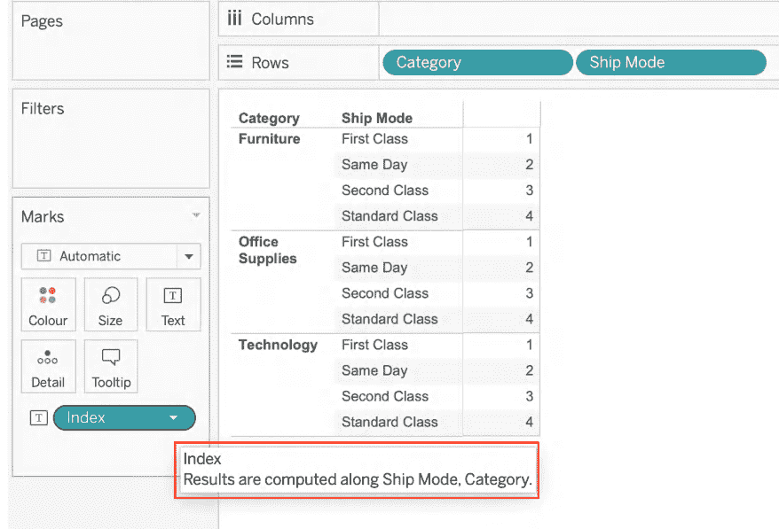

### 图 5.29: 索引

示例 8 中的描述为 **结果沿运输方式、类别计算**（参见 *图 5.29*）。示例 1 描述框中的文本与示例 4 相同：**沿运输方式按类别计算结果**，这可以理解为将**类别**分区并寻址**运输方式**。这种翻译与示例 1 中实际完成的分区/寻址设置相同。因此，示例 1 和示例 4 是相同的。但是，与示例 8 的微小差异是否意味着存在实际差异？不！

示例 6 乍看之下可能令人困惑。为什么会出现奇怪的编号序列？因为寻址维度的顺序与 **行** 货架上维度的顺序不同。寻址顺序是 **运输方式**、**类别**。 **行** 货架上的顺序是 **类别**、**运输方式**。只需在 **行** 货架上互换 **类别** 和 **运输方式** 的位置，并注意编号序列的变化，就有助于消除任何混淆：

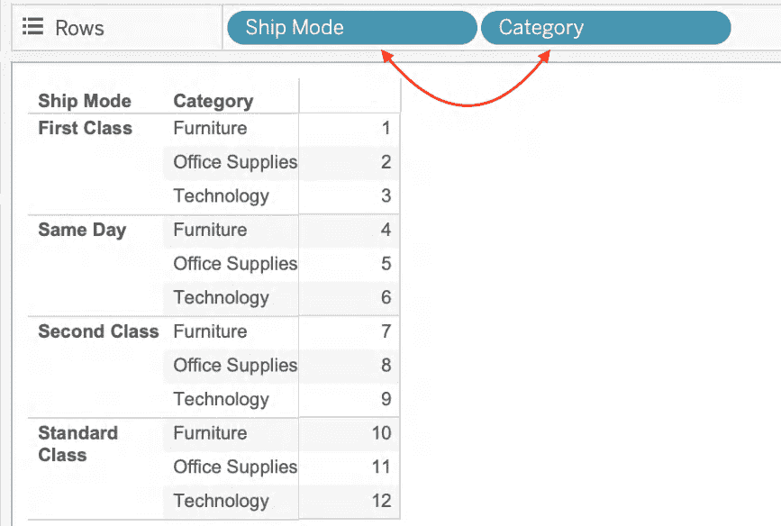

### 图 5.30: 切换维度

示例 6 有任何实际用途吗？有。不时可能需要以货架上列出的不同顺序来寻址维度。但这通常不是情况。这引出了我们的下一条准则：

> *对表计算寻址多个维度时，寻址顺序通常反映行和/或列货架上的维度顺序。*

## 三个维度的分区与寻址

让我们在我们的操场中添加另一个维度，并稍微重新排序。将 **类别** 和 **地区** 放在 **行** 货架上，将 **运输方式** 放在 **列** 货架上。索引应保留在 **标记** 卡上的 **文本** 中。另外，添加两个筛选器。将 **地区** 筛选为东、南、西。将 **运输方式** 筛选为头等舱、二等舱、标准班。

对三个维度进行分区和寻址时，可能的迭代数量将跳至 57；但是，其中只有 14 个是唯一的。以下是这些唯一可能性的列表。

**注意**
请记住，寻址意味着在表计算设置中选择维度，而分区是取消选择维度，如图 5.17 所述。

在第一个示例中，按如下配置分区和寻址设置：

- 分区：类别，地区
- 寻址：运输方式
- 级别：-
- 每个重新开始：-

这将生成以下可视化：

| 类别 | 地区 | 头等舱 | 二等舱 | 标准班 |
|------|------|--------|--------|--------|
| 家具 | 东 | 1 | 2 | 3 |
| 家具 | 南 | 1 | 2 | 3 |
| 家具 | 西 | 1 | 2 | 3 |
| 办公用品 | 东 | 1 | 2 | 3 |
| 办公用品 | 南 | 1 | 2 | 3 |
| 办公用品 | 西 | 1 | 2 | 3 |
| 技术 | 东 | 1 | 2 | 3 |
| 技术 | 南 | 1 | 2 | 3 |
| 技术 | 西 | 1 | 2 | 3 |

### 图 5.31: 示例 1

在这里，我们按类别和地区组合计算不同的运输方式数量。

在第二个示例中，按如下配置分区和寻址设置：

- 分区：类别，运输方式
- 寻址：地区
- 级别：-
- 每个重新开始：-

这将生成以下可视化：

| 类别 | 地区 | 头等舱 | 二等舱 | 标准班 |
|------|------|--------|--------|--------|
| 家具 | 东 | 1 | 1 | 1 |
| 家具 | 南 | 2 | 2 | 2 |
| 家具 | 西 | 3 | 3 | 3 |
| 办公用品 | 东 | 1 | 1 | 1 |
| 办公用品 | 南 | 2 | 2 | 2 |
| 办公用品 | 西 | 3 | 3 | 3 |
| 技术 | 东 | 1 | 1 | 1 |
| 技术 | 南 | 2 | 2 | 2 |
| 技术 | 西 | 3 | 3 | 3 |

### 图 5.32: 示例 2

在这里，我们按类别和运输方式组合计算不同的地区数量。

在第三个示例中，按如下配置分区和寻址设置：

- 分区：地区，运输方式
- 寻址：类别
- 级别：-
- 每个重新开始：-

这将生成以下可视化：

| 类别 | 地区 | 头等舱 | 二等舱 | 标准班 |
|------|------|--------|--------|--------|
| 家具 | 东 | 1 | 1 | 1 |
| 家具 | 南 | 1 | 1 | 1 |
| 家具 | 西 | 1 | 1 | 1 |
| 办公用品 | 东 | 2 | 2 | 2 |
| 办公用品 | 南 | 2 | 2 | 2 |
| 办公用品 | 西 | 2 | 2 | 2 |
| 技术 | 东 | 3 | 3 | 3 |
| 技术 | 南 | 3 | 3 | 3 |
| 技术 | 西 | 3 | 3 | 3 |

### 图 5.33: 示例 3

在这里，我们按地区和运输方式组合计算不同的类别选项数量。

在第四个示例中，按如下配置分区和寻址设置：

- 分区：类别
- 寻址：地区，运输方式
- 级别：最深层级
- 每个重新开始：无

这将生成以下可视化：

### 运输方式

| 类别 | 地区 | 头等舱 | 二等舱 | 标准班 |
|------|------|--------|--------|--------|
| 家具 | 东 | 1 | 2 | 3 |
| 家具 | 南 | 4 | 5 | 6 |
| 家具 | 西 | 7 | 8 | 9 |
| 办公用品 | 东 | 1 | 2 | 3 |
| 办公用品 | 南 | 4 | 5 | 6 |
| 办公用品 | 西 | 7 | 8 | 9 |
| 技术 | 东 | 1 | 2 | 3 |
| 技术 | 南 | 4 | 5 | 6 |
| 技术 | 西 | 7 | 8 | 9 |

### 图 5.34: 示例 4

在这里，我们按地区和运输方式组合在最深层级上计算不同的类别选项数量。

在第五个示例中，按如下配置分区和寻址设置：

- 分区：类别
- 寻址：运输方式，地区
- 级别：最深层级
- 每个重新开始：无

这将生成以下可视化：

### 运输方式

| 类别 | 地区 | 头等舱 | 二等舱 | 标准班 |
|------|------|--------|--------|--------|
| 家具 | 东 | 1 | 4 | 7 |
| 家具 | 南 | 2 | 5 | 8 |
| 家具 | 西 | 3 | 6 | 9 |
| 办公用品 | 东 | 1 | 4 | 7 |
| 办公用品 | 南 | 2 | 5 | 8 |
| 办公用品 | 西 | 3 | 6 | 9 |
| 技术 | 东 | 1 | 4 | 7 |
| 技术 | 南 | 2 | 5 | 8 |
| 技术 | 西 | 3 | 6 | 9 |

### 图 5.35: 示例 5

在这里，我们按运输方式和地区组合在最深层级上计算不同的类别选项数量。

在第六个示例中，按如下配置分区和寻址设置：

- 分区：地区
- 寻址：类别，运输方式
- 级别：最深层级
- 每个重新开始：无

这将生成以下可视化：

| 类别 | 地区 | 头等舱 | 二等舱 | 标准班 |
|------|------|--------|--------|--------|
| 家具 | 东 | 1 | 2 | 3 |
| 家具 | 南 | 1 | 2 | 3 |
| 家具 | 西 | 1 | 2 | 3 |
| 办公用品 | 东 | 4 | 5 | 6 |
| 办公用品 | 南 | 4 | 5 | 6 |
| 办公用品 | 西 | 4 | 5 | 6 |
| 技术 | 东 | 7 | 8 | 9 |
| 技术 | 南 | 7 | 8 | 9 |
| 技术 | 西 | 7 | 8 | 9 |

### 图 5.36: 示例 6

在这里，我们按类别和运输方式组合在最深层级上计算不同的地区数量。

在第七个示例中，按如下配置分区和寻址设置：

- 分区：运输方式
- 寻址：类别，地区
- 级别：最深层级
- 每个重新开始：无

这将生成以下可视化：

| 类别 | 地区 | 头等舱 | 二等舱 | 标准班 |
|------|------|--------|--------|--------|
| 家具 | 东 | 1 | 1 | 1 |
| 家具 | 南 | 2 | 2 | 2 |
| 家具 | 西 | 3 | 3 | 3 |
| 办公用品 | 东 | 4 | 4 | 4 |
| 办公用品 | 南 | 5 | 5 | 5 |
| 办公用品 | 西 | 6 | 6 | 6 |
| 技术 | 东 | 7 | 7 | 7 |
| 技术 | 南 | 8 | 8 | 8 |
| 技术 | 西 | 9 | 9 | 9 |

### 图 5.37: 示例 7

在这里，我们按类别和地区组合在最深层级上计算不同的运输方式数量。

在第八个示例中，按如下配置分区和寻址设置：

- 分区：运输方式
- 寻址：地区，类别
- 级别：最深层级
- 每个重新开始：无

这将生成以下可视化：

| 类别 | 地区 | 头等舱 | 二等舱 | 标准班 |
|------|------|--------|--------|--------|
| 家具 | 东 | 1 | 1 | 1 |
| 家具 | 南 | 4 | 4 | 4 |
| 家具 | 西 | 7 | 7 | 7 |
| 办公用品 | 东 | 2 | 2 | 2 |
| 办公用品 | 南 | 5 | 5 | 5 |
| 办公用品 | 西 | 8 | 8 | 8 |
| 技术 | 东 | 3 | 3 | 3 |
| 技术 | 南 | 6 | 6 | 6 |
| 技术 | 西 | 9 | 9 | 9 |

### 图 5.38: 示例 8

在这里，我们按 **地区** 和 **类别** 组合在最深层级上计算不同的运输方式数量。

在第九个示例中，按如下配置分区和寻址设置：

- 分区：-
- 寻址：类别，运输方式，地区
- 级别：最深层级
- 每个重新开始：无

这将生成以下可视化：

| 类别 | 区域 | 头等 | 二等 | 标准 |
|---|---|---|---|---|
| 家具 | 东 | 1 | 4 | 7 |
| | 南 | 2 | 5 | 8 |
| | 西 | 3 | 6 | 9 |
| 办公用品 | 东 | 10 | 13 | 16 |
| | 南 | 11 | 14 | 17 |
| | 西 | 12 | 15 | 18 |
| 技术 | 东 | 19 | 22 | 25 |
| | 南 | 20 | 23 | 26 |
| | 西 | 21 | 24 | 27 |

## 图 5.39：示例 9

在此示例中，我们在最深层级统计类别、运输方式和区域的组合。

在第十个示例中，按如下方式配置分区和寻址设置：

- 分区：-
- 寻址：运输方式, 类别, 区域
- 层级：最深层级
- 重新开始：无

这将生成以下可视化：

| 类别 | 区域 | 头等 | 二等 | 标准 |
|---|---|---|---|---|
| 家具 | 东 | 1 | 10 | 19 |
| | 南 | 2 | 11 | 20 |
| | 西 | 3 | 12 | 21 |
| 办公用品 | 东 | 4 | 13 | 22 |
| | 南 | 5 | 14 | 23 |
| | 西 | 6 | 15 | 24 |
| 技术 | 东 | 7 | 16 | 25 |
| | 南 | 8 | 17 | 26 |
| | 西 | 9 | 18 | 27 |

## 图 5.40：示例 10

在此示例中，我们在最深层级统计运输方式、类别和区域的组合。

在第十一个示例中，按如下方式配置分区和寻址设置：

- 分区：-
- 寻址：运输方式, 类别, 区域
- 层级：类别
- 重新开始：无

这将生成以下可视化：

| 类别 | 区域 | 头等 | 二等 | 标准 |
|---|---|---|---|---|
| 家具 | 东 | 1 | 4 | 7 |
| | 南 | 1 | 4 | 7 |
| | 西 | 1 | 4 | 7 |
| 办公用品 | 东 | 2 | 5 | 8 |
| | 南 | 2 | 5 | 8 |
| | 西 | 2 | 5 | 8 |
| 技术 | 东 | 3 | 6 | 9 |
| | 南 | 3 | 6 | 9 |
| | 西 | 3 | 6 | 9 |

## 图 5.41：示例 11

在此示例中，我们在类别层级统计运输方式、类别和区域的组合。

在第十二个示例中，按如下方式配置分区和寻址设置：

- 分区：-
- 寻址：运输方式, 区域, 类别
- 层级：最深层级
- 重新开始：无

这将生成以下可视化：

| 类别 | 区域 | 头等 | 二等 | 标准 |
|---|---|---|---|---|
| 家具 | 东 | 1 | 10 | 19 |
| | 南 | 4 | 13 | 22 |
| | 西 | 7 | 16 | 25 |
| 办公用品 | 东 | 2 | 11 | 20 |
| | 南 | 5 | 14 | 23 |
| | 西 | 8 | 17 | 26 |
| 技术 | 东 | 3 | 12 | 21 |
| | 南 | 6 | 15 | 24 |
| | 西 | 9 | 18 | 27 |

## 图 5.42：示例 12

在此示例中，我们在最深层级统计运输方式、区域和类别的组合。

在第十三个示例中，按如下方式配置分区和寻址设置：

- 分区：-
- 寻址：运输方式, 区域, 类别
- 层级：最深层级
- 重新开始：运输方式

这将生成以下可视化：

| 类别 | 区域 | 头等 | 二等 | 标准 |
|---|---|---|---|---|
| 家具 | 东 | 1 | 1 | 1 |
| | 南 | 4 | 4 | 4 |
| | 西 | 7 | 7 | 7 |
| 办公用品 | 东 | 2 | 2 | 2 |
| | 南 | 5 | 5 | 5 |
| | 西 | 8 | 8 | 8 |
| 技术 | 东 | 3 | 3 | 3 |
| | 南 | 6 | 6 | 6 |
| | 西 | 9 | 9 | 9 |

## 图 5.43：示例 13

在此示例中，我们在最深层级统计运输方式、区域和类别的组合。

在第十四个示例中，按如下方式配置分区和寻址设置：

- 分区：-
- 寻址：区域, 运输方式, 类别
- 层级：最深层级
- 重新开始：无

这将生成以下可视化：

### 运输方式

| 类别 | 区域 | 头等 | 二等 | 标准 |
| :--- | :--- | :--- | :--- | :--- |
| 家具 | 东 | 1 | 4 | 7 |
| | 南 | 10 | 13 | 16 |
| | 西 | 19 | 22 | 25 |
| 办公用品 | 东 | 2 | 5 | 8 |
| | 南 | 11 | 14 | 17 |
| | 西 | 20 | 23 | 26 |
| 技术 | 东 | 3 | 6 | 9 |
| | 南 | 12 | 15 | 18 |
| | 西 | 21 | 24 | 27 |

## 图 5.44：示例 14

我们不会逐一讨论这些可能性的各种实例。相反，我们鼓励你在 Tableau 中重新创建这 14 种可能性，以巩固你对分区和寻址的理解。更好的是，考虑重新创建所有 57 种可能的迭代，并努力了解 Tableau 如何产生每个结果。此过程可能会比较繁琐，但由此获得的理解是无价的，它能让用户了解 Tableau 在后台进行计算时所执行的操作。

## 准则

在本章中，我列出了一系列分区和寻址准则。以下是再次列出的快速提醒：

- 不要使用 Tableau 提供的开箱即用的分区和寻址设置，包括 Table（横向）和 Pane（纵向）。强制自己点击 特定维度 并手动定义分区和寻址，以便清楚了解每个表计算是如何应用的。
- 在为表计算设置分区和寻址之前，将所有所需的维度放置在所需的架子上。
- 在“层级”下拉菜单中不需要选择底层维度。它始终与“最深层级”相同。
- 为表计算寻址多个维度时，寻址顺序通常会反映“行”和/或“列”架子上的维度顺序。

## 使用表计算的跟随练习仪表板

我们将使用 FIFA 球员数据集，在跟随练习仪表板中应用你的 Tableau 知识。你将通过多个相关可视化探索球员评分、国籍、俱乐部和国家。

如果你尚未在第 4 章中下载以下数据集，请立即下载：

https://www.kaggle.com/datasets/stefanoleone992/fifa-22-complete-player-dataset?resource=download

- 1. 在 Tableau 中，连接到 players_22.csv。
- 2. 打开新工作表并将其命名为 Nation Overall。
- 3. 单击 Nationality Name 的数据类型图标，将其更改为 Country/Region：

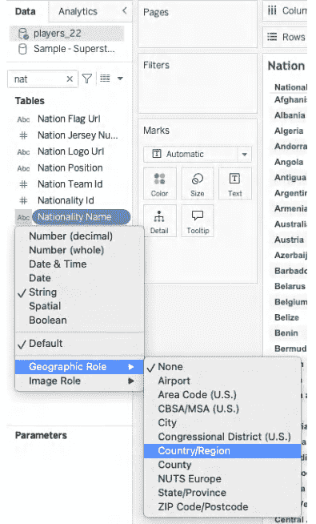

## 图 5.45：地理角色

- 4. 双击 Nationality Name 创建地图：

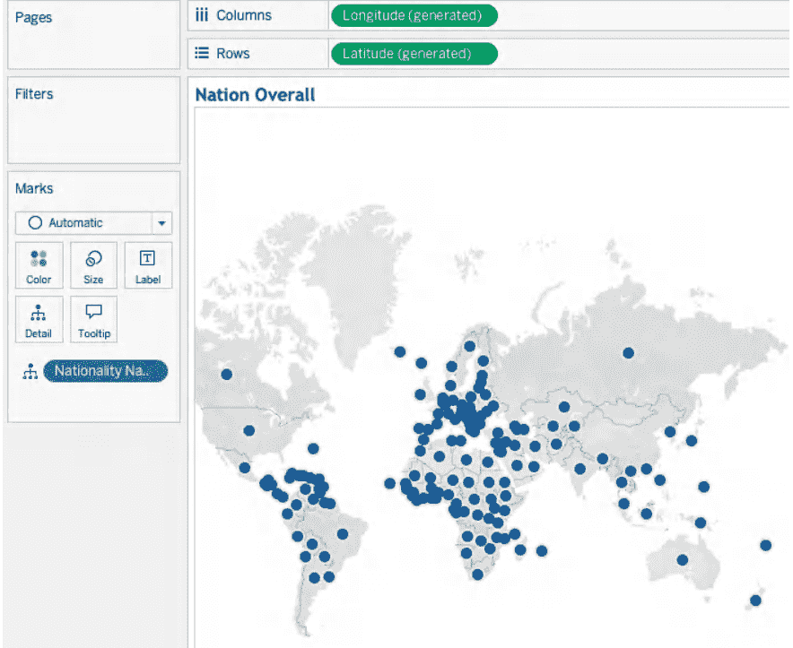

## 图 5.46：地图

- 5. 将 Overall 拖动到标记卡上的 Color。
- 6. 为 Overall 的度量选择平均值。

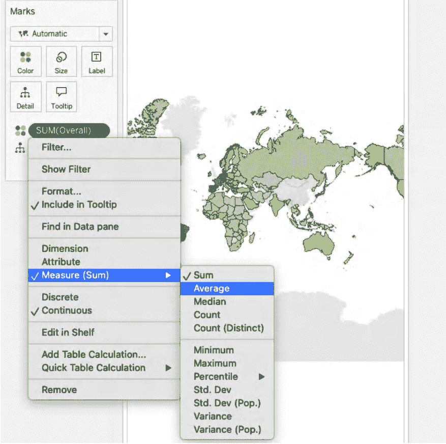

## 图 5.47：平均值

此地图按国籍提供了球员质量的高级概览。

- 7. 创建第二个工作表并将其命名为 Overall by Club。
- 8. 将 Club Name 拖动到“行”。
- 9. 将 Overall 拖动到“列”。为 Overall 的度量选择平均值。
- 10. 排除 Null：

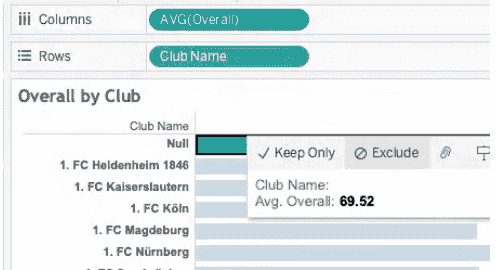

## 图 5.48：按俱乐部划分的总评

你现在拥有一个按排名排列的俱乐部列表，显示哪些俱乐部拥有评分最高的球员。

- 11. 创建第三个工作表并将其命名为 Player Overview。
- 12. 将 Club Name 拖动到“行”。
- 13. 将 Long Name 拖动到“行”上 Club Name 的右侧，以创建俱乐部 → 球员层次结构。
- 14. 将 Overall、Wage Eur 和 Value Eur 拖动到“列”。
- 15. 再次排除 Club Name = Null。

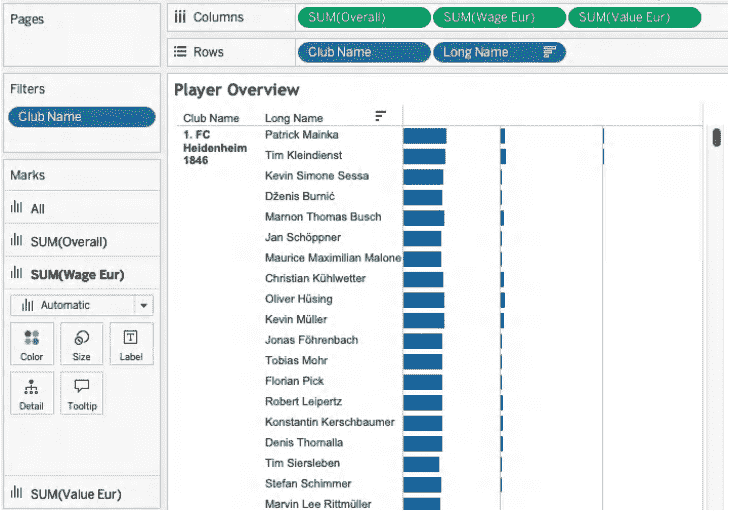

## 图 5.49：球员概览

此工作表提供了每个球员在其俱乐部内的详细信息。

- 16. 创建第四个工作表并将其命名为 Players by Country。
- 17. 将 Nationality Name 拖动到“行”。
- 18. 将 Overall 拖动到“列”。
- 19. 将 Overall 的聚合方式更改为平均值。

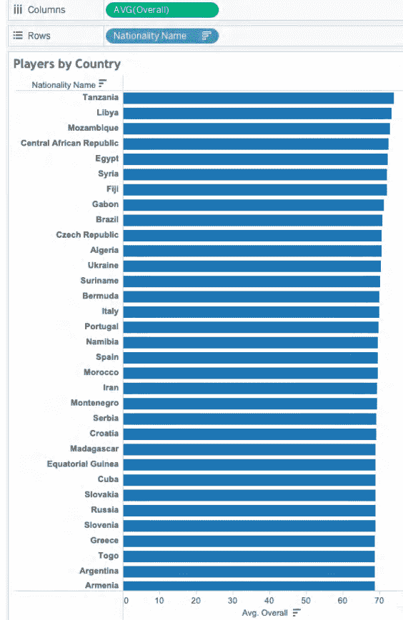

## 图 5.50：按国家/地区划分的球员

此工作表从另一个角度突出显示了按国籍划分的球员质量。

- 20. 创建新工作表并将其命名为 Player Metrics。
- 21. 将 Club Name 拖动到“行”。排除 Null。
- 22. 将 Long Name 拖动到“行”上 Club Name 的右侧，创建俱乐部 → 球员层次结构。

- 23. 将 **Wage Eur** 和 **Overall** 拖放到 Columns。

- 24. 在 **Data** 窗格中，单击下拉箭头并选择 **Create Calculated Field**。将字段命名为 % of Club Wage。输入以下公式：SUM([wage_eur]) / TOTAL(SUM([wage_eur])).

- 25. 将 % of Club Wage 拖放到 Columns。

- 26. 右键单击 % of Club Wage 字段，并选择 **Edit Table Calculation...**。在 **Compute Using** 下，选择 **Pane (Down)**，以便每个俱乐部的百分比重置。通过右键单击 | **Default Properties** | **Number Format...** 将字段格式设置为百分比。

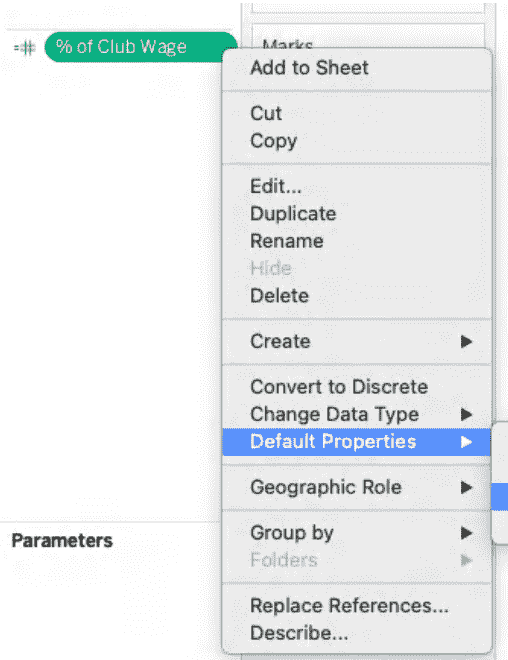

图 5.51：数字格式...

这可让你查看每个球员的工资与队友相比如何。

- 27. 在 **Data** 窗格中单击下拉箭头并选择 **Create Calculated Field...**。将计算命名为 **Overall vs Club Avg**。输入 AVG([overall]) - WINDOW_AVG(AVG([overall])).

- 28. 将 **Overall vs Club Avg** 拖放到 Columns。

- 29. 单击该字段并选择 Edit Table Calculation... 设置 Compute Using | Pane (Down)，以便为每个俱乐部分别计算窗口平均值。

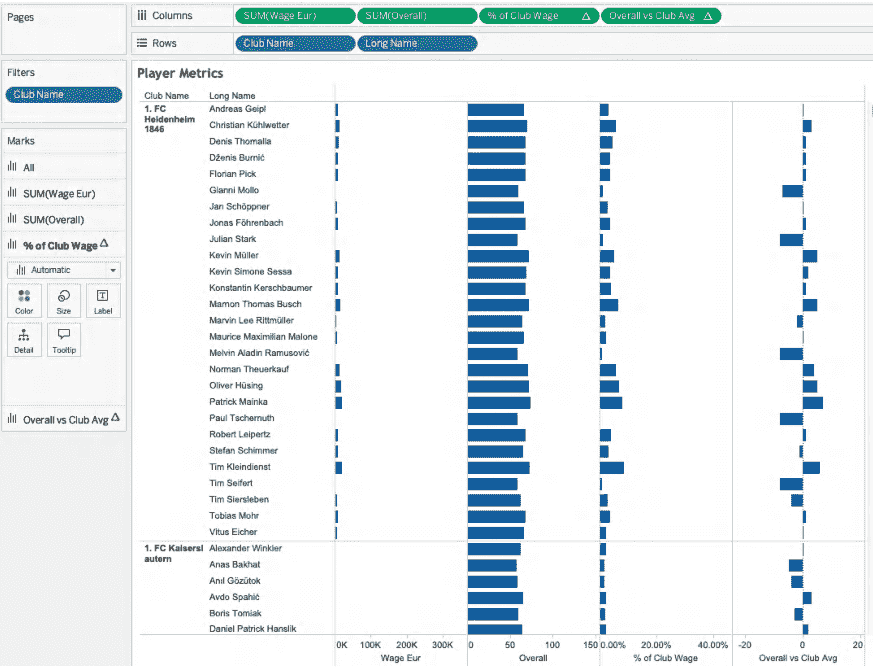

## 图 5.52：球员指标

该指标显示每个球员的评分与其俱乐部平均评分之间的差异，让你快速了解球员在团队中的表现。

现在，让我们创建一个新仪表板并将所有内容整合在一起，将其命名为：FIFA 22 球员概览。

- 30. 按以下顺序添加工作表：顶部：Nation Overall，中左侧：Overall by Club，中右侧：Player Overview，左下角：Players by Country，右下角：Player Metrics。

- 31. 将筛选器：League Name、Player Positions、Overall Rating 和 Age 添加到某个工作表中，并为每个筛选器选择 All Using This Data Source：

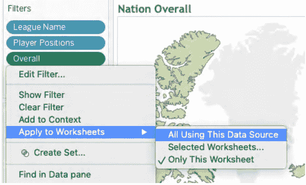

图 5.53：筛选器

- 32. 在仪表板上使四个筛选器可见：

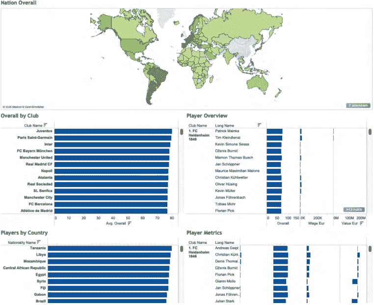

图 5.54：仪表板

在本跟随式仪表板构建练习中，你已构建了一个仪表板，演示如何在 Tableau 中使用多个视图探索 FIFA 球员数据，跨工作表应用筛选器，并按国籍、俱乐部和国家分析球员表现。

## 摘要

在本章中，我们探索了表计算的内部工作原理。我们首先思考表计算的分区和方向是什么。在后续章节中，我们区分了表计算的方向性和非方向性寻址，这最终引导我们来到了 Edit Table Calculation 界面，并确定它是更改分区和寻址（也称为范围和方向）的位置。在探索过程中，我们回顾了表计算函数的每个独特组，但 script_ 和 model_ 函数除外，这些内容将在第 15 章，Integrating Programming Languages 中详细介绍。

我们学习了如何通过分区和寻址将这些函数应用于视图，其中分区可视为计算的范围，寻址可视为计算的方向。

我们已经看到过在不同时间段比较度量值的示例，例如每周利润数字，或将部分与整体进行比较。接着，我们考虑了用于股价警报的标准差区间，以及用于生成凸点图的 Rank 函数。

利用本章获得的分区和寻址知识，在下一章中，我们将继续探索数据密化和大数据。

## 获取本书的 PDF 版本及更多内容

扫描二维码（或访问 packtpub.com/unlock）。按书名搜索本书，确认版本，然后按照页面上的步骤操作。

注意：请随时准备好发票。直接从 Packt 购买不需要发票。

# 6
