# 利用 OData、数据密化、大数据和 Google BigQuery

Tableau 新手提出的许多问题与数据准备、联接、合并、数据混合或数据结构无关，而是与 Tableau 在经常让初学者困惑的情况下的表现有关，例如意外的 null 值、不熟悉的表计算结果，或大数据集的性能问题。本章将介绍此类情况，你还将更清晰地了解数据密化、域内填充以及 Tableau 如何与现代数据平台交互等概念。

本章的目标是通过解释 *为什么* 某些结果会出现在你的视图中以及 *如何* Tableau 在幕后管理数据，来增强你解读 Tableau 表现的信心。通过探索连接器、密化技术和大数据工作流，你将更好地具备排查问题和设计更可靠可视化的能力。

Tableau 新用户通常认为令人困惑的结果是由数据质量问题引起的，但实际上它们来自 Tableau 结构化和查询数据的方式。理解这些机制将帮助你避免常见陷阱，准确诊断意外结果，并在处理小型和大型数据集时做出明智的决策。

在本章中，我们将讨论以下主题：

- 使用 OData 连接器
- 介绍数据密化
- Tableau 与大数据

## 技术要求

本章将首先介绍 OData 连接器。芝加哥市像其他城市、国家或公共机构一样，公开提供数据。去看看吧；你会对能在网上找到的数据量感到惊讶。在我们的情况中，我们更加幸运，因为芝加哥市使用 OData，这使得分析变得更加容易，因为 Tableau 拥有直接的 OData 连接器。让我们开始吧。

## 使用 OData 连接器

本章的练习可以通过下载与此章关联的工作簿来跟随学习，地址为 https://github.com/PacktPublishing/Mastering-Tableau-2026/tree/main/Chapter06。以下步骤解释了如何使用 OData 端点（在此例中由芝加哥市提供）将网上的数据集直接加载到 Tableau 中：

- 1. 导航到 https://data.cityofchicago.org/Public-Safety/Crimes-2001-to-Present/ijzp-q8t2 并选择 **Actions**，然后选择 **Access via oData** 按钮：


图 6.1：芝加哥数据门户

- 2. 复制 **OData Endpoint** URL 并打开 Tableau Desktop：

## 通过 OData 访问此数据集

使用 OData 在 Excel 或 Tableau 等工具中打开数据集。这在连接的应用程序中提供了可按需刷新的数据的直接连接。

**Tableau 用户应选择 OData v2 端点选项。**

Socrata OData 文档

OData 端点

https://data.cityofchicago.org/api/odata/v4/ijzp-q8 OData V4 复制

完成

图 6.2：OData

- 3. 在 Data Source 窗格中搜索 odata，并选择 OData 选项：

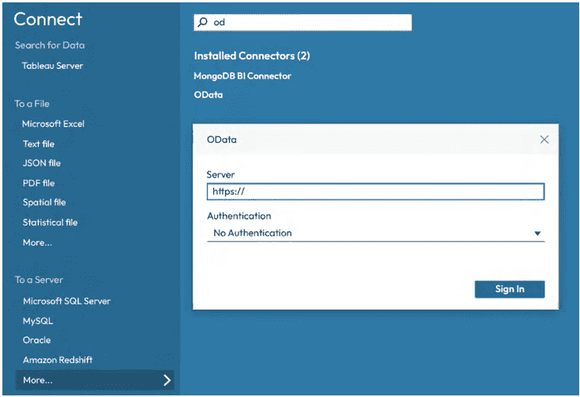

图 6.3：OData 连接器

- 4. 在 **Server** 字段中，从芝加哥犯罪网站复制 **OData** 端点。不需要身份验证，因此选择 **Sign In** 即可开始：

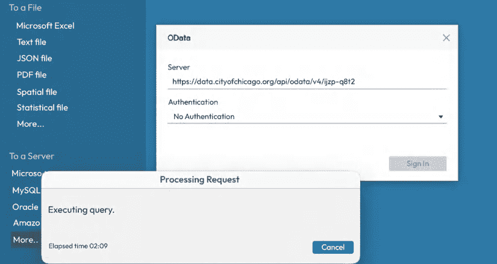

图 6.4：服务器名称

- 5. 开始构建你的仪表板！

既然数据连接已全部设置完毕，我们可以继续进行关于数据密化的第一个实际练习。了解数据密化将帮助你在仪表板中看到意外数据输出时进行排查，并将帮助你以正确的方式设置可视化以实现目标，而无需进行任何排查。

## 介绍数据密化

数据密化是 Tableau 的一个大部分未记录的方面，在许多情况下可能很有用，但也可能在意外遇到时令人困惑。本节将提供有关数据密化的信息，旨在消除困惑，并为 Tableau 作者提供足够的知识来利用此功能。数据密化的最简单形式是将不存在于底层数据集中的数据点添加到视图中。这个主题起初可能有点令人困惑。

> **注意**
> 如果你想了解更多信息，请查看以下文章：https://towardsdatascience.com/data-densification-in-tableau-93c0a6bfcc5f.


要开始理解数据密集化，应定义四个术语：数据密集化、稀疏数据、域完成和域填充。除了定义之外，每个术语还将通过示例进行详细讨论，以帮助改善理解：

- **数据密集化**：显示没有相应基础数据的数据点（例如，通过使用域完成或域填充）
- **稀疏数据**：缺少多个数据点的数据集（想象瑞士奶酪）
- **域完成**：使稀疏数据变为密集数据——域完成是一种数据密集化方法，它使用表计算来填充空白，在Tableau中当视图中有两个或更多维度时可用
- **域填充**：向稀疏数据集添加数据点——域填充是一种数据密集化方法，可通过范围药片（例如日期和容器维度）上的显示缺失值功能获得

定义现在应该很清楚了；让我们继续进行动手练习。

## 域完成

数据密集化有两种类型：域完成和域填充。域完成是两者中更复杂的一种，可以巧妙地部署来解决稀疏数据问题，但也可能意外出现，并且难以处理。

掌握域完成需要很好地理解**维度**和**度量值**——离散和连续——以及表计算中的**分区**和**寻址**。如果您需要回顾这些主题，请在继续下一个练习之前查看*第1章，回顾基础知识*（关于**维度**和**度量值**）以及*第5章，表计算入门*（关于**分区**和**寻址**）。

现在，让我们考虑域完成可以如何部署，何时有用，以及何时可能成为问题。

## 部署域完成

域完成可以通过许多有时令人惊讶和困惑的方式激活。调整货架上药片的排列、在离散和连续之间切换维度、在标记卡上切换视图类型、调整分区、寻址以及其他更改都可能影响域完成的激活。虽然本书不会涵盖每种激活可能性的示例，但回顾典型的域完成场景应该会很有帮助。

## 在交叉表中激活域完成

以下步骤将指导您了解域完成的示例。我们将使用*使用OData连接器部分*中描述的OData端点：

- 1. 按照*使用OData连接器部分*中描述的方式，从芝加哥数据门户连接到OData连接器。
- 2. 打开新工作表并将其命名为**DC - 交叉表**。这将自动创建一个提取，由于您正在加载800万多行，这需要一些时间。
- 3. 创建提取后，确保**分析 | 表布局 | 显示空行**和**显示空列**均未被选中。
- 4. 在芝加哥犯罪数据集中，创建一个名为**索引**的计算字段，代码为`INDEX()`。
- 5. 添加一个**位置描述**筛选器以仅查看几个位置。这将加快渲染速度——例如，以**机场**开头的所有位置。然后，将**位置描述**放置在**行**货架上。
- 6. 将**年份**放置在**列**货架上。将其更改为离散值。请注意，如下面的屏幕截图所示，视图是稀疏填充的：

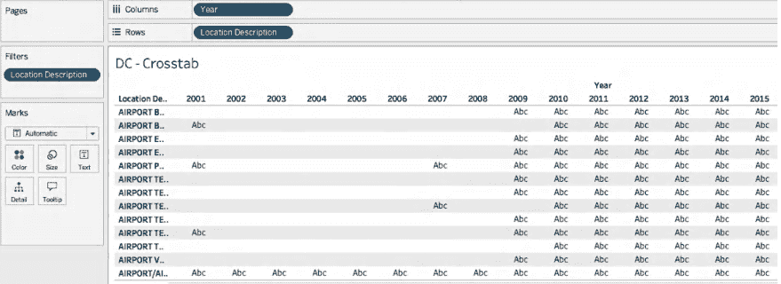

- 7. 将**索引**放置在**标记**卡上的**详细信息**货架上。请注意，如下面的屏幕截图所示，视图现在反映了域完成——也就是说，视图已完全填充：

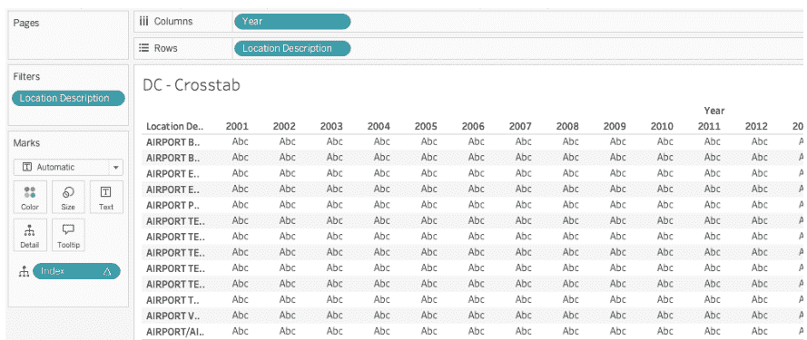

图 6.6: 交叉表 II

- 8. 单击年份并选择连续。请注意，数据密集化已被禁用：

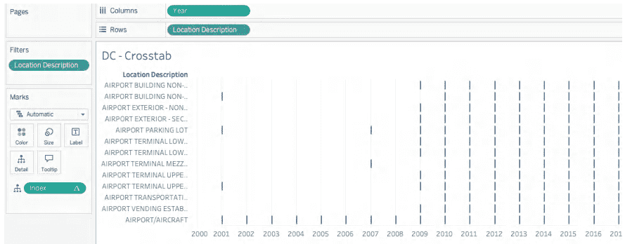

图 6.7: 交叉表 III

- 9. 将年份重置为离散，然后单击**索引**并选择编辑表计算。
- 10. 在生成的对话框中，选择**特定维度**，然后观察每个以下选择的结果：

| 选择特定维度 | 数据密集化激活/禁用 |
|---|---|
| **位置描述** | 激活 |
| **年份** | 激活 |
| **位置描述和年份** | 禁用 |
| **无选择** | 禁用 |

### 表 6.1: 对话框

前面的练习说明了部署域完成的以下规则：

> *给定一个在行和列货架上具有离散维度的交叉表，使用表计算（在此示例中为索引字段），其中至少一个维度（但不是所有维度）被寻址，将激活域完成。*

前面规则中的一个关键术语可能令人困惑：寻址。分区和寻址在第5章“表计算入门”中已介绍，但将在此再次定义，以确保理解此规则。请参考以下Tableau文档中的信息（https://help.tableau.com/current/pro/desktop/en-us/calculations_tablecalculations.htm）：

> *定义如何对计算进行分组（即定义计算执行的数据范围）的维度称为分区字段。表计算在每个分区中分别执行。其余维度（即执行表计算的维度）称为寻址字段，并确定计算的方向。*

编辑表计算时，您可以选择/取消选择特定维度。当选择一个维度时，该维度用于寻址表计算。当未选择一个维度时，该维度用于分区表计算。以下表计算编辑对话框的屏幕截图演示了对位置描述的寻址和对年份的分区。

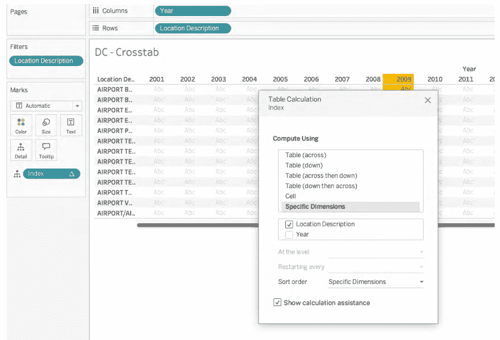

图 6.8: 表计算

### 域完成的实用性

域完成在许多情况下都很有用——例如，您不想手动填充缺失值，每当您想要使用参数时，或者在执行解释性分析时。事实上，您可能已经从以前的练习中领悟到了一些用途，尽管那些练习仅用于说明目的。以下练习演示了如何使用域完成来显示稀疏填充视图中没有值的单元格没有数据。

#### 标记空值

让我们查看以下步骤以开始练习：

- 1. 创建新工作表，DC — 标记空值。
- 2. 将年份放置在列上，将位置描述放置在行上，并筛选出所有机场记录。将SUM(Ward)和AGG(No Data)放置在标记货架上的文本中。调整复制的工作表，使视图类型设置为文本。另外，确保仅将位置描述和年份部署到视图上。务必将位置描述留在筛选器货架上，以便显示几个位置。
- 3. 创建一个名为**无数据**的计算字段，使用以下代码：

```
IF ISNULL(COUNT([Case Number])) THEN 'No Data' ELSE 'Data' END
```

- 4. 将**辖区**和**无数据**放置在**文本**货架上。请注意，**无数据**文本未显示：

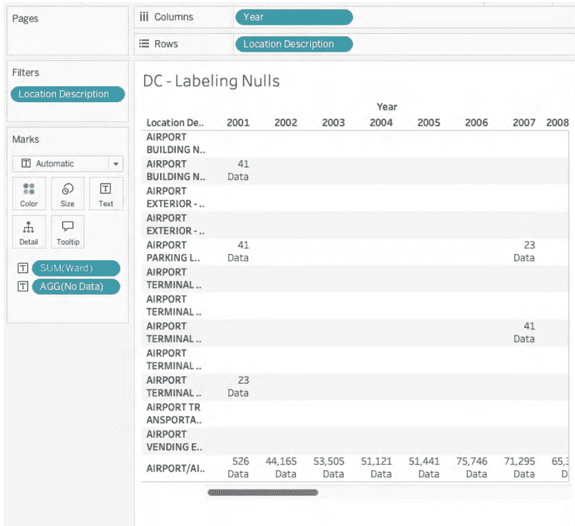

图 6.9: 标记空值

- 5. 将**索引**放置在**详细信息**货架上。请注意，**无数据**文本现在显示。域完成部分的练习现在已完成，但考虑通过使用形状来使可视化更具吸引力：

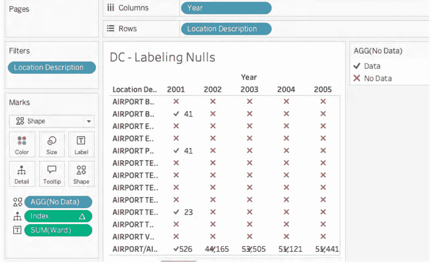

图 6.10: 标记空值，附加格式

恭喜——您现在了解域完成的方方面面。接下来，我们将讨论域填充：一个在处理日期和容器时最相关的概念。

## 域填充

第二种数据密集化类型称为**域填充**。我们将考虑域填充如何部署以及何时有用。

## 部署域填充

您可能记得，部署域完成的一种方式是通过**分析 | 表布局 | 显示空行/列**。域填充也是如此，如下面的练习所示。此练习演示如何开启和关闭域填充：

- 1. 打开名为**DP - 显示缺失值**的新工作表。单击左上角的**显示开始页面**Tableau图标。连接到随Tableau附带的Sample Superstore数据集。
- 2. 将**运输方式**和**州/省**放置在**行**货架上。接下来，将**区域**放置在**筛选器**货架上并选择**西部**。最后，将**销售总和**放置在**文本**货架上。请注意，例如，**怀俄明州**仅适用于**标准**运输方式：


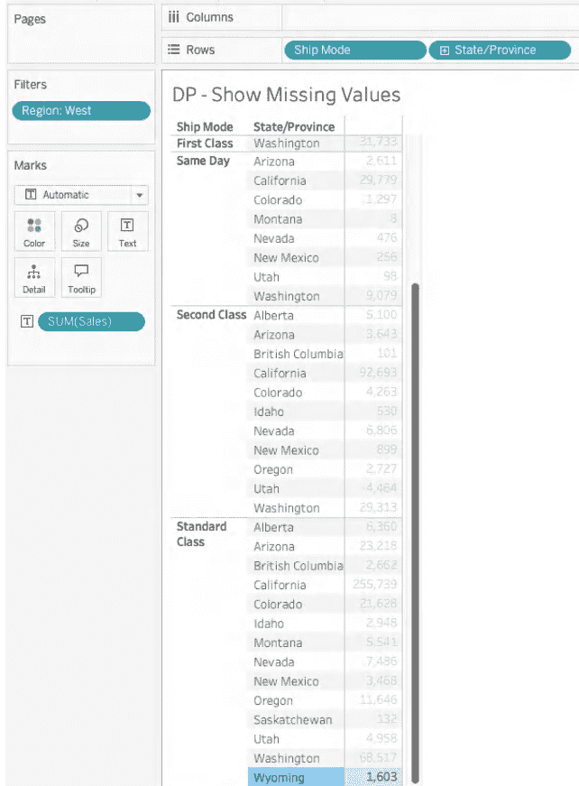

图 6.11: 显示缺失值

- 3. 选择 分析 | 表格布局 | 显示空行：

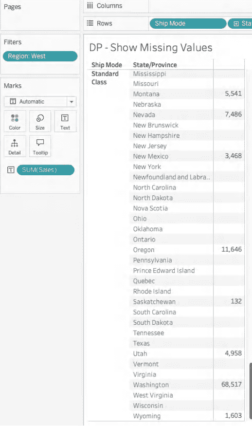

图 6.12: 显示缺失值 II

您可以看到域填充的实际效果。在某一年份或某个地区中带有值的所有州现在都会显示，即使是之前已按 区域: 西部 筛选的州也是如此。现在，筛选器只是移除了销售额，但仍会显示所有可能的州。

有必要指向实时数据源，例如随 Tableau 附带的 Superstore 实例，因为在这种情况下，使用提取不会激活域填充，即使已选择 分析 | 表格布局 | 显示空行。一旦激活提取，该功能就会丢失。

## 域填充的用途

使用带有间隙的日期时，域填充通常很有用。这种间隙发生在某些日期有关联值而某些日期没有值的情况。如下面的示例所示，在 Superstore 数据集中，退货并非每天都会发生。由于显示带有间隙日期的可视化可能会令人困惑，因此填充这些间隙可能会有所帮助。

### 使用域填充填充日期间隙

我们现在将尝试填充日期间隙：

- 1. 打开一个新工作簿并将其命名为 DP - Filling Data Gaps。
- 2. 选择在上一个练习中创建的 Sample - Superstore 数据源。
- 3. 将 MDY(Order Date) 的离散实例放置于 列 书架，并将 Sales 放置于 行 书架。请注意，视图中的每个标记间距均相等，与日期之间的时间长短无关：

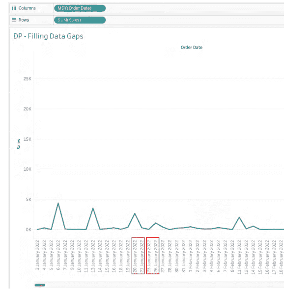

图 6.13: 填充数据间隙

- 4. 右键单击 MDY(Order Date) 并选择 显示缺失值。

- 5. 在 **行** 书架上右键单击 **SUM(Sales)** 并选择 **格式**。在弹出的 **格式** 窗口中，选择 **窗格** 选项卡并选择 **标记: 在默认值处显示**：

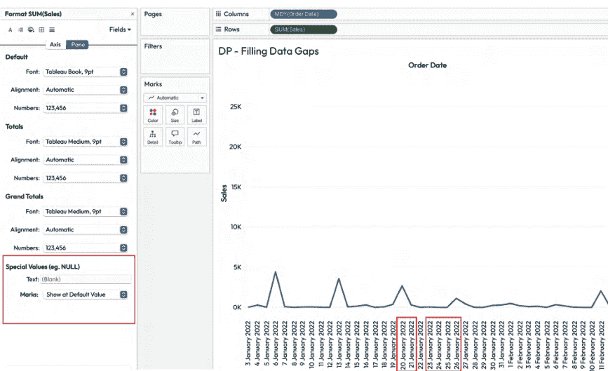

图 6.14: 填充数据间隙 II

请注意，标记之间的距离现在基于日期之间的时间长度。所有没有值的日期都显示为 **Sales** 值为零。

## 域填充的问题

由于可以通过 Tableau 中的特定命令（即 **显示缺失值** 和 **显示空行/列**）打开或关闭域填充，因此通常不是问题。但是，存在一些域填充可能会造成混淆的场景，下面的示例将介绍其中一种。

## 从域填充可视化到交叉表

让我们看看如何从域填充可视化创建交叉表：

- 1. 创建一个名为 **DP - From Viz to Crosstab** 的新工作簿。
- 2. 选择 **Sample - Superstore** 数据源。
- 3. 在 **数据** 窗格中右键单击 **Discount** 并选择 **创建 | 分箱**。在弹出的对话框中，选择分箱大小为 **0.05**。
- 4. 将新建的 **Discount (bin)** 维度放置于 **列** 书架。

- 5. 右键单击 **Discount (bin)** 并确保已选择 **显示缺失值**。

- 6. 将 **数据** 窗格中的 **Discount** 字段拖放到 **行** 书架。将 **CNT** 选为度量值。请注意，某些分箱没有值。例如，如下方屏幕截图所示，**0.35** 分箱没有关联值：

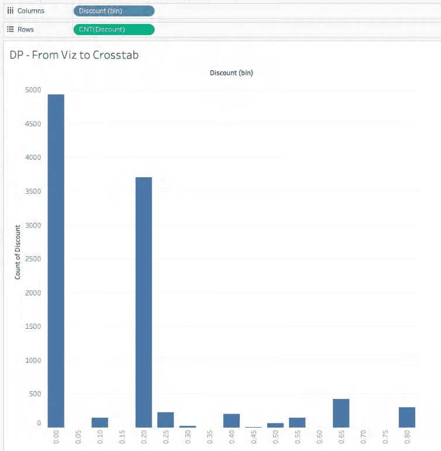

图 6.15: 从可视化到交叉表

- 7. 通过右键单击工作表选项卡并选择 **作为交叉表复制** 将工作表复制为交叉表。请注意，**显示缺失值** 仍处于激活状态：

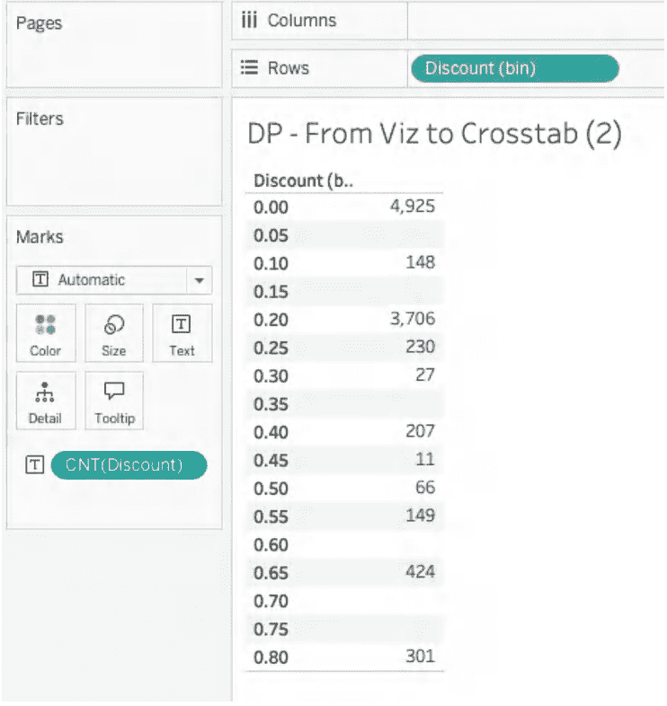

图 6.16: 从可视化到交叉表 II

- 8. 通过右键单击 **Discount (bin)** 并取消选择 **显示缺失值** 来完成练习：

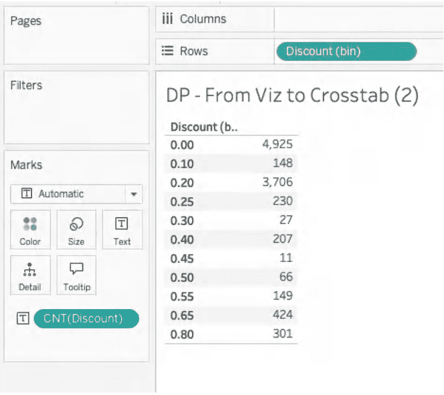

图 6.17: 从可视化到交叉表 III

在可视化中对分箱或日期使用 **显示缺失值** 通常很有帮助，但在交叉表视图中可能没有帮助。如果有许多没有值的行或列，尤其如此。这会让人更难以消化数据量，并且由于通常与不重要相关，因此在交叉表中大多数情况下最好排除缺失值——仅为了保持更好的概览。

我希望数据密化现在有点清楚了。它是一个强大的功能，应该更经常地讨论。传播这个消息！数据密化将增强您的可视化，为您插值数据点，甚至可以用于计算——一个不存在的数字会突然出现；多酷！然而，我们的旅程将继续，我们下一个要讨论的主题是使用大数据。

## Tableau 与大数据

也许大数据的第一个挑战是恰当地定义它。这个术语被广泛使用，以至于几乎失去了含义。例如，有些人可能将超过 1,048,576 行的数据称为大数据（这是 Microsoft 365 的行限制），而另一些人则仅将该术语应用于多 EB 级别的数据集。[维基百科](https://en.wikipedia.org/wiki/Big_data) 上的定义非常宽泛，涵盖了这两个示例。

诚然，仅仅将超过 Excel 行限制的数据视为大数据可能过于简单化；然而，对于以 Excel 为传统数据处理应用程序的个人来说，前面的定义是适用的。

讨论大数据离不开并行处理。对于 Tableau 和大数据处理，非常重要的是了解您的 IT 团队为并行处理设置的分区。例如，这些分区可能是 YEAR、MONTH 和 DAY 列。如果使用数据库中也用作分区的这些列，您的 Tableau 仪表板性能将远优于在数据集中随机字段上进行查询。因此，首先，设置过滤器——最好是分区。然后，在数据子集上构建仪表板。全部完成后，加载所需的数据并再次检查性能。有关性能的更多信息在第 12 章“提升性能”中介绍。

许多组织选择基于云的解决方案，例如 AWS、Azure 或 Google Cloud Platform (GCP)。在 GCP 中，您会找到 BigQuery，我们将在下一个练习中使用它。

## 使用 Google BigQuery 构建可视化

大数据解决方案之一是来自 Google 的 BigQuery，此外还有来自 Amazon、Alibaba、Azure、IBM 等提供商的许多其他方案。在本书的这一部分中，我们随机选择了 BigQuery，如果您有 Gmail 帐户，可以免费试用。其他提供商也提供免费层级帐户。由于我们使用云，无需安装任何内容，这使得 Google Cloud 成为本书中练习的一个良好平台。

要使用 Google BigQuery 构建可视化，首先需要设置对 BigQuery 的访问权限。以下练习将指引您走向正确方向。设置访问权限后，您将能够连接到 BigQuery 示例数据集。在练习的其余部分，您将在连接到 BigQuery 的同时构建可视化。

假设您有良好的互联网连接，性能可能会超过使用本地副本的大小相近的提取数据源时的体验。

让我们看看如何在 Tableau 仪表板中使用 Google BigQuery：

- 1. 登录您的 Google 帐户，导航至 https://cloud.google.com/bigquery/，并按照提供的说明免费试用 BigQuery。
- 2. 在 Tableau Desktop 中，选择 连接 | 到服务器 | Google BigQuery。
- 3. 使用 身份验证 | 使用 OAuth 登录。现在，您可以选择自己的 Google 帐户进行连接。在 数据源 页面上，您可以选择在 GCP 上注册时设置的任何计费项目。在我这边，它名为 BigDataProject。


- 4. 然后，选择 **publicdata** 项目、**samples** 数据集和 **natality** 表。此数据对所有人开放，因此您也应该能够看到它。

- 5. **natality** 表提供了美国从 1969 年到 2008 年的出生人口统计数据：

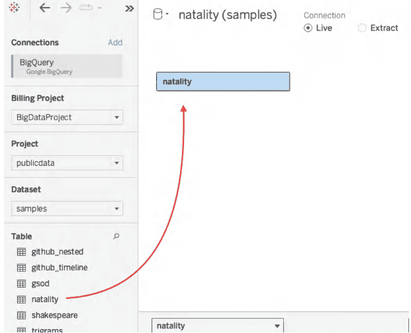

图 6.18: BigQuery

- 6. 打开新的工作表并将其重命名为 **BigQuery**。在 **Data** 窗格中，双击 **natality(Count)**。

- 7. 从 **Data** 窗格中，将 **Month** 拖动到 **Columns** 存储区，并将其设置为 **Discrete**。

- 8. 右键单击 y 轴 **Count of natality**，并选择 **Edit Axis**。取消选中 **Include Zero**。

- 9. 按需格式化。此可视化显示了从 1969 年到 2008 年每个月出生的婴儿数量：

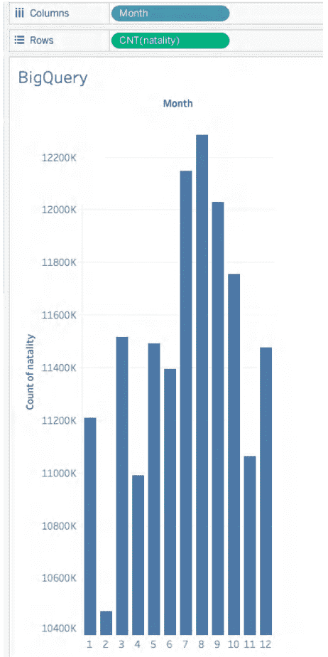

图 6.19: BigQuery 可视化

了解大数据引擎分区所依据的字段在面临性能问题时会有很大帮助。例如，如果您的数据按 Year 分区，请始终尝试在过滤器和计算中使用此字段。第 12 章“Improving Performance”包含有关此主题的更多信息。

如您所见，BigQuery 允许我们快速且轻松地可视化包含数百万条记录的数据集。

## 跟随练习仪表板

在本章的跟随练习中，我们将连接到 OData 源，探索其数据，构建两个基本可视化，并将它们组合成一个简单的仪表板。让我们开始吧！请遵循以下步骤：

- 1. 打开 Tableau。
- 2. 在 Data Source 选项卡下，在 Connect 下找到 To a Server 并选择 OData。
- 3. 在 OData URL 字段中，输入以下内容：https://services.odata.org/V4/Northwind/Northwind.svc/。
- 4. 单击 Sign In（无需凭据）。

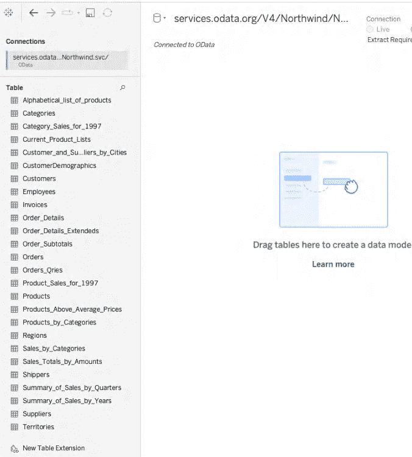

图 6.20: OData 连接器

Tableau 将显示服务中可用的表列表。对于本练习，我们将使用两个表：**Orders** 和 **Order_Details**。

- 5. 单击 **Orders** 并将其拖动到画布上。
- 6. 接下来，找到 **Order_Details** 并将其拖动到 **Orders** 旁边。
- 7. Tableau 将自动检测关系；如果没有，请在 **OrderID** 上创建关系。这为我们提供订单级信息（日期、客户、运输信息）和行项目信息（产品、数量、价格）。

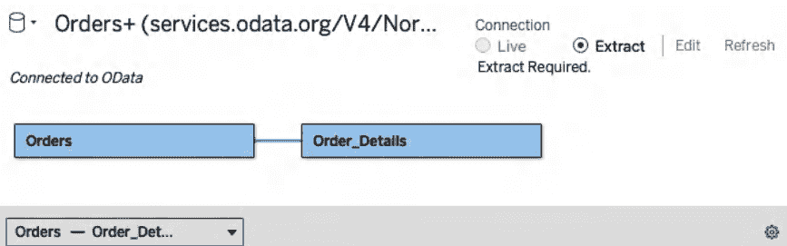

关系与连接有何区别？了解更多

| Orders | 操作符 | Order_Details |
| :--- | :--- | :--- |
| # Order ID | = | # OrderID (Order Details) |

- 添加更多字段

图 6.21: 连接

- 8. 打开新的工作表并将其命名为 **Sales by City**。
- 9. 将 **ShipCity** 拖动到 **Rows**。
- 10. 将 **Quantity** 拖动到 **Columns**。

- 11. 使用 Quantity 轴标签旁边的排序图标按降序对城市进行排序。

| 列 | SUM(Quantity) |
| 行 | Ship City |

### Sales by City

- Ship City
- Boise
- Graz
- Cuneo valde
- Rio de Janeiro
- London
- Sao Paulo
- Cork
- München
- Albuquerque
- Brücke
- San Cristóbal
- Charleroi
- Seattle
- México D.F.
- LuléÅ
- Marseille
- I. de Margarita
- Montréal
- Tsawassen
- Brandenburg
- Barquisimeto
- Genève
- Frankfurt a.M.
- Quantity
- 0
- 500
- 1000
- 1500
- 2000
- 2500
- 3000
- 3500
- 4000
- 4500
- 5000

图 6.22: Sales by City

- 12. 创建新的工作表并将其命名为 Monthly Orders。
- 13. 将 OrderDate 拖动到 Columns。
- 14. 右键单击该 pill 并选择 Month (continuous)。
- 15. 将 OrderID 拖动到 Rows。
- 16. 通过右键单击该 pill 并查找 Measure，将 OrderID 更改为 COUNT(OrderID)。

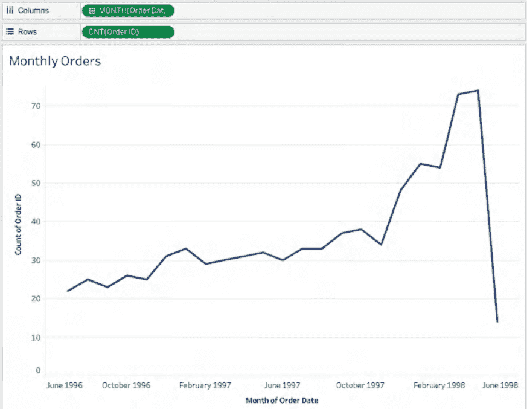

图 6.23: Monthly Orders

- 17. 打开 **Dashboard** 选项卡。
- 18. 在左侧窗格中，将 **Size** 值设置为 **Automatic** 或 **Fixed: 1000×800**。
- 19. 将两个工作表 **Sales by City** 和 **Monthly Orders** 拖动到仪表板上。
- 20. 将它们并排排列。
- 21. 添加仪表板标题，例如 **Northwind Orders Overview**。
- 22. 添加 **ShipCity** 过滤器并将其应用于两个工作表。

- 23. 为 OrderDate 添加日期过滤器。

### Northwind Orders Overview

### Sales by City

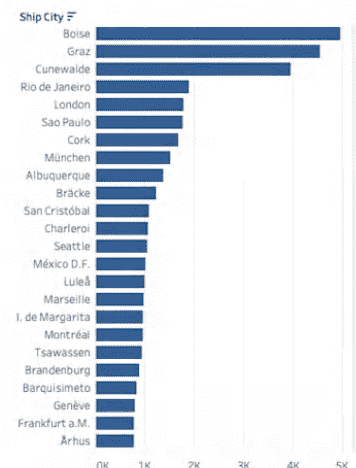

### Monthly Orders

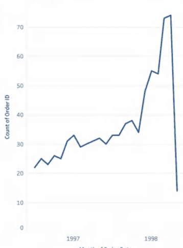

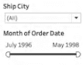

图 6.24: Northwind Orders Overview

能够直接连接到 OData 源非常强大，因为它让 Tableau 无需手动下载即可可视化实时、标准化、云托管的数据，并且尽管数据是远程的，Tableau 仍然优化查询以实现强大的性能，各行业中有成千上万个公共和私有 OData 端点可用：政府、非营利组织、金融、教育等。您可以轻松访问丰富的现实世界数据集，这些数据集可帮助您完成日常工作，并使您能够练习分析、构建作品集以及开发可直接应用于现代数据环境的技能。

## 摘要

本章首先讨论了数据密度化，并发现有两种数据密度化类型：域完成和域填充。在回顾这两种数据密度化类型时，我们了解了如何部署每种类型、每种类型何时有用以及每种类型何时可能存在问题。接下来，我们通过一个示例演练探索了大数据，了解如何使用 Tableau 连接到 Google BigQuery。

在下一章中，我们将探索另一种功能：**Level of Detail (LOD)** 计算。尽管表计算仍然是日常 Tableau 使用的重要组成部分，但我们将发现 LOD 计算可以轻松完成以前仅通过复杂表计算才能实现的任务。

## 加入我们的 Discord 社区

加入我们社区的 Discord 空间，与作者和其他读者讨论：

https://discord.gg/VXpz9YPUTW


