# 练习 Level of Detail 计算

当我们谈论 Tableau 中的 **Level of Detail (LOD)** 计算时，我们指的是三个表达式：FIXED、INCLUDE 和 EXCLUDE。这三个表达式通过提供创建针对特定粒度级别的计算的能力，为我们打开了一个充满选择的世界。在较旧版本的 Tableau 中，工作表的数据粒度由视图中的维度确定。如果视图包含 Region、State 和 Postal Code 等维度，但作者想要创建 City 级别的计算，则需要将 City 维度包含在视图中。此外，没有机制在视图中排除或忽略给定的 **dimension**。诚然，所需结果通常可以通过表计算、数据混合等复杂且有时难以理解的用法来实现。幸运的是，LODs 大大简化了这些用例场景，并在某些情况下使以前不可能实现的事情成为可能。

在本章中，我们将讨论以下主题：

- * 介绍 LODs
- * 使用 FIXED 和 EXCLUDE 函数
- * 使用 INCLUDE 函数
- * 构建使用 LOD 的实际应用

本章的早期部分更多基于理论，但请不要担心——您将在 _构建使用 LOD 的实际应用_ 部分以实际方式探索这些概念。让我们先从介绍 LODs 及其使用方法开始。

> > **注意**
> > 
> > 您的购买包含一份免费的 PDF 副本和独家额外内容。
> > 
> > 您的购买包含本书的无 DRM PDF 副本、Packt+ 库 7 天试用（无需信用卡）以及额外的独家内容。请参见 _前言_ 中的 _书籍随附的免费权益_ 部分，立即解锁它们并最大化您的学习。

## 介绍 LODs

Tableau 的默认行为是根据视图中也存在的维度显示视图中的度量值。如果您有一个带有 Sales 数据和 State、City 等维度的仪表板，并将 State 和 Sales 数据拖动到视图上，则 Sales 数据将按 State 分为，显示每个 State 的 Sales。如果您想将 Sales 数据进一步划分为更小的块，可以添加 City 字段，从而得到每个 State 下每个 City 的 Sales 数据。LODs 可以操纵这种默认行为。

完成本章后，您将能够按视图中不存在的维度划分或分区度量值，并使用比视图中可见的维度更少的维度来显示度量值。

为此，我们将构建和使用两个 **playgrounds**。按职责交付所需报告可能会导致对有限功能集的深入了解；也就是说，深入但狭窄的理解。要抽出时间（并证明该时间合理）来探索 Tableau 的功能，这些功能表面上看可能与职责没有直接关联，这可能很困难。Playground 环境可以通过提供高效的探索途径来帮助克服任何困难和反对意见。在本章中，我们将专门为 LODs 构建两个 playground 环境，通过提供高效的探索和理解途径，使深入而广泛的理解任务变得更容易。您随时可以回到伴随本章的工作簿来测试与 LOD 相关的功能。

## 使用 FIXED 和 EXCLUDE 操作

我们将构建的第一个 playground 旨在探索三个 LOD 函数中的两个：FIXED 和 EXCLUDE。我们将使用一组参数和关联的计算字段来高效地探索这些函数的工作原理。在深入探讨函数本身之前，让我们先了解工作簿设置。

在进入技术设置之前，让我解释一下所有这些参数和计算实际有什么作用。这样以下步骤会更清晰。

| 组件 | 它控制什么 | 工作原理 |
| :--- | :--- | :--- |
| 1st Dim, 2nd Dim, 3rd Dim, 4th Dim (参数) | Rows 存储区的四个插槽中各出现哪个维度？ | 每个参数都有一个维度列表（Category、Region、Segment 等）。当您从下拉列表中选择一个维度时，参数会将一个数字（1、2、3...）传递给相应的计算字段。 |


### 表 7.1: 参数和计算摘要

| 1st Dim、2nd Dim、3rd Dim、4th Dim（计算字段） | 将参数选择转换为实际的 Tableau 字段 | 这些 CASE 语句将参数编号转换为字段名称。例如，如果参数值为 1，则计算字段将返回 [Category]。 |
| --- | --- | --- |
| Choose Fixed Dims（参数） | 选择在 FIXED LOD 计算中将“固定”哪些维度 | 与 Dim 参数类似，但此参数控制 Case Fixed 计算字段。值 1 表示“使用第 1 个 Dim 字段”。 |
| Case Fixed（计算字段） | 用户可以尝试的实际 FIXED LOD 计算 | 这就是关键所在：{ FIXED [1st Dim] : SUM([Sales]) }。FIXED 函数在所选维度级别上聚合销售额，忽略视图中的其他维度。 |
| Choose Excluded Dims 1 & 2（参数） | 选择将从 EXCLUDE LOD 计算中排除的哪些维度 | 这些控制 Case Exclude 1 和 Case Exclude 2 字段。 |
| Case Exclude 1 & 2（计算字段） | 实际 EXCLUDE LOD 计算 | 这些使用 { EXCLUDE [1st Dim] : SUM([Sales]) }。EXCLUDE 函数从聚合中移除所选维度，无论视图中包含什么。 |
| Product Name（上下文筛选器） | 将数据集缩减为以 "s" 开头的产品 | 此筛选器在 LOD 计算之前应用，演示了上下文筛选器如何与 LOD 交互。 |

这个练习环境允许你最多选取四个维度在表格中显示，然后比较三种不同的计算：

- Sales = 视图层级上的常规 SUM(Sales)
- Case Fixed = 在所选维度上固定的 SUM(Sales)（忽略其他行/列）
- Case Exclude 1 & 2 = 从聚合中排除特定维度的 SUM(Sales)

你可以通过更改参数并观察数字如何变化来进行实验。这是真正理解 LOD 的最佳方式。

## 设置工作簿

本练习的大部分基础工作已在本章关联的工作簿中完成。以下步骤只需打开不同的计算和参数，以查看其设置方式及为何如此工作。沿途会给出解释。如果你无法随时访问该工作簿，应可通过参考以下步骤构建一个类似的工作簿。

要完成工作表的初始设置，请执行以下步骤：

- 1. 导航至 https://github.com/PacktPublishing/Mastering-Tableau-2026/tree/main/Chapter07 以查找并下载本章关联的工作簿
- 2. 打开本章关联的工作簿并导航至 Fixed and Exclude 工作表。工作表应如下所示：

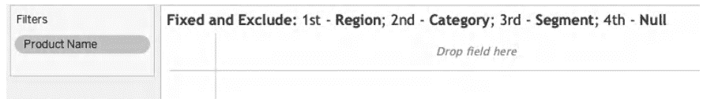

### 图 7.1: 工作表

- 3. 选择 Superstore 数据源，并通过右键单击并选择 **编辑** 来检查名为 **1st Dim** 的参数：

### 编辑参数 [1st Dim]

| 值 | 显示为 |
|---|---|
| 1 | 类别 |
| 2 | 城市 |
| 3 | 国家/地区 |
| 4 | 客户 ID |
| 5 | 客户名称 |
| 6 | 订单 ID |
| 7 | 邮政编码 |

### 图 7.2: 参数 I

名为 2nd Dim、3rd Dim 和 4th Dim 的参数与 1st Dim 相同。

- 4. 请注意，除了 Order Date 和 Ship Date 之外，数据集中的每个维度都包含在值列表中（参见图 7.2）。出于本练习的目的，Category、Region、Segment、Ship Mode 和 Sub-Category 特别重要，因为这些是成员较少的维度。成员较多的维度在此上下文中更难使用。

- 5. 检查工作簿中包含的 **Choose Fixed Dims**、**Choose Excluded Dims 1** 和 **Choose Excluded Dims 2** 参数，并注意我们在值列下定义了若干整数，每个整数稍后都将作为 **显示为** 列中指定的字符串在参数下拉列表中显示。**Choose Fixed Dims** 的值和显示为配置如下：

| 值 | 显示为 |
|---|---|
| 1 | 1st |
| 2 | 2nd |
| 3 | 3rd |
| 4 | 4th |
| 5 | Fixed: 无 |
| 6 | 0 |
| 点击添加 | |

### 图 7.3: 参数 II

- 6. 检查名为 **1st Dim** 的计算字段（它位于 **数据** 窗格的 **Practical: All** 文件夹下）；此计算使用 **1st Dim** 参数，并将根据参数选择显示字段。如果用户在 **1st Dim** 参数中选择 **Category**，则将激活值 1（根据 **图 7.2** 中指定的值）。值 1 随后将转换为计算 **1st Dim** 字段中的 **Category** 字段，如以下屏幕截图所示：

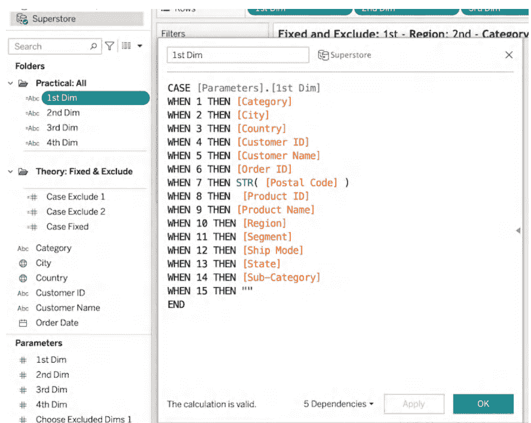

### 图 7.4: 计算的 1st Dim 字段

> **注意**
>
> 计算字段必须返回相同的数据类型；因此，**Postal Code** 已封装在字符串中。

名为 **2nd Dim**、**3rd Dim** 和 **4th Dim** 的计算字段与 **1st Dim** 相同，只是每个字段都引用其同名参数；例如，**2nd Dim** 计算字段使用 **[Parameters].[2nd Dim]**

这些 Case 语句结合关联参数，将允许你从视图中的下拉列表中选择要查看的维度，如步骤 5 所述。

- 7. 检查以下计算字段，它们使你能够选择要使用的 LOD，从而比较和对比差异与相似之处：

```
CASE [Choose Fixed Dims]
WHEN 1 THEN SUM({FIXED [1st Dim]: SUM([Sales])})
WHEN 2 THEN SUM({FIXED [2nd Dim]: SUM([Sales])})
WHEN 3 THEN SUM({FIXED [3rd Dim]: SUM([Sales])})
WHEN 4 THEN SUM({FIXED [4th Dim]: SUM([Sales])})
WHEN 5 THEN SUM({FIXED : SUM([Sales])})
WHEN 6 THEN 0
END
```

### 图 7.5: Case fixed

_Case Fixed_ 计算显示，如果用户在 **Choose Fixed Dims** 参数中选择 1（该参数显示为 **1st**），则无论仪表板设置如何，**1st Dim** 都将被固定。这意味着 **SUM(Sales)** 将按 **1st Dim** 进行分区，无论它是否是仪表板的一部分：

```
CASE [Choose Excluded Dims 1]
WHEN 1 THEN SUM({EXCLUDE [1st Dim]: SUM([Sales])})
WHEN 2 THEN SUM({EXCLUDE [2nd Dim] : SUM([Sales])})
WHEN 3 THEN SUM({EXCLUDE [3rd Dim] : SUM([Sales])})
WHEN 4 THEN SUM({EXCLUDE [4th Dim]: SUM([Sales])})
WHEN 5 THEN 0
END
```

### 图 7.6: Case Exclude 1

_Case Exclude 1_ 计算显示，如果用户在 **Choose Excluded Dims 1** 参数中选择 1（该参数将显示为 **1st**），则 **1st Dim** 将从视图中的计算中排除。这意味着 **SUM(Sales)** 不会按 **1st Dim** 进行分区，即使它是视图的一部分：

```
CASE [Choose Excluded Dims 2]
WHEN 1 THEN SUM({EXCLUDE [1st Dim] : SUM([Sales])})
WHEN 2 THEN SUM({EXCLUDE [1st Dim],[2nd Dim] : SUM([Sales])})
WHEN 3 THEN SUM({EXCLUDE [1st Dim],[2nd Dim],[3rd Dim] : SUM([Sales])})
WHEN 4 THEN SUM({EXCLUDE [1st Dim],[2nd Dim],[3rd Dim], [4th Dim] : SUM([Sales])})
WHEN 5 THEN SUM({EXCLUDE : SUM([Sales])})
WHEN 6 THEN 0
END
```

### 图 7.7: Case Exclude 2

Case Exclude 2 计算显示，如果用户在 Choose Excluded Dims 2 参数中选择 1（该参数将显示为 1st），则 1st Dim 将从视图中的计算中排除。这意味着 SUM(Sales) 不会按 1st Dim 进行分区，即使它是视图的一部分。

- 8. 现在，右键单击并打开 Product Name 上的上下文筛选器以进行检查。在随即出现的对话框中，单击 Wildcard 选项卡并注意设置，如以下屏幕截图所示。筛选器已设置为仅显示以 S 开头的产品名称（匹配值不区分大小写。）：

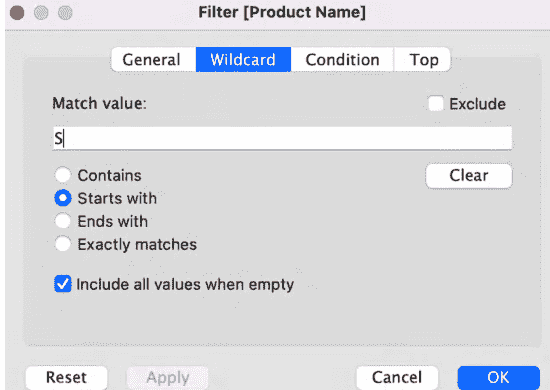

### 图 7.8: 通配符筛选器

- 9. 单击确定后，右键单击筛选器并单击添加到上下文。请注意，上下文筛选器以灰色表示：


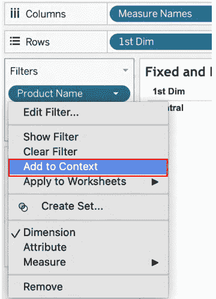

图 7.9: 灰色上下文筛选器

- 10. 将以下维度放在行货架上：第 1 维度、第 2 维度、第 3 维度和第 4 维度
- 11. 将度量名称拖到筛选器货架上，并选择销售额、情况固定、情况排除 1 和情况排除 2
- 12. 将度量值添加到文本，将度量名称添加到列：

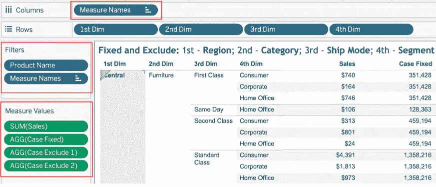

图 7.10: 度量值

- 13. 通过右键单击每个参数并选择**显示参数控件**来显示每个参数。按如下顺序排列参数控件：

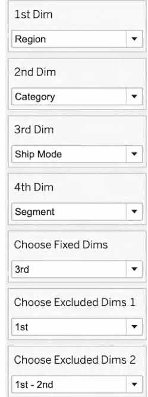

图 7.11: 最终游乐场

按照前面的步骤，我们现在已准备好构建各种表格来比较不同的 LOD，因为参数将允许我们选择不同的维度以及包含 Tableau FIXED 和 EXCLUDE 函数的计算字段。我们将继续使用此游乐场，并解释 LOD 如何更改计算字段。

## 理解 FIXED

现在游乐场环境已搭建完成，让我们构建一些场景以更好地理解 FIXED 和 EXCLUDE 函数。我们将从 FIXED 开始。FIXED LOD 仅考虑其指向的维度。因此，当固定于某个维度时，视图中的所有其他（如果有）维度都会被忽略。当在未定义任何维度的情况下使用 FIXED LOD 时，结果将是忽略视图中所有（如果有）维度的计算。

让我们直接进入练习，亲自看看：

- 1. 使用前面描述的工作表，按如下所示设置参数：

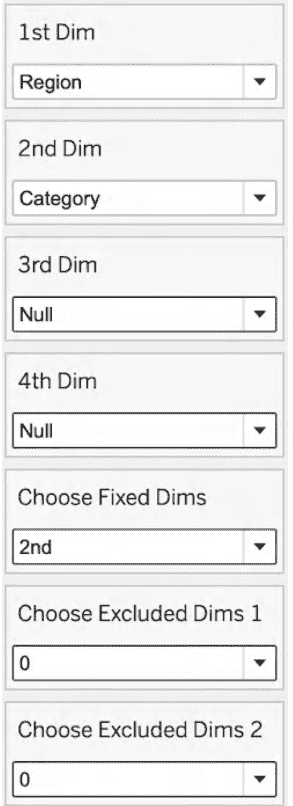

图 7.12: 第一个示例

使用不同参数所实现的效果是，我们展示每个 **区域** 的 **SUM(Sales)** 以及每个 **类别** 下的每个 **区域**，但同时也在 **情况固定** 列中固定了 **类别** 维度的 **SUM(Sales)** 计算。

- 2. **情况固定** 列现在显示每个 **类别** 的总计，并忽略 **区域**，因为我们指示计算固定 **第 2 维度 (区域)** 并忽略视图本身中的维度

- 3. 通过比较 **销售额** 列和 **情况固定** 列可以明显看出此效果：

固定和排除：第 1 - 区域; 第 2 - 类别; 第 3 - 空; 第 4 - 空

| 第 1 维度 | 第 2 维度 | 第 3 维度 | 第 4 维度 | 销售额 | 情况固定 | 情况排除 1 | 情况排除 2 |
| :--- | :--- | :--- | :--- | :--- | :--- | :--- | :--- |
| Central | Furniture | | | $10,072 | 47,379 | 0 | 0 |
| | Office Supplies | | | $16,340 | 70,596 | 0 | 0 |
| | Technology | | | $13,985 | 76,801 | 0 | 0 |
| East | Furniture | | | $14,249 | 47,379 | 0 | 0 |
| | Office Supplies | | | $21,560 | 70,596 | 0 | 0 |
| | Technology | | | $20,646 | 76,801 | 0 | 0 |
| South | Furniture | | | $4,494 | 47,379 | 0 | 0 |
| | Office Supplies | | | $8,721 | 70,596 | 0 | 0 |
| | Technology | | | $17,451 | 76,801 | 0 | 0 |
| West | Furniture | | | $18,564 | 47,379 | 0 | 0 |
| | Office Supplies | | | $23,975 | 70,596 | 0 | 0 |
| | Technology | | | $24,710 | 76,801 | 0 | 0 |

图 7.13: 情况固定 I

- 4. 亲自检查并为 Furniture 进行计算

10,072 + 14,249 + 4,494 + 18,564 = 47,379

尽管视图中可见 **区域**，但 **情况固定** 列中的 **SUM(Sales)** 忽略了 **区域**，并显示结果，仿佛 **类别** 维度是视图中唯一的维度。我们操纵了数据的粒度。在 **情况固定** 列中，**区域** 仅用于信息显示，不影响 **SUM(Sales)** 的计算。

- 1. 现在将 **选择固定维度** 参数更改为 **第 1**，并注意 **情况固定** 现在显示每个 **区域** 的总计：

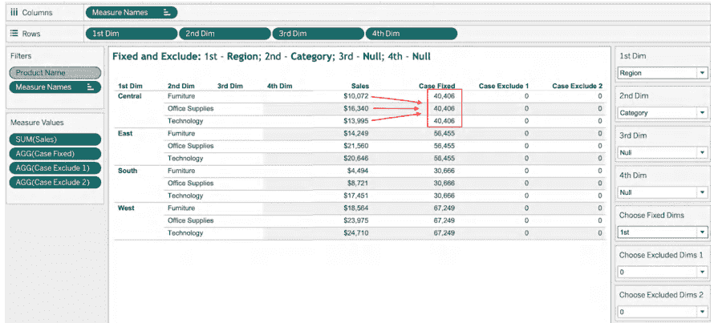

图 7.14: 情况固定 II

- 2. 此次，我们将 Case Fixed 列中的计算固定为仅考虑 区域 而忽略 类别。请亲自检查并为 Central 进行计算：

10,072 + 16,340 + 13,995 = 40,406.

将 Choose Fixed Dims 参数更改为 Fixed: Nothing，并注意该金额反映了 SUM(Sales) 的总计：

固定和排除：第 1 - 区域; 第 2 - 类别; 第 3 - 空; 第 4 - 空

| 第 1 维度 | 第 2 维度 | 第 3 维度 | 第 4 维度 | 销售额 | 情况固定 | 情况排除 1 | 情况排除 2 |
|---|---|---|---|---|---|---|---|
| Central | Furniture | | | $10,072 | 194,776 | 0 | 0 |
| | Office Supplies | | | $16,340 | 194,776 | 0 | 0 |
| | Technology | | | $13,995 | 194,776 | 0 | 0 |
| East | Furniture | | | $14,249 | 194,776 | 0 | 0 |
| | Office Supplies | | | $21,560 | 194,776 | 0 | 0 |
| | Technology | | | $20,646 | 194,776 | 0 | 0 |
| South | Furniture | | | $4,494 | 194,776 | 0 | 0 |
| | Office Supplies | | | $8,721 | 194,776 | 0 | 0 |
| | Technology | | | $17,451 | 194,776 | 0 | 0 |
| West | Furniture | | | $18,564 | 194,776 | 0 | 0 |
| | Office Supplies | | | $23,975 | 194,776 | 0 | 0 |
| | Technology | | | $24,710 | 194,776 | 0 | 0 |

图 7.15: 固定：无

此次，我们将计算固定为无，这意味着我们忽略视图中的每个维度。请亲自检查并通过求和 Sales 值来验证计算；总和将为 194,776。

很明显，FIXED LOD 仅考虑其指向的维度。因此，当固定于 **类别** 时，会忽略 **区域**。如所示，当固定于 **区域** 时，会忽略 **类别**。最后，当 **选择固定维度** 设置为 **固定：无** 时，将显示未受 **产品名称** 上下文筛选器限制的整个数据集。

接下来，让我们看看 Tableau 2021.1 引入的几项与 FIXED LOD 相关的新功能。

## 表范围表达式

编写 FIXED 表范围 LOD 表达式的快捷方式（等效于 {FIXED : MAX([Order Date])}）是：

```
{MAX([Order Date])}
```

如果在 Superstore 数据集上使用此计算，您将获得与编写以下内容完全相同的结果：

```
{FIXED : MAX([Order Date])}
```

无论您在视图中显示什么，此字段始终会从整个表中检索最新数据。很酷，对吧？

## 快速 LOD

Tableau 2021.1 允许我们更快地创建 FIXED LOD。只需将所需度量拖放到维度上方，然后按 **Ctrl**（macOS 上为 **Cmd**）。

现在您将看到维度被蓝色高亮显示（请参阅 **图 7.16** 中的 **区域**）。然后将度量放置于该处，将创建一个新的度量字段（在此示例中为 **销售额 (区域)**）。

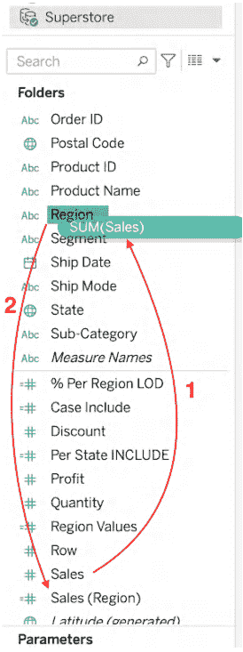

图 7.16: 快速 LOD

右键单击 Sales (Region)，并注意已创建一个 FIXED LOD：

```
{ FIXED [Region]: SUM([Sales]) }
```

图 7.17: 快速 LOD II

如果您使用的是 Tableau 2021.1 或更高版本，可以使用此快捷方式创建 FIXED LOD。

我们构建的游乐场不仅用于 FIXED，也用于 EXCLUDE。接下来，让我们了解 EXCLUDE。

## 理解 EXCLUDE

让我们开始理解 EXCLUDE LOD。EXCLUDE LOD 将排除其指向的任何维度。如果您的视图包含 **区域** 和 **类别**，并且您在 **类别** 上编写了一个 EXCLUDE LOD，则计算中仅考虑 **区域**。以下示例将更清晰地说明这一点——本练习的目标是使用比视图中更少的维度来计算 SUM(Sales)。我们希望仅从计算中排除可见维度，但仍在仪表板中显示维度值：

- 1. 按以下屏幕截图所示设置参数：

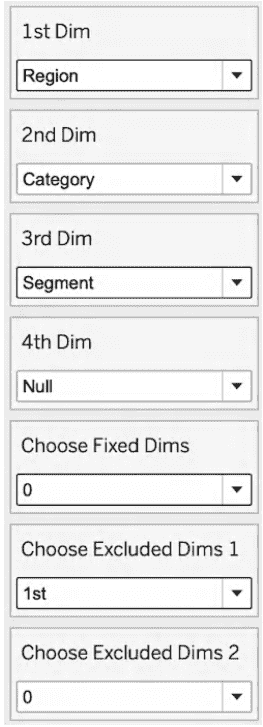

图 7.18: 固定：无

- 2. 您可以观察以下结果：

固定和排除：第 1 - 区域; 第 2 - 类别; 第 3 - 段; 第 4 - 空

| 第 1 维度 | 第 2 维度 | 第 3 维度 | 第 4 维度 | 销售额 | 情况固定 | 情况排除 1 | 情况排除 2 |
|---|---|---|---|---|---|---|---|
| Central | Furniture | Consumer | | $5,444 | 0 | 26,738 | 0 |
| | | Corporate | | $2,779 | 0 | 13,050 | 0 |
| | | Home Office | | $1,849 | 0 | 7,592 | 0 |
| | Office Supplies | Consumer | | $9,085 | 0 | 31,861 | 0 |
| | | Corporate | | $3,462 | 0 | 24,179 | 0 |
| | | Home Office | | $3,793 | 0 | 14,556 | 0 |
| | Technology | Consumer | | $5,144 | 0 | 39,955 | 0 |
| | | Corporate | | $3,848 | 0 | 23,766 | 0 |
| | | Home Office | | $5,003 | 0 | 13,081 | 0 |
| East | Furniture | Consumer | | $6,941 | 0 | 26,738 | 0 |
| | | Corporate | | $4,415 | 0 | 13,050 | 0 |
| | | Home Office | | $2,893 | 0 | 7,592 | 0 |
| | Office Supplies | Consumer | | $11,361 | 0 | 31,861 | 0 |
| | | Corporate | | $7,217 | 0 | 24,179 | 0 |
| | | Home Office | | $2,982 | 0 | 14,556 | 0 |
| | Technology | Consumer | | $12,459 | 0 | 39,955 | 0 |
| | | Corporate | | $8,011 | 0 | 23,766 | 0 |
| | | Home Office | | $176 | 0 | 13,081 | 0 |
| South | Furniture | Consumer | | $2,052 | 0 | 26,738 | 0 |
| | | Corporate | | $2,193 | 0 | 13,050 | 0 |
| | | Home Office | | $249 | 0 | 7,592 | 0 |
| | Office Supplies | Consumer | | $3,393 | 0 | 31,861 | 0 |
| | | Corporate | | $2,349 | 0 | 24,179 | 0 |
| | | Home Office | | $2,978 | 0 | 14,556 | 0 |
| | Technology | Consumer | | $10,024 | 0 | 39,955 | 0 |
| | | Corporate | | $6,046 | 0 | 23,766 | 0 |
| | | Home Office | | $1,381 | 0 | 13,081 | 0 |
| West | Furniture | Consumer | | $12,301 | 0 | 26,738 | 0 |
| | | Corporate | | $3,663 | 0 | 13,050 | 0 |
| | | Home Office | | $2,600 | 0 | 7,592 | 0 |
| | Office Supplies | Consumer | | $8,022 | 0 | 31,861 | 0 |

图 7.19: 排除 1

**情况排除 1** 显示每个 **类别** 和 **段** 的总计，并忽略 **区域**。例如，类别 **Furniture** 内段 **Consumer** 的总计为 $26,738。该总计对每个 **区域** 都会重复。生成这些结果的相关代码是

```
SUM({EXCLUDE [Region] : SUM([Sales])})
```


- 3. 对参数进行以下更改：

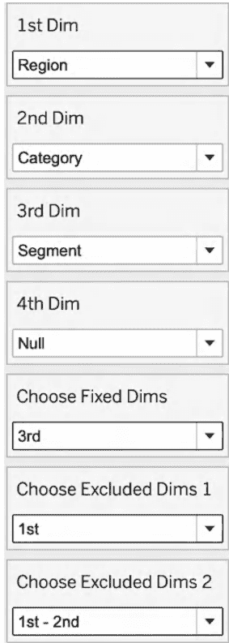

图 7.20：排除 II

任何 LOD 计算都可以在视图中与多个维度一起使用。在此示例中，排除情况 2 忽略两个维度：第 1 维度和第 2 维度，它们分别与区域和类别相关联。因此，排除情况 2 的相关代码为：

```
SUM({EXCLUDE [Region],[Category] : SUM([Sales])})
```

固定情况的相关代码为：

```
SUM({FIXED [Segment]: SUM([Sales])})
```

排除情况 2 与固定情况现在具有相同的结果。这是因为排除前两个维度等同于对第三个维度进行固定。在两种情况下，只考虑第三个维度 Segment。

你可以在以下屏幕截图中观察结果：

## 固定和排除：第 1 位 - 区域；第 2 位 - 类别；第 3 位 - 细分；第 4 位 - 空

| 第 1 维度 | 第 2 维度 | 第 3 维度 | 第 4 维度 | 销售额 | 固定情况 | 排除情况 1 | 排除情况 2 |
|---|---|---|---|---|---|---|---|
| 中部 | 家具 | 消费者 | | $5,444 | 98,554 | 26,738 | 98,554 |
| | | 企业 | | $2,779 | 60,994 | 13,050 | 60,994 |
| | | 家庭办公 | | $1,849 | 35,228 | 7,592 | 35,228 |
| | 办公用品 | 消费者 | | $9,085 | 98,554 | 31,861 | 98,554 |
| | | 企业 | | $3,462 | 60,994 | 24,179 | 60,994 |
| | | 家庭办公 | | $3,793 | 35,228 | 14,556 | 35,228 |
| | 技术 | 消费者 | | $5,144 | 98,554 | 39,955 | 98,554 |
| | | 企业 | | $3,848 | 60,994 | 23,766 | 60,994 |
| | | 家庭办公 | | $5,003 | 35,228 | 13,081 | 35,228 |
| 东部 | 家具 | 消费者 | | $6,941 | 98,554 | 26,738 | 98,554 |
| | | 企业 | | $4,415 | 60,994 | 13,050 | 60,994 |
| | | 家庭办公 | | $2,893 | 35,228 | 7,592 | 35,228 |
| | 办公用品 | 消费者 | | $11,361 | 98,554 | 31,861 | 98,554 |
| | | 企业 | | $7,217 | 60,994 | 24,179 | 60,994 |
| | | 家庭办公 | | $2,982 | 35,228 | 14,556 | 35,228 |
| | 技术 | 消费者 | | $12,459 | 98,554 | 39,955 | 98,554 |
| | | 企业 | | $8,011 | 60,994 | 23,766 | 60,994 |
| | | 家庭办公 | | $176 | 35,228 | 13,081 | 35,228 |
| 南部 | 家具 | 消费者 | | $2,052 | 98,554 | 26,738 | 98,554 |
| | | 企业 | | $2,193 | 60,994 | 13,050 | 60,994 |
| | | 家庭办公 | | $249 | 35,228 | 7,592 | 35,228 |
| | 办公用品 | 消费者 | | $3,393 | 98,554 | 31,861 | 98,554 |
| | | 企业 | | $2,349 | 60,994 | 24,179 | 60,994 |
| | | 家庭办公 | | $2,978 | 35,228 | 14,556 | 35,228 |
| | 技术 | 消费者 | | $10,024 | 98,554 | 39,955 | 98,554 |
| | | 企业 | | $6,046 | 60,994 | 23,766 | 60,994 |
| | | 家庭办公 | | $1,381 | 35,228 | 13,081 | 35,228 |
| 西部 | 家具 | 消费者 | | $12,301 | 98,554 | 26,738 | 98,554 |
| | | 企业 | | $3,663 | 60,994 | 13,050 | 60,994 |
| | | 家庭办公 | | $2,600 | 35,228 | 7,592 | 35,228 |
| | 办公用品 | 消费者 | | $8,022 | 98,554 | 31,861 | 98,554 |

图 7.21：排除 II 表格

- 4. 对参数进行以下更改：

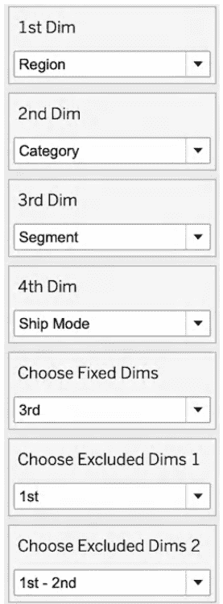

图 7.22：更改第 4 个维度

- 5. 你可以按如下方式观察结果

## 固定和排除：第 1 位 - 区域；第 2 位 - 类别；第 3 位 - 细分；第 4 位 - 运输方式

| 第 1 维度 | 第 2 维度 | 第 3 维度 | 第 4 维度 | 销售额 | 固定情况 | 排除情况 1 | 排除情况 2 |
|---|---|---|---|---|---|---|---|
| 中部 | 家具 | 消费者 | 头等舱 | $740 | 98,554 | 2,961 | 8,843 |
| | | | 二等舱 | $313 | 98,554 | 6,493 | 24,765 |
| | | | 标准舱 | $4,391 | 98,554 | 17,147 | 62,011 |
| | 企业 | | 头等舱 | $164 | 60,994 | 779 | 10,622 |
| | | | 二等舱 | $801 | 60,994 | 3,139 | 8,818 |
| | | | 标准舱 | $1,813 | 60,994 | 8,934 | 38,997 |
| | 家庭办公 | | 头等舱 | $746 | 35,228 | 1,202 | 3,121 |
| | | | 当日达 | $106 | 35,228 | 517 | 2,616 |
| | | | 二等舱 | $24 | 35,228 | 2,286 | 6,953 |
| | | | 标准舱 | $973 | 35,228 | 3,586 | 22,537 |
| 办公用品 | 消费者 | | 头等舱 | $251 | 98,554 | 1,854 | 8,843 |
| | | | 当日达 | $160 | 98,554 | 2,165 | 2,935 |
| | | | 二等舱 | $1,046 | 98,554 | 7,930 | 24,765 |
| | | | 标准舱 | $7,627 | 98,554 | 19,913 | 62,011 |
| | 企业 | | 头等舱 | $1,819 | 60,994 | 4,977 | 10,622 |
| | | | 当日达 | $41 | 60,994 | 274 | 2,558 |
| | | | 二等舱 | $427 | 60,994 | 3,225 | 8,818 |
| | | | 标准舱 | $1,176 | 60,994 | 15,703 | 38,997 |
| | 家庭办公 | | 头等舱 | $634 | 35,228 | 1,551 | 3,121 |
| | | | 当日达 | $172 | 35,228 | 1,419 | 2,616 |
| | | | 二等舱 | $400 | 35,228 | 1,866 | 6,953 |
| | | | 标准舱 | $2,586 | 35,228 | 9,720 | 22,537 |
| 技术 | 消费者 | | 头等舱 | $260 | 98,554 | 4,028 | 8,843 |
| | | | 当日达 | $235 | 98,554 | 634 | 2,935 |
| | | | 二等舱 | $1,062 | 98,554 | 10,342 | 24,765 |
| | | | 标准舱 | $3,587 | 98,554 | 24,951 | 62,011 |
| | 企业 | | 头等舱 | $946 | 60,994 | 4,866 | 10,622 |
| | | | 二等舱 | $783 | 60,994 | 2,454 | 8,818 |
| | | | 标准舱 | $2,119 | 60,994 | 14,360 | 38,997 |
| | 家庭办公 | | 头等舱 | $15 | 35,228 | 369 | 3,121 |
| | | | 二等舱 | $1,637 | 35,228 | 2,802 | 6,953 |

图 7.23：排除 III

- 6. 请注意，排除情况 2 与固定情况不再具有相同的结果。这是因为引入了运输方式，排除情况 2 会考虑运输方式，而固定情况不会。

- 7. 尝试其他设置，以进一步增强对 FIXED 和 EXCLUDE LOD 的理解

EXCLUDE 会导致 LOD 计算中涉及的任何维度从计算中被移除。多个维度可以是 EXCLUDE LOD 的一部分，常见的用例包括将视图中较低聚合级别（视图中存在的字段）的值与较高聚合（仿佛从视图中移除了维度）的值进行直接比较。假设你想要可视化不同区域中各类别的销售额，以及每个区域的总销售额。你可能还想要计算某个区域内单个类别与该区域总体之间的差异。LOD 能够解决这个看似不可能的场景，难道不很酷吗？我希望上述练习能让你更好地理解 EXCLUDE LOD。

在 FIXED 和 EXCLUDE 练习之后，作为快速插曲，让我们更仔细地了解一下 Tableau 的操作顺序。如你现在所知，FIXED 和 EXCLUDE 不能始终获得相同的结果——操作顺序将帮助我们理解原因。

## 了解 Tableau 的操作顺序

上一个练习让我们相信，可以通过固定未排除的维度（反之亦然）来实现 FIXED 和 EXCLUDE 的相同结果。但是，Tableau 执行 FIXED 和 EXCLUDE LOD 的顺序不同，因此可能会导致意外结果。为避免这种情况，我将向你展示在使用 FIXED 或 EXCLUDE LOD 时需要考虑的事项。

让我们看看筛选顺序：

- 1. 设置参数如下：

| 标签 | 值 |
|---|---|
| 第 1 维度 | 区域 |
| 第 2 维度 | 类别 |
| 第 3 维度 | 细分 |
| 第 4 维度 | 空 |
| 选择固定维度 | 第 3 个 |
| 选择排除的维度 1 | 第 1 个 |
| 选择排除的维度 2 | 第 1 个 - 第 2 个 |

图 7.24：设置参数

- 2. 观察结果

| 第 1 维度 | 第 2 维度 | 第 3 维度 | 第 4 维度 | 销售额 | 固定情况 | 排除情况 1 | 排除情况 2 |
|---|---|---|---|---|---|---|---|
| 中部 | 家具 | 消费者 | | $5,444 | 98,554 | 26,738 | 98,554 |
| | | 企业 | | $2,779 | 60,994 | 13,050 | 60,994 |
| | | 家庭办公 | | $1,849 | 35,228 | 7,592 | 35,228 |
| | 办公用品 | 消费者 | | $9,085 | 98,554 | 31,861 | 98,554 |
| | | 企业 | | $3,462 | 60,994 | 24,179 | 60,994 |
| | | 家庭办公 | | $3,793 | 35,228 | 14,556 | 35,228 |
| | 技术 | 消费者 | | $5,144 | 98,554 | 39,955 | 98,554 |
| | | 企业 | | $3,848 | 60,994 | 23,766 | 60,994 |
| | | 家庭办公 | | $5,003 | 35,228 | 13,081 | 35,228 |
| 东部 | 家具 | 消费者 | | $6,941 | 98,554 | 26,738 | 98,554 |
| | | 企业 | | $4,415 | 60,994 | 13,050 | 60,994 |
| | | 家庭办公 | | $2,893 | 35,228 | 7,592 | 35,228 |
| | 办公用品 | 消费者 | | $11,361 | 98,554 | 31,861 | 98,554 |
| | | 企业 | | $7,217 | 60,994 | 24,179 | 60,994 |
| | | 家庭办公 | | $2,982 | 35,228 | 14,556 | 35,228 |
| | 技术 | 消费者 | | $12,459 | 98,554 | 39,955 | 98,554 |
| | | 企业 | | $8,011 | 60,994 | 23,766 | 60,994 |
| | | 家庭办公 | | $176 | 35,228 | 13,081 | 35,228 |
| 南部 | 家具 | 消费者 | | $2,052 | 98,554 | 26,738 | 98,554 |
| | | 企业 | | $2,193 | 60,994 | 13,050 | 60,994 |
| | | 家庭办公 | | $249 | 35,228 | 7,592 | 35,228 |
| | 办公用品 | 消费者 | | $3,333 | 98,554 | 31,861 | 98,554 |
| | | 企业 | | $2,349 | 60,994 | 24,179 | 60,994 |
| | | 家庭办公 | | $2,978 | 35,228 | 14,556 | 35,228 |
| | 技术 | 消费者 | | $10,024 | 98,554 | 39,955 | 98,554 |
| | | 企业 | | $6,046 | 60,994 | 23,766 | 60,994 |
| | | 家庭办公 | | $1,381 | 35,228 | 13,081 | 35,228 |
| 西部 | 家具 | 消费者 | | $12,301 | 98,554 | 26,738 | 98,554 |
| | | 企业 | | $3,663 | 60,994 | 13,050 | 60,994 |
| | | 家庭办公 | | $2,600 | 35,228 | 7,592 | 35,228 |
| | 办公用品 | 消费者 | | $8,022 | 98,554 | 31,861 | 98,554 |

图 7.25：相同结果

请注意，如上一个练习中所示，排除情况 2 与固定情况相同。

- 3. 右键单击 **产品名称** 筛选器，然后选择 **从上下文中删除**：

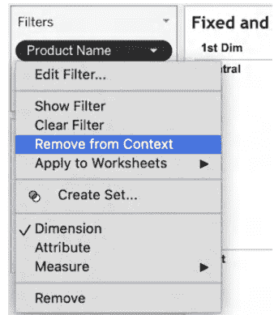

图 7.26：从上下文中删除


- 4. 观察以下屏幕截图中的结果：

固定和排除：第1维 - 地区；第2维 - 类别；第3维 - 细分；第4维 - 空

| 第1维 | 第2维 | 第3维 | 第4维 | 销售额 | 情况固定 | 情况排除1 | 情况排除2 |
|---|---|---|---|---|---|---|---|
| 中部 | 家具 | 个人客户 | | $5,444 | 1,161,401 | 26,738 | 98,554 |
| | | 企业 | | $2,779 | 706,146 | 13,050 | 60,994 |
| | | 家庭办公 | | $1,849 | 429,653 | 7,592 | 35,228 |
| | 办公用品 | 个人客户 | | $9,085 | 1,161,401 | 31,861 | 98,554 |
| | | 企业 | | $3,462 | 706,146 | 24,179 | 60,994 |
| | | 家庭办公 | | $3,793 | 429,653 | 14,556 | 35,228 |
| | 技术 | 个人客户 | | $5,144 | 1,161,401 | 39,955 | 98,554 |
| | | 企业 | | $3,848 | 706,146 | 23,766 | 60,994 |
| | | 家庭办公 | | $5,003 | 429,653 | 13,081 | 35,228 |
| 东部 | 家具 | 个人客户 | | $6,941 | 1,161,401 | 26,738 | 98,554 |
| | | 企业 | | $4,415 | 706,146 | 13,050 | 60,994 |
| | | 家庭办公 | | $2,893 | 429,653 | 7,592 | 35,228 |
| | 办公用品 | 个人客户 | | $11,361 | 1,161,401 | 31,861 | 98,554 |
| | | 企业 | | $7,217 | 706,146 | 24,179 | 60,994 |
| | | 家庭办公 | | $2,982 | 429,653 | 14,556 | 35,228 |
| | 技术 | 个人客户 | | $12,459 | 1,161,401 | 39,955 | 98,554 |
| | | 企业 | | $8,011 | 706,146 | 23,766 | 60,994 |
| | | 家庭办公 | | $176 | 429,653 | 13,081 | 35,228 |
| 南部 | 家具 | 个人客户 | | $2,052 | 1,161,401 | 26,738 | 98,554 |
| | | 企业 | | $2,193 | 706,146 | 13,050 | 60,994 |
| | | 家庭办公 | | $249 | 429,653 | 7,592 | 35,228 |
| | 办公用品 | 个人客户 | | $3,393 | 1,161,401 | 31,861 | 98,554 |
| | | 企业 | | $2,349 | 706,146 | 24,179 | 60,994 |
| | | 家庭办公 | | $2,978 | 429,653 | 14,556 | 35,228 |
| | 技术 | 个人客户 | | $10,024 | 1,161,401 | 39,955 | 98,554 |
| | | 企业 | | $6,046 | 706,146 | 23,766 | 60,994 |
| | | 家庭办公 | | $1,381 | 429,653 | 13,081 | 35,228 |
| 西部 | 家具 | 个人客户 | | $12,301 | 1,161,401 | 26,738 | 98,554 |
| | | 企业 | | $3,663 | 706,146 | 13,050 | 60,994 |
| | | 家庭办公 | | $2,600 | 429,653 | 7,592 | 35,228 |
| | 办公用品 | 个人客户 | | $8,022 | 1,161,401 | 31,861 | 98,554 |

图 7.27：无上下文筛选器

- 5. 情况排除 2 和 情况固定 不再相同。情况固定 不再受产品名称筛选器影响，因为上下文已被移除。

前一练习中观察到的 EXCLUDE 和 FIXED 之间的行为差异，反映了底层的筛选操作顺序。如图 7.27 所示，上下文筛选器会影响 FIXED、EXCLUDE 和 INCLUDE 计算，因为上下文筛选器首先应用于数据集，然后才是 LOD。然而，维度筛选器只会影响 EXCLUDE 和 INCLUDE LOD，因为 FIXED LOD 首先应用于数据集，然后是维度筛选器，随后是 EXCLUDE 和 INCLUDE LOD。

请参见以下图表，它是 Tableau 中操作顺序的示意图：

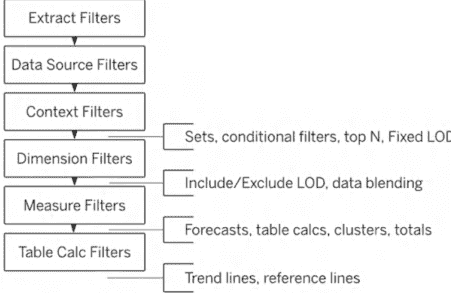

图 7.28：操作顺序

图 7.28 源自 Tableau 帮助页面，地址为：https://help.tableau.com/current/pro/desktop/en-us/order_of_operations.htm。

该页面还包含关于 Tableau 操作顺序的更多信息。

我们刚刚看到，在使用上下文筛选器时，EXCLUDE 和 FIXED LOD 可以得出相同的数字，而维度筛选器会导致结果不同。这是因为 Tableau 依次执行不同的请求。如上图所示，操作顺序为：

- 1. 上下文筛选器
- 2. FIXED LOD
- 3. 维度筛选器
- 4. INCLUDE 和 EXCLUDE LOD

了解这一点对您来说很重要，以便为您的目的选择正确的筛选器或 LOD。

接下来，我们将使用一个新的游乐场，这次来展示 INCLUDE LOD 的工作原理。

## 使用 INCLUDE 函数

使用随附工作簿（https://github.com/PacktPublishing/Mastering-Tableau-2026/tree/main/Chapter07）时，第二个游乐场大部分已为您设置好。但是，我们将添加一些计算字段，以便有效探索。如果您无法随时访问工作簿，应该可以通过参考以下信息构建类似的工作簿。

### 设置工作簿

以下，我们将设置一个工作表，以便练习 INCLUDE LOD：

- 1. 打开与此章关联的工作簿并导航到“探索包含”工作表
- 2. 在之前练习中创建的名为 1st Dim、2nd Dim、3rd Dim 和 4th Dim 的参数和计算字段也用于此工作表
- 3. 右键单击 **1st Dim** 参数并选择 **复制**
- 4. 将副本重命名为 Choose Included Dims
- 5. 创建一个名为 Case Include 的新计算字段，使用以下代码：

```
CASE [Choose Included Dims]
WHEN 1 THEN AVG({INCLUDE [Category]: SUM([Sales])})
WHEN 2 THEN AVG({INCLUDE [City]: SUM([Sales])})
WHEN 3 THEN AVG({INCLUDE [Country]: SUM([Sales])})
WHEN 4 THEN AVG({INCLUDE [Customer ID]: SUM([Sales])})
WHEN 5 THEN AVG({INCLUDE [Customer Name]: SUM([Sales])})
WHEN 6 THEN AVG({INCLUDE [Order ID]: SUM([Sales])})
WHEN 7 THEN AVG({INCLUDE [Postal Code]: SUM([Sales])})
WHEN 8 THEN AVG({INCLUDE [Product ID]: SUM([Sales])})
WHEN 9 THEN AVG({INCLUDE [Product Name]: SUM([Sales])})
WHEN 10 THEN AVG({INCLUDE [Region]: SUM([Sales])})
WHEN 11 THEN AVG({INCLUDE [Segment]: SUM([Sales])})
WHEN 12 THEN AVG({INCLUDE [Ship Mode]: SUM([Sales])})
WHEN 13 THEN AVG({INCLUDE [State]: SUM([Sales])})
WHEN 14 THEN AVG({INCLUDE [Sub-Category]: SUM([Sales])})
WHEN 15 THEN 0
END
```

- 6. 将 Case Include 放在详细信息卡上
- 7. 将以下度量和维度放置在各自的卡上：

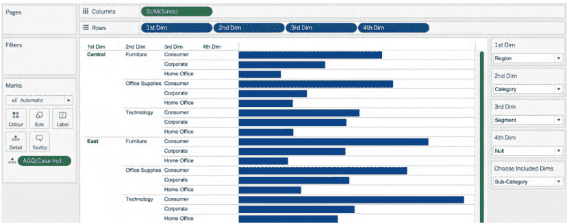

图 7.29：探索 INCLUDE

- 8. 通过右键单击每个参数并选择 **显示参数控件** 来显示每个参数：

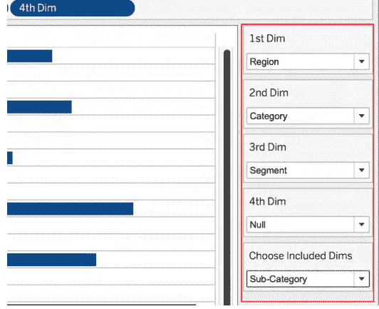

图 7.30：参数

完成初始设置后，我们终于可以开始研究 INCLUDE LOD 了。

### 理解 INCLUDE

现在游乐场环境已准备就绪，让我们构建一个场景以更好地理解 INCLUDE。到目前为止，您可能已经想象到，如果 FIXED 和 EXCLUDE LOD 从计算中移除维度，那么 INCLUDE 会添加维度。没错！您可能希望在计算中包含一个或多个维度，即使视图中未显示它们也是如此。下一个示例将利用这一功能，在不显示子类别的情况下展示每个子类别的平均值。之所以想要这样做，是因为子类别的值太多，会导致仪表板更难阅读，并且得出快速结论所需的时间更长。尽管如此，了解每个子类别的平均值仍然很有用，因为每个 **地区** 和其他维度的子类别数量可能不同，因此包含它可以深入了解真正的平均销售额。

让我们看看实际效果：

- 1. 如下所示设置右侧的参数：

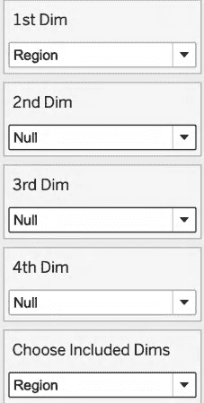

图 7.31：初始布局

- 2. 单击 **分析** 添加两条参考线，并使用以下设置进行编辑：

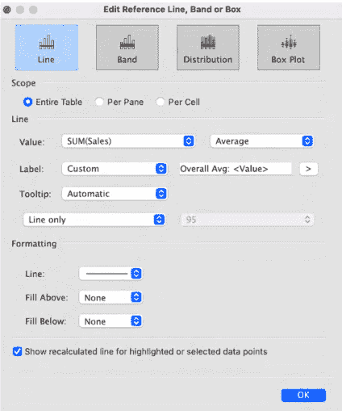

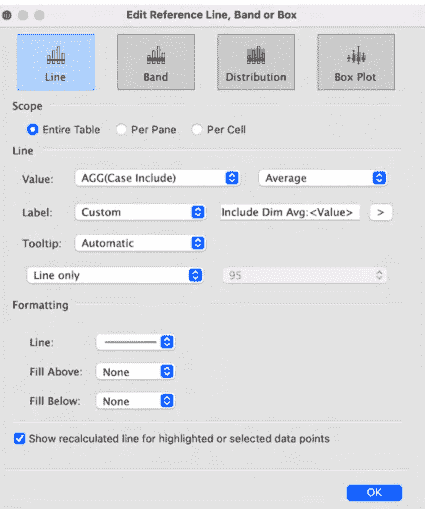

图 7.32：参考线设置

- 3. 查看以下屏幕截图以了解结果。请注意，两条参考线相等：

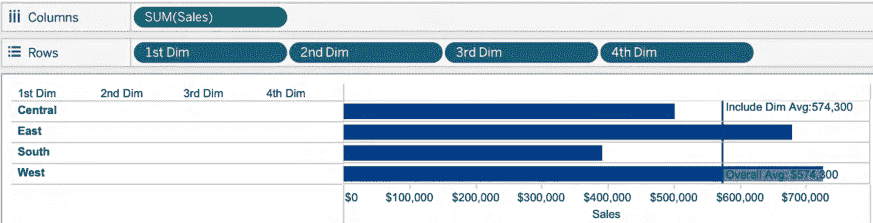

图 7.33：按地区划分的销售额和参考线

- 4. 如果参考线相互重叠，请编辑格式并将对齐方式设置为“顶部”。要访问格式，请单击视图中的参考线：

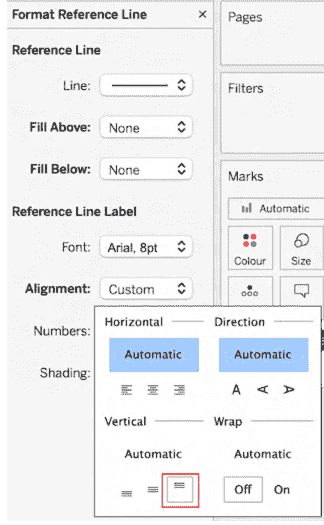

图 7.34：格式设置参考线

- 5. 现在，如下所示设置参数：


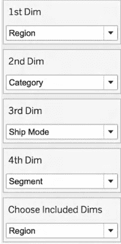

图 7.35: 参考线格式

6. 在 Tableau Desktop 中，您现在应看到以下内容。与之前一样，两个 **参考线** 相等：

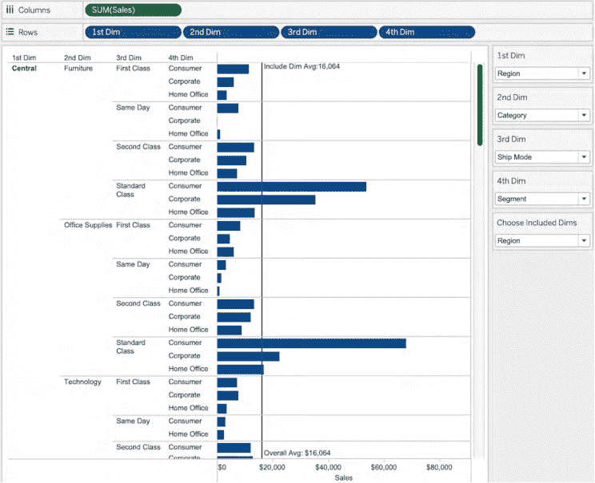

图 7.36: 参考线

7. 将 **Choose Included Dims** 参数更改为 **类别、运输方式和客户细分**

8. 请注意，针对这些设置， **参考线** 彼此相等。这是因为 **Choose Included Dims** 仅引入视图中已表示的维度。

9. 将 **Choose Included Dims** 参数更改为 **子类别**，以便在预期位置查看附加参考线：

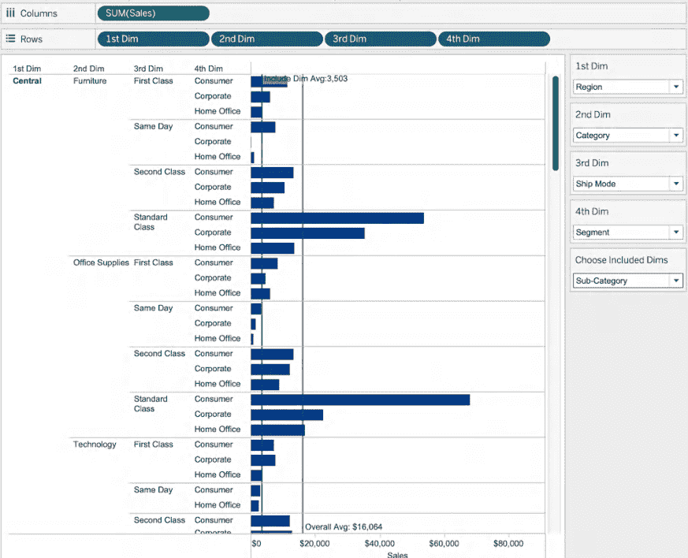

图 7.37: 显示附加参考线

**包含维度平均值** 参考线现在在平均值中包含了 **子类别**，因此与 **整体平均值** 参考线不同。平均值较小，是因为总 **销售额** 正在被除以视图中可见点之外的更多点。将 **子类别** 添加到 LOD 会导致更多行，从而导致每行的平均值变小。此外，请注意，**子类别** 维度未在视图中使用。LOD 不要求计算驻留在视图中。

总结而言，**INCLUDE** LOD 可以以这种方式操作可视化：添加视图本身未使用的分区。此外，所有三个 LOD 的命名约定将是理解它们的最佳助记符：Fixed 用于固定所用字段，Include 用于添加“缺失”字段，Exclude 用于从已存在的计算中删除不需要的字段。

如需获得更多实操培训，我们将继续介绍几个实际应用。

## 使用 LOD 构建实际应用

本章的第一部分旨在演示 LOD 的工作原理。剩余部分将专门用于实际应用。具体来说，我们将考虑三个典型挑战，这些挑战之前是使用其他 Tableau 功能（如表计算和数据混合）解决的。

本练习将探讨将计算总计百分比的表计算与维度筛选器混合时出现的问题。我们将考虑该问题、使用 LOD 计算的解决方案，最后以关于解决方案相关要点的评论部分结束。

### 使用 LOD FIXED 计算

您是否曾遇到过这种情况：希望计算总计百分比，但在视图中仅显示总计维度的子集？好吧，您并非孤单。但多亏了 LOD，您很快就会知道如何解决此问题。以下步骤将指导您完成练习：

- 1. 打开与此章关联的工作簿，导航到名为 The Problem 的工作表
- 2. 选择 2012_World_Pop 数据集

- 3. 创建名为 Percent of Total 的计算字段，使用以下代码：

```
SUM([Population]) / TOTAL(SUM([Population]))
```

- 4. 右键单击 Percent of Total，选择 **默认属性 | 数字格式 | 百分比**
- 5. 将 Country 放在列架上，Measure Names 放在行架上，Measure Values 放在文本架上
- 6. 从 Measure Values 架中删除 Number of Records
- 7. 右键单击 Percent of Total 并将其设置为 **使用 | Country 计算**

- 8. 在 Country 上创建筛选器，使仅显示 Afghanistan：

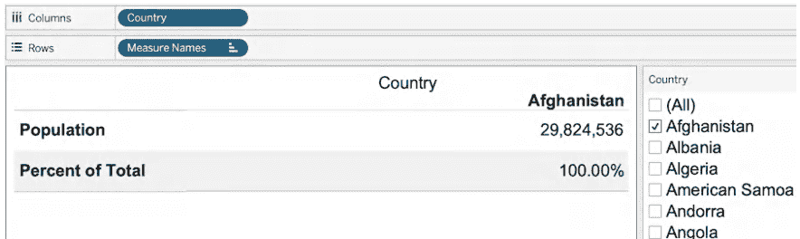

图 7.38: 阿富汗的人口

Afghanistan 显示的总计百分比为 100%。显然，这并不代表阿富汗占世界总人口的百分比。让我们探讨一个可能的解决方案——要使用 LOD 解决此问题，请按照练习步骤操作：

- 9. 复制名为 The Problem 的工作表并将其重命名为 Solution LOD

- 10. 创建名为 Percent of Total LOD 的计算字段，使用以下代码：

```
SUM([Population])/SUM({ FIXED : SUM([Population])})
```

- 11. 将 Percent of Total LOD 放在 Measure Values 架上，并注意显示的百分比等于 0.43%。如果显示 0，请更改数字格式为百分比：

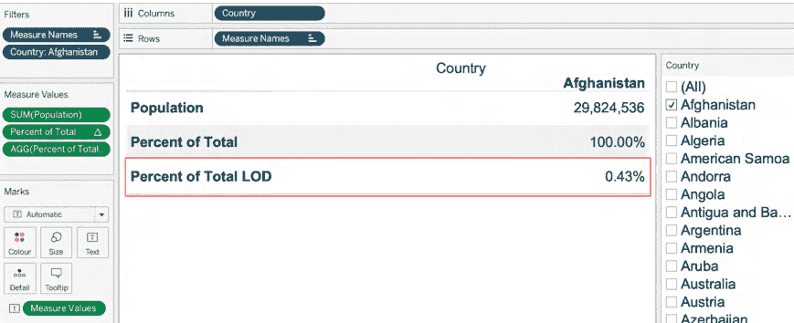

图 7.39: 总计百分比

- 12. 从 Measure Values 架中删除先前创建的 Percent of Total 表计算：

| 国家 | Afghanistan |
| :--- | :--- |
| 人口 | 29,824,536 |
| 总计百分比 LOD | 0.43% |

图 7.40: 总计百分比 LOD

由此可见，问题已解决！为了更好地了解后台发生的情况，让我们来看看 Tableau 为名为 The Problem 的工作表生成的查询。生成的查询可以通过单击 **帮助 | 设置和性能 | 开始性能记录** 来查看。（有关查看 Tableau 生成的查询的更多信息，请参见第 11 章，设计仪表板和可视化最佳实践。）

SQL 语句如下：

```
SELECT
['2012_World_Pop$'].[Country] AS [Country],
SUM(['2012_World_Pop$'].[Population]) AS [SUM:Population:ok]
FROM
[dbo].['2012_World_Pop$'] ['2012_World_Pop$']
WHERE
(['2012_World_Pop$'].[Country] = 'Afghanistan')
GROUP BY
['2012_World_Pop$'].[Country]]
```

请注意，查询中的 WHERE 子句将返回的数据集限制为仅包含 **Country** 为 Afghanistan 的行。此 WHERE 子句是因为将 **Country** 放在 **筛选器** 架上而生成的。通过限制返回的数据，处理要求从 Tableau 转移到基础数据源引擎。换句话说，数据源引擎执行查询的工作，因此 Tableau 使用较小的数据集。这种设计背后的理由是，数据源引擎专门用于高效查询大型数据集，并通常具有支持此类活动的底层硬件。此外，限制返回到 Tableau 的数据行可以减少由于延迟导致的低效。

由于 Tableau 尽可能使用缓存，因此低效率会进一步降低。通常，用户可以执行各种操作而无需向基础数据源发出调用。但是，在前面的案例中，如果用户从筛选器中选择不同的 **Country**，Tableau 将向数据源生成新查询。例如，如果用户与筛选器交互并取消选择 Afghanistan 并选择 Albania，则会生成带有相应 WHERE 子句的新查询。尽管 Tableau 依赖数据源引擎的逻辑是有据可查的，但前面示例中提出的问题仍然存在。Tableau 作者可以做什么来计算整体百分比，而不受筛选影响？

一个解决方案是创建一个也可用作筛选器的表计算。区别在于，与工作表 The Problem 不同，Tableau 生成的用作数据源的查询返回整个数据集。当表计算用于筛选器时，筛选操作不会在基础数据返回之前进行。换句话说，Tableau 执行筛选操作。这样，无论用户选择查看哪个国家的人口总数，都可以保留总计百分比。但是，表计算的一个潜在问题是，返回的数据集可能非常大，这可能会导致性能挑战。由于返回大型数据集所需的时间增加，可能会出现延迟，Tableau 可能会因为额外的筛选数据集处理责任而运行得更慢。

我们提出的解决方案是 LOD 计算，可以解决这些挑战。让我们来看看 Solution LOD 工作表中 Percent of Total LOD 计算字段生成的 SQL 查询：

```
SELECT
[t0].[Country] AS [Country],
[t1].[ measure 0] AS
[TEMP(Calculation_418553293854285824)(2417030171)(0)],
[t0].[TEMP(Calculation_418553293854285824)(616435453)(0)] AS
[TEMP(Calculation_418553293854285824)(616435453)(0)]
FROM
( SELECT
['2012_World_Pop$'].[Country] AS [Country], SUM(['2012_World_Pop$'].[Population])
AS [TEMP(Calculation_418553293854285824)(616435453)(0)]
FROM
[dbo].['2012_World_Pop$'] ['2012_World_Pop$']
WHERE
(['2012_World_Pop$'].[Country]= 'Afghanistan')
GROUP BY
['2012_World_Pop$'].[Country] ) [t0]
CROSS JOIN
( SELECT SUM(['2012_World_Pop$'].[Population]) AS [ measure 0] FROM
[dbo].['2012_World_Pop$'] ['2012_World_Pop$']
GROUP BY () ) [t1]
```

请注意 CROSS JOIN 术语；LOD 计算生成一个查询，指示基础数据源引擎以这种方式返回数据，从而允许 Tableau 将一个或多个国家的人口值除以世界人口总计，从而返回正确的总计百分比。

### 使用 LOD INCLUDE 计算

接下来，我们将练习 INCLUDE LOD 计算。在此练习中，我们将创建一个显示以下内容的工作表：

- 每个地区的总销售额
- 所有地区的总销售额平均值
- 每个地区内所有州的总销售额平均值


使用 LOD 计算来显示这些值非常简单。让我们探索一下。按照练习步骤操作：

- 1. 选择 Practical Include 工作表
- 2. 选择 Superstore 数据集

- 3. 创建一个名为 Per State INCLUDE 的计算字段，使用以下代码：

```
{INCLUDE [State]:SUM([Sales])}
```

- 4. 将 Region 拖到 Columns 栏，SUM(Sales) 拖到 Rows 栏，AVG(Per State INCLUDE) 拖到 Details 栏。请务必将 Per State INCLUDE 更改为平均聚合。

- 5. 右键单击 Sales 轴并选择 Add Reference Line，添加两条参考线。使用以下设置：

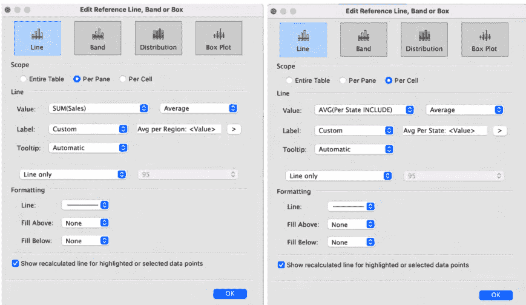

### 图 7.41：参考线

- 6. 按需格式化工作表以完成它：

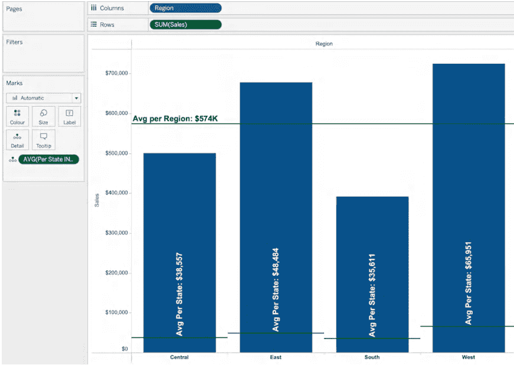

### 图 7.42：按区域和州计算的平均值

由此可见，得益于 LOD，我们可以为每个 **区域** 显示一条折线图，同时还可以为整个数据集显示一条。之所以可行，是因为我们在 **Per State INCLUDE** 计算中包含了 **州** 维度。使用此计算字段创建参考线，使 Tableau 不仅能显示每个（可见） **区域** 的平均值，还能显示每个 **区域** 下每个（不可见） **州** 的平均值。

## 使用 LOD EXCLUDE 计算

在本练习中，我们将使用 Superstore 数据集创建一个工作表，用于计算区域内每个城市产生的销售额百分比。

按照练习步骤操作：

- 1. 选择 Practical Exclude 工作表
- 2. 选择 Superstore 数据集
- 3. 创建以下计算字段：

```
Region Values
{ EXCLUDE [City],[State] :ZN( SUM([Sales]) ) }
```

```
% Per Region LOD
SUM([Sales])/SUM( [Region Values] )
```

### 图 7.43：区域值和按区域计算的 LOD 百分比

- 4. 将 Region 和 City 放在 Rows 栏上

- 5. 将 Measure Names 放在 Columns 栏上，Measure Values 放在 Text 栏上

- 6. 从 Measure Values 栏中删除所有度量实例，只保留 Sales、Region Values 和 % Per Region LOD

- 7. 为了让 % Per Region LOD 显示为百分比，必须调整数字格式。只需在“数据”窗格中右键单击该计算，然后选择“默认属性 | 数字格式 | 百分比”：

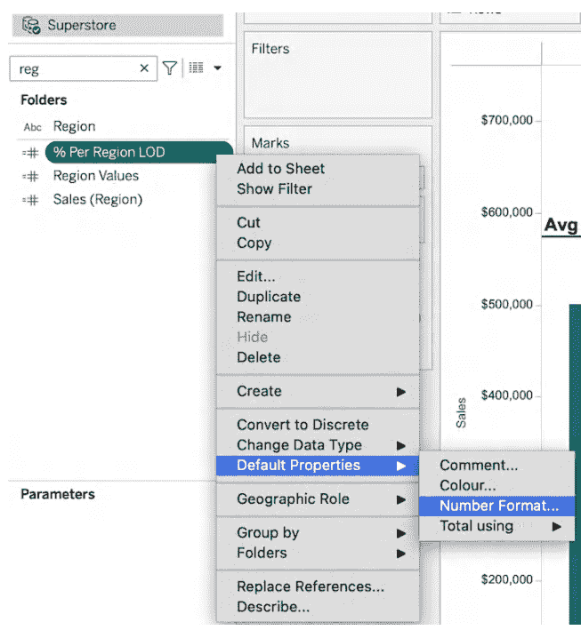

### 图 7.44：更改数字格式

- 8. 将 AGG(% Per Region LOD) 的一个实例放在 Filter 栏上，并调整以显示至少 0.1（即 10%）：

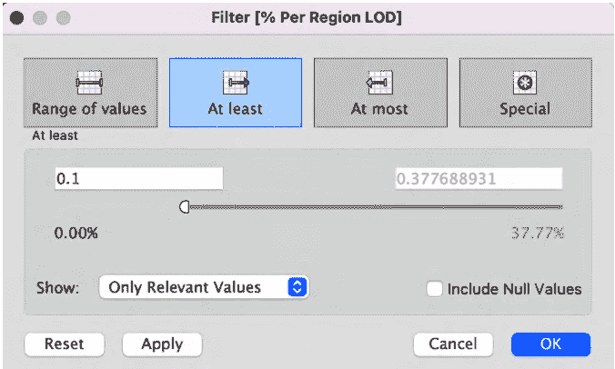

### 图 7.45：% 筛选器

- 9. 观察当前视图，Region 和 City 在 Rows 栏上：

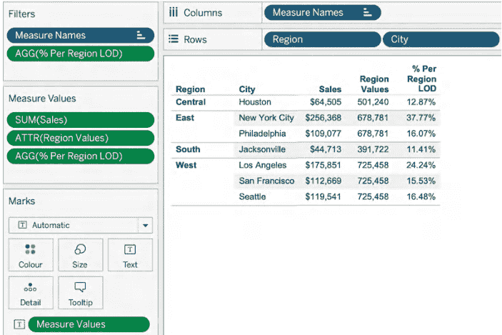

### 图 7.46：Jacksonville 仍然可见

- 10. 现在，将 State 放在 Rows 栏的 Region 和 City 之间。请注意 Jacksonville 消失了：

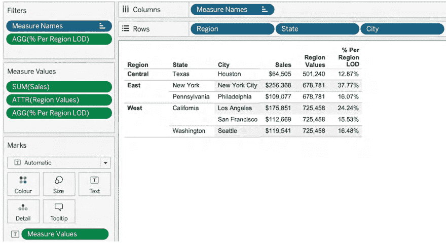

### 图 7.47：将 Region 添加到 Rows 时 Jacksonville 消失

之所以会这样，是因为 Jacksonville 位于南区域的两个州，即佛罗里达州和北卡罗来纳州。您可以通过将 % Per Region LOD 筛选器替换为 City: Jacksonville 来查看这一点：

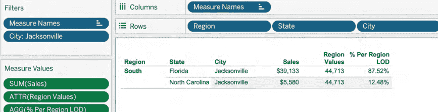

### 图 7.48：Jacksonville 存在于两个州中

我们的 Region Values 计算排除了 City 和 State，因此 % Per Region LOD 将考虑视图中可见内容的 SUM(Sales)，除以 Region Values。当视图中仅包含 Region 和 City 时，Jacksonville 的 SUM(Sales) 为 44,713（见图 7.48）。该数字除以 Region Values 的 391,722（见图 7.46）大于 10%。但随后我们将 State 添加到视图中，使得佛罗里达州 Jacksonville 的 SUM(Sales) 变为 39,133，北卡罗来纳州 Jacksonville 变为 5,580（见图 7.50）。这两个数字除以 391,722 的 Region Values 都不超过 10%，因此会因我们的筛选器而从视图中删除。

在使用 Tableau 时，LOD 是较为高级的主题之一，但它们非常强大，值得花时间去理解。如需更多实际示例，我建议您查看以下网站：https://www.tableau.com/about/blog/LOD-expressions。我记得刚开始使用 Tableau 时，我从未想过自己会想要显示基于视图中不存在的维度的数据，或者想要排除维度。但我曾多次需要这样做，例如，在将“到总行平均值的距离”的计算添加到仪表板时，或者当一个维度有多个最大日期且您只想显示每个单独最大日期的度量时。我回顾 LOD 文档的次数比您想象的还要多，我只能鼓励您也这样做；您对 LOD 越了解，就越容易掌握该概念并自然地使用它们。LOD 为您的仪表板带来的额外灵活性令人难以置信。

## 跟随练习的仪表板

在本章的跟随练习仪表板中，我们有一个非常酷的数据集可供使用。它是来自美国运输部/美国交通统计局（BTS）的美国航空公司准点率数据。让我们开始吧！

- 1. 从以下网址下载承运人准点率数据集：https://www.kaggle.com/datasets/mexwell/carrier-on-time-performance-dataset
- 2. 将 Tableau 连接到数据集
- 3. 接下来，我们将构建三个工作表并将它们组合到一个仪表板中
- 让我们从工作表 1 开始：随时间变化的延误 vs 路线基准（FIXED）。

- 1. 打开一个新工作表
- 2. 将 Flight Date 拖到 Columns。右键单击并设置为 Month。
- 3. 将 Arr Delay 拖到 Rows。如有需要，将聚合更改为 AVG。
- 4. 将 Flight Date 拖到 Filters
- 5. 创建字段 Avg ArrDelay(FIXED) = { FIXED : AVG([Arr Delay])}
- 6. 将 Route Avg ArrDelay (FIXED) 拖到视图中，将其作为 Rows 上的第二个度量并使用双轴

这显示了什么：

- 折线 = 平均延误随时间的变化情况（所选航班）
- 第二条线 = 来自 FIXED LOD 的稳定路线基准

### 图 7.49：延误 vs 基准

接下来，我们将创建工作表 2：KPI 磁贴（LOD 指标摘要）：

- 1. 打开一个新工作表。
- 2. 将 **Origin** 拖到 **Rows**。
- 3. 将 **YEAR(Flight Date)** 拖到 **Columns**。同时也将 **AVG(Arr Delay)** 和 **Arr Delay without Origin = { EXCLUDE [Origin]: AVG([Arr Delay]) }** 拖到 **Columns**。
- 4. 将两个度量设为双轴，并同步它们。
- 5. 在标记卡中为 **到达延误** 选择 **条形图**，为另一个度量选择 **折线图**。
- 6. 将 **YEAR(Flight Date)** 放到 **Filter** 栏，保留 2018、2019 和 2020。现在您有了一个由 LOD 驱动的摘要面板。

### 图 7.50：按起源划分的延误

接下来，我们将创建工作表 3：按航空公司划分的延误：

- 1. 打开一个新工作表
- 2. 将 Reporting Airline 拖到 Columns
- 3. 将 Dest State 拖到 Rows
- 4. 将 AVG(Arr Delay) 放在 Color 上

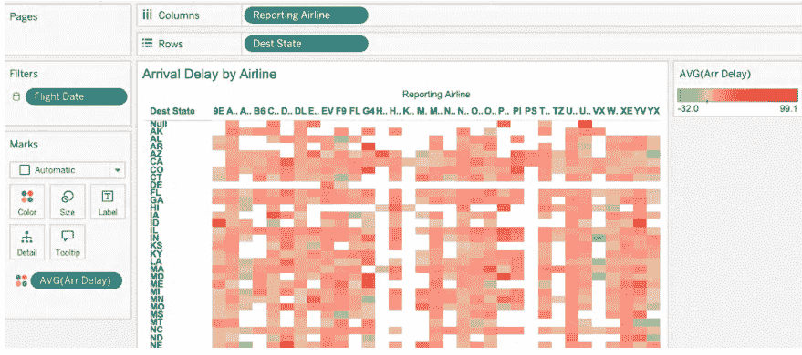

### 图 7.51：按航空公司划分的到达延误

- 4. 最后，构建仪表板

- 5. 拖入：
  - 左上和中间：工作表 1：随时间变化的延误 vs 基准
  - 左下和中间：工作表 3：按航空公司划分的到达延误
  - 右侧从上到下：工作表 2：按起源划分的延误
  - 如果您喜欢整洁的布局，可以使用垂直和水平容器对它们进行排列

- 6. 为最终润色，添加以下标题：
  - 仪表板：航班延误（LOD 仪表板）
  - 根据喜好编辑颜色和字体；

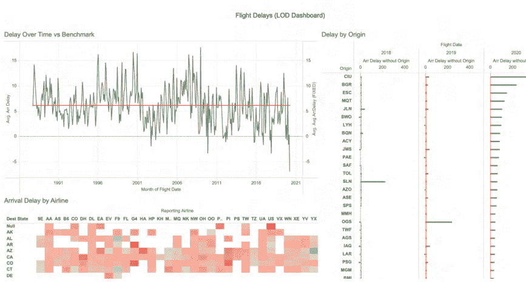

### 图 7.52：最终仪表板

现在，您已经拥有了自己的 LOD 驱动的 Tableau 仪表板

## 摘要

本章首先探讨了 LOD 为何如此有影响力，以及其加入 Tableau 为何备受赞誉。接着，我们构建了两个游乐场来探索三种 LOD——FIXED、EXCLUDE 和 INCLUDE——的工作原理。Tableau 的默认行为是基于视图中可见的维度进行计算。例如，如果视图中有州，销售额将按州显示。如果添加城市，销售额将按州、按城市进行调整。但是，如果您想操纵此默认逻辑，可以使用 LOD。它们允许您基于任何维度计算度量，无论该维度是否在视图中表示。我们还看到，FIXED LOD 在 Tableau 的操作顺序中高于 EXCLUDE 和 INCLUDE LOD。这一点很重要，以便您在仪表板中使用正确的 LOD 和/或筛选器。

在下一章中，我们将把注意力转向 Tableau 的可视化方面，探索不同的图表类型以及不常见但非常有用的可视化效果。


## 获取本书的 PDF 版本和更多资源

扫描二维码（或访问 packtpub.com/unlock），按书名搜索本书，确认版本，然后按照页面上的步骤操作。


注意：请随时准备好发票。直接从 Packt 购买不需要发票。
