# 超越基础

本章的前提是，你熟悉条形图、折线图、树状图、饼图和区域图等基本图表类型，并已使用 Tableau 构建过多个图表。本章的意图是聚焦于自定义背景，这是一个你可能不熟悉的 Tableau 功能，但这功能仍然非常实用。接着，我将向你介绍 Tableau Exchange，这是一个包含扩展、加速器和连接器的平台，提供一些更奇特的图表类型。

也许本章最有用的部分根本不在书中，而在与本章关联的工作簿中。请务必下载该工作簿（相关章节中会提供链接），以查看各种可视化类型。

本章将探讨以下可视化类型和主题：

- * 改进常见的可视化
- * 自定义背景图像
- * Tableau Exchange
- * 扩展
- * 加速器
- * 连接器

请记住，仪表板的内容最重要，但如果你可以用更漂亮的设计呈现相同的内容，那就选择更漂亮的设计。**审美偏差**和**设计驱动消费**是真实存在的。你想要销售产品——就让它看起来更好！希望接下来的章节能帮助你找到方向，最终让你成为一名更出色的仪表板设计师。

## 自定义背景图像

Tableau 中的自定义背景图像开启了无限可能。想象一下，你可以可视化任何空间。可能性涵盖体育、医疗保健、工程、建筑、室内设计以及更多、更多领域。尽管潜力巨大，但在我看来，Tableau 中的背景图像似乎被低估了。为什么？部分原因是生成可与背景图像配合使用的数据集比较困难。

背景图像需要网格布局来精确定位 x 和 y 坐标。在下一节中，我们将讨论如何使用 Tableau 创建可叠加在图像上的网格，以即时识别与 x 和 y 坐标关联的位置，并相对快速生成可供 Tableau 访问的数据集用于可视化目的。

## 创建自定义多边形

Tableau 原生提供多边形的地理区域包括国家、州/省、县和邮政编码/邮编。例如，这意味着可以轻松为世界各国创建填充地图。只需复制国家列表并将其粘贴到 Tableau 中。然后，将 Tableau 中的视图类型设置为 **填充地图**，并将国家列表放置在 **详细信息** 置区上。Tableau 将自动为每个国家绘制多边形。

此外，可能会出现特殊的映射需求，需要为通常不在地图上显示的区域绘制多边形。例如，组织可能定义不遵循常规地图边界的销售区域。最后，自定义图像也可能产生映射需求。Tableau 作者可能将篮球场或足球场图像导入 Tableau，并绘制多边形来表示场地的特定部分。要为 Tableau 未原生提供多边形的每个示例创建填充地图，必须创建自定义多边形。

## 在 Null Island 周围绘制正方形

在本节中，我们将从基础开始，在神话中的 Null Island 周围绘制一个简单的正方形，该岛屿位于本初子午线和赤道的交汇处。

我们将进入一个更稳健的示例，需要为德克萨斯州的每个城市绘制多边形。Tableau 中有一个选项，允许作者为未知位置 **在默认位置显示数据**。选择此选项将导致 Tableau 将所有未知位置的纬度和经度坐标设置为 0（零），从而在非洲西海岸约 1600 公里处的世界地图上创建一个符号。Tableau 开发者亲切地将该区域称为 Null Island。

> **注意**
>
> Null Island 甚至有自己的 YouTube 视频：https://youtu.be/bjvIpI-1w84。

在此练习中，我们将在 Null Island 周围绘制一个正方形：

- 1. 在 Excel 中重新创建以下数据集：

| | A | B | C |
|---|---|---|---|
| 1 | 点 | 纬度 | 经度 |
| 2 | 0 | -1 | -1 |
| 3 | 1 | -1 | 1 |
| 4 | 2 | 1 | 1 |
| 5 | 3 | 1 | -1 |
| 6 | 4 | -1 | -1 |

表 8.1：示例数据集

- 2. 将数据集复制并粘贴到 Tableau 中。这样做后，将出现名为 Clipboard_... 的新数据源

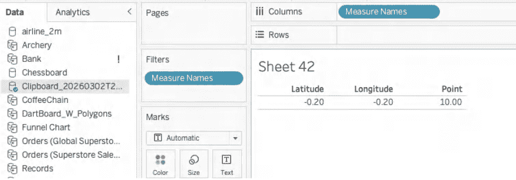

图 8.1：Null Island 坐标

- 3. 从工作表中删除所有字段

- 4. 将 **点** 转换为维度。可以通过右键单击 **点** 并选择 **转换为维度**，或将其拖到 **数据** 窗格的维度部分来完成。

- 5. 双击 **纬度** 和 **经度**。顺序无关紧要；Tableau 会自动将 **经度** 放在 **列** 置区上，将 **纬度** 放在 **行** 置区上。

- 6. 选择 地图 | 背景地图 | 街道。你可能需要稍微缩小以查看陆地线：

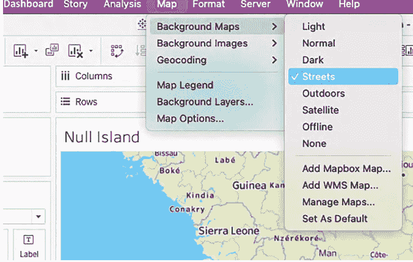

图 8.2：定位 Null Island

- 7. 将视图类型更改为 折线，并将 点 放到 路径 置区上。你应该看到以下结果：

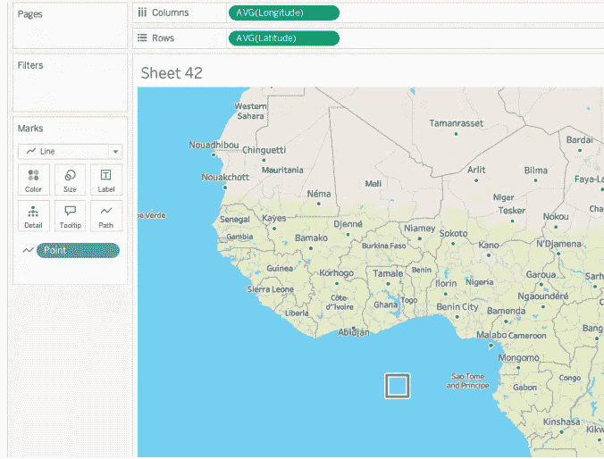

图 8.3：定位 Null Island II

- 8. 返回 Excel 文件，交换包含点 1 和点 2 数据的行，并再次将数据复制到 Tableau 中

- 9. 按照步骤 2–7 并观察生成的图像：

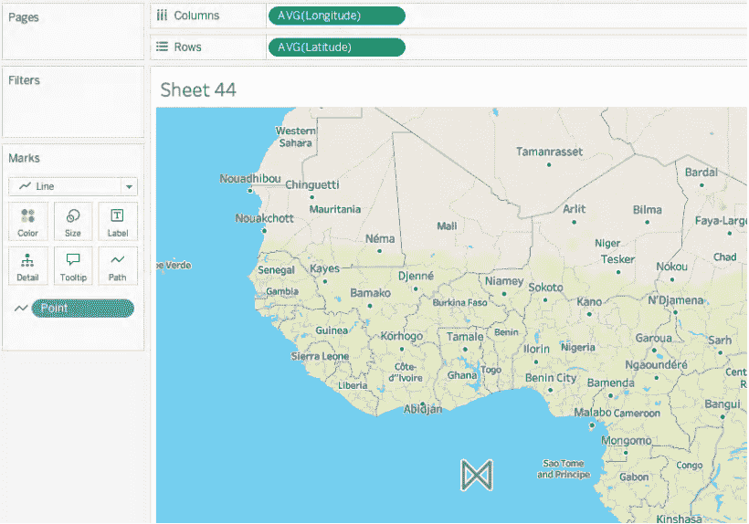

图 8.4：错误勾勒 Null Island

这张有趣但不正确的图像之所以出现，是因为点顺序不正确。经验法则是，在确定点顺序时，选择如果你在物理上绘制多边形时合理的顺序。如果你无法在纸上使用给定的点顺序绘制所需的多边形，Tableau 也无法绘制。

你可能发现完成此练习在 Tableau 中相对容易。挑战在于将数据做对，特别是多边形点。一个有用（且免费）的生成多边形数据的工具可在 http://powertoolsfortableau.com/tools/drawing-tool01 找到。这是 InterWorks 创建的许多有助于解决常见 Tableau 挑战的工具之一。

我们将在下一节使用它来展示我们图书馆中哪些书籍可用，哪些不可用。

## 使用多边形创建交互式书架

我本人绘画技巧不太好，但我一直喜欢在 Tableau Public 上看到的花哨多边形背景，有各种形状，并且可以让 Tableau 与之交互、根据度量值为其着色，或将操作链接到特定区域。例如，你知道吗，大陆可以重塑以构建鸡的形状？没错，尼科洛·奇罗内使用多边形制作了一个 Tableau 仪表板：https://www.theinformationlab.co.uk/2016/06/01/polygons-people-polygon-ize-image-tableau/。

你也想构建花哨的仪表板，但绘画技能和我一样平庸吗？别担心！本节将为你提供实现这一目标的工具。InterWorks 开发了一个类似于数字填色的工具——这是一个无需过多绘图即可构建多边形的完美应用程序。你可以在这里找到它：https://cbstudio.interworks.com。你只需要找到一张图片，将其上传到工具中，然后沿着线条开始绘制。

为此次练习，我在互联网上搜索了一张书架图片：

- 1. 打开 InterWorks 的免费绘图工具并选择 **图像** 选项：


图 8.5：CBI Studio

- 2. 上传你的图片并在 **我正在创建** 部分选择 **多边形**


- 3. 现在从一本书的边缘开始并单击。会出现一个橙色点。现在转到同一书的下一个边缘并再次单击。一条线将沿着该书的边缘绘制，并且坐标会自动出现在右侧的列表中

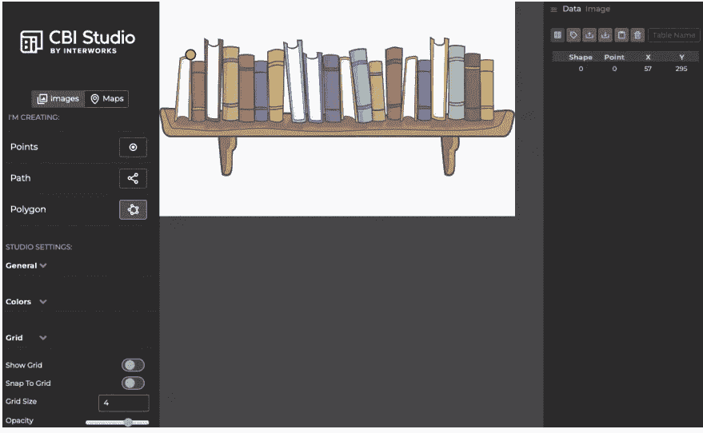

图 8.6：绘图工具

- 4. 书本的最后一个点应该位于第一个点之上（第一个点比其余的大）。再次点击第一个点将最终确定第一个多边形，这由绿色表示

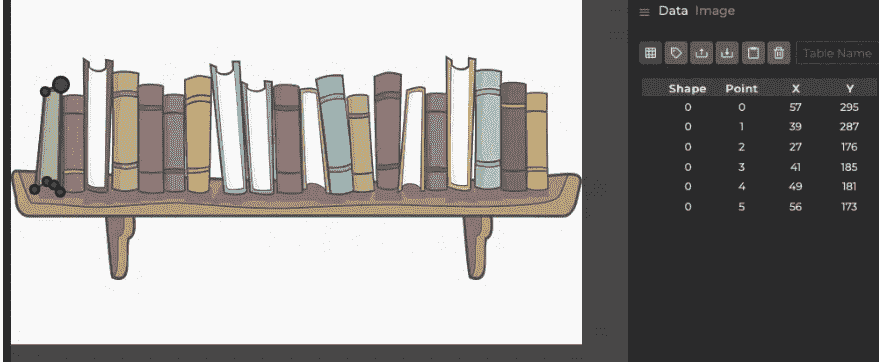

图 8.7：最终确定多边形

- 5. 你在其他位置设置的下一个点将获得不同的形状 ID，因此稍后可以被 Tableau 识别为不同的形状。请记住，沿书的外部移动并避免线条交叉。

- 6. 当你完成书本轮廓绘制后，以下载 .csv 格式的数据并保存文件，以便在 Tableau 中用作数据源。我就是这样做的，此外，我添加了 **名称** 和 **可用** 列。你还可以看到唯一的形状 ID、点 ID（你在屏幕上点击的顺序），以及 x 和 y 作为图像中位置的表示。

| 形状 ID | 点 ID | x | y | 名称 | 可用 |
|---|---|---|---|---|---|
| 0 | 0 | 57 | 284 | 棕色的书 | 否 |
| 0 | 1 | 83 | 284 | 棕色的书 | 否 |
| 0 | 2 | 83 | 173 | 棕色的书 | 否 |
| 0 | 3 | 60 | 173 | 棕色的书 | 否 |
| 0 | 4 | 57 | 284 | 棕色的书 | 是 |
| 1 | 0 | 117 | 173 | 绿色的书 | 是 |
| 1 | 1 | 117 | 309 | 绿色的书 | 是 |
| 1 | 2 | 145 | 309 | 绿色的书 | 是 |
| 1 | 3 | 145 | 176 | 绿色的书 | 是 |
| 1 | 4 | 117 | 173 | 绿色的书 | 是 |
| 2 | 0 | 175 | 176 | 蓝色的书 | 是 |
| 2 | 1 | 175 | 283 | 蓝色的书 | 是 |
| 2 | 2 | 196 | 283 | 蓝色的书 | 是 |
| 2 | 3 | 196 | 176 | 蓝色的书 | 是 |
| 2 | 4 | 175 | 176 | 蓝色的书 | 是 |
| 3 | 0 | 303 | 176 | 紫色的书 | 否 |
| 3 | 1 | 303 | 292 | 紫色的书 | 否 |
| 3 | 2 | 327 | 292 | 紫色的书 | 否 |
| 3 | 3 | 327 | 173 | 紫色的书 | 否 |
| 3 | 4 | 303 | 176 | 紫色的书 | 否 |

图 8.8：Excel

- 7. 接下来，将数据加载到 Tableau 中，并将 **X** 放在 **列** 上，将 **Y** 放在 **行** 上。你能认出书架了吗？我在这个练习中只用了四本书；因此，并非所有书都显示出来

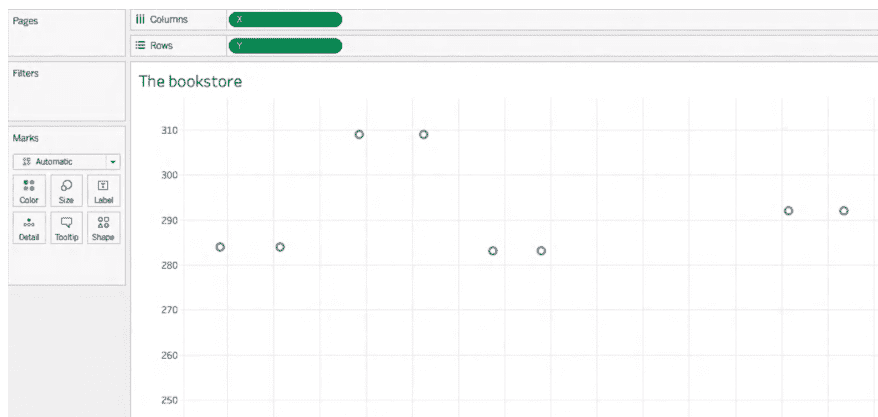

图 8.9：书店

- 8. 在将图像添加到 Tableau 之前，我们需要为 Tableau 设置最外端点的坐标。只需返回绘图工具并测量边缘。记下四个边缘的 X 和 Y 坐标。这可能不完全是角落，但下面的值可以大致翻译为高度 = 400 和宽度 = 648

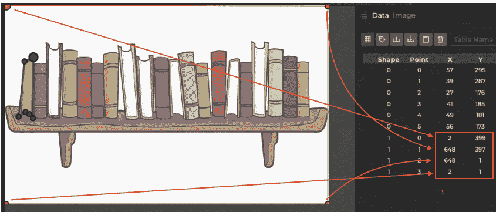

图 8.10：绘图工具

- 9. 回到 Tableau 中，单击 Map | 背景图像 并选择 书店...。在接下来的弹出窗口中，定义一个名称并上传你在绘图工具中使用的图像。还要填写 X 和 Y 字段的坐标以表示图像的边缘


图 8.11：编辑背景图像

- 10. 单击 选项 并选择 始终显示整个图像。然后关闭此窗口

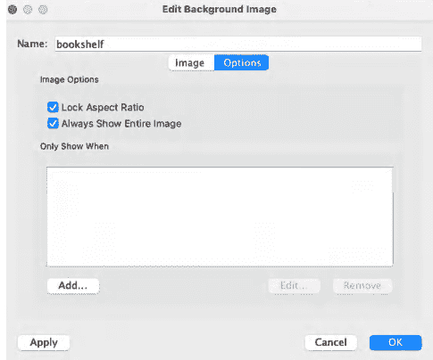

图 8.12：编辑背景图像选项

- 11. 你的图像现在应该出现在工作表中，书本周围有匹配的点


图 8.13：带点的书架

- 12. 要创建围绕线而不是点，请将标记类型更改为 线，并将 形状 ID 放在 详细信息 上，将 点 ID 放在 路径 上


图 8.14：带线的书架

- 13. 要创建多边形，请将标记类型更改为 多边形，并将 颜色 图架上的 透明度 设置为 0%

- 14. 此外，你可以在将两个字段都放在 **详细信息** 图架后，添加带有书名和可用性的提示

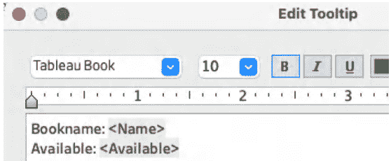

图 8.15：编辑提示

- 15. 如果你将鼠标悬停在书本上，可以看到名称以及可用性

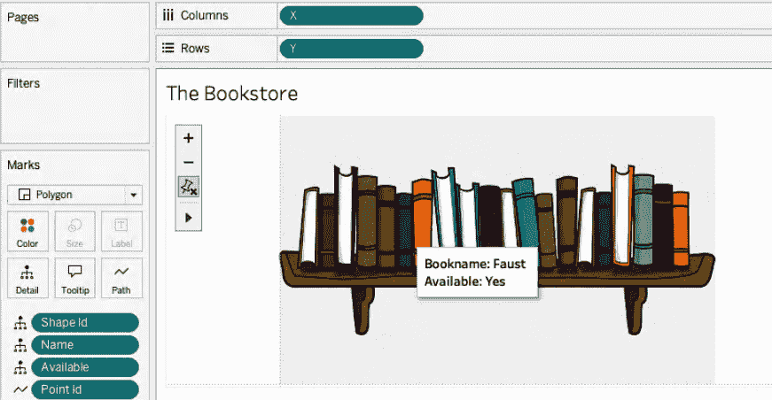

图 8.16：使用提示

多边形最好的地方在于它们填充了整个区域。在这个示例中，无论你在哪里悬停或单击，书的完整背面都被覆盖，因为我们绘制了一个区域而不是一个点或某个默认形状。并且这带来了无限的可能性；想象一个大图书馆，每本书都是一个多边形，你可以将实时数据连接到多边形数据集，以获取任何书籍的最新可用性。除了书籍，你可以画任何东西。我在 Tableau 中见过最多的是平面图、超市货架、办公布局、分割成部分的形状……多边形确实让你在可视化中发挥创造力。

如果你手头没有图像，并且想要为仪表板绘制非常特定的内容，可以使用付费或免费的软件，例如 Adobe Illustrator Draw、Sketch、Sketsa SVG Editor、Boxy SVG、Gravit Designer、Vecteezy Editor、Vectr、Method Draw、Inkpad、iDesign、Affinity Designer、macSVG、Chartist.js、Plain Pattern、Inkscape 等。

在继续之前，让我们将仪表板进一步提升：

- 1. 在 名称 | 别名... 上右键单击...
- 2. 如图所示更改书籍并单击 确定：

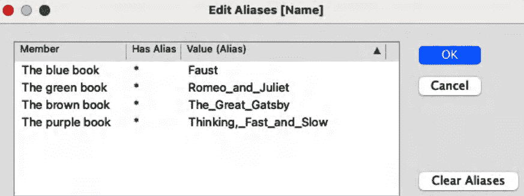

图 8.17：选择另一本书

- 3. 删除 书店 工作表的 X 和 Y 轴
- 4. 打开一个仪表板选项卡并将其命名为 书店。
- 5. 将 书店 工作表拖动到仪表板的上半部分，将 网页 对象拖动到底部的一半。在 URL 弹出窗口中键入：https://en.wikipedia.org/wiki/。
- 6. 选择 网页 对象并单击箭头；选择 添加 URL 操作...


图 8.18：添加 URL 操作...

- 7. 在 **操作** 窗口中，通过从箭头下拉菜单中选择该字段，将 **名称** 添加到 URL。

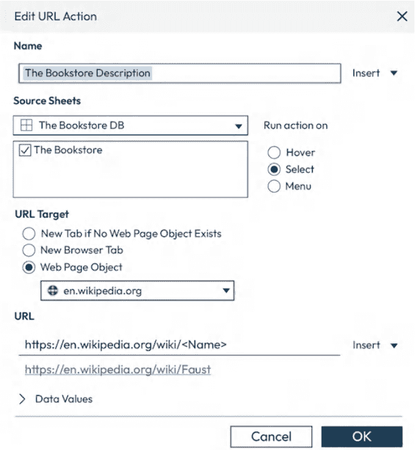

图 8.19：描述筛选器

- 8. 单击 **确定** 并选择不同的书，以查看仪表板中 Wikipedia 条目的变化


图 8.20：Wikipedia

我相信你现在已经有了关于如何使用多边形的大量想法。也许你想分析一场棋局？我们下一节就来做这个！

## 在 Tableau 中分析一场棋局

在这个练习中，我们将使用 Inkscape。但是，与其在其中一个工具中绘制东西、将其转换为多边形并加载到 Tableau 中，不如在 Tableau 中创建 SVG 文件的代码，将其加载到 Inkscape 中查看是否有效，然后将其转换为多边形，并将带有 x 和 y 坐标的转换版本加载回 Tableau 来分析一场棋局。通过亲自创建 SVG 文件，你将能够识别 Tableau 需要的哪些 X 和 Y 坐标，因此你将始终能够转换 SVGs。

### 在 Tableau 中创建 SVG 文件

在本节中，我们将使用 Tableau 生成构建 SVG 文件所需的 XML，该文件可以用矢量图形工具 Inkscape 打开，Inkscape 是开源的，因此免费提供。访问 inkscape.org 下载最新版本。我们还需要 Chessboard.png 图像，可在 Packt GitHub 页面上找到：https://github.com/PacktPublishing/Mastering-Tableau-2026/tree/main/Chapter08。请也下载该文件。

通常，多边形在非线性绘图中表现出更大的威力。然而，我们的棋盘是这种情况下的一个很好示例，因为我们将创建 Tableau 自己使用的位置——创建一个正方形比创建更复杂的形状更容易，因为我们可以使用增量。请注意，以下示例中使用了 10 行 10 列的网格，这当然会生成一个包含 100 个单元格的网格。这在 Inkscape 中运行良好。但是，如果需要大量单元格，可能需要专业的图形工具，如 Adobe Illustrator。

### 创建网格

以下练习具有多种目的。第一个目的是演示如何使用 Tableau 创建网格。本章提供了另一个使用数据支架的机会，该内容在第 4 章 了解连接、混合和数据结构 中有所讨论。区别在于，在那一章中，日期用于支架目的，而在以下部分中，使用了分箱。此外，这个练习需要许多表计算，这将有助于巩固在第 5 章 表计算简介 中学到的知识。最后，这个练习使用了数据密集化，该内容在第 6 章 使用 OData、数据密集化、大数据、Google BigQuery 中有所讨论。

要开始，请执行以下步骤：

- 1. 打开一个新的 Tableau 工作簿，并将第一个工作表命名为 **标题**
- 2. 使用 Excel 或文本编辑器，创建一个 **记录** 数据集。下面的两行表格完整地表示了 **记录** 数据集

| 记录 | |
|---|---|
| 1 | |
| 2 | |

图 8.21：Excel

- 3. 将 Tableau 连接到 **记录** 数据集：
  - o 为方便起见，可以考虑使用 `Ctrl + C` 复制数据集，并使用 `Ctrl + V` 直接粘贴到 Tableau 中。
  - o Tableau 可能会将 **记录** 视为度量值。将 **记录** 拖动到 **数据** 窗格的 **维度** 部分。


- 4. 创建两个参数。将一个命名为 Overall Pixel Count，另一个命名为 Rows Down/Columns Across。两者的设置如下：
    - 数据类型：整数
    - 允许值：全部

- 5. 显示这两个参数。将 Rows Down/Columns Across 设置为 10，将 Overall Pixel Count 设置为 1,000：

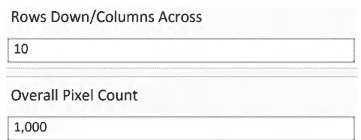

图 8.22：显示参数

- 6. 创建一个名为 Concatenate Header 的计算字段，使用以下代码：

```
'<?xml version="1.0" encoding="utf-8"?>&lt;svg version="1.1" id="Squares"
xmlns="http://www.w3.org/2000/svg"
xmlns:xlink="http://www.w3.org/1999/xlink" x="0px" y="0px" viewBox="0 0 ' +
STR( [Overall Pixel Count] ) + " " + STR([Overall Pixel Count])+ " "
style="enable-background:new 0 0 ' + STR([Overall Pixel Count]) + ' ' +
STR([Overall Pixel Count]) + '; " xml:space="preserve">
<style type="text/css"> .st0{fill:none;stroke:#000000;stroke-miterlimit:10;}
</style>'
```

注意，在计算字段对话框中输入换行符可能会导致从 Tableau 中提取结果变得困难。换句话说，请删除所有换行符。

- 7. 现在我们已创建一个骨架或模板，它将帮助我们在 Tableau 中创建多个位置以绘制网格

- 8. 将新创建的计算字段放置在 文本 卡上

- 9. 在工具栏中，选择 适合整个视图 以查看结果；您可以看到参数从 Concatenate Header 中填充了 STR([Overall Pixel Count])

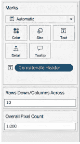

```
<?xml version="1.0" encoding="utf-8"?><svg version="1.1" id="Squares" xmlns="http://www.w3.org/2000/svg" xmlns:xlink="http://www.w3.org/1999/xlink" x="0px" y="0px" viewBox="0 0 1000 1000" style="enable-background:new 0 0 1000 1000;" xml:space="preserve"> <style type="text/css"> .st0{fill:none;stroke:#000000;stroke-miterlimit:10;}</style>
```

图 8.23：Concatenate Header

- 10. 创建一个名为 Location Codes 的新工作表

- 11. 创建以下计算字段：

| 名称 | 代码 |
| :--- | :--- |
| Rows Down/Columns Across | [Parameters].[Rows Down/Columns Across] |
| Which Column? | LAST()+1 |
| Which Row? | INDEX() |
| Grid Size | [Overall Pixel Count]/LOOKUP([Which Column?],FIRST()) |
| X | [Overall Pixel Count] - ([Grid Size] * ([Which Row?])) |
| Y | [Overall Pixel Count] - ([Grid Size] * ([Which Column?]-1)) |
| Count | If [Records] = 1 THEN 1 ELSE [Rows Down/Columns Across] END |
| Decicount | If [Records] = 1 THEN 1 ELSE [Rows Down/Columns Across] END |
| Location Codes | Index() |
| Concatenate Locations | '<text transform="matrix(1 0 0 1 ' + STR([X]) + ' ' + STR([Y]) + ')">' + STR( [Location Codes] ) + '</text>' |

表 8.2：创建计算字段

- 12. 创建的计算字段将在后续步骤中用于创建值表，类似于我们在绘图工具中生成的值表。只不过现在，我们将自行完成，并使用 SVG 代码代替经度和纬度值。

- 13. 右键单击 Count 并选择 创建 | 分组（Bins）。在出现的对话框中，将 分组大小 设置为 1

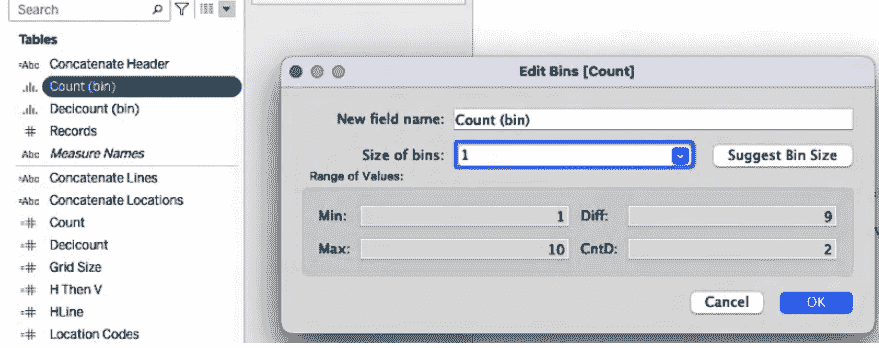

图 8.24：Count 分组

- 14. 右键单击 Decicount 并选择 创建 | 分组（Bins）。在出现的对话框中，将 分组大小 设置为 1。

- 15. 将 Count (bin)、Decicount (bin)、Location Codes、X 和 Y 放置在 行 卡上。确保按列出的顺序放置这些字段。

- 16. 如果您的字段为绿色（表示连续），请右键单击 行 卡上的每个字段并将其设置为 离散。然后：
    - 右键单击 Count (bin) 和 Decicount (bin)，并确保已选择 显示丢失值（Show Missing Values）
    - 右键单击 Location Codes 并选择 使用计算方式 | 表（向下）（Table (Down)）
    - 将 X 的 使用计算方式 设置为 Count (bin)

- 17. 将 Y 的 使用计算方式 设置为 Decicount (bin)

| Count (bin) | Decicount (bin) | Location Codes | X | Y |
|---|---|---|---|---|
| 1 | 1 | 900 | 100 | Abc |
| 2 | 2 | 900 | 200 | Abc |
| 3 | 3 | 900 | 300 | Abc |
| 4 | 4 | 900 | 400 | Abc |
| 5 | 5 | 900 | 500 | Abc |
| 6 | 6 | 900 | 600 | Abc |
| 7 | 7 | 900 | 700 | Abc |
| 8 | 8 | 900 | 800 | Abc |
| 9 | 9 | 900 | 900 | Abc |
| 10 | 10 | 900 | 1,000 | Abc |
| 1 | 11 | 800 | 100 | Abc |
| 2 | 12 | 800 | 200 | Abc |
| 3 | 13 | 800 | 300 | Abc |
| 4 | 14 | 800 | 400 | Abc |
| 5 | 15 | 800 | 500 | Abc |
| 6 | 16 | 800 | 600 | Abc |
| 7 | 17 | 800 | 700 | Abc |
| 8 | 18 | 800 | 800 | Abc |

图 8.25：Location Codes 工作表

- 18. 将 Concatenate Locations 放置在 文本 卡上

- 19. 右键单击您刚刚放置在 文本 卡上的 Concatenate Locations 实例，并选择 编辑表计算（Edit Table Calculations）

- 20. 在出现的对话框顶部，请注意 嵌套计算（Nested Calculations）下有四个选项：Grid Size、Which Column?、Which Row? 和 Location Codes。为每个选项设置 使用计算方式（Compute Using）定义，如下所示：
    - 嵌套计算：Grid Size > 使用计算方式：表（向下）（Table (down)）
    - 嵌套计算：Which Column? > 使用计算方式：特定维度：Decicount (bin) > 将此维度移至顶部
    - 嵌套计算：Which Row? > 使用计算方式：特定维度：Count (bin) > 将此维度移至顶部
    - 嵌套计算：Location Codes > 使用计算方式：表（向下）（Table (down)）

- 21. 在工具栏中，选择 适合宽度（Fit Width）以查看结果；您可以看到已创建多行。这些行稍后将用于绘制网格：

| Count (bin) | Decicount (bin) | Location Codes | X | Y | XML |
|---|---|---|---|---|---|
| 1 | 1 | 900 | 100 | <text transform="matrix(1 0 0 1 900 100)">1</text> |
| | 2 | 900 | 200 | <text transform="matrix(1 0 0 1 900 200)">2</text> |
| | 3 | 900 | 300 | <text transform="matrix(1 0 0 1 900 300)">3</text> |
| | 4 | 900 | 400 | <text transform="matrix(1 0 0 1 900 400)">4</text> |
| | 5 | 900 | 500 | <text transform="matrix(1 0 0 1 900 500)">5</text> |
| | 6 | 900 | 600 | <text transform="matrix(1 0 0 1 900 600)">6</text> |
| | 7 | 900 | 700 | <text transform="matrix(1 0 0 1 900 700)">7</text> |
| | 8 | 900 | 800 | <text transform="matrix(1 0 0 1 900 800)">8</text> |
| | 9 | 900 | 900 | <text transform="matrix(1 0 0 1 900 900)">9</text> |
| | 10 | 900 | 1,000 | <text transform="matrix(1 0 0 1 900 1000)">10</text> |
| 2 | 11 | 800 | 100 | <text transform="matrix(1 0 0 1 800 100)">11</text> |
| | 12 | 800 | 200 | <text transform="matrix(1 0 0 1 800 200)">12</text> |
| | 13 | 800 | 300 | <text transform="matrix(1 0 0 1 800 300)">13</text> |
| | 14 | 800 | 400 | <text transform="matrix(1 0 0 1 800 400)">14</text> |
| | 15 | 800 | 500 | <text transform="matrix(1 0 0 1 800 500)">15</text> |
| | 16 | 800 | 600 | <text transform="matrix(1 0 0 1 800 600)">16</text> |
| | 17 | 800 | 700 | <text transform="matrix(1 0 0 1 800 700)">17</text> |
| | 18 | 800 | 800 | <text transform="matrix(1 0 0 1 800 800)">18</text> |
| | 19 | 800 | 900 | <text transform="matrix(1 0 0 1 800 900)">19</text> |
| | 20 | 800 | 1,000 | <text transform="matrix(1 0 0 1 800 1000)">20</text> |
| 3 | 21 | 700 | 100 | <text transform="matrix(1 0 0 1 700 100)">21</text> |
| | 22 | 700 | 200 | <text transform="matrix(1 0 0 1 700 200)">22</text> |
| | 23 | 700 | 300 | <text transform="matrix(1 0 0 1 700 300)">23</text> |

图 8.26：适合宽度

- 22. 现在，创建一个名为 Lines 的新工作表

- 23. 创建以下计算字段：

| 名称 | 使用计算方式设置 |
|---|---|
| H Then V | Index() |
| HLine | Last() |
| VLine | Index()-1 |
| X1 | IF [H Then V] = 1 THEN 0 ELSE [Overall Pixel Count] - ((Grid Size) * ([VLine])) END |
| Y1 | IF [H Then V] = 2 THEN 0 ELSE [Overall Pixel Count] - ((Grid Size) * ([VLine])) END |
| X2 | IF [H Then V] = 1 THEN [Overall Pixel Count] ELSE [Overall Pixel Count] - ((Grid Size) * ([VLine])) END |
| Y2 | IF [H Then V] = 2 THEN [Overall Pixel Count] ELSE [Overall Pixel Count] - ((Grid Size) * ([VLine])) END |

表 8.3：创建计算字段

- 24. 接下来，按以下顺序将以下字段放置在 行 卡上：Count (bin)、Decicount (bin)、H Then V、HLine、VLine、Grid Size、Which Column?、X1、Y1、X2 和 Y2。请注意，每个字段都应设置为离散。

- 25. 右键单击 Count (bin) 和 Decicount (bin)，并将每个设置为 显示丢失值（Show Missing Values）

- 26. 右键单击 行 卡上的其余每个字段，并选择 编辑表计算（Edit Table Calculations）。为每个字段设置 使用计算方式（Compute Using）定义，如下表所示：

| 名称 | 嵌套计算 | 使用计算方式设置 |
|---|---|---|
| H Then V | 不适用（N/A） | Count (bin) |
| HLine | 不适用（N/A） | Count (bin) |
| VLine | 不适用（N/A） | Decicount (bin) |
| Grid Size | Grid Size | 表（向下）（Table (Down)） |
| Grid Size | Which Column? | Decicount (bin) |
| X1, Y1, X2, Y2 | H Then V | Count (bin) |
| X1, Y1, X2, Y2 | Grid Size | Count (bin) |
| X1, Y1, X2, Y2 | Which Column? | Count (bin) |
| X1, Y1, X2, Y2 | VLine | Decicount (bin) |

表 8.4：使用计算方式设置

- 27. 请注意，某些字段包含嵌套表计算。在这种情况下，表计算对话框顶部将包含一个名为 嵌套计算（Nested Calculations）的额外选项


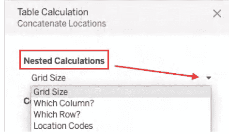

图 8.27: 嵌套计算

- 28. X1、X2、Y1 和 Y2 需配置为四个嵌套计算。首先打开 X1 表计算，然后从“嵌套计算”下拉菜单中选择 H 然后 V，并将“计算方式”设置为 Count (bin)。接着，在同一窗口中，从下拉菜单中选择“网格大小”并输入相应的“计算方式”设置。设置完所有四个下拉菜单后，继续设置 X2，操作相同。

- 29. 筛选 H Then V，仅显示 1 和 2

- 30. 创建名为 Concatenate Lines 的计算字段，代码如下：

```
'<line class="st0" x1="" + STR([X1]) + ' y1="" + STR([Y1]) + ' x2="" + STR( [X2] ) + ' y2="" + STR([Y2]) + "/>'
```

- 31. 该计算将通过包含 X1、X2、Y1 和 Y2 字段来创建新字符串。这样做可以将一行代码扩展为所需行数，每行都有 X1、X2、Y1 和 Y2 的特定组合。

- 32. 将 Concatenate Lines 放置到文本卡上。您的工作表应如下所示：

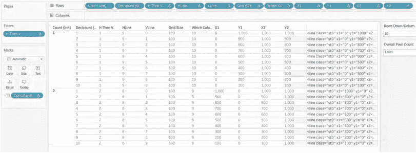

图 8.28: Concatenate Lines

- 33. 导出刚刚创建的三个工作表中的代码

导出三个工作表的代码可能比较棘手，因为 Tableau 可能会尝试为字符串值插入额外的引号。我发现以下方法效果最佳：

  - 1. 在 Count (bin) 行中选择 1
  - 2. 按 Ctrl + A（Mac 为 Command + A）选择工作表的所有内容
  - 3. 将光标悬停在视图中所选文本上，停顿直到工具提示命令按钮出现
  - 4. 选择工具提示右侧的“查看数据”图标
  - 5. 在弹出的“查看数据”对话框中，选择“导出全部”
  - 6. 使用与各工作表相同的名称保存 CSV 文件；例如，从 Header 工作表导出的数据将命名为 Header.csv
  - 7. 对其余工作表 Header 和 Location Codes 重复上述步骤

- 34. 打开您喜欢的文本编辑器的一个实例，将其另存为 Grid and LocationCodes.svg

- 35. 将先前导出并保存的 Header.csv 中的数据复制并粘贴到 Grid and LocationCodes.svg。请确保不包含标题信息；仅包含 XML 代码。例如，在下一个截图中，不要复制第 1 行，仅复制第 2 行

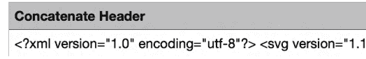

图 8.29: Excel

- 36. 使用 Excel，从 Location.csv 复制所需数据并粘贴到 Grid and LocationCodes.svg。所需数据仅包括标记为 Concatenate_Locations 的列。不要包含其他列或标题。仅包含 XML 代码。例如，在下一个截图中，我们仅复制列 F

| Count (bin) | Decicount (. | Location Coord X | Y | 内容 |
|---|---|---|---|---|
| 1 | 1 | 900 | 100 | <text transform="matrix(1 0 0 1.900 100)">11</text> |
| | 2 | 1 | 900 | 200 | <text transform="matrix(1 0 0 1.900 200)">22</text> |
| | 3 | 3 | 900 | 300 | <text transform="matrix(1 0 0 1.900 300)">33</text> |
| | 4 | 4 | 900 | 400 | <text transform="matrix(1 0 0 1.900 400)">44</text> |
| | 5 | 5 | 900 | 500 | <text transform="matrix(1 0 0 1.900 500)">55</text> |
| | 6 | 6 | 900 | 600 | <text transform="matrix(1 0 0 1.900 600)">66</text> |
| | 7 | 7 | 900 | 700 | <text transform="matrix(1 0 0 1.900 700)">77</text> |
| | 8 | 8 | 900 | 800 | <text transform="matrix(1 0 0 1.900 800)">88</text> |
| | 9 | 9 | 900 | 900 | <text transform="matrix(1 0 0 1.900 900)">99</text> |
| | 10 | 10 | 900 | 1,000 | <text transform="matrix(1 0 0 1.900 1000)">1010</text> |
| 2 | 1 | 11 | 800 | 100 | <text transform="matrix(1 0 0 1.800 100)">11</text> |
| | 2 | 12 | 800 | 200 | <text transform="matrix(1 0 0 1.800 200)">12</text> |
| | 3 | 13 | 800 | 300 | <text transform="matrix(1 0 0 1.800 300)">13</text> |
| | 4 | 14 | 800 | 400 | <text transform="matrix(1 0 0 1.800 400)">14</text> |
| | 5 | 15 | 800 | 500 | <text transform="matrix(1 0 0 1.800 500)">15</text> |
| | 6 | 16 | 800 | 600 | <text transform="matrix(1 0 0 1.800 600)">16</text> |
| | 7 | 17 | 800 | 700 | <text transform="matrix(1 0 0 1.800 700)">17</text> |
| | 8 | 18 | 800 | 800 | <text transform="matrix(1 0 0 1.800 800)">18</text> |
| | 9 | 19 | 800 | 900 | <text transform="matrix(1 0 0 1.800 900)">19</text> |
| | 10 | 20 | 800 | 1,000 | <text transform="matrix(1 0 0 1.800 1000)">20</text> |
| 3 | 1 | 21 | 700 | 100 | <text transform="matrix(1 0 0 1.700 100)">21</text> |
| | 2 | 22 | 700 | 200 | <text transform="matrix(1 0 0 1.700 200)">22</text> |
| | 3 | 23 | 700 | 300 | <text transform="matrix(1 0 0 1.700 300)">23</text> |

图 8.30: Excel II

- 37. 使用 Excel，从 Lines.csv 复制所需数据并粘贴到 Grid and LocationCodes.svg。同样，所需数据仅包括标记为 Concatenate Lines 的列。不要包含其他列或标题，仅包含 XML 代码。

- 38. 最后，通过输入 </svg> 闭合标签来完成 SVG 文件。为方便起见，完整代码已添加到“生成的 SVG 代码”选项卡中。

```
<text transform="matrix(1 0 0 1.200 1000)">80</text>
<text transform="matrix(1 0 0 1.200 900)">79</text>
<text transform="matrix(1 0 0 1.200 800)">78</text>
<text transform="matrix(1 0 0 1.200 700)">77</text>
<text transform="matrix(1 0 0 1.200 600)">76</text>
<text transform="matrix(1 0 0 1.200 500)">75</text>
<text transform="matrix(1 0 0 1.200 400)">74</text>
<text transform="matrix(1 0 0 1.200 300)">73</text>
<text transform="matrix(1 0 0 1.200 200)">72</text>
<text transform="matrix(1 0 0 1.200 100)">71</text>
<text transform="matrix(1 0 0 1.300 1000)">80</text>
<text transform="matrix(1 0 0 1.300 900)">79</text>
<text transform="matrix(1 0 0 1.300 800)">78</text>
<text transform="matrix(1 0 0 1.300 700)">77</text>
<text transform="matrix(1 0 0 1.300 600)">76</text>
<text transform="matrix(1 0 0 1.300 500)">75</text>
<text transform="matrix(1 0 0 1.300 400)">74</text>
<text transform="matrix(1 0 0 1.300 300)">73</text>
<text transform="matrix(1 0 0 1.300 200)">72</text>
<text transform="matrix(1 0 0 1.300 100)">71</text>
<text transform="matrix(1 0 0 1.400 1000)">80</text>...
```

图 8.31: 完整代码

- 39. 现在，在 Inkscape (https://inkscape.org/) 中打开 SVG 文件并观察网格

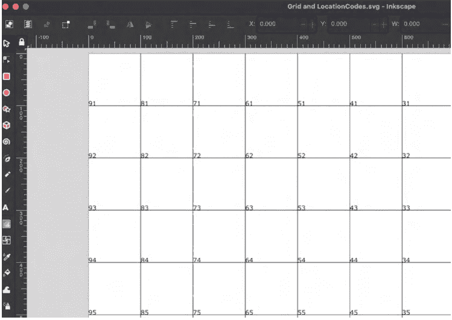

图 8.32: Inkscape II

如果出于某种原因您的代码未能创建网格，或者您想改用我创建的版本，可以在以下 GitHub 页面中找到 SVG 文件以及所有其他数据集：https://github.com/PacktPublishing/Mastering-Tableau-2026/tree/main/Chapter08。

我们将在下一个练习中介绍如何在 Tableau 中将网格用于多边形数据源的示例。

## 使用网格生成数据集

熟练的棋手大约需要 40 步即可完成一场比赛。在国际象棋锦标赛中，每场比赛的数据都会被常规记录，这为数据可视化提供了机会。在本练习中，我们将使用国际象棋比赛的数据来可视化棋盘每个方格被占用的频率：

- 1. 在本章关联的工作簿中，导航到名为 Chessboard 的工作表

- 2. 如果尚未下载，请从此书的 GitHub 存储库下载 Chessboard.png 图片

- 3. 在 Inkscape 中打开上一个练习中创建的 SVG 文件

> **注意**
>
> 如果您未完成上一个练习，可以复制本章关联的解决方案工作簿中仪表板上名为“生成的 SVG 代码”的 XML 代码。将该代码粘贴到文本编辑器中并以 SVG 扩展名保存，然后使用 Inkscape 打开该文件。

- 4. 在 Inkscape 中，按 Ctrl + A（Mac 为 Command + A）全选。使用 Ctrl + G（Mac 为 Command + G）对选定内容进行分组。

- 5. 在 Inkscape 菜单中，选择 图层 | 图层和对象。键盘快捷键为 Shift + Ctrl + L（Mac 为 Shift + Command + L）。

- 6. 在屏幕右侧显示的图层调色板中，按 + 图标创建一个图层。将图层命名为 Chessboard。然后，再创建一个名为 Grid 的图层

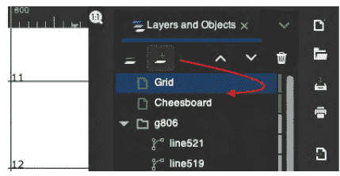

图 8.33: 图层

- 7. 单击视图中的任意线条或数字。右键单击同一线条或数字，然后选择“移动到图层”。选择 Grid 图层。

- 8. 选择 文件 | 导入 并选择 Chessboard.png 图片


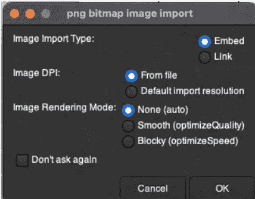

### 图 8.34：图像导入

- 9. 确保图像放置在棋盘图层上，以免位置代码数字被遮挡。将棋盘图像定位，使位置代码 81 居中于棋盘左上角的方格。由于棋盘仅由 64 个方格组成，因此它不会涵盖网格提供的全部 100 个方格

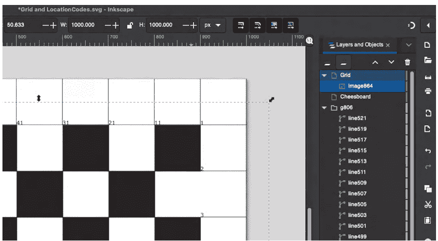

### 图 8.35：棋盘

此时，你可以根据每个位置被占用的频率生成数据集。例如，你可能会注意到在某一局棋中，位置 81 被占用了 40 步，这种情况下玩家可能只是从未移动过那辆车。然而，在另一局棋中，该位置可能仅被占用了 10 步，这或许表明玩家在比赛早期进行了易位。将棋局与方格文件分层的目的是识别哪个方格属于棋盘上的哪个字段。

## 可视化棋局

在本练习中，我们将查看从棋局生成的数据集，并了解如何基于之前练习所做的工作来可视化结果。为了按照步骤操作，你需要下载与本章相关的资源。为此，只需单击本书 GitHub 仓库的链接：https://github.com/PacktPublishing/Mastering-Tableau-2026/tree/main/Chapter08。

以下是步骤：

- 1. 在与本章关联的工作簿中，导航到名为 Chessboard 的工作表并选择 Chessboard 数据源
- 2. 右键单击 Chessboard 数据源并选择“编辑数据源”以检查数据集
- 3. 在询问“数据文件在哪里？”的对话框中，定位到与本章相关资源中提供的 Chessboard.xlsx 文件
- 4. 名为 **棋盘网格** 的表包含每个位置代码及其关联的 X 和 Y 坐标。该数据集取自本章前面创建的 **位置代码** 工作表。名为 **已占用方格** 的表包含字段 **位置代码** 和 **已占用移动次数**。“棋盘网格”和“已占用方格”通过在 **位置代码** 上进行左连接相连。

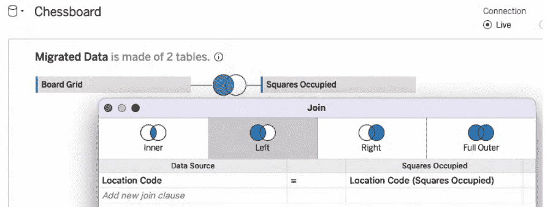

### 图 8.36：连接

- 5. 在 Chessboard 工作表中，选择 Map | 背景图像 | Chessboard
- 6. 在弹出的对话框中，单击“添加图像”以添加背景图像
- 7. 如图所示填写“编辑背景图像”对话框

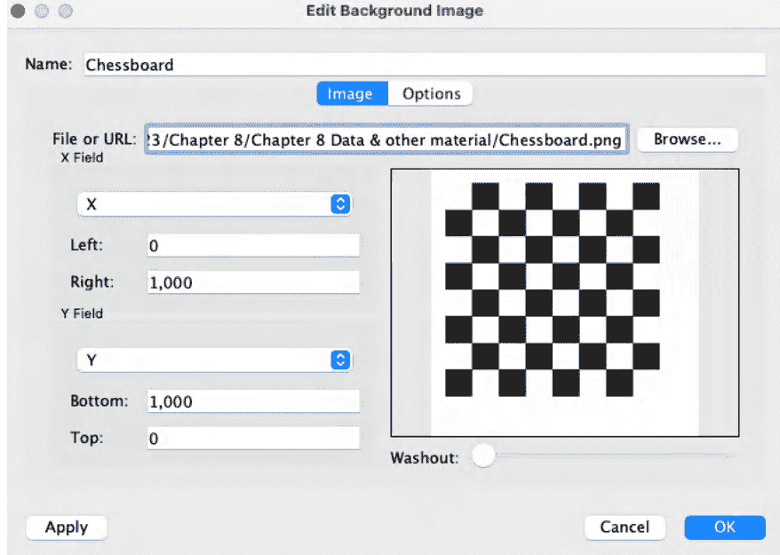

### 图 8.37：棋盘背景图像

- 8. 分别将字段 X、Y（均设为维度）和位置代码放置在列、行和详细信息卡片上，并将 **已占用移动次数** 字段放置在 **颜色** 上，同时将标记类型选择为 **密度**

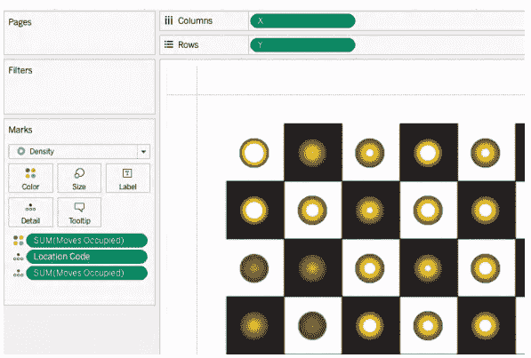

### 图 8.38：棋盘背景图像 II

- 9. 右键单击 X 和 Y 轴，并将两者均设置为 **固定**，**固定起始**值为 **0**，**固定结束**值为 **875**
- 10. 编辑 **Y** 轴并将其设置为 **反转**。不要反转 **X** 轴。
- 11. 根据需要调整 **颜色**、**大小**、**形状** 等：


### 图 8.39：棋盘

执行此最后一步是因为数据已结构化，以镜像大多数图形工具中的默认 X 和 Y 坐标设置。在这些工具中，左上角是 X 和 Y 均等于 0 的位置。

在截图中，圆圈越亮，该空间被移动占用的频率越高。圆圈越暗，占用频率越低。将鼠标悬停在字段上方时，也会显示占用量。

总结一下，我们首先创建了一个 SVG 文件。我们是这样做的：根据 SVG 文件的标准，创建了三种不同的代码类型，即标头、位置代码和线条。然后，我们将这三段代码复制到文本编辑器程序中，并将其另存为 SVG 文件。接着，我们下载了 Inkscape 应用程序并打开了 SVG 文件，以检查并查看我们工作的结果，即一个 10×10 的方格场。

我们将一张棋盘图像添加到 Inkscape 并将两者对齐。现在，我们可以看到哪个方格编号将与哪个棋盘字段相关联。就像书架示例一样，有必要识别形状 ID，即棋盘字段 ID。基于棋盘字段 ID，我们能够生成第二个数据集，其中包含字段被占用的移动次数。通过将 Board Grid 数据集与 Occupied Moves 数据集相连，我们得到了一个用例。我们将一张棋盘背景图像添加到 Tableau，并在其上绘制了方格，并根据棋局中这些字段被占用的移动次数对其进行着色和大小调整。当然，这些数字因棋局而异，但通过收集多局棋的数据，我们能够直观地分析棋策略，甚至可能判断谁是更好的棋手。如果你喜欢国际象棋，欢迎尝试一下，比较每局不同的可视化结果，或者看看自己通常是否最终呈现相同的模式，以及你的对手是否也是如此。

说到游戏，在下一个练习中，我们将可视化飞镖靶。这个练习将比棋局练习更短。请按照步骤操作，了解更多关于多边形的知识。

## 在背景图像上创建多边形

在可视化中利用特定点上的形状对于之前的练习已经足够，但有时使用多边形来勾勒形状可能更有优势。在本节中，我们将在背景图像上利用多边形，并且与书籍示例不同，我们将填充区域，以至于不再（那么）需要背景图像。

以下是所需步骤：

- 1. 在与本章关联的工作簿中，导航到名为 Dashboard - Polygon 的工作表并选择 Dartboard_W_Polygon 数据源

**注意：** 如果在完成上一个练习时尚未下载，请下载 GitHub 上提供的图像。将内容解压到你选择的目录中。

- 3. 选择 Map | 背景图像 | Dartboard - Polygon。在背景图像对话框中，选择添加图像。如图所示填写对话框

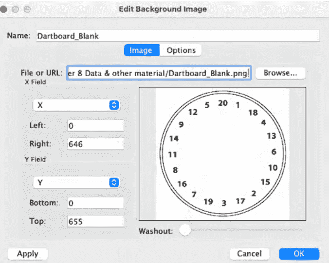

### 图 8.40：飞镖靶背景图像

- 4. 使用以下配置创建参数：

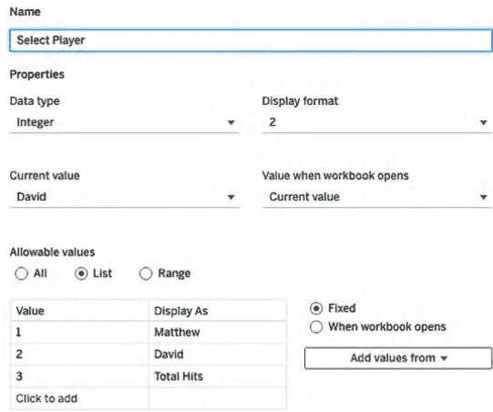

### 图 8.41：参数

- 5. 此参数将用于在玩家 1：**Matthew** 和玩家 2：**David** 之间切换，或显示两人的飞镖命中情况
- 6. 通过在 **数据** 窗格底部右键单击上一步中创建的参数并选择 **显示参数控件** 来显示该参数
- 7. 创建名为 Total Hits 的计算字段，代码如下：

```
[David]+[Matthew]
```

- 8. 然后，创建名为 Case 的计算字段，代码如下：

```
CASE [Select Player]
WHEN 1 THEN SUM([Matthew])
WHEN 2 THEN SUM([David])
WHEN 3 THEN SUM([Total Hits])
END
```

- 9. 将 **标记** 卡片设置为 **多边形**
- 10. 检查 **数据** 窗格以确保 **点** 和 **形状** 均为维度（蓝色）。其他字段均为度量值

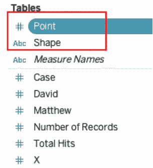

### 图 8.42：维度和度量值

- 11. 将字段 **X、Y、点、形状和 Case** 放置在各自的货架上

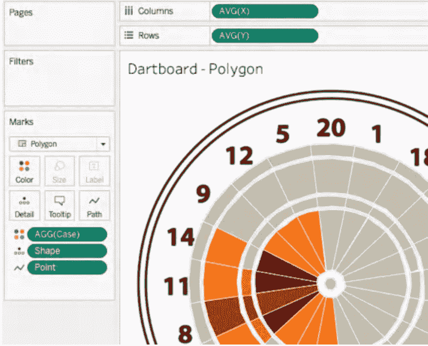

### 图 8.43：飞镖靶多边形

- 12. 右键单击每个轴，并将 **范围** 设置为从 **0** 到 **650**
- 13. 单击 **颜色** 货架并选择 **编辑颜色**。根据需要调整颜色。以下截图显示了一种可能性


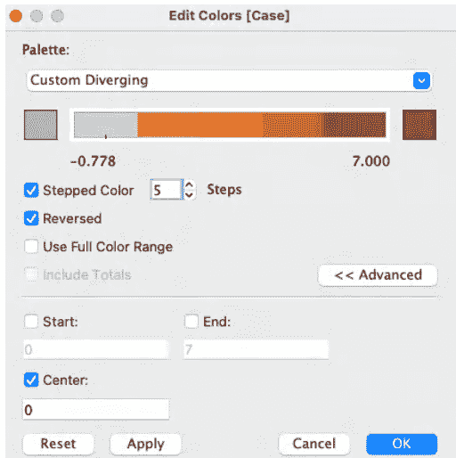

图 8.44: 自定义发散

您的最终工作表应如下所示：

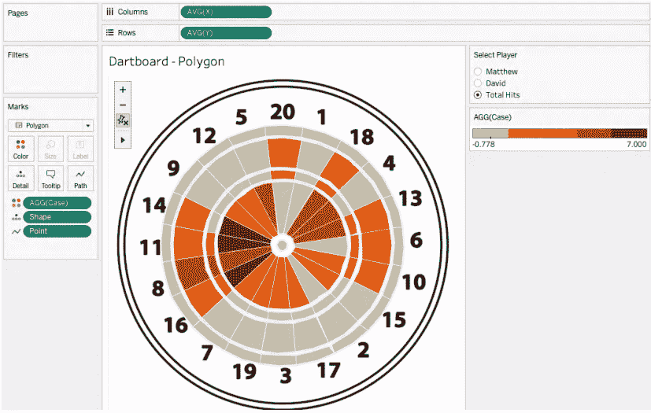

图 8.45: 最终飞镖板多边形

最终仪表板显示一个带有不同颜色的飞镖板。灰色表示该区域在游戏中未被击中，而场地颜色越红，表示被击中的次数越多。通过使用参数，您可以将马修的得分与大卫的得分进行比较，或者显示总命中次数，如上一张截图所示。

您可能已经注意到，本练习中多边形的曲线部分并不十分完美。例如，请看靶心周围的三环区和双环区；您可以看到该区域并非 100% 均匀。这仅仅是在 Tableau 中使用笛卡尔网格上的点的特性。这意味着 Tableau 基于网格结构，因此我们绘制的每条曲线仍将是连接网格布局上点的许多小线段。点越多，点之间的线段越短，绘制均匀曲线的可能性就越大。但是，如果您跟随本书架练习操作过，您可以看出，这样一个背景图片需要投入大量精力。尽管如此，我认为多边形绝对值得。在这里，我们使用了一些可能无法为日常工作增加价值的有趣练习，但请考虑一下您在其他程序中设计的完美着陆页面。通过使用多边形，您可以使设计元素可点击且可交互。

下一个主题与本章其余部分略有不同。您听说过 Tableau Exchange 吗？Tableau Exchange 结合了三种产品：扩展、加速器和连接器。感兴趣吗？继续阅读下一部分！

## Tableau Exchange

要访问 Tableau Exchange，请访问此网站：https://exchange.tableau.com。


图 8.46: Tableau Exchange

加速器和扩展也可以从 Tableau Server 和/或 Tableau Desktop 内部访问。让我们直接深入了解 Tableau Exchange，看看它有什么可提供的！

## Tableau 扩展

扩展是最古老的产品，可从 Tableau 仪表板的“对象”窗格中访问。基本上，扩展允许您直接在 Tableau 中使用第三方工具。部分选定的扩展可在 https://extensiongallery.tableau.com 上获取，且列表在不断增长。

请注意，Tableau 不为扩展提供支持或保证/安全措施。这些 API 是由外部方构建的，应当如此对待。如果您想在工作中使用它们，请先咨询您的 IT 安全团队。

让我们看看 Infotopics 的一个示例——Sankey 图扩展。

## 使用扩展（仪表板或可视化）

在关联的工作簿中，创建一个名为“显示更多”的新工作表，并选择 Coffee Chain 数据集。现在，通过将“Type”添加到列、“Product Type”添加到行、“Profit”添加到文本架，来复制以下工作表布局：

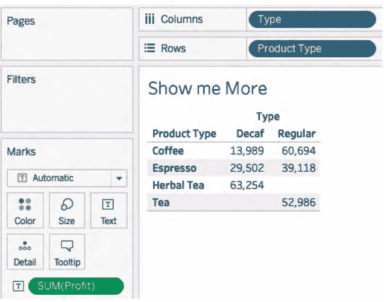

图 8.47: Show me More

我们希望为本工作表使用 Sankey 图，这是一种流程图，根据流线的大小显示给定度量和给定维度有多少流入第二个给定维度。在此示例中，我们想知道 Regular 类型产品的 Profit 有多少来自 Coffee、Espresso、Herbal Tea 或 Tea，以及有多少 Profit 可以与 Decaf 类型关联。

假设您知道如何使用计算字段构建 Sankey 图，但这很耗时。相反，有一个扩展可以实现此目的。以下是使用扩展并最终在构建 Sankey 图时节省时间的步骤：

- 1. 在关联的工作簿中，打开一个 Dashboard 选项卡，并将其命名为 Show me More DB
- 2. 将 Show me More DB 工作表拖动到仪表板上。现在还将扩展对象拖动到仪表板上

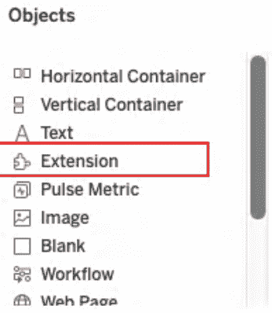

图 8.48: 扩展

- 3. 从 Tableau 2021.1 开始，您将看到以下弹出窗口

## Viz 扩展

在工作表中使用自定义可视化。了解更多

- 排序方式
- 下载量

- 功能
- 由 Tableau + Salesforce 构建
- 免费
- 沙箱
- 适用于 Tableau Public
- Tableau 可信合作伙伴构建

## 所有 Viz 扩展

- Sankey (by Tableau): Sankey 图用于显示多个类别之间的数据流。
- Tableau Table (by Tableau): 直接在 Tableau 中创建带有条件格式的丰富表格体验。
- Radial (by Tableau): 以圆形格式显示数据，其中所有段值的总和加起来等于 100%。
- Donut (by LaDataViz): 创建 Donut 图表而不
- Tree Diagram (by LaDataViz): 创建美丽的径向图。
- Gauge (by LaDataViz): 创建完全可自定义的

图 8.49: 扩展库

> 注意
> Tableau 区分仪表板扩展和可视化扩展；两者都适用于本节中解释的步骤。

- 4. 在扩展库中搜索 **显示更多 2.0** 扩展。单击它，并在下一屏幕上选择 **添加到仪表板**

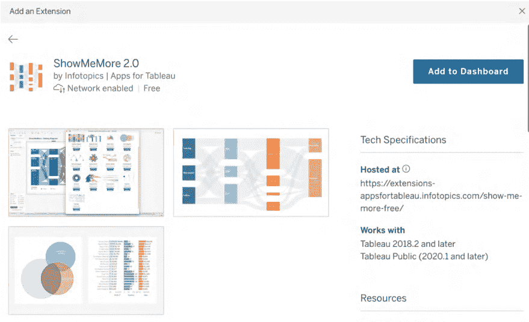

## 描述

图 8.50: Show Me More 2

- 5. 然后，选择 **开始使用** 并选择 **Sankey 图** 可视化

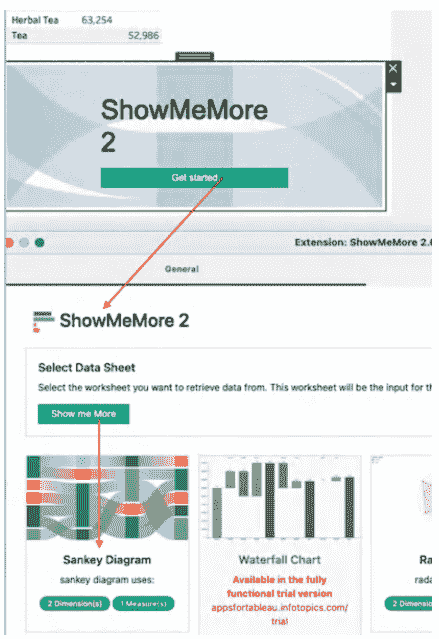

图 8.51: Show Me More II

- 6. 选择 Sankey 图后，按如下方式配置变量。还有更多选项，如图 8.52 部分所示；请随意尝试：

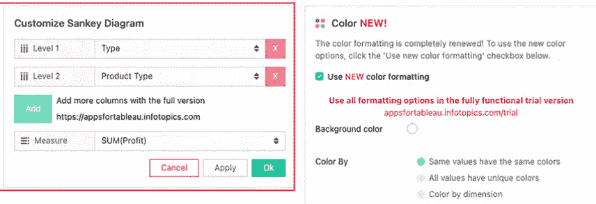

图 8.52: Sankey 图设置

- 7. 单击 **确定** 按钮，瞧，您的 Sankey 图就准备好了：

## 显示更多

| 产品类型 | 无咖啡因 | 普通 |
|---|---|---|
| Coffee | 13,989 | 60,694 |
| Espresso | 29,502 | 39,118 |
| Herbal Tea | 63,254 | |
| Tea | | 52,986 |


图 8.53: Sankey 图

Sankey 图仅作为示例使用；Tableau 已将 Sankey 图作为原生可视化添加。我强烈建议您查看扩展库，找到一些更高级的可视化进行实验。有许多适用于多种不同用例的扩展；有些是免费的，有些需要付费，但您也可以构建自己的扩展。值得一看！

## 加速器

此功能在更基本的层面上工作：如何设计、构建和组合仪表板。加速器是来自不同部门、具有不同侧重点的预定义仪表板。目前，有超过 100 个可用，支持多种语言，面向不同部门、行业和企业应用。与其从头开始，不如通过 Tableau Desktop 登录页面或 Tableau Server 上的链接单击 **加速器** 仪表板：

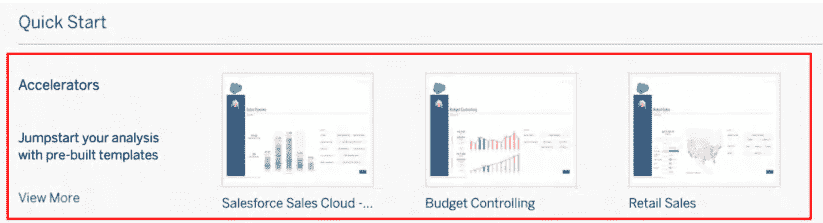

图 8.54: Tableau 登录页面

在图 8.54 中，左侧的两个仪表板始终显示在 Tableau Desktop 登录页面上，您对此已很熟悉：即 Superstore 和 World Indicators 数据集。在它们旁边，您可以看到一个戴耳机的两个人的图标。这是我加载的第三个加速器仪表板。但是，查看右上角的红色框，您可以看到一个名为 **更多加速器** 的超链接；单击它。

想象一下，您想使用金融交易数据和加速器仪表板来启动您的项目。搜索 trading：

## 加速器

快速构建针对行业或企业应用定制的强大仪表板，全部使用您的数据。

- 了解更多


- 排序方式
- 下载量
- 连接类型
- 全部
- 语言
- 全部
- 功能
- 由 Tableau + Salesforce 构建
- 启用数据映射
- 类别
- 全部
- 企业财务
- 客户服务
- 数字与社交媒体
- 数字机构

## 所有加速器

- Salesforce Sales Cloud - 加权销售管道
- 由 Tableau 提供
- 销售云：进行整体销售管道审查（具有...的机会）
- 预算控制
- 由 Tableau 提供
- 监控、跟踪和管理财务表现与支出（相对于预算）
- 零售销售
- 由 Tableau 提供
- 评估您的网络表现并增长您的销售
- keyrus
- 客户洞察与 Data Cloud
- 呼叫中心代理分析
- 立即
- 管理仪表板

图 8.55: 搜索加速器

单击 Tableau 的 Trading 仪表板后，将打开一个新的 Tableau 工作簿——内置了完全构建好的交易仪表板，更棒的是，具有数据映射功能，这意味着您可以用不同的数据替换当前数据，而不会破坏仪表板布局和预构建功能。每个加速器仪表板中的描述包含可能或不可能的数据映射信息。


当您打开新仪表板时，将看到以下弹出窗口：


## 添加您的数据

您可以使用自己的数据替换此加速器中的示例数据。数据映射器可帮助您添加数据，并将您的字段分配给加速器使用的字段。

暂不 开始使用

图 8.56: 数据映射器

单击“开始使用”，将所需数据集连接到加速器仪表板。

> **注意**
> 您可以使用此数据集进行测试：https://www.kaggle.com/datasets/georgezakharov/historical-data-on-the-trading-of-cryptocurrencies.

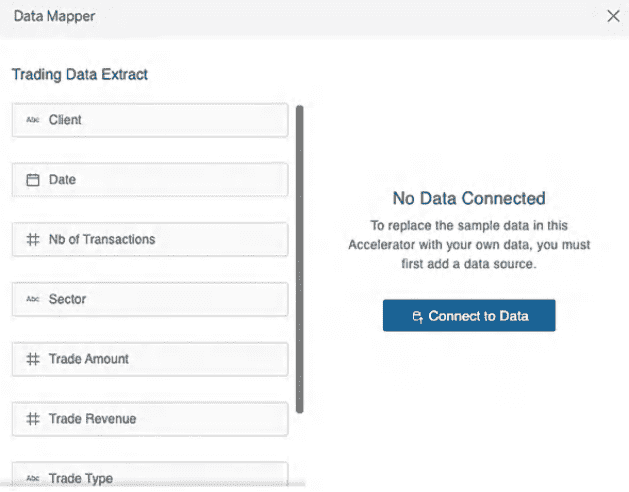

图 8.57: 数据映射器 II

加载后，您可以开始逐个字段进行映射：

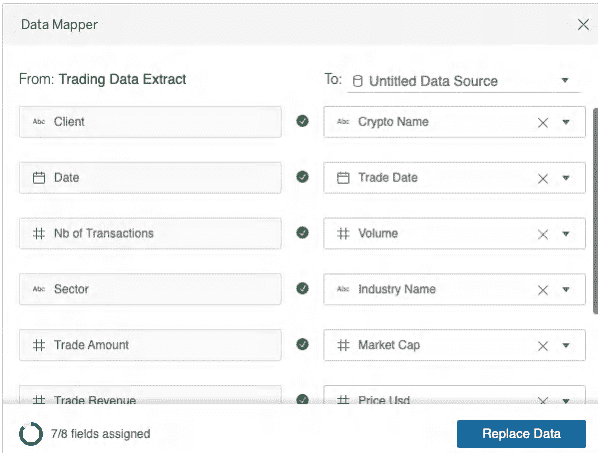

图 8.58: 映射数据

重要说明：您无需映射所有字段；但是，如果工作簿中的可视化使用了未映射的列，这些实例将显示为 null。

映射完成后，您的仪表板即可使用！抽样检查一切是否符合预期，您的工作就完成了！

太棒了，不是吗？真是个省时工具；我真的很喜欢 Tableau 中的这个新功能。

## 连接器

Tableau Exchange 提供的最后一部分是 **连接器**。在这里，您可以找到连接到未在 Tableau Desktop 的 **连接** 窗格中列出的数据库的连接器。

总而言之，Tableau Exchange 是一个平台，您可以在其中找到各种工具以快速获得有意义的洞察。它提供 Tableau 加速器（由专家预先构建的仪表板）、提供 Tableau 原生功能之外功能的扩展，以及允许您连接到默认窗格中未列出的数据库的连接器。这是一个真正免费的市场，可帮助您开启 Tableau 之旅。

## Einstein Discovery

在前一节中，我们讨论了 Tableau Exchange；但是，另一个同样超越基础的功能也值得关注。但在继续之前，先简单介绍一下背景。2019 年 8 月，Tableau 被 Salesforce 收购。您中的大多数人可能都知道 Salesforce，甚至使用过它，但对于其他所有读者，Salesforce 是一款云原生的 **客户关系管理（CRM）** 工具。除此之外，该公司还开发了一个分析部分，允许 Salesforce 用户分析来自 CRM 系统和其他数据源的数据。

在收购之前，将 Salesforce 连接到 Tableau 就已可行，但 Tableau 2021.1 中的新功能是 Salesforce 的分析部分可作为扩展和在计算字段中集成到 Tableau 中。Tableau 社区对这一功能非常兴奋，因为它具有内置的机器学习功能和实时预测能力。这款软件称为 Einstein Discovery。

> **注意**
> 要使用 Einstein Discovery，您需要 Salesforce 许可证，更具体地说，需要 Salesforce 的分析许可证。许可详情请参阅：https://www.salesforce.com/editions-pricing/crm-analytics/。

现在，为了让您了解 Einstein Discovery 可以为您做什么，我将带您了解一个虚构的用例。在供应链数据仪表板上，您发现可以改善运输时间，但不知道哪些因素导致了延误。在这种情况下，您可能会决定使用 Einstein Discovery 进行分析功能。

首先，将 **扩展** 对象拖到仪表板上，就像我们使用 **显示更多** 扩展所做的那样。然后选择 **Einstein Discovery** 项目，此时会打开一个浏览器窗口，要求您登录 Salesforce。登录后，您可以选择要在 Tableau 仪表板上使用的模型。该模型（例如机器学习模型）必须事先在 Salesforce 中准备好。然后，Einstein Discovery 将成为您仪表板的一部分，您的工作表将显示 Salesforce 后台运行模型的输出。在我们的示例中，该模型将更容易找到仪表板上最适合预测交货时间的相关变量，并将推荐您可以采取的措施以改善运输时间。

**注意**
所述用例及另一个用例的视频可在以下网址观看：https://youtu.be/dMluy6mVE_o。

或者，您可以直接在计算字段中调用 Salesforce 模型。其工作原理请参阅：https://help.tableau.com/current/pro/desktop/en-us/einstein_discovery_predictions.htm。

如果您想尝试这些新功能，即使没有 Salesforce 许可证，也有办法测试新的 Einstein 功能。设置过程较长，但对于确实想要尝试的人来说，请查看此视频以获得帮助：https://youtu.be/ZReSwXk0reo。

这些是 Tableau 2021.1 中定制的新 Einstein 功能的基石。不幸的是，详细介绍 Salesforce 平台的功能超出了本书的范围，但如果您已部署 Salesforce，我肯定会建议您设置连接并测试运行一些模型。即使您不使用 Salesforce，许可情况也可能随时间而变化，因此希望我们都能很快运行这些模型。目前，不用担心，因为我们将在第 15 章"集成编程语言"中讨论机器学习模型集成。

## 跟随练习仪表板

本章的跟随练习将使用第 7 章相同的数据集。希望熟悉数据集会带来一种与应用 LOD 不同的有趣方法。

- 1. 如果您还没有这样做：下载此文件：https://www.kaggle.com/datasets/mexwell/carrier-on-time-performance-dataset
- 2. 在 Tableau 中打开工作表，并将 Arr Delay 放到"列"。将度量值更改为平均值。
- 3. 将 Origin State 拖到"行"
- 4. 将 Origin State 拖到标记卡的"标签"
- 5. 将 AVG(Arr Delay) 拖到标记卡的"颜色"
- 6. 将工作表重命名为 Bar – Avg Delay by State

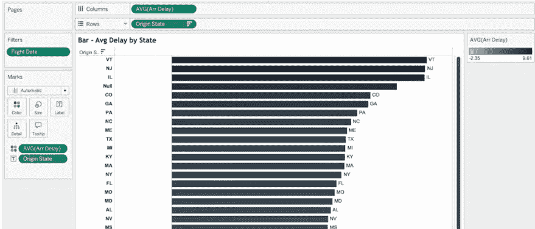

图 8.59: Bar – Avg Delay by State 工作表

这时就用到多边形了：每个州将被绘制为填充多边形。

- 7. 打开新工作表
- 8. 通过右键单击 | 地理角色 | 州/省 更改 Origin State Name 的数据类型
- 9. 双击 Origin State Name
- 10. Tableau 将识别地理角色并创建地图。如果右下角看到未知值，请单击它 | 编辑位置，并将国家/地区选择为美国。如果标记卡设置为点，请更改为地图。现在每个州都是一个填充多边形。让我们应用一些最后的美化更改。
- 11. 将 Avg(Arr Delay) 拖到标记卡的颜色
- 12. 将颜色编辑为较高延迟的红色调色板
- 13. 将 Origin State 拖到标签以在地图上显示州缩写
- 14. 将此工作表重命名为：Map – State Delay

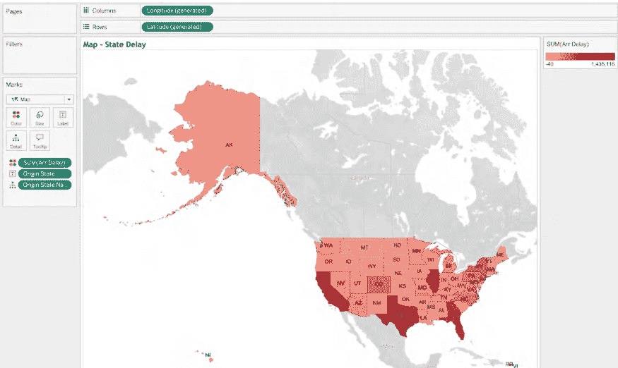

图 8.60: Map – State Delay 工作表

最后，创建航空公司延误的条形图。

- 1. 打开新工作表
- 2. 将 **报告航空公司** 拖到"行"
- 3. 将 **Avg(到达延迟)** 拖到"**列**"
- 4. 按延误降序排序
- 5. 也将 **到达延迟** 拖到"**颜色**"并将度量值更改为"**平均值**"。选择您喜欢的颜色调色板。
- 6. 将工作表重命名为：**条形图 – 航空公司延误**

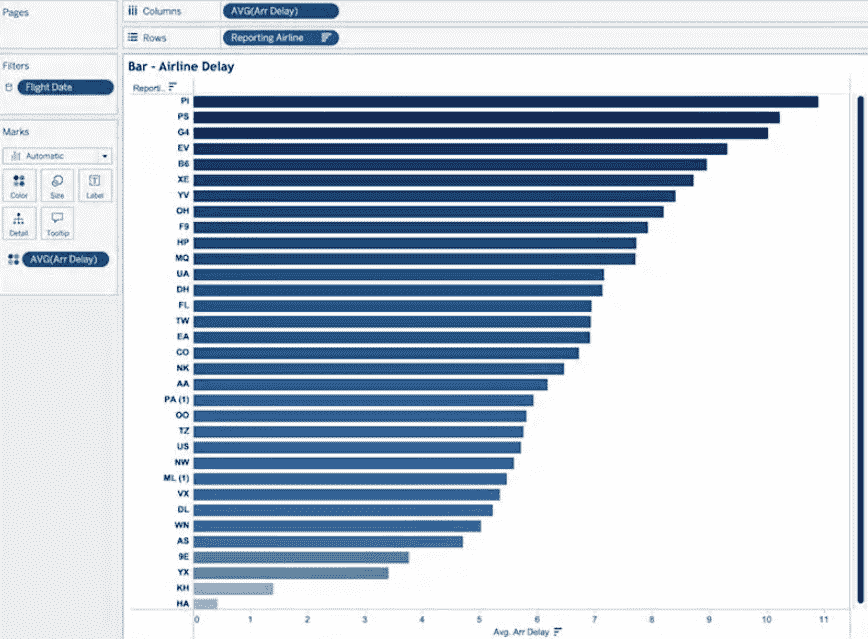

图 8.61: Bar - Airline Delay 工作表

接下来，我们将构建仪表板。

- 1. 单击 **新建仪表板**
- 2. 将工作表拖放到仪表板上：
- 3. 顶部：**Map – 州延误**（多边形地图）
- 4. 左下角：**条形图 – 按州平均延误**
- 5. 右下角：**条形图 – 航空公司延误**

**注意** 如果您希望布局更简洁，请使用水平/垂直容器，但这不是必需的。

为了获得更好的用户体验，请执行以下步骤：

- 6. 在仪表板上单击条形图 – 按州平均延误工作表
- 7. 选择筛选器 | 航班日期
- 8. 然后单击筛选器，并选择应用于工作表 | 所有使用此数据源的工作表

现在，当您在地图上单击一个州多边形时，州条形图和航空公司条形图都将筛选该州。

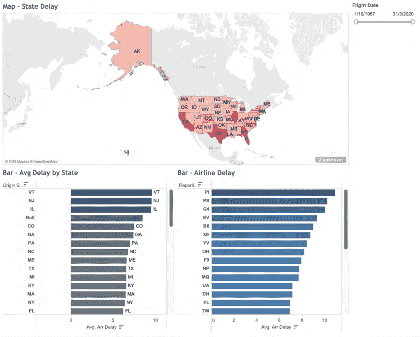

图 8.62: 按州筛选

## 摘要

本章首先将重点放在自定义背景图像上，探讨如何使用 XML 构建网格以生成 SVG 文件，从而加速用于背景图像的生成数据。随后，我们通过在背景图像上构建多边形完成了本章，并简要探索了 Tableau Exchange 的世界。我们讨论了加速器、扩展和连接器，还讨论了由 Salesforce 销售的独立产品 Einstein Discovery。


本书中选项太多，无法一一介绍，但既然你现在已经是复制方面的专家，我在解决方案工作簿中添加了更多带有其他可视化效果的工作表，供你实验。你会发现包含条形图、堆叠条形图、发散堆叠条形图、交叉表、突出显示表、离散突出显示表、趋势线、面积图、迷你图、组合图、双轴、直方图、箱线图、散点图、填充地图、符号地图、树形图、树状条形图、甘特图、KPI 图、漏斗图、抖动分布图、日历图、排名变化图、斜率图、瀑布图、目标图和条中条图等工作表。始终确保使用最适合你的数据并能为你要讲述的故事增加价值的图表。如果你在确定合适的可视化技术时仍需要一些帮助，我建议你查看在 Tableau Public 上发布的以下仪表板：https://public.tableau.com/en-us/gallery/visual-vocabulary。这个仪表板旨在根据你拥有的数据，向你展示应使用哪种可视化类型。

在下一章中，我们将把注意力转向地图制作，探讨如何在不离开界面的情况下扩展 Tableau 的原生地图功能，以及如何利用其他技术扩展 Tableau 的地图功能。

## 加入我们的 Discord 社区

加入我们社区的 Discord 空间，与作者和其他读者讨论：

https://discord.gg/VXpz9YPUTW


