# 使用地图

当我为初次使用 Tableau 的人士讲授 Tableau 课程和研讨会时，我发现演示 **地图制作** 总是非常受欢迎，有时还会引起赞赏和惊讶的低语。多次有人告诉我，Tableau 的地图功能是让他们注意并更认真地考虑 Tableau 产品的关键特性。Tableau 开箱即用的地图功能功能强大且灵活。你可能会惊讶于在不离开用户界面的情况下能完成多少工作。但这些开箱即用的功能只是冰山一角。在适当的指导下（我将在本章中尝试提供），你可以超越原生地图功能，探索能够大大增强工作簿功能和美观度的技术。

在本章中，我们将讨论以下主题：

- 在不离开 Tableau 的情况下扩展 Tableau 的地图功能
- 创建自定义多边形
- 热力图
- 双轴与地图图层
- 利用另一种技术扩展 Tableau 地图功能
- 切换地图
- 自定义地理编码

Tableau 的默认地图功能是一个重要的卖点。选取任何城市、区域、国家或其他地理位置，将其放置在 Tableau 工作表上，你就会得到一张漂亮的地图；将诸如 **Sales** 之类的度量值添加到 **Color** 书架，你的地图颜色将根据销售数据发生变化。在以下部分中，我们将进一步深入，利用 Tableau 提供的那些不太明显的功能来增强此功能，例如在地图上测量距离以及在后台绘制其他数据（例如天气数据）。

> 你的购买包含一本免费的 PDF 副本和独家额外内容

你的购买包含本书的 DRM-free PDF 副本、Packt+ 书库的 7 天试用（无需信用卡）以及其他独家额外内容。请参阅前言中的“随书附赠的免费权益”部分，立即解锁这些内容，最大化你的学习效果。

## 在不离开 Tableau 的情况下扩展 Tableau 的地图功能

在日常生活中，地图可以帮助我们更好地了解周围的世界。例如，地图经常被用于网站、电视或印刷媒体中，以呈现人口统计信息。在这种情况下，地图需求是静态的，因为当前目标不需要移动。有些企业只有静态地图需求——例如，一家零售连锁店可能会创建包含地图的可视化效果，以便更好地了解特定区域的销售业绩。在这种情况下，地点之间的移动并不是直接需求。

然而，通常还需要地图来从 A 点导航到 B 点。这种地图需求更为复杂，因为它既包含静态需求（附近有什么餐厅？），又必须提供额外信息，例如路线和距离（如何到达那家餐厅？）。这些动态地图需求假设需要移动才能满足需求。许多企业需要了解路线和里程，即如何从 A 点到达 B 点以及涉及的距离。这些动态地图要求可能差异很大，但大多数需求至少有两个共同点：路线和距离。

在以下练习中，我们将考察澳大利亚的航班路线及其相关距离。具体来说，我们将介绍如何从 Tableau 中提取经纬度数值，并利用该信息结合三角学来计算各点之间的里程。在此过程中，我们将使用数据混合、表计算、地图以及详细程度 (LOD) 计算，进行一个涵盖许多高级功能的稳健练习。

请执行以下步骤：

- 1. 导航至 https://github.com/PacktPublishing/Mastering-Tableau-2026/tree/main/Chapter09 以查找并下载与本章关联的工作簿。
- 2. 打开工作簿并导航至 Map 工作表。
- 3. 在 **数据** 窗格中选择 **Transit Data**，双击 **City**，然后在 **标记** 卡中将 **City** 从 **详细信息** 更改为 **标签**。
- 4. 在以下截图中，请注意目前尚未显示任何内容。此问题取决于你的国家/地区设置。单击右下角的 **16 unknown**：

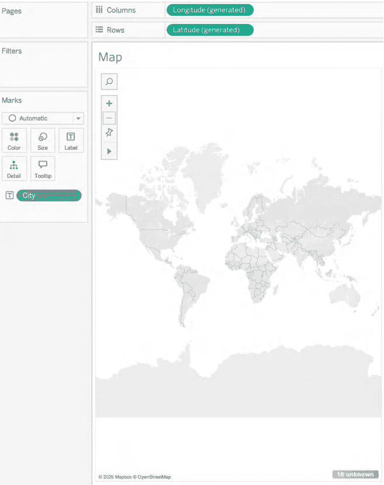

### 图 9.1：未知

- 5. 选择 **编辑位置...**

## [City] 的特殊值

有 14 个值的地理位置未知。你想要如何处理？

**编辑位置...**

更正未知位置。

### 筛选数据

从视图和计算中排除特殊值。

### 在默认位置显示数据

在轴的默认位置显示特殊值。例如，Null 值将显示在 0 处。

### 图 9.2：编辑位置...

- 6. 将国家/地区更改为 固定 | Australia

## 编辑位置

地理角色
国家/地区：Australia
州/省：
城市：
将值匹配到位置字段
- 无
- 固定：Australia
- 从字段：Australia
2 字符代码：两者 (ISO 和 FIPS)
ADELAIDE
ALBURY
ALICE SPRINGS
BRISBANE
CANBERRA
DARWIN
Dubbo
KALGOORLIE
MACKAY
重置匹配 取消 确定

### 图 9.3：选择 Australia

Australia 现在在地图上显示。

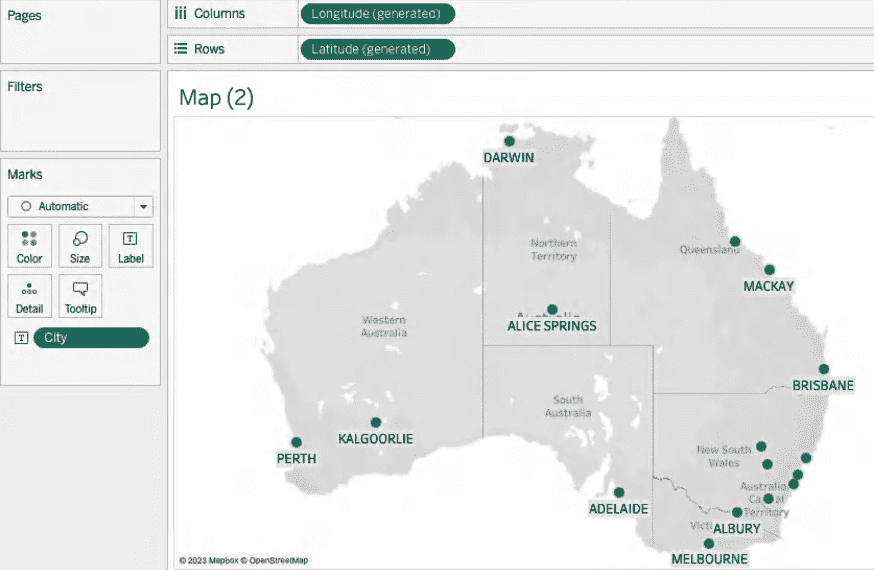

### 图 9.4：Australia

- 7. 导航至 Miles 工作表，将 Trip ID 和 City 字段放置在行书架上，将 Latitude (generated) 和 Longitude (generated) 放置在文本书架上，如下面的截图所示：

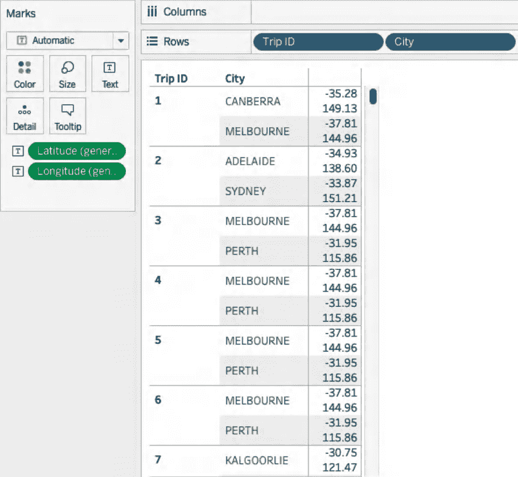

### 图 9.5：距离

你的屏幕应与上一张截图类似。请注意，交叉表看起来相当杂乱。理想情况下，**Latitude** 和 **Longitude** 应该显示在单独的列中。不幸的是，我们无法对生成的纬度和经度执行此操作，因为尽管它们列在 **数据** 窗格的 **度量值** 部分下，但 Tableau 不将它们视为度量值。为了完成练习，我们需要能够从单独的数据源中访问纬度和经度坐标。

- 8. 为此，首先单击 Map 工作表选项卡。
- 9. 右键单击可视化效果并选择 **查看数据**。通过选择每个单元格并单击 **复制**，复制随即出现的对话框中 **摘要** 选项卡的所有数据。


- 10. 关闭对话框并按 Ctrl + V（Mac 上为 Command + V）在 Tableau 中创建新数据集。将生成的数据集（现名为 Clipboard_[timestamp]）重命名为 Lat Long。同时将工作表命名为 Lat Long。

- 11. 在 Lat Long 工作表中，将 Latitude (generated) 和 Longitude (generated) 重命名为 Lat 和 Long。

- 12. 返回 Miles 工作表，在 Transit Data 数据源中创建两个计算字段：一个名为 LAT，包含代码 AVG([Lat Long].[Lat])，另一个名为 LONG，包含代码 AVG([Lat Long].[Long])。

- 13. 从标记卡的 Text 中移除 Latitude (generated) 和 Longitude (generated)。

- 14. 将 Measure Names 放置到 列 和 筛选器 卡，并选择 Lat 和 Long。同时，将 Measure Values 放置到 文本 卡。现在，我们能够将纬度和经度视为真正的度量值。

- 15. 再创建两个计算字段：一个名为 Lookup Lat，包含代码 Lookup(Lat, -1)，另一个名为 Lookup Long，包含代码 Lookup(Long, -1)。将这两个新创建的计算字段放置到 Measure Values 卡。

- 16. 创建名为 Great Circle Distance Formula 的计算字段，代码如下：

```
3959 * ACOS (
SIN(RADIANS([Lat])) * SIN(RADIANS([Lookup Lat]))+ COS(RADIANS([Lat])) *
COS(RADIANS([Lookup Lat])) * COS(RADIANS([Lookup Long]) - RADIANS([Long]))
)
```

对于千米，将 3959 改为 6378。该数字代表地球半径，需要从英里更新为千米。

- 17. 将新创建的计算字段 Great Circle Distance Formula 放置到 Measure Values 卡。

- 18. 更改 Great Circle Distance Formula 的计算方式，使其按 City 计算：点击该字段本身并选择 使用方式：City

- 19. 相应调整以下计算

- Lookup Lat: IFNULL(LOOKUP(Lat,-1), LOOKUP(Lat,1))

- Lookup Long: IFNULL(LOOKUP(Long,-1), LOOKUP(Long,1))

- 20. 选择 Map 工作表，将标记类型设置为 Line。

- 21. 将 Trip ID 放置到 详细信息 卡。

- 22. 将 City 拖动到标记卡的底部。

- 23. 将 Great Circle Distance Formula 字段放置到 提示 卡。再次确认其仍设置为 使用方式：City。

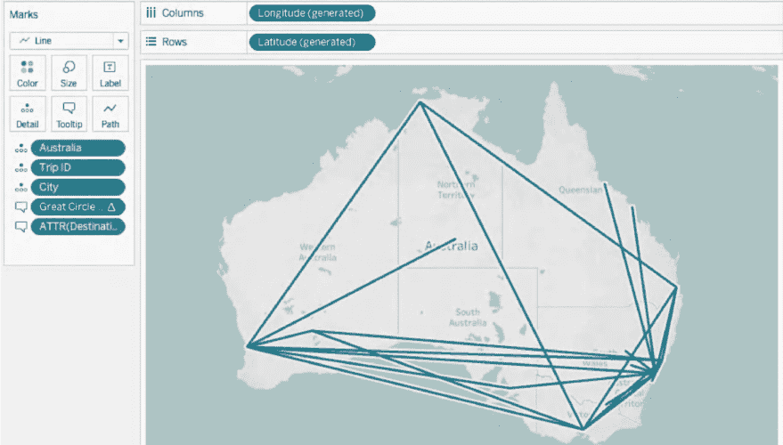

图 9.6：澳大利亚距离

- 24. 再创建两个计算字段，一个名为 Source City，包含以下代码：

```
{ FIXED [Trip ID]:MIN(IF [Dest/Orig]='Source' THEN City END)}
```

第二个计算字段应命名为 Destination City，并包含以下代码：

```
{ FIXED [Trip ID]:MIN(IF [Dest/Orig]='Destination' THEN City END)}
```

- 25. 使用新创建的计算字段按需进行格式设置。特别是，请注意在以下截图中，**Source City** 位于 **颜色** 卡，而 **Destination City** 用于 **提示** 卡：

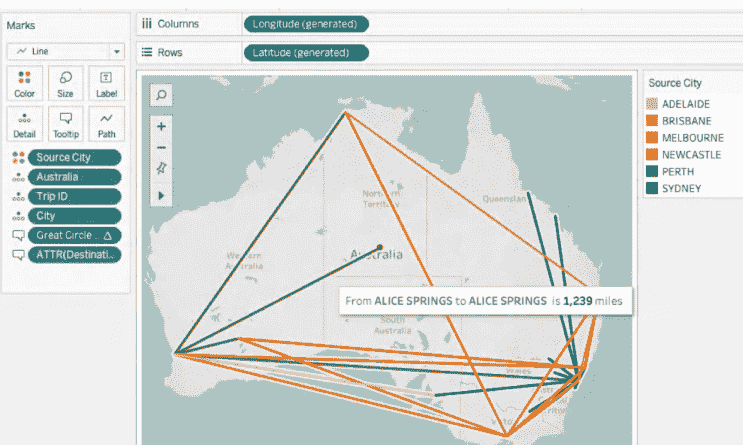

图 9.7：航班

总之，我们在此所做的工作如下：最初，我们向 Tableau 添加了一个数据集。随后，我们需要从工作簿中复制每个城市的纬度和经度，以创建第二个数据源，然后将其作为混合数据源用于查找纬度和经度值。借助 LOD 计算，我们可以识别出发城市和目的地城市，最后，我们能够使用所谓的大圆公式来测量城市之间的距离。可视化中的每种颜色代表一个出发城市；例如，所有绿色线条都测量从珀斯到其他城市的距离。将鼠标悬停在线条上方时，会显示出发城市和目的地城市，以及以英里（或千米）为单位的测量距离。

如果您想分析货运路线或两点之间的任何其他距离，那么您现在知道如何在 Tableau 中可视化此类数据。

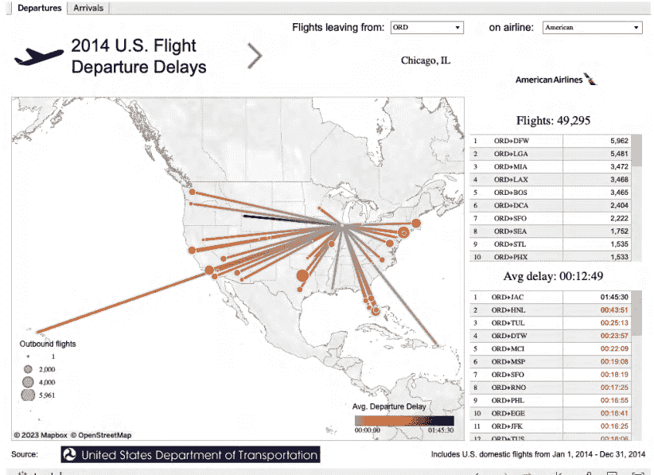

图 9.8：美国航班出发延误

在图 9.8 中，您可以看到另一个类似的可视化，这绝对值得查看（尝试复制它）：[Tableau 解决方案工作簿：大数据比以往任何时候都更常见](https://www.tableau.com/solutions/workbook/big-data-more-common-now-ever)。

在下一节中，我们将讨论如何利用地图和多边形的组合来进一步扩展我们的 Tableau 工具箱。

## 创建自定义多边形

Tableau 原生提供多边形的地理区域包括全球机场代码、城市、国家/地区、区域、领土、州、省份，以及某些邮政编码和二级行政区（县级区域）：美国区号、核心统计区 (CBSAs)、大都市统计区 (MSAs)、国会选区和 ZIP 代码。这意味着，例如，可以轻松为世界各国创建填充地图。只需复制世界各国列表（Ctrl + C），然后在 Tableau Desktop 的空白工作表上将鼠标定位并按 Ctrl + V 将该列表粘贴到 Tableau 中。新数据源将添加到数据区域的右上角。接下来，将 Tableau 的视图类型设置为 填充地图，并将国家列表放置到 详细信息 卡。Tableau 将自动为每个数据点绘制多边形。有一些地理类型，Tableau 不会自动提供多边形。这些包括电话区号。对于这些地理类型，Tableau 会绘制符号地图，但不会绘制填充地图，如下所示：

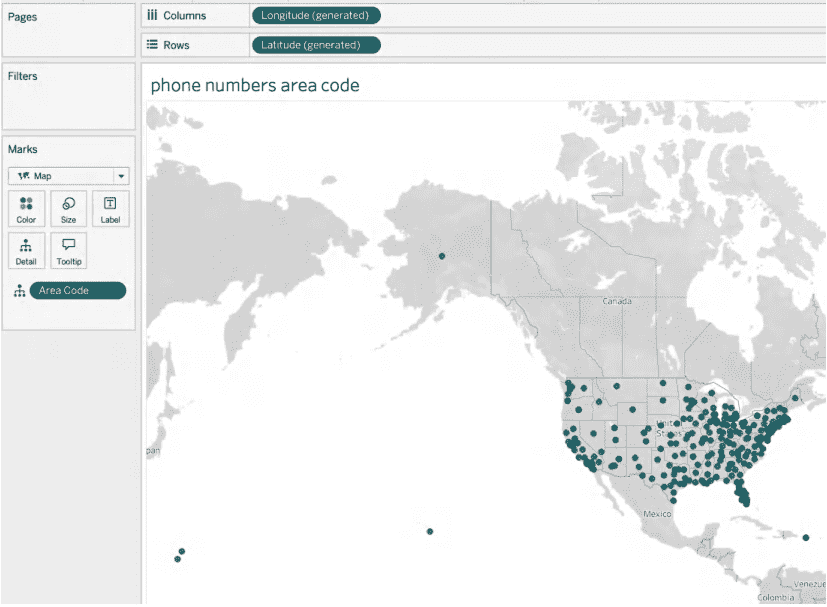

图 9.9：填充地图失败

尽管选择了填充地图 **标记** 类型，Tableau 仍无法填充地图，因为这些区域的轮廓对 Tableau 来说是未知的。此外，可能会出现特殊的映射需求，需要为地图上通常不包含的区域绘制多边形。例如，组织可以定义不遵循常规地图边界的销售区域。或者，Tableau 作者可以将篮球场或足球场的图片导入 Tableau，并绘制多边形来表示比赛区域的特定部分。另一种替代方案（我们在 _第 8 章，超越基础_ 中详细讨论过）是映射商店中的书架。

除了自行绘制多边形外，还有一些文件类型支持绘制多边形。其中一种文件类型是 .shp。在下一个练习中，我们将使用此类文件并为德克萨斯州创建多边形。

通过处理上述 .shp 文件类型的示例，Tableau 可以创建多边形。让我们尝试一下，并将德克萨斯州的人口显示为德克萨斯州地图上的多边形：

- 1. 打开 **德克萨斯州交通部** 页面：https://gis-txdot.opendata.arcgis.com/datasets/txdot-city-boundaries/explore?location=30.990445%2C-100.168292%2C6.68

- 2. 使用 **下载** 下拉菜单并下载 **Shapefile**

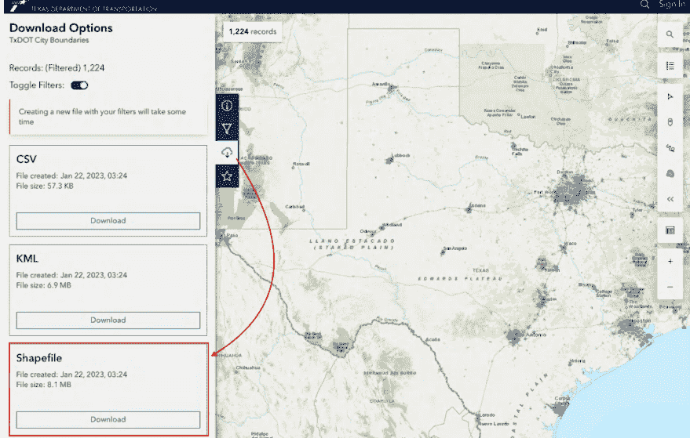

图 9.10：德克萨斯州数据

在您的下载目录中，应该能找到多个文件：


图 9.11：德克萨斯州城市边界

如果在文本编辑器中打开 .shp 文件，将看到以下内容：


图 9.12：文本编辑器中的 .shp

- 3. 幸运的是，Tableau 具有读取 .shp 文件的原生功能。在与本章相关的工作簿中，导航到 City Limits 工作表并选择 数据 | 新建数据源 | 文本文件。

- 4. 导航到您的下载目录或保存德克萨斯州 shapefile 的路径，并选择 .shp 文件。

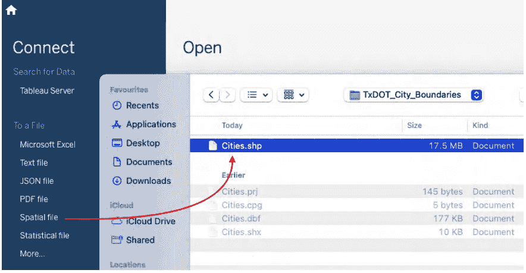

图 9.13：加载空间文件

- 5. 在下一个截图中，您可以看到 Tableau 如何读取 .shp 文件，以及它如何创建了一个名为 **Geometry** 的附加字段，指示我们正在查看该文件中的多边形和多重多边形。

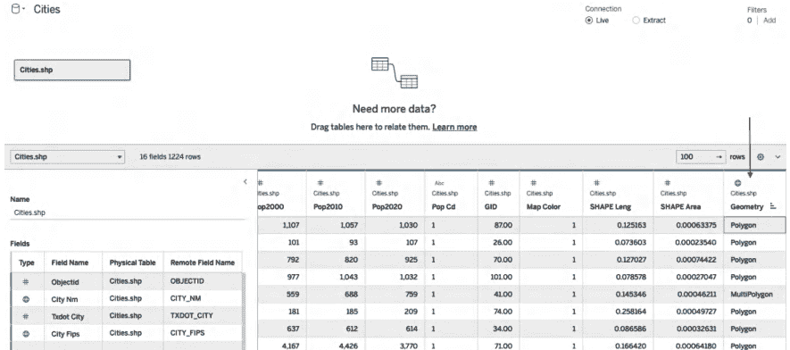

图 9.14：Geometry

- 6. 打开一个新工作表，并将 **Geometry** 拖放到空白画布上。

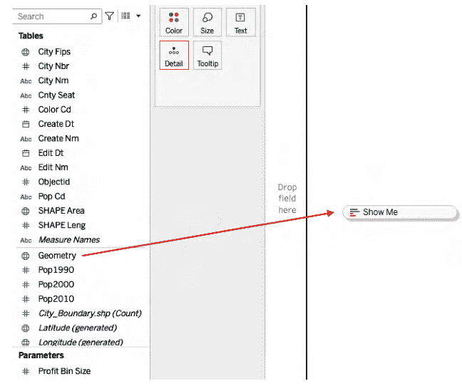

图 9.15：添加几何


- 7. 看！Tableau 立即在得克萨斯州区域周围创建了多边形。

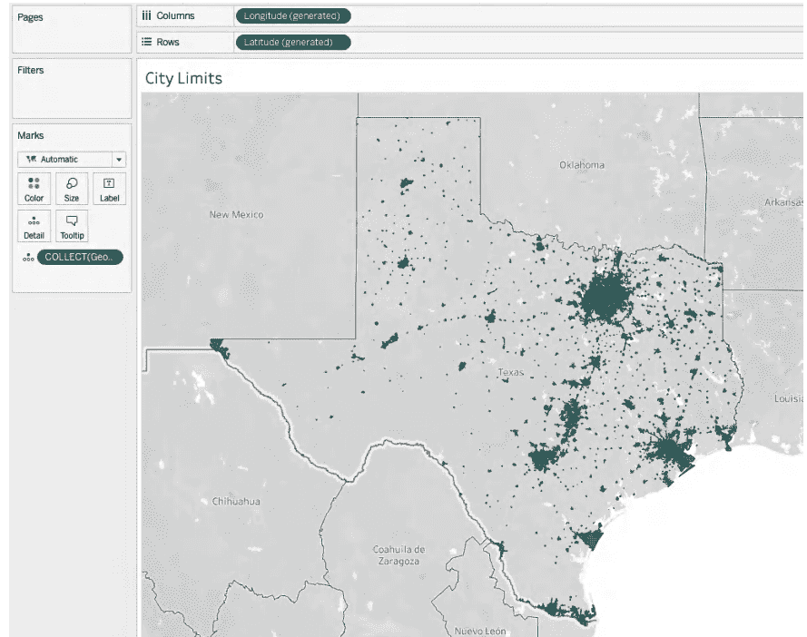

图 9.16: 得克萨斯州多边形

- 8. 请随意通过 Map | Background Maps | Dark 调整格式。

- 9. 在 **标记** 卡上将 City Nm 字段放在 **详细信息** 上，将 Pop2010 放在 **颜色** 上。（图 9.16 中使用的颜色是 Temperature Diverging。）

- 10. 你的工作表应该如下所示：

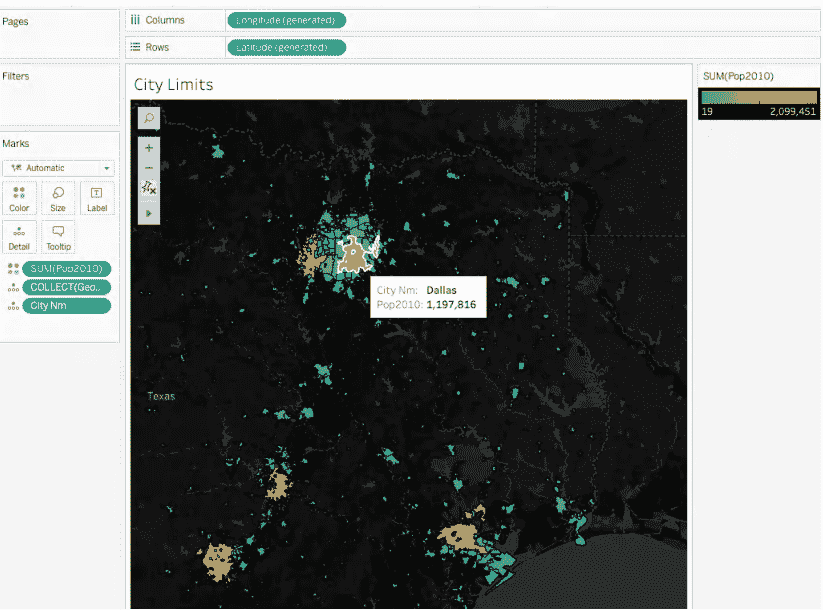

图 9.17: 得克萨斯州城市边界

现在你可以看到，我们有一张很好看的深色地图，上面覆盖了多边形。这些多边形定义了每个城市名称的区域（使用字段 City Nm，由得克萨斯州政府发布）。通过将 2010 年人口度量（使用字段 Pop2010）放置在 **颜色** 图层上，我们还可以看到，红色多边形区域在 2010 年拥有最多居民，而深绿色区域最少。

你可能不喜欢多边形，或者你可能在想，像 .shp 这样的空间文件是否只允许使用多边形。幸运的是，答案是无论它是不是空间文件，我们都可以更改地图。我非常喜欢使用热图来显示地理密度，所以让我们在下一部分中使用它们。

## 热图

我想与你分享一个功能，它是早期 Tableau 版本的一部分，在处理地理数据时已被证明非常有用。它是 **标记** 类型 **密度**，通过它你可以创建 **热图**。此新功能不仅限于地图；你也可以将其用于任何其他类型的图表。然而，它对于密集数据最为高效，在这类数据中模式不易被轻易发现。

以下步骤将演示创建 **热图** 的示例：

- 1. 打开与本章相关的工作簿中的 CityLimits 选项卡。如果你未完成之前的练习，请打开本章解答工作簿中的 CityLimits 选项卡。

- 2. 复制工作表并将其命名为 City Limits (2)。

- 3. 将 **标记** 卡类型设置为 **密度**

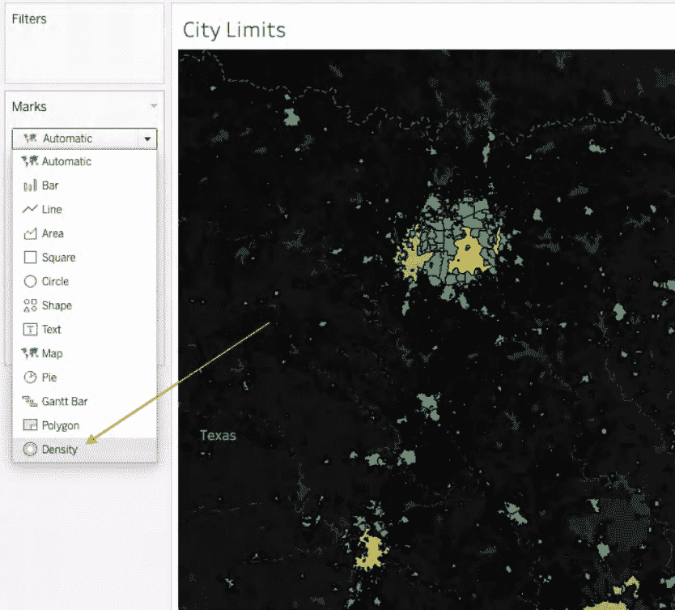

图 9.18: 得克萨斯州城市密度

- 4. 在 **标记** 卡上单击 **颜色**，然后选择任何你喜欢的颜色。我选择了 **Density Gold Dark**。

- 5. 在 **标记** 卡中通过将滑块向左拖动来减小 **大小**。拖动直到你喜欢地图上圆圈的大小。

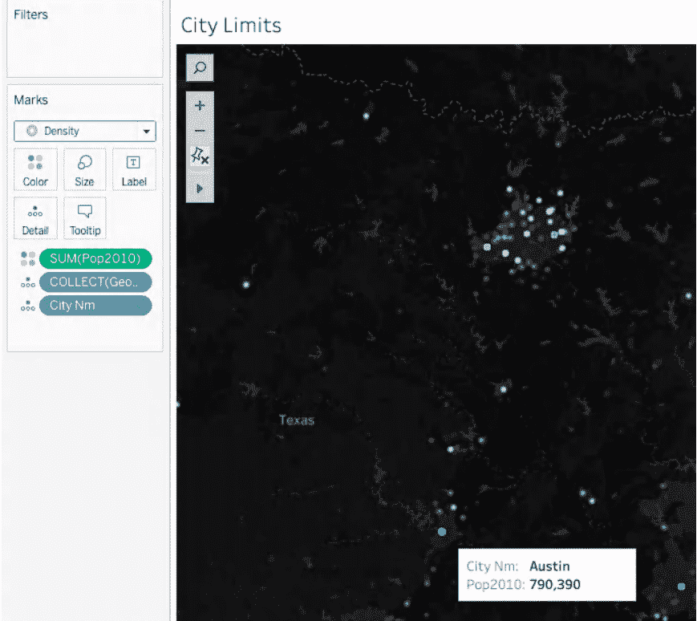

图 9.19: 热图

热图可以显示空间集中度，非常适合非常密集的数据集。在前一个图中，你可以看到我们丢失了城市周围环境和多边形结构；然而，我们仍然可以看到人口稠密区域，而且现在每个城市的大小都相同，这使得比较大小不同的地理位置变得更容易。我们还能够证明，空间文件不需要与多边形一起使用。

在 Tableau 2020.4 版本中，添加了另一个功能：地图图层。它们是什么以及用途将在下一部分中描述。

## 双轴和地图图层

你可能回想起，在之前章节的多个场合中，我们使用了双轴。双轴可视化也可以用地图实现，而且更棒的是，自 Tableau 2020.4 版本以来，地图可以分层。我们只需添加另一个具有相同结构（在此例中为地图）的图层，对于每个图层，我们可以显示不同的数据。

我们将学习两个练习，第一个关于双轴的使用，第二个包含地图图层。

### 使用双轴

让我们开始：

- 1. 首先，我们需要一个数据集。我只是在 Excel 中自己创建了一个；请随意创建自己的，复制下面截图中你看到的内容，或从本书的 GitHub 仓库下载文件（https://github.com/PacktPublishing/Mastering-Tableau-2026/tree/main/Chapter09）。将文件命名为 freight：

| | B | C | D | E | F | G | H | I | J |
|---|---|---|---|---|---|---|---|---|---|
| 1 | 运输方式 | 货物 | 订购日期 | 交付日期 | 起点 | 起点国家 | 目的地 | 目的地国家 | 重量 |
| 2 | 飞机 | 家具 | 1/1/21 | 22/1/21 | Lisbon | Portugal | London | United Kingdom | 75 |
| 3 | 火车 | 家具 | 1/1/21 | 17/1/21 | London | United Kingdom | Paris | France | 54 |
| 4 | 船舶 | 家具 | 1/1/21 | 24/1/21 | Venice | Italy | Palma | Italy | 59 |
| 5 | 船舶 | 家具 | 1/1/21 | 7/1/21 | Rotterdam | Netherlands | Hamburg | Germany | 86 |
| 6 | 飞机 | 办公用品 | 1/1/21 | 4/1/21 | Rotterdam | Netherlands | Rome | Italy | 71 |
| 7 | 飞机 | 办公用品 | 1/1/21 | 12/1/21 | Rome | Italy | Kiev | Ukraine | 52 |
| 8 | 运输车 | 办公用品 | 1/1/21 | 14/1/21 | Rome | Italy | Vienna | Austria | 91 |
| 9 | 飞机 | 办公用品 | 2/1/21 | 17/1/21 | Amsterdam | Netherlands | Warsaw | Poland | 56 |
| 10 | 飞机 | 办公用品 | 2/1/21 | 4/1/21 | London | United Kingdom | Reykjavik | Iceland | 99 |
| 11 | 运输车 | 书籍 | 2/1/21 | 15/1/21 | Hamburg | Germany | Berlin | Germany | 51 |
| 12 | 飞机 | 书籍 | 2/1/21 | 23/1/21 | Athens | Greece | Tallinn | Estonia | 85 |
| 13 | 火车 | 书籍 | 2/1/21 | 27/1/21 | Paris | France | Madrid | Spain | 82 |
| 14 | 火车 | 书籍 | 2/1/21 | 24/1/21 | Warsaw | Poland | Budapest | Hungary | 82 |
| 15 | 船舶 | 书籍 | 2/1/21 | 15/1/21 | Helsinki | Finland | Glasgow | United Kingdom | 62 |
| 16 | 船舶 | 服装 | 3/1/21 | 9/1/21 | Glasgow | United Kingdom | Reykjavik | Iceland | 93 |
| 17 | 飞机 | 服装 | 4/1/21 | 12/1/21 | Reykjavik | Iceland | Istanbul | Turkey | 54 |
| 18 | 飞机 | 服装 | 5/1/21 | 26/1/21 | Istanbul | Turkey | Naples | Italy | 75 |
| 19 | 飞机 | 服装 | 6/1/21 | 2/2/21 | Palermo | Italy | Tunis | Tunisia | 97 |

图 9.20: Excel

- 2. 将新数据集连接到 Tableau，并打开一个名为 Dual-axis map 的新工作表。

- 3. 双击 Origin Country，将出现以下地图：

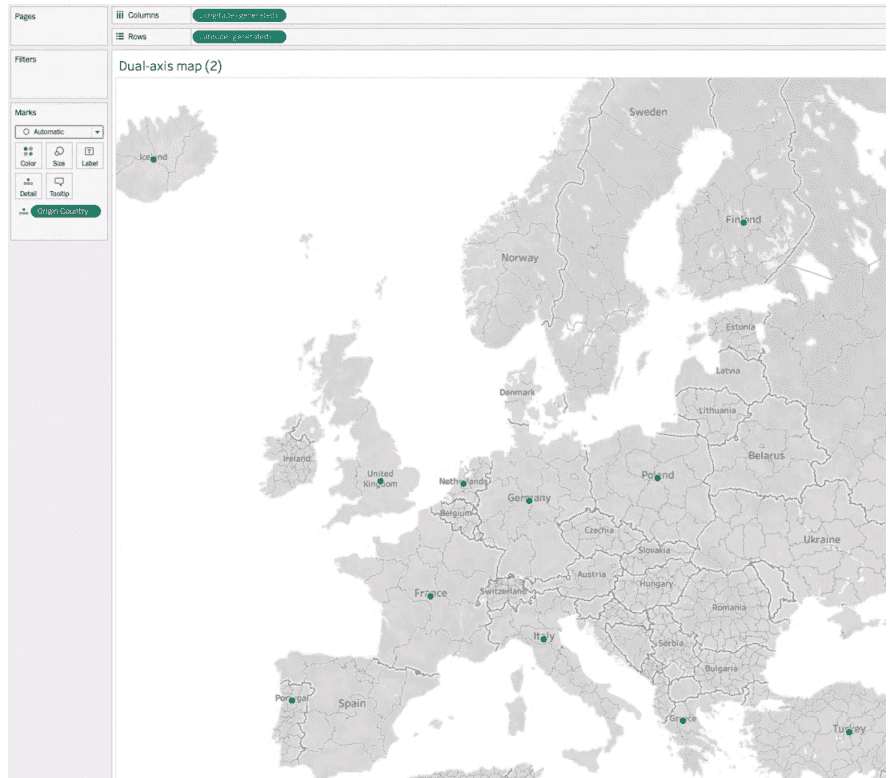

图 9.21: 双轴地图

- 4. 将 **标记** 卡类型更改为填充地图，并将 Goods 拖到 **颜色** 图层上。

| 页面 | 列 | 经度（生成的） |
| :--- | :--- | :--- |
| 筛选器 | 行 | 纬度（生成的） |

- 地图
- 颜色
- 大小
- 标签
- 详细信息
- 提示
- Goods
- Origin Country

Dual-axis map

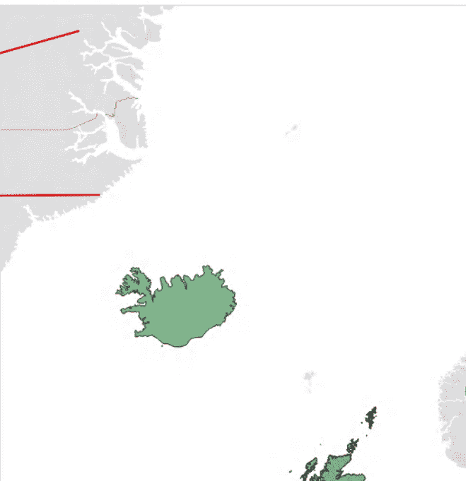

图 9.22: 双轴地图 II

- 5. 在 **列** 图层上单击 **经度**，按住 **Ctrl** (Mac 上为 **Command**)，并同时将字段向右移动。你应该已将 **经度** 字段的副本复制到 **列** 图层上。

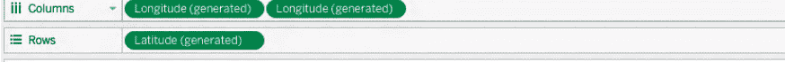

Dual-axis map

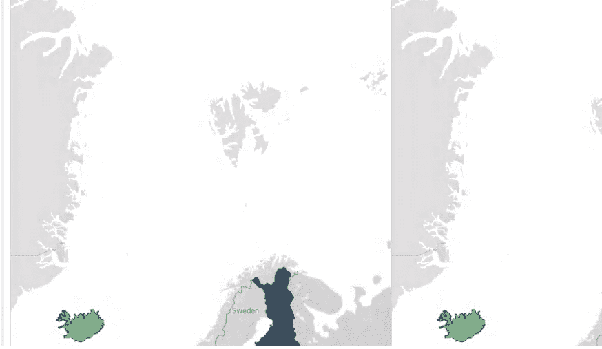

图 9.23: 复制经度

- 6. 你还可以看到，**标记** 卡现在保留了两个图层，外加一个额外的 **全部** 图层，就像条形图上的双轴一样。

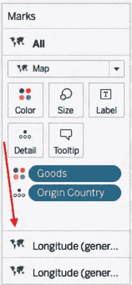

图 9.24: 标记卡

- 7. 在底部图层上，将 **颜色** 图层上的 Goods 替换为 Origin，看看第二张地图如何现在显示代表城市的彩色点。

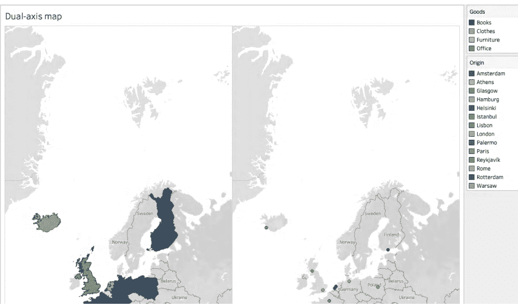

图 9.25: 双轴地图

- 8. 在 **列** 图层上单击右侧的 **经度** 字段，并选择 **双轴**。
- 你已创建第一个分层地图！每个国家的颜色代表其运输的货物类型。点表示火车、船舶、飞机或卡车运输的城市。

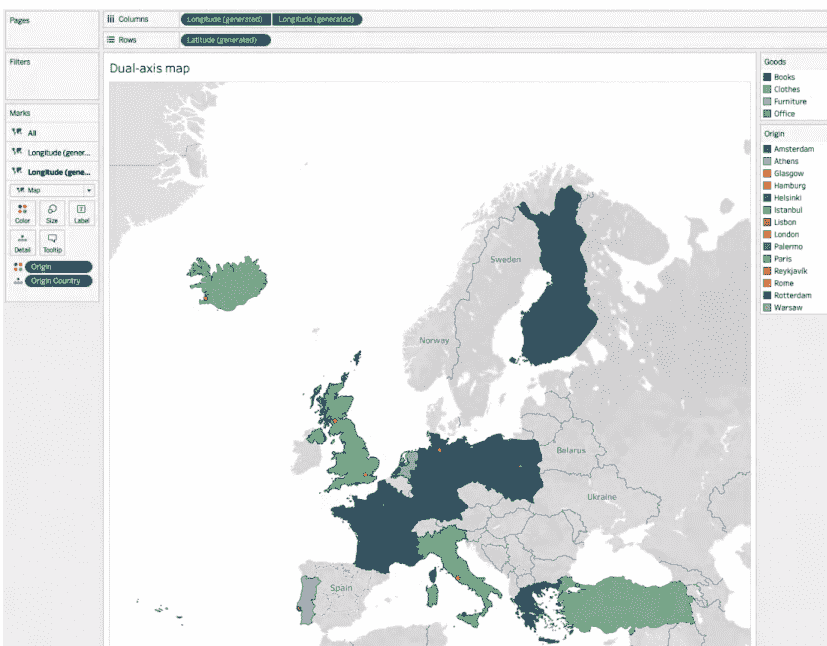

图 9.26: 双轴地图

完成第一个基本练习后，我们将继续学习使用更新的地图图层功能进行更复杂的练习。

### 添加地图图层

我们希望用一条从起点到目的地城市的线来可视化运输路线。我们还想显示交货时间以及货物重量。我们将继续使用之前的 freight 数据集；我们只需做一些调整：

- 1. freight 数据集没有经度或纬度，这些对于 Tableau 的某些空间计算字段（例如 MAKEPOINT，我们稍后将用到）至关重要。打开 Google Maps，输入数据集中的一个城市，例如 Lisbon。在 URL 中，你将能够找到经度和纬度：


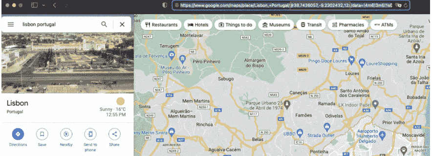

图 9.27: Google Maps

- 2. 将它们复制并添加到单独的 Excel 工作表中，如下面的屏幕截图所示，并将其命名为 latlong：

| 城市 | 纬度 | 经度 |
| :--- | :--- | :--- |
| 里斯本 | 38.7436057 | -9.2302432 |
| 伦敦 | 51.507351 | -0.127758 |
| 威尼斯 | 45.440845 | 12.315515 |
| 鹿特丹 | 51.924419 | 4.477733 |
| 罗马 | 41.902782 | 12.496365 |
| 阿姆斯特丹 | 52.3547925 | 4.7638775 |
| 汉堡 | 53.5586526 | 9.6476426 |
| 雅典 | 37.9908997 | 23.7033199 |
| 巴黎 | 48.8589507 | 2.2770201 |
| 华沙 | 52.2330653 | 20.9211112 |
| 赫尔辛基 | 60.11021 | 24.7385058 |
| 格拉斯哥 | 55.8555734 | -4.3725409 |
| 雷克雅未克 | 64.1335484 | -21.922482 |
| 伊斯坦布尔 | 41.0055005 | 28.7319933 |
| 巴勒莫 | 38.1406578 | 13.2872484 |
| 马略卡岛帕尔马 | 39.5812177 | 2.6355079 |
| 基辅 | 50.4021368 | 30.2525097 |
| 维也纳 | 48.2208286 | 16.2399765 |
| 柏林 | 52.5069312 | 13.1445522 |
| 塔林 | 59.4717925 | 24.5981597 |
| 马德里 | 40.4381311 | -3.8196211 |
| 布达佩斯 | 47.4813602 | 18.9902194 |
| 那不勒斯 | 40.8540421 | 14.1765623 |
| 突尼斯 | 36.7949999 | 10.0732375 |

图 9.28: Excel

- 3. 我们需要使用一个新的 Excel 工作表，因为我们必须为目的地以及起点创建空间字段。由于有些城市既是起点又是目的地，我们将创建两个内连接；两次均将最初的货运 Excel 工作表连接到最近创建的 latlong Excel 工作表（如果你从 GitHub 下载了数据，latlong 表格是 Freight.xlsx 中的第二个选项卡）：


图 9.29: Join

- 4. 唯一的区别在于第一个连接是在 Origin 和 City 上进行，第二个是在 Destination 和 City 上进行。通过双击名称重命名 latlong 数据源以避免混淆：

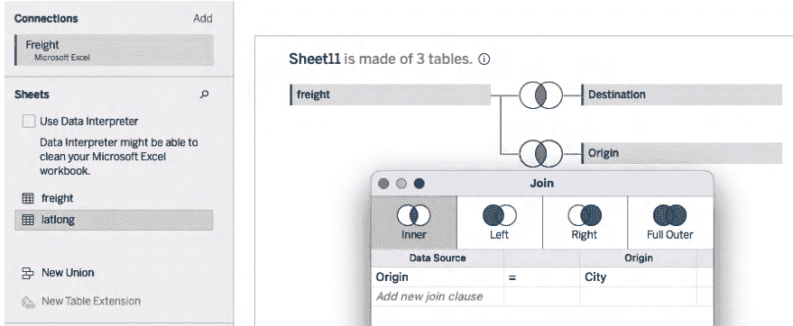

图 9.30: Join II

- 5. 打开一个新工作簿并将其命名为 4-layer map。创建一个名为 Line 的计算字段，使用以下代码：

```
MAKELINE(MAKEPOINT([Lat (Origin)], [Long (Origin)]), MAKEPOINT([Lat (Destination)], [Long (Destination)]))
```

- 6. Tableau 描述显示，要基于空间位置创建点，Tableau 需要经度和纬度坐标。

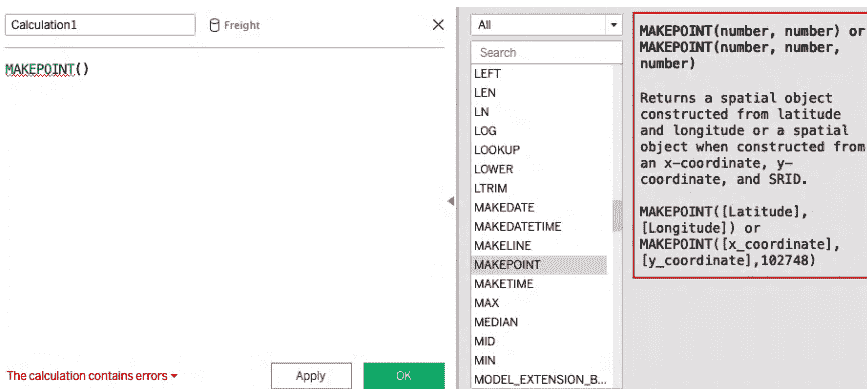

图 9.31: MAKEPOINT

- 7. 创建另一个名为 Days to delivery 的计算字段，使用以下代码：

```
[Delivered]-[Ordered]
```

- 8. 双击 Origin 文件中的 City，将出现地图，但你会遇到 12 个未知项。单击错误，然后单击 编辑位置...

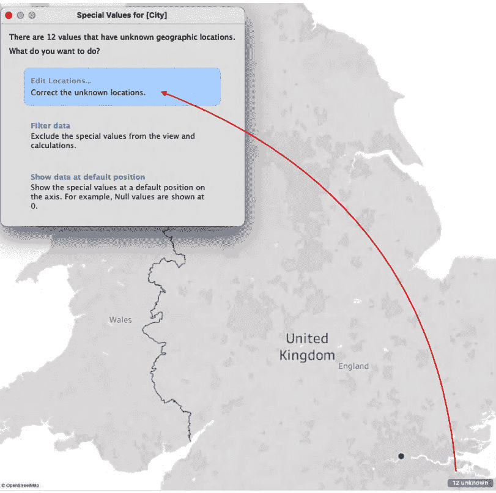

图 9.32: 未知城市

- 9. 你将看到 Tableau 使用 **英国**（对你来说可能不同）作为默认国家来查找每个城市，但 Tableau 不成功，因为我们的数据集中有遍布欧洲的城市。不要使用 **固定** 位置，而使用 **来自字段** 选项并选择 **原产国**。现在此字段将用作数据集中每个城市的国家：

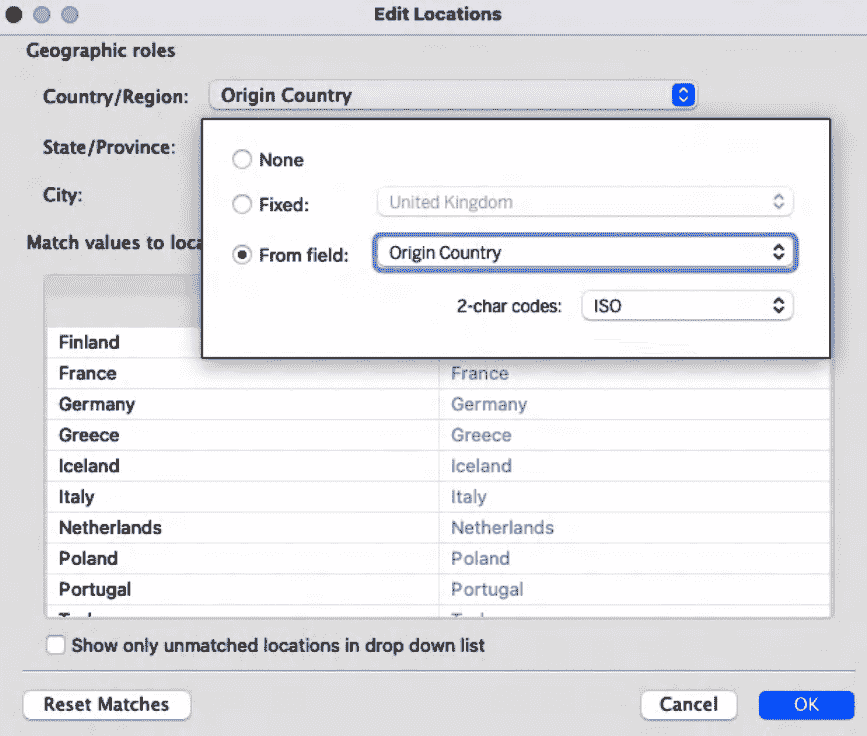

图 9.33: 原产国

- 10. Tableau 自动将 原产国 添加到 详细信息 卡上的视图，并现在正确显示城市。你也可以通过直接将 原产国 放在 详细信息 卡上来完成前一步。

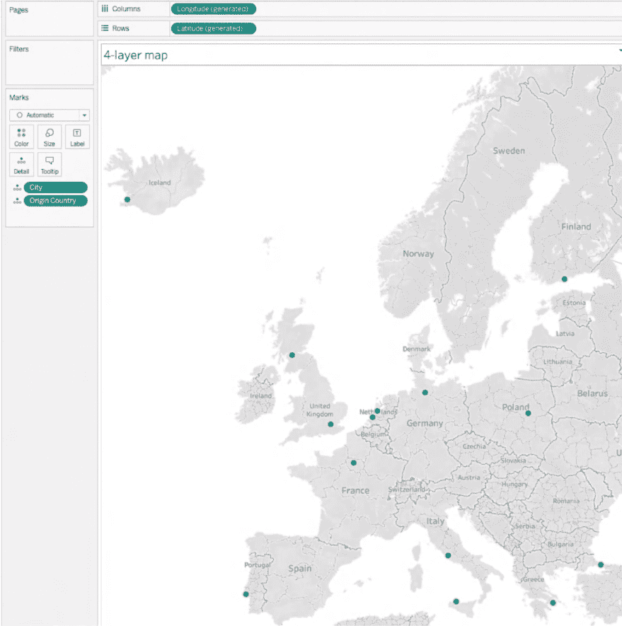

图 9.34: 起点城市

- 11. 由于我们的目标之一是在 **起点** 和 **目的地** 城市之间绘制线条，那么添加 **目的地** 也是合理的，对吗？双击 **目的地** 将其添加到可视化中。

- 12. 我们现在在视图中拥有所有 **起点** 和 **目的地** 城市，但我们无法区分它们，因为它们都在同一图层上。因此，将刚刚添加的 **目的地** 字段从 **详细信息** 卡拖动到视图的左上角，直到出现 **添加标记图层** 标志：

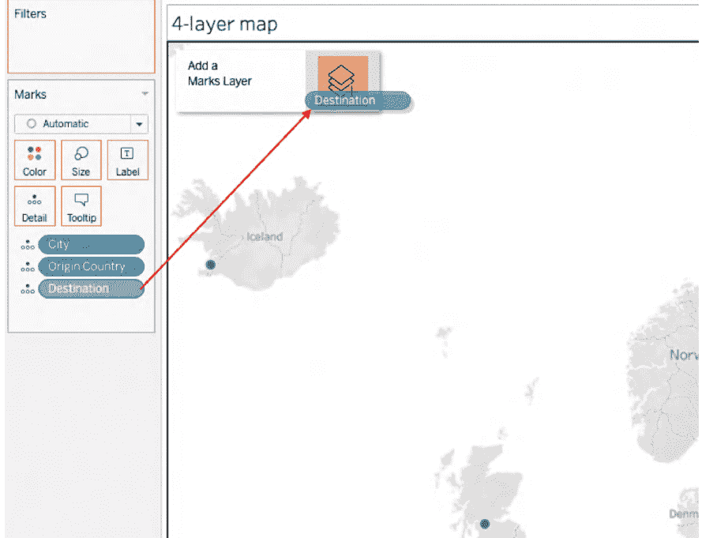

图 9.35: 货运 II

- 13. 你现在将看到 **标记** 卡显示两个图层

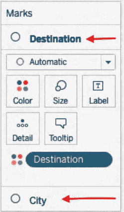

图 9.36: 标记

- 14. 通过双击名称将 目的地 图层重命名为 目的地国家。

- 15. 将 Line 拖动到 添加标记图层 来添加另一个图层，并将 送达天数 添加到 颜色。将此图层命名为 Line，并从 标记 卡下拉菜单中选择 自动 类型。

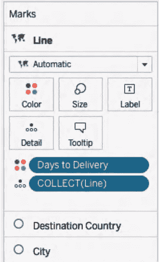

图 9.37: 标记图层

- 16. 将 City 拖动到 添加标记图层 来添加另一个图层，并将其命名为 City (2)。将 目的地国家 添加到 详细信息。从 标记 卡下拉菜单中选择 自动 类型。

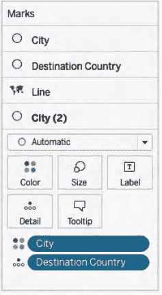

图 9.38: 标记图层

- 17. 最后，返回 目的地国家 图层，将 目的地国家 更改为 详细信息，并将 重量 放在 颜色 上。从 标记 卡下拉菜单中选择 地图。

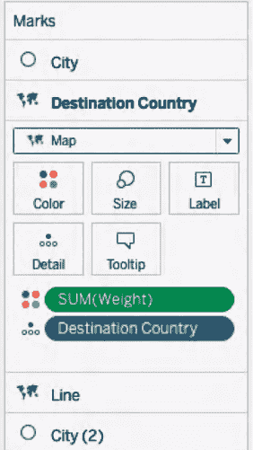

图 9.39: 标记图层

- 18. 通过拖放图层按以下顺序排序：Line、City、City (2) 和 目的地国家。你的工作表现在应如下所示：

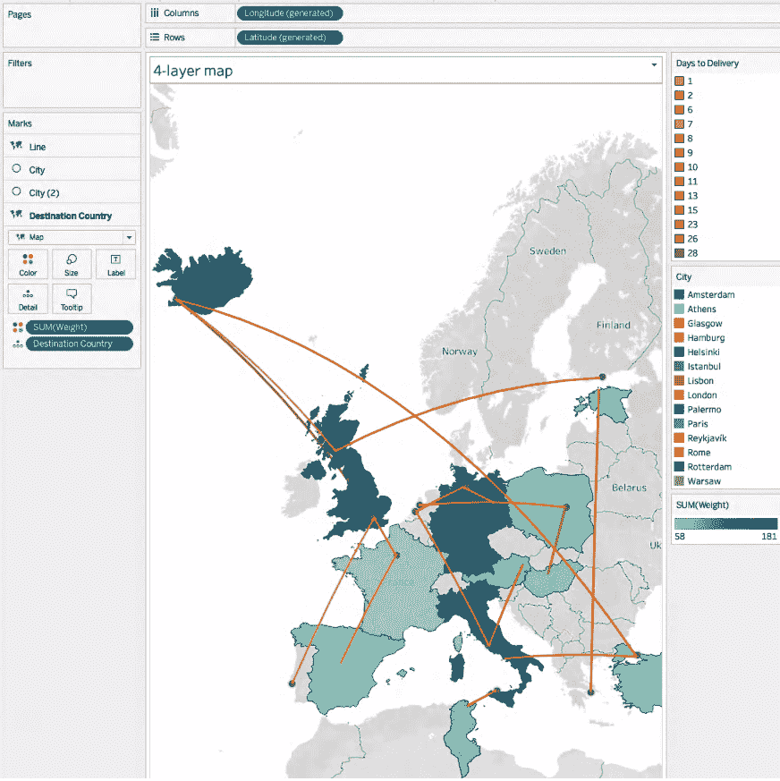

图 9.40: 地图

- 19. 为了使可视化稍微易于解读，将 起点 放在 筛选器 卡上，并仅选择几个你喜欢的起点。

- 20. 为了区分 起点 和 目的地，打开 City 和 City (2) 地图图层，分别将 City 和 City (Destination) 从 详细信息 更改为 形状。为 起点 选择一种形状，为 目的地 选择另一种形状，例如，起点 使用实心圆，目的地 使用十字。你也可以通过单击 颜色 卡为形状着色：

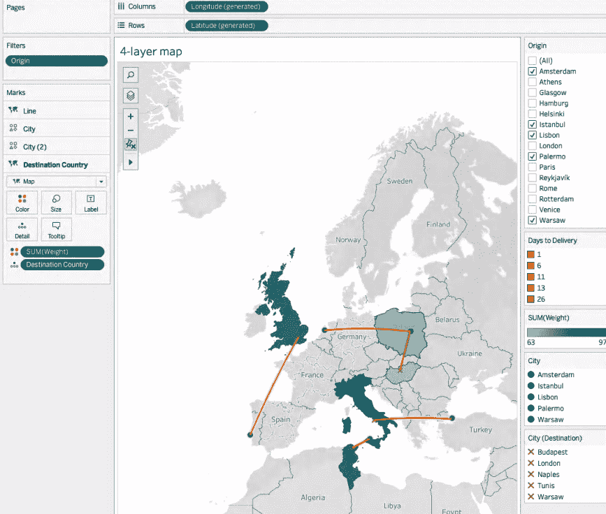

图 9.41: 最终分层地图

现在，让我们看看我们创建了什么。我们可以看到货物正从每个圆圈运输到十字城市。两座城市都由黄色到红色范围着色的线条连接。黄色调越多，表示送货越快；红色调越多，表示送货时间越长。目的地国家以青绿色到深蓝色范围着色。颜色越深，运送到那里的重量越大。我们可以轻松发现，意大利接收了最重的运输，来自伊斯坦布尔并在 6 天内送达。最慢的运输是从布达佩斯到华沙，花费了 26 天。

希望这个练习向你展示了分层地图的优势。每个图层允许你以其独特的方式使用 颜色、形状、大小、标签 和其他 标记，为你的分析开辟新路径。在下一节中，我们将进一步探讨，并将在 Tableau 中将外部技术用于地图。

## 使用另一项技术扩展 Tableau 映射

接下来，我们将考虑如何使用其他工具扩展 Tableau 的映射功能。Tableau 的开发者在创建一个易于扩展的映射接口时非常谨慎。这种可扩展性的某些领域，例如连接到 Web 地图服务 (WMS) 服务器，可直接从界面使用；我们将在下一部分探讨。

### 将自定义地图与 WMS 一起使用

将自定义地图引入 Tableau 的最简单方法是直接从 桌面版。我们需要一个指向 WMS 服务器的格式正确的 URL。Tableau Desktop 可以连接到任何支持 WMS 1.0.0、1.1.0 或 1.1.1 标准的 WMS 服务器。

查找此类 URL 列表的好地方是在线目录，它们提供来自世界各地数百种不同地图服务的信息。许多政府机构、航天机构和环境组织提供免费 WMS 服务。

你为什么想要使用 WMS 地图？

假设你拥有一家在线商店。你可以查看特定产品的销售额在某些地区是否更高——例如，雨天地区的雨伞或炎热地区的防晒产品。通过添加天气 WMS 图层，你可以查看当地条件与销售额之间是否存在相关性。或者，也许你需要监控仓库附近的山火风险，或追踪航运路线上的海冰。WMS 地图将这种上下文相关的现实世界数据直接带入你的 Tableau 仪表板。

### 选择 WMS URL 时应关注什么：

- **可靠性**：该服务是否由稳定的组织（政府、大学、航天机构）托管？
- **更新频率**：数据是实时更新、每日更新，还是静态历史图层？
- **地理覆盖范围**：该服务是否覆盖你感兴趣的区域（全球、区域、本地）？
- **图像格式**：服务器是否返回 PNG 或 JPEG 等标准格式？
- **许可证**：该服务是否免费用于商业用途，或仅用于教育/个人用途？

以下练习灵感来自 Jeffrey A. Shaffer 的文章《在不到 1 分钟内在 Tableau 中构建天气雷达》，可在此处访问：https://www.dataplusscience.com/TableauWeatherRadar.html。但是，我们将包含一个不同的地图，我们的来源是 NASA Earth Observation 数据（https://neo.gsfc.nasa.gov/）。在此练习中，我们将看到，通过绘制额外数据（以背景图像形式）放在数据集下方，你将能够为业务做出更好的决策。例如，如果你的销售额取决于良好（或不良）天气，或者你的生产面临附近山火风险，你将能够在一个 Tableau 仪表板中查看所有这些情况：

### 一般连接步骤：

- 1. 从选定的提供商处复制 WMS URL
- 2. 在 Tableau 中，导航到 Map | Background Maps | Add WMS Map（或较新版本中的 Map Services）
- 3. 粘贴 URL 并单击 OK


+   4. 连接后，您可能需要从可用选项中选择要显示的图层
+   5. 使用“地图 | 背景图层”菜单调整地图不透明度，以便您的数据可视化始终清晰显示在上方

> **注意**
> 在继续之前，关于瓦片和缩放，有个说明。由于高分辨率地图可能有许多千兆字节，要求您下载整个地图只是为了放大某个小区域是不切实际的。瓦片通过启用多个缩放级别来解决这个问题。缩放级别 0 会生成一个单个瓦片（通常是 256 x 256 像素的 PNG 图像），显示整个地图。随着缩放级别的增加，地图瓦片的数量会呈指数增长。同样，显示的地图部分会按比例缩小；也就是说，随着缩放级别的增加，显示的整个地图区域会减少，而填充显示所需的瓦片总数保持不变。这有助于控制任何给定时间下载的数据量。

接下来，我们将探索 Mapbox。

## 探索 Mapbox

Mapbox 提供自定义地图，并与 Tableau 原生集成。要了解如何构建自己的自定义地图，可以访问其网站：https://www.mapbox.com/。从 Tableau 2019.3 开始，多种 Mapbox 样式甚至默认可用。

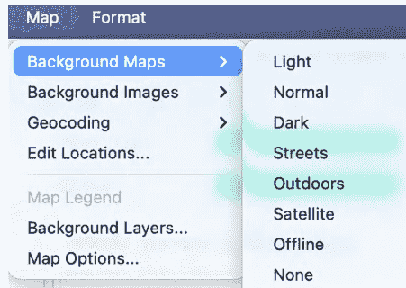

图 9.4.2：背景地图

除此之外，Mapbox 本身提供一项扩展映射服务，配有配套 Web 应用程序，使用户能够自定义地图。这种可定制性涵盖字体、颜色、背景图片等。Mapbox 提供基本免费服务，但当然，更多地图和更大带宽需求将需要支付相应费用的升级。

本练习将向您展示如何连接到 Mapbox：

+   1. 导航至 https://www.mapbox.com 并创建帐户。

+   2. 完成注册并登录 Mapbox 后，单击 Studio 链接。

+   3. 单击“新建样式”开始创建地图。我选择了“单色 | 深色 | 自定义单色”。

+   4. Mapbox 编辑器应会打开。根据您的需求调整地图。

+   5. 完成后，单击右上角的“共享”。选择“第三方 | Tableau”并复制 URL。


图 9.4.3：Mapbox 集成

+   6. 在本章关联的工作簿中，导航至 Mapbox Classic 工作表，并选择“地图 | 背景地图 | 添加 Mapbox 地图”。

+   7. 添加样式名称（我使用了 MasteringTableau）并复制 URL。单击确定。

+   8. 选择 Superstore 数据源，双击“州”，并通过“地图 | 背景地图 | MasteringTableau”路径选择 MasteringTableau 地图样式。

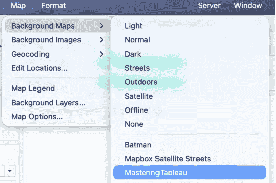

图 9.4.4：背景地图

由此可见，Tableau 使用了我们之前在 Mapbox 中创建的地图。太棒了！这意味着您可以按照喜好自定义地图。

有关如何创建自定义地图以及您需要知道的关于 Mapbox 的所有内容的手册，可以在此处找到：https://docs.mapbox.com/studio-manual/guides/。

## 交换地图

我们将创建一个仪表板，允许最终用户在我们刚刚讨论的各种地图之间进行选择。本练习使用的技术称为工作表交换。不过，对该技术的深入探讨将在第 11 章“设计仪表板和可视化最佳实践”中介绍。

让我们来看看必要的步骤：

+   1. 导航到本章关联的工作簿中的 MapSwap 工作表。双击“州”。将“标记”卡视图设置为地图，单击“颜色”，将不透明度设置为 0%，最后，将边框设置为“自动”。
+   2. 复制 MapSwap 工作表两次。
+   3. 选择 MapSwap 工作表，导航至“地图 | 背景地图 | 正常”。
+   4. 选择 MapSwap (2) 工作表，导航至“地图 | 背景地图 | 深色”。
+   5. 选择 MapSwap (3) 工作表，导航至“地图 | 背景地图 | 卫星”。

+   6. 创建一个名为 Show Sheet 的参数，如下所示：

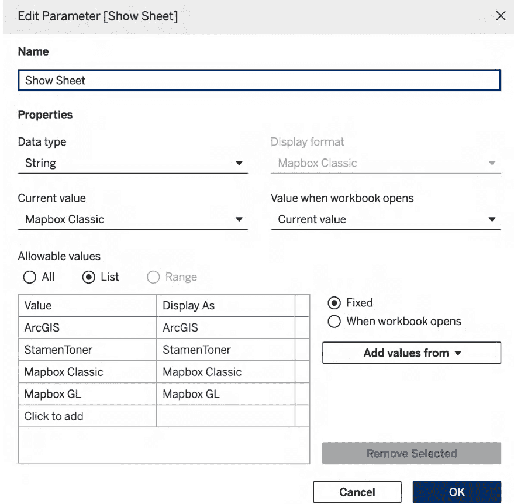

图 9.4.5：参数

+   7. 在 **数据** 窗格中右键单击该参数，并选择 **显示参数控件**。

+   8. 创建一个名为 Show Sheet Filter 的计算字段，如下所示：

```
[Show Sheet]
```

+   9. 选择 MapSwap 工作表，并将 **Show Sheet Filter** 放置在 **筛选器** 书架上。选择 **从列表中选择** 和 **正常**。

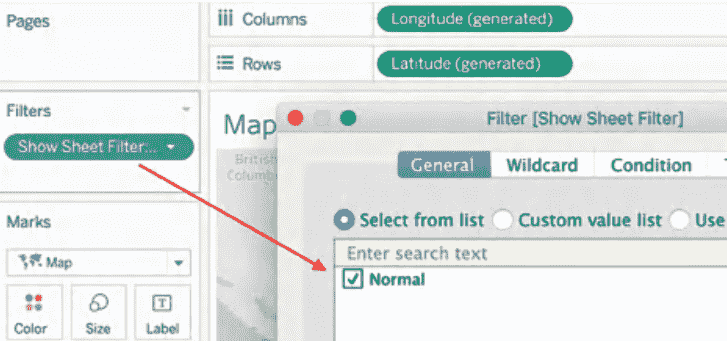

图 9.4.6：工作表筛选器

+   10. 选择 **MapSwap (2)** 工作表，并将 **Show Sheet Filter** 放置在 **筛选器** 书架上。这次，选择 **自定义值列表** 并键入 Dark。

+   11. 在 **MapSwap (3)** 工作表上重复上一步，并键入 **Satellite** 代替 Dark。

+   12. 创建一个仪表板并将其命名为 **db_MapSwap**。在仪表板上放置一个垂直容器。

+   13. 将所有三个 **MapSwap** 工作表放置在垂直容器中并隐藏其标题。

+   14. 选择不同的地图样式，看看您的地图如何变化。

您可能在自己的计算机上见过深色/浅色或日/夜背景功能，或者在 **YouTube** 等网站或 **PyCharm** 等 IDE 上见过。通过 **MapSwap** 功能，您现在可以在 Tableau 仪表板上为用户提供同样的便利。

## 自定义地理编码

在结束本章之前，我想分享几周前在 LinkedIn 上看到的一个快速技巧。描述以下练习的帖子来自 Klaus Schulte，一位德国教授和 2018 年 Iron Viz 冠军。

他分享说，他使用自定义地理编码构建了一个网格地图。让我们尝试复制它！

从某处下载六边形地图数据，或自行创建。对于本练习，您可以使用我 Tableau Public 或 GitHub 上的六边形地图数据：https://github.com/PacktPublishing/Mastering-Tableau-2026/tree/main/Chapter09。如果您想自行创建，请回顾第 8 章“超越基础”中的多边形练习。您可以以我们创建书籍多边形的同样方式创建该文件：

+   1. 将 hexmap 文件放在 Tableau 存储库的 Mapsources 文件夹中。

+   2. 将 Tableau Desktop 连接到默认的 Superstore 数据。

+   3. 双击“州/省”。

+   4. 在 **数据** 窗格中单击“州/省”，并选择“地理角色 | Hexmap.xlsx”。

+   5. 单击“地图 | 背景图层”，并将“淡化 (%)”设置为 100%。

为什么要这么做？因为网格地图会均匀分布州。如果没有它，您将无法区分近距离的州，并且会漏掉一些遥远的州。

谢谢 Klaus 提供这个绝妙技巧！顺便说一句，六边形地图不仅适用于美国。也可以尝试欧洲、非洲、南美洲或亚太地区（APAC）！每当您处理大小差异时，网格地图都非常有用。

## 跟随练习仪表板

在本跟随练习中，我们将使用来自 opentransportdata.swiss 的官方瑞士 GTFS 时间表数据。

废话不多说，让我们按照步骤开始吧：

+   1. 转到“数据”，并搜索 Timetable 2026 (GTFS2020)。

+   2. 下载任意日期的 ZIP 文件；我使用的是 2026 年 3 月 18 日的文件。

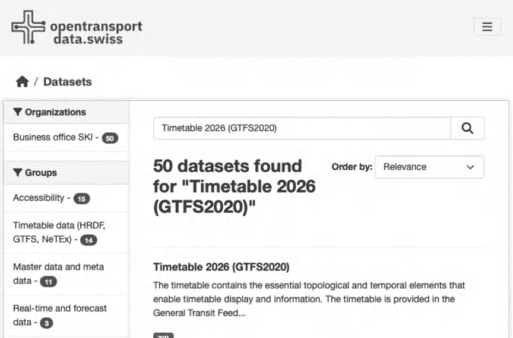

图 9.4.7：OpenTransport 数据

ZIP 包含多个 CSV 文件。每个文件的用途如下：

| 文件 | 用途 | 关键字段 |
|---|---|---|
| stops.txt | 所有火车站点位置 | stop_id, stop_name, stop_lat, stop_lon |
| routes.txt | 交通线路 | route_id, route_short_name, route_type |
| trips.txt | 每条路线的单独行程 | trip_id, route_id |
| stop_times.txt | 每个行程到达每个站点的时间 | trip_id, stop_id, arrival_time, departure_time, stop_sequence |
| calendar.txt | 每个行程运行的日期 | service_id, Monday, Tuesday, 等等 |
| calendar_dates.txt | 异常（假期、特殊服务） | service_id, date, exception_type |
| frequencies.txt | 基于频率的服务（如果使用） | trip_id, start_time, end_time, headway_secs |
| transfers.txt | 站点之间的换乘时间 | from_stop_id, to_stop_id, transfer_type |
| agency.txt | 运输公司 | agency_name, agency_url |
| feed_info.txt | 关于馈送的元数据 | feed_publisher_name, feed_version |

表 9.1：CSV 文件


| 左表 | 右表 | 关系 |
| --- | --- | --- |
| stops | stop_times | 原始停靠站 ID = 停靠站 ID |
| stop_times | trips | 行程 ID = 行程 ID |
| trips | routes | 路线 ID = 路线 ID |

表 9.2: 文件及其关系

为了获得更好的性能，现在可以在数据源页面上创建提取。

- 3. 使用相应的关系连接以下四个文件：

- 4. 创建名为 Trips per Stop 的计算字段：

```
{ FIXED [Stop Name] : COUNTD([Trip Id]) }
```

- 5. 创建名为 Hour of Day 的计算字段：

```
DATEPART('hour', DATETIME([Departure Time]))
```

- 6. 创建名为 Station Popularity Map 的新工作表：

- 7. 将 Stop Lon 拖到 Columns。

- 8. 将 Stop Lat 拖到 Rows。

- 9. 将 Stop Id 拖到 Detail 标记卡，并将标记类型更改为 Line。

- 10. 将 Stop Sequence 拖到 Path 标记卡，右键单击并选择 Dimension（而非 Measure）。

- 11. 在 Columns 上复制 Stop Lon 字段（按住 Ctrl 并向右拖动）。

- 12. 右键单击第二个 Stop Lon 标记卡，选择 Dual Axis。现在 Marks 标记卡中将有两个图层。

- 13. 在底层图层上，将标记类型更改为 Circle。

- 14. 在该图层上，将 SUM(Trips per Stop) 拖到 Size。

- 15. 创建名为 Busy Stop Label 的计算字段：

```
IF [Trips per Stop] > 1000 THEN [stop_name] END
```

- 16. 将此字段拖到同一图层的 Color：

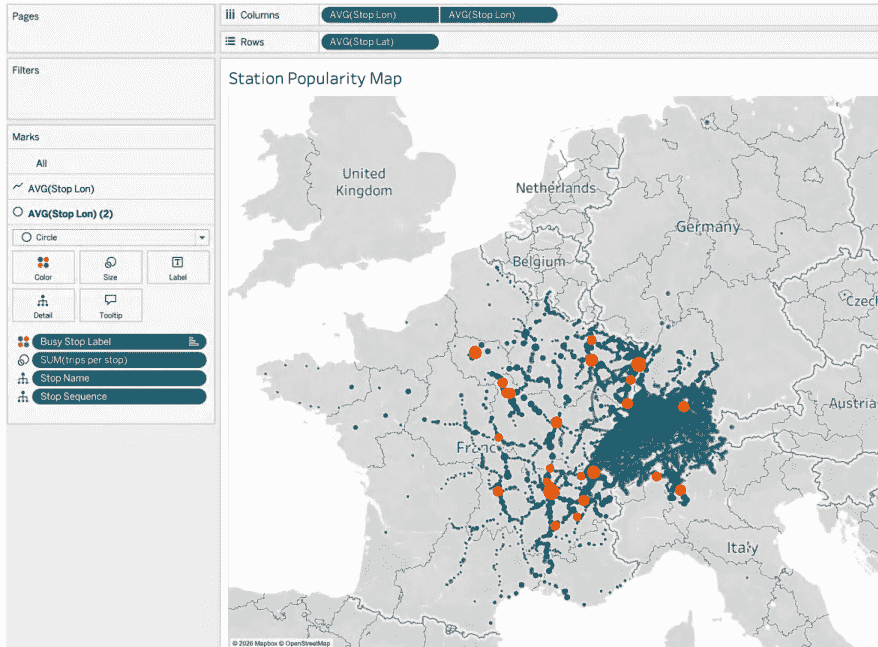

图 9.48: 站点热门度地图

- 17. 创建名为 **按小时划分的服务频率** 的新工作表。

- 18. 将 **一天中的小时** 拖到 Columns。

- 19. 将 **路线简称** 拖到 Rows。

- 20. 将 **CNTD(Trip Id)** 拖到 Color。

- 21. 将标记类型更改为 Square。

- 22. 在 7:00 和 17:00 添加参考线。

这样使用户更容易区分早晨、晚上以及两者之间的时间：

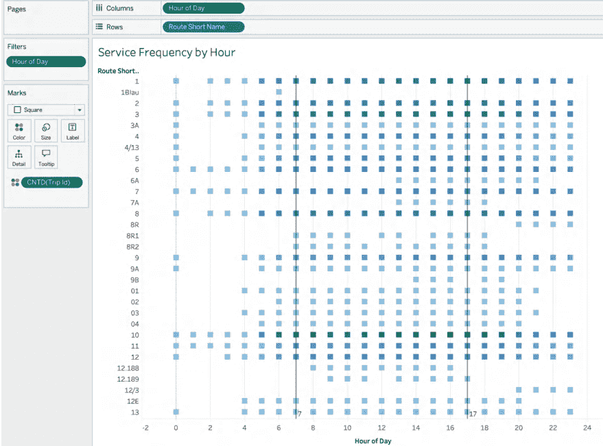

图 9.49: 服务频率

- 23. 创建名为 **最繁忙的车站** 的新工作表。

- 24. 将 **站点名称** 拖到 Rows。

- 25. 将 **CNTD(Trip Id)** 拖到 Columns。

- 26. 降序排序。

- 27. 将 Route Type 拖到 Color。

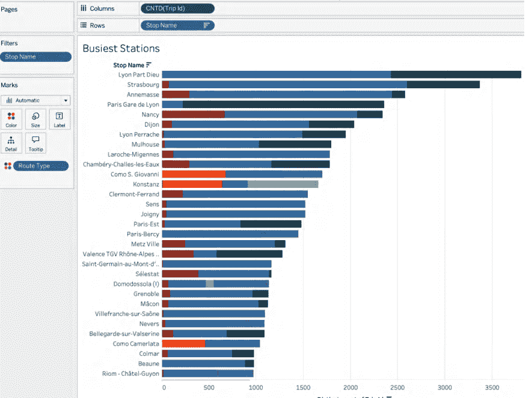

图 9.50: 最繁忙的车站

- 28. 创建名为 Timetable Explorer 的新仪表板
  - 左侧放置：站点热门度地图。
  - 右侧放置：按小时划分的服务频率（顶部）和最繁忙的车站（底部）。

### 时刻表探索器

### 站点热门度地图

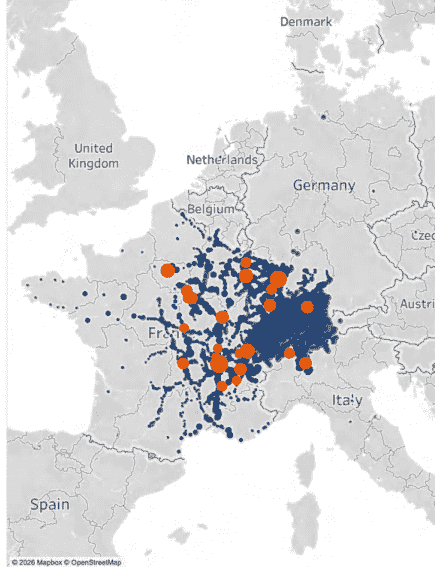

### 按小时划分的服务频率

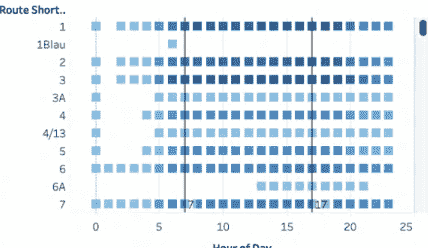

### 最繁忙的车站

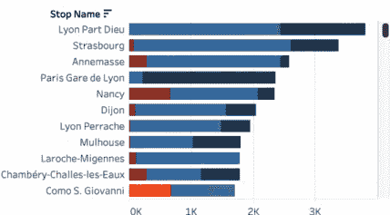

图 9.51: 时刻表探索器

该仪表板有助于了解三个核心方面

在 **站点热门度地图** 中，所有火车站均按停靠列车数量调整大小（最繁忙的车站显示为大圆）。这可以识别关键交通枢纽，并揭示瑞士及邻国的网络密度模式。

在 **按小时划分的服务频率** 中，我们显示一个热图，指示哪些路线在一天中的哪些时段运行。这有助于规划行程，显示高峰与非高峰服务，并揭示仅在高峰时段运行的路线。

最后，**最繁忙的车站** 工作表包含按列车频率排名的顶部车站条形图。这是网络中最重要节点的快速参考。

## 摘要

本章探讨了如何在不离开界面的情况下扩展 Tableau 的映射功能，通过捕获 Tableau 生成的纬度和经度数据，并学习如何在 Google 上查询这些数据。我们根据 .shp 文件为得克萨斯州创建了多边形和热图，以及一个带有双地图轴的仪表板和另一个带有 4 个地图图层的仪表板。接下来，我们探讨了使用其他技术扩展 Tableau 映射的各种方式。我们连接到 WMS 服务器，然后探索了 Mapbox 产品，随后深入了解了多边形的世界。

在下一章中，我们将探讨使用 Tableau 进行演示。具体来说，我们将了解如何从 Tableau 中获取最佳图像、如何有效高效地将 Tableau 与 PowerPoint 结合使用，以及如何直接使用 Tableau 进行演示而不依赖第三方工具。

## 获取本书 PDF 版本及更多内容

扫描二维码（或访问 packtpub.com/unlock），按名称搜索本书，确认版本，然后按照页面上的步骤操作。


立即解锁

注意：请随时准备好发票。直接从 Packt 购买无需发票。

## 10
