# 设计仪表板与可视化最佳实践

本章将深入探讨数据可视化的基本原则和最佳实践，重点关注仪表板设计。通过探索如何以视觉上引人入胜且信息丰富的方式呈现数据，您将获得知识并学习技术，从而帮助创建有影响力的仪表板，有效地传达洞察、推动决策并吸引受众。本章受到一些数据可视化领域巨著的影响：_功能艺术_ by Alberto Cairo，_信息仪表板设计_ by Stephen Few，_仪表板大全_ by Steve Wexler、Jeffrey Shaffer 和 Andy Cotgreave，_设计通则_ by William Lidwell、Kritina Holden 和 Jill Butler，_数据故事_ by Nancy Duarte，以及 _定量信息的视觉呈现_ by Edward Tufte。

本章将涵盖以下主题：

- 可视化设计理论
- 格式规则
- 颜色规则
- 可视化类型规则
- 保持可视化简洁
- 仪表板设计
- 仪表板最佳实践
- 额外内容

在定义了本章主题后，让我们深入探讨设计理论，这将为您提供可应用于构建的每个仪表板的规则。

## 可视化设计理论

您的可视化思考过程应始终从最基础的设计层面入手。换句话说，我们将首先讨论仪表板上显示的工作表，并确保这些工作表设计良好。

因此，我们的讨论将从考虑可视化设计原则开始，例如以下集合，该集合灵感来源于 7 条设计原则：

- 强调最重要的内容
- 放大重要数据点
- 通过适当使用颜色、大小和纹理来对齐和平衡元素
- 使用对比来突出元素或组
- 将颜色或字体的使用限制在三种以内，以提升品牌识别度并保持控制
- 使用人类友好的比例，如黄金分割
- 使用户视线沿 Z 形移动
- 使用线条表示基准或阈值
- 使用空白来组织和结构化

您可以在此处了解更多信息：https://www.turing.com/kb/what-are-the-7-principles-of-design-detailed-breakdown

在下一节中，我们将考虑各种规则，同时牢记一旦您熟悉基础知识，规则可以为了特定目的而打破。

## 格式规则

本节将探讨的格式规则涵盖字体、线条和带区。字体显然是格式考虑的一个显著方面。然而，线条和带区可能不是您通常会使用的内容——但在 Tableau 中，线条和带区当然应予考虑。这表明数据可视化与平面设计密切相关，线条和带区在其中的作用远大于例如 Excel 中的作用，而且格式考虑的内容远不止文本布局。

让我们来看看这些规则。

## 保持字体选择简洁

通常，在仪表板上使用一两种字体是可取的。更多字体会造成混乱环境并干扰可读性。

标题字体应粗壮实在，而正文字体应易于阅读。在 Tableau 中，选择合适的字体很简单：选择 Format | Font 以显示 Format Font 窗口，查看并选择您喜欢的字体。

Tableau 字体始终可靠，例如 Tableau Bold、Tableau Book、Tableau Medium、Tableau Light 等等。对于特殊场合，我喜欢使用 Corbel 或尝试新字体。


## 按可见性顺序使用线条

我们倾向于按以下顺序排列线条可见性：趋势线、图表线、参考线、放线和网格线。例如，趋势线可见性应大于参考线可见性。可见性通常通过增加线条粗细来增强，但也可以通过色彩饱和度或选择点线/虚线而非实线来增强。让我们按可见性递减的顺序来看看每种线条类型：

- **趋势线**：如果存在，趋势线通常是图表上最显眼的线条。趋势线通过 **Analytics** 窗格显示，并可通过 **Format | Lines** 进行调整。在处理包含大量数据点且随时间波动较大的时间序列时，这非常有用。使用趋势线来显示整体方向（随时间增加/减少），从而使用户更容易处理信息。

- **图表线**：图表线（例如时间序列图中使用的线条）不应过粗以至于遮蔽数据中的起伏变化。虽然可以通过使用 Pages 书架将图表线显示为点线或虚线，但这通常不宜，因为它可能会遮蔽可见性。图表线的粗细可以通过在 Marks 卡区域单击 Size 书架来调整。这条线代表折线图的实际线条。

- **参考线**：通常不如趋势线常见，可通过 **Format | Reference lines** 进行格式设置。

它们最适合用于显示一条直线，以表示，例如，仪表板视图中至少一个维度内静态的阈值。

- **放线**：不常用。要使用放线，在视图的空白部分右键单击并选择 **Drop lines | Show drop lines**。接着，在视图中单击一个点以显示放线。要设置放线格式，请选择 **Format | Drop Lines**。仅当可视化中使用至少一个轴时，放线才相关。

我们使用这些来标记从图表上的某个点到轴的线。它可以帮助您识别与该数据点关联的特定值。

- **零线**：有时也称为基准线，仅当视图中包含零或负值，或正数值相对接近零时才显示。通过 **Format | Lines** 设置零线格式。

如果您对默认零线不满意，可以对其进行格式设置。您可以将其更改为断线或不同颜色。它可以帮助区分正值开始和负值结束的位置（反之亦然）。

- **网格线**：这些应是视图中最不显眼的线条，甚至可以完全省略。通过 **Format | Lines** 设置网格线格式。

网格线有助于眼睛识别与轴距离较远的数据点数值。使用它们来帮助用户更好地理解可视化中的数值。

现在让我们看看第二条规则。

## 以三到五个为一组使用带状区域

由文本高表或水平条形图组成的可视化应将维度成员分为每组三到五个。

请按以下步骤操作，体验在 Tableau 中高效使用带状区域：

1. 导航至 https://github.com/PacktPublishing/Mastering-Tableau-2026/tree/main/Chapter10 以定位并下载本章相关的工作簿
2. 导航至 Banding 工作表
3. 选择 Superstore 数据源并将 Product Name 放置在 Rows 书架上
4. 双击 Discount、Profit、Quantity 和 Sales。请注意，完成此步骤后，Tableau 默认对每隔一行进行带状区域设置。此默认格式对于短表来说没问题，但对于高表来说相当繁琐，并且在处理大型数据集时可能会导致性能问题。
5. 导航至 Format | Shading 并在 Row Banding 下设置 Band Size，使每个带状区域涵盖三到五行文本。请务必为 Pane 和 Header 设置适当的颜色：

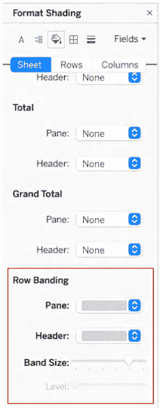

图 10.1: 设置阴影格式

“以三到五个为一组使用带状区域”规则受到 Dona W. Wong 的影响，她在其著作 _The Wall Street Journal Guide to Information Graphics_ 中推荐使用细线分隔长表或条形图，将条形分为三到五个一组，以帮助读者横向阅读。

## 颜色规则

在一本将以黑白印刷的书籍中讨论颜色规则似乎略有讽刺意味（如需下载彩色图片，请参阅：https://packt.lnk/gb/9781806100712。当然，如果您在电子设备上阅读本书，情况可能并非如此）。尽管如此，即使在单色环境中，讨论颜色也是相关的。例如，仅使用黑色文本传达的含义与使用灰色渐变不同。以下颜色规则列表应有助于确保您在各种环境中有效地使用颜色。

### 保持颜色简单且有限

坚持使用基本色相，仅提供少量（也许三到五个）色相变体。在其著作 _The Functional Art: An Introduction to Information Graphics and Visualization_ 中，Alberto Cairo 解释了为什么这很重要：

> _我们的视觉工作记忆容量有限，这有助于解释为什么在地图和图表上使用超过四或五种颜色或图形符号来标识不同现象是不明智的。_

### 尊重颜色的心理暗示

世界各地都存在一种无处不在、已成为本能的颜色词汇。红色常用于表示爱或危险；在一些亚洲国家，它也可以表示财富，且常用于婚纱。绿色可以表示好运，而在墨西哥，绿色代表独立。绿色交通信号灯告诉我们可以通行，红色表示停止。同样，仪表板上的颜色通常也是有目的地使用的。红色和橙色通常与负面表现相关联，而蓝色和绿色则与正面表现相关联。违背直觉地使用颜色可能会引起混淆，因此请注意颜色使用情况以及您的受众及其解读。

### 兼顾色盲友好性

一次快速的 Google 搜索告诉我，"_全球估计有 3 亿人存在色觉缺陷。每 12 名男性中有 1 人、每 200 名女性中有 1 人色盲。_" 因此，在您的职业生涯中，很可能会在某个时候面向包含色盲或色觉缺陷人员的受众进行演示。色盲通常表现为无法区分红色和绿色，或蓝色和黄色。红色/绿色和蓝色/黄色位于色轮的相对两侧。

因此，这些颜色组合对色盲人士带来的挑战可以使用 Photoshop 等图像编辑软件轻松重现。如果您不是色盲，请将包含这些颜色组合的图像转换为灰度并观察。对 8.0% 的男性和 0.5% 的女性（即色盲人群）来说，挑战立刻变得显而易见！或者，使用以下网站上传仪表板图像，体验您的用户可能看到的颜色效果：https://www.color-blindness.com/coblis-color-blindness-simulator/。

## 审慎使用纯色

以下练习产生的颜色应该是非常鲜艳的红色、绿色和蓝色。取决于显示器，您可能甚至发现难以直视这些颜色。这些被称为纯色，应审慎使用，也许仅用于突出显示特别重要的项目或警报，例如，超出阈值的情况。

请执行以下步骤：

1. 打开与本章相关的工作簿并导航至 Pure Colors 工作表
2. 选择 Superstore 数据源并将 Category 同时放置在 Rows 书架和 Color 书架上
3. 设置 Fit to Entire View
4. 单击 Color 书架并选择 Edit Colors...
5. 在 Edit Colors 对话框中，依次选择各个成员——即 Furniture、Office Supplies 和 Technology，并分别选择蓝色、绿色和红色：

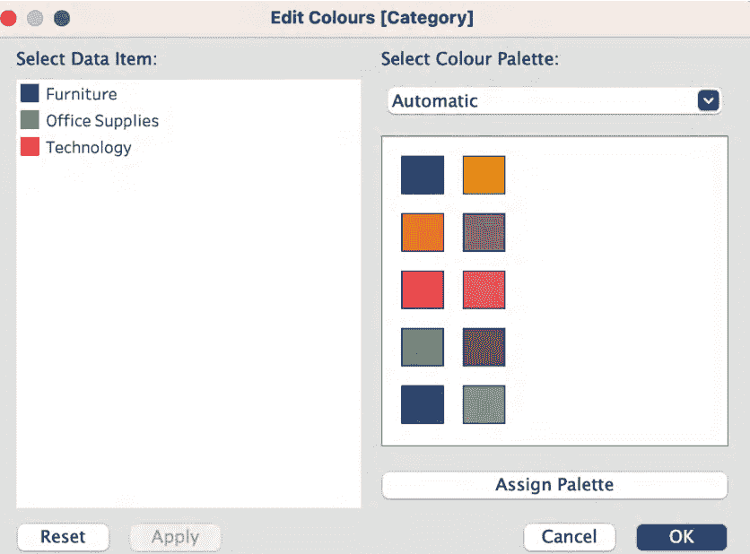

图 10.2: 颜色


亲身体验一下观看那些纯色的感觉，并选择另外三种不那么鲜艳的颜色进行比较。过于鲜艳的颜色会让你的眼睛感到非常疲劳，难以集中注意力。然而，过于相似的颜色又难以区分。找到良好的平衡是关键。

## 选择颜色变化而非符号变化

对于最终用户来说，辨认不同的符号比区分颜色耗费更多的脑力。因此，应优先使用颜色变化而非符号变化。

请参阅以下散点图，了解符号变化的示例：

### 符号

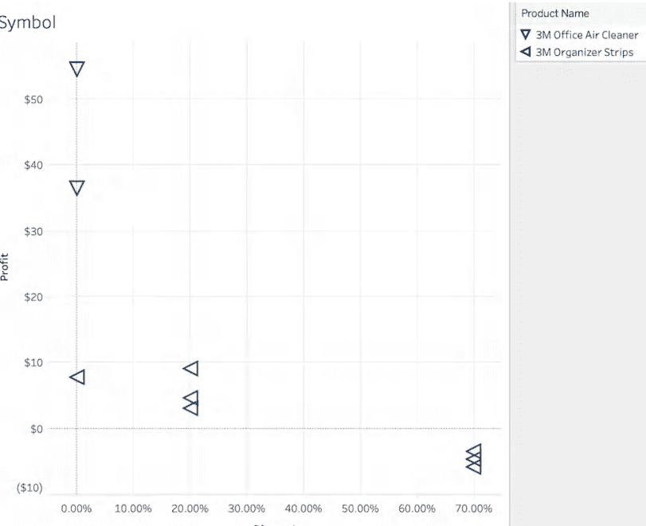

图 10.3：符号变化

请参阅颜色变化的相同示例：

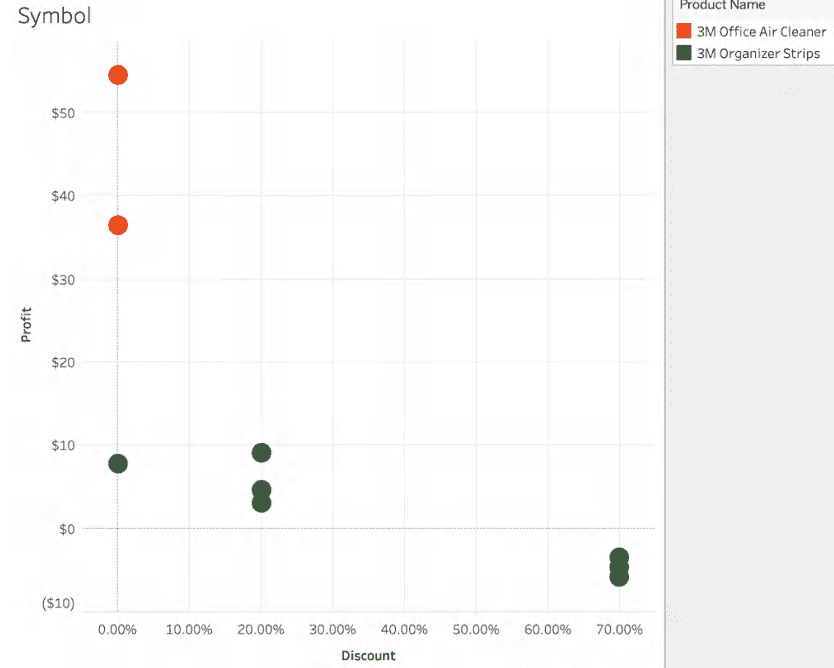

图 10.4：颜色变化

总结颜色规则：保持调色板简洁，并注意地区和文化中的颜色含义。另外，请考虑你的受众中可能有人患有色觉缺陷；工具可以帮助你明智地选择颜色，Tableau 还提供了色盲调色板。谨慎使用纯色，因为过多鲜艳的颜色会让受众难以关注重要项目。最后，不要在一个视图中使用太多形状；相反，应使用颜色来区分类别。

## 可视化类型规则

本节内容足以单独成书，并与讲故事、沟通和说服等多个学科相互关联；因此，我们不会在此花时间深入探讨冗长的可视化类型规则列表，而是重点介绍几个经常被讨论的规则。我们将考虑保持简单形状与复杂形状，以及饼图的有效使用。

### 保持形状简单

过多的形状细节会阻碍理解。这是因为形状细节会分散用户对数据的注意力。请考虑使用两张不同购物车图片进行的以下练习。

让我们来看以下练习步骤：

- 1. 打开与此章关联的工作簿并导航到“简单购物车”工作表。请注意，该可视化是一个散点图，显示按总销售额和利润计算的前 10 个畅销子类别。
- 2. 导航到 My Tableau 仓库中位于 Shapes 目录的位置。在我电脑上，路径为 C:\Users\Marleen Meier\Documents\My Tableau Repository\Shapes。在你的机器上找到相应的 Tableau 仓库并打开 Shapes 目录
- 3. 在 Shapes 目录中，创建一个名为 My Shapes 的文件夹
- 4. 参考工作表评论部分中包含的链接以下载与此章相关的资源。在下载的材料中，找到标题为 Shopping_Cart 和 Shopping_Cart_3D 的图片，然后将这些图片复制到 My Shapes 目录中。
- 5. 在 Tableau 中，访问“简单购物车”工作表
- 6. 单击“形状”搁架，然后选择“更多形状”
- 7. 在“编辑形状”对话框中，单击“重新加载形状”按钮：

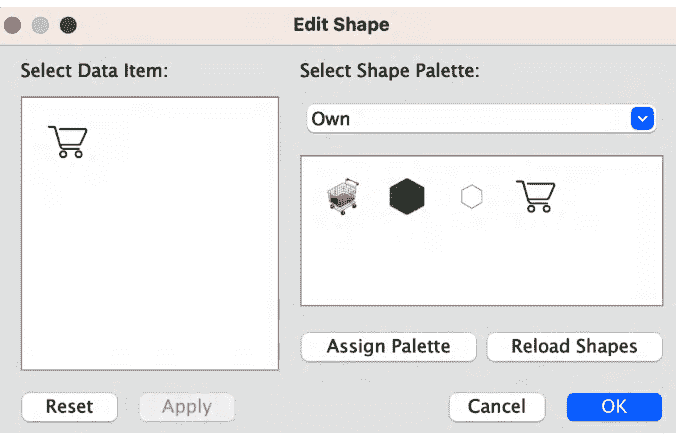

图 10.5：重新加载形状

- 8. 选择 **我的形状** 调色板并将形状设置为 Shopping_Cart
- 9. 关闭对话框后，单击 **大小** 搁架并按需调整。同时，按需调整可视化的其他方面。
- 10. 导航到 3D 购物车工作表，然后重复 _步骤 6–9_
- 11. 不要使用 Shopping_Cart，而要使用 Shopping_Cart_3D。请参阅以下截图，了解简单购物车和 3D 购物车的对比：

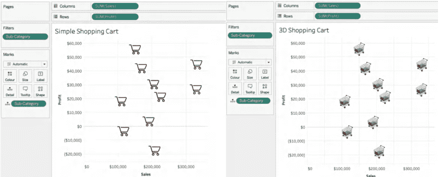

图 10.6：2D 对比 3D

比较这两个可视化。哪个版本的购物车更具吸引力？很可能带有 3D 外观的购物车是你的选择。那么，为什么不选择更具吸引力的图片呢？使可视化具有吸引力只是次要考虑。首要目标是尽可能清晰高效地显示数据。简单形状比复杂形状被理解得更快、更直观。此外，3D 图片的可爱感很快就会消失。

### 谨慎使用饼图

爱德华·塔夫特在他的著作_定量信息的视觉呈现_中对使用饼图发表了尖锐的批评，他说表格始终优于饼图，因为人类无法解读饼图的视觉维度。

当前数据可视化圈子的主流情绪大多支持塔夫特的批评。然而，可能存在一些例外，即某些饼图是最佳选择的情况。请考虑以下可视化：

### 堆积气泡

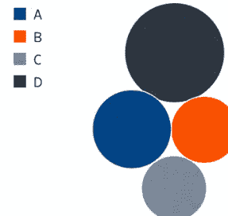

### 树状图


### 饼图

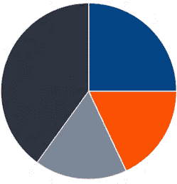

### 条形图


图 10.7：可视化对比

这四个可视化中，哪一个最能说明 A 占整体的 25%？显然，是饼图！因此，也许更公平的说法是将饼图称为有限且应谨慎使用，而非认为它们本质上不可取。

通常，构建可视化是一门平衡艺术。从书籍、博客、顾问甚至组织内部遇到相互矛盾的指导并不罕见。有人可能坚持利用每一个像素空间，而另有人则倡导简洁和留白。有人主张引导式方法，而另有人则建议构建开放式仪表板，让最终用户自行探索路径。

前卫派人士可能渴望晦涩的可视化，而更保守的人则倾向于遵循惯例。让我们探讨几种常见的相互竞争的需求，然后提出折中方案。

### 使仪表板既简单又稳健

奥卡姆剃刀原则表明，解决任何问题的最简单方案通常是正确的。然而，有时候，即使是最简单的方案也相当复杂。这没关系！Tableau 仪表板中的复杂性不必回避。但清晰理解一些基本准则可以帮助作者明智地决定如何在简洁需求与稳健需求之间折中：

- 数据更新越频繁，设计越应简单：某些 Tableau 仪表板可能接近实时。可以使用第三方技术，强制通过 Tableau Server 显示仪表板的浏览器每隔几分钟刷新一次，以确保显示最新数据。在这种情况下，设计应相当简单。最终用户必须能够立即看到所有相关数据，且不应将该仪表板用于深入分析。相反，每月刷新一次的仪表板可以支持高度复杂性，因此可用于深入探索。
- 最终用户越专业，仪表板越可以复杂：了解你的用户。如果他们想要简单、一目了然的可视化，请保持仪表板简单。如果他们喜欢深入探索，请相应地设计。
- 较小的受众需要更精确的设计：如果只有少数人监控某个仪表板，可能需要高度定制的方法。在这种情况下，规格可能非常详细，复杂且难以执行和维护。这是因为小型用户群的期望可能在 Tableau 中并非易于生成。
- 屏幕分辨率与可视化复杂度成正比：使用低分辨率设备的用户需要以简单方式与仪表板交互。因此，此类仪表板的设计可能相应地较为简单。相反，高分辨率设备支持更高的复杂性。
- 距离屏幕越远，仪表板元素需要越大：如果仪表板是为会议室观看设计的，仪表板上的元素可能需要放大，以满足远离屏幕的人员的观看需求。因此，仪表板可能相对简单。相反，主要在最终用户桌面上查看的仪表板可以更复杂。

虽然这些观点都关于简单与复杂，但不要将简单等同于容易。一个设计简洁优雅的仪表板可能比复杂的仪表板更难创建。

正如史蒂夫·乔布斯所说，简单可能比复杂更难；然而，简单可以移山。

### 很好地呈现密集信息

通常，折线图最多应有四到五条线。但是，有时你可能希望显示更多线条。通过呈现多条线条并授予用户按需高亮的权限，可以达成折中方案。以下折线图显示了 2000 年至 2012 年各国的互联网使用百分比。用户可以选择一个国家，该国家将变色，并与其他国家进行对比。


我们可以在以下截图中查看此示例：

## Internet Usage

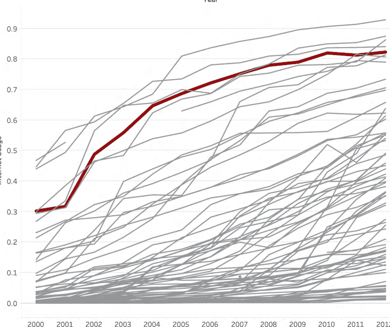

图 10.8: 多折线图

在使用折线图与多折线图时，关键不在于某条线与特定另一条线的表现相比如何，而在于一条线在众多其他线中的表现如何。

## Telling a story

在她的著作《数据叙事》(Data Story) 中，Nancy Duarte 详细解释了使用数据讲述故事的各种技巧，其中许多与前面讨论的可视化设计理论相重叠。我们现在将重点介绍几个新的、专门用于讲故事的方面：

- 探索数据点，以深入到更低的聚合层级。在提示框 (Tooltip) 中进行可视化（请参阅本章“最大化仪表板上的文档”部分），以及操作（Actions）（请参阅本章“仪表板最佳实践”部分），都是实现此目的的好方法。
- 关联你的数据；例如，如果距离、大小、时间或速度难以理解，请将其转换为已知的事物。或者，“如果太阳像足球一样大，月亮像……那么两者之间的距离将从这里到 x。”或者，作为一个非常具体的例子，不要以毫克 (mg) 显示糖的含量，而应将其呈现为方糖的数量，或将其与推荐的每日摄入量相关联。
- 使用修辞手法，通过融入感性词汇、反问句和感叹词，引导读者按照你的观点了解故事。
- 如果你的数据与人类有些关系——而且通常都有——就要使其人性化。与人们交谈并了解问题；然后你可以在仪表板中添加定性信息。注意不要做出假设。

你会发现，讲故事并不像人们想象的那么容易：

> “几乎所有事物都可以计数和衡量。在数据中进行寻宝并发现金色机会的字节，令人兴奋 [...]. 在你的职业生涯中，愿你掌握数据科学，也掌握传播数据的艺术。”

Nancy Duarte – 《数据叙事》

你可以选择使用指令式仪表板设计（即，引导查看者的仪表板）来讲述故事，或者你可以决定构建一个允许发现众多故事的仪表板。你的选择将取决于给定的数据集和受众。如果你选择创建一个故事发现平台，请务必采纳 Grimwade 在 Alberto Cairo 的著作《功能的艺术：信息图表与可视化简介》(The Functional Art: An Introduction to Information Graphics and Visualization) 中建议的《纽约时报》方法：“提供提示、指针和良好的文档，以引导最终用户成功地与你想要讲述的故事进行交互，或者成功地发现他们自己的故事。”

### Maximizing documentation on a dashboard

在“讲述故事”部分，我们考虑了提供提示、指针和良好文档的建议，但存在一个问题。这些东西会占用空间。仪表板空间很宝贵。通常，Tableau 作者被要求在仪表板上塞进越来越多的内容，因此会寻找节省空间的方法。以下是一些在对屏幕空间影响最小的同时最大化仪表板上文档的建议：

- **为清晰沟通设计标题**：标题是预期的。不仅是仪表板和仪表板上工作表的标题，还包括图例、筛选器和其他对象的标题。这些标题可用于有效且高效的文档。例如，筛选器不应仅显示 Market。相反，它应该说类似 Select a Market 的话。注意祈使句。用户被告知要做某事，这是一个有用的提示。在标题中添加几个词通常不会影响仪表板空间。
- **使用副标题传递说明**：副标题会占用一些额外空间，但不必太多。标题下方立即使用的较小斜体字体是用户寻求指导的明显位置。考虑一个示例：红色表示损失。这个短句可以作为副标题，可能消除图例的需求，从而实际节省空间。
- 使用直观图标：考虑从一个仪表板导航到另一个仪表板的用例。当然，你可以将操作与声明其导航到另一个仪表板的超链接文本相关联。但是，当操作可以与一个小巧、不起眼的箭头（例如 PowerPoint 中原生使用的箭头）相关联以传达相同内容时，这似乎是不必要的。
- 将更详细的文档存储在与帮助图标相关联的提示框中：应用程序右上角的一个小问号很常见。目前，我正在 Word 中撰写本章，它有这样的问号。在 Tableau 仪表板中，灯泡图标通常用于相同目的。这清楚地传达了在需要额外帮助时应该去哪里。如下面的练习所示，创建它很容易。

按照以下步骤创建信息性提示框以帮助用户：

1. 打开与此章关联的工作簿并导航到 Help 工作表

2. 将鼠标悬停在工作表上的灯泡上并注意出现的文本：

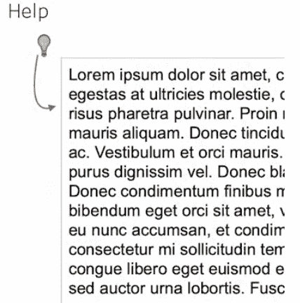

图 10.9: Lorem ipsum

> **注意**
> 注意前面截图中显示的 Lorem ipsum... 文本通常由网页设计师使用，他们从排版工那里借用，排版工几个世纪以来一直使用这种拉丁文本作为占位符。访问 www.loremipsum.io 了解更多信息。

此工作表中的文本是通过 工作表 | 提示框 部署的。此工作表可以被合理地放置在仪表板上（例如，在右上角），以提供非常详细的文档，同时对空间影响最小。

## Visualization types

另一组重要的规则是针对哪种数据类型使用哪种可视化！仅举几个例子：

- 对于偏差数据，使用脊柱图
- 对于相关性，使用散点图或热力图
- 对于时间序列，使用折线图或地震图
- 对于排名，使用条形图、棒棒糖图或排名图
- 对于分布，使用直方图或箱线图
- 对于整体的一部分数据，使用树状图、网格图或瀑布图
- 使用条形图、雷达图或弹丸图来反映数值大小
- 对于空间数据，使用流图、点密度图或热力图
- 对于流，使用桑基图、瀑布图或网络图

此列表远未详尽；如果你想获取关于此主题的更多信息，我强烈建议查看 Andy Kriebel 创建的 Visual Vocabulary，它受《金融时报》(Financial Times) 启发，可在 Tableau Public 上查看：https://public.tableau.com/profile/andy.kriebel#!/vizhome/VisualVocabulary/VisualVocabulary。每个类别包含多个合适的可视化类型；你可以点击给定的类别以查看详细信息：

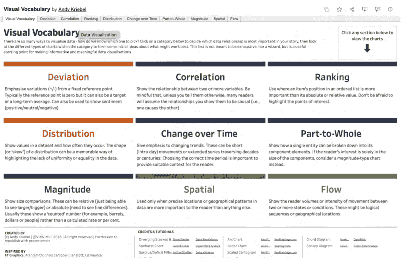

图 10.10: Visual Vocabulary

例如，以下是 Distribution 类别的详细页面：

### Andy Kriebel 的 Visual Vocabulary

### Distribution

显示数据集中的值及其出现频率。分布的形状（或‘偏斜’）可以是突出数据缺乏均匀性或平等性的令人难忘的方式。

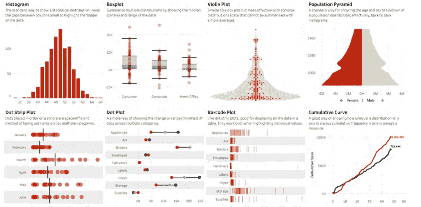

图 10.11: Visual Vocabulary – Distribution

为你的图表选择匹配良好的可视化类型是创建良好仪表板的起点。将花些时间在这个主题上作为优先事项；在大多数项目中，这是一个关键决策。

## Keep visualizations simple

有些人厌倦了反复看到相同的图表类型。这导致诸如“我们能给仪表板增加些趣味吗？”之类的请求。通常，这种情绪应该被抵制。正如本章开头所述，为了多样性而引入多样性是适得其反的。然而，有时不常见的可视化类型可能比更流行的类型更好。那些时候是什么时候？

在以下场景中使用不常见的图表类型：

- 该图表用于吸引最终用户的注意力
- 该图表类型更有效地呈现数据

有时，不常见的图表类型可以有效地用于吸引最终用户的注意力，以实现某些目标，例如幽默、强调要点或使可视化更令人难忘。这样的一个示例可以在 Tableau 404 错误页面上找到。导航到 http://www.tableau.com/asdf 并观察包含泡沫图的 Bigfoot。请注意，此页面会不时更改，因此你可能会看到 Elvis、外星人或其他可视化。


第二点的一个示例是使用树形图代替饼图。两者都是非笛卡尔图表类型（没有字段放置在**行**或**列**书架上的可视化），用于显示整体的各个部分。饼图是两者中更常见的一种，但树形图通常能更好地呈现数据。至少有三个原因：

- 树形图可以表示更多的数据点
- 树形图的矩形特性更高效地适配显示器空间
- 饼图切片的大小比树形图细分区域的大小更难以区分

有时，使用不太常见的可视化类型可能会引发投诉：我喜欢饼图。给我一个饼图！在这种情况下，可能可以达成妥协。本章后面，我们将讨论工作表交换。您将了解到，工作表交换可以允许最终用户确定要查看哪种可视化类型。最终，如果无法达成妥协，而负责您薪水的人希望使用非理想的图表类型……嗯，我建议您照办！

## 仪表板设计

既然我们已经讨论完了可视化理论，现在让我们把注意力转向仪表板设计。我们先从一个问题开始：什么是仪表板？这个问题相当难以回答；然而，许多组织在日常对话中使用它，说明人们对仪表板是什么有一个明确的概念。而且，搜索引擎结果中大量提供定义。但这些定义可能有显著差异，甚至相互矛盾。

为什么定义仪表板如此困难？部分原因是，作为整体的数据可视化，尤其是仪表板设计，是一个新兴领域，结合了许多其他学科。这些学科包括统计分析、平面和网页设计、计算机科学甚至新闻学。一个包含如此多组件的新兴领域是一个移动目标，因此难以定义。

为本节目的，我们将从史蒂芬·福（Stephen Few）的定义开始，该定义首次出现在2004年《智能企业》（*Intelligent Enterprise*）杂志的一期中。他指出，仪表板是实现目标所需的关键统计数据的可视化显示，所有这些细节都呈现在单个屏幕上，以便信息可以在同一位置观察。然后，我们将扩展和调整该定义以适用于 Tableau 仪表板。

虽然这个定义很好，但 Tableau 采用了更广泛的方法。例如，Tableau 仪表板可能位于单个屏幕上，但可以设计成（且非常有效地）需要滚动。更重要的是，Tableau 仪表板通常是交互式的，这为探索、分析和设计选项打开了新天地。因此，让我们尝试制定一个以 Tableau 为中心的仪表板定义：

> Tableau 仪表板是一个包含一个或多个数据可视化的显示，旨在使用户能够快速查看指标。此显示可能提供交互元素，例如筛选、突出显示和下钻功能，以实现进一步的探索和分析。

## 仪表板布局

仪表板布局之所以重要，与杂志折页或网页布局的重要性原因相同。将正确的信息放在正确的位置，可以帮助查看者快速、高效地收集信息并得出结论。

为了认识到这一事实，请回想一下上次您在构建不佳的网页上艰难寻找重要信息的时候。您的时间本可更好地用于实际应用这些重要信息！

## 黄金比例布局

您可能听说过斐波那契数列或黄金比例。因为您上数学课可能已经几年了，简短回顾或许会有所帮助。

斐波那契数列是一系列数字，其中每个数字都是前两个数字之和——例如，1、1、2、3、5、8、13、21。

当矩形的最长边与最短边的比率约为 1.618 时，即形成黄金矩形。这个比率被称为黄金比例。从数学上讲，黄金比例表示如下：

```
\varphi = \frac{1 + \sqrt{5}}{2} = 1.618033988749...
```

当将斐波那契数列中的每个数字除以前一个数字时，可以看到斐波那契数列与黄金比例之间的联系；例如，取以下数列：

```
0, 1, 1, 2, 3, 5, 8, 13, 21, 34
```

这得出以下结果：

```
1/1=1, 2/1=2, 3/2=1.5, 5/3=1.67, 8/5=1.6, 13/8=1.625, 21/13=1.615, 34/21=1.619
```

现在，让我们考虑使用黄金比例的仪表板布局。此处显示的布局由矩形构成，每个矩形的长度或高度是下一个矩形的 1.618 倍。显示螺旋（即黄金螺旋）以演示矩形的顺序：

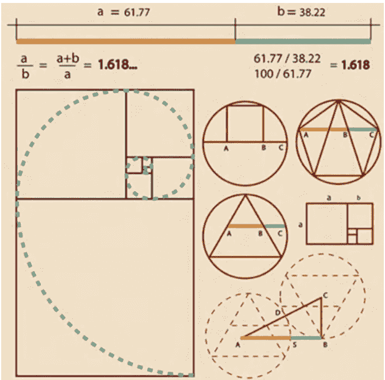

图 10.12：黄金比例（https://www.pixpa.com/blog/golden-ratio）

斐波那契数列/黄金矩形/黄金比例在自然界和历史中屡见不鲜。许多海螺和花卉紧密遵循斐波那契数列。吉萨大金字塔似乎在构建时就考虑了黄金比例。菲迪亚斯很可能使用黄金比例为雅典帕台农神庙设计他的雕像。确实，帕台农神庙本身就是按照黄金矩形比例设计的。即使更近期的研究表明，该比例无法精确复制到小数位，自然和艺术仍然非常接近其背后的数学。

那么，如上图所示的黄金比例是否代表理想的仪表板布局？也许更合适的说法是，这幅图代表一种可接受的仪表板布局。理想布局与其说存在于抽象之中，不如说体现在实际应用中。仪表板布局有时可能逼近黄金比例，但正如我们将看到的，其他仪表板布局可能更适合不同场景。

此处显示的仪表板（也可随本章附带的 Tableau 工作簿获取）使用了黄金矩形：

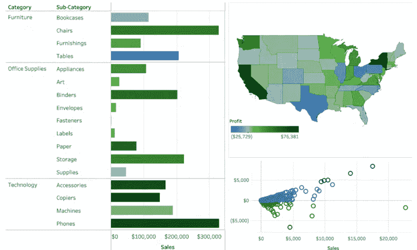

图 10.13：黄金矩形

请注意，此示例不尝试将黄金比例应用到越来越小的矩形中。实际应用存在限制。

黄金矩形布局特别适合引导查看者从粗粒度过渡到细粒度。在此示例中，仪表板左侧显示最粗粒度，即 17 个子类别。其次是地图。最后，散点图显示最细粒度。创建遵循此路径的操作将成为最终用户的自然交互。例如，最终用户可能会先单击**表格**，然后单击宾夕法尼亚州**Pennsylvania**，以观察散点图中的异常值。

## 四象限布局

四象限布局将仪表板划分为四个大致相等的象限。它易于实现。在空白仪表板上，只需在**仪表板**窗格中双击四个工作表即可。结果是四象限布局，不过可能需要进行一些小调整以考虑图例、筛选器和参数。要观察四象限布局，请参阅*图 10.7*中的图表。

## 小倍数布局

小倍数布局在单个仪表板上显示许多视图。与四象限布局一样，小倍数布局可以通过在**仪表板**窗格中双击每个所需工作表来实现。

当反复查看使用相同可视化类型的信息时，小倍数非常有用。此外，保持一致的主题也很有帮助；例如，以下屏幕截图演示了美国各州利润表现的主题。尝试使用多种可视化类型和多种主题创建小倍数布局可能会很混乱且难以交互：

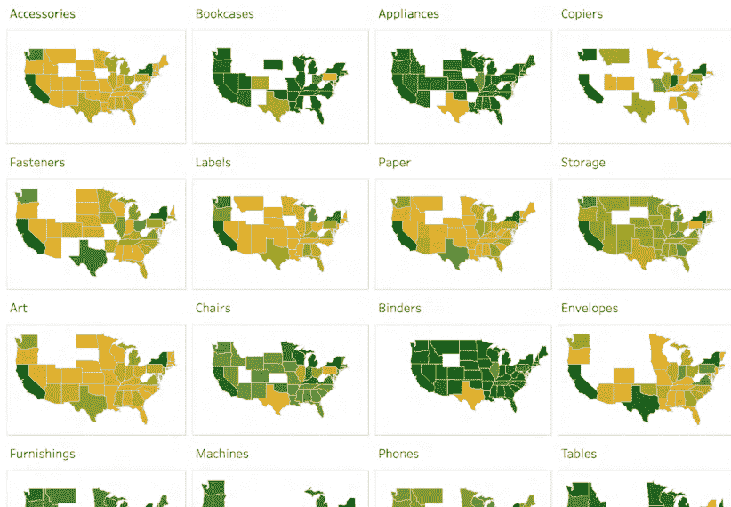

图 10.14：小倍数布局

某些布局本质上是主题的变体。例如，显示三个视图的布局，其中仪表板上的一个视图占用的空间是其他每个视图的两倍，本质上可能是四象限布局的变体。其他布局难以简单分类，且特定于某个仪表板。无论如何，希望这能为您未来设计仪表板提供一些思考。

我们在讨论妥协时已经提到了下一节内容——工作表交换，这是一项用于妥协的绝佳功能。如果利益相关者要求您构建某个您知道可能不够好或不符合可视化最佳实践的东西，您可以始终添加工作表交换，让利益相关者满意，并为其他用户提供替代方案。我们将在下一节中逐步演示工作表交换练习。

## 利用工作表交换

工作表选择，通常称为工作表交换，允许 Tableau 作者隐藏和显示可视化，以及在仪表板上添加或移除工作表。


这些技术已以创造性的方式应用，并取得了非常令人印象深刻的结果。例如，Tableau Zen Master Joshua Milligan 使用工作表选择构建了各种游戏，包括井字游戏和二十一点。出于我们的目的，我们将继续使用工作表选择来辅助创建遵循我们讨论过的设计原则的仪表板。

在“谨慎使用饼图”部分，我们讨论了饼图和树形图，并指出树形图是更好的可视化。然而，人们通常更习惯于使用饼图。作为一种折中方案，在第一个练习中，我们将回顾一个示例，该示例允许最终用户选择查看饼图还是树形图。

请按照以下步骤操作：

- 1. 打开与本章关联的工作簿并导航至 Population Pie 工作表
- 2. 选择 World Indicators 数据源，并注意名为 Blank 的计算字段。代码由两个单引号组成，中间有一个空格。
- 3. 将 Blank 放在 Columns 架上
- 4. 在视图中，通过 Ctrl + A 或在整个饼图周围拖动选择框来选择所有饼图扇区。非笛卡尔可视化类型（例如，Rows 或 Columns 架上没有字段的可视化）需要此步骤才能使工作表交换正常工作。否则，当将工作表放置在仪表板的垂直容器中时，工作表将无法正确拉伸以填充容器的宽度。
- 5. 右键单击任意饼图扇区并选择 Annotate | Mark
- 6. 在生成的对话框中，删除除 <Country> 以外的所有文本：

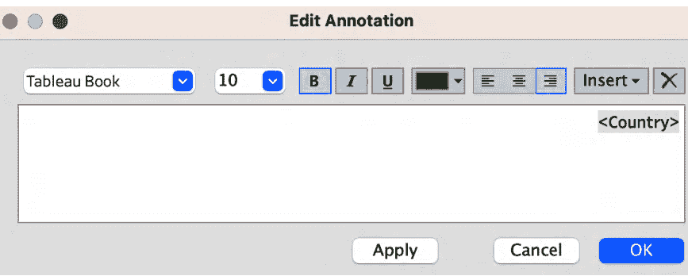

图 10.15：注释

- 7. 按需要定位和格式化注释。请注意，将饼图部署到仪表板后可能还需要进行其他调整。

- 8. 创建名为 Select Chart Type 的参数，使用以下设置：

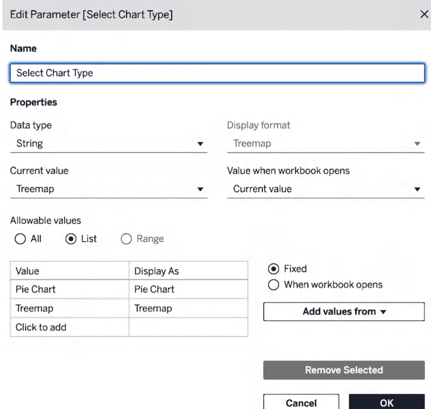

图 10.16：参数

- 9. 创建名为 Sheet Swap 的计算字段，包含以下代码：

```
[Select Chart Type]
```

- 10. 将 Sheet Swap 放在 Filters 架上，并在生成的对话框中选择 Pie Chart

- 11. 通过右键单击 Select Chart Type 并选择 Show Parameter Control 来显示参数

- 12. 导航至 Population Tree 工作表

- 13. 将 Blank 放在 Columns 架上

- 14. 将 **工作表交换** 放在 **筛选器** 架上，并在生成的对话框中选择 **树形图**

- 15. 如果 **树形图** 未显示为选项，请确保 **选择图表类型** 参数已切换为 **树形图**，然后单击 OK：

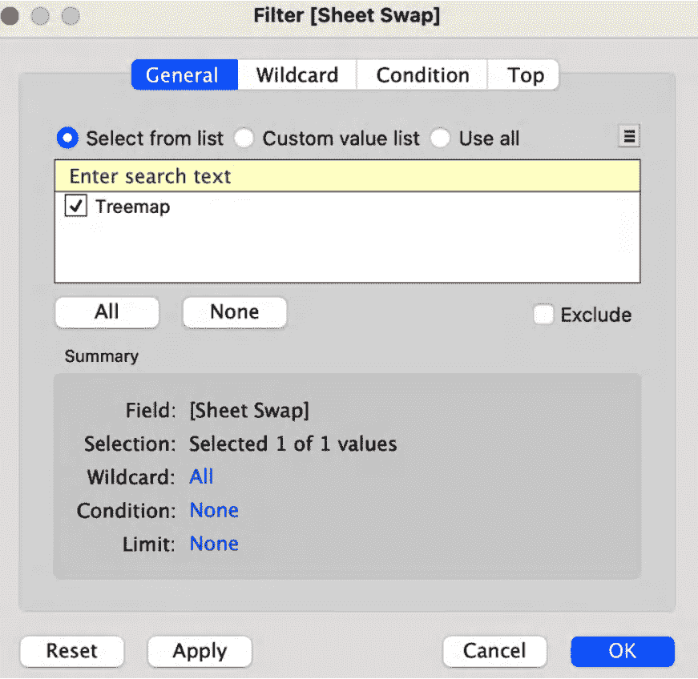

图 10.17：筛选器

- 16. 创建名为 Latin American Population 的新仪表板

- 17. 在 **仪表板** 窗格中，双击 **垂直** 以在仪表板上放置垂直容器

- 18. 在 **仪表板** 窗格中，依次双击 **人口树形图** 和 **人口饼图** 以将其添加到视图中

- 19. 右键单击标题 Population Tree 和 Population Pie，然后为两者都选择 Hide Title

- 20. 将 Population Map 和 Population Change 放在我们的仪表板上，然后按需要定位它们：

## 可折叠菜单

单击下方的下拉菜单以在树形图和饼图之间切换。

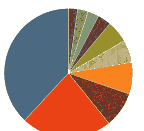

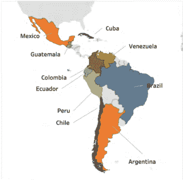

| 国家 | 2000 | 2001 | 2002 | 2003 | 2004 | 2005 | 2006 | 2007 | 2008 | 2009 | 2010 | 2011 | 2012 |
|---|---|---|---|---|---|---|---|---|---|---|---|---|---|
| 阿根廷 | | 1.003% | 0.950% | 0.911% | 0.891% | 0.885% | 0.883% | 0.878% | 0.876% | 0.876% | 0.876% | 0.879% | 0.879% |
| 巴西 | | 1.412% | 1.371% | 1.315% | 1.242% | 1.159% | 1.070% | 0.990% | 0.931% | 0.900% | 0.889% | 0.884% | 0.874% |
| 智利 | 1.186% | 1.152% | 1.113% | 1.079% | 1.048% | 1.021% | 0.996% | 0.974% | 0.954% | 0.936% | 0.919% | 0.903% | |
| 哥伦比亚 | 1.656% | 1.621% | 1.591% | 1.566% | 1.543% | 1.522% | 1.499% | 1.471% | 1.438% | 1.402% | 1.365% | 1.329% | |
| 古巴 | 0.331% | 0.328% | 0.321% | 0.244% | 0.166% | 0.080% | 0.005% | -0.047% | -0.067% | -0.063% | -0.051% | -0.045% | |
| 厄瓜多尔 | 1.977% | 1.950% | 1.917% | 1.877% | 1.833% | 1.789% | 1.746% | 1.710% | 1.681% | 1.658% | 1.636% | 1.612% | |
| 危地马拉 | 2.453% | 2.498% | 2.525% | 2.528% | 2.516% | 2.496% | 2.482% | 2.481% | 2.496% | 2.520% | 2.545% | 2.558% | |

图 10.18：仪表板

- 21. 将 Select Chart Type 参数 Shift-拖动到我们的树形图上以使控件浮动；按需要定位

- 22. 删除所有图例和快速筛选器。按需要格式化、记录并定位所有仪表板元素。用户现在可以确定是查看树形图还是饼图。以下是带树形图的仪表板示例：

## 可折叠菜单

单击下方的下拉菜单以在树形图和饼图之间切换。

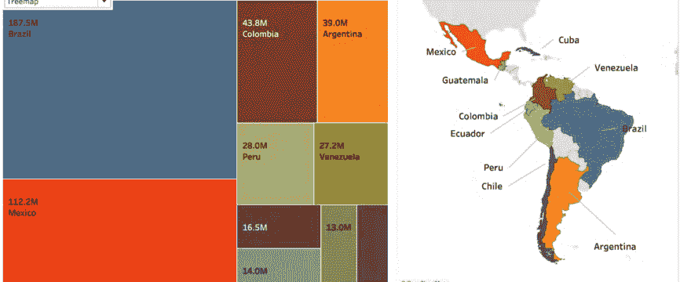

| 国家 | 2000 | 2001 | 2002 | 2003 | 2004 | 2005 | 2006 | 2007 | 2008 | 2009 | 2010 | 2011 | 2012 |
|---|---|---|---|---|---|---|---|---|---|---|---|---|---|
| 阿根廷 | 1.003% | 0.956% | 0.911% | 0.891% | 0.885% | 0.883% | 0.878% | 0.876% | 0.876% | 0.876% | 0.878% | 0.879% |
| 巴西 | 1.412% | 1.371% | 1.315% | 1.242% | 1.159% | 1.070% | 0.990% | 0.931% | 0.900% | 0.883% | 0.884% | 0.874% |
| 智利 | 1.196% | 1.152% | 1.113% | 1.079% | 1.048% | 1.021% | 0.996% | 0.974% | 0.954% | 0.936% | 0.919% | 0.903% |
| 哥伦比亚 | 1.650% | 1.621% | 1.591% | 1.566% | 1.543% | 1.522% | 1.499% | 1.471% | 1.438% | 1.402% | 1.365% | 1.329% |
| 古巴 | ... | ... | ... | ... | ... | 0.666% | 0.080% | 0.005% | -0.047% | -0.067% | -0.069% | -0.051% | -0.045% |
| 厄瓜多尔 | ... | ... | ... | ... | ... | 1.833% | 1.768% | 1.745% | 1.710% | 1.681% | 1.658% | 1.635% | 1.612% |
| 危地马拉 | 2.453% | 2.498% | 2.525% | 2.526% | 2.516% | 2.496% | 2.482% | 2.481% | 2.496% | 2.520% | 2.545% | 2.558% |

图 10.19：带树形图的仪表板

如果某些用户偏爱某一种可视化而非另一种，您可以使用工作表交换功能。接下来，我们将创建一个可以在仪表板上隐藏的筛选器菜单。在“最大化仪表板文档”部分，已指出仪表板空间非常宝贵。因此，在第二个练习“创建可折叠菜单”中，我们将回顾一个示例，该示例将使用工作表选择来允许最终用户显示或隐藏筛选器，从而更高效地利用屏幕空间。

## 创建可折叠菜单

请按照以下步骤了解如何将可折叠筛选器菜单添加到您的仪表板中：

- 1. 复制前一个练习中创建的仪表板并将其重命名为 可折叠菜单。如果您未完成前一个练习，请使用本章提供的解决方案工作簿中包含的仪表板。

- 2. 选择仪表板上的任意工作表并单击箭头；选择要显示的筛选器 **国家** 和 **仅年份**

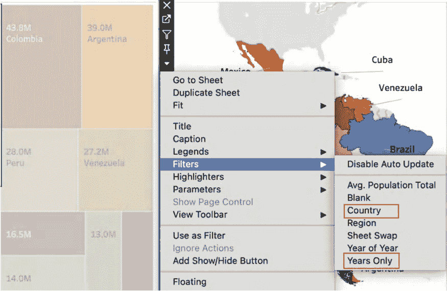

图 10.20：筛选器

- 3. 两个筛选器将被放置在仪表板右侧的容器中。双击任一筛选器顶部中间的两条水平线，以改为选择容器。周围的线条将显示为蓝色。选择 **添加显示/隐藏按钮**

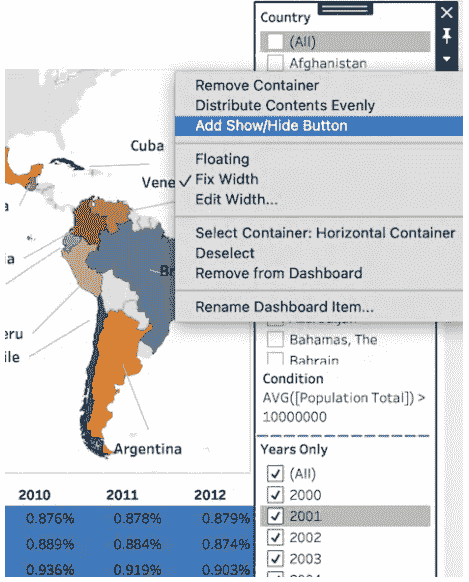

图 10.21：添加显示/隐藏按钮

- 4. 请注意，筛选器旁边可见一个 X。在 **演示模式** 中，现在可以使用此按钮来最小化筛选器：

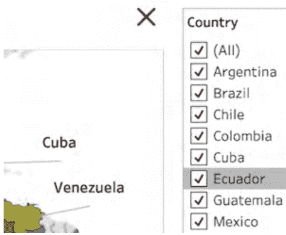

图 10.22：国家

在本节中，我们了解到，通过使用容器和筛选器，Tableau 可以自动调整容器中所选工作表的大小。此功能可用于使工作表似乎可以被交换。然而，Tableau 基本上只是最小化一个并最大化另一个，尽管这对用户的眼睛不可见。太棒了，不是吗？

完成此练习后，您可能会想，好吧，筛选器在技术上不在仪表板上显示，但它们在侧面仍然可见。在 Tableau Desktop 中这是事实，但如果您可以将工作簿上传到 Tableau Server 的实例，您会注意到，单击菜单图标时，筛选器会出现和消失，并且不会在侧面显示。

可折叠菜单是一个非常好的附加功能，有助于简化您的仪表板。如果您读过本书的最后第三版，您可能会记得这是一个繁琐的过程——与其说是一个功能，不如说是让可折叠菜单工作的一种变通方法。现在，有了 添加显示/隐藏按钮，这简直易如反掌。用户可以专注于数据，仅在需要时使用筛选器。

## 仪表板最佳实践

可视化最佳实践不仅限于可视化功能；操作、筛选器和组织数据同样重要。本节将提及 Tableau 提供的其中一些功能。它们中的每一个都将帮助您改善用户体验或跟踪您构建的内容——因为，有时，在处理许多不同的工作表时，您可能会迷失方向。

我们将先讨论六种不同类型的操作，然后是下载和导航对象，接着是“使用位置”功能，最后是项目层次结构。它们都有助于更好的仪表板构建体验。让我们开始吧！

## 操作

在潜意识中，我们之前多次讨论过这一点，但让我们明确地看看使用操作可以在可视化和仪表板设计方面实现什么。如果您希望用户单击或悬停在可视化的数据上时被重定向，则操作就会发挥作用。如果您有大量数据要展示且不希望全部放在同一个仪表板上，这将很有帮助。您也不应该这样做，因为这会分散注意力，如果数据是层次结构数据，操作是实现下钻技术的完美方式。

以下各部分将解释您可以在 Tableau 中使用的所有不同操作，以添加交互性，支持简洁且高效的仪表板设计。


## 筛选操作

在此示例中，我们将使用筛选操作来显示最初隐藏的数据。通过这样做，我们将确保一次呈现较小的数据块，并且用户可以钻取到任意感兴趣的点。请执行以下步骤：

- 1. 请打开工作表“按州划分的数量”

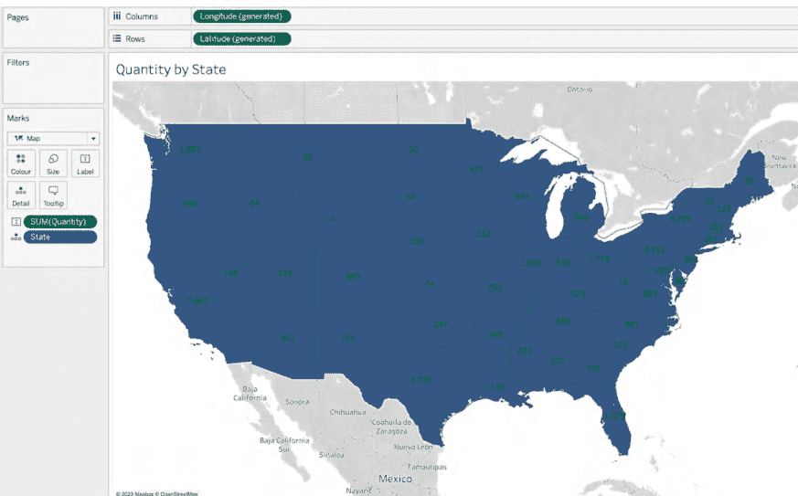

### 图 10.23: 地图

您可以在上述截图中看到，每个州代表给定产品的销售数量。但是，能否通过点击给定州来查看更多详细信息不是很好吗？为了实现此目的，我们必须设置操作。

- 2. 首先，我们需要一个要在操作中使用的第二个工作表。请打开工作表“按州和类别划分的利润”

| 州 | 类别 | |
|---|---|---|
| 阿拉巴马州 | 家具 | $1,231 |
| | 办公用品 | $1,258 |
| | 技术 | $3,298 |
| 亚利桑那州 | 家具 | ($2,745) |
| | 办公用品 | ($796) |
| | 技术 | $113 |
| 阿肯色州 | 家具 | $781 |
| | 办公用品 | $1,966 |
| | 技术 | $1,261 |
| 加利福尼亚州 | 家具 | $9,163 |
| | 办公用品 | $37,748 |
| | 技术 | $29,470 |
| 科罗拉多州 | 家具 | ($2,683) |
| | 办公用品 | ($373) |
| | 技术 | ($3,472) |
| 康涅狄格州 | 家具 | $1,226 |
| | 办公用品 | $1,504 |
| | 技术 | $781 |

### 图 10.24: 表格

您可以在上述截图中看到，显示了每个州、每个类别及相应的利润。

- 3. 现在，返回到“按州划分的数量”工作表以启用一个操作，该操作将提示用户转到“按州和类别划分的利润”工作表，然后根据用户点击的州对其进行筛选

- 4. 在“按州划分的数量”工作表上，选择 **工作表 | 操作**；将出现以下窗口。单击 **添加操作** 按钮并选择 **筛选...**

### 操作

操作让您在数据、仪表板对象、其他工作表和网络之间创建交互关系。

### 显示操作的对象

- 此工作簿
- 此工作表

| 名称 | 运行于 | 源 | 字段 |
|---|---|---|---|

- 筛选...
- 高亮...
- 转到 URL...
- 转到工作表...
- 更改参数...
- 更改设置值...

### 图 10.25: 筛选操作

- 5. 在下一个窗口中，添加一个名为 **映射到表格（数量到利润）** 的筛选操作，并复制如截图所示的设置。然后，单击 **确定**：

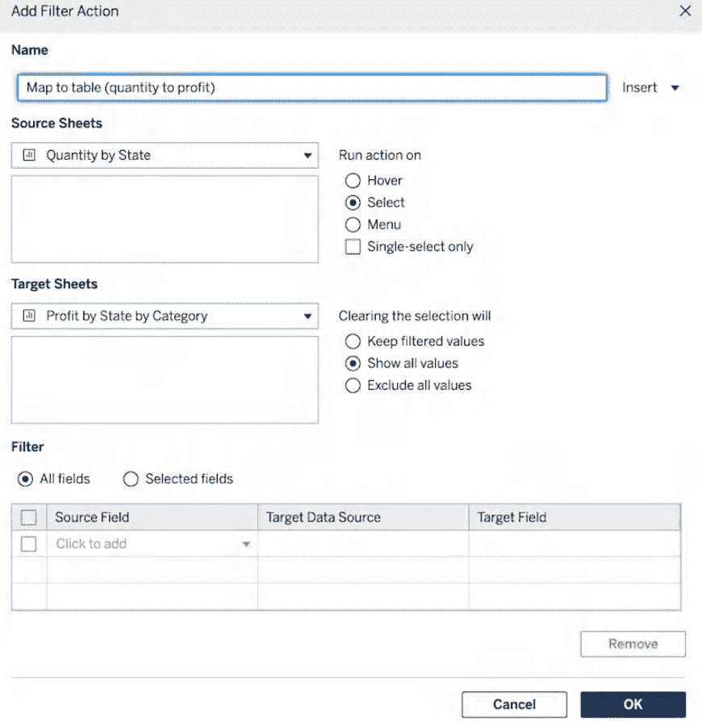

### 图 10.26: 筛选操作参数

- 6. 如果您现在单击“按州划分的数量”工作表（源工作表）上的某个州，Tableau 将在目标工作表中查找相同的 **州**，并相应地进行筛选。以下是在单击 **德克萨斯州** 后的示例：

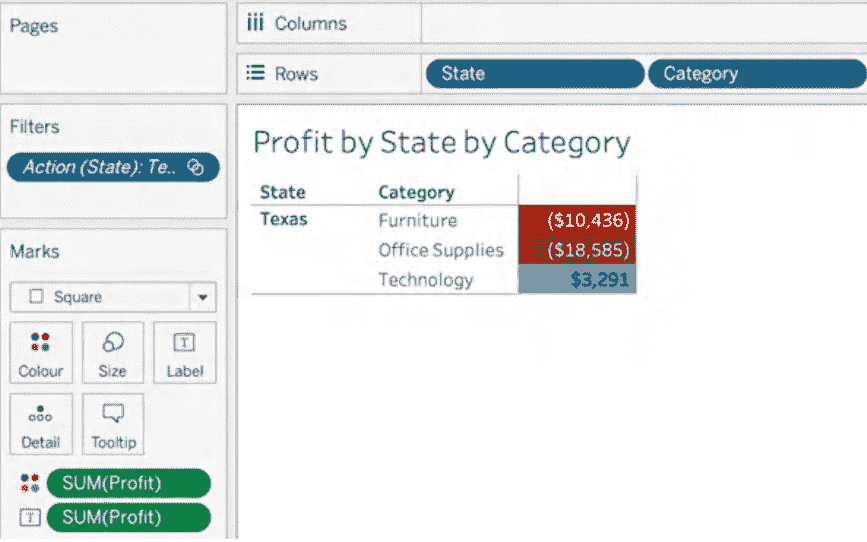

### 图 10.27: 已筛选的表格

本节讨论的筛选操作可用于清理仪表板。遵循设计原则通常意味着少即是多，如果您有许多数据点要共享，钻取操作或筛选操作可以帮助您实现此目标。首先呈现高级别数据，然后在筛选操作背后呈现更详细的数据层。您还可以在标题下方为用户添加一句话，例如：单击某个州以查看更多详细信息。

## 高亮操作

其他选项例如高亮操作。对于同一页面上的工作表更有用，因为它只会高亮显示适用字段。您可以在同一仪表板上显示所有数据，但高亮操作使用户更容易找到相关数据点。请执行以下步骤：

- 1. 请打开仪表板“数量与利润”，它结合了我们之前使用的两个工作表

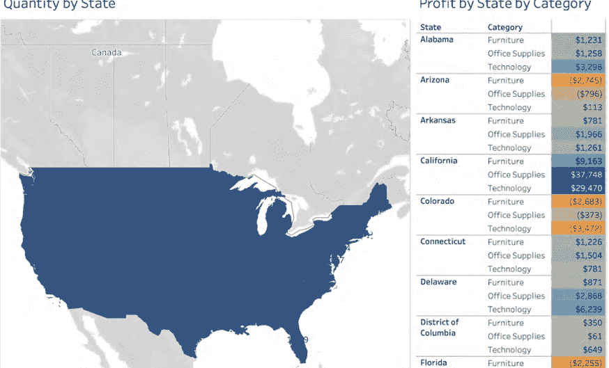

### 图 10.28: 仪表板

- 2. 单击 **仪表板 | 操作**，这次，复制以下 **高亮操作** 参数

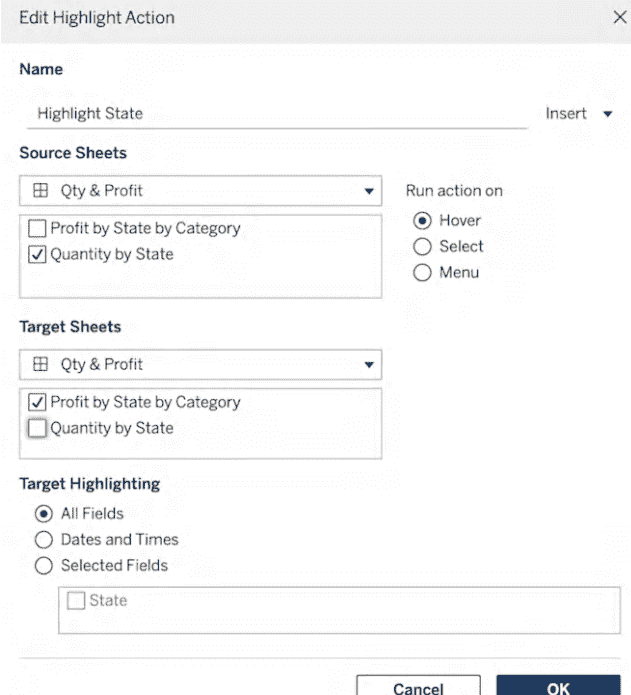

### 图 10.29: 高亮操作

- 3. 上述参数的意思是，在“数量与利润”仪表板上，我们的源工作表将是“按州划分的数量”，并且通过将鼠标悬停在其上，目标工作表上的相应数据将被高亮显示。在此情况下，唯一的共同数据是 **州**，因此高亮器将只考虑 **州**。结果如下：

### 按州划分的数量

| 州 | 类别 | |
|---|---|---|
| 阿拉巴马州 | 家具 | $1,231 |
| | 办公用品 | $1,258 |
| | 技术 | $3,298 |
| 亚利桑那州 | 家具 | ($2,745) |
| | 办公用品 | ($796) |
| | 技术 | $113 |
| 阿肯色州 | 家具 | $781 |
| | 办公用品 | $1,966 |
| | 技术 | $1,261 |
| 加利福尼亚州 | 家具 | $9,163 |
| | 办公用品 | ($774) |
| | 技术 | $9,363 |
| 科罗拉多州 | 家具 | ($2,683) |
| | 办公用品 | ($373) |
| | 技术 | ($3,472) |
| 康涅狄格州 | 家具 | $1,226 |
| | 办公用品 | $1,504 |
| | 技术 | $781 |
| 特拉华州 | 家具 | $871 |
| | 办公用品 | $2,868 |
| | 技术 | $6,239 |
| 哥伦比亚特区 | 家具 | $350 |
| | 办公用品 | $61 |
| | 技术 | $649 |
| 佛罗里达州 | 家具 | ($2,255) |

### 图 10.30: 高亮操作仪表板

通过将鼠标悬停在地图上的亚利桑那州，右侧表格中的相同州将被高亮显示。如您所见，实现高亮筛选可以帮助用户更快地找到相关数据点。与导航操作相比，此筛选器应用于同一页面上的工作表，并作为查找值的视觉辅助。

## URL 操作

下一个操作是 URL 操作。它允许您在单击仪表板中的数据点时打开一个 URL。请执行以下步骤：

- 1. 转到“按州划分的数量”工作表并打开 **工作表 | 操作**
- 2. 删除每个可见操作
- 3. 现在，选择 **添加操作** 并选择 **转到 URL...**。复制下面所示的所有参数，并单击 Wikipedia URL 旁边的箭头。来自数据源的字段将出现，这使您可以向 URL 添加一个字段，该字段将根据仪表板自动返回值。选择 **州**：

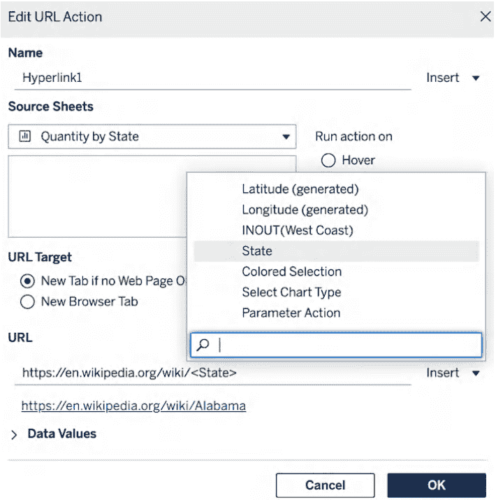

### 图 10.31: URL 操作

- 4. 在“按州划分的数量”工作表的地图上单击某个州，并观看 Wikipedia 将打开相应的网页

当您希望向用户显示网站上可用的其他信息时，URL 操作非常有用。您还可以使用纬度和经度值打开 Google 地图，或将 URL 操作链接到内部公司网站（包含法规），或者可能是工单系统。

## 导航操作

下一个操作过去常与按钮结合使用，以给用户带来更交互式的体验。您将添加带有操作的按钮以转到特定工作表，而不是单击选项卡从一个页面跳转到另一个页面：

- 1. 转到“数量与利润”仪表板，创建名为 **字符串** 的计算字段，代码为 "返回到 [...]"。这将很快充当我们的按钮。

- 2. 打开一个新工作表并将其命名为 **按钮**

- 3. 通过将 **详细信息** 和 **标签** 拖放到上面，放置计算字段 **字符串**

- 4. 从 **标记** 卡下拉菜单中选择 **形状**，并选择您喜欢的任意形状（和颜色）

- 5. 隐藏标题并禁用 **提示信息**

- 6. 单击 **标签** 并选择 **底部居中对齐**。结果如下所示：

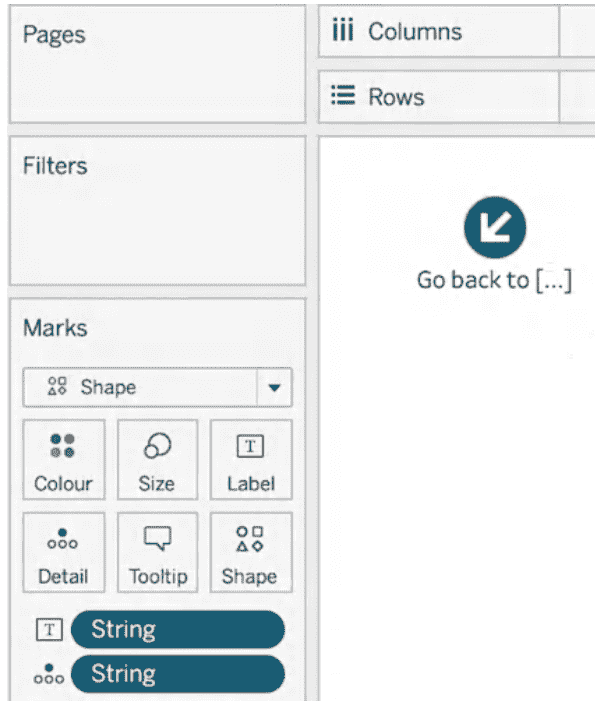

### 图 10.32: 按钮

- 7. 返回到“数量与利润”仪表板，选择 **浮动**，并将 **按钮** 工作表拖放到仪表板上——例如，放在左下角

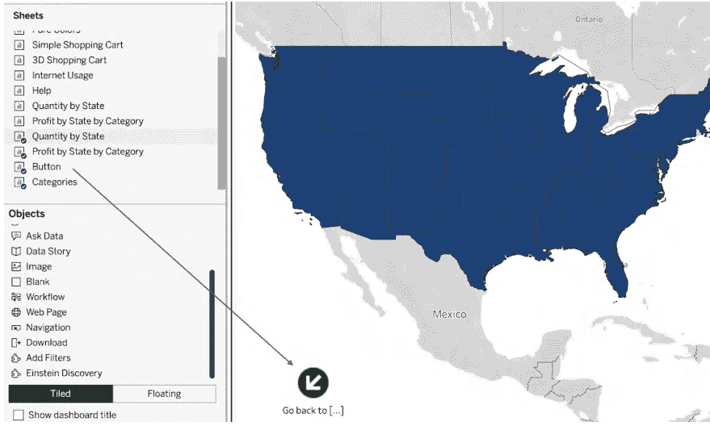

### 图 10.33: 仪表板上的按钮

- 8. 单击 **仪表板 | 操作** 并复制以下参数

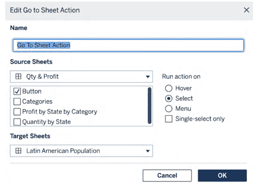

### 图 10.34: 转到工作表操作

- 9. 单击 **确定** 并单击“数量与利润”仪表板上的 **按钮** 工作表

它现在将带您返回到“拉丁美洲人口”仪表板！如今，由于特定导航对象的发布，此操作不再常用，但了解它以保持完整性是有用的。


## 参数操作

接下来是参数操作。此功能用于通过单击仪表板中的数据点来更改参数，而非使用参数控件。请按以下步骤操作：

- 1. 将“Categories”工作表放置在“Qty & Profit”仪表板上（例如，位于右上角）

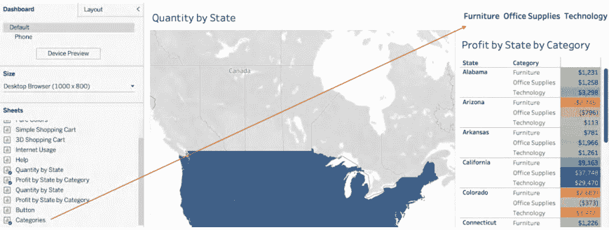

图 10.35：参数操作

- 2. 单击“仪表板 | 操作”，并复制以下参数：

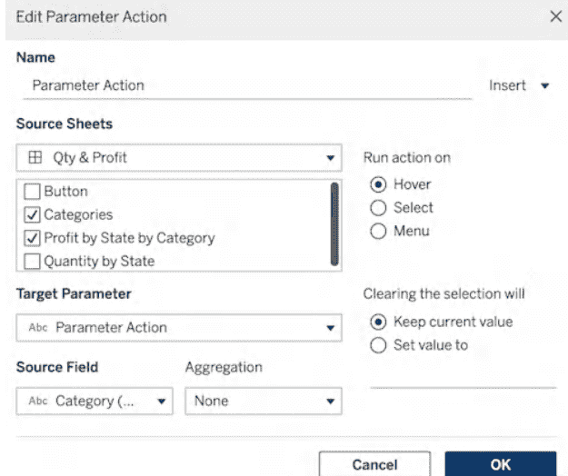

图 10.36：参数操作设置

- 3. 创建名为 Cat Param 的计算字段，使用以下代码：

```
If [Parameter Action] = [Category]
Then [Category]
Else ""
END
```

- 4. 将 Cat Param 放置在工作表“Profit by State by Category”的筛选器卡上，选择空值并启用“排除”（如所示），然后单击确定：

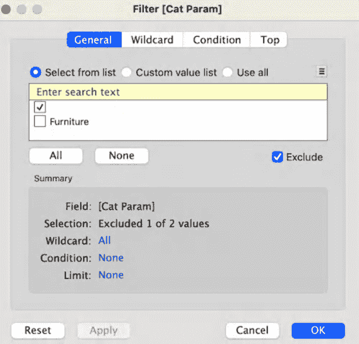

图 10.37：类别筛选器

- 5. 现在，如果将鼠标悬停在顶部的任何类别上，以下表格将相应调整：

| 州 | 类别 | 金额 |
| --- | --- | --- |
| 阿拉巴马州 | 技术 | $3,298 |
| 亚利桑那州 | 技术 | $113 |
| 阿肯色州 | 技术 | $1,261 |
| 加利福尼亚州 | 技术 | $29,470 |
| 科罗拉多州 | 技术 | $19,472 |
| 康涅狄格州 | 技术 | $781 |
| 特拉华州 | 技术 | $6,239 |
| 哥伦比亚特区 | 技术 | $649 |
| 佛罗里达州 | 技术 | $531 |
| 佐治亚州 | 技术 | $4,400 |
| 爱达荷州 | 技术 | $92 |
| 伊利诺伊州 | 技术 | $4,823 |
| 印第安纳州 | 技术 | $11,001 |
| 艾奥瓦州 | 技术 | $318 |
| 堪萨斯州 | 技术 | $175 |
| 肯塔基州 | 技术 | $4,157 |

图 10.38：已筛选类别的仪表板

## 集合操作

我们将讨论的最后一种操作是集合操作。集合将数据分为两部分：内部或外部。如果根据以下列表创建名为 animals 的集合：[猫, 树, 狗, 豹, 房子, 汽车]，则将猫、狗和豹标记为内部，将树、房子和汽车标记为外部。随后，可以将集合用作仪表板的新字段。请按以下步骤操作：

- 1. 打开“Qty & Profit”仪表板，并选择西部州加利福尼亚州、俄勒冈州和华盛顿州。请注意，弹出窗口在右上角显示两个圆环。使用此图标是创建集合的一种方法；请单击该图标。

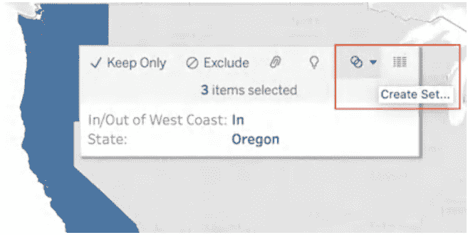

图 10.39：集合操作

- 2. 将打开以下窗口；单击确定

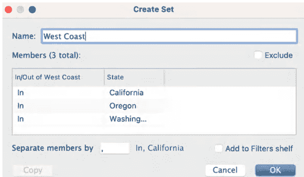

图 10.40：集合

在数据窗格中，已创建一个新字段——名为西海岸的集合。

- 3. 通过以下方式更改“Profit by State by Category”工作表来查看其工作原理：从“行”中移除 **州**，并改为添加 **西海岸**（您可以从筛选器卡上移除 **Cat Param**，也可以保留它；两者均可）：

| 西海岸的内/外 | 类别 | |
|---|---|---|
| 内部 | 家具 | $14,869 |
| | 办公用品 | $49,109 |
| | 技术 | $44,616 |
| 外部 | 家具 | $3,582 |
| | 办公用品 | $73,382 |
| | 技术 | $100,839 |

图 10.41：设置字段状态

**外部**带中的利润计算了除加利福尼亚州、俄勒冈州和华盛顿州以外的所有州，而**内部**带则显示相对于上述三个州的数字。

- 4. 返回“Qty & Profit”仪表板，选择 **仪表板** | **操作**，以将以下参数复制到 **集合操作**：

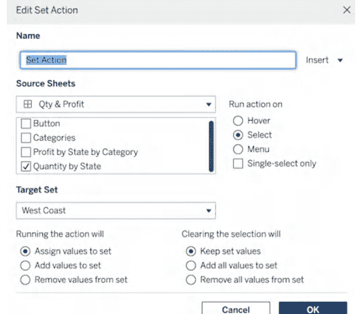

图 10.42：集合操作参数

- 5. 现在，如果单击一个或多个州，所有选定的州都将成为集合的内部组。因此，利润数字将显示您的选择与其余部分的对比，如下所示：

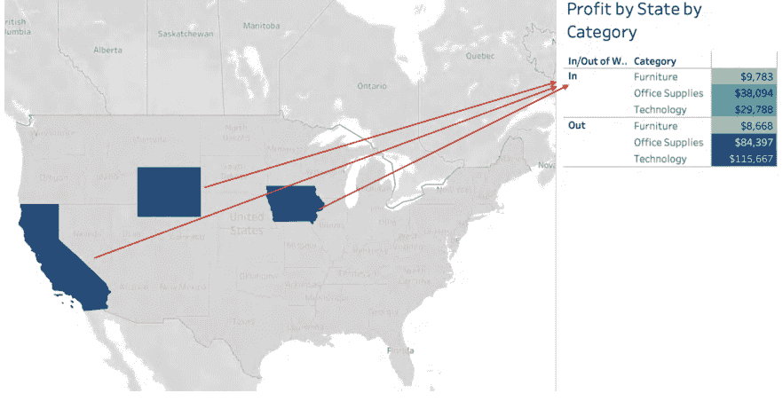

图 10.43：集合操作仪表板

- 6. 您也可以通过单击并选择 **编辑别名**... 来重命名 **内部** 和 **外部** 值：

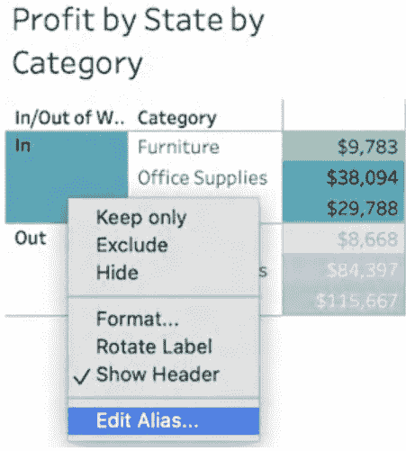

图 10.44：编辑别名..

以上便是 Tableau 的六种操作；利用 **筛选器** 和 **突出显示** 操作，可以使用户更轻松地通过下钻来查找更详细的信息。**转到工作表** 和 **转到 URL** 操作可视为交互式按钮，将用户重定向到其他信息（无论是在网络上还是在另一张工作表上）。最后，**更改参数** 和 **更改集合** 操作可用于调整预定义值或多个值，从而允许用户从不同角度与数据进行交互并进行分析。

## 下载按钮

除操作之外，用户体验的另一项内容是内置下载按钮。将此类按钮添加到仪表板，即可允许用户（如果愿意）与其他人共享图像或屏幕截图、将其用于文档或用于演示目的。添加按钮非常简单；只需按以下步骤操作：

- 1. 打开仪表板 `601den Rectangle`，在左下角选择 **浮动**，并将 **下载** 拖动到右上角：

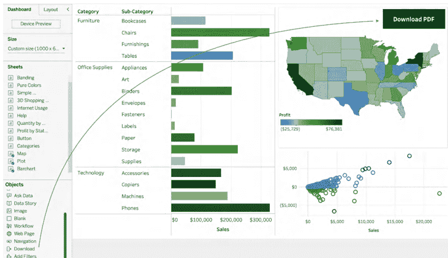

图 10.45：下载按钮

- 2. 在演示模式下，单击新添加的按钮（非演示模式下为 Alt + 单击）；将出现“打印为 PDF”弹出窗口

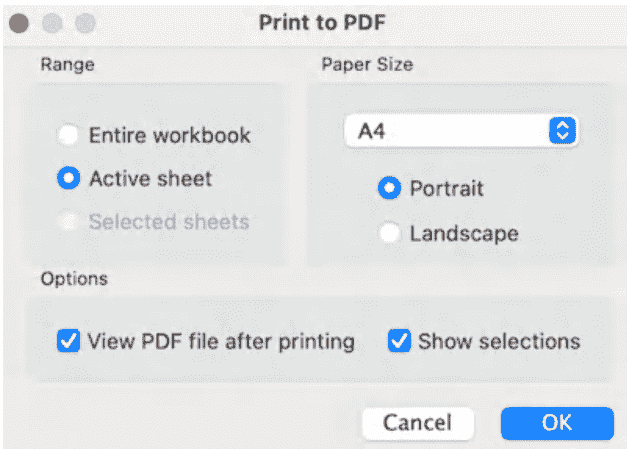

图 10.46：打印为 PDF

- 3. 单击确定，随后即可从桌面以 PDF 形式打开仪表板

就这样！只需一步，就能让许多喜欢打印输出的用户非常满意。

Tableau 工作簿和 Tableau 仪表板可能会变得非常复杂，这取决于创建它们所使用的工作表数量。幸运的是，Tableau 提供了 **项层次结构** 和 **使用位置** 等组织功能。

## 项层次结构

如前所述，在*创建可折叠菜单*部分中简要提及，如果打开*拉丁美洲人口*仪表板，您将在*布局*窗格的左下角注意到 **项层次结构**。单击 *平铺* 一词旁边的箭头，即可查看仪表板的所有不同部分以及每个容器中使用的工作表。您还可以发现容器中嵌套容器以及布局的结构：

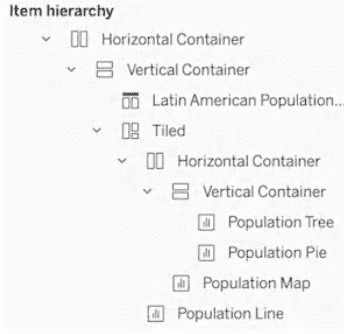

图 10.47：展开的项层次结构

请尝试在项层次结构中保持逻辑顺序。这样以后修改仪表板会更加容易。您选择哪种逻辑由您决定；我经常使用的一种逻辑是从高级到更详细、从最重要到最不重要，或者从较大的工作表到较小的工作表。有关保持仪表板整洁的精彩文章可在此找到：https://www.thedataschool.co.uk/joe-beaven/layout-containers-how-to-get-your-item-hierarchy-under-control。

## 使用位置功能

**使用位置** 功能会显示某个工作表用于哪些仪表板。只需右键单击工作表并选择 **使用位置**：


图 10.48：使用位置

如果您想更改工作表，此功能特别有用。在执行之前，您可以检查哪些仪表板将受到影响，从而大大降低破坏现有仪表板的风险。

## 补充内容

刚开始使用 Tableau 时，我就是 Makeover Monday（https://www.makeovermonday.co.uk）的超级粉丝，现在依然如此。Makeover Monday 是由 Eva Murray 和 Andy Kriebel 主办的一项倡议。每个周一，Tableau 社区（即您）都会获得一个附带可视化的数据集，并被要求对其进行改进。数据示例可能来自报纸或网站。随后，参与者将分析数据集、构建仪表板，并使用标签 #makeovermonday 在 Twitter 上发布该版本。如果您将社区的工作与原始工作进行比较，您肯定会了解哪些仪表板效果最好以及您偏好哪些设计，从而逐渐发展出自己的风格，尤其是在参与时。

Makeover Monday 前几年的经验总结在一本同名书中。2022 年，Makeover Monday 暂停了一段时间，但现在以略有不同的形式回归，由 Andy 独立主导。请查看；非常值得。以下是一些示例以及我解释其有效性的原因；您将认识到我们在本章中讨论过的规则（我将把这些规则放在括号中）：

第一个示例发表在 *卫报* 上，展示了 2020 年 1 月英国出口商品的下降。

数据链接：https://data.world/makeovermonday/2021w13。

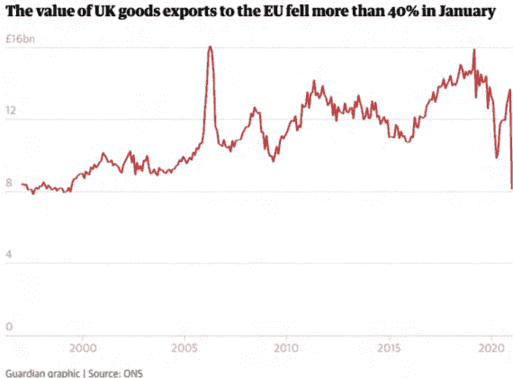

图 10.49：英国出口


## 什么方法有效？

使用折线图（规则：保持可视化简单）来展示时间序列数据是个好主意。我也喜欢这条线是红色的（规则：颜色的心理暗示），因为可视化展示的是负面信息，即出口额的急剧下降。Y轴显示这些变化的货币价值，让我作为用户了解绝对损失。

现在让我们看看Makeover Monday的朋友们做出了什么：

Kimberly Furdell创建了图10.51所示的图表，在不再继续阅读之前，请问自己，与原始可视化相比有哪些不同，你更喜欢哪一个，为什么？

Link to the visualization: https://public.tableau.com/app/profile/kimberly.furdell/viz/UKexportstoEU_16172321299550/Dashboard1.

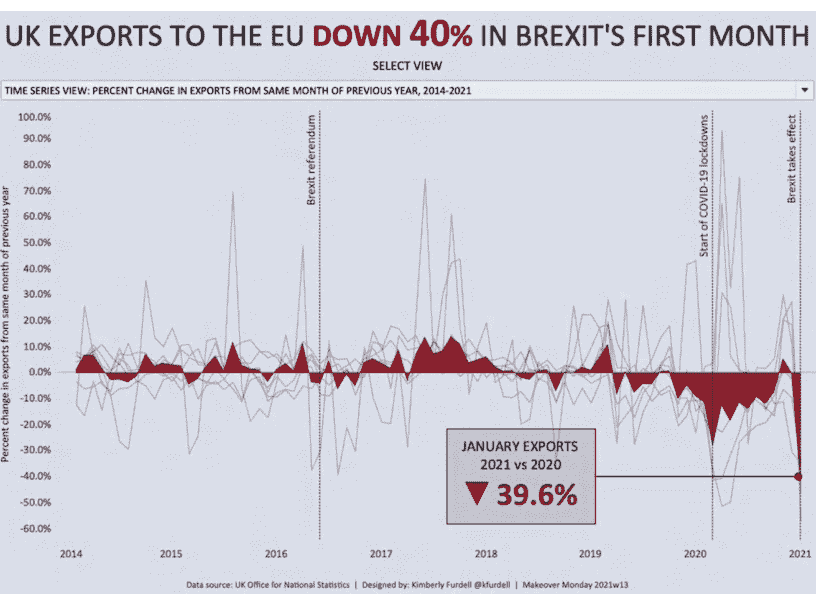

图10.50：脱欧出口

## 为什么效果更好

《卫报》发表的文章围绕2021年1月相比2020年1月出口额下降40%展开叙述。原始可视化中并未清楚表明该数字与前一年相关，而Kimberly的可视化中包含足够信息，无需阅读全文即可理解（规则：最大化仪表板上的文档）。为了进一步支持叙事，Kimberly对图表进行了出色的修改。

此可视化效果更好，因为Y轴显示百分比。现在，你可以清楚地看到2021年1月的下降比2020年的下降更严重，而由于绝对值的特性，在原始图表中两者看起来相似。将时间序列数据延伸更多年份，强调了这些发展超出了过去几年的范围。她仪表板上的灰色线条代表各种出口类别，因此，为总数使用面积图，为细节使用不太显眼颜色的折线图是个好主意（规则：呈现密集信息，谨慎使用纯色）。标明此期间事件的参考线使故事完整（规则：讲述故事）。最后，好奇哪个类别对出口额急剧下降贡献最大的用户，可以从下拉菜单中选择第二个视图，即水平条形图（设计：工作表交换）。

接下来，我们将探讨另一个Makeover Monday挑战以及两个做得更好的示例。

这一次，我们关注不同知名连锁店各种咖啡的咖啡因含量。该文章和数据最初发布于www.which.co.uk。

Link to the challenge: https://data.world/makeovermonday/2023w9.

在这里你可以找到原始可视化，依我看来，它并不算差：

## 高街咖啡咖啡因含量对比

| | 单份浓缩咖啡 | 卡布奇诺 | 滴滤/冲泡咖啡 |
|---|---|---|---|
| Caffè Nero | 45mg (30ml) | 110–115mg (355ml) | n/a |
| Costa (Signature blend) | 100mg (30ml) | 325mg (362ml) | n/a |
| Greggs | 75mg (28ml) | 197mg (341ml) | 225mg (341ml) |
| Pret | 180mg (30ml) | 180mg (350ml) | 271mg (350ml) |
| Starbucks | 33mg (25ml) | 66mg (350ml) | 102mg (350ml) |

*咖啡因含量（mg）（饮品容量 ml）*

图10.51：咖啡

## 什么方法有效？

咖啡杯图片很好；无需查看表格或阅读标题，你就会知道这个可视化是关于咖啡的。它会吸引你的注意。颜色使用有限，但背景不是我最喜欢的；蓝色很抢眼但与主题无关，且对眼睛有点刺眼。不过，表格很好用；很容易比较每个品牌的不同饮品以及不同品牌的相同饮品（规则：保持简单和稳健）。

同时显示咖啡因含量和毫升数几乎信息过多，可以进行更好的归一化处理。但让我们看看Tableau社区做出了什么。

这个第一个示例，图10.53，由Will Sutton发布。他创建了一个故事，每一页都是改进版的一步。多么棒的主意！

Link to the visualization: https://public.tableau.com/app/profile/wjsutton/viz/HighStreetCaffeine/ImprovingabarchartMakeoverMonday2023Week9.

### 改进Tableau中条形图的默认视图


### Pret拥有最强的单份浓缩咖啡

### 注释

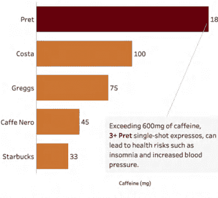

摄入超过600mg的咖啡因，相当于3倍以上Pret单份浓缩咖啡，可能导致失眠和血压升高等健康风险。

在图表中添加注释可以邀请读者了解更多。这里我将180置于语境中，我的读者可能不知道180mg咖啡因是否算大量。

通过快速谷歌搜索，我发现超过600mg会有一些危险的副作用，因此我对此进行了标注，并将其置于语境中，说明这相当于多少杯Pret浓缩咖啡。

这使读者能够进一步探索数据，例如Starbucks浓缩咖啡弱多少，或考虑他们自己的购买决策。

作者：Will Sutton | 来源：Which.co.uk 2023年2月 | 注：Costa指其招牌混合咖啡

图10.52：注释

## 为什么效果更好

其效果更好的一部分可以从水平条形图旁看到；数字被置于了语境中（规则：讲述故事）。除此之外，Will将表格改为非常简单的条形图；他只关注一种饮品，并以深红色标出浓缩咖啡，标明最高可能的健康风险（规则：制作简单稳健的仪表板，使用简单颜色）。他带领用户了解一个故事，而原始表格则为语境和未知问题的答案留下了大量空间。

但我还会向你展示一个包含所有咖啡连锁店和所有饮品的重做版本；接下来这个由Gabriela Comanescu制作。

Link to the visualization: https://public.tableau.com/app/profile/gabriela.comanescu/viz/HowmuchcaffeineisinyourcoffeeMakeoverMonday/Coffee.

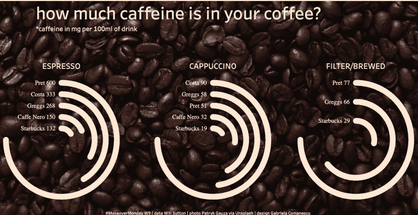

图10.53：咖啡因

## 为什么效果更好

Gabriela采用了原始文章的主题，使用咖啡图片来吸引用户注意。不过，她使用逼真的咖啡豆图片作为可视化的背景，而不是插图。她的颜色选择非常简单；字体保持为米白色，这几乎可以是咖啡上的牛奶（规则：使用简单颜色）。但我最喜欢的是她对数据进行了归一化。对于所有饮品，她显示每100毫升的咖啡因含量（mg）。这使得每种饮品都可比较，因此将每种饮品都绘制为圆形条形图是合理的。几秒钟内，用户就能发现每种饮品中咖啡因含量最高的，并能相互比较。使用圆形条形图是天才之举，因为在我看来，这就像在搅拌咖啡（规则：制作简单稳健的仪表板，呈现密集信息，以及颜色的心理暗示）。

这就是我对Makeover Monday的看法，我希望到现在你也成了粉丝。如果你在推特上发布任何给定数据集的你的版本，请标记#MasteringTableau，这样本书的读者和我就可以查看你的作品。

最后但同样重要的是，我强烈推荐的另一个页面是Visual Capitalist（https://www.visualcapitalist.com）。其仪表板设计得如此完美，你真的应该尝试向它们学习。

## 跟随练习仪表板

在本章的跟随练习中，我们将做点不同的事情。我们将拿一个因设计受到赞誉的仪表板作为示例，尝试重做一个更简单的版本。选定的仪表板来自Ryan Sleeper，名为Super Sample Superstore。你可以在这里找到：https://www.tableau.com/data-insights/dashboard-showcase/superstore。但现在，让我们重做它，以便从这部杰作中学习。

我们将构建一个包含以下内容的仪表板：顶部筛选栏、三个KPI磁贴（销售额、利润率、平均发货天数）、按州划分的销售额地图以及销售额随时间变化趋势。

- 打开Tableau Desktop。
- 连接到Sample Superstore数据集。
- 将Orders表拖动到画布上。
- 我们现在将模仿Sample Superstore仪表板中的KPI：销售额、利润率和平均运输时间。

- 打开一个新工作表，创建一个计算字段，并将默认数字格式设置为百分比：

```
Profit Ratio = SUM([Profit]) / SUM([Sales])
```

- 创建另一个计算字段：

```
Shipping Days = DATEDIFF('day', [Order Date], [Ship Date])
```

- 我们现在将构建三个单独的KPI工作表，然后将它们排成一行。打开一个新工作表并将其命名为KPI – Sales

- 将Sales拖动到标记卡上的Text

- 将标记类型更改为Text

- 单击Text，然后单击三个...在新窗口中，输入SUM(Sales)并在其后输入Sales

- 将SUM(Sales)格式化为更大的字体（例如20–28pt）并将其加粗，对单词Sales使用例如15–20。

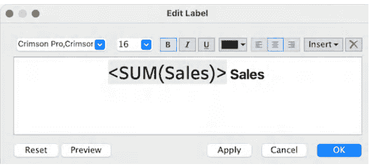

图10.54：编辑标签


- 11. 设置 SUM(Sales) 格式：
  - 在“数据”窗格中右键单击字段 | 默认属性 | 数字格式...
  - 选择“货币(自定义)”，0 位小数

现在你有了这个：

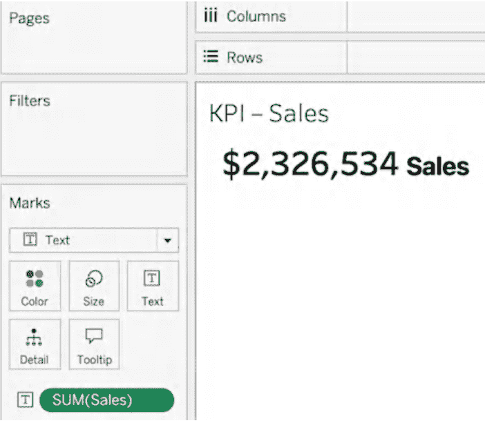

图 10.55：KPI - 销售额

- 12. 复制工作表（右键单击 KPI – 销售额 | 复制）
- 13. 重命名为 KPI – 利润率
- 14. 将“标记”卡上“文本”处的度量值替换为：
  - 将 利润率 拖到“文本”货架，替换掉 销售额
  - 设置 利润率 格式：默认属性 | 数字格式 | 百分比，1 位小数
- 15. 将标签更改为显示：<AGG(Profit Ratio)> 利润率

- 16. 再次复制并重命名为 KPI – 发货天数
- 17. 将度量值替换为 AVG([Shipping Days])
- 18. 格式设置为带 1 位小数的数字，并将标签文本更改为：<AVG(Shipping Days)> 平均发货天数
- 19. 打开新工作表
- 20. 将其重命名为 销售趋势
- 21. 将 订单日期 拖到“列”
  - 右键单击并选择“月份”
- 22. 将 销售额 拖到“行”
- 23. 选择标记类型：折线

| | 列 | MONTH(Order Date) |
| --- | --- | --- |
| | 行 | SUM(Sales) |


图 10.56：销售趋势

- 24. 创建另一个新工作表并将其重命名为 Map – 按州划分的销售额
- 25. 将 州/省份 拖到“详细信息”
- 26. 将 销售额 拖到“颜色”
- 27. 将颜色设置为单个发散调色板（例如，从浅到深）。
- 28. 将 区域 和 细分 拖到“筛选器”货架


图 10.57：Map – 按州划分的销售额

- 29. 单击“新建仪表板”
- 30. 将大小设置为自动
- 31. 将水平布局容器拖到仪表板顶部
- 32. 将空白对象拖入容器
- 33. 将文本对象拖到该空白对象上方并键入：
  - 超级商店绩效概览
  - 将背景设置为青色，字体设置为白色、粗体、16–20 pt
- 34. 在标题下方，拖入另一个水平容器。

- 35. 将工作表 Map – 按州划分的销售额 暂时拖入仪表板。
- 36. 选择“筛选器”| 订单日期的月份。
- 37. 右键单击筛选器控件（在仪表板上）| 应用到工作表 | 使用此数据源的所有工作表。
- 38. 还选择“多值(下拉列表)”。
- 39. 对“国家/地区”、“区域”和“细分”筛选器执行相同操作。
- 40. 将筛选器控件排列在该水平容器中，以制作整洁的“筛选器行”，然后如果需要可以删除临时工作表。使用“均匀分布内容”功能实现完美对齐。
- 41. 在筛选器下方拖入一个水平容器。
- 42. 将每个 KPI 工作表拖入此容器：
  - KPI – 销售额
  - KPI – 利润率
  - KPI – 发货天数

此行应感觉像是仪表板主体顶部整齐的三个“卡片”。

- 43. 在 KPI 行下方拖入一个垂直容器
- 44. 在其中拖入：
  - Map – 按州划分的销售额 (顶部)
  - 销售趋势 (底部)
- 45. 通过拖动它们之间的分隔线调整相对高度
- 46. 确保提示信息整洁且信息丰富

为保持与原始 Super Sample Superstore 设计一致（该设计因其简洁的企业风格而受到赞扬），请进行最终检查：

- 一致性：所有视图中使用相同的字体和颜色。
- 空白与对齐：使用布局容器使内容整齐排列在网格中，避免出现随意的间隙。
- 有意义的颜色：蓝灰色主题；仅在需要突出重要内容（例如负利润）时才使用亮色强调色。
- 最小化杂乱：删除不必要的网格线、边框和图表垃圾。

我做了一些美观上的更改，我的最终仪表板如下所示：

## 超级商店绩效概览

## 关键绩效指标

$2,326,534 销售额   12.6% 利润率   4.0 平均发货天数

## Map - 按州划分的销售额


## 销售趋势


图 10.58：仪表板

这个跟随练习很有价值，因为它不仅教你如何复制一个精美的仪表板，还解释了每个设计选择的重要性，帮助你培养创建清晰、有效且专业的 Tableau 仪表板所需的实用技能和视觉判断力。

## 摘要

我们在本章开头探讨了可视化设计理论。我们研究了格式规则、颜色规则，以及哪些可视化类型应该使用、哪些应该避免。我们还探讨了当最终用户表达相互冲突的设计目标时如何进行妥协。然后，我们讨论了仪表板设计原则。我们介绍了三种流行的布局：黄金矩形、四宫格和小多图。

之后，我们探讨了如何将工作表选择技术作为良好设计的助力。具体来说，我们探讨了如何允许最终用户选择要查看的可视化类型，以及如何隐藏和显示筛选器，以充分利用屏幕空间。接下来，我们讨论了操作和下载按钮以提供更好的用户体验，以及项目层次结构和“用于”功能，这对于组织仪表板非常有用。这反过来又将有助于改善布局设计。最后，为了结合所学的所有内容，我们分析了三个 Makeover Monday 仪表板，并根据先前讨论的规则解释了它们为什么有效。

在下一章中，我们将关注用例。从数据集到产品将是主题，我们将练习使用（其中包括）地理空间数据来实现这一点。你从前几章获得的知识将非常有用！

## 加入我们的 Discord 社区

加入我们社区的 Discord 空间，与作者和其他读者讨论：

https://discord.gg/VXpz9YPUTW


## 11
