# 利用高级分析

本章专注于高级自助分析。自助分析可以被视为一种商业智能形式，鼓励企业中的人们直接在数据集上执行查询，而不是将查询请求作为积压工作提交给 IT 团队。然后，可以进行查询分析，这应该能带来更多洞察和数据驱动的决策。但是，如果你是第一次这样做，如何开始创建有用的自助仪表板呢？如何从数据集过渡到产品？你是否曾经问过自己，其他人是如何开始处理仪表板、如何清理数据以及如何想出仪表板设计的？如果是这样，那么本章正是适合你！我要与你分享三个用例，以流程思考的方式撰写，让你了解我的工作方式。请注意，这只是我的个人经验；实现目标有许多不同的方法。

我们将涵盖以下主题：

- 可视化世界指数相关性
- 芝加哥交通违规的地理空间分析
- 构建交叉路口地图
- 使用距离度量扩展地理空间分析

在阅读这篇介绍后，让我们开始第一个用例，我们将构建一个探索性仪表板，帮助利益相关者按需比较任意两个指数。

> **注意**
> 
> 您的购买包含一份免费的 PDF 副本和独家额外内容
> 
> 您的购买包含一本 DRM-free 的 PDF 副本、Packt+ 图书馆 7 天试用（无需信用卡）以及其他独家额外内容。请参阅“前言”中的“_随书免费权益_”部分，即可立即解锁它们并最大限度地提升学习效果。

## 可视化世界指数相关性

想象你正在处理世界指数数据集，你的直属经理给你下达了以下任务：为我创建一个仪表板，我可以轻松发现所有相关的世界指数及其分布。我明天早上需要它。

现在，在继续阅读之前，花几分钟思考一下你将如何处理这个任务。该数据集包含 67 个带有各种指数的列，例如出生登记或排放值、出口和进口以及森林面积，分为 188 行，每行代表一个国家。

写下你计划的步骤，从 https://github.com/PacktPublishing/Mastering-Tableau-2026/tree/main/Chapter11 打开与本章相关的工作簿，并按照你的步骤操作；计时以便更好地了解使用 Tableau 时的时间估计。这样，如果有人问你构建某个仪表板需要多长时间，你可以确保按时交付并管理期望。

## 绘制散点图

现在，我将说明一种我可以想象的解决这个任务的方法：

- 1. 首先，思考如何一次性可视化所有相关性，但又不会信息过载？我有 65 个不同的列，这会产生 4,225 种可能的组合。不，我决定显示所有内容行不通。任务非常笼统，因此我决定采用双参数方法，这将使最终用户能够自行选择每个指数组合。我开始勾勒仪表板的可能外观，并想出了以下设计：

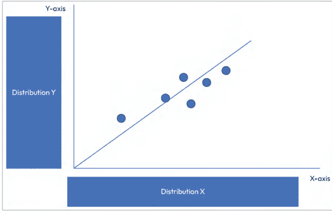

图 11.1：草图


- 2. 为了执行我的计划，我首先创建两个参数，我将它们命名为 X-Axis 和 Y-Axis，用于分别定义 x 轴和 y 轴

- 3. 我将两个参数都定义为 String 类型，并将剪贴板中的所有字段名称粘贴到这两个参数中。为此，我在 Excel 中打开输入文件，将标题行转置为列，并按 Ctrl + C。现在可以通过“从剪贴板粘贴”选项将数据粘贴到参数中。这样可以节省时间并降低出错率：

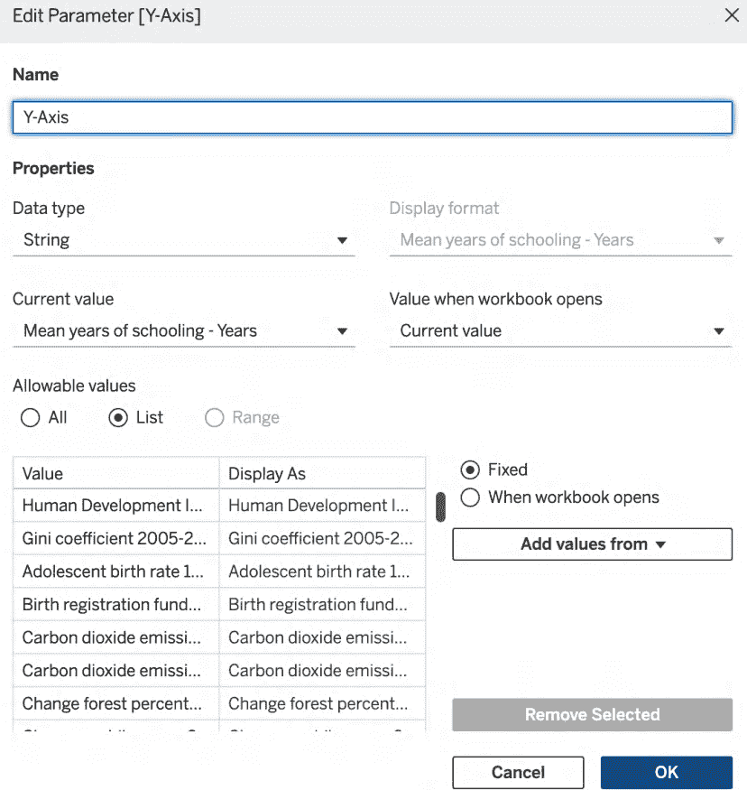

Figure 11.2: 粘贴到参数

- 4. 我也要在仪表板上显示参数，因此我选择 **显示参数**：

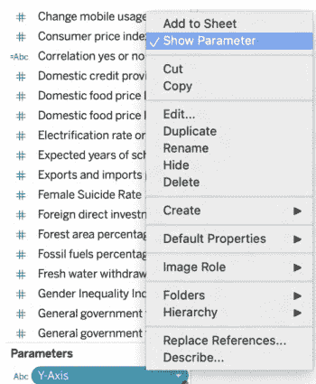

Figure 11.3: 显示参数

- 5. 如果现在测试参数，将不会发生任何事情。我们需要一个计算字段，用于定义如果从参数中做出了选择，Tableau 将选择相应的字段。我创建以下计算字段来实现此目的（此字段已作为入门和解决方案工作簿的一部分，以便让您更轻松）：

```
If [Parameters].[X-Axis] = 'Human Development Index HDI-2014' then [Human Development Index HDI-2014]
Elseif [Parameters].[X-Axis] = 'Gini coefficient 2005-2013' then [Gini coefficient 2005-2013]
Elseif [Parameters].[X-Axis] = 'Adolescent birth rate 15-19 per 1000 2010-2015' then [Adolescent birth rate 15-19 per 1000 2010-2015]
Elseif [Parameters].[X-Axis] = 'Birth registration before age 5 2005-2013' then [Birth registration before age 5 2005-2013]
Elseif [Parameters].[X-Axis] = 'Carbon dioxide emissions Average annual growth' then [Carbon dioxide emissions Average annual growth]
Elseif [Parameters].[X-Axis] = 'Carbon dioxide emissions per capita 2011 Tonnes' then [Carbon dioxide emissions per capita 2011 Tonnes]
Elseif [Parameters].[X-Axis] = 'Change forest percentage 1900 to 2012' then [Change forest percentage 1900 to 2012]
Elseif [Parameters].[X-Axis] = 'Change mobile usage 2009 2014' then [Change mobile usage 2009 2014]
Elseif [Parameters].[X-Axis] = 'Consumer price index 2013' then [Consumer price index 2013]
Elseif [Parameters].[X-Axis] = 'Domestic credit provided by financial sector 2013' then [Domestic credit provided by financial sector 2013]
Elseif [Parameters].[X-Axis] = 'Domestic food price level 2009 2014 index' then [Domestic food price level 2009 2014 index]
Elseif [Parameters].[X-Axis] = 'Domestic food price level 2009-2014 volatility index' then [Domestic food price level 2009-2014 volatility index]
Elseif [Parameters].[X-Axis] = 'Electrification rate or population' then [Electrification rate or population]
Elseif [Parameters].[X-Axis] = 'Expected years of schooling – Years' then [Expected years of schooling - Years]
Elseif [Parameters].[X-Axis] = 'Exports and imports percentage GDP 2013' then [Exports and imports percentage GDP 2013]
Elseif [Parameters].[X-Axis] = 'Female Suicide Rate 100k people' then [Female Suicide Rate 100k people]
```

Figure 11.4: 计算字段

- 6. 现在我们将对 **Y 轴** 参数执行相同的操作
  - 为了更快地创建 **Y 轴** 的计算字段，请将 **X 轴** 计算字段复制并粘贴到 Excel 中，查找并替换 `[Parameters].[X-Axis]` 为 `[Parameters].[Y-Axis]`。

- 7. 将 **X 轴** 计算字段拖到 **列**，将 **Y 轴** 拖到 **行**。另外，将 **ID** 字段放在 **详细信息** 卡片上。

- 8. 为了查看 Tableau 的相关性分析，请将 **趋势线** 拖到工作表上：

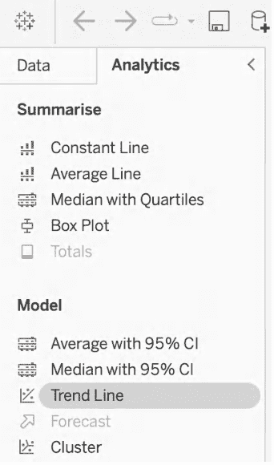

Figure 11.5: 趋势线

- 9. 带有趋势线的工作表如下所示。当将鼠标悬停在趋势线上时，您将看到直线方程、**R 平方**值和 **P 值**：

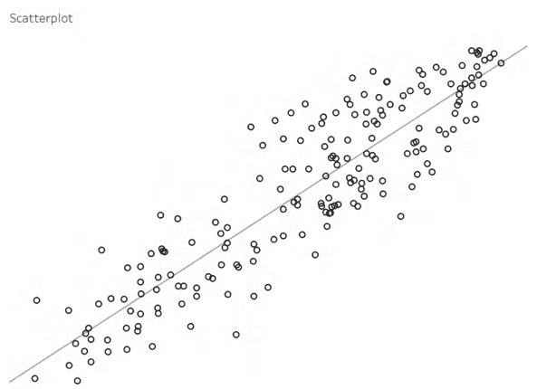

Figure 11.6: 趋势线数值

Y 轴方程的含义是，对于 x 轴上的每个点，y 轴值将增加 17.9717，起始点为 x 轴上的 0 和 y 轴上的 -4.33685。因此，总体而言，y 项的增长速度快于（也在增长的）x 项。**R 平方**值说明趋势线解释了多少方差（80.81%），最后，**P 值**说明模型的显著性。小于 0.05 的 **P 值**被认为是显著的，这意味着数据有 5% 的可能性是随机遵循趋势线的。前一张图中的趋势线 **P 值**小于 0.01%。因此，我们可以安全地假设，两个变量之间存在真实关系。

- 10. 要查看更多系数，请右键单击线条并选择 **描述趋势线...**：

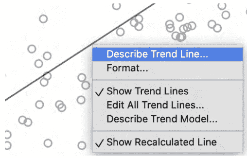

Figure 11.7: 描述趋势线...

将出现以下窗口：

```
Describe Trend Line

P-value: < 0.0001
Equation: Y-Axis=17.9717*X-Axis+-4.33685

Coefficients

| Term | Value | StdErr | t-value | p-value |
|---|---|---|---|---|
| X-Axis | 17.9717 | 0.64207 | 27.9902 | < 0.0001 |
| intercept | -4.33685 | 0.455498 | -9.52111 | < 0.0001 |

Copy
```

Figure 11.8: 趋势线信息

- 11. 或者，您可以选择描述趋势模型... 选项，您将看到以下内容：

```
Describe Trend Model
```

趋势线模型

给定 X-Axis 时，会为 Y-Axis 计算线性趋势模型。该模型在 p <= 0.05 时可能显著。

  - 模型公式：( X-Axis+intercept )
  - 建模观察值数量：188
  - 筛选观察值数量：0
  - 模型自由度：2
  - 残差自由度 (DF)：186
  - SSE (平方误差和)：343.173
  - MSE (平均平方误差)：1.84502
  - R 平方：0.808139
  - 标准误差：1.35831
  - p 值 (显著性)：< 0.0001

| 窗格 | | 线条 | | 系数 | | | | |
|---|---|---|---|---|---|---|---|---|
| 行 | 列 | p 值 | DF | 项 | 值 | 标准误 | t 值 | p 值 |
| Y 轴 | X 轴 | < 0.0001 | 186 | X 轴 | 17.9717 | 0.64207 | 27.9902 | < 0.0001 |
| | | | | 截距 | -4.33685 | 0.455498 | -9.52111 | < 0.0001 |

复制

Figure 11.9: 趋势模型信息

如果您想了解有关解释趋势线的更多信息，可以阅读以下文章：https://onlinehelp.tableau.com/current/pro/desktop/en-us/trendlines_add.htm.

- 12. 网格线让我有点分心，因此我决定通过右键单击屏幕并选择 格式... 来删除它们。

- 13. 在“格式”窗口中，我选择第五个选项“线条”，并将网格线值设置为 **无**：

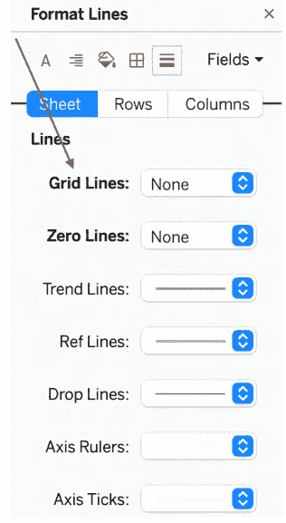

Figure 11.10: 移除网格线

- 14. 我还将标记从自动更改为圆形，并将颜色更改为黑色

- 15. 现在，我认为在散点图上显示每个点代表哪个国家会很有帮助，因此我在标记卡中将 ID 字段从“详细信息”更改为“标签”；然而，这看起来有点太混乱了：

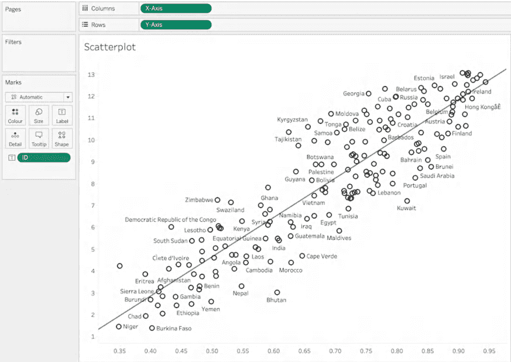

Figure 11.11: ID 到文本

- 16. 我单击撤销箭头，并通过右键单击 ID 并选择显示突出显示器 来添加突出显示功能。现在，最终用户将能够搜索国家，该点将在散点图中被突出显示：

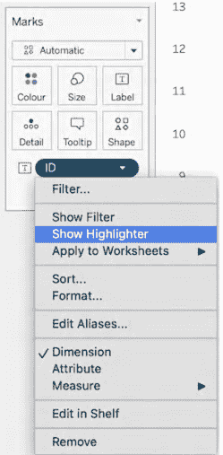

Figure 11.12: 显示突出显示器

- 17. 我也希望在将鼠标悬停在任何点上时，国家名称能以红色清晰显示，我通过在编辑提示 中将 ID 颜色更改为红色并增大大小来实现这一点：

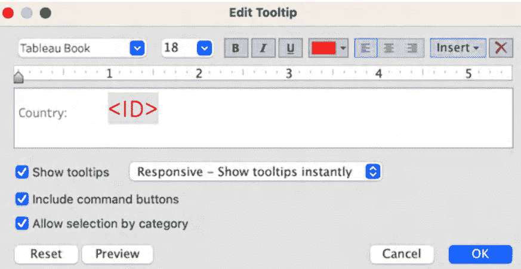

Figure 11.13: 提示

结果如下所示：

散点图

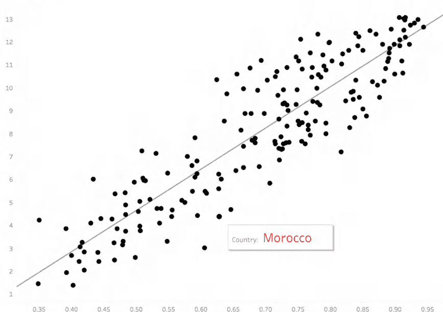

Figure 11.14: 悬停在点上

- 18. 我已经添加了趋势线，现在我想在视图中显示 **皮尔逊 R** (也称为 **R 平方**) 值，以便用户知道两个指标是否相关；然而，无法将 **描述趋势线** 或 **描述趋势模型** 选项设置为始终显示。因此，我将在新字段中自己计算该值；我使用 CORR() 函数来完成此操作：

```
ROUND( CORR( [X-Axis], [Y-Axis] ), 3 )
```

Figure 11.15: 皮尔逊 R


## 注意

趋势线显示关系的方向，但 R-squared（R²）告诉你该关系有多强。相关性衡量两个变量如何同步变动。正相关 = 两者均上升。负相关 = 一个上升，另一个下降。R-squared 的取值范围是 0 到 1。越接近 1，关系越强。

- R² = 0.9 表明存在非常强的关系
- R² = 0.5 表明存在中等强度的关系
- R² = 0.1 表明存在弱关系

- 但我想显示一些文本来指示两个变量是否相关，而不是显示数值本身，因为我希望仪表板更清晰。因此，我创建了另一个名为 **相关性：是或否** 的计算字段，使用以下代码：

```
IF [Pearson R] > 0.7 then 'The two variables <' + [Parameters].[X-Axis]+ '> and
<'+ [Parameters].[Y-Axis]+ '> have a very strong positive correlation of: ' +
STR([Pearson R])
ELSEIF [Pearson R] < 0.7 and [Pearson R] > 0.4 then 'The two variables <' +
[Parameters].[X-Axis] + '> and <'+ [Parameters].[Y-Axis]+ '> have a strong
positive correlation of: ' + STR([Pearson R])
ELSEIF [Pearson R] < 0.4 and [Pearson R] > 0.2 then 'The two variables <' +
[Parameters].[X-Axis] + '> and <'+ [Parameters].[Y-Axis]+ '> have a moderate
positive correlation of: ' + STR([Pearson R])
ELSEIF [Pearson R] <0.2 and [Pearson R] > -0.2 then 'The two variables <' +
[Parameters].[X-Axis] + '> and <'+ [Parameters].[Y-Axis]+ '> have no or a weak
correlation of:'+ STR([Pearson R])
ELSEIF [Pearson R] < -0.2 and [Pearson R] >-0.4 then 'The two variables <' +
[Parameters].[X-Axis] + '> and <'+ [Parameters].[Y-Axis]+ '> have a moderate
negative correlation of: ' + STR([Pearson R])
ELSEIF [Pearson R] < -0.4 and [Pearson R] > -0.7 then 'The two variables <' +
[Parameters].[X-Axis] + '> and <'+ [Parameters].[Y-Axis]+ '> have a strong
negative correlation of: ' + STR([Pearson R])
ELSEIF [Pearson R] < -0.7 THEN 'The two variables <' + [Parameters].[X-Axis] +
'> and <'+ [Parameters].[Y-Axis]+ '> have a very strong negative correlation of:
' + STR([Pearson R])
END
```

- 完成此操作后，我创建一个新工作表，并将 **相关性：是或否** 放置在 **文本** 货架上。该工作表非常简单，如您所见：


变量 <Human Development Index HDI-2014> 和 <Mean years of schooling - Years> 之间存在非常强的正相关，值为：0.899

图 11.16：文本上的相关性

- 我右键单击标题并选择 隐藏标题

最后，几乎所有内容都已准备就绪，可以从本节开头的草图构建仪表板。为了帮助用户解读散点图（并发现偏斜/异常值），我们将为两个轴添加边际分布。

## 添加轴分布

我们已经有所起步，但现在我想在散点图旁边添加 x 轴和 y 轴的分布图。我执行以下步骤：

- 1. 我从 x 轴开始，打开另一张工作表，并将 X 轴拖至 行。接下来，我单击刚添加的 **绿色药丸 X 轴**，并选择 **度量值 | 计数**。现在，在数据窗格中右键单击 **X 轴** 并选择 **创建 | 分组...**。在弹出窗口中，单击确定。最后，我将新维度 **X 轴 (bin)** 拖至 列。

- 2. 关闭 **编辑轴 [X 轴]** 窗口后，我右键单击 **X 轴** 并取消选择 **显示标题**，以不再显示标题

- 3. 我在另一张新工作表中继续处理 Y 轴，并将 Y 轴拖至 列。接下来，我通过单击它并选择 **度量值 | 计数** 来更改 列 上的 **Y 轴**。现在，在数据窗格中右键单击 **Y 轴** 并选择 **创建 | 分组...**。在弹出窗口中，我单击确定。

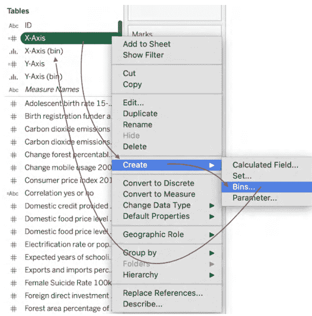

图 11.17：分组

- 4. 最后，我将新维度 Y 轴 (bin) 拖至 行
- 5. 我在 标记卡 中将颜色更改为灰色，并在页面顶部选择 整个视图
- 6. y 轴分布应与散点图对齐；因此，我单击 Y 轴 (bin) | 排序 | **降序**。接下来，我右键单击 Y 轴并取消选择 显示标题，以不再显示标题。
- 7. 为了将所有内容整合在一起，我打开一个仪表板页面并将其命名为 分布，然后将 散点图 工作表放在页面底部，将 相关性 工作表放在仪表板画布顶部
- 8. 我将分布工作表添加到散点图的相关两侧（Y 轴添加到 y 轴，X 轴添加到 x 轴）

- 9. 我还在左下角添加一个空白对象，以使分布与散点图边缘对齐：

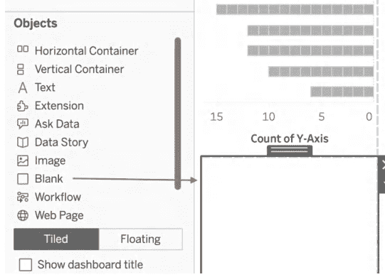

图 11.18：添加空白

最终布局如下：

变量 <Human Development Index HDI-2014> 和 <Mean years of schooling - Years> 之间存在非常强的正相关，值为：0.899

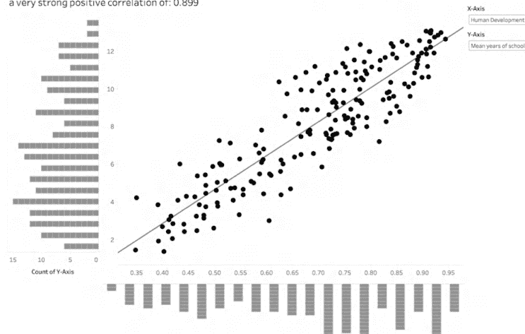

图 11.19：最终布局

- 10. 我想让分布更有意义，并添加一个操作，以便在两个分布图中突出显示国家。我这样做是为了让用户可以看到一个国家在单个指标的所有国家范围内的位置，因为在散点图中有时很难看到。另一方面，散点图可用于深入了解两个指标之间的关系。对于 **突出显示** 操作，我需要按如下方式设置参数：

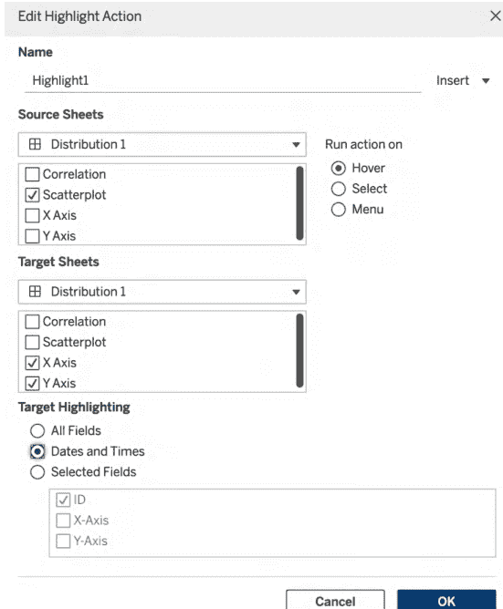

图 11.20：突出显示

- 11. 为了使高亮器在 **X 轴** 和 **Y 轴** 工作表上正常工作，请在两个工作表中将 **ID** 添加到 **详细信息** 货架

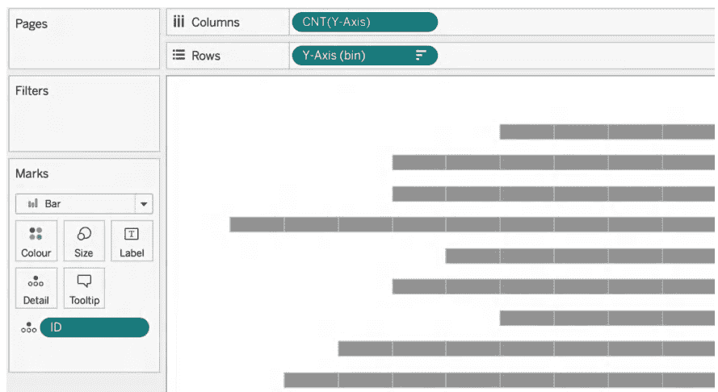

图 11.21：添加 ID

再次查看图 11.19 时，我在 X 轴上选择了 公共卫生支出占 GDP 比例 2013，在 Y 轴上选择了 平均受教育年限 - 年。我需要在 数据窗格 中通过右键单击 | 编辑 | 建议分组大小 | 确定 来调整 X 轴 bin 的大小。我可以看到，这两个度量值之间的总体相关性为中度正相关，相关系数为 0.359。但通过悬停在点上，您现在可以调查哪些国家对该相关性有何影响。对于靠近趋势线的国家，相关系数更接近真实因子。例如，右上角的美国在 x 轴（卫生支出）上的值为 16.8，在 y 轴（受教育年限）上的值为 12.76。如果将 12.76 乘以 0.359（相关系数），您将得到 4.581，这几乎正好是 12.76 和 16.8 之间的差值。现在，如果您搜索 塞拉利昂（右下角），您将得到 x 和 y 值 11.4 和 2.9。在这里，乘以相关系数无法很好地解释这种关系。这在散点图中很容易看出，因为 塞拉利昂 远离趋势线。我非常喜欢这个仪表板，因为它简化了变量之间的关系，并可以帮助新手和高级用户理解数据。

## 添加相关矩阵

单击仪表板并测试功能后，我意识到很难记住已经尝试过哪些组合，而且我希望能够筛选高度相关的组合。为解决此问题，我想向此工作簿添加一个新仪表板：一个包含所有组合的相关矩阵，采用颜色编码，并带有筛选选项：

- 1. 首先，我返回到 数据源 选项卡，再次添加相同的数据集，但使用新名称：World Indices Correlation Matrix。我甚至添加了两次，因为我需要将每个指标与其他每个指标进行相关分析：

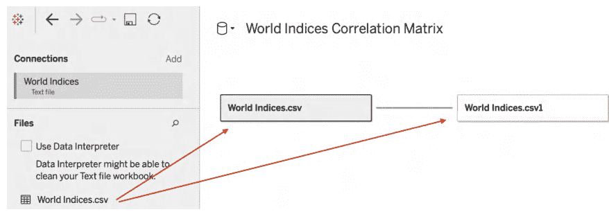

图 11.22：World Indices Correlation Matrix

- 2. 使用的键是 ID：

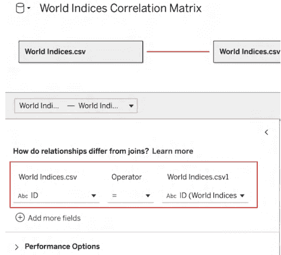

图 11.23：ID 作为键

- 3. 然后，我需要对两个表进行 透视 处理，因为我不再为每个指标拥有一列，而是需要一列包含所有指标名称，第二列包含所有值，以便创建一个包含它们各自的表。我选择 ID 以外的所有字段，并使用 透视：


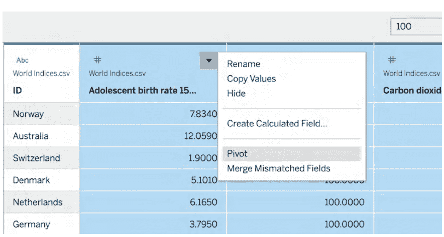

图 11.24：透视

- 4. 这将生成三个列。我将数据透视字段值重命名为值索引 A，将数据透视字段名重命名为索引 A：

| ID | 索引 B | 值索引 B |
|---|---|---|
| 挪威 | 15-19 岁青少年出生率 pe... | 7.83 |
| 挪威 | 5 岁以下出生登记率... | 100.00 |
| 挪威 | 二氧化碳排放量 per ... | 9.19 |
| 挪威 | 二氧化碳排放量平均值... | 0.78 |
| 挪威 | 森林覆盖率变化 19... | 11.91 |
| 挪威 | 移动使用量变化 2009 2... | 5.22 |

图 11.25：重命名列

- 5. 现在我对第二个表再次执行此操作，并重命名列 索引 B 和 值索引 B

## 相关系数矩阵

- 6. 我打开一个新工作表，并将 **索引 B** 放在 **列** 上，将 **索引 A** 放在 **行** 上。我创建一个名为 **皮尔森 R** 的计算字段，代码为 `CORR([Value Index B], [Value Index A])`，并将其放置在 **筛选器**、**颜色** 和 **文本** 上。在 **筛选器** 卡上右键单击 **皮尔森 R** 后，我选择 **显示筛选器**：

| 索引 A | 每 10 万人中 15-19 岁青少年出生率 2010–2015 | 5 岁以下出生登记率... | 2011 年人均二氧化碳排放量（吨） | 二氧化碳排放量年平均百分比... | 森林百分比变化 19.. | 2009-2014 年移动使用量变化 | 2013 年消费者物价指数 | 2013 年金融部门提供的国内信贷 | 2009-2014 年国内食品价格水平指数 | 2009-2014 年国内食品价格水平波动指数 | 电气化率或人口... |
|---|---|---|---|---|---|---|---|---|---|---|---|
| 每 10 万人中 15-19 岁青少年出生率 2010.. | 1.000 | -0.650 | -0.442 | -0.025 | -0.332 | 0.388 | 0.191 | -0.481 | 0.596 | 0.165 | -0.705 |
| 2005-2013 年 5 岁以下出生登记 | -0.650 | 1.000 | 0.386 | 0.087 | 0.289 | -0.405 | -0.296 | 0.393 | -0.583 | -0.132 | 0.736 |
| 人均二氧化碳排放量 2.. | -0.442 | 0.386 | 1.000 | -0.077 | 0.232 | -0.260 | -0.140 | 0.271 | -0.509 | -0.048 | -0.427 |
| 二氧化碳排放量年平均.. | -0.025 | 0.087 | -0.077 | 1.000 | -0.016 | 0.022 | 0.003 | -0.045 | 0.156 | 0.096 | 0.122 |
| 1900 至 2.. 年森林覆盖率变化 | -0.332 | 0.289 | 0.232 | -0.016 | 1.000 | -0.149 | -0.094 | 0.239 | -0.309 | -0.066 | 0.322 |
| 2009-2014 年移动使用量变化 | 0.388 | -0.405 | -0.260 | 0.022 | -0.149 | 1.000 | 0.168 | -0.277 | 0.402 | 0.026 | -0.535 |
| 2013 年消费者物价指数 | 0.191 | -0.296 | -0.140 | 0.003 | -0.094 | 0.168 | 1.000 | -0.280 | 0.269 | 0.118 | -0.212 |
| 金融部门提供的国内信贷 s.. | -0.481 | 0.393 | 0.271 | -0.045 | 0.239 | -0.277 | -0.280 | 1.000 | -0.572 | -0.139 | 0.448 |
| 2009-2014 年国内食品价格水平指数 | 0.596 | -0.583 | -0.509 | 0.156 | -0.309 | 0.402 | 0.269 | -0.572 | 1.000 | -0.212 | -0.636 |

图 11.26：相关系数矩阵

颜色可随您喜好调整；我选择了从红色到黑色的 5 级配色方案，表示红色字段为负相关，黑色字段为正相关。

- 7. 我打开一个新的选项卡并将工作表放置在其中。尝试调整筛选器，使您只能看到高度相关的范围 0.89–0.99，目前仅使用较小的数据集：

## 相关系数矩阵

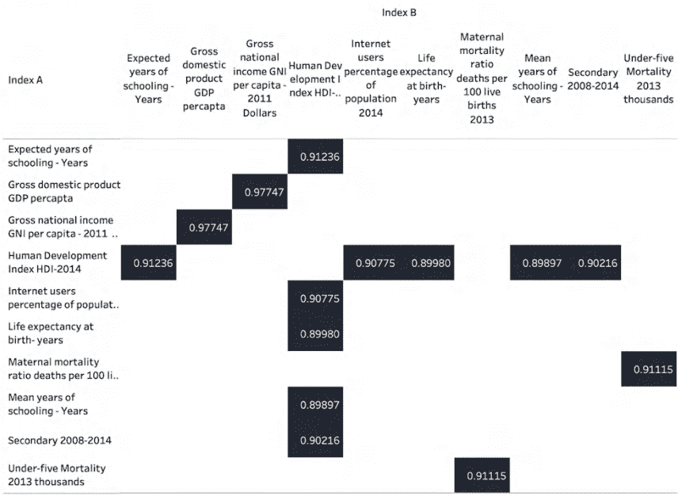

图 11.27：筛选相关系数矩阵

此部分帮助我们创建了所有可能组合的热图，并对相关值进行了颜色编码，添加了筛选器以关注感兴趣的点。在前面的截图中，您可以看到高度相关的指数。

## 完成仪表板

为避免任何混淆，我想向用户解释皮尔森 R 筛选器并完成仪表板：

- 1. 首先，我将文本字段“皮尔森 R 范围说明”添加到仪表板。如果有更多时间，我可以将其制作成类似于 X 轴和 Y 轴字段的下拉参数：

## 相关系数矩阵

| 索引 A \\ 索引 B | 预期受教育年限 - 年 | 国内生产总值人均 | 国民总收入人均 | 人类发展指数 HDI-2014 | 2014 年互联网用户占人口百分比 | 出生时预期寿命 - 年 | 2013 年孕产妇死亡率每 10 万例活产死亡 | 平均受教育年限 - 年 | 中学 2008-2014 | 2013 年五岁以下死亡率（千人） |
|---|---|---|---|---|---|---|---|---|---|---|
| 预期受教育年限 - 年 | | | | 0.91236 | | | | | | |
| 国内生产总值人均 | | | 0.97747 | | | | | | | |
| 国民总收入人均 GNI 人均 - 2011 ... | | 0.97747 | | | | | | | | |
| 人类发展指数 HDI-2014 | 0.91236 | | | | 0.90775 | 0.89980 | | 0.89897 | 0.90216 | |
| 互联网用户占人口百分比.. | | | | 0.90775 | | | | | | |
| 出生时预期寿命 - 年 | | | | 0.89980 | | | | | | |
| 每 10 万例活产孕产妇死亡率.. | | | | | | | | | | 0.91115 |
| 平均受教育年限 - 年 | | | | 0.89897 | | | | | | |
| 中学 2008-2014 | | | | 0.90216 | | | | | | |
| 2013 年五岁以下死亡率（千人） | | | | | | 0.91115 | | | | |

图 11.28：添加关于皮尔森 R 的文本

- 2. 要完成所有内容，需要三个操作。首先，需要两个参数操作，以便单击相关系数矩阵来更改 X 轴和 Y 轴参数的值，其中第一个应自定义如下：

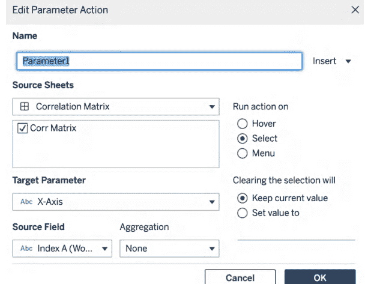

图 11.29：参数操作 1

前面的截图中的操作将把 X 轴参数更改为来自索引 A 的值。

- 3. 现在，我按如下方式编辑第二个参数操作：

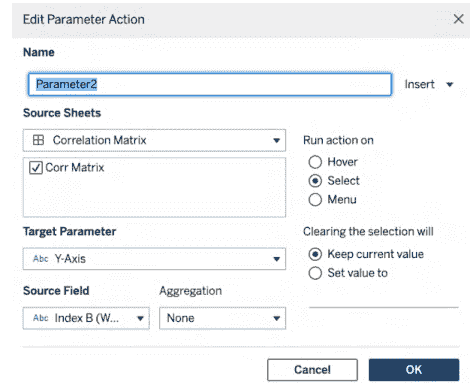

图 11.30：参数操作 2

前面的图中的操作将把 Y 轴参数更改为来自索引 B 的值。

- 4. 最后，我添加一个名为 GoToScatterplot 的工作表导航操作，该操作允许用户在选择索引组合后更改仪表板：

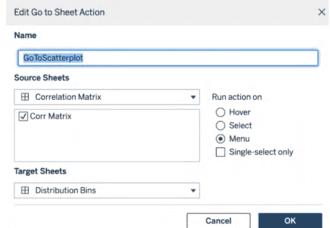

图 11.31：工作表导航操作

前面的操作将显示一个菜单，以转到趋势线仪表板。

- 5. 用户现在可以选择一个值并单击它。在后台，X 轴和 Y 轴参数将调整为与同一字段相关的两个指数。例如，对于平均受教育年限和人类发展指数，将出现一个超链接：

## 相关系数矩阵

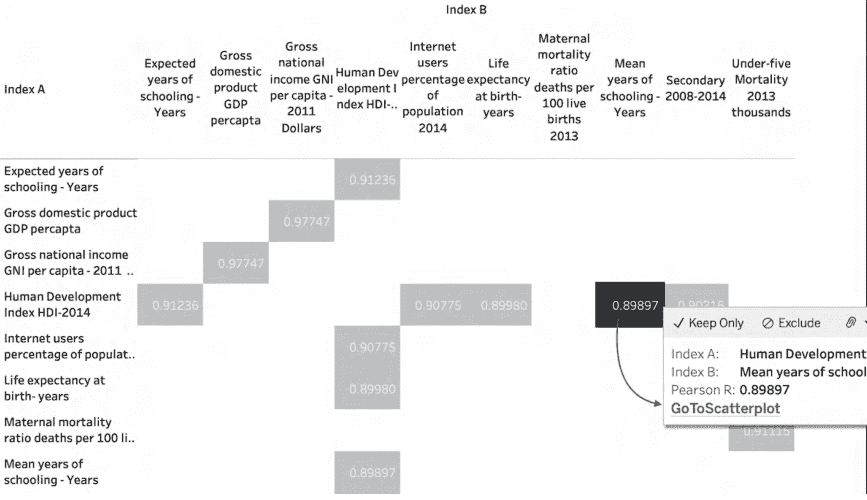

图 11.32：菜单

- 6. 用户将被重定向到带有趋势线的仪表板，该趋势线现在已预筛选并显示相同的两个指数：平均受教育年限和人类发展指数

由此可以看出，所选的两个指数正相关 89.9%。我们还可以看到 x 轴和 y 轴上每个指数的分布。

这是一个冗长的练习，但我想向您展示我完整的思考过程并探讨仪表板创建。如果有更多时间，我肯定会添加更多见解，例如：

- 为每个指数添加说明
- 添加更详尽的相关性说明
- 将 p 值或其他系数添加到分析中，并相应更改文本

别忘了获取反馈，并与利益相关者确认方向是否正确。有些人使用草图，然后制作草稿，并再次征求反馈，直到产品最终定稿。我倾向于向利益相关者提问，以更好地了解他们的需求，并让他们引导我了解他们希望用 Tableau 仪表板替换或更改的流程。然后，根据复杂程度和时间表，我会展示完整版本或中间版本。您应该避免在利益相关者不需要的事情上花费数小时或数天。

但现在，让我们看看一个包含地理空间数据的第二个、更简短的用例。我们将把同样的“快速思考，快速交付”方法应用于空间数据——这次是在严格的一小时截止日期内。

## 芝加哥交通违章的地理空间分析

星期三早上，您的经理来到您的办公室，想查看芝加哥过去一年的闯红灯违章情况。他们询问您是否可以为此构建一个仪表板。特别是，您需要突出显示大多数违章发生的位置，以及过去几年芝加哥交通信号灯违章是否存在整体趋势。您会获得两个数据集，一个包含摄像头位置，一个包含违章记录，并被告知仪表板需要在一小时内完成。您该怎么办？

在继续阅读之前，请思考您将如何处理这个问题。花五分钟时间思考您将采取的步骤，并草拟仪表板设计。

以下是我处理此问题的概述：

- 1. 在 Tableau Prep Builder 中打开数据集
- 2. 连接两个数据集
- 3. 如有需要，清理数据
- 4. 在 Tableau 中打开输出
- 5. 如果可能，使用地图可视化摄像头位置
- 6. 添加每个摄像头的违章数量
- 7. 确定是否存在月度趋势

接下来是我设计仪表板的粗略草图：

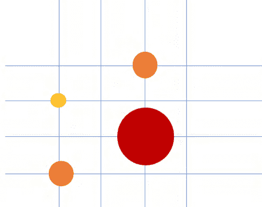

网格 = 街道
圆圈 = 交通信号灯摄像头位置
颜色/大小 = 违章数量


接下来是我将要执行的步骤说明。对应的 Tableau 仪表板可以从 Tableau Public 下载，Tableau Prep Builder 文件可在 GitHub 上找到 (https://github.com/PacktPublishing/Mastering-Tableau-2026/tree/main/Chapter11)，而数据集本身可在此公开获取：https://data.cityofchicago.org/Transportation/Red-Light-Camera-Violations/spxq-js37.

## 准备数据

将两个文件加载到 Tableau Prep Builder 后，我发现按 LONGITUDE 和 LATITUDE 进行连接并没有任何帮助，因为几乎所有记录都不匹配：

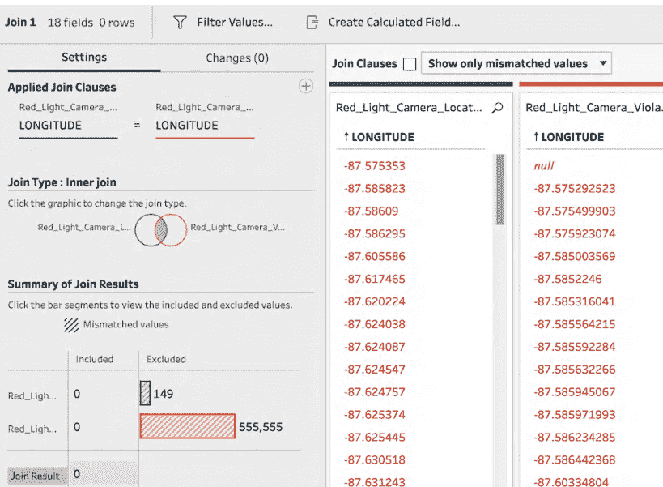

图 11.34：连接 1

我尝试另一种方法：按交汇路口进行连接。这次结果同样是 0 个连接行，但这次我明白了原因。在一个数据集中，INTERSECTION 值由短横线 (-) 分隔，而在另一个数据集中，则是 AND；此外，一个使用大写字母，另一个则不使用：

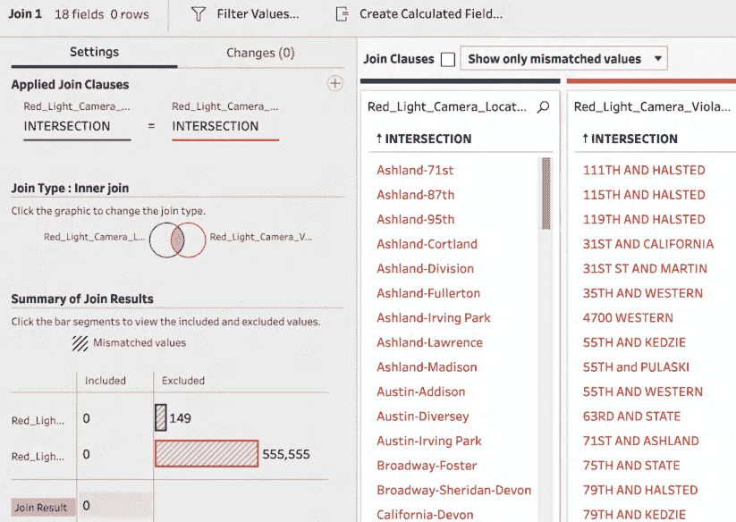

图 11.35：连接 II

我可以添加一个清理步骤，将所有字母转为大写并将交汇路口拆分为两部分。我可以在 - 以及 AND 上执行 Custom Split...：


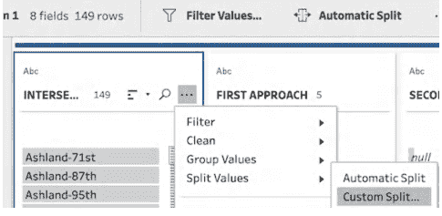

图 11.36：数据准备

接着，我注意到交汇路口的顺序不同；例如，Ashland-71st 和 71ST AND ASHLAND。我可能会考虑重新构建数据集，创建一个循环，将两条街道在两个拆分部分中按字母顺序排列，但现在我没有时间这样做。

另一种解决方案是先将 split 1 与 split 1 连接，以及 split 2 与 split 2 连接。在第二次连接中，我可以将 split 1 与 split 2 连接，以及 split 2 与 split 1 连接。之后，我可以将两次连接合并并创建输出文件（或直接将 Prep Builder 数据集加载到 Tableau Desktop 中）。使用这种方法，我仍然无法包含所有数据，但可以获得 444,000 行中的 380,000 行。这可能足以大致了解模式。如果我还有剩余时间，可以继续映射剩余的不匹配项。

不过，我决定彻底放弃 locations 数据集，只使用 violations 数据集，因为我意识到自己只会遗漏尚未发生违规行为的地点。目前违规地点的位置已经足够。然而，如果你想判断交通信号灯控制是否停止工作，则必须同时使用两个数据集。

## 构建交汇路口地图

我继续在 Tableau 中打开 violations 数据集：

- 1. 经度和纬度值未被自动识别，因此我需要通过单击数据类型图标将两者都更改为 Number (decimal)：

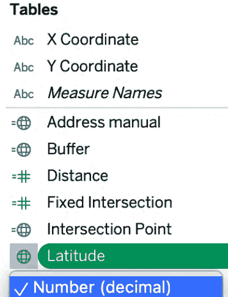

图 11.37：更改数据类型

- 2. 然后，我通过单击前面图中字段上的下拉箭头并选择 **转换为度量**，将 **经度** 和 **纬度** 字段更改为 **度量**

- 3. 现在我可以再次单击数据类型图标，将两个字段更改为 **纬度** 和 **经度**：

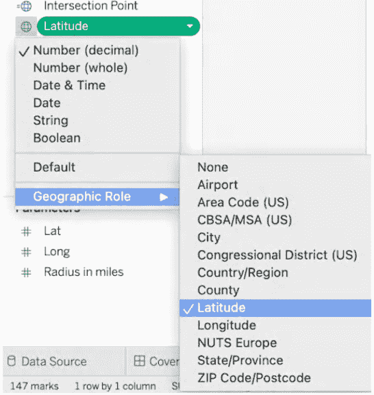

图 11.38：更改地理角色

- 4. 通过将 **经度** 拖到 **列**，**纬度** 拖到 **行**，并将 **交汇路口** 拖到 **文本** 卡，我可视化红灯位置——至少包括曾发生过违规的位置：

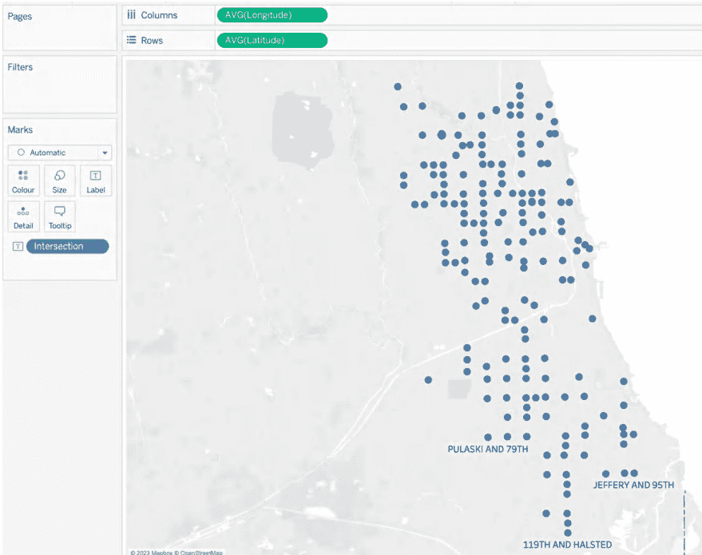

图 11.39：芝加哥的交汇路口

- 5. 工作表的名称将为 交汇路口，由于我正在查看违规情况，我将 标记卡 中的颜色更改为红色。最后，我不需要查看交汇路口名称，因此将 交汇路口 从 文本 更改为 详细信息。

- 6. 接下来，当地图显示更多细节时我更喜欢，因此我使用 **背景图层...** 来选择更多选项：

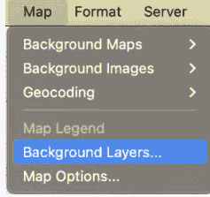

图 11.40：**背景图层...**

- 7. 选择你想在地图上看到的所有图层：

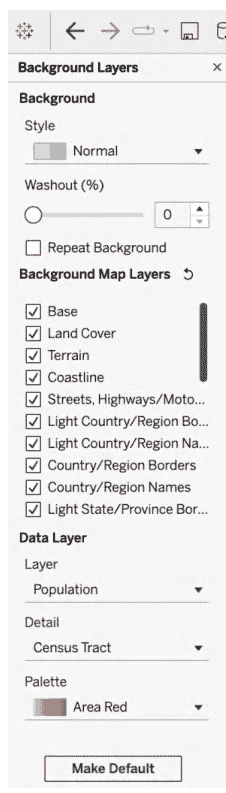

图 11.41：芝加哥地图

Tableau 的另一个不错的功能是，你可以将 数据图层 添加到视图中。你可以在前面截图的左下角看到该选项。

- 8. 我使用 普查区 的 **人口** 图层，因为我希望它能提供一些关于人口稠密地区是否发生更多或更少违规行为的细节：

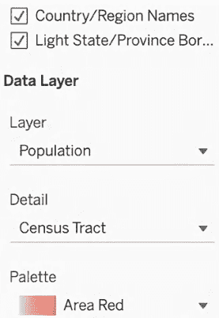

图 11.42：数据图层

在下面的截图中，你可以看到其外观——请注意，红色越深，该地区人口越稠密：

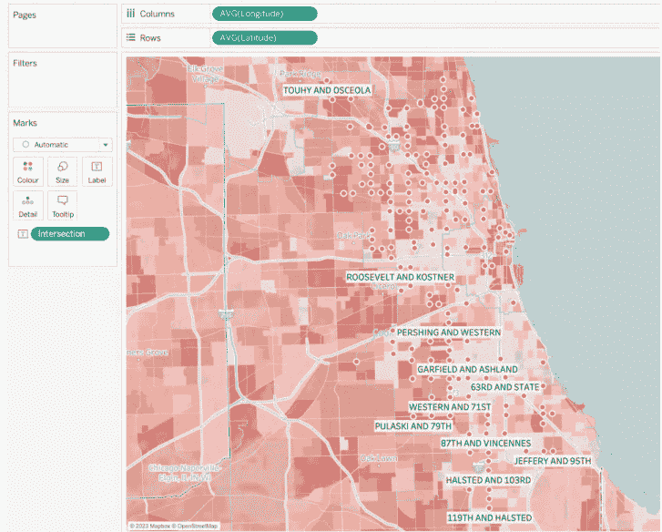

图 11.43：交汇路口可视化

- 9. 我将 **MONTH([Violation Date])** 添加到 **页面**；这样，我的老板可以操作月份，查看违规数量在何时何地发生变化：

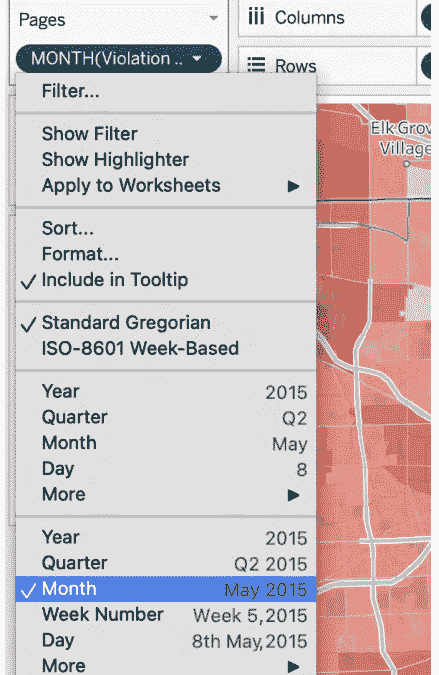

图 11.44：**页面**

- 10. 当然，我需要添加 **违规** 字段才能使 **页面** 正常工作。我决定使用 Tableau 的 **密度** 功能，并将颜色设为红色：

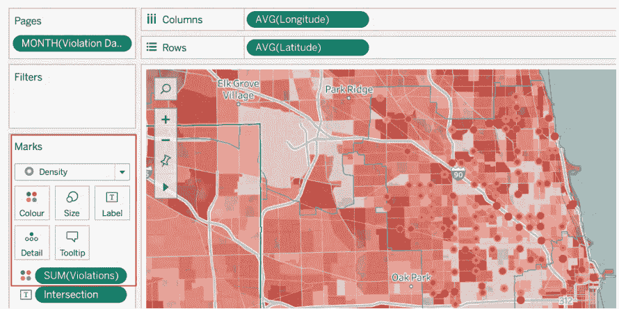

图 11.45：密度可视化

## 添加相应的热图工作表

单击 页面 播放按钮后，我注意到某些月份存在一种模式。我想更仔细地查看，因此我打开一个新工作表：

- 1. 我将新工作表命名为 热图，并将 MONTH(Violation Date) 放在 列 上，将 YEAR(Violation Date) 放在 行 上。然后，我将 违规 拖到 颜色 卡并选择红金色，得到如下结果：

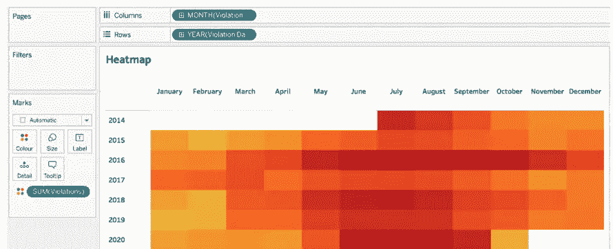

图 11.46：热图

夏天肯定有更多的红灯违规行为，2016 年和 2020 年的违规数量最多。

- 2. 最后但同样重要的是，我添加一个名为 趋势？ 的新工作表。我将 MONTH(Violation Date) 拖到 列 卡上。 违规 字段应放置在 行 上。我确保两个度量均为 Continuous（绿色）。从 分析窗格，我将线性 趋势线 拖到工作表上。接下来，我将 预测 拖入视图中：

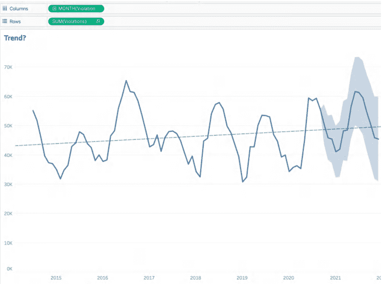

图 11.47：折线图

在前面的图中，你可以看到红灯违规的总体趋势随年份略有增加。预测显示，夏天红灯违规较多的季节性规律可能会在 2021 年继续。

欢迎在 2021 年底前检查 Tableau 预测模型的效果！芝加哥市的数据集会持续刷新。

## 最终确定仪表板

一小时快结束了，我只是将三个工作表放置到一个名为 红灯违规 的仪表板上，并稍微进行格式化；它如下所示：

## 红灯违规

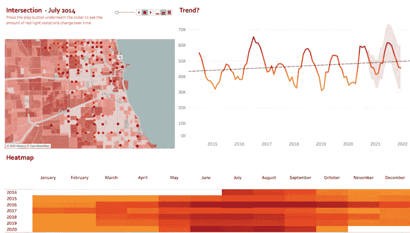

图 11.48：最终仪表板

你可以在 Tableau Public 上与此章节关联的 Tableau 工作簿中找到最终仪表板，链接如下：https://github.com/PacktPublishing/Mastering-Tableau-2026/tree/main/Chapter11。

仪表板可以改进吗？当然可以，总是可以改进。但是在第一次迭代之后，我的老板可以告诉我是否需要调整任何内容，我可以进行调整。我相信我可以花更多时间来改进它，但大多数时候，仪表板制作更注重及时交付。与临时问题或一次性练习相比，完整的生产模型是另一回事，尤其是如果你以敏捷的方式工作，将工作拆分为可交付成果，获取反馈并继续处理。

## 使用距离度量扩展地理空间分析

我们的最后一个用例也是针对同一芝加哥交通数据集的地理空间分析，但这次我们将添加另一个组件。我们希望租一个新地方，但要求半径 x 范围内的交汇路口不超过 n 个，且海军码头距离最多 y 英里。变量 n、x 和 y 应该是交互式的，以便我们进行更改并获得非常灵活的仪表板体验。关于此任务，需要提出的问题是：

- 我们如何将芝加哥的任何给定位置添加到数据集中？它当前仅显示交汇路口和违规行为。

- 我们如何创建 n、x 和 y 变量？

- 我们如何在地图上任何给定点添加半径指示器？

- 我们如何测量两个变量点之间的距离？


以下步骤将解答所有这些问题：

- 1. 返回与此章相关的工作簿
- 2. 右键单击名为 **Intersection** 的工作表，然后单击 **复制**
- 3. 将新工作表重命名为 Rental1
- 4. 从 **页面** 中移除 **MONTH(Violation Date)**，从 **颜色** 货架中移除 **SUM(Violations)**，并从标题中移除红色文本（子标题），使工作表如下所示：

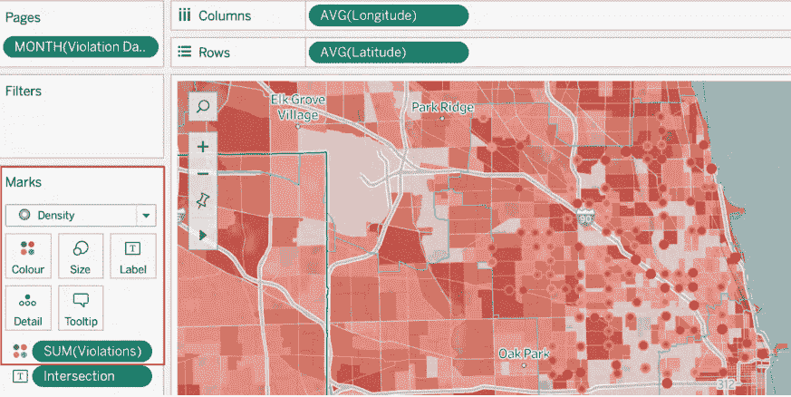

图 11.49：交集

- 5. 将 **标记** 类型更改为 Map
- 6. 单击 **地图 | 图层**，并将 **数据图层** 更改为 **无数据图层**：


图 11.50：图层

- 7. 将 Violation Date 放到 **筛选器** 货架上，并选择年份 2020
- 8. 将 Violations 拖到 **颜色** 货架上，并选择 Red 调色板：

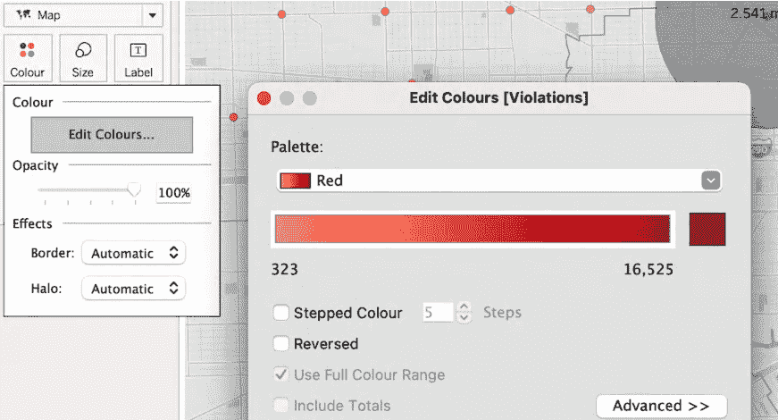

图 11.51：编辑颜色

现在我们面前有一张芝加哥地图，每个点代表 2020 年发生过违规行为的路口。点越深，表示在该路口登记的违规行为越多。

## 向地图添加度量点

接下来，我们需要添加功能，以便在地图上设置一个标记并从此处开始测量。这可以通过创建经度和纬度参数，并在计算字段中使用它们来实现：

- 1. 创建以下参数：
  - Lat：
  - 纬度：

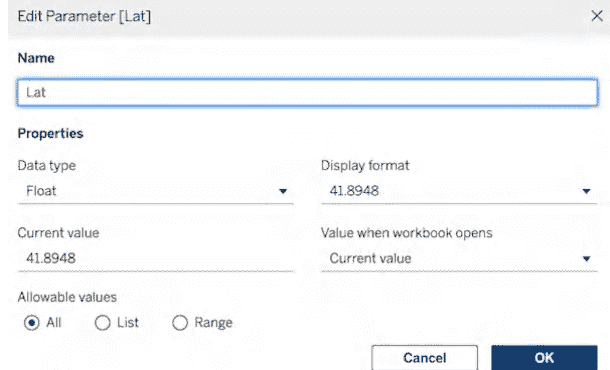

图 11.52：纬度参数

  - Long：
  - 经度：

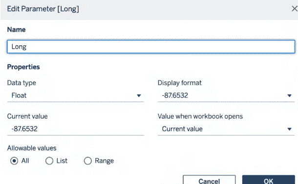

图 11.53：经度参数

- 2. 右键单击每个参数并选择 **显示参数**
- 3. 创建名为 Address manual 的计算字段：

```
MAKEPOINT([Lat], [Long])
```

- 4. 将 Address manual 拖到地图上，位于 **添加标记图层** 弹出窗口上方：

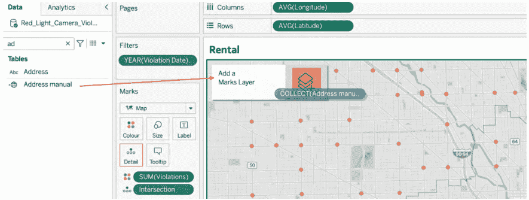

图 11.54：添加图层

- 5. 将新图层的 **标记** 类型更改为 Map

- 6. 按照这些步骤，我们将拥有一张带有路口、按颜色编码的违规数量以及一个可通过 Lat 和 Long 参数更改的点的地图。用户可以例如使用 Google Maps 查找纬度和经度；只需在 Google Maps 上选择一个代表租赁房屋位置的点即可：

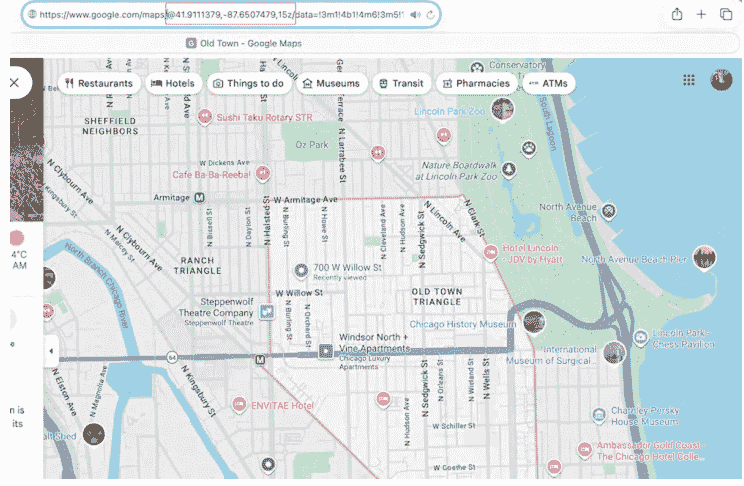

图 11.55：Google Maps

- 7. 纬度和经度将显示在 URL 和页面底部。将它们输入到 Lat 和 Long 参数中，相同的点将出现在我们的 Tableau 地图上：

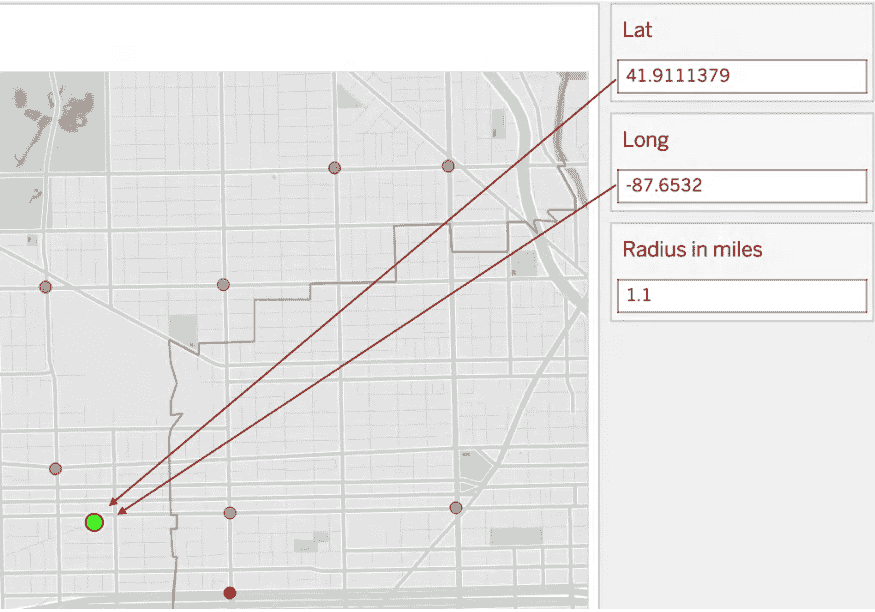

图 11.56：纬度和经度

## 添加距离线

在接下来的步骤中，我们将添加一个半径和一条从海军码头开始的距离线：

- 1. 创建另一个名为 Radius in miles 的参数，并将当前值设置为 1.1
- 2. 右键单击 Radius in miles 参数并选择 **显示参数**
- 3. 创建名为 Buffer 的计算字段，它将用作围绕 **Address manual** 点的半径：
  ```
  BUFFER([Address manual],[Radius in miles], 'miles')
  ```
- 4. 将 **Buffer** 字段拖到地图上，就像我们处理 **Address manual** 字段一样，位于 **添加标记图层** 弹出窗口上方
- 5. 将此新图层的 **标记** 类型更改为 Map

- 6. 单击 **颜色**，将不透明度更改为 **50%**，并选择灰色

以下图中显示了 **Navy Pier** 在 URL 中的坐标（**41.8859088,-87.6064094**）：


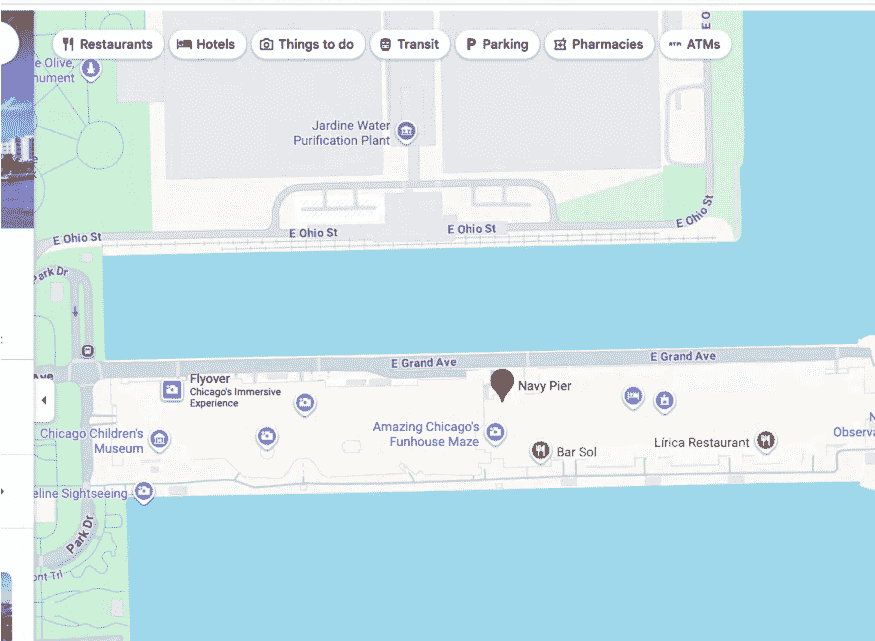

图 11.57：海军码头

- 7. 按如下方式创建计算字段：

```
MAKEPOINT(41.892133, -87.604045)
```

- 8. 将 **Navy Pier** 字段拖到地图上，位于 **添加标记图层** 弹出窗口上方
- 9. 将 **标记** 类型更改为 Map
- 10. 为了将 **Navy Pier** 连接到我们的 **Address manual** 点并测量距离，创建另一个名为 Line 的计算字段：

```
MAKELINE([Address manual], [Navy Pier])
```

- 11. 要测量两者之间的距离，使用以下代码创建一个 Distance 字段：

```
DISTANCE([Address manual], [Navy Pier], 'miles')
```

- 12. 将 Line 字段放置在地图上，位于 **添加标记图层** 弹出窗口上方
- 13. 将新图层中的 **标记** 类型更改为 Map
- 14. 将 Distance 放到 **标签** 货架上，将度量更改为平均值，然后单击 **标签** 添加文本 miles：

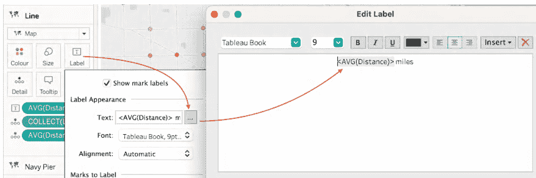

图 11.58：编辑标签

我们的仪表板现在如下所示：

租赁

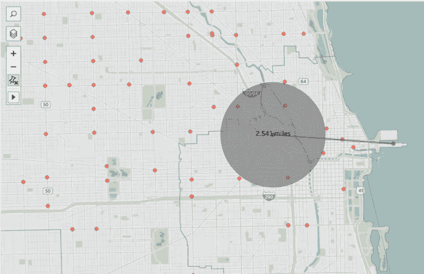

图 11.59：最终仪表板

至此即告完成。半径清楚地显示了某段距离内有多少个路口；你可以通过将鼠标悬停在点上来查看 **路口违规数量**。从海军码头到我们当前位置 **Address manual** 的线告诉我们这两个点之间的距离。

要解答开头提出的问题：

- *如何将芝加哥的任何给定位置添加到我们的数据集中？目前它仅显示路口和违规行为。通过在计算字段中使用 **MAKEPOINT()** 函数。*
- *如何创建 n、x 和 y 变量？通过使用参数。*
- *如何在地图上的任何给定点添加半径？通过使用 **BUFFER()** 函数。*
- *如何测量两个可变点之间的距离？通过使用 **DISTANCE()** 函数；通过添加 **MAKELINE()** 函数，将绘制一条线。*

此用例可以重新创建用于某区域的超市数量、学校、公共交通站点等等。发挥创造力，欢迎将你的仪表板上传到 Tableau Public，别忘了添加 **#MasteringTableau** 标签！

如果你大量使用空间数据，我也建议你查看以下链接：

- https://www.tableau.com/about/blog/2019/6/geospatial-analysis-made-easy-two-new-spatial-functions-makepoint-and-makeline
- https://www.tableau.com/about/blog/2020/3/seeing-and-understanding-proximity-made-easy-buffer-calculations

## 配套仪表板

在本章中，我们将使用 Tableau Superstore 零售数据集创建一个预测仪表板，该数据集包含地理、时间和产品数据，非常适合空间分析和预测。

- 1. 打开 Tableau 并连接到 Sample Superstore 数据集。将 Orders 拖到画布上。
- 2. 创建一个新工作表并将其命名为：“销售地理”
- 3. 构建地图：双击 **州/省**
- 4. 将 **Sales** 拖到 **标记** 货架的 **大小** 和 **颜色** 上，并选择 **红蓝发散**
- 5. 右键单击地图 | **背景** | **地图图层**，并启用：**土地覆盖**、**海岸线**、**国家边界**，在 **数据图层** 中：**人口密度**：


图 11.60：背景图层

你现在将能够在人口之上看到每个州的销售数字。我们是否在人口数量较高的地方看到了更多销售？

## 销售地理


图 11.61：销售地理

- 6. 创建一个新工作表并将其命名为：“销售预测”
- 7. 将 Order Date 拖到列，将其更改为月份且连续
- 8. 将 Sales 拖到行
- 9. 在分析窗格中将“预测”拖入视图

- 10. 右键单击线条，单击 **预测 | 预测选项**：
  - 预测长度：正好 12 个月
  - 源数据：按月汇总
  - 忽略最后：1 个月
  - 显示预测区间：95%


图 11.62：销售预测

- 11. 复制 Sales Forecast 工作表并将其命名为：“类别预测”
- 12. 将 Category 添加到行中，置于 Sales 之前


## 销售预测 (2)


图 11.6.3：类别预测

- 13. 创建一个新仪表板并将其命名为“全球零售销售预测”
- 14. 在顶部添加“销售地理”工作表，左下角添加“销售预测”，右下角添加“类别预测”。按需设置格式。

### 销售地理


### 销售预测


### 类别预测


图 11.6.4：最终仪表板

此仪表板展示了具有空间分析功能的综合预测能力，非常适合零售规划、库存管理和战略决策。分步说明确保您可以通过调整字段名称和关系，即使使用不同的数据集也能重建此仪表板。

## 摘要

在本章中，我们探索了高级自助分析这个迷人的世界。我们首先理解了自助分析作为一种商业智能形式的概念，它使个人能够直接查询数据集并挖掘宝贵见解。在整个过程中，我们发现了三个引人入胜的用例，展示了自助分析的威力。我们解读了世界指数之间复杂的相关性，从而更深入地了解全球市场动态。随后，我们深入研究了芝加哥交通违章领域，使用地理空间分析来发现模式和潜在改进领域。最后，我们扩展了地理空间分析，利用距离度量根据关键变量确定住房位置的最佳半径。

在这些多样化的场景中，一个关键教训贯穿始终：在启动自助分析项目时，结构良好的方法至关重要。通过仔细规划工作、熟悉数据、运用描述性统计，并根据中间结果调整计划，我们为成功铺平了道路。

请记住，仪表板永远不会真正完成：您随时可以更改内容；受众可能会发生变化；利益相关者的意愿可能会不同。交付一个具有基本功能的可用可视化，并在获得反馈后继续开发。根据您的积压工作或其他情况，最小可行产品可能正是您所需要的。

在本章结束时，我敦促您反思所获得的见解，并思考如何将这些原则应用到您自己的自助分析工作中。请记住，虽然我的经验可以作为指南，但有许多不同的道路可以通向您的目标。拥抱自助分析的力量，用数据赋能自己，并在追求明智决策的过程中解锁无限可能。在此过程中，让您的 IT 团队歇一歇，让他们专注于超出您职责范围的更重实现工作。

下一章将全面介绍性能改进。随着数据量的不断增加，性能至关重要，可能意味着成功与失败的区别。

## 获取本书的 PDF 版本及更多内容

扫描二维码（或访问 packtpub.com/unlock），按书名搜索此书，确认版本，然后按照页面上的步骤操作。


立即解锁

注意：请妥善保管发票。直接从 Packt 购买无需发票。
