# 性能改进

一旦人们熟悉了 Tableau 的功能，很快就会遇到另一种问题：性能。您可能都曾在屏幕上盯着“加载数据”或“执行查询”阅读。但请不要担心，我们会帮助您！如果设计得当，Tableau 仪表板即使在处理大量数据时也能表现出色。

本章将从多个方面探讨性能，旨在为您提供创建加载速度快且能快速响应最终用户交互的工作簿的技术。

在本章中，我们将讨论以下主题：

- 了解性能记录仪表板
- 硬件和即时技术
- 连接到数据源
- 使用提取
- 明智地使用过滤器
- 高效计算
- 其他改进性能的方法

由此可见，有关性能改进的主题有很多，因此，我们不浪费时间，立即进入主题。我们的第一个主题是性能记录，当您遇到性能下降时，应该首先查看它，因为它可以帮助您找出所有缓慢问题的根源。

## 了解性能记录仪表板

Tableau 将性能记录功能作为安装包的一部分提供，并作为名为 PerformanceRecording.twb 的仪表板随附。该仪表板为 Tableau 创作者提供了一种了解和排查性能问题的简便方法。以下练习及相关讨论点将回顾性能记录仪表板的各个方面，包括如何生成它、如何使用它来改进性能，以及它的构造方式。

执行以下步骤：

1. 导航至 https://github.com/PacktPublishing/Mastering-Tableau-2026/tree/main/Chapter12 以定位并下载与本章关联的工作簿
2. 导航至“事件类型”工作表
3. 选择“帮助 | 设置和性能 | 开始性能记录”
4. 在 Windows 上按 F5 或在 macOS 上按 Command + R 刷新视图
5. 选择“帮助 | 设置和性能 | 停止性能记录”。将打开一个新仪表板：

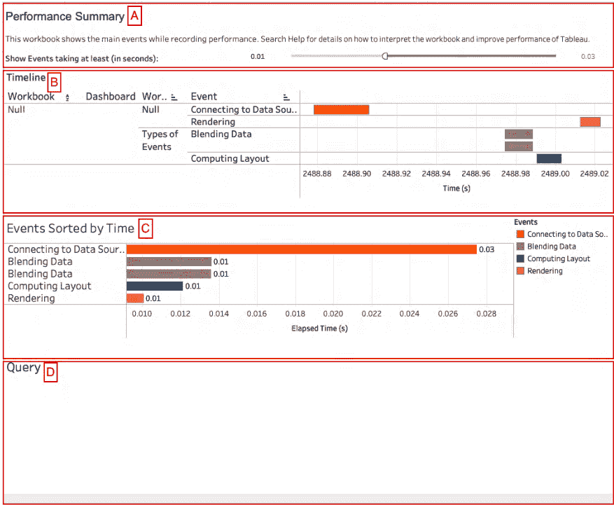

图 12.1：性能摘要

需要查看四个主要部分：

- **性能摘要**显示仪表板执行步骤 3（开始性能记录）和步骤 5（停止性能记录）之间所有步骤所需的时间。可以使用滑块进行筛选。
- **时间轴**显示哪个步骤何时发生以及耗时多久。
- 步骤也采用颜色编码，并可在 **事件** 条形图中找到。
- **查询**仅在单击 (**B**) 或 (**C**) 中的任何事件时才会显示详细信息。

让我们继续执行下一步：

6. 将 (**A**) 中的 **事件** 时间轴滑块拖到最左侧以显示所有事件
7. 在 **按时间排序的事件** (**C**) 中，单击任何名为 **执行查询** 的绿色条。请注意，**查询** 部分现已填充了高亮条所属的 VizQL：

## 按时间排序的事件

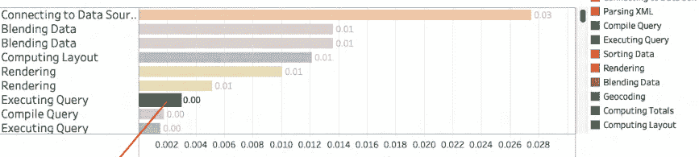

```
SELECT "Extract"."Region1" AS "Region",
"Extract"."State" AS "State"
FROM "Extract"."Extract" "Extract"
GROUP BY 1,
2
```

图 12.2：事件

8. 若要完整查看查询，请导航到 **查询** 工作表并将适配设置为 **整个视图**（在 Tableau 中，**查询** 指的是 VizQL 查询）。请注意，特别长的查询可能不会完整记录。要查看此类查询的每一行，请参阅位于 **我的 Tableau 存储库** 中的日志文件。

前面的步骤旨在让您初步了解性能记录仪表板的用途。我通常使用它来检查某个特定查询是否比其他查询耗时显著更长。然后，我查看 **查询** 选项卡上的查询，通过读取使用的字段来检查哪个部分受影响，尝试更改它，然后再次运行性能仪表板以查看变化情况。现在，让我们了解更多细节。

如果从性能记录仪表板访问 **事件** 工作表，您将看到不同的事件。让我们更详细地讨论这些事件及其对性能的影响：

- **连接到数据源：** 连接数据源时性能不佳可能表明存在网络延迟或数据库问题，甚至驱动程序过时。
- **生成提取：** 在提取之前聚合数据并隐藏未使用的列可以提高性能，因为这将分别减少总列数和总行数。
- **编译查询：** 编译查询性能问题可能表明存在数据库问题。


- **执行查询**：如果查询耗时过长，可以通过过滤不需要的数据或隐藏未使用的字段来提升性能。有关更多信息，请参阅本章中的*明智使用筛选器*部分。

- **排序数据**：与排序相关的性能问题可能表明视图中包含过多标记。此排序问题也可能由依赖于对视图中数据进行排序的表计算引起。

- **地理编码**：地理编码性能问题可能表明视图中包含过多标记、存在互联网延迟问题、硬件性能不佳或显卡性能不佳。

- **数据混合**：可通过减少基础数据量或进行过滤来提升数据混合性能。

- **计算表计算**：由于表计算通常在本地执行，复杂计算可能会增加最终用户计算机的负担。

- **计算合计**：可通过减少基础数据量或进行过滤来提升计算合计的性能。

- **计算布局**：计算布局的性能问题可能表明仪表板中包含过多工作表或图片等元素。

阅读本概述后（您可随时回顾），我们将深入探讨启用性能记录时发生的情况。请注意，以下内容假设您正在使用 Tableau Desktop。在第 13 章 探索 Tableau Server 和 Tableau Cloud 中，我们将介绍 Tableau Server 上的性能记录。

记录性能时，Tableau 最初会在 My Tableau Repository\Logs 中创建一个名为 performance_[timestamp].tab 的文件。此外，Tableau 程序目录中还有一个名为 PerformanceRecording_new.twb 的文件，例如 C:\Program Files\Tableau\Tableau.[version]\Performance。录制停止后，该文件会自动打开，从而允许作者浏览结果。

我们刚刚了解了如何记录性能指标以及如何使用随 Tableau Desktop 和 Tableau Server 一起提供的仪表板（如果管理员启用了该功能）来查看相关主题。在接下来的章节中，我们将逐步引导您了解可用于提升整体性能的不同选项。

一旦您知道瓶颈是查询时间、渲染还是计算，下一个问题是限制因素是您的计算机（硬件）还是工作簿设置，因此我们先介绍作者端的快速修复方法。

## 硬件和即时技术

尽管 Tableau Desktop 对硬件要求不高，但公司台式机或笔记本电脑仍可能性能不足，尤其是如果您是所谓的业务用户，日常工作不需要编程工具或大量处理能力。

因此，在本节中，我们将讨论一些技术细节和可能派上用场的技巧！

### 图形卡被忽视的作用

许多 Tableau 作者没有意识到，他们的图形卡（GPU）在仪表板渲染中扮演着重要角色，尤其是在包含大量地图或动画丰富的可视化时。

### GPU 在 Tableau 中处理的内容：

- 地图渲染（尤其是缩放和平移时）
- 包含数千个标记的散点图
- 仪表板动画和过渡
- 透明度和渐变等视觉效果

### 您的 GPU 可能性能不足的迹象：

- 地图渲染时间明显长于查询时间
- 滚动或缩放感觉“卡顿”
- 查询完成后，包含大量标记的仪表板仍渲染缓慢

为快速测试，在两台不同的计算机上打开一个包含大量地图的仪表板——一台配备集成显卡（大多数笔记本电脑），另一台配备独立 GPU（游戏或工作站笔记本电脑）。即使查询时间相同，您通常会在平移和缩放流畅度上看到巨大差异。

### Tableau 开发者的建议：

- 对于标准条形图、折线图和交叉表：集成显卡即可
- 对于包含大量地图的仪表板或大型散点图：考虑配备独立 GPU（NVIDIA 或 AMD）的计算机
- 对于演示仪表板（很少交互）：GPU 不如初始加载时间重要

> 注意：Tableau Server 渲染使用服务器的 GPU（如果可用）。对于为许多包含大量地图的仪表板提供服务的企业部署，配备 GPU 的服务器节点可以显著改善用户体验。

现在我们已经掌握了基础知识，让我们来看看一个可能会无意中拖慢性能的功能以及如何解决它。我们的第一个即时技术称为自动更新。

自动更新可以通过工具栏上的图标、通过 工作表 | 自动更新，或在 Windows 上使用快捷键 F10 或在 Mac 上使用 Option + Command + 0 来访问。自动更新为作者提供暂停/恢复工作表和/或筛选器的自动更新的选项。如果您想对布局进行多项更改，但又希望避免每次更改后 Tableau 都重新加载（因为每次加载都会向基础数据源发送新查询并进行处理，这会消耗处理能力），此功能非常有用。您只需暂停更新，进行更改，然后再运行一次更新即可。

以下练习演示了此操作的工作原理：

1. 打开本章关联的工作簿并导航至 Auto Updates 工作表
2. 在数据窗格中，选择 Superstore 数据集
3. 将 State 放在行架上
4. 通过工具栏取消选中 Auto Update Worksheet：

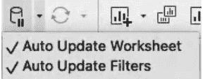

Figure 12.3: Auto Update Worksheet

5. 将 City 放在行架上，位于 State 的右侧。请注意，视图不会更新。
6. 通过工具栏启用 Auto Update Worksheet。现在视图会更新。
7. 右键单击行架上的 State，然后选择 Show Filter
8. 右键单击行架上的 City，然后选择 Show Filter
9. 在 City 筛选器上，单击下拉菜单并选择 Multiple Values (list) 和 Only Relevant Values：

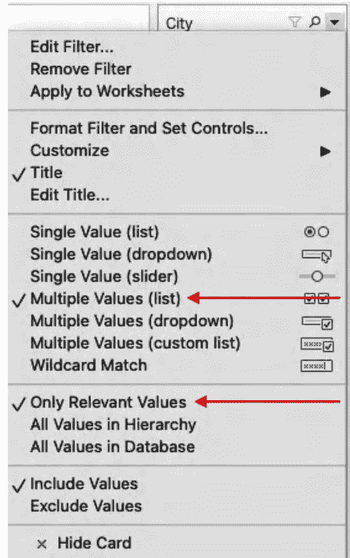

Figure 12.4: Only Relevant Values

10. 取消选中 Auto Update Filters，如图 12.3 所示

11. 在 **State** 筛选器中，仅选择 **Alabama**。请注意，**City** 筛选器不会更新。

12. 通过工具栏启用 **Auto Update Filters**。现在 **City** 筛选器会更新。

自动更新非常有用。作者可以暂停自动更新，进行多项更改，然后恢复自动更新，从而节省时间并间接提升性能。

顺便说一句，使用暂停按钮或自动更新时，**Only Relevant Values** 或 **All Values in Context** 等级联筛选器可能不会填充，因为它们依赖于先传递查询。

## 运行更新功能

暂停/恢复自动更新选项右侧的 **Run Update** 图标旨在刷新一次，同时用户可以保持禁用的 **Auto Update** 功能。以下简短示例应有助于澄清此选项：

1. 复制名为 Auto Updates 的 **previous** 工作表，并将副本命名为 Run Updates
2. 单击 **Pause Auto Updates** 图标暂停所有更新
3. 在 **State** 筛选器中随机选择多个州
4. 单击 **Run Update** 图标，如 **Figure 12.5** 所示，然后选择 **Update Filters** 或 **Update Worksheet**。运行更新的快捷键在 Windows 上为 F9。在 macOS 上为 Shift + Command + 0：


Figure 12.5: Running an update

5. 在 **State** 筛选器中再次随机选择多个州。请注意，自动更新仍处于暂停状态。

再说一遍，**Run Update** 允许 Tableau 作者在保持自动更新暂停的情况下间歇性刷新视图。我们刚刚讨论的两个更新功能将使您作为仪表板开发人员的生活更轻松，因为它们允许您在加载（因此等待刷新数据）之前进行多项更改，但如果您想从根本上解决性能问题，还需要更多工具。自动更新可帮助您在构建时避免不必要的刷新，但如果即使刷新后工作簿仍然缓慢，您通常需要减少数据量；这时小型提取就有用了。

仪表板作者经常问我的一个问题是：“在仪表板上放置多少个工作表会导致其变慢？”

没有单一答案，但以下是基于实际测试的实用指南：

- 1-5 个工作表应为高管摘要仪表板和 KPI 监视器提供出色的性能。
- 6-10 个工作表应带来良好的性能，常见于部门仪表板和操作视图。


- 11-15 个工作表是可以接受的，但可能会出现轻微卡顿。这数量的工作表通常用于详细分析型仪表板。
- 16-20 个工作表会在旧硬件上导致明显卡顿。你可以用于复杂报告型仪表板（考虑拆分）。
- 超过 20 个工作表会导致性能显著下降。我不建议你将其拆分为多个仪表板。

但是有一个因素实际上比工作表数量更重要：

| 因素 | 影响等级 | 说明 |
| :--- | :--- | :--- |
| 每个工作表的标记数 | 高 | 每个工作表有 10,000 个标记的 3 个工作表的仪表板（共 30k 个标记）通常表现不如每个工作表 100 个标记的 10 个工作表（共 1k 个标记） |
| 每个工作表的表计算数 | 高 | 每个表计算在查询返回后都会增加处理开销 |
| 图层数 | 高 | 具有多个图层或自定义多边形的地图对 GPU 要求高 |
| 工作表复杂度 | 中 | 具有多行、嵌套表或复杂格式的交叉表 |
| 数据源类型 | 中 | 实时连接与提取，数据库性能 |

表 12.1: 影响仪表板性能及其对效率相对影响的关键因素

在将工作表添加到仪表板之前，问问自己：

- 此工作表是否提供了现有工作表未提供的独特价值？
- 我是否可以将多个工作表合并为一个（使用组合轴或双轴）？
- 我是否可以使用仪表板操作来替代工作表，而不是一次性全部显示？

与其一次性显示所有工作表，不如考虑这种性能友好的模式：

- **热**（始终可见）：1-3 个 KPI 工作表或汇总视图
- **温**（按需可见）：通过仪表板操作出现的详细视图
- **冷**（下钻）：点击时替换主视图的详细工作表

这种方法在保持初始加载快速的同时，仍能在需要时访问详细分析。判断是否有过多工作表的最佳方法是进行测试。运行性能记录器（本章前面已介绍），并查找：

- 计算布局事件超过 1 秒意味着工作表过多或布局过于复杂
- 呈现事件超过 2 秒意味着标记过多或地图复杂度过高
- 查询事件超过 3 秒意味着数据源或计算存在问题

如果出现上述任一情况，请考虑减少工作表数量、简化布局，或转为使用“热-温-冷”模式。

## 小型提取

虽然提取将在 *使用提取* 部分中详细讨论，但在创作时提及性能方面的提取似乎很合适。即使在最佳条件下，处理大型数据源也可能很慢。如果在创作时不需要不断访问整个数据集，请考虑创建一个小型本地提取。尽可能多地创作工作簿，然后在真正需要所有底层数据时，指向原始数据源。

以下步骤展示了该技术的简短示例：

1. 在与此章关联的工作簿中，导航到“小型本地提取”工作表
2. 选择“数据 | 新建数据源”以选择所需数据源。此练习假设使用 Superstore.xls（随 Tableau 安装），但你可以使用任何喜欢的数据集。
3. 将任何字段拖动到文本卡。在我的示例中，我使用了“记录数”，这是一个仅包含数字 1 的计算字段。
4. 右键单击数据源（对我来说：Superstore），并选择**提取数据...**

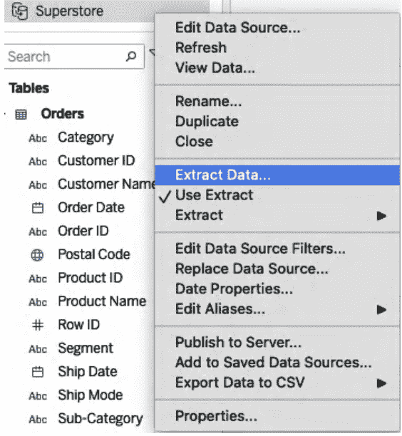

图 12.6: 提取数据

5. 在**提取数据...**对话框底部，选择**顶部**、你的数据源，并选择**1000**。在以下图中，**订单**已被选中，它是 Superstore 连接的两个部分之一：

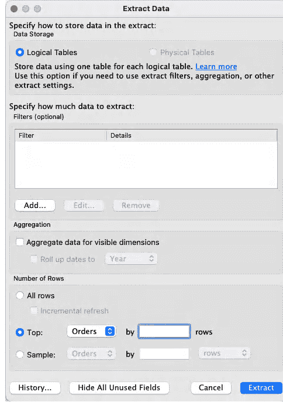

图 12.7: 顶部行

6. 单击**提取**按钮，并注意记录数现在显示为 **1000** 行
7. 在**数据**窗格中，右键单击 **Superstore** 并取消选择**使用提取**。注意“记录数”已恢复到其原始值。

通过创建小型本地提取，Tableau 创作者缓解了两个性能抑制因素：网络延迟和数据集大小。

本节让你了解如何暂时减少数据集，并提供恢复到原始大小的选项，所有操作无需离开 Tableau 界面。这是加速仪表板构建过程、避免长时间等待的好方法。在下一节中，我们将讨论如何连接到数据源以实现最佳性能。

## 连接到数据源

Tableau 的优点之一是，你可以以多种方式轻松连接到各种不同的数据源。如前所述，Tableau 中定义了许多连接器，用于与各种数据源交互。此外，这种灵活性不仅限于连接到单个表或文件。

> **注意**
>
> 尽管 Tableau 使连接到各种数据源变得容易，但应强调 Tableau 不是一个 **提取、转换和加载 (ETL)** 工具。如果需要复杂的连接和复杂的数据混合来生成有用结果，则最好在 Tableau 之外执行 ETL 工作，例如在 Tableau Prep Builder 中（有关此服务的更多信息，请参阅 _第 3 章，使用 Tableau Prep Builder_）。理想情况下，ETL 工作将带来更好的数据建模，从而在 Tableau 中实现更轻松的创作和更快的性能。

Tableau 连接到数据的四种方式如下：

- Tableau 可以连接到单个表。这是理想的，因为它允许最多的功能和最容易的故障排除，同时使 Tableau 能够发送最简单的查询，从而实现最佳性能。但是，并不总是可以连接到单个表，而且，虽然理想，但设定如此严格的限制是不合理的。数据源与报告工具之间的关系在不断变化。一种在连接数据方式上不够灵活的报告工具，无论最终结果多么优雅美丽，都不太可能成功。

- 第二个选项是关系，这是一种较新、更灵活的组合两个或多个数据集的方法。详细级别将按工作表定义，而不是在 **数据源** 选项卡中定义，这使此功能非常强大。

- Tableau 连接到数据的第三种方式是通过连接。一个表可能无法提供所有必要数据，但通过连接两个或多个表，所有所需数据可能都可以访问。随着连接变得越来越复杂，性能可能会受到影响，故障排除可能会变得困难。幸运的是，Tableau 可以假设参照完整性，从而即使在复杂连接下也能相当高效地工作。更多信息可以在这里找到：https://help.tableau.com/current/pro/desktop/en-us/joins_xbd_perf.htm。

- 最后，Tableau 可以使用数据混合。只要混合的数据源中不超过一个很大，且用于混合的维度成员相对较少，数据混合通常表现出色。

尽可能应选择关系而不是连接，并选择连接而不是数据混合。在混合多个大型数据源时，性能可能会受到严重影响。在高基数维度上进行数据混合时，问题会进一步加剧。此外，数据混合限制了一些功能，例如从次要数据源使用维度、行级别计算或 LOD 表达式的能力。

但是，也有例外，这里讨论其中两个：

- 首先，当两个表之间没有共用键时，数据混合是有利的（且通常是必要的）。
- 其次，在某些情况下，交叉连接将不起作用，需要数据混合。例如，当你处理两个粒度不同且无法使用关系的数据集，或无法进行跨数据库连接（例如，到立方体或仅提取连接）时，请使用数据混合；或者，当你拥有大型数据集且混合能提高性能时，也可以使用数据混合。

> **注意**
>
> 更多信息可以在这里找到：https://help.tableau.com/current/pro/desktop/en-us/multiple_connections.htm。

基于这些原因，作为准则，如果存在连接选项，通常应避免使用数据混合。

第 4 章“关于连接、混合和数据结构”提供了有关连接和混合的详细信息。就本章而言，连接和混合的讨论将仅限于性能考虑。

一旦连接策略确定，许多性能优势来自数据库层，如索引、键和约束，因此我们将简要介绍最具影响力的调优概念，以便与 DBA 讨论。

## 高效处理大型数据源

本节将介绍数据库调优的一些基础知识以及高效处理大型数据源的方法。由于该主题更侧重于数据源而非 Tableau，因此不包含练习。

如果你正在连接大型数据源并遇到性能问题，与数据库管理员 (DBA) 交谈可能会有所帮助。

清晰的沟通加上少量的数据库工作可以显著提高性能。对话应包括数据库调优点，例如显式定义主键和外键、将列定义为非空以及索引。每个点将在此处讨论。

## 定义主键和外键

主键和外键对于连接表至关重要。主键由表中的一个或多个列组成。主键对每个行都应该是唯一的。在非唯一的行级键上进行连接可能会导致错误结果，如第 4 章“关于连接、混合和数据结构”中所探讨的。在数据库中显式定义主键有助于确保每个键值都是唯一的：


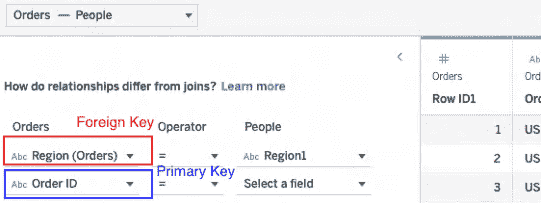

图 12.8：数据库键

外键由表中一个或多个列组成，用于唯一标识另一张表中的行。这种唯一标识是由于一个表中的外键引用了另一张表中的主键而实现的。在数据库中明确定义外键可以使 Tableau 绕过许多完整性检查，从而提升性能。

## 将列定义为 NOT NULL

Tableau 发布了多份关于[性能改进提示和技巧](https://help.tableau.com/current/pro/desktop/en-us/performance_tips.htm)的白皮书，其中指出程序员和 Tableau Desktop 不喜欢 NULL 数据。如果可能，请为表中的每个列明确定义 NOT NULL。

在实践中，数据库管理员会争论何时适合或不适合将列定义为 NOT NULL；然而，有两点是明确的：

- 主键或外键应定义为 NOT NULL。这不言而喻，因为主键和外键在定义上必须是唯一的。
- 此外，任何将被索引的列都应定义为 NOT NULL，否则索引可能无法使用。

索引将在下一节中更详细地讨论。

## 索引

让我们来考虑一下关于索引的以下两个问题：

- 什么是索引？
- 应该对什么进行索引？

我们的两个问题中的第一个可能对 DBA 来说很容易回答，但对于普通 Tableau 作者来说可能是未知领域。因此，为了澄清，索引是数据库表中选定列的副本，已针对高效搜索进行优化。由于这些复制的列包含指向原始列的指针，因此可以访问它们以快速查找给定行并返回所需数据。

一个小示例可能会有所帮助。根据波音公司的说法，787 梦想客机大约有 230 万个零件。想象一个表，在 Part_Name 列中列出所有这些零件。您的任务是搜索该列，查找所有以 *fuse* 字符串开头的零件。对于未编入索引的列，这需要检查数据库中的每一行数据。此类搜索可能非常慢。幸运的是，可以使用索引来减少被搜索的行数，从而使过程快得多。用于索引的一种结构化数据是 B-tree。B-tree 数据结构是排序的。因此，使用 B-tree 数据结构访问索引以搜索所有以 *fuse* 开头的零件时，不必考虑每一行。相反，数据库可以直接跳到 fuse 并快速返回所需的行。

现在让我们进入索引的第二个问题。应该对什么进行索引？这个问题可以简明地回答：理想情况下，数据源中用于连接或筛选的所有列都应该编入索引。

虽然在 Tableau 中创建更高效的连接有一些基本的性能注意事项（例如，当左连接足够时，避免使用外连接），但连接性能在很大程度上在 Tableau 之外决定。因此，对连接中使用的列建立索引通常比对筛选中使用的列建立索引更重要。

继续讨论操作数据源，下一节将介绍如何通过提取使用 Tableau 创建汇总数据集。

## 使用提取

本节将讨论什么是 Tableau 数据提取，以及如何高效地构建提取。我的一位同事最近为一家相对较小的移动电话服务提供商提供了咨询。尽管公司规模不大，但每天的通话量可能超过 1,000,000 次。该公司管理层坚持要能够在 Tableau 工作簿中与单个通话的详细可视化进行交互。可以理解的是，工作簿的性能成了一个问题。如此低级别的细节是否必要？减少细节并制作更加灵敏的工作簿是否会带来更好的业务决策？

为了在业务需求与实际性能要求之间取得平衡，企业通常需要确定哪些细节级别对报告真正有帮助。通常，详细的颗粒度并非必要。在这种情况下，汇总表可能提供足够的业务洞察，同时实现快速性能。对于移动电话服务提供商来说，每天的通话量快照可能就足够了。即使是每小时快照也会大大减小表格大小并提高 Tableau 的性能。

为满足这一常见业务需求，提取是由 Tableau Desktop 创建的专有压缩数据源。自发布以来，提取的文件扩展名已从 .tde 更改为 .hyper 格式。因此，新格式使用了 Hyper 引擎，该引擎在 *第 1 章，回顾基础知识* 中讨论过。提取可以本地存储，并由 Tableau 访问以呈现可视化。

考虑以下几点，这些要点使提取文件成为性能改进的绝佳选择：

- 提取可以在汇总级别快速生成
- 提取是列式存储，以列序列的形式记录数据
- 关系数据库通常使用行存储方法存储数据

在以下示例中，请注意，**行存储**对于返回单个行非常出色，而**列存储**对于返回汇总数据则好得多。

以下是一个示例表：

| | 乐器 | 商店 | 价格 |
|---|---|---|---|
| 第 1 行 | 塞尔默小号 | 北 | $3,500 |
| 第 2 行 | 康法国号 | 东 | $4,500 |
| 第 3 行 | 格岑长号 | 南 | $2,500 |
| 第 4 行 | 米拉福大号 | 西 | $9,000 |

表 12.2：示例数据库

以下是数据库中的**行存储**表：

| 第 1 行 | 塞尔默小号 |
|---|---|
| | 北 |
| | $3,500 |
| 第 2 行 | 康法国号 |
| | 东 |
| | $4,500 |
| 第 3 行 | 格岑长号 |
| | 南 |
| | $2,500 |
| 第 4 行 | 米拉福大号 |
| | 西 |
| | $9,000 |

表 12.3：行存储表

以下是数据库中的列存储表：

| 乐器 | 塞尔默小号 |
|---|---|
| | 康法国号 |
| | 格岑长号 |
| | 米拉福大号 |
| 商店 | 北 |
| | 东 |
| | 南 |
| | 西 |
| 价格 | $3,500 |
| | $4,500 |
| | $2,500 |
| | $9,000 |

表 12.4：列存储表

希望您能看到，在列存储表中，某个属性的每个第 n 行共同构成第一行。例如，乐器的第一行、商店的第一行和价格的第一行都与同一条目相关，而在行存储表中，属于同一条目的所有行都是按连续顺序排列的。

总结本节迄今所学的内容，提取使用压缩技术来减小文件大小，同时保持性能，并利用 RAM 和硬盘空间以实现最佳性能。使用数据库的实时连接时，这两点都不会发生——因此，当数据库无法做到时，提取可以提高仪表板的性能。

## 构建提取

本节将从性能方面讨论提取。提取的其他方面，例如计划和增量刷新，此处不予考虑，但您可以在此处找到更多信息：https://help.tableau.com/current/pro/desktop/en-us/extracting_refresh.htm。

如前所述，在*小型提取*部分中，提取是通过 数据 | [数据源] | 提取数据 创建的。从生成的对话框中，我们可以执行以下操作：

- 根据需要筛选提取：有时，精确反映数据源的提取是合理的，但通常筛选各个字段仍然可以用所需数据填充提取，同时缩小大小并提高性能。要添加筛选器，只需单击 Add... 即可访问与工作表中使用的筛选器对话框相同的对话框。

**按视图中表示的粒度级别进行汇总：**汇总不仅可以减小文件大小，还可以从安全角度提供帮助。如果没有汇总，提取将使用行级数据构建。因此，Tableau 作者应注意，如果在构建提取时未选择汇总，则任何敏感的行级数据都可访问：


图 12.9：汇总

**减少行数：**如*小型提取*部分所示，减少行数可以让作者创建一个小型本地提取以快速构建工作簿，之后可以访问原始数据源进行完整分析：

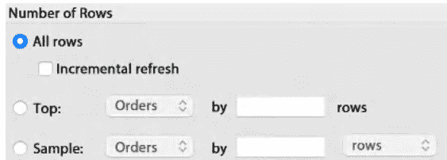

图 12.10：减少行数

**隐藏所有未使用的字段：**此选项将从提取中排除工作簿中未使用的所有列。这可以显著减小提取大小并提高性能：


图 12.11：隐藏字段

采取这四项措施后，您的性能应立即得到改善。欢迎使用性能记录工具自行测试，为同一数据源创建不同的提取。汇总和性能记录操作将在下一节中讨论。


## 聚合

以下练习将使用来自单个数据源的两个聚合，一个在 **州** 级别，另一个在 **城市** 级别。这些聚合数据源将用于创建两个工作表。每个工作表都将与第三个包含行级信息的工作表一起放置在仪表板上。最后，将创建筛选操作来将这三个工作表关联在一起。本练习的目的是演示如何将小型提取与较大的数据集结合使用，以创建性能更好的仪表板：

- 1. 打开与本章相关的工作簿并导航到 State Agg 工作表
- 2. 在 **数据** 窗格中，选择 State Agg 数据源
- 3. 通过将 **State** 放置在 **详细信息** 书架上并从 **标记** 卡中选择 **填充地图**，使用州创建填充地图
- 4. 右键单击 State Agg 数据源并选择 **提取数据**
- 5. 请注意，Tableau 显示一个错误，指出它无法找到引用的文件。您可以指向随 Tableau 附带的 **Superstore** 实例，也可以使用通过 GitHub 链接提供的实例：https://github.com/PacktPublishing/Mastering-Tableau-2026/tree/main/Chapter12。
- 6. 连接到数据源后，Tableau 将显示 **提取数据** 对话框。在对话框中，选择 **聚合可见维度的数据** 和 **所有行**。单击 **隐藏所有未使用的字段** 按钮，然后单击 **提取**。请注意，生成的提取仅包含 **State**。还要注意，数据已聚合，因此没有底层数据可用。
- 7. 导航到 City Agg 工作表
- 8. 在 **数据** 窗格中，选择 City Agg 数据源。请注意，此数据源已提取，因此仅包含 **State**、**City** 和 **Sales**。还要注意，数据已聚合，因此没有底层数据可用。
- 9. 将 **City** 放置在 **行** 书架上，**Sales** 放置在 **文本** 书架上，**State** 放置在 **详细信息** 书架上。不要忘记包含 **State**，即使它在视图中不显示。必须使用它，以便练习末尾创建的仪表板能够正常工作。
- 10. 导航到 Row Detail 工作表并选择 Superstore 数据集
- 11. 创建一个交叉表视图，显示 **Customer Name**、**Order ID**、**Row ID**、**Profit** 和 **Sales**。创建此视图的一种快速方法是双击每个字段。
- 12. 导航到 Agg Dash 仪表板并将三个工作表中的每一个放置在仪表板上
- 13. 从 **Superstore** 和 **City Agg** 数据源在 **City** 和 **State** 之间创建混合关系：

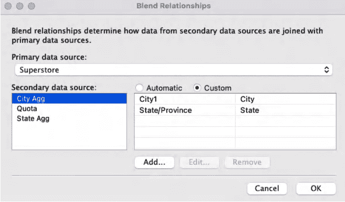

图 12.12：混合

- 14. 通过 Dashboard | Actions | Add Action | Filter 创建以下操作：

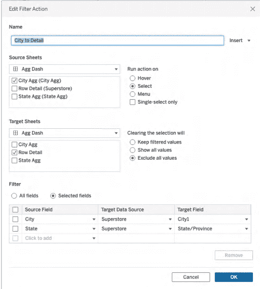

图 12.13：将城市添加到详细信息操作

- 15. 通过 Dashboard | Actions | Add Action | Filter 创建以下操作：

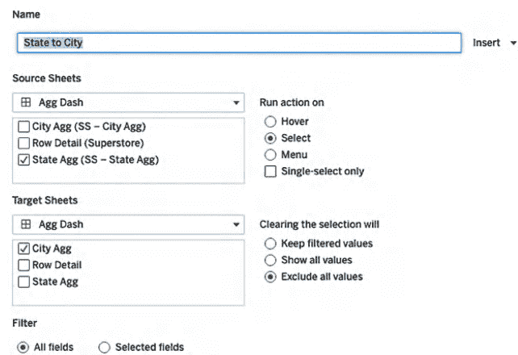

图 12.14：将州添加到城市操作

- 16. 创建这两个操作后，在仪表板上单击 State 字段
- 17. 然后，单击 City 字段
- 18. 单击 City Agg 工作表的空白部分以排除 Row Detail 上的所有值
- 19. 单击 State Agg 工作表的空白部分以排除 City Agg 上的所有值
- 20. 按需格式化仪表板：

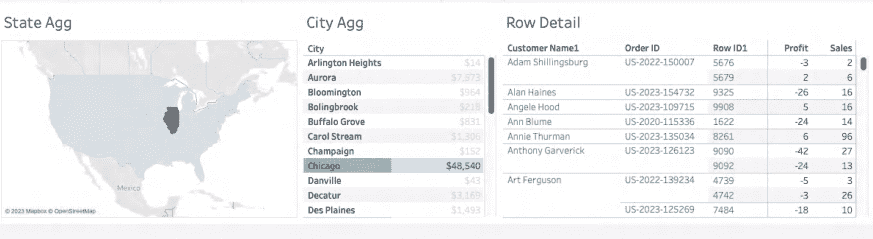

图 12.15：仪表板上的操作

完成本练习后，请注意，生成的仪表板性能之所以好，是出于以下原因：

- 用户首次打开仪表板时，仅显示 State Agg。这样做性能更好，原因有两点。首先，打开仪表板时显示单个工作表而不是每个工作表，会导致更少的初始查询和更少的渲染。其次，访问小型提取比访问较大的数据源更快。

- 由于 City Agg 工作表也访问小型提取，因此当用户单击某个州时，**City Agg** 工作表会快速显示。

- 当用户单击 **City** 时，会对数据源发出调用，该调用仅包含该城市的信息。拉取的数据量相对较小，即使对于较大的数据集，性能也应该良好。

除了使用聚合提取之外，本练习还应考虑良好性能实践的另一个方面。仪表板不包含快速筛选器。通常，在仪表板上使用快速筛选器是不必要的。如果仪表板上的工作表可以用于筛选，这些工作表本质上可以发挥双重作用。也就是说，工作表可以提供有价值的分析，同时充当仪表板上其他工作表的筛选器。与使用快速筛选器相比，这代表了性能改进，因为添加快速筛选器会导致向底层数据源发送额外查询。

在前面的仪表板中，每个工作表引用不同的数据源。因此，您可能会问，操作筛选器如何能够跨不同数据源工作？答案可以在筛选器操作对话框中找到。如 **图 12.13** 和 **图 12.14** 所示，**所有**字段都被视为 **目标筛选器**。Tableau 只需匹配每个数据源中同名的字段即可。提取可以优化以获得更好的性能结果。我们将在下一节中介绍这一点。

## 优化提取

优化通过尽可能物化计算字段来加速性能。这意味着 Tableau 为提取中的计算字段生成值，以便可以查找这些值而不是计算它们。如果使用表计算，Tableau 每次更改视图时都必须计算这些值。

**注意**

请注意，并非所有计算字段都会物化。未物化的字段包括表计算、可更改或不稳定的函数（例如 `NOW()` 和 `TODAY()`）以及使用参数的计算字段。

首次创建提取时，它会自动优化。换句话说，计算字段会在可能时自动物化。但是，随着时间的推移，计算字段可能会被更改，这会导致提取丢弃物化字段。在这种情况下，打开 **数据 | [数据源] | 提取** 并单击 **立即计算计算** 以重新生成物化字段：

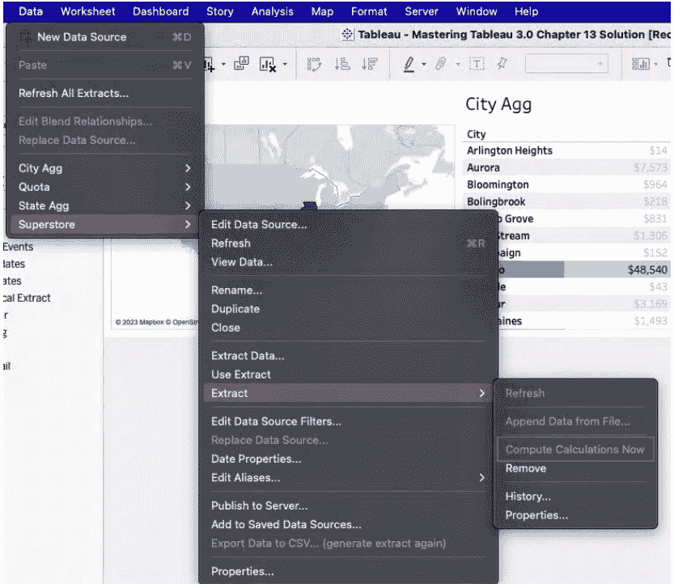

图 12.16：计算计算

如果在 Tableau Server 上设置提取刷新，则每次刷新都会自动优化提取。

最后，如果在仪表板中使用参数，请检查是否可以消除这些参数并改用计算来提高性能。另外，如果计算无法作为整体物化，请拆分计算。将可以物化的部分放入一个计算字段中，将非物化部分放入另一个字段中。如果计算的部分可以在提取创建过程中计算，您将获得性能提升。

使用提取的优势现已详细讨论完毕，让我们继续并了解如何充分利用筛选器。

## 明智地使用筛选器

筛选器通常会提高 Tableau 的性能。例如，使用维度筛选器仅查看西部区域时，会向底层数据源发送查询，从而仅返回该区域的信息。通过减少返回的数据量，性能得到提高。这是因为数据量减少意味着降低了网络带宽负载、降低了数据库处理要求以及降低了本地计算机的处理要求。

筛选器也可能对 Tableau 的性能产生负面影响。例如，使用 **仅相关值** 会导致向底层数据源发送额外查询，从而减慢响应时间。此外，从高基数维度创建快速筛选器会损害性能。

Tableau 的筛选器按特定顺序执行，因此在使用它们时请牢记这一点。下面的流程图以及指向一小时演示文稿的链接可能会帮助您完全理解这一概念：https://help.tableau.com/current/pro/desktop/en-us/order_of_operations.htm：

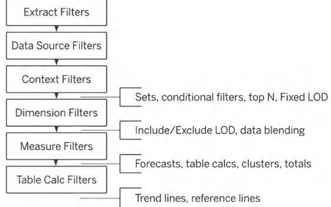

图 12.17：筛选操作顺序

本节其余部分将逐步介绍操作顺序。到本节结束时，您将知道在哪些情况下使用哪些筛选器，以便为仪表板实现最佳性能。

### 提取筛选器

提取筛选器会从提取的数据源中删除数据。简单地说，数据不存在。因此，通过减少数据总量来提高性能。由于提取的数据使用 Tableau 的专有列式数据集，性能也可能得到改善。

此外，提取始终是扁平的，这比使用连接连接到数据集具有性能优势。要创建提取筛选器，请先选择 **数据 | [数据源] | 提取数据**。在生成的对话框中，选择添加筛选器。


## 数据源筛选器

数据源筛选器将应用于整个工作簿。例如，如果您创建一个数据源筛选器，它会移除 Country 维度中除了 USA 以外的所有成员，那么该工作簿中所有工作表的 Country 维度将仅包含 USA。

数据源筛选器提升性能的方式与维度和度量筛选器相同；也就是说，数据源筛选器会导致 Tableau 向底层数据源生成查询，从而限制返回的数据。返回的数据越少，通常处理和渲染速度越快。数据源筛选器的另一个优势是创作简便。例如，如果 Tableau 创作者事先知道整个工作簿将以美国为中心，创建数据源筛选器可以免除为使用该数据源的工作簿中每个工作表应用维度筛选器的麻烦。

还要注意，数据源筛选器在处理流程中非常早就发生。所有计算（包括在维度和度量筛选器触发之前呈现的使用固定 LOD 表达式的计算）都遵循数据源筛选器。

要创建数据源筛选器，请单击 Tableau Desktop 左下角的 Data Source 选项卡。然后，单击页面右上角的 Add 链接：

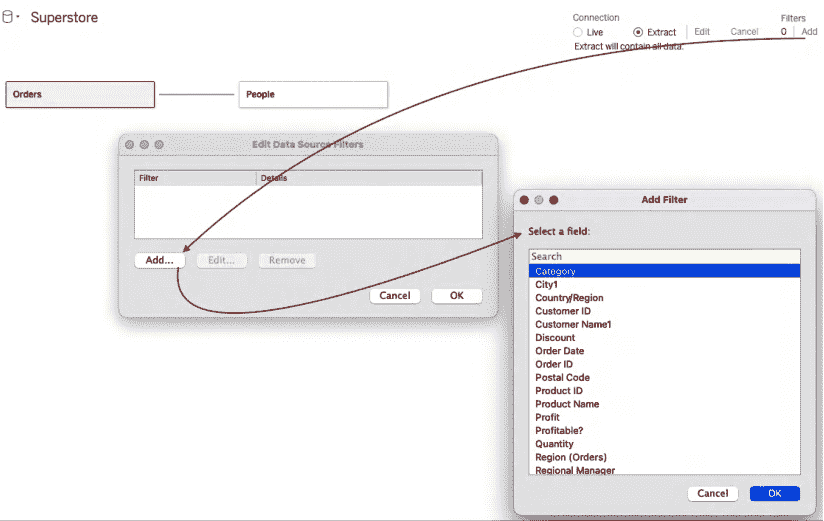

图 12.18：添加筛选器

## 上下文筛选器

上下文筛选器只需在 Filter shelf 上的字段右键单击并选择 Add to Context 即可创建：

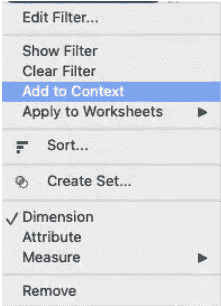

图 12.19：上下文筛选器

维度和度量筛选器是独立的。每个筛选器都会独立查询数据源并返回结果。而上下文筛选器则会迫使维度和度量筛选器依赖于它。这种行为在某些情况下对于获得正确答案非常有帮助（甚至必要）。例如，如果 Tableau 创作者访问 Superstore 数据集，并使用 Product Names 上的筛选器来返回单个类别中销量前 10 的产品名称，那么将 Category 定义为上下文筛选器是必要的。否则，Product Names 筛选器将返回整体前 10 名。因此，上下文筛选器可以提升性能。

## 维度和度量筛选器

维度和度量筛选器可以提升性能。因为维度筛选器或度量筛选器都会导致 Tableau 向底层数据源生成查询，从而限制返回的数据，所以性能得到了提升。简单来说，返回的数据集越小，性能越好。

然而，维度和度量筛选器也可能降低性能。因为 Tableau 不仅为了显示可视化而向底层数据源生成查询，还会为了显示筛选器而生成查询，因此显示的筛选器越多，性能越慢。此外，高基数维度上的显示筛选器会抑制性能。（拥有许多成员的维度被称为具有高基数。）考虑一个显示数据集中每个客户的筛选器示例。此类筛选器的性能可能较慢，因为必须定位并返回底层数据集中的每个客户，然后 Tableau 需要在筛选器中渲染并显示每个客户。

在视图上使用两个或更多维度或度量筛选器时，可以使用相关筛选器来限制显示的选项。例如，如果视图包含城市和邮政编码的筛选器，则后者可以设置为显示 Only Relevant Values：

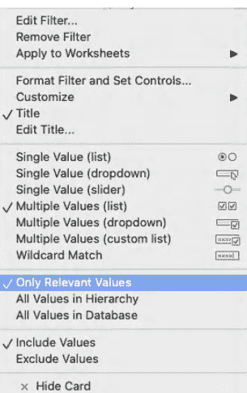

图 12.20：仅显示相关值

这对最终用户有利，因为它会调整显示的邮政编码数量，仅反映与第一个筛选器中选定的城市相关的邮政编码。然而，使用相对筛选器会导致向数据源发送额外查询，因此可能会降低性能。

## 表计算筛选器

将表计算用作筛选器，并不会像维度或度量筛选器那样带来相应的性能提升。如上所述，维度和度量筛选器会减少返回的数据集，而表计算筛选器则不会。在 Tableau 的处理流程中，表计算不会在数据从数据源返回之前呈现。这意味着表计算无法用于生成查询来限制返回的数据。换句话说，表计算筛选器会导致与给定维度或度量相关的所有数据被返回，之后 Tableau 在返回的数据集上执行筛选。

要演示这一点，请执行以下步骤：

- 打开与本章关联的工作簿并导航到 Late Filter 工作表
- 在 Data 窗格中，选择 Superstore 数据源
- 创建名为 Cust Name Tbl Calc 的计算字段，使用以下代码：

```
LOOKUP( MAX( [Customer Name] ),0 )
```

- 将 Customer Name 放置在 Rows shelf 上
- 将 Cust Name Tbl Calc 放置在 Filters shelf 上并限制仅显示 Aaron Bergman
- 将 Sales 放置在 Text shelf 上
- 右键单击 Sales 并选择 Quick Table Calculation | Rank

在此练习中，完整的客户列表会被返回到 Tableau，之后 Tableau 部署筛选器。本质上，将 Cust Name Tbl Calc 用作筛选器只是隐藏了底层数据。这样做有用，因为返回给 Aaron Bergman 的排名是正确的。仅对 Customer Name 进行筛选会将 Aaron Bergman 的排名返回为 1。不幸的是，正确的结果伴随着性能损失。在此练习上运行性能记录器将显示表计算对性能产生负面影响。

幸运的是，随着 LOD 计算的出现，将表计算用作筛选器通常不再必要。LOD 是计算字段，它们独立于当前视图包含或排除数据。有关更多信息，请参阅第 5 章“介绍表计算”。

## 使用操作而非筛选器

提升性能的另一种方法可能是使用操作而非筛选器。您可以开发一个仪表板，首先显示高级别概述，仅在用户选择某项内容后才深入显示详细信息。其机制与我们在 Aggregation 部分展示的类似；不过，聚合是在每个工作表上进行的，而不是在数据源本身上进行。通过在高级别概述中选择一个标记，将触发一个操作。用户可以深入查看详细信息，但详细程度只会逐步提高。因此，不需要一次性加载大量数据。

关于此主题的非常精彩的演示文稿可在此处找到 https://youtu.be/vel1Z1btoms。或者，如果您想了解有关 Hot-Warm-Cold 方法的更多信息，欢迎阅读此文章：https://gemshare.org/2019/08/16/hot-warm-cold-data-architecture-best-practices/。

我们将讨论的下一个主题涉及计算。我们如何以最高效、性能最好的方式编写计算？

## 高效计算

计算可以以不同方式构建，但仍能完成相同的事情。例如，请看下面的示例，它表明 IF 语句可以被更简单的代码替换：

| 场景 I | 场景 II |
|--------|--------|
| 创建带有以下代码的计算字段：IF SUM (Profit) > 0 THEN 'Profitable' ELSE 'Unprofitable' END 将计算字段放置在 Color shelf 上。 | 创建带有以下代码的计算字段：SUM (Profit) > 0 将计算字段放置在 Color shelf 上。在生成的图例中右键单击 True 和 False，将其重命名为 Profitable 和 Unprofitable。 |

表 12.5：实现相同结果的不同方式

由于这两种场景都将返回所需结果，应该使用哪一种？决定性因素是性能。本节将探讨在创建计算字段时应做什么和应避免什么，以最大限度地提升性能。

## 优先使用代码值

使用布尔值或数字的计算比使用日期的计算性能更高。使用日期的计算又比使用字符串的计算性能更高。这不仅适用于 Tableau，也适用于整个计算机科学领域。

根据这些信息，前表中列出的场景 II 比场景 I 性能更好。场景 I 会导致 Tableau 创建一个查询，要求数据源引擎处理字符串以报告盈利能力，而场景 II 仅发送 1 和 0 来确定盈利能力。场景 II 的第三步（即将 True 和 False 别名为 Profitable 和 Unprofitable）仅仅是发生在聚合数据集从数据源返回后的标签更改，这对 Tableau 来说既快速又简单。

## 固化表达式计算或表计算

在某些情况下，固化表达式（LOD）计算可能比表计算更快，反之亦然。如果您不确定，可以同时尝试两者以查看哪个性能更好。您当然也可以运行性能记录。此外，如果它们并非真的需要，则两者都不要使用。请参阅以下图表，它解释了何时选择哪种：

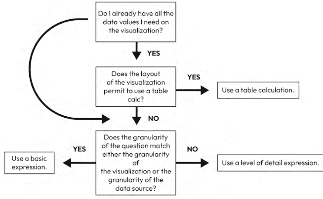

图 12.21：选择计算类型

该图表以及有关选择计算类型的更多建议，可以在此处访问 https://www.tableau.com/about/blog/2016/4/guide-choosing-right-calculation-your-question-53667。


## 其他提升性能的方法

为结束本章，让我们考虑几种其他提升性能的可能性。

- **避免仪表板过于拥挤**：通常，最终用户希望在仪表板上一次性看到所有内容。虽然这可能被认为是有益的，但往往并非如此。考虑在仪表板中包含大型交叉表。翻阅页页细节是否会增加仪表板的分析价值？也许答案是“不。”此外，仪表板上信息过多可能会掩盖重要见解。外交地主张更精简的仪表板，可能会带来更好的决策以及更好的性能。

- **修复仪表板大小**：仪表板可以设置为精确大小，或**范围**或**自动**。精确大小会带来更快的性能，因为一旦 Tableau 服务器为某个最终用户渲染了视图，该渲染结果就会留在缓存中，并可供下一个访问该仪表板的最终用户重复使用。

另一方面，**自动**和**范围**会导致 Tableau 服务器尝试确定每个最终用户使用的分辨率大小，并相应地渲染仪表板。这意味着 Tableau 服务器不会对下一个最终用户使用缓存中存储的仪表板实例。这反过来会影响性能。

- **使用 Tableau Prep Builder**：这一点之前已提及，但非常相关，因此我将重复：如果生成有用结果需要复杂的连接和复杂的数据混合，那么在 Tableau 之外执行 ETL 工作可能是可取的，例如，在 Tableau Prep Builder 中（有关此服务的更多信息，请参阅*第 3 章，使用 Tableau Prep Builder*）。ETL 工作理想情况下会带来更好的数据建模、聚合数据，或包含其他你本不得不在 Tableau Desktop 中创建的额外列的数据，因此使用 Prep Builder 会带来更轻松的创作和更快的性能。

- **设定预期**：如果最终用户期望近乎即时的性能，那么当然，任何低于此标准的东西都会令人失望。提前解释，复杂的、面向细节的仪表板可能性能不佳，至少可以在两方面提供帮助。首先，在解释可能的性能问题后，可能会达成妥协，从而创建一个不太复杂但仍能提供有价值信息的仪表板。其次，如果仪表板绝对必须复杂且面向细节，至少最终用户已被警告，在与之交互时可能需要耐心。

## 工作簿优化器

最后，对于我们中懒惰的人——或者说，高效的人——Tableau 不久前推出了一个很棒的功能：工作簿优化器。它根据一组规则检查你的工作簿，并将返回三类类别：采取措施、需要审查和通过。因此，它为你使用众所周知的 RAG（红-黄-绿）或交通灯系统完成性能检查。

在撰写本文时，规则包括：计算长度、使用多个数据源的计算、仪表板大小未固定、筛选器使用条件逻辑、筛选器仅使用“相关值”、实时数据连接、数据源中有多个连接、嵌套计算、未物化计算、数据源数量、筛选器数量、布局容器数量、LOD 计算数量、仪表板中的视图数量、工作表数量、未使用的数据源、未使用的字段、使用数据混合、使用日期计算和使用分组。然而，我相信会有更多规则出现，并且拥有高性能仪表板将变得越来越容易。你可以通过选择“服务器 | 运行优化器”来访问工作簿优化器功能：

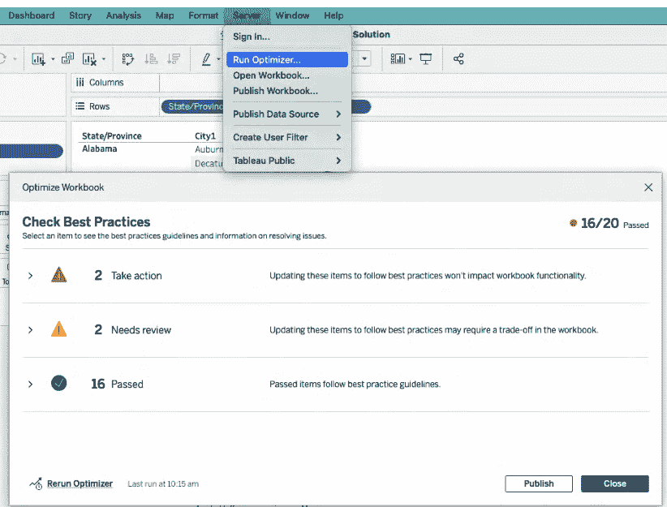

### 图 12.22：运行优化器

然后，你将能够按类别深入查看，并了解仪表板需要在哪里改进。对于大多数规则，都需要一些人工干预，但对于某些规则，点击一下按钮就足够了，如图 12.23 所示。观察规则下方的图标——扳手图标表示 Tableau 可以为你修复此问题。

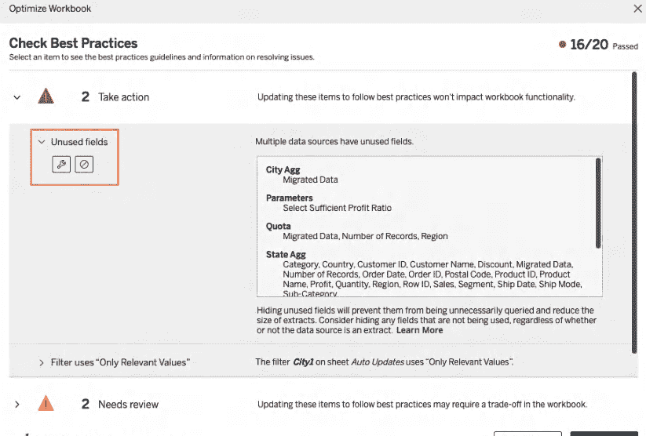

### 图 12.23：未使用的字段

对于每条规则，Tableau 还提供 **了解更多** 超链接，将重定向到其中一个 Tableau 帮助页面以获取进一步说明。

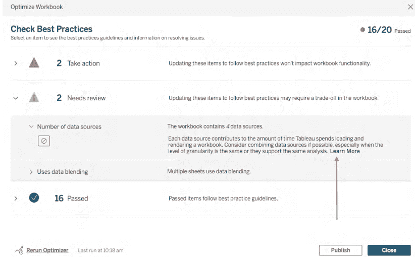

### 图 12.24：数据源数量

这个功能不是很棒吗！？从现在开始，务必始终使用“运行优化器”按钮！

## 跟随练习仪表板

在本跟随练习仪表板中，我们将使用纽约市自行车数据集，并应用性能增强功能。

- 1. 从 https://citibikenyc.com/system-data 下载一个月的数据（例如，2023 年 1 月，位于 2023-citibike-tripdata.zip 中），并将 Tableau Desktop 连接到数据集。2023 年 1 月分为两个 CSV 文件；你可以任选其一。
- 2. 立即创建提取（在右上角）
> **注意**
> 性能提示：除非万不得已，否则绝不要直接连接到百万级行数的 CSV 文件。
- 3. 打开一个新工作表。将“开始时间”、“起始站点名称”、“会员类型”和“车辆类型”拖到标记卡的文本字段中。
- 4. 单击数据窗格中的箭头，然后选择隐藏所有未使用的字段：

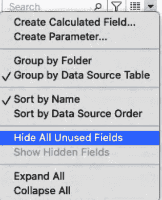

### 图 12.25：隐藏未使用的字段

> **注意**
> 性能提示：字段越少 = 提取越小 = 查询越快。

- 5. 接下来，创建一个名为“KPI Sheet (Total Trips)”的新工作表
- 6. 创建一个名为“Trip Count”的计算字段：1
- 7. 将“行程计数”拖到标记架上的文本中

> **注意**
> 性能提示：使用 SUM(1) 计数行比使用 COUNT([Trip ID]) 更快。

- 8. 创建一个名为“Trips by User Type”的新工作表
- 9. 将 Member Casual 拖到行区
- 10. 将 Trip Count 拖到列区
- 11. 降序排序

> > 性能提示：基数低的维度（此处为 2 个值）速度非常快。

- 12. 创建另一个名为“Monthly Trips Trend”的工作表
- 13. 将 **开始时间** 拖到列区
- 14. 更改为 **日**
- 15. 将 **行程计数** 拖到行区

> > 性能提示：避免更低粒度（例如分钟或秒），因为这会导致标记数量激增。

- 16. 创建另一个名为“Top 10 Start Stations”的工作表
- 17. 将 **起始站点名称** 拖到行区
- 18. 将 **行程计数** 拖到列区
- 19. 降序排序
- 20. 添加 Top N 筛选器：按 SUM(Trip Count) 的前 10 名

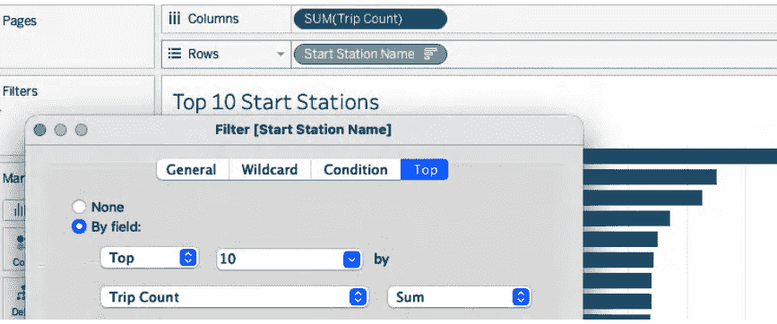

### 图 12.26：筛选器

> > 性能提示：始终限制高基数维度，例如站点名称。

- 21. 添加以下筛选器：Member Casual 和 Rideable Type，并将它们设为下拉筛选器

> **注意**
> 性能提示：下拉菜单比复选列表更快，尤其是在处理大型数据集时。

- 22. 构建仪表板，选择 1200 x 800 的固定大小和以下布局：
  - 顶部：KPI - 总行程数
  - 中部左侧：每月行程趋势
  - 中部顶部右侧：按用户类型划分的行程
  - 中部底部右侧：前 10 个起始站点

- 23. 最后，按需格式化

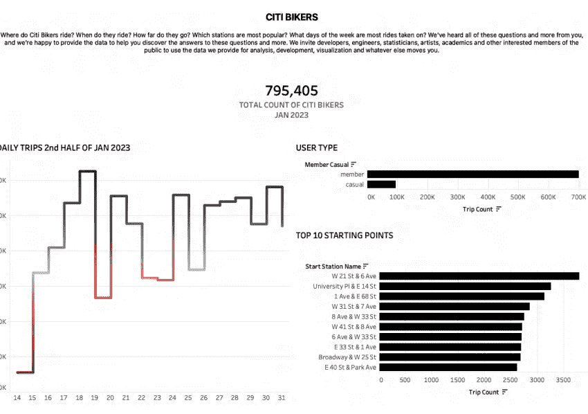

### 图 12.27：最终仪表板

这是一个快速且简单的仪表板，其中应用了所有重要的性能增强功能。
此外，你能从该数据集中创建一张显示纽约市最常用自行车路线的地图吗？

## 总结

本章以讨论性能记录仪表板开始。这一点很重要，因为随后的许多练习都使用性能记录仪表板来检查底层查询。接下来，我们讨论了硬件和即时技术，旨在传达良好 Tableau 性能的硬件注意事项，以及在缺乏最佳硬件时，从任何计算机中榨取最佳性能的技术。

然后我们介绍了使用数据源，包括连接、混合以及高效使用数据源。随后讨论了尽可能高效地生成和使用提取。通过关注这三个部分的数据源，我们了解了在处理远程数据集或提取时的最佳实践以及需要避免的事项。接下来的部分探讨了各种类型筛选器和计算的性能影响。最后，我们查看了其他性能注意事项，探讨了关于仪表板性能及设定预期的几个额外想法。

在下一章中，我们将把注意力转向 Tableau 服务器。Tableau 服务器是一个深奥的主题，值得单独写一本书；因此，我们的探索将被限制为仅从 Tableau Desktop 创作者的角度关注 Tableau 服务器。

## 在 Discord 上加入我们的社区

加入我们社区的 Discord 空间，与作者和其他读者进行讨论。

https://discord.gg/VXpz9YPUTW


