# 13 探索 Tableau Server 和 Tableau Cloud

Tableau Server 和 Tableau Cloud 是用于共享、分发和协作处理在 Tableau Desktop 和/或 Tableau Public 中创建的内容的在线解决方案。它们的优势包括提供一个环境，最终用户可以在其中安全地查看、探索和刷新实时和计划的数据可视化。Tableau Server 和 Tableau Cloud 之间的主要区别在于，Tableau Server 需要由您进行维护，而 Tableau Cloud 由 Tableau 在云中完全托管，并由 Amazon Web Services (AWS) 基础设施支持。为便于阅读，我们将统一将两者称为 Tableau Server。

本章范围仅限于 Tableau Desktop 作者与 Tableau Server 的交互。安装和升级、身份验证和访问、安全配置以及命令行实用程序等主题与 Tableau Desktop 作者与 Tableau Server 的交互无关，因此未包含在本章中。

> 注意
> 不过，帮助文档非常出色。还可以观看 Tableau Software 关于 Tableau Server 的一些视频（例如，https://www.youtube.com/c/tableausoftware/search?query=Tableau%20Server）。如果您对此处列出的任何主题或其他任何 Tableau Server 主题有疑问，请务必访问在线帮助网站 https://www.tableau.com/support/help。

本章将探讨以下主题：

- 将数据源发布到 Tableau Server
- Tableau 文件类型
- Web 创作
- 在 Tableau Server 上维护工作簿
- Tableau Server 设置和功能
- 2026.1 版中的新增功能

Tableau Server 是将贵公司的 Tableau 采用提升到更高水平的绝佳方式。您心中最重要的问题可能是：如何将 Tableau 仪表板从 Desktop 迁移到 Server？这正是我们将在第一部分向您展示的内容。

注意

您的购买包含一份免费 PDF 副本和独家额外内容。

您的购买包含本书的 DRM-free PDF 副本、Packt+ 图书馆 7 天试用（无需信用卡）以及其他独家额外内容。请参阅前言中的“随书附赠权益”部分，即可立即解锁并最大化您的学习效果。

## 将数据源发布到 Tableau Server

因此，您购买了 Tableau Desktop，成为了一名专业的仪表板开发人员，现在想与同事分享您的工作。他们是否都需要 Tableau Desktop 许可证和安装才能查看您的可视化内容？幸运的是，答案是：不需要！共享 Tableau 仪表板的最佳方式是通过 Tableau Server。这样一来，您的同事只需要 Tableau Server 查看许可证，这比开发人员许可证便宜得多，并且他们可以完全与您构建并上传到 Server 的仪表板进行交互。有关 Tableau Server 许可模型中不同角色的详细说明，可以在此处找到：https://help.tableau.com/current/server/en-us/license_manage.htm。

但是，如何将仪表板从 Desktop 上传到 Server 呢？让我们查看以下步骤，了解如何将数据源发布到 Tableau Server：

1. 导航至 https://github.com/PacktPublishing/Mastering-Tableau-2026/tree/main/Chapter13 以查找并下载与本章关联的工作簿
2. 导航至“发布”工作表
3. 确保数据源为 My Superstore
4. 如果尚未登录，请通过单击 Server | Sign In... 登录到您的 Tableau Server 实例：

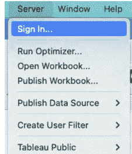

图 13.1：Server—Sign In...

5. 在“数据”窗格中，选择 My Superstore 数据源
6. 选择 Server | Publish Data Source | My Superstore：

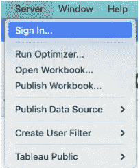

图 13.2：Server–Publish Data Source

7. 在弹出的对话框中，输入所需的设置

如果您的 Tableau Server 上有不同的项目，可以选择将数据源发布到哪个项目。如果需要，也可以更改名称或添加说明，这非常有用，尤其是在您有很多不同的数据源，并希望用户能够查找所需数据源的情况下。通过添加标签，您将添加一个元数据层，使 Tableau Server 用户能够根据标签搜索特定数据源。您还可以更改权限。您的设置可能是不同用户属于不同的组，因此在这里您可以选择哪个组拥有哪些权限。最后，您可以立即连同数据源一起上传工作簿，这样两者都可在 Tableau Server 上使用。

## 了解 Tableau Server 权限层次结构

Tableau Server 中的权限遵循层次结构。了解此层次结构是正确设置访问权限并避免用户无法看到预期内容时产生混淆的关键。

权限层次结构（从高到低）：

| 级别 | 它控制的内容 | 示例 |
|---|---|---|
| Server | 对整个 Tableau Server 实例的全局访问权限 | 谁可以登录 |
| Site | 对特定站点的访问权限（如果存在多个站点） | 谁可以查看“销售”站点？ |
| Project | 对项目中所有内容的访问权限 | 谁可以查看“财务”项目文件夹？ |
| Content | 对单个工作簿、数据源或流的访问权限 | 谁可以编辑“管理仪表板”？ |

表 13.1：权限层次结构

此结构依赖于继承原则，即在较高级别设置的权限会自动向下传递到较低级别；例如，向用户授予项目文件夹的查看访问权限，自然也会授予其对其中所有工作簿的查看访问权限。您可以通过使用覆盖来细化此流程，以针对特定项目打破继承关系，但请记住，**拒绝**规则始终优先——如果在任何一点拒绝用户访问，它将覆盖所有其他授予，以防止意外数据泄露。这种逻辑使您能够处理各种实际场景，例如确保财务团队仅查看其特定项目，允许分析师编辑工作簿而不更改数据源，或将外部顾问隔离在其自己的专用项目中。为保持系统整洁且易于管理，您应始终将权限分配给组而不是个人，并努力在尽可能高的级别授予访问权限，而不是覆盖每个单独的文件。当您需要验证设置是否正常工作时，可以导航到某个内容，单击“权限”选项卡，并搜索特定用户以查看其 *有效权限*，这将显示在应用所有层次结构规则后他们确切可以执行的操作。通过遵循这些原则并使用专用帐户进行测试，您可以确保一个安全且有据可查的环境，以符合您组织的需求。

## Tableau 文件类型

我们将通过考虑各种 Tableau 文件类型来继续讨论 Tableau Server。这看起来可能是一个令人意外的讨论位置，但随着您的阅读，您会发现，清晰地了解文件类型为 Tableau Desktop 作者提供了与 Tableau Server 高效且有效地交互所需的基础知识。

之前讨论过的、与了解如何与 Tableau Server 交互相关的文件类型将进行深入探讨。与了解 Tableau Server 无关的文件类型将仅进行简要介绍。某些文件类型（例如，与许可证激活相关的文件类型）将不予讨论。

## Tableau 数据源

让我们来看看 Tableau 中可用的各种数据源。请看以下 Tableau 数据文件：假设您已构建到公司 SQL 数据库的完美连接。您已定义计算字段，为清晰起见重命名了列，并设置了默认聚合。您希望组织中的每个分析师都使用同一个“真理来源”，而无需从头重新构建。.tds 文件正是如此。

- 文件格式类型：XML
- 包含的内容：元数据。
- 为何有用：.tds 文件很重要，因为它允许 Tableau 作者定义默认格式和聚合、计算字段、数据类型、字段类型等。此外，.tds 文件可以发布到 Tableau Server，从而供环境中的其他作者访问。这实际上使 .tds 文件成为一个“手册”，确保整个组织的一致性。此重要功能将在 Tableau Server 架构部分中更充分地探讨。
- 如何生成：可以通过在“数据”窗格中右键单击数据源并选择 **添加到已保存的数据源...**，然后在弹出的对话框中选择 **Tableau 数据源** 来生成 .tds 文件。此外，还可以通过 **Server | 发布数据源 | [数据源]** 在发布到 Tableau Server 时生成 .tds 文件。**将数据源发布到 Tableau Server** 部分演示了如何发布 .tds 文件以及 .tdsx 文件。
- 如何访问：通常在以下两个位置之一访问 .tds 文件类型。首先，它可以存储在 **我的 Tableau 存储库 | 数据源**。存储在此目录中时，.tds 文件将在开始页面左侧的 **已保存的数据源** 部分下显示。.tds 文件通常的第二个位置是

存储在 Tableau Server 上。导航到 **数据 | 新建数据源** 并选择 **Tableau Server** 可让 Tableau 作者指向已发布到 Tableau Server 的 .tds 和 .tdsx 文件。

## Tableau 数据源包

如果您需要与无法直接访问公司数据库的某人共享数据源（例如，外部顾问或离线工作的同事），.tdsx 文件将元数据和数据快照打包成一个任何人都可以使用的单个压缩文件。查看以下 Tableau 数据文件详细信息：

- 文件格式类型：压缩。
- 它包含的内容：元数据和数据提取。
- 它有用的原因：.tdsx 文件很有用，因为它既可用于访问元数据，也可用于访问数据。Tableau 作者可以将位于 Tableau Server 上的 .tdsx 文件作为数据源访问，从而消除了工作簿直接连接到外部数据源的需求。已发布的 .tdsx 文件可以按计划放置，以便从基础数据源定期更新。
- 它是如何生成的：可以通过在数据窗格中右键单击数据源并选择 **添加到已保存的数据源...**，然后在弹出的对话框中选择 **Tableau 数据源包** 来生成 .tdsx 文件。与 .tds 文件一样，.tdsx 文件也可以通过 **服务器 | 发布数据源 | [数据源]** 发布到 Tableau Server 时生成。有关更多详细信息，请参阅下一个练习部分。
- 如何访问它：.tdsx 文件的访问方式与 .tds 文件相同。首先，它可以存储在 **我的 Tableau 存储库 | 数据源**。存储在此目录中时，.tdsx 文件将显示在开始页面左侧的 **已保存的数据源** 部分下。存放 .tdsx 文件的第二个位置通常是在 Tableau Server 上。选择 **数据 | 新建数据源** 并选择 **Tableau Server** 可让 Tableau 作者指向已发布到特定 Tableau Server 实例的 .tds 和 .tdsx 文件。

## Tableau 工作簿

除了数据源，还有 Tableau 工作簿。如果您正在构建一个连接到频繁更新的实时数据库的仪表板（例如，实时销售仪表板），您希望仪表板始终显示最新数据，而无需手动刷新。.twb 文件仅存储可视化架构（“蓝图”），不包含任何数据，从而保持文件小巧且响应迅速。查看以下 Tableau 数据文件详细信息：

- 文件格式类型：XML
- 它包含的内容：元数据和架构。架构定义工作簿中的可视化。请注意，在此上下文中，架构是指定义工作簿可视组件的 XML，包括工作表上显示的可视化以及仪表板和故事的布局。
- 它有用的原因：.twb 文件类型是 Tableau 作者最常用的文件类型。它是创建指向实时数据集的可视化所必需的。因此，实时解决方案将使用此文件类型。
- 它是如何生成的：.twb 文件通过 文件 | 另存为 创建，然后在弹出的对话框中选择 .twb 文件类型。
- 如何访问它：.twb 文件可以通过 Tableau Desktop 打开，或通过指向 Tableau Server 实例的浏览器访问。由于 .twb 文件是 XML，可以通过文本编辑器打开、查看和更新。

## Tableau 工作簿包

如果您需要与无法访问您数据源的人共享完整的仪表板（例如，将销售报告发送给客户，或在没有互联网连接的会议上进行演示），.twbx 文件将所有内容（可视化、数据和任何图像）打包成一个自包含的文件，可离线工作。查看以下 Tableau 数据文件详细信息：

- 文件格式类型：压缩。
- 它包含的内容：元数据、架构，以及可选的一个或多个数据提取。
- 它有用的原因：.twbx 文件类型是使用 Tableau Reader 所必需的。它还可以有效地与 Tableau Server 一起使用，以访问 Tableau Server 不直接连接的数据源，例如平面文件和 Microsoft Excel 和 Access 文件。.twbx 文件的缺点将在下文讨论。
- 它是如何生成的：.twbx 文件通过 文件 | 另存为 创建，然后在弹出的对话框中选择 .twbx 文件类型。
- 如何访问它：.twbx 文件可以通过 Tableau Desktop 打开，或通过指向 Tableau Server 实例的浏览器访问。由于 .twbx 文件是压缩文件，也可以通过压缩实用程序（例如 WinZip 或 7-Zip）解压缩。

现在您了解了不同的 Tableau 文件类型以及何时使用每种类型，您可能在想：“将工作发布到 Tableau Server 后会发生什么？我每次需要更改时是否都必须下载工作簿，在 Tableau Desktop 中编辑，然后重新发布？”答案是否定的。而这就是 Web 创作发挥作用的地方。Web 创作允许您直接在浏览器中编辑已发布的工作簿，而无需打开 Tableau Desktop。当您需要快速调整、与队友协作，或在未安装 Tableau Desktop 的计算机上工作时，这尤其有价值。让我们探讨一下它的工作原理。

## Web 创作

将仪表板发布到 Tableau Server 后，如何对其进行编辑呢？Tableau 提供了两种选项。第一种选项是，您和所有有权访问并有权下载仪表板的其他人都可以下载它，在 Tableau Desktop 中编辑它，然后通过新上传覆盖 Tableau Server 上的最新版本。另一种选项是在 Server 上实时编辑仪表板。此功能称为 Web 创作。Web 创作是 Tableau Server 的一项功能，提供了与 Tableau Desktop 类似的创作界面。最初，Web 创作界面功能有限，但每个版本都会引入更多功能。因此，Tableau Server Web 创作环境与 Tableau Desktop 之间的功能差距已缩小。Web 创作环境提供了强大的功能来创建和应用表计算，并提供了创建仪表板的功能。

撰写本文时，Tableau Server Web 创作环境中仍缺少一些功能，但以下链接将为您提供当前可用功能的概览，对比 Tableau Desktop 和 Tableau Server Web 创作功能：https://help.tableau.com/current/pro/desktop/en-us/server_desktop_web_edit_differences.html。

接下来，两个非常简短的练习将演示如何访问 Tableau Server 中的创作环境。请记住，Tableau Server 管理员需要授予用户相应权限才能执行此操作。

## 使用 Web 创作编辑现有工作簿

执行以下步骤以在 Tableau Server 上编辑现有工作簿：

1. 登录到 Tableau Server 实例
2. 选择在 **将数据源发布到 Tableau Server** 部分中上传的 My Superstore 数据源
3. 选择 **新建** | **工作簿** 以基于已发布的数据源创建工作簿：

探索 / 默认 / My Superstore

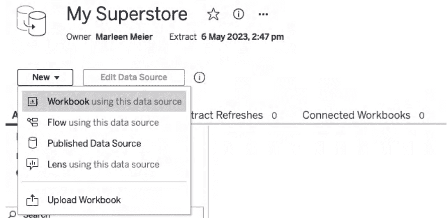

图 13.3：已发布的数据源

4. 将 Category 拖到 Columns，将 Profit 拖到 Rows
5. 现在单击 文件 | 另存为...，在弹出窗口中为工作簿选择一个名称（我将我的命名为 Test），然后单击 发布：

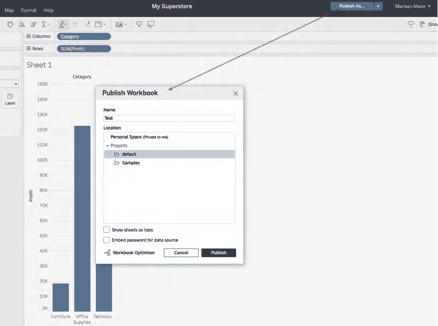

图 13.4：发布工作簿

6. 如果您现在返回 Tableau Server 的默认文件夹，您将在 My Superstore 已发布的数据源旁边看到一个名为 Test 的其他工作簿：

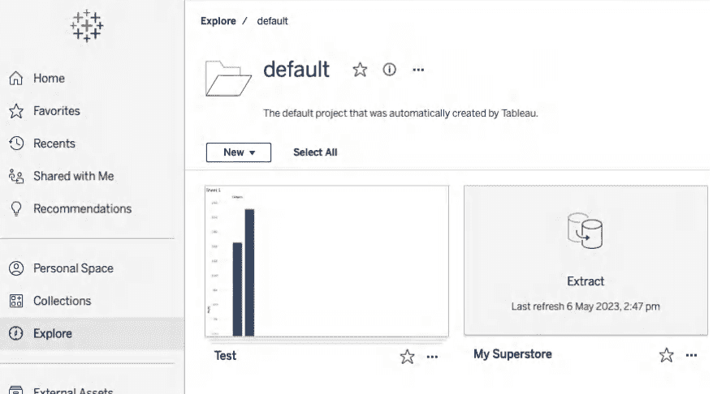

图 13.5：工作簿视图

7. 如果您想继续编辑 Test 工作簿，只需在 Tableau Server 上打开它并选择 编辑 按钮：

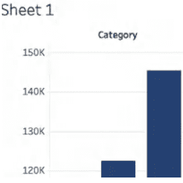

图 13.6：Web 创作

就这么简单。

到目前为止，我们已发布数据集，基于该数据集在 Tableau Server 上构建了工作簿，并且您可能甚至已编辑了工作簿。如果尚未，请别担心；我们将在下一个练习中执行此操作。

## 了解 Tableau Server Web 创作环境

让我们执行以下步骤以了解 Tableau Server Web 创作环境：

1. 访问与此章关联的工作簿，并注意**销售与配额**工作表：

| 排名 | 州 | 数值 |
|:---|:---|:---|
| 1 | Texas | 106% |
| 2 | Illinois | 98% |
| 3 | Michigan | 100% |
| 4 | Indiana | 84% |
| 5 | Wisconsin | 100% |
| 6 | Minnesota | 96% |
| 7 | Missouri | 101% |
| 8 | Oklahoma | 86% |
| 9 | Nebraska | 93% |
| 10 | Iowa | 92% |
| 11 | Kansas | 97% |

图 13.7：Web 创作 II

2. 通过单击**服务器 | 发布工作簿**将工作表发布到 Tableau Server 实例。在出现的窗口中，将工作簿重命名为销售与配额，并确保仅上传销售与配额工作表：

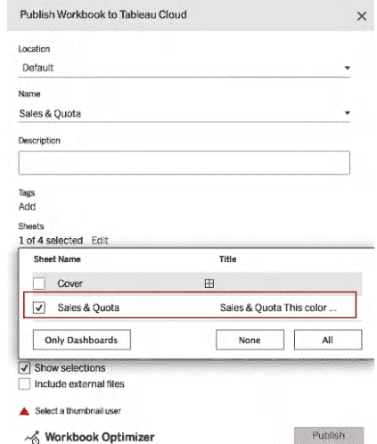

图 13.8：发布工作簿

3. 将出现以下弹出窗口：

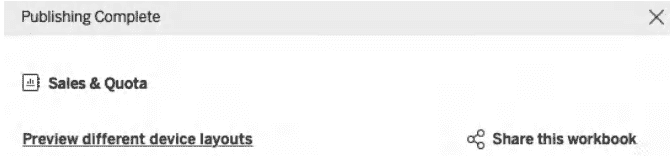

图 13.9：发布工作簿 II

4. 通过单击已发布的销售与配额视图打开 Tableau Server 上的工作表，然后单击“编辑”以访问 Web 创作：

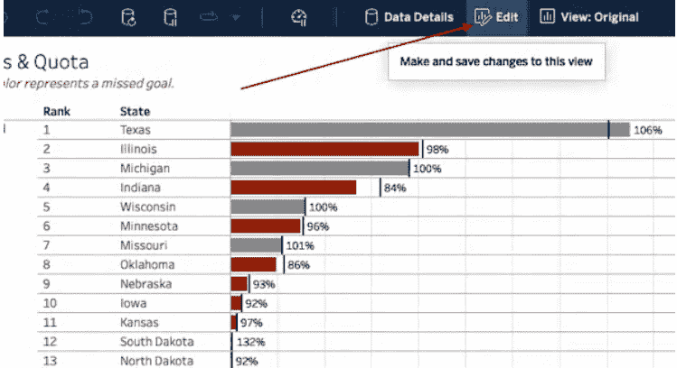

图 13.10：访问 Web 创作

5. 从这里开始，您应该会看到一个与 Tableau Desktop 中习惯使用的界面类似的界面。这就是 Web 创作的含义——您在线拥有大部分 Tableau Desktop 功能，只要工作簿已发布到 Tableau Server，甚至无需打开 Tableau Desktop。让我们试一下！

您可能首先注意到，尽管我们没有发布 Cover 或 Publish 工作表，但它们在 Web 创作视图中可见。您可以右键单击其中任意一个，通过选择“发布”来使此工作表可供没有 Web 创作权限的 Tableau Server 用户访问：

图 13.11：Web 创作

6. 接下来，在销售与配额 选项卡上，按住键盘上的 Ctrl (Windows) 或 Command (macOS) 键，同时将 Quota Met? 字段拖动到 Rows 书架：

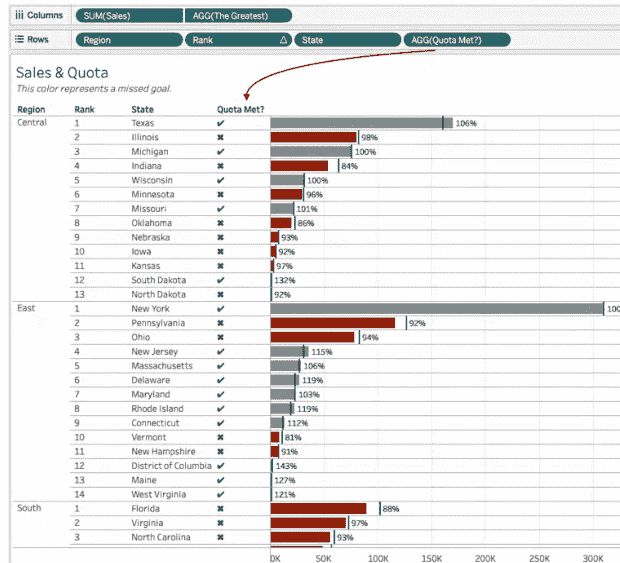

图 13.12：Web 创作 II

7. 您会看到视图中出现叉号和对勾。这表明我们不仅可以使用颜色来指示是否达成配额，还可以使用这个简单的计算字段在视图中添加标记：IF SUM([Sales]) >= [Quota] THEN "" ELSE "" END。随意尝试您在 Tableau Desktop 中习惯轻松处理的其他操作，包括以下内容：

- 创建计算字段
- 添加筛选器
- 调整提示信息
- 创建新工作表
- 创建仪表板

编辑完成后，尝试单击右上角的叉号。您会发现更改在仪表板中不可见。再次单击“编辑”以返回 Web 创作模式，瞧！Quota Met? 仍然可见于 Rows 书架。根据您的 Server 设置，Tableau 会自动保存，但您必须使用“发布”按钮才能使更改对 Server 上的查看者可见。

## Web 创作增强功能

2026.1 版本为 Web 创作体验带来了多项激动人心的增强功能，进一步缩小了 Tableau Desktop 与 Tableau Server 之间的差距。

- **圆角：** 您现在可以直接在 Web 创作中为仪表板对象设置圆角半径。告别使用注释或图片进行繁琐操作的日子。只需设置半径值即可创建简单的圆角，或设置更极端的圆角半径以创建不同形状。此功能在 Tableau Cloud、Tableau Desktop 和 Tableau Public 中均可用，让您可以直接在浏览器中轻松创建现代、精美的仪表板设计。
- **无障碍可视化创作：** Tableau 致力于提高可访问性，让每个人都能成为数据可视化的创建者。在 Web 创作中，您现在可以导航到一个药丸（pill），并使用键盘和辅助技术选择上下文菜单选项，将该药丸放入放置区，包括列和行书架、显示我、页面、筛选器或标记卡。此功能使无需鼠标即可构建可视化成为可能，将数据创建面向更广泛的受众。
- **查看数据模型增强：** 了解 Tableau 数据模型在可视化或工作表中的使用方式，以及哪些表为可视化中的哪些药丸提供数据。如果在药丸中使用了复杂计算，悬停在药丸上现在会在查看数据模型中高亮显示参与的表，以确认逻辑的正确性。这使您可以直接在工作流中诊断和评估分析，避免在工作表和数据源选项卡之间来回切换。
- **表名称智能筛选：** 通过允许用户按精确名称筛选表，提高大型数据模型中的分析效率。使用相同的表智能筛选 "T:"，后跟精确表名称的双引号，以绕过子字符串搜索。这项虽小却强大的增强功能在处理复杂数据模型时可节省时间。

我们已经讨论过仪表板编辑选项和自动保存，但尚未讨论如何跟踪更改，并确保在生成新信息的过程中不会丢失重要信息。下一部分将介绍如何在 Tableau Server 上维护工作簿，首先从修订历史记录开始。

## 在 Tableau Server 上维护工作簿

一旦您开始在 Tableau Server 上共享工作，就会很快意识到，创建仪表板只是战斗的一半。另一半是长期维护它。编辑后意外损坏仪表板会发生什么？如何保护您的工作不被同事覆盖？如何确保每个用户只能看到他们应该看到的数据，而无需为每个人创建单独的工作簿？

在本节中，我们将探讨每个 Tableau 作者都应该了解的三项基本工作簿维护功能。

## 修订历史记录

作为 Tableau 仪表板开发人员甚至 Tableau Server 管理员，您希望确保用户始终查看正确的数据。但事情是这样的：您编辑了仪表板，编辑后仪表板显示错误信息。有个用户给您打电话，要求立即恢复旧仪表板。您该怎么办？使用修订历史记录！

Tableau Server 自带修订历史记录，确保每个工作簿和数据源的过去 25 个版本可检索。此设置可由 Tableau Server 管理员启用或禁用。在 Tableau Desktop 中，如果您尝试上传与先前上传的文件同名的工作簿或数据源，Tableau Desktop 将显示诸如 **工作簿名称已被使用** 的警告。

发布将覆盖现有数据源。如果您继续上传，将激活修订控制，文件的先前版本将作为修订版保持可访问。要访问 Tableau Server 中单个工作簿和数据源的修订历史记录，只需选择您上传的任何数据源或工作簿，然后单击右下角的三个点。在弹出窗口中，选择 **修订历史记录...**：

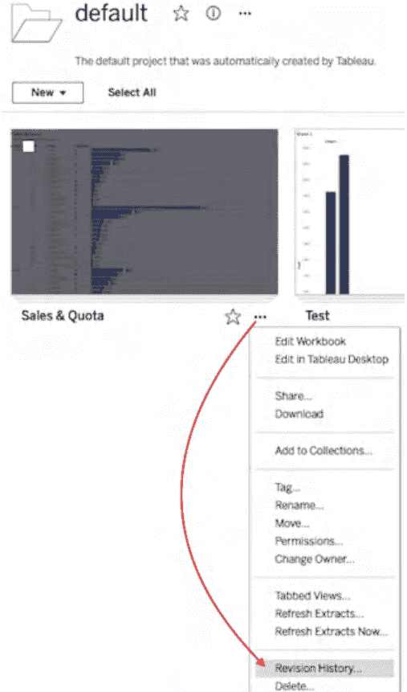

图 13.13：修订历史记录...

这将打开一个对话框，您可以在其中选择要恢复的先前版本：

### 修订历史记录

选择工作簿 "Sales & Quota" 的修订版。

| 修订版本号 | 发布者 | 发布日期 | 操作 |
|---|---|---|---|
| 修订版本 2 (当前) | Marleen Meier | 2023 年 5 月 6 日 下午 3:23 | |
| 修订版本 1 | Marleen Meier | 2023 年 5 月 6 日 下午 3:09 | ... |

取消 恢复

图 13.14：修订历史记录 II

## 禁用重复的自定义视图名称

说到版本控制，2026.1 版本引入了一项新功能，以增强产品可靠性并创建更直观的自定义视图体验。管理员现在可以阻止创建重复的自定义视图名称，并在保存将覆盖现有视图时提供清晰的内联警报。这消除了静默失败，并防止混淆，尤其是在许多用户可能在同一仪表板上创建视图的大型企业环境中。

修订历史记录和自定义视图管理非常有用！我希望您不需要经常使用它们，但始终有选择是件好事。许多组织面临的下一个问题是：如何确保用户只能看到他们应该看到的数据，而不是 Tableau Server 上发布的所有内容？一个解决方案是用户筛选器。我们将在下一节讨论这个话题！

## 用户筛选器

学生经常问我类似这样的问题：我负责多个地区的销售经理。重要的是，销售经理只能看到他们的指标，即其他销售经理的指标对他们不可见。为了实现这一点，我是否需要为每个销售经理创建单独的工作簿？

幸运的是，答案是否定的。Tableau 提供了用户筛选器，允许 Tableau 作者确保每位销售经理只能看到他们有权查看的信息。为了演示这一点，请执行以下步骤：

1. 此练习需要 Tableau Server 上有多个用户。因此，请通过单击“用户 | 添加用户”在 Tableau Server 上创建至少一个其他用户。我使用了我拥有的第二个电子邮件地址来完成此操作：

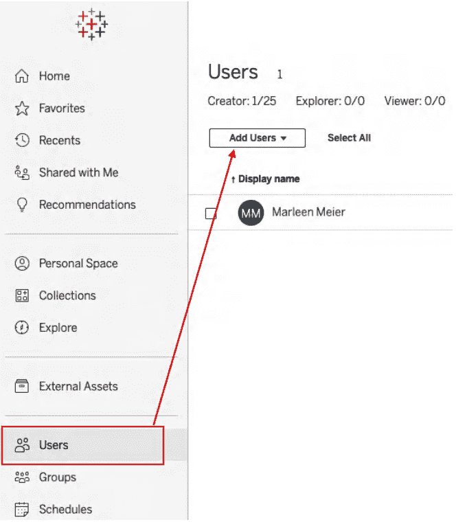

图 13.15: 添加用户

- 2. 作为可选步骤，您可以更改帐户的显示名称。要更改帐户的显示名称，请登录 https://www.tableau.com/，单击用户 | 编辑帐户，然后对名和姓条目进行所需更改。

- 3. 作为第二个可选步骤，您不仅可以将单个用户分配给筛选器，还可以分配用户组。为此，您可以创建不同的组，方法如下：

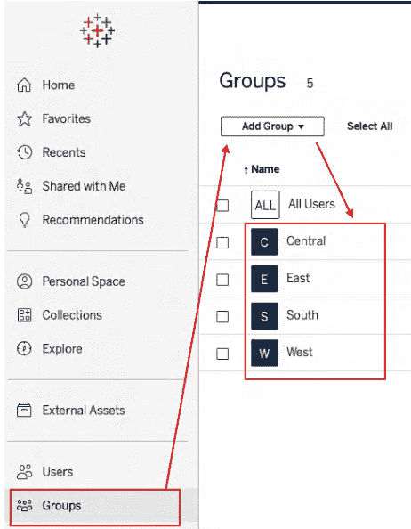

图 13.16: 添加组

- 4. 随后，您可以通过选择用户，然后在 **操作** 下选择 **组成员资格...**，将 Tableau Server 实例中的用户划分为中央、东部、南部和西部区域：

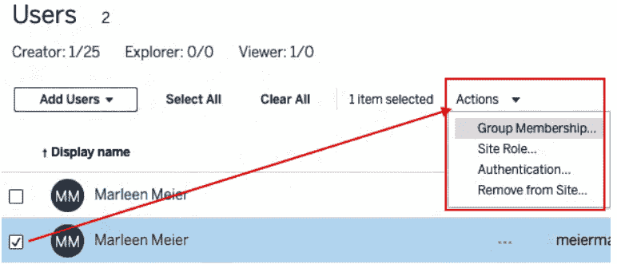

图 13.17: 添加组 II

- 5. 现在，访问与本章关联的工作簿，并导航到视图级用户筛选器工作表。请注意，该视图是美国的字段地图，其中 State 在“详细信息”货架上，Region 在“颜色”货架上，Sales 在“标签”货架上。

- 6. 通过 Tableau Desktop 中的服务器 | 登录 登录到 Tableau Server 实例。

- 7. 选择服务器 | 创建用户筛选器 | 区域...（仅可从 Tableau Desktop 访问）。在显示的用户筛选器对话框中，您现在可以将单个用户或用户组分配给某个区域。将用户筛选器命名为销售区域，然后单击确定：

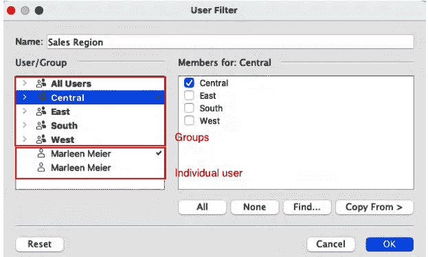

图 13.18: 用户筛选器

- 8. 请注意，销售区域现已实际添加到数据窗格的集合部分：

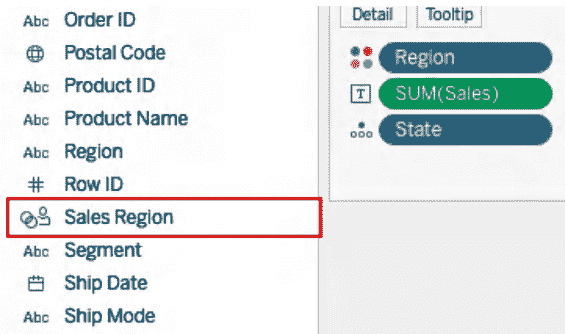

图 13.19: 已添加集

- 9. 将 **销售区域** 放在 **筛选器** 货架上

- 10. 在状态栏右侧，单击下拉列表以访问用户筛选器：

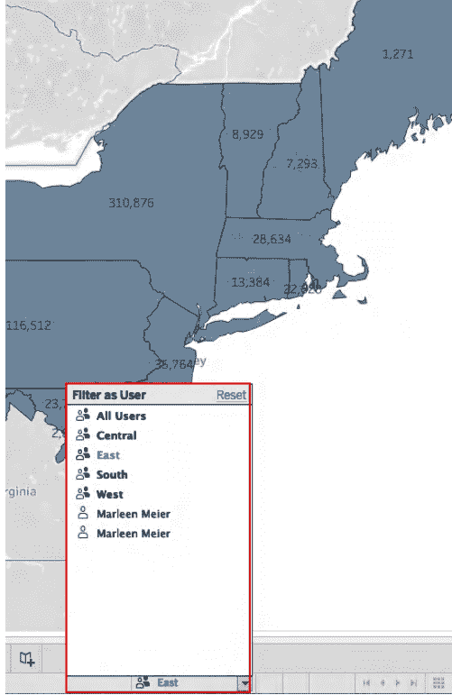

图 13.20: 切换筛选器

- 11. 选择不同的组或用户，并请注意，显示的结果会根据图 13.19 中的设置发生变化。

- 12. 工作簿发布到 Tableau Server 后，访问工作簿的用户只能查看筛选器允许的信息。这也可以应用于数据源级别的已保存数据源。

需要注意的是，与仅将维度筛选器添加到筛选器货架不同，您或许应考虑将销售区域添加到数据源筛选器。这一点非常重要，因为任何拥有 Web 创作权限的用户都可以直接从筛选器货架中移除筛选器。在此练习中，用户随后便能查看所有区域的指标。然而，数据源筛选器无法通过 Web 创作环境移除，因此更安全。此外，数据源筛选器适用于整个工作簿，从而进一步保障数据安全。但是，如果您未启用 Web 创作，筛选器货架即可满足需求。

## Tableau Server 设置和功能

发布仪表板后，用户可以根据其权限设置警报、认证数据源、订阅、向仪表板添加评论等。本节将在两个不同位置介绍不同的功能：工作表和视图。除此之外，Tableau Server 还拥有更多功能，尤其是针对网站管理员的设置，但遗憾的是，这些内容已超出本书的范围。

## 工作表级别的功能

这里所说的工作表级别功能，是指您在选择某个项目和特定工作表后可用的设置，如下所示：

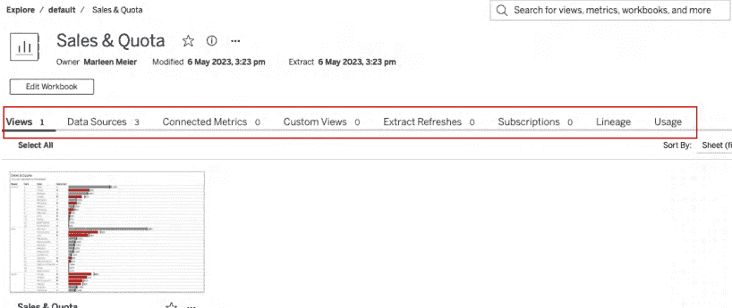

图 13.21: Tableau Server

在此级别，我们可以看到八个不同的选项卡，将在接下来的几页中讨论它们。

- 视图：视图显示在一个工作簿内已发布的所有工作表或仪表板的缩略图。将工作簿上传到 Tableau Server 时，您可以选择此处应显示的所有视图：

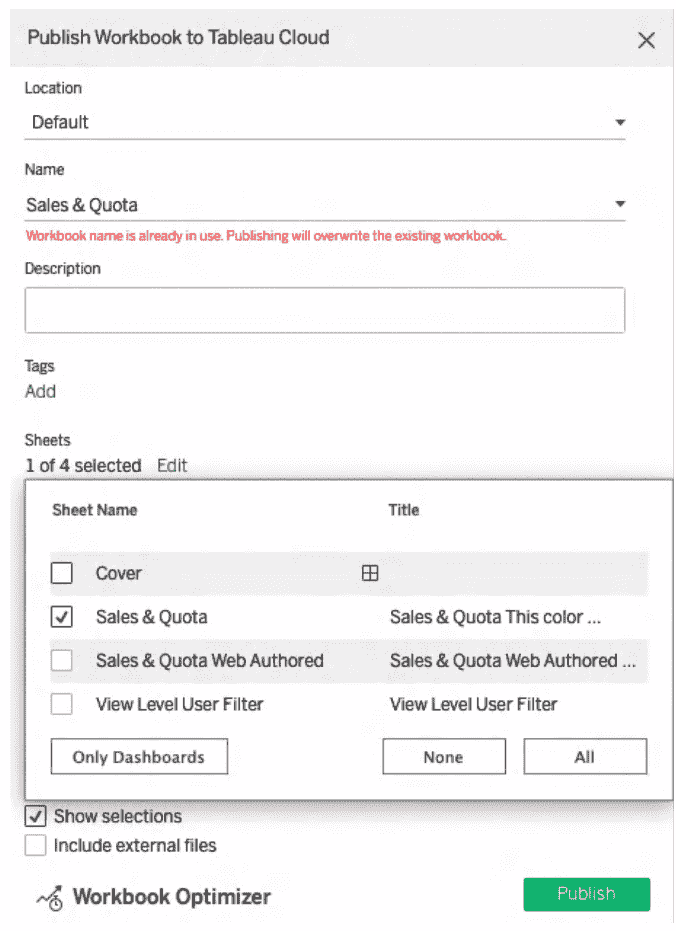

图 13.22: 发布工作簿

单击视图旁边的三个点，将出现更多选项，如下图所示：

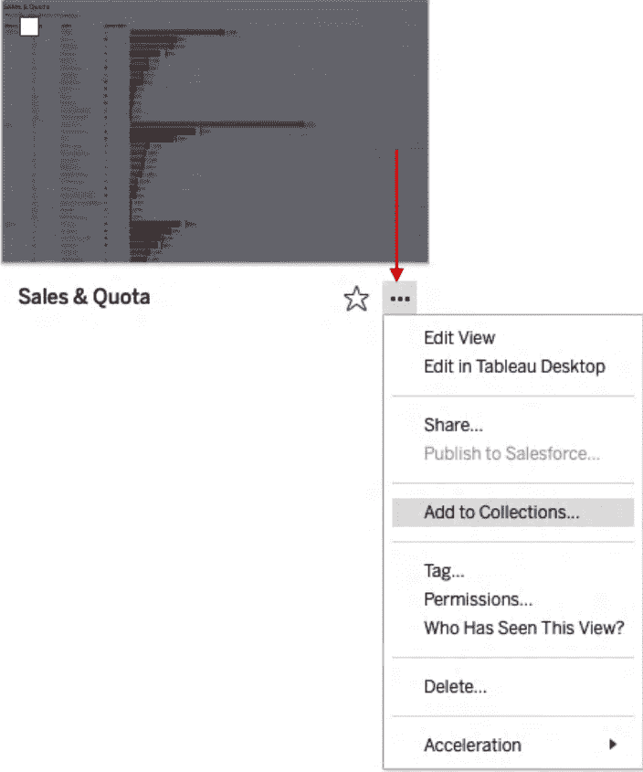

图 13.23: 选项

这些选项不言自明：您可以编辑视图（也称为 Web 创作，本章前面已讨论过），也可以将视图共享给其他用户，Tableau 会向与您共享视图的用户发送一封带有图片和超链接的电子邮件。您还可以添加标签，帮助其他用户找到该视图；可以查看哪个用户或组拥有打开该视图的权限，以及谁查看过该视图；最后，您可以删除该视图。显示哪些选项取决于 Tableau Server 的配置，因此您的管理员可以启用或禁用不同的功能以显示或隐藏它们，否则这些功能可能会显示为置灰状态。

- 数据源：下一个选项卡是数据源。它将向您展示创建此工作簿所用的数据源概览：

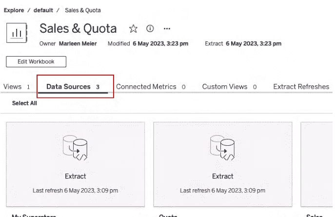

图 13.24: 数据源

您将能够查看使用了哪种类型的数据源；例如，通过单击每个数据源旁的三个点，您将能够再次查看更多设置，具体取决于您的 Tableau Server 配置：

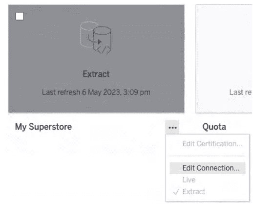

图 13.25: 数据源 II

- **Tableau Pulse 中的指标**：Tableau Pulse 推出了一个现代化指标层，可提供集中式、受控管的关键绩效指标（KPI）定义。与旧版指标（源自单个仪表板）不同，Pulse 指标来自单一可信数据源，并附带 AI 生成的见解，用于解释发生了什么以及原因。例如，如果您有一个显示过去一年每日利润的仪表板，但指标应仅显示最后一个利润数据点，则您需要创建一个新视图，以便在指标中使用明确的最后利润值，尽管数据已是初始视图的一部分。然而，一大优势是您无需连接到不同的数据源，因为各工作簿中已设置的连接将被复用。

有关指标的更多详细信息，请访问：https://www.tableau.com/about/blog/2020/5/introducing-metrics-headlines-your-data.

- **提取刷新**：使用提取作为数据源时，您可以在将工作簿上传到 Tableau Server 或发布工作簿后，定义刷新计划。不同的计划可由您的服务器管理员设置。例如，如果您将提取刷新设置为每天上午 7 点运行，Tableau Server 将在上午 7 点访问数据源（可能是 SQL 数据库），加载数据，随后您将在 Tableau 仪表板中看到最新数据。使用提取的性能通常优于实时连接，具体取决于数据量和数据源类型，但请注意，仪表板中的数据始终与您最新的提取一样旧。

- **订阅**：订阅可在视图级别设置；我们将在下一节介绍此内容。但在工作簿级别，您可以查看特定工作簿的所有活动订阅。

- **数据血缘**：血缘是 Tableau Server 上另一个较新的功能。它仅通过数据管理加载项提供，需额外付费，并会向您展示数据源的依赖关系。有关血缘的更多信息，请访问 https://help.tableau.com/current/server/en-us/dm_lineage.htm。

- **使用情况**：使用情况选项卡可让您了解有多少人查看了您的仪表板，以及有多少其他用户将您的仪表板添加到了收藏夹。

**注意**
使用情况数据也可从 Tableau 数据库访问，因此可用于进一步分析。

最后，请注意工作簿页面上的三个点，其中还包含其他选项以及我们之前看到的选项：

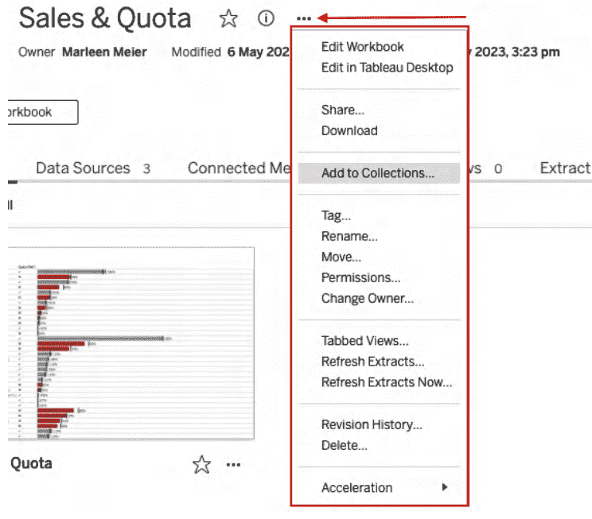

同样，您能使用哪些选项取决于 Tableau Server 管理员授予您的权限。

当选择基于已发布数据源（例如我们在本章开头发布到 Tableau Server 的 My Superstore 数据源）时，可用选项会略有不同：

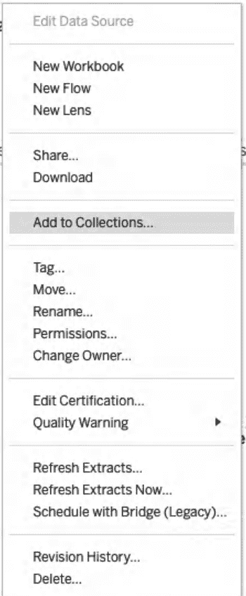

图 13.27: 选项 II

大多数项目都不言自明，但我想指出 **质量警告**，该功能需在 Data Management 插件中额外付费才能使用。该功能将允许您提醒数据的每个用户以及基于该数据的任何工作簿在使用时要格外小心。

根据设置，Tableau Server 将显示各种类型的警告，例如 **已弃用**、**数据已过时**、**维护中** 和 **敏感数据**，这些警告可从下拉菜单中选择。

您还可以决定是仅在数据源上显示类型，也在相关工作簿上显示。以下是在数据源上显示的示例：

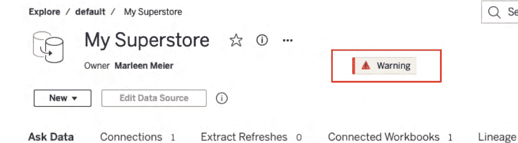

图 13.28: 数据质量警告

这些警告在工作簿级别也可见，甚至在打开视图时也是如此。

这是一个非常强大的功能，展示了 Tableau 随每个版本日益成熟。数据质量是许多数据策略的重点，也是所有分析的基础。Tableau Server 已适应这一需求，并为您提供将随您的数据策略和质量措施共同成长的功能。

> > **注意**
> > **关于 Ask Data 的说明**
> >
> > 如果您使用过较旧版本的 Tableau，可能记得 Ask Data，即自然语言查询功能，可让您键入诸如“按区域显示销售额”之类的问题。Ask Data 于 2024 年 2 月正式停用，不再在 Tableau Cloud 或 Tableau Server 2024.2 及更高版本中提供。其功能已被 Tableau Pulse（提供关于指标的 AI 生成洞察）和 Tableau Agent（帮助您通过对话构建可视化）所取代。有关这些功能的更多信息，请参见第 15 章，Tableau AI、Pulse 和下一代的智能时代。

## 视图级别的功能

我们已介绍完工作簿级别的所有设置，现在将深入探讨较低一级——视图。视图大致如下所示，红色框中的设置是本节关注的重点：

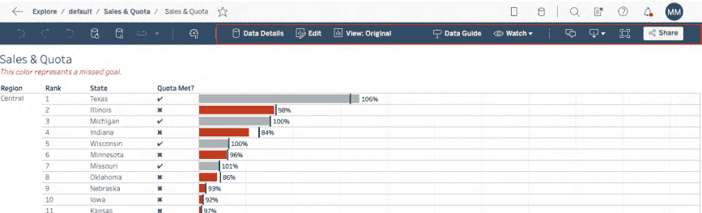

图 13.29: 视图级别功能

让我们详细了解这些功能：

- 数据详情：数据详情选项卡将显示视图中所用数据源的更多详细信息。该功能需在 Data Management 插件中额外付费才能使用。右侧将弹出的窗口包含三个不同的部分：此工作表的视图、数据源和正在使用的字段：

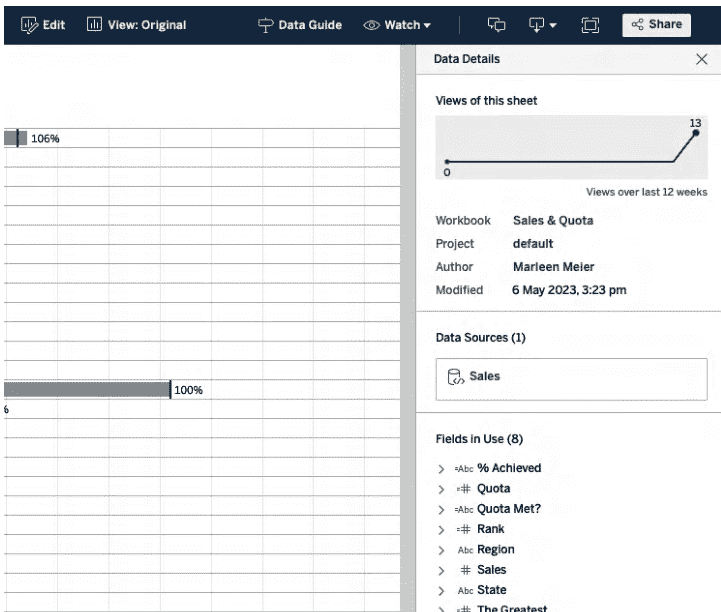

图 13.30: 数据详情

在最后一个部分中，您可以单独打开每个字段。如果是计算字段，将显示计算公式；如果是来自原始数据源的字段，则会显示数据类型和描述（如果已添加描述）：

### 正在使用的字段 (8)

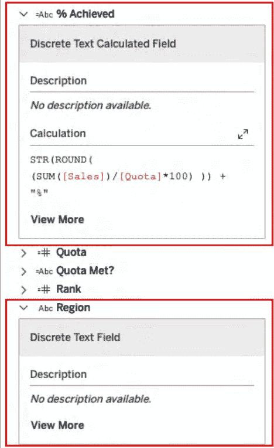

图 13.31: 数据详情 II

- 编辑：您应该已经知道这个了。编辑允许您进入 Tableau Server 上的 Web 创作环境。

- **视图：** **视图**选项卡允许您添加除默认视图外的其他视图并保存。下次打开仪表板时，您可以单击此选项卡选择您创建的视图，保存的设置将一次性全部应用。您的视图可能包含特定的筛选器选择、不同于默认视图的参数选择，或者对您最重要的集合。您无需在每次打开视图时更改筛选器、参数和集合，可以使用 **视图** 选项卡：

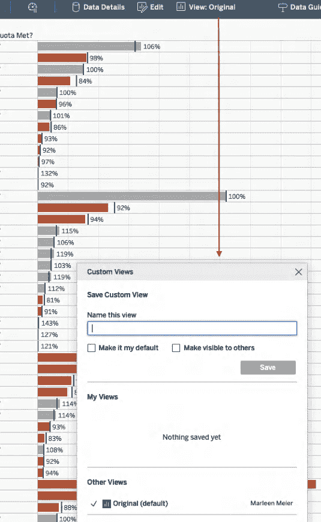

图 13.32: 自定义视图

- 数据向导是仪表板中数据的摘要。不言自明，对吧？！

- 观察包含订阅、指标和警报：

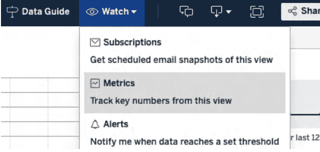

图 13.33: 自定义视图

- 警报：截至撰写本文时，警报只能设置在连续数值轴上。但是，Tableau 论坛上正在讨论一些想法，这些想法将提高设置警报的灵活性。

> > **注意**
> > 在 Tableau Ideas 论坛中，用户可以写下对未来版本的想法，社区可以为其投票。得票率高的想法可能很快会被采纳。您可以在此处找到该论坛：https://community.tableau.com/community/ideas。

单击警报按钮，右侧将显示文本：

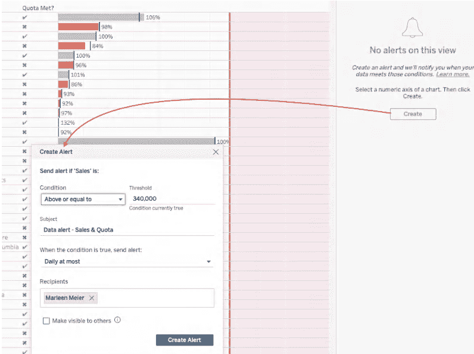

图 13.34: 警报

选择数值轴（如销售额）后，将出现一个新的弹出窗口，其中可以输入条件和阈值。此外，可以指定阈值检查的频率：

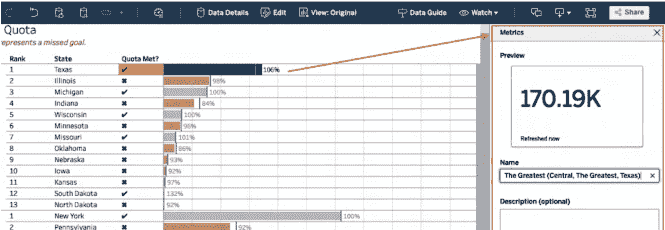

图 13.35: 警报 II

一旦设置警报，当阈值被突破时，该警报中指定的所有用户和群组都将收到一封电子邮件。电子邮件将包含一张静态图像和指向 Tableau Server 上交互式版本的链接。

- 指标：如前所述，这是一个相对较新的功能。要创建指标，请在任何视图中选择一个标记并单击指标选项卡。随后的屏幕将在视图右侧打开：

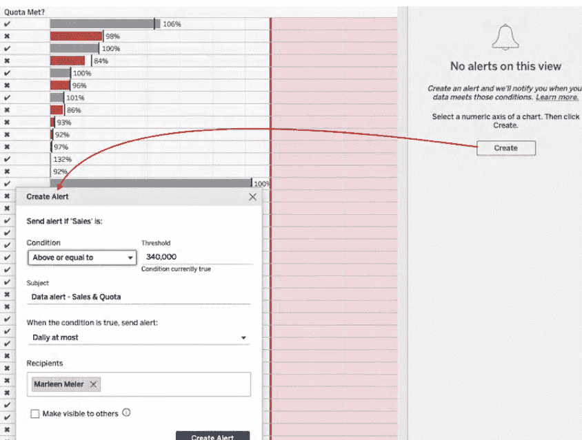

图 13.36: 指标

指标功能与 Tableau Mobile 高度集成，因此可以用于向任何人、任何地点展示关键绩效指标。单击创建后，可以从保存指标的项目中访问指标视图。

- 订阅：订阅用于频繁的电子邮件更新。它们的工作方式与警报类似；可以订阅人员或群组，他们将在设定的时间收到一封包含相关仪表板概览的电子邮件。调度可以由管理员预定义：例如，每天早上 7 点。

## 2026.1 版中的新增功能

2026.1 版是 Tableau 演进中的巨大进步，引入了改进可用性、扩展连接性并加深平台与 AI 驱动分析集成的增强功能。在此前版本的基础上，该版本致力于提供更流畅、更智能的用户体验。

在本节中，我们将探讨 Tableau 2026.1 引入的关键更新和功能，重点介绍它们如何简化工作流程、改进协作，并将分析贴近日常决策。

### 图像导出改进

在导出或创建订阅时，Tableau 2026.1 引入了一种新的扩展导出服务架构，可帮助您加载使用扩展的仪表板，并生成与登录时看到的数据一致的图像输出。这确保了您的订阅、警报和下载始终与预期完全一致。分析人员和管理员可以简化围绕导出和自动作业的注意事项，并在用户下载仪表板、访问订阅和缩略图、接收警报、在 Slack 上协作等情况下提供统一的仪表板体验。

- 共享：单击共享，将打开一个弹出窗口，允许您与 Tableau Server 已知的任何人共享视图的 URL。该人员将收到带有链接的电子邮件。请确保该用户有权访问该项目，否则他们将无法打开视图：

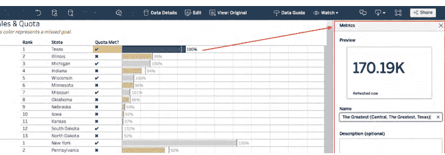

图 13.37: 共享视图

- 下载：Tableau Server 还提供下载功能。根据管理员的配置，您可以选择不同的格式进行下载：

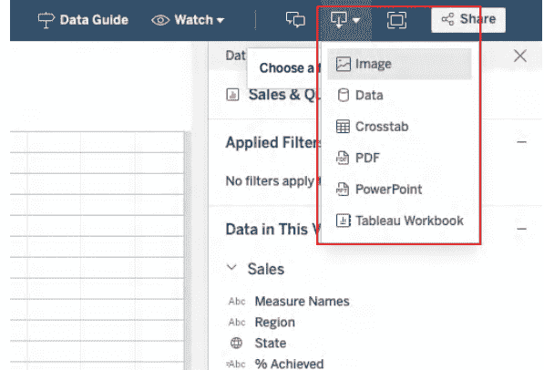

图 13.38: 下载

- 评论：最后但同样重要的是，您可以对视图进行评论；原始视图或已编辑视图均可。为此，请单击右上角的 **评论** 按钮：

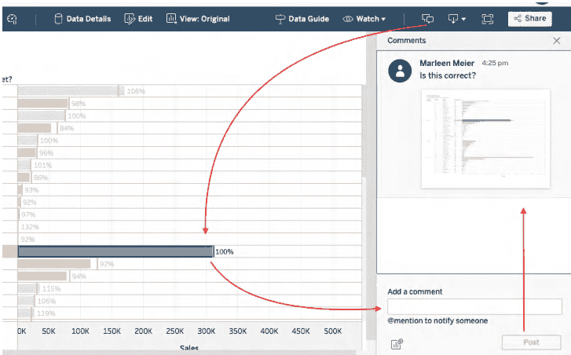

图 13.39: 评论

您可以在评论中使用 @同事姓名 提及同事，他们将收到包含您评论的电子邮件。您还可以将屏幕截图添加到评论中。

## Tableau Pulse 集成

Tableau Pulse 代表了 Tableau 提供洞察方式的根本转变，从用于构建仪表板的工具包转变为由 AI 驱动的智能、个性化分析体验。它旨在将指标和解释——而不仅仅是图表——置于用户工作流的中心。

与其从仪表板开始，不如说 Pulse 从您的关键业务指标开始。您可以从数据源定义或自动生成这些关键 KPI（例如“经常性月收入”或“客户流失率”）。Pulse 然后持续监控它们。

Tableau Pulse 在现有数据和 Tableau 内容之上添加了一个智能层。其 AI 引擎会自动：

- 它扫描您的数据以建议相关、可信的指标，并将其维护为单一事实来源。

- 对于每个指标，Pulse 不仅显示趋势线。其 AI 提供自然语言摘要，直接在上下文中突出显示重大变化、促成因素和异常。

- 它为每个用户量身定制体验。查看同一“收入”指标的销售总监和区域经理将看到与其特定角色和数据细分相关的解释和细分。

- 洞察通过摘要电子邮件、个性化网页主页交付，并直接集成到 Slack 和 Salesforce 等工具中。用户无需四处寻找；关键变化会主动送达。

Pulse 配备自然语言界面，用户可以使用普通英语就任何指标或洞察提出后续问题，而无需构建新视图即可深入钻研。这就是它与爱因斯坦副驾驶等功能集成的地方，实现从洞察到行动的无缝对话流程。

Tableau Pulse 是 Tableau AI 愿景的体现，自动化数据洞察的生命周期。它将静态仪表板转变为与您数据的动态、智能、个性化对话，使分析更易于访问、更主动，并集成到日常决策中。

## 增强的数据连接性

2026.1 版引入了两项连接数据的重大增强功能，值得特别关注。

- 无需编写自定义代码即可连接到来自 REST API 端点的数据。新的 REST API 连接器为没有开发人员资源的业务用户解锁 API 数据，实现自助分析并缩短分析时间。REST API 连接器是已弃用的 Web 数据连接器选项的预期替代品。这对于依赖 API 数据的组织来说是一个变革性的功能。业务用户不再需要等待 IT 构建自定义连接器或编写 Python 脚本，现在可以直接连接到 REST API 并将数据带入 Tableau 进行分析。

- 使用自带连接器（BYOC，现处于 Pilot 阶段）加速您的云之旅并集中治理。使用专有系统或不支持数据库的组织现在可以部署自定义驱动程序和连接器，从而实现迁移到 Tableau Cloud。BYOC 在确保站点级治理和使用监控的同时，解锁了网页创作、已发布数据源、提取和 Tableau Prep 流的全部功能。对于拥有旧系统或行业特定数据库的企业，此功能消除了云采用的主要障碍。您现在可以将现有连接器带到 Tableau Cloud。

## Tableau 应用程序适用于 Microsoft 365

您现在可以使用 **Tableau 应用程序适用于 Microsoft 365**（在 Tableau Cloud 和 Tableau Server 中正式提供）确保您的工作基于最新数据和洞察。除了与 Microsoft Teams 的现有集成之外，用户现在可以将 Tableau 内容直接嵌入 PowerPoint 幻灯片和 Word 文档中，以可信数据讲述引人入胜的故事。

此集成将 Tableau 强大的可视化效果直接带入您已用于演示和报告的工具中。不再需要截图或手动更新；您嵌入的可视化效果保持与 Tableau Server 上实时数据的连接。

## SCIM 与身份验证协议无关

对于企业管理员，2026.1 版通过将 Tableau Cloud 上的 **跨域身份管理系统（SCIM）** 支持从 SAML 扩展到包括现代 **OpenID Connect（OIDC）** 协议，带来了更大的灵活性和简化的集成。云管理员现在可以无缝在 SCIM 配置中选择 OIDC 作为身份验证方法。这使用户预配和身份管理更加灵活，特别是对于已将 OIDC 作为其主要身份验证协议的组织。

## 摘要

本章开头介绍了 Tableau Server 设置。我们了解到修订历史记录功能可以为防止意外覆盖文件提供安全网。我们探索了 Tableau Server 网页创作环境的一节，该节将该环境与 Tableau Desktop 进行了比较。本节的主要目的是建立知识库，以确定哪些人员应拥有 Tableau Desktop 许可证，以及 Tableau Server 的网页创作功能对谁来说已足够。2026.1 版通过圆角、可访问创作和增强的数据模型可见性，使网页创作更接近 Desktop。

然后我们讨论了用户筛选器。用户筛选器使 Tableau 创作者能够确保用户只能访问他们有权限访问的数据。最后，我们探讨了一些实用功能，例如警报、订阅、评论等，现在已通过图像导出改进和防止重复自定义视图得到增强。

新的连接选项——REST API 连接器和自带连接器——使 Tableau 面向更多数据源，而 Tableau 应用程序适用于 Microsoft 365 将您的可视化效果直接带入 PowerPoint 和 Word。Tableau Pulse 代表了分析的未来：主动、个性化且由 AI 驱动。

在下一章中，我们将脱离 Tableau 领域，考虑如何将其与 R 和 Python 集成。编程集成知识将帮助 Tableau 创作者完成超出 Tableau 功能的分析任务，同时仍使用 Tableau 可视化结果。

## 获取本书的 PDF 版本和更多内容

扫描二维码（或访问 packtpub.com/unlock），按名称搜索此书，确认版本，然后按照页面上的步骤操作。

立即解锁

注意：请妥善保管您的发票。直接从 Packt 购买不需要发票。
