# 集成编程语言

经过 13 章关于 Tableau 功能和练习的内容，我们还缺少什么？如果您认为是编程集成，那您就对了！假设您需要一个 Tableau 计算字段未原生涵盖的函数，并且您知道如何编写它——您可以利用编程集成。具体来说，支持两种语言：R 和 Python。

想象一下以下场景：您正在处理一个财务数据集，并希望将期权定价公式添加到 Tableau 仪表板中。您查找公式，发现您拥有所有所需变量，如行权价、股票价格和波动率，但您还需要一个概率密度函数，而 Tableau 中找不到它。在这种情况下，您可以回退到编程集成，在 R 或 Python 中运行计算并发回输出——很棒，不是吗？现在想象第二个场景：您正在从事情感分析项目。您可以在 Tableau 外部使用 Python 计算情感，然后将输出用作模型的输入，但如果您能将所有内容都放在 Tableau 中，岂不是更棒？好吧，您可以通过使用编程工具集成来实现。

在本章中，您将学习如何通过与 R 和 Python 两种强大编程语言集成来扩展 Tableau 的分析能力。我们将介绍：

- 编程语言集成
- R 安装和集成
- 实现 R 功能
- 性能挑战
- 实现 Python 功能
- 使用 TabPy 部署模型
- 预部署的 TabPy 函数

但让我从一个具体示例开始，向您展示为什么这很重要。

想象一下以下场景：您正在处理一个财务数据集，并希望将期权定价公式添加到 Tableau 仪表板中。您查找公式，发现您拥有所有所需变量，如行权价、股票价格和波动率，但您还需要一个概率密度函数，而 Tableau 中找不到它。在这种情况下，您可以回退到编程集成，在 R 或 Python 中运行计算，然后将结果发回 Tableau——很棒，不是吗？

现在想象第二个场景：您正在从事情感分析项目。您可以在 Tableau 外部计算情感，然后导入结果，但如果一切都在一个地方，岂不是更好？使用 Tableau 的编程集成，您可以直接从仪表板运行情感分析，使您的整个工作流程保持无缝。

在本章结束时，您将能够利用 R 和 Python 解决 Tableau 单独无法处理的问题——而无需离开 Tableau 界面。让我们开始吧！

### 集成编程语言

集成如何赋能 Tableau？它是通过计算字段实现的。Tableau 动态与 Rserve 或 TabPy 接口以传递值并接收结果。Tableau Prep Builder 也具有 R 和 Python 集成，就像我们在 _第 3 章，使用 Tableau Prep Builder_ 中看到的一样！那么，让我们不要浪费任何时间，直接开始吧。

基本的 Tableau-to-R 和 Tableau-to-Python 集成非常简单：视图基于计算字段显示数据，借助该字段，Tableau 将数据推送到 Rserve 或 TabPy，然后通过表计算检索结果：


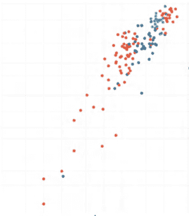

```
Cluster
Results are computed along Table (across).
SCRIPT_INT("
m <- cbind(arg1, arg2);
kmeans(a[,n.start=5]$cluster",
AVG( [Life Expectancy Female] ), AVG([Life Expectancy Male]))
```

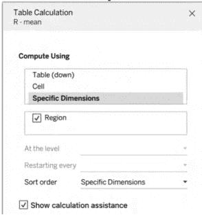

- 外部服务，例如：
- R
- Python
- ...

图 14.1: Tableau 外部服务

当然，无论您是在 Tableau Desktop 上查看工作簿，还是通过 Tableau Server 访问，如果您希望运行 R 和 Python 计算，则 Rserve 或 TabPy 必须可访问。

为了正确理解集成，我们也以 Tableau/R 工作流为例。以下图中使用的术语（您可能不熟悉）将在本章后面进行解释：

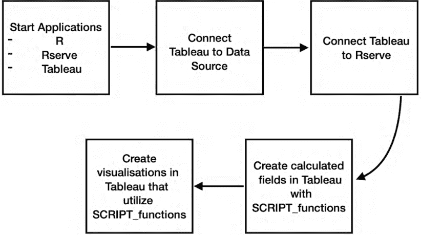

图 14.2: Tableau/R 工作流

上述截图同样适用于 Python，只需将 R 替换为 Python，将 Rserve 替换为 TabPy 即可。我们先从 R 开始，因为它是第一个可用的集成。

## R 安装与集成

要充分了解 Tableau 和 R 如何协同工作，掌握全局非常重要。为便于理解，本节将在深入探讨计算字段和 R 脚本细节之前，介绍高层概念和信息。

虽然安装 R 很简单，但集成过程除了标准安装外，还需要特定的配置。要成功将 Tableau 与 R 连接，您需要确保权限设置正确，并且各种组件（有些是必需的，有些只是锦上添花）已正确实现。我们将介绍基础知识，回顾安装过程中遇到的一些典型挑战，并提供故障排除指导。

执行以下步骤安装 R：

- 1. 通过访问 http://www.r-project.org/、单击 **下载 R** 超链接并选择 CRAN 镜像站点来下载 R。请注意，R 在 Linux 或 Unix 环境中效果最佳；不过，要学习 R 并开始使用 Tableau/R 功能来完成本章中的练习，安装 Windows 版本就足够了。
- 2. 双击下载的可执行文件安装 R
- 3. 打开 R

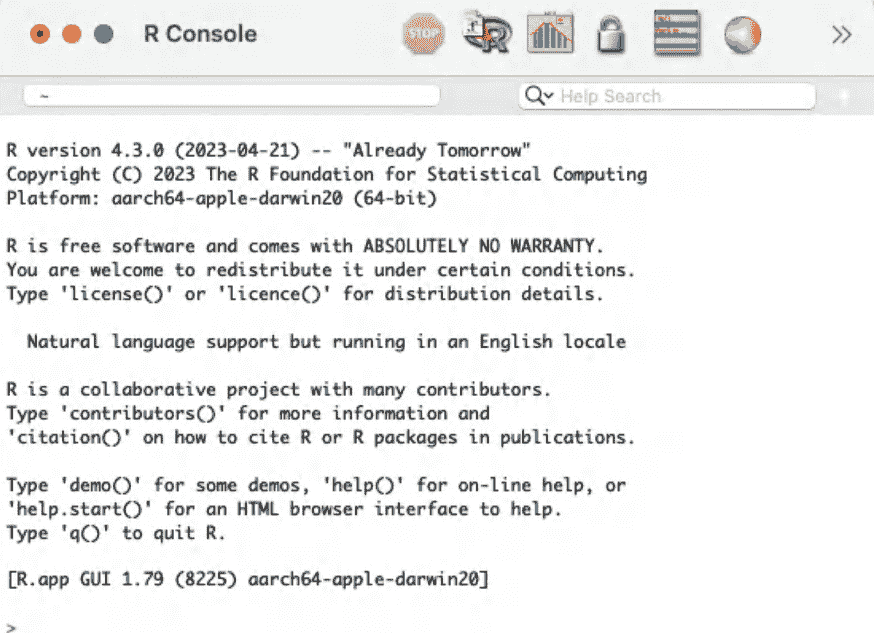

图 14.3: R GUI

> 注意
> http://www.r-project.org/ 的文档提供了关于克服各种安装挑战的详细信息。

虽然不是必需的，但 RStudio Desktop 提供的用户界面比随 R 安装的默认 R GUI 更好。RStudio 包含一个具有智能代码补全（即 IntelliSense）功能的控制台、一个提供对文件、包和帮助的便捷访问的工作区浏览器、一个数据查看器以及更多功能，所有这些都在一个统一的环境中：

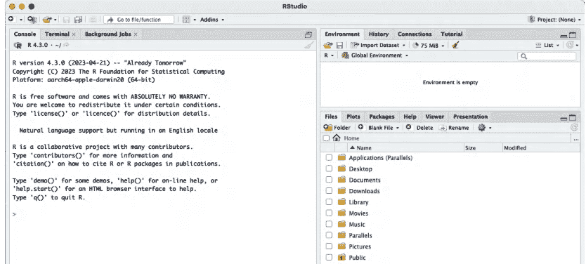

图 14.4: RStudio

RStudio 的开源版本足以满足许多用途。您可以通过 https://posit.co/download/rstudio-desktop/ 下载该应用程序。在桌面版和 R GUI 版本之间，请自行选择您更喜欢的一个。

现在您已经安装并打开了 R，并了解了 RStudio 作为一种可选但有用的界面，让我们回到已启动的您选择的 R 界面，并使其准备好与 Tableau 通信。打开 R 后，请按照以下步骤启动 Tableau 与 R 通信所需的 Rserve 服务。

要与 Tableau 建立连接，您需要启动 Rserve。从技术上讲，Rserve 是一个独立的包；但是，默认情况下，它会随 R 一起安装：

- • 要确保已安装 Rserve 包，请在 R 中输入以下命令：
    ```
    rownames(installed.packages())
    ```
- • 应该会列出多个包，包括 Rserve。如果出于某种原因 Rserve 包未随您的 R 实例一起安装，您可以通过以下方式安装：
    ```
    install.packages("Rserve")
    ```

要启动 Rserve，请输入 library(Rserve); Rserve()

分号 (;) 在 R 中表示新一行代码：

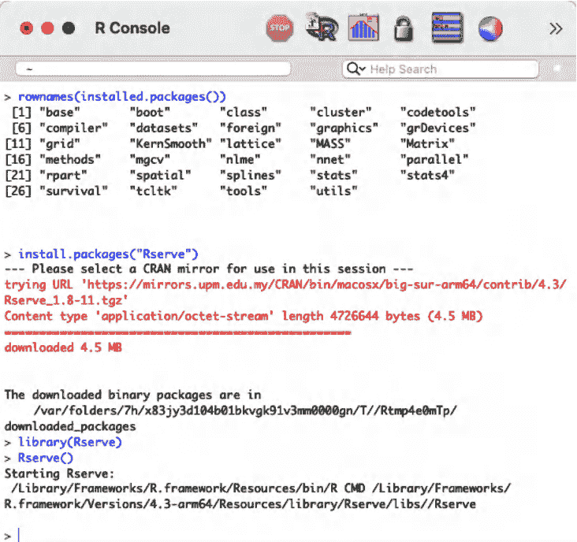

图 14.5: Rserve 初始化

现在您已成功安装 R 并启动了 Rserve，可以将 Tableau 连接到 R 了。在 Tableau 中，选择 帮助 | 设置和性能 | 管理分析扩展连接...

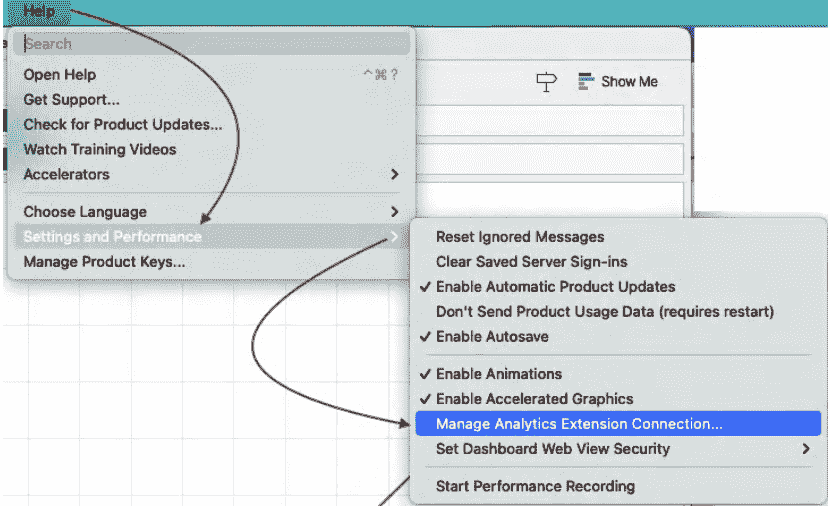

图 14.6: 分析扩展

将打开“管理分析扩展连接”屏幕；选择 Rserve。以下屏幕截图中的默认设置适用于大多数本地安装：

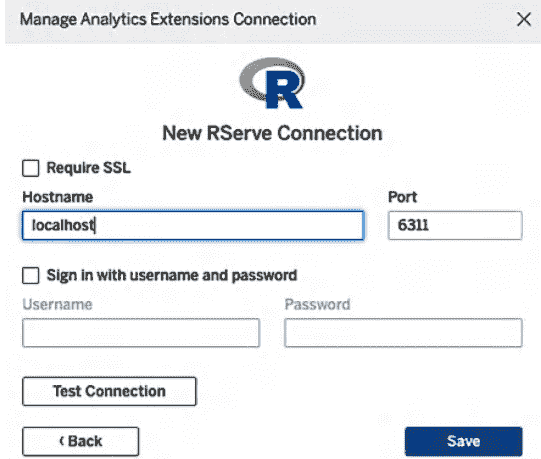

图 14.7: 分析扩展连接

虽然将 Tableau 与 R 集成不需要与 R 界面进行任何交互，但在将代码嵌入 Tableau 之前，您可能希望先在 GUI（例如 R GUI 或 RStudio）中试运行您的 R 代码。这样，您就可以利用与 R 语言相关的有用附带功能，例如帮助、示例和针对 R 定制的示例数据集。请注意，Tableau 中的计算字段编辑器仅作为 R 代码的透传通道，不提供任何支持。

## 实现 R 功能

现在我们已成功将 Tableau 与 R 连接，让我们在 Tableau 中编写一些代码来调用 R。在 Tableau 中，打开“计算字段编辑器”。请注意以下截图中显示的以 SCRIPT_ 开头的函数类：

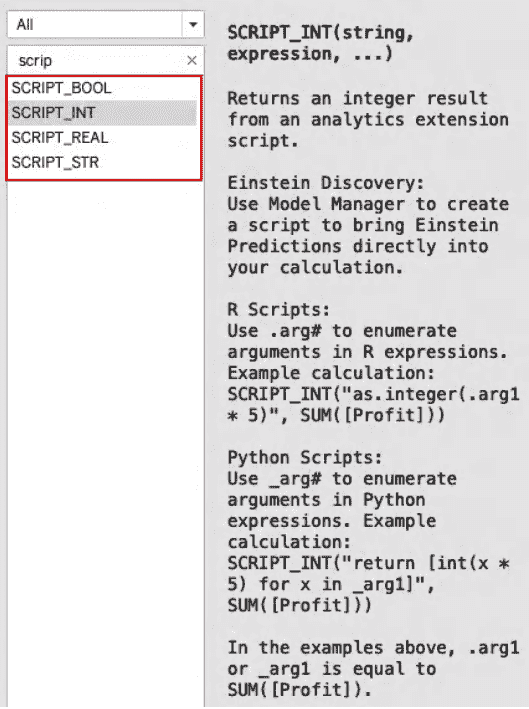

图 14.8: SCRIPT_ 函数

Tableau 使用 SCRIPT_ 函数来调用 R。函数名称传达返回结果的数据类型；SCRIPT_REAL 返回浮点值，SCRIPT_BOOL 返回 true 或 false 值，依此类推。

SCRIPT_函数的语法在以下图中表示：

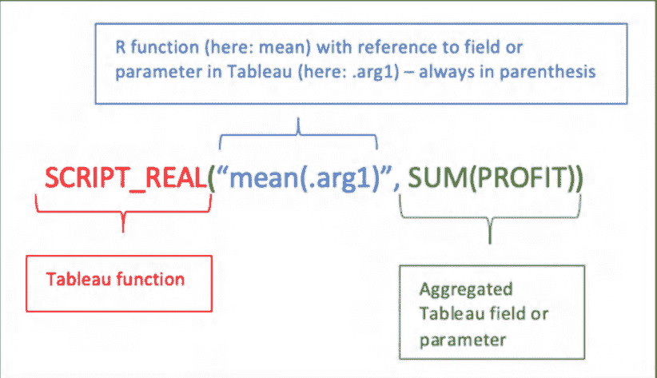

图 14.9: R 脚本语法

前面的示例代码 Script_Real("mean(.arg1)", SUM(PROFIT)) 计算平均利润，但我们将在下一部分中介绍更多示例。让我们先使用 R 集成来复现 Tableau 功能，并验证 R 集成是否按预期工作。

## 在 R 中复现原生 Tableau 功能

作为第一个练习，我们将使用 Tableau 中的 AVG、MEDIAN 和 STDEV 函数，并将结果与 R 中的 mean、median 和 sd 函数进行比较。这将使您能够练习 SCRIPT_ 函数，开始理解 R 语法，并比较 Tableau 生成的结果与 R 生成的结果。

执行以下步骤：

- 1. 导航到 https://github.com/PacktPublishing/Mastering-Tableau-2026/tree/main/Chapter14 以查找并下载与本章相关的工作簿
- 2. 导航到 **中位数** | **平均值** | **标准差** 工作表
- 3. 选择 **Superstore** 数据源

4. 创建以下以 Tableau 为中心的计算：

```
Tab Avg: WINDOW_AVG(SUM(Sales))
Tab Median: WINDOW_MEDIAN(SUM(Sales))
Tab Stdev: WINDOW_STDEV(SUM(Sales))
```

- 5. 将 **区域** 维度放置在 **行** 卡上，将 **销售** 放置在 **文本** 卡上
- 6. 双击 Tab Avg、Tab Median 和 Tab Stdev。它们现在将出现在“度量值”卡上：

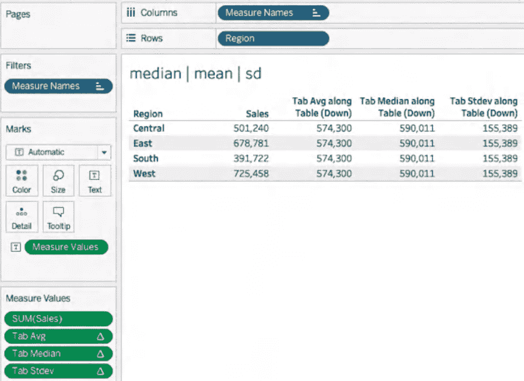

图 14.10: 测试 R

- 7. 确保 R 已按照“R 安装与集成”部分中的说明进行安装、连接和运行
- 8. 如果您尚未安装 Rserve 包，请在 R 界面中键入 install.packages("Rserve") 来安装 Rserve 包
- 9. 接下来，在 R 界面中键入 library(Rserve); Rserve()。您可能会看到以下错误：
    ```
    Fatal error: you must specify '--save', '--no-save' or '--vanilla'
    ```

在这种情况下，请键入 Rserve(args = "--no-save")。R 要求您在会话结束后选择保存、不保存或组合（vanilla）（我不保存是我首选的选项，但其他两个选项也可行）。


- 10. 按照 R 安装和集成部分所示，将 R 连接到 Tableau。完成后，返回 Tableau 并单击 **测试连接** 按钮，查看是否成功：

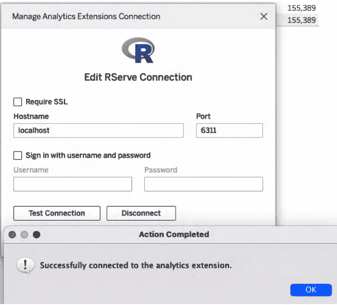

图 14.11: 测试 R 连接

- 11. 单击 **确定** 关闭窗口

- 12. 在 Tableau 中创建以下以 R 为中心的计算。注意，R 函数（例如 mean）区分大小写：

```
R - mean: SCRIPT_INT("mean(.arg1)", SUM(Sales))
R - median: SCRIPT_REAL ("median(.arg1)", SUM(Sales))
R - sd: SCRIPT_INT("sd(.arg1)", SUM(Sales))
```

- 13. 将每个 R 计算字段放在 **度量值** 货架上，并排列它们，使同类计算相互相邻，但 Tableau 计算与 R 计算交替排列；例如，**Tab Avg** 然后 **R — 均值** 然后 **Tab 中位数** 然后 **R — 中位数** 等等。由于 SCRIPT_ 函数被归类为表计算（稍后详述），请确保每个 R 计算字段和 Tableau 计算字段的 **按以下方式计算** 均设置为 **表(向下)**：

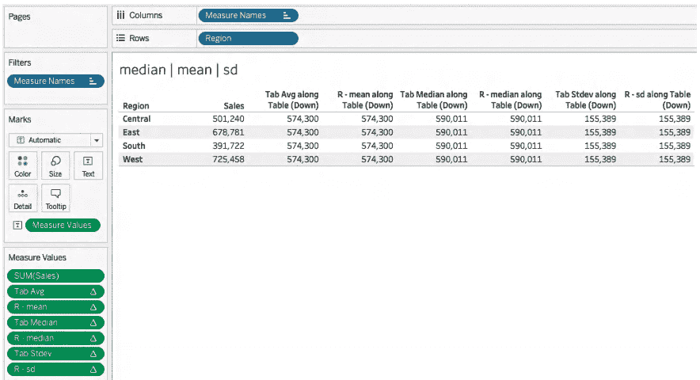

图 14.12: Tableau 与 R 输出对比

- 14. 观察 Tableau 和 R 函数显示相同的结果

请注意，中位数计算中已将 INT 替换为 REAL，这表明，正如名称所暗示的那样，SCRIPT_REAL 使用浮点值，而 SCRIPT_INT 使用整数。在中位数的情况下，SCRIPT_INT 函数会导致舍入差异——请自行尝试并亲自看看！

这是我们首次进行 R 集成练习——简单，对吧？本练习的主要目的是向您展示 R 计算有效，因此我们比较了三个相同的计算，每个计算均由 Tableau 和 R 分别计算。换句话说，这是复制 Tableau 功能，以证明 R 集成按预期工作。下一个练习将是使用 Tableau 内置功能无法完成的操作（截至撰写时）。我们将计算包含两个以上变量的回归分析。

## 使用 R 进行回归计算

简而言之，回归分析是一种用于估计变量关系的技术。有多种回归分析类型，其中最常用的是线性回归。如以下截图所示，线性回归估计最适合数据的直线，且是 Tableau 的内置功能。

您只需在 **行** 和 **列** 上放置两个度量值，以及一个用于划分视图中点的维度。然后，进入 **分析**，将 **趋势线** 拖到屏幕上并选择 **线性**：

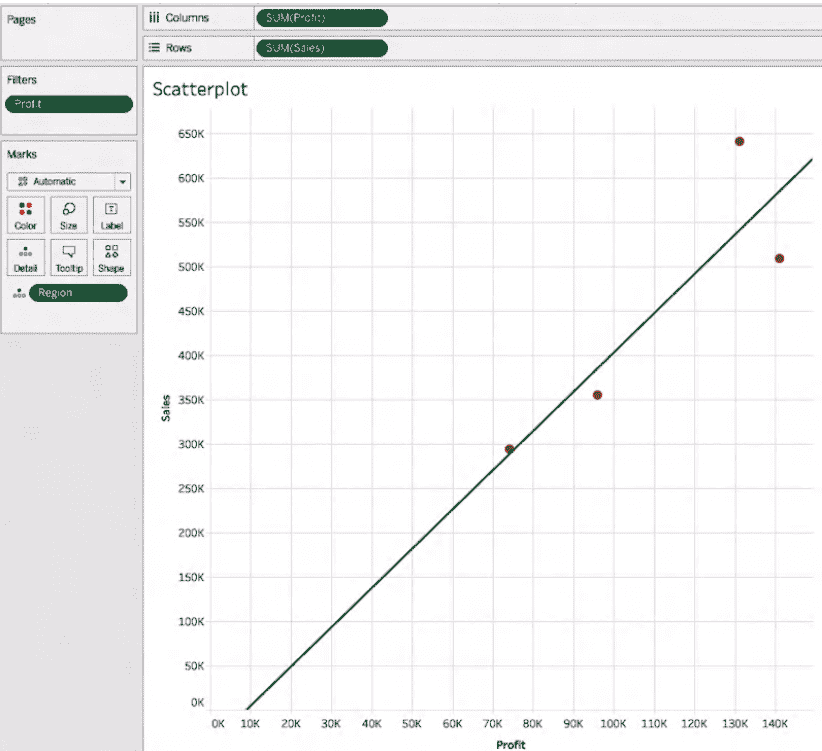

图 14.13: 散点图

请注意，此截图来自 Tableau。您可以单击与本章关联的工作簿中的 **散点图** 工作表来访问它。这是一个打开趋势线的简单散点图。在 Tableau 中，趋势线默认为线性，但还包括对数、指数和多项式选项，这些都是回归分析的示例。通过在使用趋势线的可视化中访问 **工作表 | 导出 | 数据**，您可以为视图上的标记生成带有预测值和残差的 **Access** 数据库。但这是一个繁琐的过程，无法为实施更强大的线性回归用途提供健壮的动态解决方案。使用 R 提供了更大的灵活性。

线性回归可使用单个或多个变量。单变量方程适合学习，但多变量方程通常是现实世界应用所必需的。以下练习包含多变量方程。本练习的目标是确定 **Profit** 的线性回归模型与 COUNT(Quantity)、SUM(Sales) 和 AVG(Discount) 的拟合程度如何：

- 1. 导航到回归工作表

- 2. 选择 Superstore 数据源

- 3. 通过将 **Profit** 放在 **列** 货架上，将 **State** 放在 **行** 货架上，并通过将 **State** 放在 **筛选器** 货架上按 **Sum of Profit** 筛选 **Top 10**，来构建基本布局：

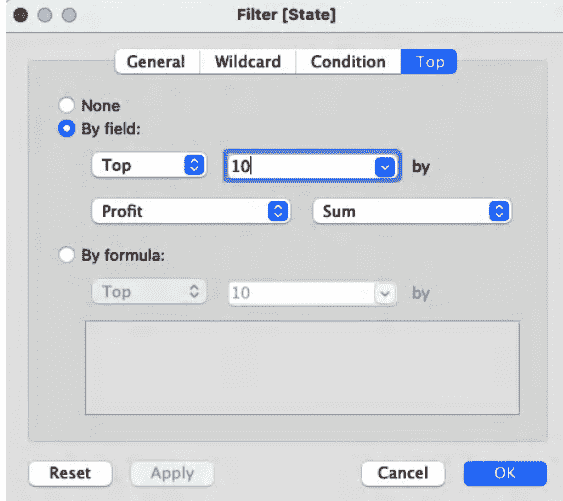

图 14.14: 筛选前 10

- 4. 创建名为 Profit_Expected 的计算字段，使用以下代码：

```
SCRIPT_REAL("
x <- lm(.arg1 ~ .arg2 + .arg3 + .arg4)
x$fitted",
SUM(Profit), COUNT(Quantity), SUM(Sales), AVG(Discount)
)
```

- 5. 创建名为 % Diff 的计算字段，用于计算 SUM(Profit) 与 Profit_Expected 之间的百分比差异：

```
SUM(Profit)/Profit_Expected - 1
```

- 6. 创建名为 Profit_Expected (残差) 的计算字段，以美元为单位返回 SUM(Profit) 与 Profit_Expected 之间的差异：

```
SCRIPT_REAL("
x <- lm(.arg1 ~ .arg2 + .arg3 + .arg4)
x$residuals",
SUM(Profit),COUNT(Quantity), SUM(Sales), AVG(Discount))
```

- 7. 将 Profit_Expected 放在列货架上，与 Profit 相邻。然后，单击其中任何一个并启用双轴。

- 8. 右键单击一个轴并选择同步轴

- 9. 在标记卡的 SUM(Profit) 部分中，将 % Diff 移动到颜色货架上

- 10. 选择 Red-Black 发散调色板以及分级颜色中的 2 个步骤。这样，所有正值将显示为黑色，所有负值显示为红色。请确保视图类型选择为条形图。

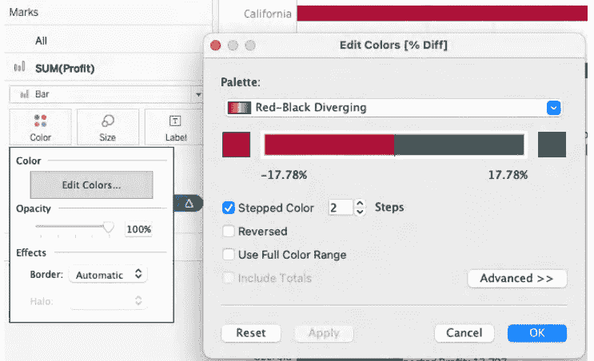

图 14.15: 颜色编码

- 11. 从菜单中选择 分析 | 堆叠标记 | 关闭

- 12. 在标记卡的 Profit_Expected 部分中，将 Profit_Expected (残差)、% Diff 和 Profit_Expected 移动到标签货架上。请确保视图类型选择为甘特条。

- 13. 再次检查所有表计算（由三角形符号指示：Profit_Expected (残差)、% Diff 和 Profit_Expected）是否都使用 State 进行计算：

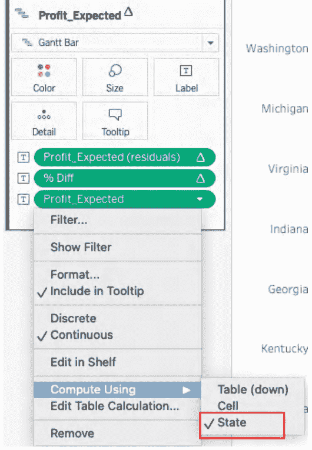

图 14.16: 按以下方式计算

- 14. 单击标签和文本部分中的三个点，并按喜好编辑标签：

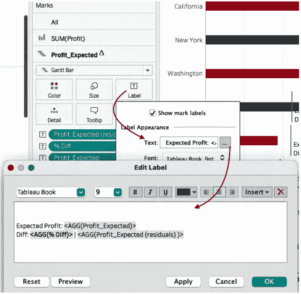

图 14.17: 预期利润

根据需要调整条形图和甘特条的大小，并观察结果：

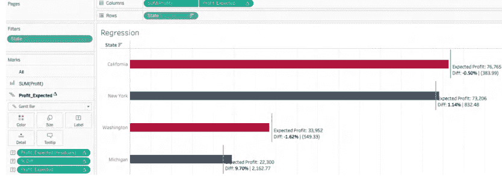

图 14.18: 回归

图 14.18 中的可视化显示了实际利润、预期利润及两者之间差异的比较。此计算在零售市场中尤其有用，也适用于任何公司的财务规划。

现在我们已经完成了练习，请花点时间考虑本练习中使用的一些代码：

| SCRIPT_REAL | 此 Tableau 函数调用 R 引擎并返回浮点值。 |
| :--- | :--- |
| "x <- lm(.arg1 ~ .arg2 + .arg3+.arg4); x$residuals" | 这是一个 R 表达式，包含一个变量、一个函数和一个参数，然后返回预测值。 |
| x <- | 这是要由后续 R 函数填充的变量。 |
| lm(.arg1 ~ .arg2 + .arg3 + .arg4) | 此 R 函数用于拟合线性模型。它可以用于根据参数中提供的变量返回回归。括号中的信息称为参数，用于拟合模型。具体来说，响应位于波浪号 (~) 的左侧，模型位于右侧。因此，这是一个多变量线性回归，其中 .arg1 = SUM(Profit)，.arg2 = COUNT(Quantity)，.arg3 = SUM(Sales)，.arg4 = AVG(Discount)。从英语角度来看，该参数可读作 SUM(Profit)，并被建模为 COUNT(Quantity)、SUM(Sales) 和 AVG(Discount) 的组合项。 |
| ", SUM(Profit), COUNT(Quantity), SUM(Sales) , AVG(Discount)) | 这些是用于填充 .arg# 变量的参数。请注意，双引号 (") 指定传递给 R 的代码结束，逗号 (,) 指定 Tableau 函数的下半部分，即表达式。 |

表 14.1: 代码快速回顾

在成功实现回归后，我们将现在研究一种常用于区分数据集中子集的不同统计方法，称为聚类。


## 在 Tableau 中使用 R 进行聚类

**聚类**用于从较大的数据集中选择具有相似特征成员的较小数据子集。举个例子，考虑一个营销场景。您拥有一个大型客户群，计划向其发送广告材料；然而，成本禁止您向每个客户发送材料。对数据集进行聚类将返回具有相似特征的客户分组。然后您可以调查结果并选择目标群体。

聚类的主要方法包括层次聚类和 k-means 聚类。层次聚类更为彻底，因此更耗时。它生成一系列模型，范围从一个包含所有数据点的模型到 n 个模型，其中每个数据点都是一个独立模型。K-means 聚类是一种更快的方法，用户或另一个函数定义簇的数量。例如，用户可以选择从一千个成员的数据集中创建四个簇。

Tableau 包含聚类功能。您可以在 **分析** 选项卡下找到此功能。Tableau 中的聚类实现基于四个支柱：

- 可靠的方法论
- 可重复的结果
- 快速的处理时间
- 易于使用

请务必在此处查看更多详细信息 (https://help.tableau.com/current/pro/desktop/en-us/clustering.htm) 以及随附解决方案工作簿中的 **聚类 (Tableau 原生)** 选项卡。

Tableau 开发团队处理聚类有多种方法。例如，R 提供了许多使用不同方法的不同聚类包。Tableau 作者可能有充分理由选择其中一种不同的方法。例如，使用 Tableau 原生聚类功能时，聚类结果始终相同。但情况未必如此。通过使用 R 进行聚类，底层数据和视图可能保持不变，但每次刷新时聚类可能会有所不同，因为该函数会在看到整个数据集之前停止在最佳结果（局部最小值）上。为了性能而使用所谓的局部最小值而不是全局最小值的权衡已被证明是值得的。但取决于数字的顺序，每次运行函数时局部最小值都可能不同。如果您正在寻找标记可能在簇之间切换的边缘情况，这可能对您有利。以下示例探讨了这种情况。

本练习的目标是根据出生率和婴儿死亡率，从世界各国创建四个簇：

- 导航到 Cluster (R) 工作表
- 选择 World Indicators 数据源（此数据集随 Tableau 一起提供，可在 **保存的数据源** 下找到）
- 通过将 **婴儿死亡率** 放在 **列** 货架、**出生率** 放在 **行** 货架、**国家/地区** 放在 **详细信息** 货架上来构建初始视图

- 右键单击每个轴并选择 **对数**，取消选择 **包含零**。这将使数据点分布更加均匀，并有助于使可视化更美观且更易于阅读：

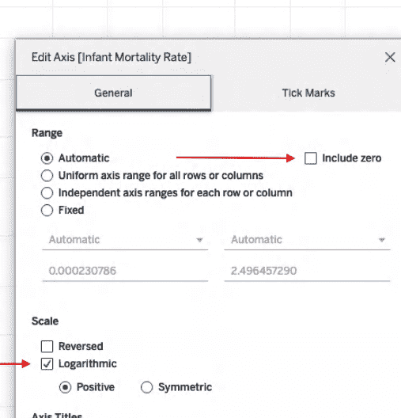

图 14.19：聚类

- 创建一个名为 Cluster 的计算字段，使用以下代码：

```
SCRIPT_INT("
m <- cbind(.arg1, .arg2);
kmeans(m,4,nstart=5)$cluster",
AVG( [Life Expectancy Female] ), AVG([Life Expectancy Male]))
```

- 将刚才创建的 **Cluster** 字段拖到 **详细信息** 和 **颜色** 货架上。请注意，Rserve 引擎会抛出一个错误：

在与分析扩展数据源通信时发生错误...

错误代码：6116DD27

在与分析扩展通信时发生错误。
在与分析扩展通信时发生错误。Error in
do_one(nmeth) : NA/NaN/Inf in foreign function call (arg 1)

图 14.20：错误处理

这是因为底层数据集中存在空值。例如，数据不包括波多黎各的婴儿死亡率。

> **提示**
> 如果在其他度量值上遇到此错误，则适用相同的解决方案。

- 要纠正错误，请将婴儿死亡率拖到 **筛选器** 货架上。在筛选器对话框中，按显示的方式选择值以删除低于 0.01 的所有值：

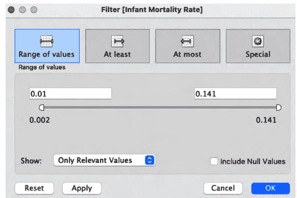

图 14.21：筛选器

- 确保将 Cluster 设置为离散，并将"使用计算对象"设置为 | 国家/地区，以避免另一个错误：k-means (m, 4, nstart = 5) 中的错误：簇中心数量超过不同数据点的数量。结果视图应如下截图所示：

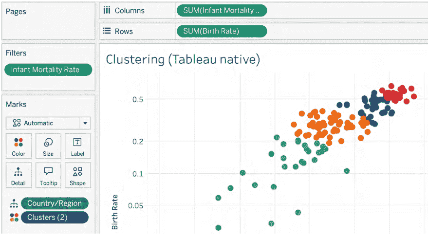

图 14.22：聚类

- 按 F5 并观察每次刷新时聚类都会发生变化

现在我们已经完成了练习，花点时间来看看我们看到的一些代码：

| 代码/术语 | 说明 |
|-----------|------|
| SCRIPT_REAL | 此 Tableau 函数调用 R 引擎并返回浮点值。 |
| "m <- cbind( .arg1, .arg2); kmeans(m,4,nstart=1)$cluster" | 这是包含变量、函数和参数的 R 表达式，然后返回簇。 |
| m <- | 这是由后续 R 函数填充的变量。 |
| cbind | 此 R 函数将以下 .arg# 变量组合成列。 |
| (.arg1, .arg2) | 括号内的变量称为参数。每个变量包含向量信息。具体来说，.arg1 = AVG( [婴儿死亡率] ) 和 .arg2 = AVG([出生率])。 |
| kmeans(m,4,nstart=1)$cluster | kmeans 声明 m 聚类方法。m 包含由 cbind 参数创建的向量。整数 4 声明簇的数量。nstart 声明随机集的数量。 |
| ", AVG ( [ Infant Mortality Rate ] ), AVG([Birth Rate])) | 这些是用于填充 .arg# 变量的参数。请注意，双引号 (") 指定传递给 R 的代码的结束，而逗号 (,) 指定 Tableau 函数的后半部分，即表达式。 |

表 14.2：代码快速回顾

我们取得了什么成就？好吧，我们能够根据预期寿命将数据集中的国家划分为四个子群。我们在散点图上展示了聚类结果，使用了两个度量值：婴儿死亡率和出生率。这样，我们可以同时间接分析四个度量值，在此情况下它们是 **婴儿死亡率**、**出生率**、**国家/地区** 和 **预期寿命**。R 聚类基于 **k-means 方法**，这与 Tableau 默认聚类不同，并且可以调整为任何可以在 R 中执行的方法。

接下来，我们将探索分位数的世界。

## 介绍分位数

**分位数**通常被认为与四分位数同义。事实并非如此。分位数是均匀分割值总体所构成的集合。四分位数是一种分位数——五分位数、三分位数和十分位数也是。为了理解分位数如何均匀分割值总体，想象将总体乘以 1/4、2/4、3/4 和 4/4，您将得到 4 个四分位数。要获得五分位数，您将总体乘以 1/5、2/5、3/5、4/5、5/5，依此类推。

Tableau 允许您通过右键单击轴并选择 **添加参考线 | 分布 | 计算 | 分位数** 来查看分位数：

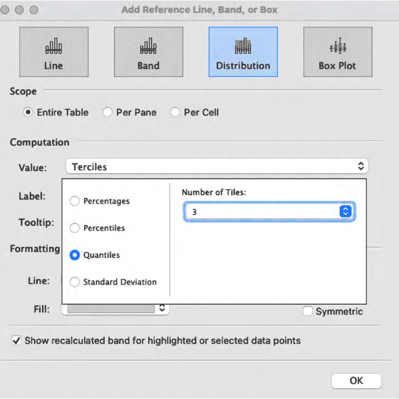

图 14.23：三分位数

但是，您也可以将分组数更改为 4、5 或任何其他数字来创建四分位数、五分位数等等。然而，以这种方式访问的分位数功能相当有限。主要原因是参考线不会生成可以放置在货架上的度量值。这限制了可视化选项。通过 R 生成分位数极大地扩展了这些选项。

本练习的目标是通过 R 创建分位数以查看按销售额划分的客户分布。我们将进一步扩展练习，通过创建将总数据集中的成员数量限制在给定百分位数范围内的参数。最后，我们将通过添加抖动来微调可视化。

让我们来看看以下步骤：

- 导航到 Quantiles 工作表
- 选择 Superstore 数据源
- 在标记卡上将视图类型更改为 Shape
- 将 Sales 拖到 行 货架，Customer Name 拖到 详细信息 货架，Region 拖到 颜色 货架
- 创建并显示名为 Number of quantiles 的参数，使用以下设置：

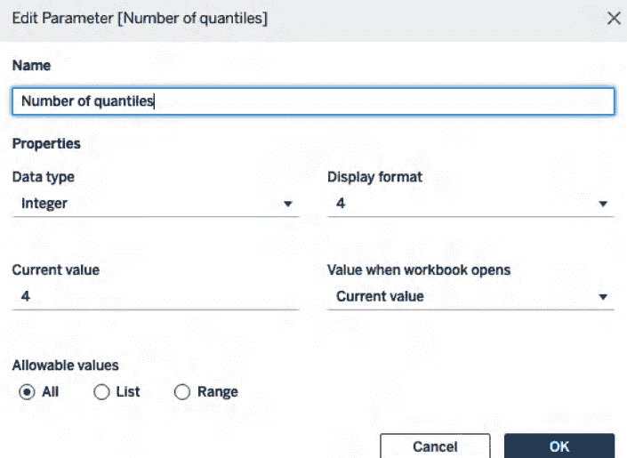

图 14.24：分位数参数

- 右键单击创建的参数并选择 显示参数
- 创建一个名为 Quantiles 的计算字段，使用以下代码：

```
SCRIPT_REAL("
x <- .arg1;
y <- .arg2[1];
m <- c(1:y)/y;
n <- length(x);
z <- c(1:n); for (i in c(1:n)) z[i] <- 0;
for (j in c(1:y)) for (i in c(1:n)) z[i] <- if (x[i] <= quantile(x,m)[j] && z[i]
```


== 0 ) j else z[i];
z;"
, SUM(Sales), [Number of quantiles])

- 8. 右键单击新创建的计算字段 quantiles，并选择 Convert to Discrete

- 9. 创建并显示两个参数，Select Percentile Bottom Range 和 Select Percentile Top Range。对两者使用以下设置：

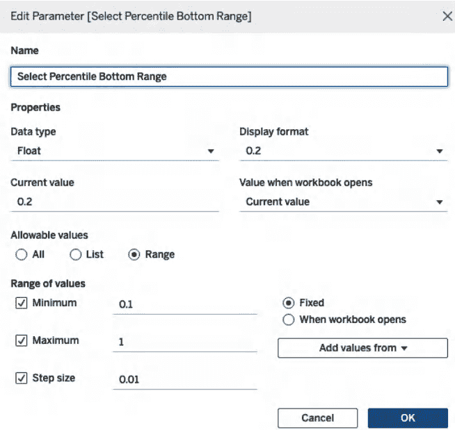

图 14.25：百分位数参数

- 10. 右键单击两个新创建的参数，并选择 Show Parameter

- 11. 创建一个名为 Percentile 的计算字段，使用以下代码：

```
RANK_PERCENTILE(SUM([Sales])) < [Select Percentile Top Range]
AND
RANK_PERCENTILE(SUM([Sales])) > [Select Percentile Bottom Range]
```

- 12. 将 Quantiles 拖到 列 (Columns) 谷架，并将 Compute Using 设置为 Customer Name

- 13. 将 Percentile 拖到 筛选器 (Filters) 谷架，单击确定，然后将 Compute Using 设置为 Customer Name。再次打开筛选器并选择值 True。

所以，让我们回顾迄今为止所做的工作。我们按区域绘制了销售值，然后添加了一个 R 脚本，从销售点云中创建分位数。我们还创建了一个参数，允许我们选择要在视图中查看多少个分位数，因为我们了解到分位数不必总是四分位数，也可以是三分位数或五分位数，或更多。接下来，我们将看到此视图的实际效果，并添加抖动。

您可以添加这些额外步骤以进一步增强可视化效果。要利用抖动，请创建一个名为 Index() 的索引计算字段，并将该字段放置在 列 (Columns) 谷架上。将 Compute Using 设置为 Customer Name。请确保取消选择 显示标题，以便 Index 不在视图中显示。

右键单击每个轴并选择 对数，取消选择 包含零。您的屏幕上应显示以下内容：

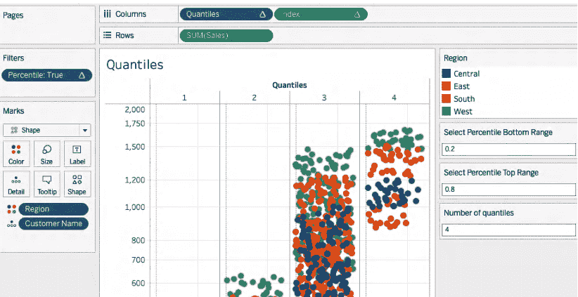

图 14.26：分位数仪表板

在前一张图中，您可以看到我们决定显示四个分位数（利用 分位数数量 参数），它们因此被称为四分位数。通过将 Index() 函数添加到列中，我们能够将分位数划分为四个组件中的每一个。从该仪表板得出的一个结论可能是，在每个四个分位数中，西部地区的销售额最高，南部地区的销售额最低。但是，中部地区和南部地区在第三个分位数中非常接近。基于此信息，我们可以对这些地区具体发生了什么情况进行进一步分析，以及为什么中部地区的销售额在该分位数中相比其他地区下降了。

既然我们已完成练习，让我们花点时间考虑一下本练习中查看的一些代码：

| SCRIPT_REAL | 此 Tableau 函数调用 R 引擎并返回浮点值。 |
| :--- | :--- |
| x <- .arg1; | x 是我们将在此基础上创建分位数的变量。在此示例中，该变量为 [Sales]。 |
| y <- .arg2[1]; | 此变量设置分位数计数。[1] 强制设置单个数字而不是向量。 |
| m <- c(1:y)/y; | m 从 1:y 均匀分布概率。 |
| n <- length(x); | 此设置循环的大小。下文将讨论循环。 |
| z <- c(1:n); for (i in c(1:n)) z[i] <- 0; | z 通过将所有内容设置为 0 来设置初始响应向量。 |
| for (j in c(1:y)) for (i in c(1:n)) z[i] = if (x[i] <= quantile(x,m)[j] && z[i] == 0 ) j else z[i]; | 对于每个分位数，我们遍历 z 向量，并对每个条目测试 x 的值是否小于该分位数的上限。如果 x 之前已设置，则保留不变。否则，z[i] = 该分位数 (j)。 |

在本练习中，您看到，通过使用 R，Tableau 默认功能（如聚类）可以被扩展，并将使您的仪表板用户在使用仪表板时遇到新问题时拥有更多自由来回答问题，因为他们可以更改（例如）参数并查看可视化效果的变化。既然我们了解了一些可能的 R 用例，是时候讨论值得您关注的事情了：即将编程集成与 Tableau 一起使用时带来的性能挑战。

## 性能挑战

R 脚本是表计算。与所有表计算一样，这意味着您只能使用视图中的字段。此外，正确设置分区和寻址非常重要；否则，您可能会得到意外结果。

在 *介绍分位数* 部分，您可能注意到，使用 **分位数数量** 参数设置的分位数数量越大，结果显示所需的时间就越长。这是因为 R 会在 **分位数** 计算字段中为每个分位数运行一次循环迭代。例如，如果 **分位数数量** 参数设置为 **1**，则循环仅触发一次。如果设置为 **2**，则运行两次，以此类推。经验法则是 R 代码对每个分区执行一次。分区越多，性能越慢。因此，在使用 R 代码时，尽可能减少分区数量。

这是本章的 R 部分。希望您喜欢它，并希望它能激发您产生自己的想法，以扩展我们迄今共享的功能。我们现在将继续介绍另一种非常著名的编程语言：Python。Tableau 通过 TabPy 为 Python 提供类似的集成层。

## Python 安装与集成

Python 是一种解释型编程语言，以其可读性而闻名。首个版本发布于 1991 年，即相当久以前（比大多数人猜测的时间更长），并由 Guido van Rossum 开发。TabPy 是一项外部服务，允许您连接 Python 和 Tableau——类似于 Rserve。您可以通过使用 TabPy，将 Tableau 仪表板中的字段解析到 Python 中，执行计算，并将结果作为新的计算字段发送回 Tableau。或者，您也可以在计算字段中调用您在 Python 中实现的函数。关于 TabPy 的更详细文章可在此处找到：https://www.datacamp.com/tutorial/how-to-run-python-in-tableau-with-tabpy

安装 Python 通常并不困难，但不仅仅是双击可执行文件那么简单。您可能需要安装某些库并在命令行上执行命令，才能成功将 Tableau 与 Python 连接起来。以下段落将指导您完成此过程。

### Python 3.11 支持

TabPy 现在支持 Python 3.11，带来性能改进和对最新 Python 功能的访问。文档已相应更新。如果您是从头开始，我建议安装 Python 3.11 或更高版本，以确保与最新库和安全更新兼容。

TabPy 2.0 版本包含几项重要增强功能：

- Python 3.11 支持 – 与 Python 3.11 完全兼容，确保访问最新语言功能和安全更新。
- 已更新依赖项 – 所有底层库已更新到其最新版本，改进性能和安全性。
- 部署简化 – 模型部署流程已优化，使部署和管理自定义模型更加容易。
- 更好的错误处理 – 当 Python 脚本出现问题时，提供更详细的错误消息，帮助您更快调试。

这些改进使 Tableau-Python 集成比以往任何时候都更加强大且更易于使用。

安装 Python 的最简单方法是执行以下步骤：

- 1. 使用带 Python 3.11 版本的 Anaconda（您至少需要 Python 3.7）：https://www.anaconda.com。任何其他 Python 解释器也可用。要集成 Python 和 Tableau，需要一些额外步骤：

- 2. 例如，在 Anaconda 中打开 Jupyter Notebook 并编写：

```
!pip install tabpy
```

或者，在 Python 目录的命令行或 Terminal（Mac）中执行以下命令：

```
pip install tabpy
```

- 3. 通过命令行或 Terminal（Mac）导航到安装 TabPy 的目录，并在命令行或 Terminal 界面中输入 tabpy：

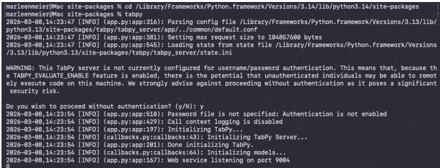

图 14.27：启动 TabPy

> 注意
> 出于安全原因，请务必使用用户名和密码。

- 4. 您现在已连接到 tabpy 服务器，在同时运行 Tableau 和 Python 时必须保持该服务器打开

- 5. 如果您遇到 TabPy 的任何其他问题，例如版本不兼容，快速在 Google 上搜索将大有帮助

- 6. 打开 Tableau，选择 帮助 | 设置和性能 | 管理分析扩展连接，为 Server 选择 localhost，并为 Port 输入 9004：


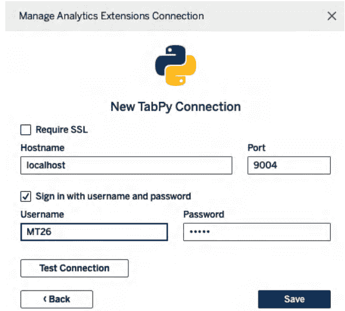

图 14.28: Analytics Extension 连接

- 7. 如前一张截图所示，如果您有任何安全顾虑或需要进行更大规模的企业级部署，可以设置用户名、密码和 SSL。

- 8. 单击 Test Connection，您应该会看到以下弹出窗口：

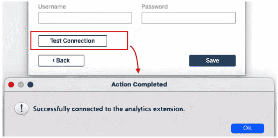

图 14.29: 测试分析扩展

有关如何启动和运行 TabPy 的完整文档，可在 https://github.com/tableau/TabPy 上找到。如果您不想或无法在本机上安装 TabPy，Tableau 还提供了一个 Docker 容器，它将安装最新版本的 TabPy。更多信息请见：https://hub.docker.com/r/emhemh/tabpy/.

## 实现 Python 功能

就像 R 一样，TabPy 使用 Tableau 中的 SCRIPT_ 函数。在接下来的章节中，我们将练习使用 TabPy 并探讨多个用例。使用 TabPy 的 Tableau 计算与 R 的计算非常相似。对于 TabPy，重要的是要向计算字段添加 return 语句，并注意参数使用下划线而不是点来表示：

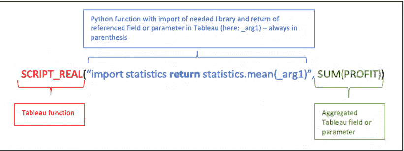

图 14.30: Python TabPy 语法

这将在接下来的练习中体现；我们将首先探讨随机数生成器。

### 随机数和正态随机数

许多计算可以通过计算字段轻松访问，另一些则通过表计算访问——还有一些隐藏函数。之所以隐藏，是因为这些函数尚未（完全）得到支持或测试；因此，请谨慎使用。例如，如果您尝试查找 Random 函数，将找不到它。但您仍然可以使用 Random() 函数，如下所示：

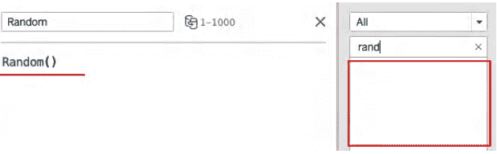

图 14.31: 随机数

另一种选择是使用 TabPy 获取 Random 函数。我们将探讨随机数和正态随机数，并使用变量 mu 和 sigma。这将使我们能够从分布中绘制随机数，这种方法常用于统计学和定量建模等领域，用于模拟、复现或计算概率；mu 和 sigma 分别是定义分布的均值和标准差。

### 生成随机数

执行以下步骤，创建具有特定底层分布（由均值和标准差定义）的随机变量点云：

- 1. 创建一个包含一个 Index 列和编号为 1-1,000 行的 Excel 表。这是为了拥有包含我们想用于随机数生成器的行数的初始数据集。
- 2. 保存文件并将 Tableau 连接到此 Excel 表。您应该会看到一个名为 **索引** 的导入度量值（就像 Excel 文件中的标题一样）。
- 3. 如 *Python 安装和集成* 中所述，将 Tableau 连接到 Python。

- 4. 创建一个名为 Random 的计算字段，应如下所示：

```
SCRIPT_REAL("
from numpy import random as rd
return rd.random(_arg1[0]).tolist()",
SIZE()
)
```

- 5. 将 **索引** 拖到 **行**，将 **随机数** 拖到 **列**
- 6. 在 **分析** 选项卡上禁用 **聚合度量值**

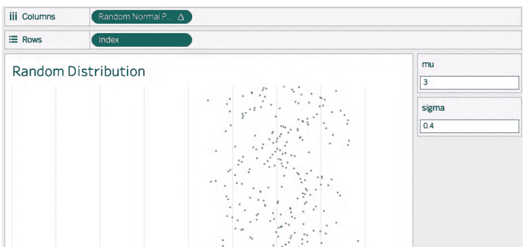

图 14.32: 随机数可视化

在上述截图中，您可以看到 1,000 个随机数据点。让我们来看看本练习中用于生成此可视化效果的一些代码：

| SCRIPT_REAL | 此 Tableau 函数调用 Python 引擎并返回浮点值。 |
|---|---|
| "from numpy import random as rd | 在代码的这一部分中，我们需要 Python 库 numpy，并从该库中需要 random 模块，我们将使用较短的名称 rd 加载它。 |
| return | 此命令仅用于返回值。 |
| rd.random(_arg1[0]).tolist()" | 在此步骤中，我们调用之前导入的 rd 模块。从 rd 模块中，我们检索 random 函数。_arg1[0] 用于在给定某个值时激活该函数。最后，我们通过添加 .tolist() 将所有检索到的值放入值列表中。 |
| SIZE() | 这是将替换 _arg1 的值，而 _arg1 是随机函数所需的。我们使用 SIZE() 来满足此要求，因为它将返回分区中的行数，足以为函数返回一个随机数。 |

表 14.3: 代码快速回顾

我们恰好得到了 1,000 个数字，因为我们的初始 Excel 表有 1,000 行。通过使用计算字段，您可以向数据框添加列，但不能添加行。因此，我们需要一个能提供数据架构的数据源。在下一节中，我们将学习如何指定从正态分布中抽取的随机数。

### 正态随机数

现在，让我们复现一个服从正态分布的随机变量。这种技术常用于统计建模中以计算概率。正态随机数值可以替代您已收集的观测值，或与之一起使用。一旦了解如何使用正态分布，您就可以扩展此知识，并在 Tableau 中创建其他分布：

- 1. 重复使用上一练习中的工作簿
- 2. 创建名为 Random Normal 的计算字段：

```
SCRIPT_REAL("
from numpy import random as rd
mu, sigma = 0, 1
return (rd.normal(mu, sigma, _arg1[0])).tolist()
",
SIZE()

)
```

- 3. 将 Random Normal 放置于 Columns，将 Index 放置于 Rows

- 4. 在 Analysis 选项卡上禁用 Aggregate Measures

- 5. 选择标记类型为 Circle。您现在可以看到一个带有 1,000 个正态分布数据点的图：

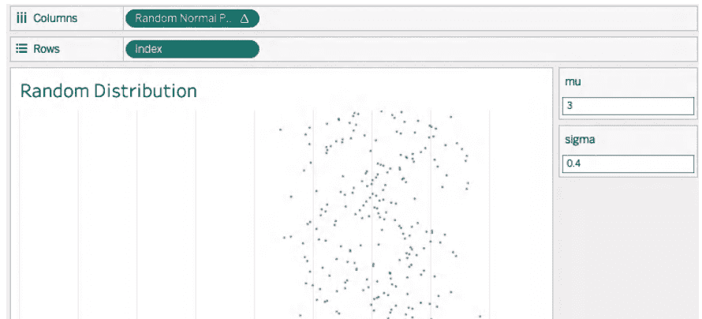

图 14.33: 正态分布可视化

- 6. 为了给用户提供更多灵活性，您还可以向视图添加与 Python 集成交互的参数。例如，创建以下两个参数：

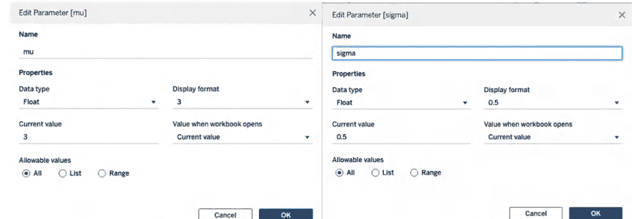

图 14.34: sigma 和 mu 参数

- 7. 然后，创建名为 Random Normal Param 的计算字段，如下所示：

```
SCRIPT_REAL("
from numpy import random as rd
mu, sigma = _arg2, _arg3
return (rd.normal(mu, sigma, _arg1[0])).tolist()
",
SIZE(), [mu], [sigma]
)
```

- 8. 将参数控件添加到您的视图中，以便用户可以决定要传递给 Python 的变量：

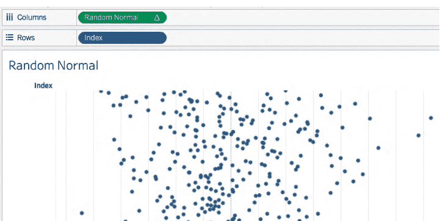

图 14.35: 最终正态分布工作表

与我们之前使用正态分布的可视化效果相比，您可以在上述截图中看到，通过将 mu 参数更改为 10，我们将均值更改为 10，从而可以将整个点云向任何方向移动。由于随机数可在 Tableau 中使用，您例如可以可视化蒙特卡洛模拟，它在许多实际应用中都很有用，因为它可以模拟可能的概率结果，从而帮助利益相关者了解风险和不确定性的影响。

> **注意**
>
> 有关如何在 Tableau 中计算蒙特卡洛模拟的更多信息，请见 -- https://jacksontwo.com/exploring-python-tableau – 更多一般性蒙特卡洛内容请见：https://www.ibm.com/topics/monte-carlo-simulation.

在继续之前，让我们再次考虑本练习中使用的一些关键代码行：

| SCRIPT_REAL | 此 Tableau 函数调用 Python 引擎并返回浮点值。 |
|---|---|
| "from numpy import random as rd | 在代码的这一部分中，我们需要 Python 库 numpy，并从该库中需要 random 模块，我们将使用较短的名称 rd 加载它。 |
| mu, sigma = _arg2, _arg3 | 此部分定义我们将使用 _arg2 和 _arg3 来引用 mu 和 sigma。 |
| return | 此命令仅用于返回值。 |
| rd.normal(mu, sigma, _arg1[0]).tolist() | 在此步骤中，我们调用之前导入的 rd 模块。从 rd 模块中，我们检索 random 函数。_arg1[0] 用于在给定某个值时激活该函数。可选值为 mu 和 sigma。这次，我们也将使用这两个值。最后，我们通过添加 .tolist() 将所有检索到的值放入值列表中。 |
| SIZE(), [mu], [sigma] | 这是将替换 _arg1、_arg2 和 _arg3 的值。与之前一样，我们使用 SIZE() 来激活函数。可选值 mu 和 sigma 将指向我们之前创建的参数。 |

表 14.4: 代码快速回顾

在使用 TabPy 完成前两个练习后，我们学习了如何在 Tableau 中使用随机数。接下来，我们将随机数更改为从正态分布中抽取的随机数，并向仪表板添加了参数，以便用户可以更改正态分布的 mu 和 sigma。当然，您还可以将 TabPy 中的函数更改为其他分布。

下一个主题更高级。我们将使用 TabPy 对 2003 年至 2021 年的报纸标题进行情感分析。


## 计算情感分析

与机器学习和人工智能一起，另一个术语正在越来越多地被使用：**自然语言处理（NLP）**。这是机器理解单词及其含义的过程。情感分析属于这一类别；该技术有不同的变体，但其中一种是衡量极性，也就是说，说话者持有正面或负面的看法。用例包括，例如，评论、推文、评论、情节、歌词等数据集。让我们来看看！

此练习基于Brit Cava的想法，他使用了Makeover Monday中前100首歌曲歌词的数据来尝试Tableau-Python集成。你可以在此处找到博客文章：https://www.tableau.com/about/blog/2016/12/using-python-sentiment-analysis-tableau-63606。让我们使用这个包含一百万条新闻标题的澳大利亚广播公司数据集来复现它：https://www.kaggle.com/datasets/therohk/million-headlines。

- 1. 导航到与章节关联的工作簿中的情感分析选项卡
- 2. 连接到 Headlines 数据源
- 3. 将 Tableau 连接到 Python
- 4. 创建情感得分计算字段。格式（例如，缩进文本）非常重要：

```
SCRIPT_REAL("
from nltk.sentiment import SentimentIntensityAnalyzer
text = _arg1
scores = []
sid = SentimentIntensityAnalyzer()
for word in text:
    ss = sid.polarity_scores(word)
    scores.append(ss['compound'])
return scores
,ATTR([headline_text]))
```

- 5. 创建颜色编码计算字段：

```
IIF ([Sentiment Scores] >= 0, 'Positivity', 'Negativity')
```

- 6. 将 publish_date 放置在 **行** 架上，以及 MONTH(publish_date)
- 7. 将 **情感得分** 放置在 **列**
- 8. 将颜色编码添加到 颜色 架。并将 headline_text 添加到 详细信息。最后，从分析窗格将平均线拖放到视图上（每个单元格）：

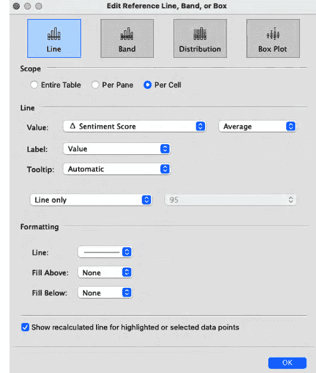

图 14.36：情感得分

根据需要限制数据，同时考虑 PC 的性能。我显示的是 2019-2021 年，仅限 1 月、2 月、11 月和 12 月，以比较年初和年末的差异：

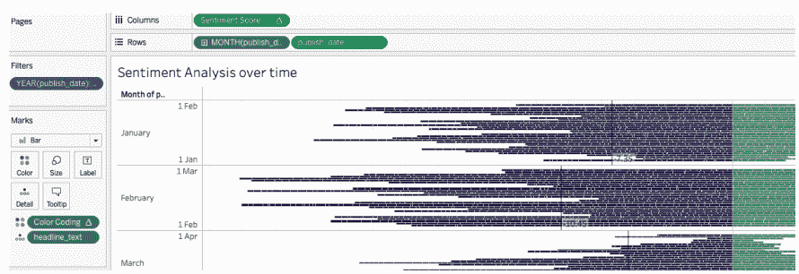

图 14.37：工作表

到目前为止，我们已加载数据集并创建了一个使用预训练情感分析器的 Python 计算，用于判断标题是以消极还是积极的方式撰写的。在前一张图中，我们将所有内容汇集在一起，你可以看到在 2021 年的每个月，消极新闻占据主导地位，其中 2 月最差（平均得分为 -10.45）和 12 月最积极（平均得分为 -0.14）。我们现在将继续检查新闻最常报道的内容。

要了解 ABC 新闻中最常讨论的话题，我们必须统计所使用的单词。也许在 Tableau 中有方法可以通过将 headline_text 字段拆分为单个单词、透视和计数来实现，但这肯定是一个繁琐的过程。而且，外部有足够的库可以删除诸如停用词之类的内容，并将单词还原为其核心形式，例如，horse = horses。因此，我们将部署另一个模型。请按以下步骤操作：

- 1. 创建一个开始参数。这将帮助我们稍后定义要搜索的时期：

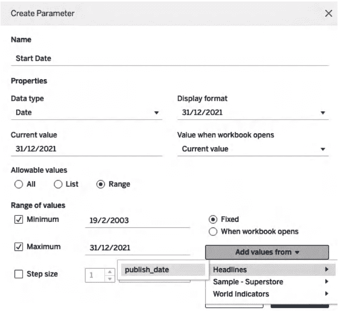

图 14.38：开始

- 2. 还要创建一个结束参数：

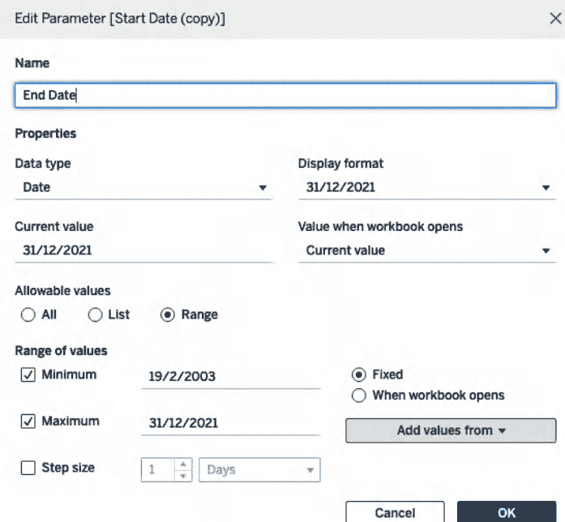

图 14.39：结束

- 3. 在 Tableau 工作簿中名为 *最常见的单词* 的新选项卡上显示这两个参数

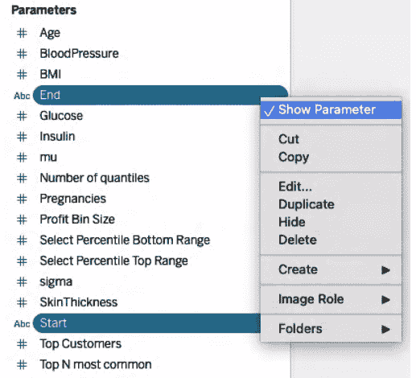

图 14.40：工作表

- 4. 接下来，你需要在你选择的 Python IDE（例如 Jupyter Notebook）中编写代码。目前，请复制以下代码。不要忘记将此行 df = pd.read_csv('abcnews-date-text.csv') 中的位置更改为你的文件副本所在的确切位置：

```
from tabpy.tabpy_tools.client import Client
client = Client('http://localhost:9004/')

def common_words(_arg1, _arg2):
    #Load all required libraries
    import pandas as pd
    import nltk
    from nltk.corpus import stopwords
    from nltk.tokenize import word_tokenize
    from nltk.probability import FreqDist
    from nltk.sentiment import SentimentIntensityAnalyzer

df = pd.read_csv('abcnews-date-text.csv')
df['publish_date'] = pd.to_datetime(df['publish_date'], format='%Y/%m/%d')

#convert the Tableau input date to a readable format
_arg1 = pd.to_datetime(_arg1, format='%Y-%m-%d')[0]
_arg2 = pd.to_datetime(_arg2, format='%Y-%m-%d')[0]
df = df.set_index('publish_date')

#empty lists to be filled
scores = []
filtered_sentence = []

# Select the rows between two dates
in_range_df = df[df.index.isin(pd.date_range(_arg1, _arg2))]

#Loading english stop words
stop_words = set(stopwords.words('english'))
text = in_range_df['headline_text']

#most used words
for row in range(0, len(in_range_df)):
    text = in_range_df['headline_text'][row]
    word_tokens = word_tokenize(text)

    for w in word_tokens:
        if w not in stop_words:
            filtered_sentence.append(w)

#calculate the frequency of each word
fdist = FreqDist(filtered_sentence)

#extract the N most common words
most_common_words = fdist.most_common(3)
return str(most_common_words)

client.deploy('common_words', common_words, 'Retrieves the most common words',
override = True)
```

由于缩进尤其重要，以下是屏幕截图，展示了它应该是什么样子；你还可以看到我指定 abcnews 文件的位置为 '/Users/marleenmeier/Downloads/abcnews-date-text.csv'，因为我的文件位于那里：

```
from tabpy.tabpy_tools.client import Client
client = Client('http://localhost:9004/')

def common_words(arg1, arg2):
    #load all required libraries
    import pandas as pd
    import nltk
    from nltk.corpus import stopwords
    from nltk.tokenize import word_tokenize
    from nltk.probability import FreqDist
    from nltk.sentiment import SentimentIntensityAnalyzer

df = pd.read_csv('/Users/marleenmeier/Downloads/abcnews-date-text.csv')
df['publish_date'] = pd.to_datetime(df['publish_date'], format='%Y%m%d')

#convert the Tableau input date to a readable format
_arg1 = pd.to_datetime(arg1, format='%Y-%m-%d')[0]
_arg2 = pd.to_datetime(_arg2, format='%Y-%m-%d')[0]
df = df.set_index('publish_date')

#empty lists to be filled
scores = []
filtered_sentence = []

# Select the rows between two dates
in_range_df = df[df.index.isin(pd.date_range(_arg1, _arg2))]

#loading english stop words
stop_words = set(stopwords.words('english'))
text = in_range_df['headline_text']

#most used words
for row in range(0, len(in_range_df)):
    text = in_range_df['headline_text'][row]
    word_tokens = word_tokenize(text)

    for w in word_tokens:
        if w not in stop_words:
            filtered_sentence.append(w)

#calculate the frequency of each word
fdist = FreqDist(filtered_sentence)

#extract the N most common words
most_common_words = fdist.most_common(3)
return str(most_common_words)

client.deploy('common_words', common_words, 'Retrieves the most common words', override = True)
```

图 14.41：Python 脚本

- 5. 现在运行 Python 脚本

- 6. 返回 Tableau 仪表板中名为 最常见的单词 的选项卡，并创建以下计算字段：最常见的单词：

```
MODEL_EXTENSION_STR("common_words", "_arg1, _arg2", [Start], [End])
```

你也可以像我们在之前的练习中那样使用 SCRIPT_STR 函数，但对于已部署的 TabPy 模型，Tableau 还提供了这种更简单的 MODEL_EXTENSION 函数语法。

- 7. 将 **最常见的单词** 拖入 **行** 并查看你的初步结果；在 2014 年 1 月至 2015 年 12 月之间，单词 *新* 在 ABC 新闻的标题中出现了 4,909 次，*警察* 出现了 4,307 次，*男人* 出现了 4,171 次。你看到前 3 个单词是因为代码中如此指定，我们稍后将进行检查。不过，你可以将其更改为任何数字！

- 8. 调整 **开始** 和 **结束** 日期并查看会发生什么！以下是另外两个示例；还要注意单词计数本身：2020 年排名第 1 的单词（*冠状病毒*，8,383 次）的使用频率是 2014 年至 2015 年期间排名第 1 的单词（*新*，4,909 次）的两倍。第一个示例查看 2019 年：

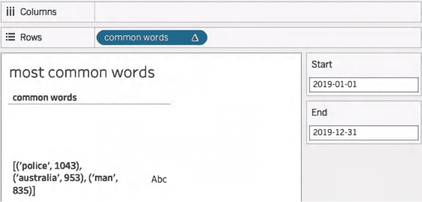

图 14.42：单词 II

第二个示例查看 2020 年：


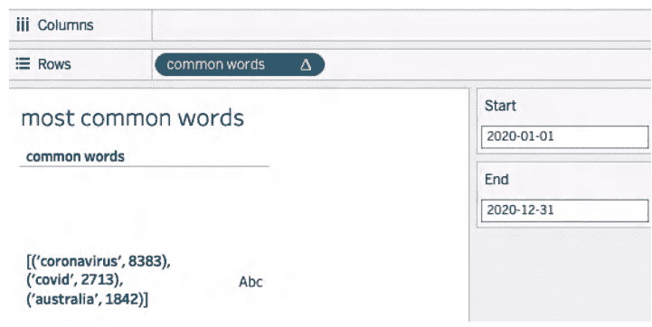

图 14.43: 词语 III

如果你想继续这项工作，可以将 top 作为模型输入参数，以及情感评分（如果你只想查看特定情感下的 top）。

本练习中，我们展示了 Tableau 可以分析文本数据的情感，这是此前未曾见过的功能。为此，我们需要将 Tableau 与 Python 连接，可以通过使用外部服务 TabPy 实现。Python 可以使用 nltk.sentiment 等库（本例中我们使用了该库）。有关此包的详细说明可参见此处：https://www.nltk.org/api/nltk.sentiment.html。情感分析有许多其他库，但 nltk 常用于演示和学习。欢迎尝试其他库！

让我们揭开本练习中包含的一些新代码实例的神秘面纱：

| SCRIPT_REAL | 这个 Tableau 函数调用 Python 引擎并返回浮点值。 |
|---|---|
| from nltk.sentiment import SentimentIntensityAnalyzer | 在代码的这一部分，我们需要 Python 库 nltk，并从该库中需要 sentiment 模块，从中加载函数 SentimentIntensityAnalyzer。 |

```
scores = []
text = _arg1
sid = SentimentIntensityAnalyzer()
ss = sid.polarity_scores(word)
```

此部分定义了我们的 _arg1 将被称为 text，scores 将是一个空列表（稍后在代码中填充），sid 将引用 SentimentIntensityAnalyzer 函数，最后，ss 将是每个单词得分的引用。

```
scores.append(ss['compound'])
```

在这一步，我们将使用极性得分填充空的 scores 表格。

```
return scores
```

在这里，我们将填充后的 scores 表格作为输出返回给 Tableau。

```
ATTR([Dialog])
```

我们的 _arg1 被指定为 Tableau 工作簿中的字段 Dialog。

```
from tabpy.tabpy_tools.client import Client
client = Client('http://localhost:9004/')
```

在代码的这一部分，我们将 Tableau 连接到 Python 实例。

```
import pandas as pd
import nltk
from nltk.corpus import stopwords
from nltk.tokenize import word_tokenize
from nltk.probability import FreqDist
from nltk.sentiment import SentimentIntensityAnalyzer
```

这里我们加载所有必需的库。

```
df = pd.read_csv('abcnews-date-text.csv')
df['publish_date'] = pd.to_datetime(df['publish_date'], format='%Y%m%d')
```

接下来，我们读取 abcnews 文件。

```
_arg1 = pd.to_datetime(
    _arg1, format='%Y-%m-%d')[0]

_arg2 = pd.to_datetime(
    _arg2, format='%Y-%m-%d')[0]

df = df.set_index('publish_date')
```

然后，我们必须将输入转换为模型可读的格式。

```
scores = []
filtered_sentence = []
```

此部分用于创建两个列表，我们将在 for 循环中填充它们。

```
in_range_df = df[df.index.isin(pd.date_range(_arg1, _arg2))]
```

现在我们将数据过滤为介于开始日期和结束日期之间。

```
stop_words = set(stopwords.words('english'))
text = in_range_df['headline_text']
```

幸运的是，英语停用词可供我们使用，我们在这一步加载它们。

```
for row in range(0, len(in_range_df)):
    text = in_range_df['headline_text'][row]
    word_tokens = word_tokenize(text)
    for w in word_tokens:
        if w not in stop_words: filtered_sentence.append(w)
```

在代码的这一部分，我们将剩余的标题转换为令牌，这是计算频率所需的，最后，非停用词将存储在 filtered_sentence 列表中。

```
fdist = FreqDist(filtered_sentence)
```

使用我们在开头加载的库之一，我们现在可以检索每个单词的频率。

```
most_common_words = fdist.most_common(3)
return str(most_common_words)
```

既然我们现在有了频率，就可以加载最常用的单词了。

| client.deploy('common_words', common_words,'Retrieves the most common words', override = True) | 最后，我们将部署模型，以便可以从 Tableau Desktop 调用它。 |

表 14.5: 代码快速回顾

我们现在已经看到了嵌入式 Python 代码；你创建一个计算字段，并使用数据集中的字段作为输入。但是，如果你想使用包含许多行代码和许多不同变量的大模型，或者对模型进行预先训练，该怎么办？这会超出 TabPy 的能力吗？不会！因为，除了嵌入式代码外，我们还可以在 Tableau 外部编写 Python 脚本。

## 使用 TabPy 部署模型

有时，你的脚本太长，无法在计算字段中使用，或者你需要在不同于 Tableau 中的数据集或扩展数据集上进行预先训练。在这种情况下，我们可以以略有不同的方式使用 TabPy。你可以在 Tableau 外部（使用 Python）编写模型，并将其部署到 Tableau，以便可以从桌面端调用它。

在即将展示的示例中，我们将构建一个推荐系统，用于预测输入 7 个参数（年龄、BMI、怀孕次数、血压、葡萄糖、胰岛素和皮肤厚度）时，皮马妇女患糖尿病的可能性。该数据集来自 J.W. Smith、J.E. Everhart、W.C. Dickson、W.C. Knowler 和 R.S. Johannes 于 1988 年进行的研究，可通过以下链接访问：https://www.ncbi.nlm.nih.gov/pmc/articles/PMC2245318/ 。

我们将从 Jupyter Notebook 或你偏好的集成开发环境（IDE）中的代码开始。请跟随以下步骤操作：

- 1. 我们通过导入 tabpy 客户端来开始编写代码，这是建立 Python-Tableau 连接所必需的：

```
from tabpy.tabpy_tools.client import Client
client = Client('http://localhost:9004/')
```

- 2. 接下来，我们导入所有需要的库和数据。请务必将数据集名称替换为文件位置的完整路径（例如，H:/Documents/Diabetes.csv 而不是 Diabetes.csv）：

```
import numpy as np
import pandas as pd
from sklearn import ensemble
from sklearn.model_selection import train_test_split
df = pd.read_csv("Diabetes.csv", sep = ',')
df = df[['Pregnancies', 'Glucose', 'BloodPressure', 'SkinThickness', 'Insulin',
'BMI', 'Age', 'Outcome']]
```

- 3. 现在我们将数据集分成四部分：两个测试数据集用于检查模型的准确性，以及两个训练数据集用于训练模型：

```
X_train, X_test, y_train, y_test = train_test_split(df.drop(['Outcome'], axis = 'columns'),df['Outcome'], test_size = 0.2)
```

> **注意**
> 如果你有兴趣了解更多细节和此代码背后的数学原理，请查看 https://scikit-learn.org/stable/modules/generated/sklearn.ensemble.GradientBoostingClassifier.html。

- 4. 接下来，我们将从 sklearn 加载 GradientBoosting 模型并拟合我们的数据；然后，我们可以立即可视化得分，该得分可以解释为我们的模型预测正确值所占总体的百分比：

```
gb = ensemble.GradientBoostingClassifier()
gb.fit(X_train, y_train)
gbscore = gb.score(X_test, y_test)
print('gradient boost: ' + str(round(gbscore*100,2)))
```

- 5. 这是 Jupyter 中的完整代码：

```
1 import numpy as np
2 import pandas as pd
3 from sklearn import ensemble
4 from sklearn.model_selection import train_test_split
5 df = pd.read_csv('/Users/marleneimer/Downloads/Diabetes.csv', sep = ';')
6 df = df[['Pregnancies', 'Glucose', 'BloodPressure', 'SkinThickness', 'Insulin', 'BMI', 'Age', 'Outcome']]
7
8 X_train, X_test, y_train, y_test = train_test_split(df.drop(['Outcome'], axis = 'columns'),df['Outcome'],
9 							test_size = 0.2)
10
11 gb = ensemble.GradientBoostingClassifier()
12 gb.fit(X_train, y_train)
13 gbscore = gb.score(X_test, y_test)
14 print('gradient boost: ' + str(round(gbscore*100,2)))
```

梯度提升：72.08

图 14.44: Python 脚本

要结束第一阶段，我们的模型在 72.08% 的案例中预测了正确的结果，无论是患有糖尿病还是没有糖尿病。这是一个相当不错的结果。为了进一步改进，我们可以添加更多数据（按行计算），扩展输入变量（按列计算），或创建新特征（如变量之间的比率，这样可以强调隐藏信息）。但目前，我们可以继续使用该模型，因为最终，我们想以百分比形式预测某人患糖尿病的可能性。让我们切换到 Tableau：


6. 我们不需要为这个练习准备数据集，因为所有数据都保存在 Jupyter Notebook 中。在 Tableau 中，你可以随便选择一个，因为我们不会用到它。在名为 Diabetes 的新 Tableau 工作表中，创建以下七个参数。

The Age 和 BloodPressure 参数：

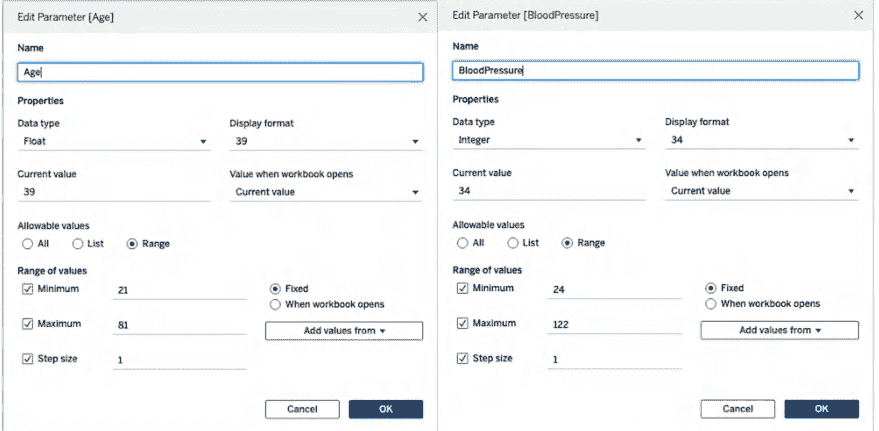

图 14.45：Age 和 BloodPressure 参数

The BMI 和 Insulin 参数：

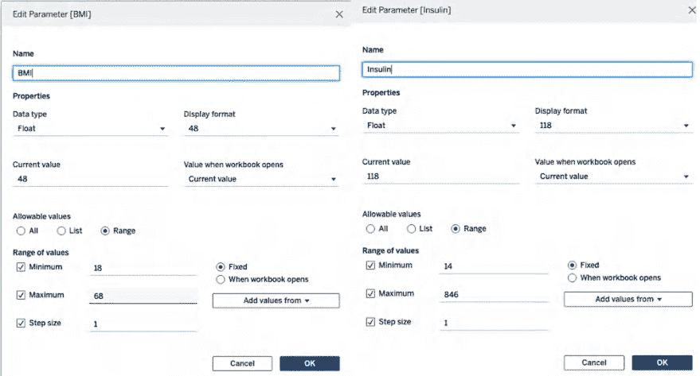

图 14.46：BMI 和 Insulin 参数

The SkinThickness 和 Glucose 参数：

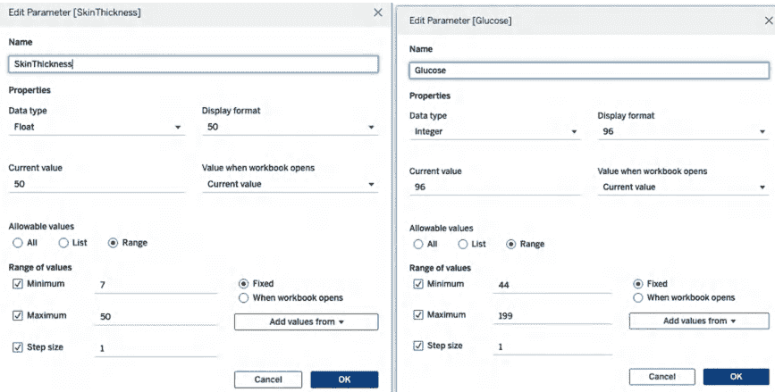

图 14.47：SkinThickness 和 Glucose 参数

最后，Pregnancies 参数：

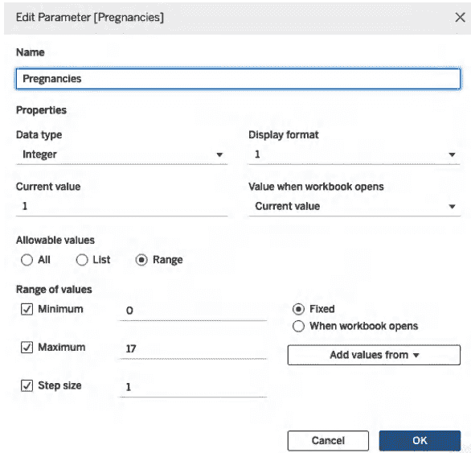

图 14.48：Pregnancies 参数

- 7. 创建所有七个参数后，全选它们并单击 **显示参数**：

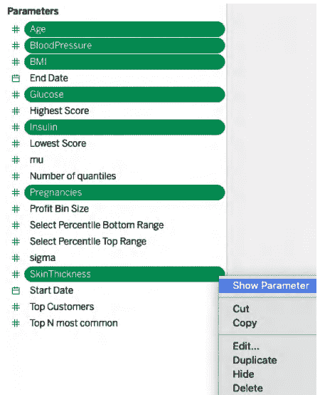

图 14.49：显示参数

- 8. 现在，返回 Jupyter 并执行最后两段缺失的代码，这些代码将创建一个用于调用我们模型的函数：

```
def diabetes_predictor(_arg1, _arg2, _arg3, _arg4, _arg5, _arg6, _arg7):
    import pandas as pd
    row = {'Pregnancies': _arg1, 'Glucose': _arg2, 'BloodPressure': _arg3,
           'SkinThickness': _arg4, 'Insulin': _arg5, 'BMI': _arg6,
           'Age': _arg7}
    test_data = pd.DataFrame(data = row, index=[0])
    predprob_diabetes = gb.predict_proba(test_data)
    return [probability[1] for probability in predprob_diabetes]
```

- 9. 最后，将函数部署到 TabPy 的代码行如下：

```
client.deploy('diabetes_predictor',
              diabetes_predictor, 'Predicts the chances of a Pima female having diabetes',
              override = True)
```

- 10. 在 Jupyter 中显示如下：

```python
import numpy as np
import pandas as pd

from sklearn.model_selection import train_test_split
df = pd.read_csv('/Users/marlenemeier/Downloads/Diabetes.csv', sep = ';')
df = df[['Pregnancies', 'Glucose', 'BloodPressure', 'SkinThickness', 'Insulin', 'BMI', 'Age', 'Outcome']]

X_train, X_test, y_train, y_test = train_test_split(df.drop(['Outcome'], axis = 'columns'), df['Outcome'],
                                                    test_size = 0.2)

gb = ensemble.GradientBoostingClassifier()

gb.fit(X_train, y_train)
gbscore = gb.score(X_test, y_test)
print('gradient boost: ' + str(round(gbscore*100, 2)))

def diabetes_predictor(arg1, arg2, arg3, arg4, arg5, arg6, arg7):
    import pandas as pd
    row = {'Pregnancies': arg1, 'Glucose': arg2, 'BloodPressure': arg3,
           'SkinThickness': arg4, 'Insulin': arg5, 'BMI': arg6, 'Age': arg7}
    test_data = pd.DataFrame(data = row, index=[0])
    predprob_diabetes = gb.predict_proba(test_data)
    return [probability[1] for probability in predprob_diabetes]


client.deploy('diabetes_predictor', diabetes_predictor, 'Predicts the chances of a \\
    Pima female having diabetes', override = True)
```

梯度提升：78.57

图 14.50：部署函数

- 11. 要检查模型是否已部署，在浏览器中输入 https://localhost:9004/endpoints。这将列出已部署到你机器上的 TabPy 的所有模型：

### 已部署的模型：

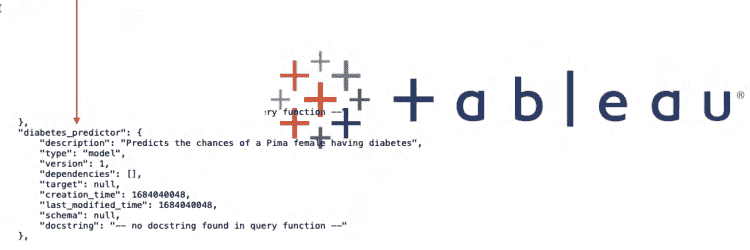

图 14.51：部署函数

返回 Tableau 并再次检查与 TabPy 的连接是否仍然活跃。

- 12. 创建一个名为 Diabetes predictor 的计算字段，如下所示：

```
SCRIPT_REAL("
return tabpy.query('diabetes_predictor', _arg1, _arg2, _arg3, _arg4, _arg5, _arg6,
_arg7)["response "],
[Pregnancies], [Glucose], [BloodPressure], [SkinThickness], [Insulin],
[BMI], [Age]
)
```

由此可见，由于我们所有的编码工作都在 Python 中完成，因此只需告诉 Tableau 返回一个名为 diabetes_predictor 的 TabPy 查询，然后添加函数所需的所有变量引用，最后在末尾添加 ['response ']。

或者，由于 TabPy 上的已部署模型还支持 MODEL_EXTENSION_BOOL、MODEL_EXTENSION_INT、MODEL_EXTENSION_REAL 和 MODEL_EXTENSION_STR 函数，你也可以使用以下代码：

```
MODEL_EXTENSION_REAL("diabetes_predictor", "_arg1, _arg2, _arg3, _arg4, _arg5,
_arg6, _arg7",
[Pregnancies], [Glucose], [BloodPressure], [SkinThickness], [Insulin], [BMI],
[Age]
)
```

第二段代码更简短、更直观；不过，两种方法都有效！

- 13. 现在将 Diabetes predictor 字段放置在 Text 书架上并观察结果：

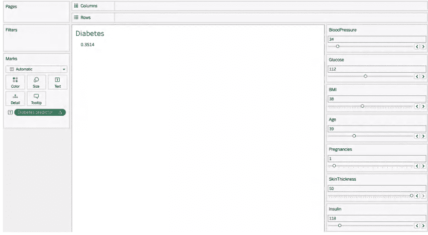

通过左右滑动参数，你会看到糖尿病的可能性发生变化。计算字段通过 TabPy 将参数数据发送到 Python，在那里你的数据将与模型拟合。结果将被发送回来，你可以看到它。当然，你可以围绕它构建整个仪表板。示例可在 Tableau 网站上找到：https://www.tableau.com/about/blog/2017/1/building-advanced-analytics-applications-tabpy-64916。

如果你想了解更多关于 Python 语言本身的信息，一个良好的信息来源是，例如 https://www.w3schools.com/python/default.asp。该网站将逐步指导你学习 Python 语法。但 Tableau 让这变得更容易，因为一组函数已经为你编写好了。

## 预部署的 TabPy 函数

并非所有人都喜欢在 Tableau 之外编程，这就是为什么 Tableau 制作了一组广泛使用的预部署函数，你可以开箱即用。你仍然只需要在 Python 中执行一行代码，一次！但这在 Python 本身中就是你需要做的全部。可用的函数包括 ANOVA、T 检验、情感分析和 PCA，但 Tableau 在多个场合提到，更多函数可能即将推出。你可以在此处找到文档：https://tableau.github.io/TabPy/docs/tabpy-tools.html。

但让我们逐步讲解一下：

- 1. 在你的 Jupyter Notebook 中，执行 tabpy-deploy-models 并查看四个函数是否已安装：

```
!tabpy-deploy-models
Successfully deployed anova
Successfully deployed ttest
Successfully deployed Sentiment Analysis
Successfully deployed PCA
```

图 14.53：部署 TabPy 默认模型

- 2. 你可以通过在浏览器中输入 http://localhost:9004/endpoints 来再次确认，在那里你应该能看到所有已部署的模型。就这样；在 Tableau 的计算字段中调用函数现在就像下面这样简单（以 ttest 为例）：

```
tabpy.query('ttest', _arg1, _arg2)['response']
```

- 3. 我挑战你将 TabPy 默认部署模型中的情感得分与我们创建的进行比较：它们有区别吗？如果有，区别在哪里？

从 Python 中，你可以直接连接到，例如：

- * DataRobot (https://www.tableau.com/solutions/datarobot)
- * Dataiku (https://www.dataiku.com/partners/tableau/)
- * MATLAB (https://www.mathworks.com/products/reference-architectures/tableau.html)

这些都是付费的第三方工具，有助于简化你的数据分析。如果你可以从 R 和 Python 连接到另一个外部工具，你也可以分别通过 Rserve 和 TabPy 将该功能用回 Tableau。如果你对这类连接感兴趣，或想回顾部署函数的话题，可以观看此视频 – https://youtu.be/0BN_Y2CxdYY – 在其中，Tableau 前高级分析产品经理 Nathan Mannheimer 解释了我们讨论的所有内容。

你在编程集成方面的个人目标是什么？如果你有绝妙的想法，欢迎与 Tableau 社区分享。

> **注意**
> 有些人可能会对使用代码感到不知所措，并在 Tableau 中使用 R 或 Python 之前寻找更简单的学习方式。www.geeksforgeeks.org 网站向你介绍两者，并允许你在不安装任何软件的情况下在网站上练习编程。

## 跟随操作构建仪表板

在这个全面的练习中，你将构建一个使用 Python 分析客户评论的交互式仪表板。你将创建两种类型的 Python 集成：

- * 用于情感分析的部署模型（如糖尿病预测器示例）
- * 用于文本统计和关键词提取的内联 Python 计算（如情感分析示例）

到最后，你将拥有一个专业的仪表板，用户可以在其中选择产品、查看随时间变化的情感趋势，并探索客户在说什么——所有这些都由 Tableau 后台运行的 Python 驱动。

在这个练习中，我们将使用一个客户评论数据集。你可以从 https://github.com/PacktPublishing/Mastering-Tableau-2026 下载。

首先，我们将创建并部署一个可以从 Tableau 调用的情感分析模型。这与你章节中的糖尿病预测器遵循相同的模式——我们在 Tableau 之外编写模型并将其部署到 TabPy。

- 1. 在 Jupyter Notebook 或你偏好的 Python IDE 中运行以下代码。在终端或命令行中找到 .py 文件并运行脚本

```
from tabpy.tabpy_tools.client import Client
import pandas as pd
from textblob import TextBlob
```


```python
import pickle
import os

# Connect to TabPy
client = Client('http://localhost:9004/')

def sentiment_analyzer(review_texts):
    """
    Analyzes sentiment of customer reviews
    Returns: polarity score (-1 to 1) and subjectivity score (0 to 1)
    """
    import pandas as pd
    from textblob import TextBlob

    results = []
    for text in review_texts:
        if pd.isna(text) or text == "":
            results.append([0.0, 0.0]) # Neutral for empty reviews
        else:
            try:
                blob = TextBlob(str(text))
                polarity = blob.sentiment.polarity
                subjectivity = blob.sentiment.subjectivity
                results.append([polarity, subjectivity])
            except:
                # Fallback if TextBlob fails
                results.append([0.0, 0.0])

    return results

# Deploy function to TabPy
client.deploy('sentiment_analyzer',
              sentiment_analyzer,
              'Returns sentiment polarity and subjectivity for customer reviews',
              override=True)

print("Models deployed successfully!")
print("Check endpoints at: http://localhost:9004/endpoints")
```

```
[marleenmeier@Mac Chapter 14 % Python3 Exerc1.py
Models deployed successfully!
Check endpoints at: http://localhost:9004/endpoints
marleenmeier@Mac Chapter 14 % 
```

图 14.54: 部署 TabPy 模型

- 2. 打开浏览器并导航到 http://localhost:9004/endpoints。您应该能看到已列出 sentiment_analyzer 和 keyword_extractor。

```
{"sentiment analyzer": {"description": "Returns sentiment polarity and subjectivity for customer reviews", "type": "model", "version": 1, "dependencies": [ ], "target": null, "creation_time": 1772977538, "last_modified_time": 1772977538, "schema": null, "is_public": false, "docstring": "\nAnalyzes sentiment of customer reviews \nReturns polarity score (-1 to 1) and subjectivity score (0 to 1) \n", "keyword_extractor": {"description": "Extracts top keywords from review text", "type": "model", "version": 1, "dependencies": [ ], "target": null, "creation_time": 1772977539, "last_modified_time": 1772977539, "schema": null, "is_public": false, "docstring": "\nExtracts most frequent keywords from reviews \n"}}}
```

图 14.55: 端点

- 3. 现在让我们逐步构建 Tableau 仪表板。打开 Tableau Desktop

- 4. 连接到您的客户评论数据集（Excel、CSV 或文本文件）

- 5. 我们将创建两个调用已部署情感分析器的计算字段

- 1. 第一个是情感极性：

```
SCRIPT_REAL("
return tabpy.query('sentiment_analyzer', _arg1)['response'][0]
",
ATTR([Review Text])
)
```

此函数调用我们部署的 sentiment_analyzer 函数，传递评论文本，并返回响应数组的第一个元素（极性分数）。

- 2. 第二个是情感主观性：

```
SCRIPT_REAL("
return tabpy.query('sentiment_analyzer', _arg1)['response'][1]
",
ATTR([Review Text])
)
```

这将返回第二个元素（主观性分数）。

- 6. 现在创建一个名为情感类别的计算字段，以对情感分数进行分类：

```
IF [Sentiment Polarity] > 0.1 THEN "Positive"
ELSEIF [Sentiment Polarity] < -0.1 THEN "Negative"
ELSE "Neutral"
END
```

- 7. 现在让我们创建一个内联 Python 计算（如您章节中的情感分析示例），以计算评论长度和复杂度。我们将此计算字段命名为评论文本统计：

```
SCRIPT_INT("
import pandas as pd
import numpy as np

reviews = _arg1
ratings = _arg2

results = []
for i in range(len(reviews)):
    if pd.isna(reviews[i]):
        results.append([0, 0])
    else:
        text = str(reviews[i])
        word_count = len(text.split())
        char_count = len(text)

        # Calculate complexity score (words per sentence approx)
        sentences = text.count('.') + text.count('!') + text.count('?')
        if sentences == 0:
            sentences = 1
        words_per_sentence = word_count / sentences

        # Combine metrics into a single complexity score (0-100)
        complexity = min(100, (words_per_sentence * 5) + (char_count / 20))

        results.append([word_count, int(complexity)])

# Return as list of lists - Tableau will interpret each element separately
return [item[0] for item in results] # Word count
",
ATTR([Review Text]),
ATTR([Rating])
)
```

此脚本演示了内联 Python；整个脚本都位于 Tableau 计算字段内。

- 8. 现在让我们通过创建单个工作表，将所有这些计算字段组装成专业仪表板

## 工作表 1: 随时间变化的情感

- 1. 将 [Date] 拖到 列（作为连续的 DAY(Date)）

- 2. 将 [Sentiment Polarity] 拖到 行

- 3. 将 [Product Category] 拖到 颜色

- 4. 添加趋势线：右键单击 | 趋势线 | 显示趋势线

- 5. 另存为 "Sentiment Trends"

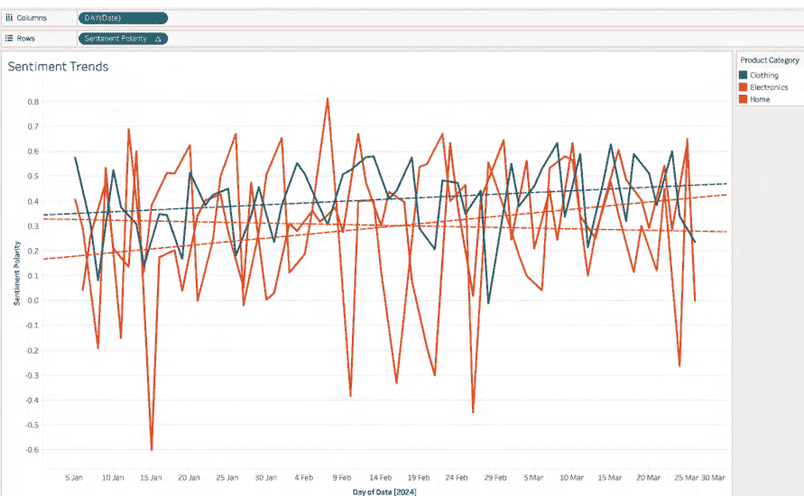

图 14.56: 情感趋势

## 工作表 2: 情感分布

- 1. 将 [Sentiment Category] 拖到 列

- 2. 创建一个计算字段 Number of Records =1 并将其拖到 行

- 3. 将 [Product Category] 拖到 颜色

- 4. 将 Review ID 拖到 详细信息

- 5. 将标记类型更改为 条形图

- 6. 另存为 "Sentiment Breakdown"


图 14.57: 情感分解

## 工作表 3: 评分与情感散点图

- 1. 将 [Rating] 拖到 列

- 2. 将 [Sentiment Polarity] 拖到 行

- 3. 将 [Product Category] 拖到 颜色

- 4. 禁用 分析 | 聚合值

- 5. 另存为 "Rating vs. Sentiment"


图 14.58: 评分与情感

## 工作表 4: 评论文本长度分析

- 1. 将 [Product Name] 拖到 行

- 2. 将 [Review Text Stats] 拖到 列（在 X 轴上重命名为 "Word Count"）

- 3. 将 [Sentiment Category] 拖到 颜色

- 4. 禁用 分析 | 聚合度量

- 5. 按字数降序排序

- 6. 另存为 "Review Length Analysis"


图 14.59: 评论长度分析

是时候组装仪表板了。

- 9. 打开新的 仪表板 选项卡

- 10. 按网格模式添加工作表：

  - 顶部行：情感趋势（全宽）
  - 中间行：情感分解和评分与情感（并排）
  - 底部行：评论长度分析

- 11. 将产品类别颜色标签添加到顶部

- 12. 更改字体、颜色和间距，以符合您的喜好：

## 客户评论 - 情感


## 情感分解


## 评分与情感


图 14.60: 客户评论 – 情感

## 常见问题及修复：

- 假设您的脚本返回错误。可能是 TabPy 服务器未运行。检查终端并重新启动 TabPy。

- 如果性能缓慢，可能是因为数据量太大。尝试添加数据源筛选器，并进一步聚合。

- 如果情感分数全部为 0，文本字段可能为空或 null。添加数据质量筛选器。

## 如果仪表板感觉缓慢，尝试以下优化：

- 1. **添加数据源筛选器**：仅限制最近 12 个月的评论
- 2. **使用提取而非实时连接**：在 Python 处理后创建 Tableau 提取
- 3. **简化脚本**：将复杂逻辑移至部署的函数中（比内联更快）
- 4. **缓存结果**：对于静态分析，仅运行一次 Python 并保存结果

这正是高级分析应用程序的典型示例，它让 Tableau 专家脱颖而出，将 Python 的分析深度与 Tableau 的可视化能力相结合，创造出单靠任一平台都无法实现的工具。

## 摘要

本章仅涉及使用 R 和 Python 的选项的表面内容。完成本章后，您现在应该能够从 Tableau 连接到 Python 和 R，并在 Tableau 中识别和编写两种编程语言的基本语法。最重要的是，您现在足够熟练，可以在 Tableau 中利用 R 和 Python 函数的强大功能，从简单的平均值计算到回归，再到实现自己的机器学习模型。虽然我们介绍了安装、集成和工作流，以及一些更流行的函数和用例，但还有更多可以探索。事实上，Tableau 编程集成的可能性在 BI 社区中仍在很大程度上是未被探索的领域。

数据可视化领域的先锋正在不断突破界限，但仍有许多工作要做。对于希望提升职业选择的读者来说，精通这两个包可能会带来巨大优势。更多内容即将推出！

在下一章中，我们将从编写代码转向探索同样令人兴奋的内容——Tableau 如何重新定义人工智能所能实现的目标。您刚刚看到 Python 和 R 如何扩展 Tableau 的分析能力；现在，请想象一种体验，其中洞察会主动来找您，AI 代理可以对话式地回答问题，而预测模型只需点击几下即可。这就是 Tableau 智能时代的承诺。


## 加入我们的 Discord 社区

加入我们社区的 Discord 空间，与作者和其他读者进行讨论。

https://discord.gg/VXpz9YPUTW


## 15

# Tableau AI、Pulse 和 Next 的智能时代

数据分析工具始终决定着我们能提出的问题。几十年来，我们一直生活在仪表板时代：这些强大且交互式的画布让我们掌控着探索过程。但随着数据量和速度的增长，手动寻找洞察的行为已成为瓶颈。2026.1 版本标志着 Tableau 智能时代的开始。这不再仅仅关乎你能发现什么，而是关乎数据能主动、智能地告诉你什么。

在本章中，我们将超越传统 **商业智能 (BI)**，探索 **智能体分析** 的前沿。我们将剖析正在重新定义 Tableau 体验的 AI 驱动功能套件：从 **Tableau Pulse** 的个性化洞察传递，到新 **Tableau Next** 平台的自主能力。我们将探讨可信语义层如何为这些功能提供支持，以及身为 Tableau 大师的你如何利用这个全新的智能世界。

我们将讨论以下主题：

- 范式转变
- 支持 AI 创新

让我们开始吧！

> **注意**
>
> 你的购买包含一份免费 PDF 副本和独家额外内容。
>
> 你的购买包含本书的无 DRM PDF 副本、Packt+ 库 7 天试用（无需信用卡）以及其他独家额外内容。请参见 *前言* 中的 *随书免费福利* 部分，立即解锁它们并最大化你的学习效果。

## 范式转变

要掌握 Tableau 的新功能，我们首先必须理解它们所代表的哲学转变。传统 BI，即使拥有精美的仪表板，本质上也是被动的。用户必须登录、导航到仪表板、应用筛选器，并直观地搜索异常值或趋势。它依赖于用户知道要寻找什么。

智能体分析颠覆了这一模式。它是主动的、个性化的和自主的。智能体分析充当持续监控系统，检测重大变化并调查根本原因，无需人工干预。它们检测重大变化，通过分段数据调查根本原因，并将包含解释的调查结果通俗语言摘要直接发送到你的收件箱、Slack 频道或 Salesforce 控制台。这至少是 Tableau AI 演进的承诺。

这种转变建立在三个核心支柱之上，我们将在后文详细探讨：

1. 统一的可信数据层（Tableau Semantics）
2. 大规模交付主动、个性化的洞察（Tableau Pulse）
3. 可分析、推理并触发操作的自主智能体（Tableau Next）

## 理解 Tableau 和 Salesforce 生态系统

当我们深入 Tableau 的 AI 驱动功能时，你可能会对哪些产品属于哪里感到困惑。Tableau Pulse 是 Tableau 的一部分还是 Salesforce 的一部分？Tableau Next 呢？为什么某些功能需要 Salesforce 许可证？让我来解释。

要了解当前的产品格局，我们需要回到 2019 年 6 月，当时 Salesforce 以 157 亿美元收购了 Tableau。当时，这是 Salesforce 历史上最大的收购之一，并传达了明确的战略方向：Tableau 将成为整个 Salesforce 生态系统的分析品牌。

这次集成背后的愿景是雄心勃勃的：将 Tableau 顶级的可视化能力与 Salesforce 的 AI 能力（Einstein）和客户数据相结合。这一愿景已逐步实现，如今 Tableau 产品分布在两个互连的生态系统中。了解这一区别对于知晓你可以访问哪些功能以及需要哪些许可证至关重要。

一方面，Tableau 生态系统中有原始的 Tableau Desktop、Tableau Prep 和 Tableau Server（还包括 Tableau Cloud 和 Tableau Public）产品，而 Salesforce 生态系统中有 Tableau Next、Tableau Semantics 和 Agentforce。Tableau Next 代表了重大演进。与通常需要根据任务在 Desktop、Prep 和 Server 之间切换的 Tableau Core 不同，Tableau Next 旨在提供统一的基于浏览器的体验，你可以在一个地方完成所有分析任务。

它完全构建在 Salesforce 平台上，包括带有 Concierge 和 Inspector 等 AI 智能体的 Agentforce Tableau、Tableau Semantics 和 Data 360（Salesforce 的统一数据平台，原名 Data Cloud）

广泛预计 Tableau Next 最终将取代 Tableau Core（Desktop、Prep 和 Server），尽管 Tableau 表示，经典产品在可预见的未来仍将是核心投资。

Tableau Pulse 独具特色；它同时出现在两个生态系统中。Tableau Cloud 版本（在 Tableau Core 中）会提供关于你指标的 AI 生成洞察。Salesforce 版本称为 Pulse for Salesforce，将相同的洞察直接带入你的 Sales Cloud 工作流。

Tableau Agent 可在 Tableau Core 中访问（帮助你进行计算、可视化和文档编写），但它需要 Salesforce AI 功能才能运行。因此，虽然你通过 Tableau 访问它，但智能来自 Salesforce 的 Einstein 平台。

取决于功能，你可能需要 Tableau 许可证、Salesforce 许可证、Tableau+ 订阅或专用的 Einstein 许可证。与其在此深入探讨复杂的许可细节，不如我专注于解释每个功能的作用。如果任何功能引起你的兴趣，请联系你的 Tableau 客户代表，了解为你的组织使其运行所需的条件。

由于此处讨论的许多功能都需要高级许可证或特定的云环境，本章的结构是信息概述，而非动手实践章节。我的目标是帮助你了解什么是可能的，以便你可以决定哪些功能值得为自己的工作追求。

## 指标层和 Tableau Semantics

在任何 AI 生成洞察之前，它需要对你的业务数据有可信的理解。正因如此，正在演进为 Tableau Semantics 的指标层变得至关重要。将其视为你关键绩效指标 (KPI) 的单一事实来源。与其让每个仪表板以略有不同的方式定义每月经常性收入 (MRR)，指标层提供了一个单一的、受治理的定义，可在任何地方重复使用。

Tableau Semantics 通过创建 AI 注入的语义层来修改这一概念。它不仅定义类似销售额（Sales）的指标，还添加业务上下文、定义和关系。例如，它理解销售额（Sales）与区域（Region）、产品类别（Product Category）和销售代表（Sales Rep）等维度相关。这种上下文知识使 AI 智能体能够提供准确且相关的答案。Tableau 开发人员的角色正在从可视化设计转向语义层策划。借助工作区中自动生成语义模型（Auto-Generate Semantic Models from Workspaces）这一新功能（目前为 Tableau Next 的 Beta 版），系统本身可以创建语义模型。只需直接从 Tableau Next 工作区用自然语言描述你的目标，平台即可映射对象和关系（包括零拷贝数据源），生成包含度量、维度和预定义逻辑的即用型模型。这使团队能够完全绕过手动配置，立即开始构建可视化或使用自然语言查询数据，从而加速洞察产生时间。

要将此付诸实践，你可以使用 Tableau Cloud 的界面创建带有清晰名称、定义和数据源的指标。Tableau Semantics 帮助你添加描述并建立字段之间的关系，Tableau Agent for Catalog 可以自动完成大部分文档工作。新的 Auto-Generate Semantic Models Beta 版对于快速原型设计尤其有价值，允许你直接从原始数据和业务目标构建语义层。为确保这些 AI 模型在可信的基础上运行，开发人员必须利用 Tableau Catalog 应用数据质量警告和认证徽章，为人类用户和自主智能体提供至关重要的“信任信号”。


## Tableau Pulse

打好基础后，我们现在可以开启洞察分发引擎：Tableau Pulse。Tableau Pulse 提供高层监控，而非深度探索。它是一款用于保持信息灵通的工具。

Pulse 监控您从各种仪表板中定义或选择关注的指标。它会持续分析这些指标，寻找具有统计显著性的变化、趋势、异常值和关键驱动因素。当发生值得注意的事情时，它会生成一个洞察。以下是 Tableau Pulse 演示（https://www.youtube.com/watch?v=Cnbdkye0X_8_）中的示例。

**Total Sales** 本月于 2024 年 1 月 30 日达到 **$494.2k**。意外的小幅增长使 Total Sales **低于预期范围**，即 **$499.4k 到 $549.3k**。**Total Sales** 的趋势在 8 天前发生变化，目前正以 **较慢的速度增长**。


图 15.1：Tableau Pulse

在 Tableau Pulse 中创建指标时，重要步骤是定义相关维度，例如 Region 或 Category。它们提供了 Pulse AI 用来自动评估绩效驱动因素并解释变化 *背后原因* 的上下文。

创建指标后，Pulse 通过多种渠道分发洞察：

- **For You 页面**：您在 Tableau Cloud 中的个性化主页，汇总您关注的所有指标的洞察
- 电子邮件和 Slack 摘要：每日、每周或每月直接在您的收件箱或 Slack 频道中接收关键指标变化摘要。这些摘要现在包含迷你趋势图，以便快速识别趋势
- Tableau Mobile：随时随地获取相同的个性化洞察，并带有深度链接以供进一步探索

### Pulse 中的生成式 AI

Pulse 最具变革性的部分是其使用生成式 AI 创建洞察摘要。当 Pulse 检测到您指标中的变化时，它不仅向您展示图表，还会用通俗易懂的语言向您说明情况。例如，您可能会收到如下通知：

本周销售额增长 12%，主要由西部地区的强劲表现（增长 22%）和“Electronics”类别的激增推动。这延续了上个月观察到的上升趋势。然后您可以就此发生的原因提出更多问题。


图 15.2：演示视频中的 Tableau Pulse

此摘要由 LLM 驱动。您的底层数据保持私密，且未用于训练公共模型。AI 仅将 Pulse 的分析结果转化为连贯、易于人类阅读的故事。

## 增强型问答和相关性洞察

Tableau 2026.1 通过仅在 Tableau+ 版本中提供的增强型问答更新，显著扩展了 Pulse 的对话能力。

- 主页上的 AI 分析：用户现在可以直接在 Tableau Pulse 主页上通过新的“AI 分析”入口更快地从好奇心转向洞察。这使业务用户可以先提出自己的自定义查询，无需再从预定义的建议问题开始。
- 相关性洞察：也许是最强大的新增功能，增强型问答现在会在指标之间呈现有意义的相关性洞察。Pulse 会报告不同指标之间的关系强度、方向和显著性，并附带支持性可视化。即使指标来自不同的数据来源，这也能让您可靠地在业务中连接各个点。

Pulse 还会从您的反馈中学习。通过对洞察使用点赞/点踩反馈，您训练系统优先处理您认为最有价值的洞察类型，进一步个性化您的信息流。

## Tableau Next

如果 Pulse 是智能通知系统，那么 Tableau Next 就是能够针对这些通知采取行动的自主分析师。作为世界上第一个代理分析平台推出，Tableau Next 代表了根本性的飞跃。它将 Tableau 的分析能力与 Agentforce 平台的自主能力相结合。


图 15.3：来自 https://www.youtube.com/watch?v=pNSb-hIFNrF8 的 Tableau Next GUI

Tableau Next 是 API-first、可组合的平台。这意味着其功能可以随时随地访问和嵌入，例如在自定义 Web 应用程序、Salesforce 记录页面或 Slack 对话中。它由 Hyperforce 提供企业级可扩展性和安全性，并依赖 Tableau Semantics 来获得对您业务的可信理解。

- Agentforce Tableau：这是代理分析最具体的体现。假设您是一名销售经理，正在查看团队机会仪表板。在 Tableau Next 仪表板中，您现在可以与 **Concierge** 交互，它是一个嵌入式 AI 代理。Concierge 是一个预构建的 Agentforce 技能，充当与 Tableau 语义层紧密集成的基于 LLM 的推理引擎。当用户提交自然语言查询时，Concierge 首先继承仪表板的当前上下文，包括活动筛选器、字段选择、用户角色和行级安全权限。然后它查询 Tableau Semantics 层，该层充当受管的业务术语表，将技术字段名称映射为人类可读的概念，并使用 Einstein Trust Layer 生成优化的查询，以确保数据隐私和治理策略得到执行。查询在 Hyper 数据引擎上执行，结果以可视化或自然语言摘要形式返回，并带有指向底层数据源的引用。您可以用对话方式提出复杂问题：
  - 哪些超过 5 万美元的交易在谈判阶段延误？
  - 根据当前销售管道，显示下一季度的预测
  - 该地区的历史胜率是多少？

Concierge 理解问题，查询语义层，并返回准确答案，通常以图表或书面摘要形式呈现，而无需您离开工作流。

- 可操作的洞察和嵌入式工作流：获得洞察是一回事，采取行动是另一回事。Tableau Next 通过直接将动作嵌入到分析体验中来弥补这一差距。从仪表板或代理响应中，用户可以触发工作流。例如，如果 Concierge 代理标记潜在的供应链中断，可能会出现一个按钮，用于创建 Jira 工单或向采购团队发送 Slack 通知。这将分析从被动的信息来源转变为主动的决策引擎。

- API-first、可组合架构：对于企业架构师，Tableau Next 提供了前所未有的灵活性。您可以使用 **外部嵌入 SDK** 将代理分析组件、单个指标、可视化或整个仪表板直接嵌入到任何 Web 应用程序中。新的 **MCP 服务器**（模型上下文协议）允许您自己的自定义 AI 代理安全地连接到 Tableau 的语义层。这意味着您的内部 AI 工具可以按需执行复杂的分析任务并检索受管、可信的数据，为整个技术栈的自动化和决策提供支持。

### 仪表板摘要、个人组织和管理员洞察

2026.1 版引入了 Tableau Next 中几种强大的新功能，目前均处于 Beta 阶段，进一步增强了代理体验。

- **仪表板摘要 (Beta)**：此功能允许您通过配置动态文本组件快速了解发生了什么以及原因，该组件提供仪表板中指标的 AI 生成文本摘要。这由 Tableau Agent 提供支持，无需手动解释即可突出显示有意义的趋势和关键驱动因素。
- **个人组织 (Beta)**：为了在保持治理的同时扩展创新，**个人组织**为分析师提供了一个安全且灵活的环境来构建和测试新分析。团队可以通过扩展受管资产并添加新数据来自助服务，在将批准的资产移入生产之前自由实验。这在创造力需求与集中控制之间取得了平衡。
- **管理员洞察 (Beta)**：此功能使管理员能够从被动分析采用转向主动分析采用。它提供一个统一仪表板，汇总内容使用情况、用户参与度和消耗洞察。作为分析师，您可能不会直接使用此功能，但知道您的管理员拥有这些洞察意味着他们可以更好地支持您的工作，识别未充分利用的资产或低效问题。

以下是一个类似案例研究，用于构思工作流程。

- 1. **从 Slack 开始**：您收到 Tableau Next Slack 摘要中的主动警报：产品 X 的库存已低于目标水平 15%
- 2. **调查**：您单击链接，该链接会直接在 Slack 中打开嵌入式 Tableau Next 可视化。您看到趋势以及 Concierge 代理生成的仪表板摘要：这是由上周东海岸订单增长 40% 驱动的。
- 3. **询问并采取行动**：在 Slack 线程中 @Concierge：产品 X 预计缺货日期是什么时候？代理立即回复：按当前消耗率，产品 X 的库存将在 4 天内耗尽。
- 4. **触发工作流**：会出现一个建议面板，建议创建紧急补货订单。您单击它，来自 ERP 系统的预填采购订单表格打开，等待您的批准。

此场景说明了 Tableau Next 远景的威力：洞察不再是静态的；它们是动态的、对话式的，并直接与业务成果相关联。

## Einstein Discovery

除了 Pulse 的主动洞察和 Tableau Next 的自主代理之外，第三个更成熟的 AI 支柱仍然是大师工具包中至关重要的部分：Einstein Discovery。Pulse 回答“发生了什么？”，Tableau Next 开始询问“我们该怎么做？”，而 Einstein Discovery 回答根本性和预测性问题：“为什么会发生？”以及“接下来会发生什么？”

将 Einstein Discovery 视为您的嵌入式数据科学家。它是一个增强型分析引擎，使用 **自动化机器学习 (AutoML)** 来统计分析您的数据，发现隐藏模式并生成预测。它不需要您编写代码或从头构建复杂模型。相反，它在后台工作，暴露出原本可能隐藏的洞察。

请注意：将 Einstein Discovery 集成到仪表板中需要对字段映射采取严谨的方法。开发人员必须确保实时 Tableau 字段（如线索来源或交易规模）与已部署 Salesforce 模型的输入精确对齐，以确保预测窗格提供准确的驱动因素和建议操作。


同样，理解 Einstein Discovery 如何融入 2026 Tableau 生态系统至关重要。它曾经是一个独立的预测工具，如今已成为 Salesforce 统一处理架构的核心组件。随着 2025-2026 版本的发布，Einstein Discovery 与新的 Agentforce 代理共享一个共同的推理中心。这意味着 Einstein Discovery 的预测能力不再是孤立的功能；它为更广泛平台的自主决策提供动力。

然而，其主要功能仍然各有侧重：

- **Tableau Pulse 用于监控**：它会主动提醒您 KPI 的变化
- **Tableau Next / Agentforce 用于自主行动**：它可以跨上下文进行推理，以解决客户问题或评估销售线索
- **Einstein Discovery 用于预测**：它提供统计模型和假设分析功能，为人类用户和自主代理提供信息

作为 Tableau 开发者，您可能会以几种关键方式与 Einstein Discovery 进行交互：

- **自动故事和模型构建**：在 Salesforce 的 CRM Analytics Studio（Tableau CRM 的演进版）中，您可以创建一个故事。您选择数据集并定义目标，例如，最大化客户生命周期价值或预测线索转化概率。Einstein Discovery 随后会自动运行成千上万个变量组合，识别最重要的驱动因素，并通过一系列自动生成的图表、统计分析和自然语言解释呈现其发现。一旦您验证了这些洞察，就可以将此分析部署为**预测模型**，以便在其他地方使用。
- **仪表板中的嵌入式预测（扩展）**：这是将 Einstein 的能力引入 Tableau 工作的最直接方式。可在 Tableau Exchange 上获得的 Einstein Discovery 扩展，允许您将实时 Tableau 数据连接到已部署的预测模型。
  - **配置**：将扩展添加到仪表板后，您需要登录 Salesforce 组织，选择模型，并将 Tableau 数据源中的字段映射到模型期望的字段。
  - **交互**：配置完成后，用户可以单击可视化中的任何标记（如特定客户、产品或区域），扩展窗格将立即显示该选定项的预测结果。它还会显示推动该预测的主要因素（例如，由于按月合同导致的高流失风险），以及至关重要的是，改善结果的建议操作（例如，提供年度折扣）。这实现了从洞察到行动的闭环。

您无需置于实时仪表板中即可从 Einstein Discovery 中受益。在 Tableau Prep Builder 中，您可以向数据流添加预测步骤。这样，您可以连接已部署的 Einstein 模型，并将预测结果直接作为新字段追加到数据集中。这非常适合批量处理或准备不需要与扩展进行实时交互的分析数据。

**注意**
关于 Tableau Public 的说明

社区中一个常见问题是 Einstein Discovery 是否可以与 Tableau Public 结合使用。简短的答案是，实时扩展在 Public 工作簿中无法工作。不过，作为变通方法，您可以使用 Tableau Prep 预测步骤将预测追加到数据中，然后将增强后的数据集保存以在 Tableau Public 中使用。尽管这创建的是静态快照而非实时交互式预测，但它仍然允许您在公共作品集中分享预测分析的强大功能。

## Tableau Exchange

现在您已了解 Tableau 中内置的智能功能，从 Pulse 的主动洞察到 Einstein Discovery 的预测能力，您可能想知道在哪里可以找到使这些功能运作的工具。Tableau Exchange 就是您用于扩展和增强 Tableau 平台的中央市场。

**注意**
我们在*第 8 章*的 Tableau Exchange 部分讨论过扩展、加速器和连接器。


图 15.4: Tableau Exchange

将 Tableau Exchange 视为分析环境的应用商店。它是一个精心策划的中心，您可以在其中发现、评估和部署各种扩展 Tableau 原生功能的预构建资产。随着 2026.1 版本的发布，Exchange 已发展成为支持整个代理分析生态系统的平台，提供四大类资产：

| 类别 | 用途 | 示例 |
| :--- | :--- | :--- |
| 扩展 | 可直接集成到仪表板中的自定义应用程序 | Einstein Discovery 扩展、自然语言处理器 |
| 加速器 | 针对特定业务功能的预构建仪表板和工作簿 | 销售预测模板、流失分析仪表板 |
| 连接器 | 到外部数据源的预构建连接 | Salesforce、Google Analytics、Snowflake、AWS |
| 语义资产 | 可重用的指标定义和业务逻辑 | 认证 KPI、行业特定的数据模型 |

表 15.1: 资产类别

## Einstein Discovery 扩展

既然我们在上一节中讨论了 Einstein Discovery，那么让我们探讨如何通过 Exchange 实际获取和配置它。

- 安装步骤：
  1. 从 Tableau Cloud 内或通过浏览器导航至 Tableau Exchange
  2. 在**扩展**类别中搜索**Einstein Discovery**
  3. 查看扩展详细信息，包括所需许可（Tableau 中的 Einstein Discovery、Tableau CRM Plus 或 Einstein Predictions）
  4. 单击**安装**并按照提示将其添加到您的 Tableau 站点
  5. 安装后，该扩展将出现在仪表板窗格的**扩展**下

仔细映射字段，确保您的 Tableau 字段与已部署 Einstein 模型期望的输入字段匹配；在向组织推广之前，先使用示例数据对数据子集进行预测验证；并设置权限，以控制哪些用户可以访问该扩展以及可以查询哪些模型。

## 支持 AI 创新

除了核心平台之外，2026.1 版本将 AI 驱动的辅助功能带到创作和学习体验中。

在 Tableau Desktop 中，您现在可以加快自定义颜色调色板的创建，同时确保对比度和可访问性。通过使用自定义颜色调色板对话框中的新"自动生成"按钮，您只需输入几个词或简短描述（例如，海上日落），即可立即生成新的可访问配色方案。这是 AI 如何融入 Tableau 体验每个角落的一个微小但令人愉悦的例子。

这个新的交互式助手还可帮助用户浏览 Tableau Public，提供即时解答和功能支持。无论您是初学者还是专家，Help Agent 都提供个性化教育，加速整个社区的学习曲线。这表明 AI 代理正在整个 Tableau 生态系统中嵌入，包括许多 Tableau 用户最初学习构建的社区平台。

## 总结

正如我们所见，Tableau 中的新 AI 功能不仅仅是渐进式更新。随着 2026.1 版本的发布，它们代表了一个完全成熟的生态系统。Tableau Pulse 通过向每个人提供可信赖、个性化的洞察来民主化数据，现在还具备增强的问答和相关性功能。Tableau Next 赋予组织能够分析、推理和行动的自主代理，并由用于自动模型生成、治理和管理的新工具提供支持。Einstein Discovery 仍然是预测分析的基石，而 Tableau Exchange 则是扩展所有功能的入口。

最近的版本还带来了让日常工作更轻松、更安全的功能，从 Tableau Agent for Catalog 中的 AI 驱动文档，到回收站的安全网，再到显示数据模型的清晰度。

当今掌握 Tableau 意味着掌握这个生态系统。关键在于构建可信赖的语义基础、设计主动洞察传递，并与能够增强您自身专业知识的 AI 代理协作。这些工具已从回答我们知道要问的问题，发展到发现我们尚未想象过的问题。分析的未来是智能的、主动的且具代理能力的；而未来已来。

现在我们已经到了本章的结尾，请考虑这些智能功能如何改变您自己的工作。您是否将从在 Pulse 中定义几个关键指标开始？您是否会尝试 Einstein Discovery 扩展？您是否会探索 Tableau Next 中的新"自动生成语义模型"功能？

无论您选择哪条道路，请记住，这些工具旨在增强而非取代您自己的专业知识。好奇、富有创造力且具备上下文意识的人类分析师，仍然是任何分析工作流中最重要的组成部分。AI 只是来帮助您更快地提出更好的问题。

在本书的下一章中，我们仍有时间探讨另一个热门话题。数据治理是近未来实现代理分析原生化的关注领域。简单来说，因为数据混乱行不通。法规和日益增加的数据安全风险迫使公司更加重视结构完善的指南和质量检查。因此，我们将在第 16 章，*开发数据治理实践* 中向您介绍 Tableau 的另一侧。


## 获取本书的 PDF 版本及更多内容

扫描二维码（或访问 packtpub.com/unlock），按书名搜索此书，确认版本，然后按照页面上的步骤操作。


注意：请随时准备好发票。直接从 Packt 购买无需发票。
