# 16 制定数据治理实践

本章与其他章节略有不同。我们不会讨论用于 Tableau 仪表板或 Tableau Server 的功能，而是探讨 Tableau 中与数据治理相关的数据功能——谁可以访问哪些数据，谁查看了哪个仪表板以及查看频率，仪表板的数据组件是什么，等等。

我们将讨论以下主题：

- 什么是数据治理？
- 数据治理原则
- Tableau 中的数据治理

近年来，尤其是在过去 20 年里，数据治理已从主要由 IT 驱动的职能演变为跨职能的组织责任，这表明该领域日益成熟。而在早期，数据治理仅是一项 IT 任务，并且通常仅限于数据目录编制，而今天的数据治理则是一项由多方共同承担的任务。公司存储的数据越多，雇佣的分析师越多，使用的数据越多，就越需要治理规则和指南。如今，由于缺乏适当的数据治理，公司会被处以罚款，大规模数据安全漏洞和数据泄露事件也越来越频繁地登上新闻头条。因此，许多机构（如欧盟）已将数据治理作为主要支柱之一，采纳了数据保护法律法规。例如，欧盟的 GDPR 和加州的 CCPA。

即使你主要关注构建仪表板和共享数据洞察，在整个企业中保护数据也正变得，并且将继续变得更像是一项共同的努力。了解政策法规、知道如何使用数据治理工具以及负责任地行事，对你来说也是必不可少的。因此，我将本章献给数据治理，以及 Tableau 在这一领域提供的所有内置功能。让我们开始吧！

## 什么是数据治理？

数据治理的核心在于根据法规和行业标准制定和实施与数据相关的政策。其主要目标是保证信息的有用性、可访问性和安全性。加强的数据治理带来更好的数据分析，通过确保分析师所依赖的数据来自可靠来源、经过验证并接受了严格的数据质量评估等措施，让分析师更加安心。

在 www.tableau.com 网站上，您可以找到一份向 Tableau 用户介绍数据管理（包括数据治理）的白皮书：https://www.tableau.com/learn/whitepapers/tableau-data-management。

如果您更喜欢视频，可以在以下链接中找到演示：https://www.tableau.com/products/data-management#content-446367。

白皮书和视频都介绍了这种设置：

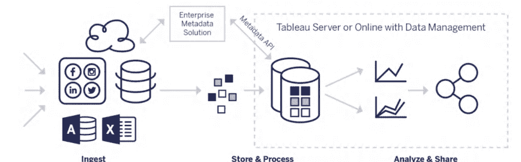

图 16.1: Tableau 数据管理

此架构连接三个层：Ingest（从数据源提取元数据）、Store and Process（将该元数据集中到 Collibra 或 Alation 等企业目录中，外加 Tableau 的 Data Management 插件，用于血缘和认证）以及 Analyze & Share（使用户能够直接在 Tableau Desktop 或 Server 中发现并信任受管数据）。通过在目录与 Tableau 之间建立双向元数据交换，您创建了一个单一事实来源，技术血缘在此与业务上下文相遇，帮助分析师找到认证数据并确切了解其来源。

一般来说，数据治理涵盖的关键方面包括确保数据质量、解决数据安全和隐私问题、制定数据政策和标准、指定数据 steward、遵守法规以及记录数据资产。

那么，数据治理为什么重要？强大的数据治理带来更好的数据质量、更低的数据管理成本和更广泛的数据访问。它提升了数据合规的可信度，从而带来更好的决策、提高的运营效率和降低的风险。例如，治理政策可以规定谁有权修改客户收入数据、该数据需要多久刷新一次，以及历史记录需要保留多久。在遵循既定政策和指南的前提下，Tableau 可以成为数据治理框架内用于数据可视化和分析的宝贵工具。

## 数据治理原则

如果你计划从事数据治理工作，应该知道数据治理原则通常是整个工作的核心与灵魂。

## 关于全球数据保护框架的说明

本节将 GDPR 作为教学示例，因为其七项原则是基础性的。不过，根据您所在的地区，可能适用不同的法律。

- 欧盟：GDPR
- 英国：UK GDPR
- 美国加州：CCPA / CPRA
- 美国其他州：各州法律（弗吉尼亚州、科罗拉多州、康涅狄格州等）
- 加拿大：PIPEDA + 魁北克省第 25 号法律
- 巴西：LGPD
- 日本：APPI
- 韩国：PIPA
- 泰国：PDPA

好消息是：本章涵盖的治理原则和 Tableau 功能（认证、血缘、访问控制、数据质量警告）支持遵守上述任何框架。一旦掌握这些概念，您就可以将它们适应到特定的监管环境中。

为了说明这一点，让我们以 GDPR（https://gdpr-info.eu/）中概述的七项原则为例，探讨如何利用 Tableau 有效地执行这些原则：

- **合法性、公平性和透明度：** 此规定要求为提供商品或服务而收集的个人信息必须合法、公正地获取，并且个人应被告知其使用目的。此外，个人信息只能在个人明确同意的情况下收集，并且必须保留此同意的记录。
- 目的限制：个人信息应仅为特定且合法的目的而收集，除非获得明确同意，否则不得用于不同或不兼容的目的。
- 数据最小化：个人信息的处理应限于实现预期目的所必需的范围。
- 准确性：个人信息必须准确收集并定期更新以降低对个人的风险，任何不准确的信息都应立即更正或删除。
- **存储限制：** 个人信息应仅保留完成处理目的所必需的期限，除非为了科学、归档或公共利益目的而需要，在这种情况下可以存储更长时间。
- **完整性和保密性：** GDPR 中的完整性要求保持准确可靠的个人数据，而保密性要求保护个人数据免受未经授权的访问和披露，确保隐私权得到维护。
- **问责制：** 对于成功的数据治理方法，问责制至关重要，因为它提供方向和有效性；建立一个由所有部门（包括高级管理人员）代表组成的数据治理委员会，对于确保跨组织责任以及制定和执行数据流程和政策至关重要。

在下一节中，让我们看看 Tableau 如何帮助我们遵守这些原则。

## Tableau 中的数据治理

近年来，Tableau 发布了多项功能，使治理对分析师来说更加易用和有价值。这些功能远非仅仅是行政负担，实际上能简化您的工作，自动化文档编制，保护您的工作，并确保您始终基于可信数据进行构建。让我们来探索一下：

- **数据源连接：** Tableau 的数据源连接功能允许组织通过连接多样化的数据源来建立集中式数据治理，促进一种可信且经过策划的数据管理方法。这使得更容易遵守完整性和保密性的监管原则，因为数据存储安全，并且可以控制访问。
- **数据访问控制：** Tableau 使管理员能够管理用户对数据源和仪表板的访问，实施用户和组权限，确保只有授权人员才能访问和交互特定数据资产。访问控制使得更容易遵守完整性和保密性的监管原则，因为访问可以集中管理，从而受到限制。
- **数据安全：** Tableau 提供数据加密、单点登录（SSO）身份验证以及与身份管理系统的集成等安全功能，通过强制执行策略和保护敏感信息来增强数据安全性。此功能使得更容易遵守完整性和保密性的监管原则，因为安全漏洞以及随之而来的敏感数据非法访问将受到限制。
- **元数据管理：** Tableau 有助于创建和管理元数据，提供数据定义、描述和血缘详情等有价值的上下文信息。此功能通过增强对数据资产的理解和控制来支持数据治理计划。元数据管理使得更容易遵守准确性的监管原则，因为元数据更改可以轻松检测。
- **数据认证：** Tableau 使用户能够认证和推广可信的数据源和仪表板，表明数据已经过质量保证，可以用于分析和决策。此认证流程确保用户能够访问可靠且受管的数据资产。这使得更容易遵守准确性的监管原则，因为所有用户都可以信任认证数据的准确性和及时性受到监控。

- 版本控制：Tableau 提供版本控制功能，使组织能够跟踪对仪表板和数据源所做的更改，通过提供修改可见性并促进审计跟踪流程，来推动数据治理。凭借其审计跟踪功能，版本控制使遵守合法性、公平性和透明度的监管原则变得更加容易。

- 监控和审计：Tableau 的监控和审计功能使管理员能够跟踪用户活动、访问模式和数据使用情况，帮助识别潜在的合规性问题并确保遵守数据治理政策。这将使遵守合法性、公平性和透明度的监管原则变得更加容易，因为它帮助我们遵守规则和法规。

- 协作和文档：Tableau 通过提供评论、注释和文档附件等功能来支持协作和文档，使用户能够直接在 Tableau 环境中记录和讨论数据资产、定义和治理相关信息。这使得遵守问责制监管原则变得更加容易，因为评论和注释对用户之间可见且可共享。

虽然 Tableau 提供数据治理功能，但组织拥有超越 Tableau 平台的全面数据治理策略和框架至关重要。Tableau 的功能可以增强并与更广泛的数据治理计划保持一致，但它们应集成到总体治理计划中，以最大限度地发挥效能。

## 目录的 Tableau Agent

为数据源编写清晰的描述对治理至关重要，但说实话，这是一项繁琐的工作。你知道应该记录数据源，以便同事能够理解和信任它们，但当截止日期临近时，文档往往是第一个被搁置的事项。Tableau 现在提供了一种几乎像魔法一样的解决方案：Tableau Agent for Catalog。

你可能从前面的章节中认识 Tableau Agent；它是一款对话式 AI 助手，可帮助你构建计算并创建可视化。但在数据治理的背景下，Tableau Agent 扮演着文档助手的角色。

当你在 Tableau Cloud 中打开已发布的数据源时，现在会在“概览”选项卡中看到一个新选项：**生成描述。** 只需点击一下，Tableau Agent 就会分析你的元数据、字段名称、数据类型甚至示例值，生成一份关于数据源包含的内容及其可能用途的全面、人类可读的摘要。

此数据源包含从 2020 年至今的客户交易记录。关键字段包括客户 ID、购买日期、产品类别和销售金额。数据每日更新，并已获认证可用于销售绩效仪表板。常见用例包括分析区域销售趋势和识别表现最好的产品。

在该功能推出之前，编写良好的文档需要你离开工作流程，这是我们大多数人所回避的过程。现在，文档编写只需几秒钟，而非几分钟。而且因为如此简便，你更有可能去做，这将使所有使用你数据源的人受益；它提高了数据可发现性，并缩短了新分析师的入职时间。

Tableau Agent 生成的描述是一个起点，而非最终产品。你可以（而且应该）对其进行编辑，以添加只有你才知道的上下文，例如业务规则、已知限制或给新用户的提示。但拥有一个 80% 完成的草稿作为起点，会改变一切。

> **注意：** 你可能还记得此功能在早期版本中名为 "Einstein Copilot for Tableau Catalog"。它于 2025 年重新品牌化为 **Tableau Agent**，但功能保持不变。它仍然是你值得信赖的 AI 助手，基于 Einstein Trust Layer 构建，这意味着你的底层数据保持私密，绝不会用于训练公共模型。

## Tableau 语义

我听学生提到的最常见的挑战之一大致是这样的：“我找到了一个非常适合我分析的已认证数据源，但我需要添加几个计算字段，并将其与另一个小表格连接。如果我创建一个副本，会失去‘已认证’状态吗？如果原始数据源更新，我的副本会过时吗？”

这些是非常好的问题，多年来，答案并不理想。是的，你会失去认证。不，你的副本不会自动更新。这在治理（希望每个人都使用相同的已认证数据）和灵活性（分析师完成工作所需要的）之间产生了张力。

**Tableau 语义**优雅地解决了这个问题。作为更广泛的 Tableau Next 平台的一部分，它允许你创建与上游已认证数据保持关联的派生数据源。

可以将 Tableau 语义视为在数据之上创建一个智能层。当你构建引用已认证源的新数据源时，Tableau 会记住该关系。对已认证源的任何更改，无论是更新的数据、更正的计算还是新字段，都会自动流向你的派生源。你可以获得构建所需内容的灵活性，而无需创建与事实来源脱节的副本。

这直接支持 GDPR 的**准确性**原则。当所有人都从同一个可信的基础工作时，你就消除了“死亡电子表格”问题，即组织中流传的多个版本的真相。查看仪表板的销售经理和运行报告的财务分析师可以放心，他们查看的是相同的数字，且计算方式相同。

作为分析师，这意味着：

- **减少重做：** 当中央数据源更新时，你的派生源会自动更新
- **更可信：** 你可以将任何数字追溯到其已认证的来源
- **更大灵活性：** 你不被锁定在别人构建的确切内容上。你可以在保持与源连接的同时进行扩展和自定义

> 性能方面呢？
> 
> 你可能会想，所有这些关联是否会拖慢速度。Tableau 的工程师已经考虑到了这一点。语义层经过优化，可在尽可能多的情况下将计算下推到底层数据库，确保你不必为了治理而牺牲性能。在许多情况下，查询运行速度与针对原始源运行时一样快。

## 为直观理解显示数据模型

你是否曾打开过同事创建的已发布数据源，然后想：“这些表是如何关联的？” 也许你花过令人沮丧的几分钟（或几小时）试图弄清楚是该连接还是混合，或者哪些字段连接了哪些表。如果是这样，显示数据模型功能即将成为你的新好朋友。

当你在 Tableau Cloud 或 Tableau Server 中打开已发布的数据源时，请查看数据源窗格。你现在会看到数据模型的可视化表示。它包含表、字段以及它们之间的关系。这与你自己构建数据源时看到的可视化类似，现在任何使用该已发布源的人都可以使用。

了解数据的形状是准确分析的基础。如果你不知道表是如何关联的，你可能会在不知不觉中创建返回错误结果的计算。可视化模型消除了猜测。你可以一目了然地看到：

- 数据源中包含哪些表？
- 它们如何连接（关系、连接或混合）
- 这些连接中使用了哪些字段
- 表是使用实时连接还是提取

这补充了我们之前讨论的血缘视图。血缘显示数据来自哪里以及流向哪里。显示数据模型向你展示当前的结构。两者结合，让你对数据资产有完整的可见性。

## 回收站

你未必把我当成讲故事的人，但回收站值得讲个故事。几年前，我的朋友正在为公司高管团队准备一个重要演示。她花了三周时间构建一个包含多个工作表、计算字段和精心设计的提示信息的复杂仪表板。演示前一天，她正在清理自己的 Tableau Server 站点，却不小心删除了错误的工作簿。咻。三周的工作，一去不复返。她花了接下来的 12 小时从记忆中重新构建，在演示前几乎没怎么睡觉。

这个故事令人恐惧，因为它可能发生在我们中的任何人身上。我们都曾在错误地点击了文件的“删除”后经历过那种恐慌时刻。过去，恢复数据意味着恳求 IT 从备份中恢复，前提是他们有备份，并且能找到正确的版本。

从 2025.1 版本开始，Tableau Cloud 和 Tableau Server 包含一个回收站，其工作方式与你电脑上的回收站完全一样。当你删除工作簿、数据源或项目时，它不会永久消失。它会移动到回收站，其中最多保留 30 天（你的管理员可以配置具体的保留期限）。你找到被删除的项目，点击“还原”，它就会回到原来的位置。

这是一种既保护你个人，而不仅仅是组织的治理方式。是的，它帮助公司防止数据丢失。但更重要的是，它让你免受会限制职业发展的错误和充满压力的夜晚的困扰。

有几点重要细节：

- 你只能恢复最初有权删除的项目
- 回收站显示谁在何时删除了什么
- 项目在保留期限过期后会被永久删除
- 你的管理员可以配置回收站保留项目 7 天、14 天、30 天或 60 天

回收站保护工作簿本身——如果你将其彻底删除，可以将其找回来。

## 数据编排中心

2026.1 版本为数据治理引入了一项重要新功能：作为 Tableau Next 一部分的数据编排中心。你可以将其视为管理整个 Tableau 环境中所有数据资产的集中式指挥中心。虽然该工具主要由管理员使用，但对数据管家来说也非常有用。

数据编排中心将以前分散的治理工具整合到一个统一的界面中，让你能够：

- 集中管理所有数据资产——从数据源和 Prep 流到提取和语义模型
- 集中监督数据血缘、质量和使用模式
- 通过简化的数据准备监控增强数据信任度
- 从单个仪表板监控整个 Tableau 生态系统中的数据健康状况

对于数据治理从业者来说，这是一个颠覆性的变化。你不再需要在不同页面之间跳转来检查数据源状态、提取刷新健康状况和血缘信息，而是拥有了一个统一的视图。这直接支持了 GDPR 中的问责原则，使展示对数据资产的控制变得更加容易。

以下截图展示了数据编排中心的外观；图片复制自 https://www.tableau.com/en-gb/products/coming-soon#item-106157：

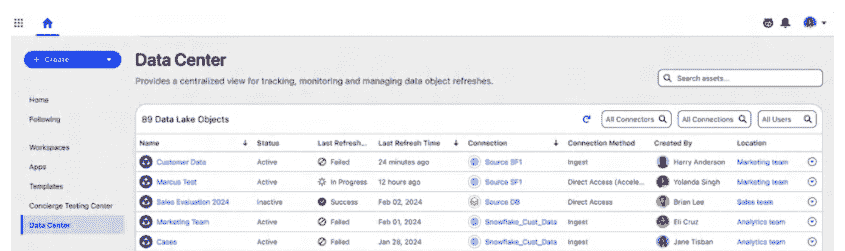

图 16.2: 数据编排中心

我们刚才探讨的功能有一个共同主题：它们让治理感觉不像是一系列限制，而更像是一系列超能力。

这些功能并非面向 IT 或站点管理员，而是面向你——每天构建仪表板并分享洞察的人。使用它们，你会发现良好的治理实践会成为你工作流的自然延伸，而不是需要绕过的障碍。

在下一节中，我们将继续介绍更多跟随操作示例，将这些功能付诸实践。

## 跟随操作示例

在本章的最后部分，你可以亲自尝试一些数据治理功能；欢迎在你的 Tableau Server 或 Tableau Cloud 版本中跟随操作。

## 认证数据源

认证数据源涉及通过验证其质量、准确性和合规性的过程，将其指定为受信任且可靠的资产。这种认证能建立信任，确保数据质量，支持合规性，促进一致性，加强数据治理，提升决策能力，促进数据发现，并由组织内的数据治理团队或专家执行。

你可以按照以下步骤在 Tableau 中认证数据源：

- 1. 打开 Tableau Server 或 Tableau Cloud
- 2. 打开数据源
- 3. 点击数据源名称旁边的三个点
- 4. 选择 **编辑认证**...

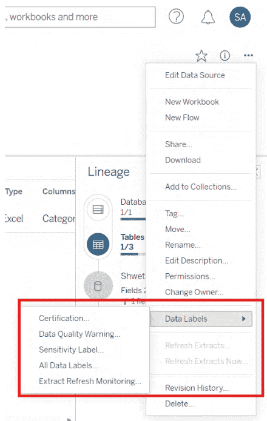

图 16.3: 认证

- 5. 你现在可以输入一条对数据源用户可见的消息，说明认证原因或类似内容。你输入的内容取决于贵公司商定的政策。点击 **保存**。

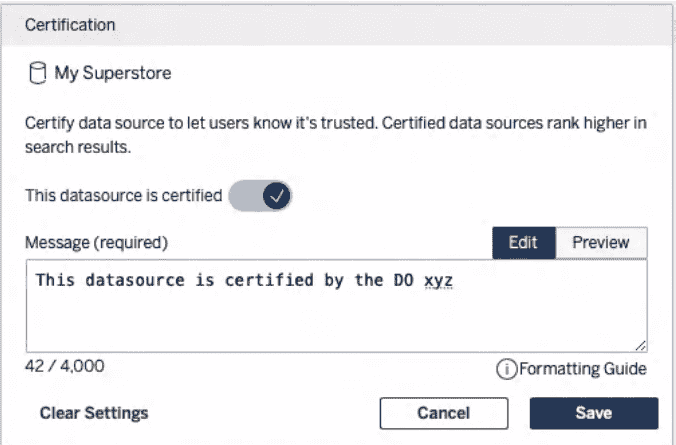

图 16.4: 认证消息

在数据源所有者和日期旁边，你现在会看到一个指示，表明该数据源已认证：

图 16.5: 已认证

已认证的数据源有助于决策，使分析师和业务用户对其使用的数据更有信心，从而得出更精确的洞察、做出更明智的决策，并实现更好的业务成果。

## 数据质量警告

数据质量警告是突出显示数据集质量中潜在问题或异常的通知，由不完整或缺失的数据、不一致性、异常值、数据完整性问题、验证失败或过时信息触发。这些警告表明需要进一步调查和数据清洗，以确保正确的分析和决策，强调解决数据质量问题对于可靠洞察的重要性。

你可以按照以下步骤设置数据质量警告：

- 1. 打开 Tableau Server 或 Tableau Cloud
- 2. 打开数据源
- 3. 点击数据源名称旁边的三个点
- 4. 选择 **质量警告**，然后在 **质量警告...** 和 **提取刷新监控...** 之间选择

数据质量警告弹出窗口将如下所示：

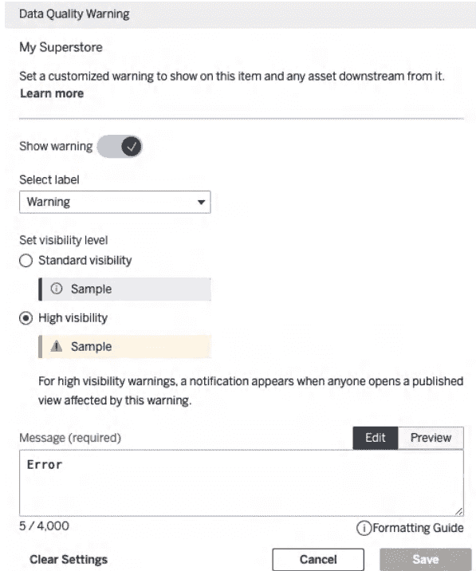

图 16.6: 数据质量警告

- 5. 从此处，从下拉菜单 **选择标签** 中选择五个标签之一：

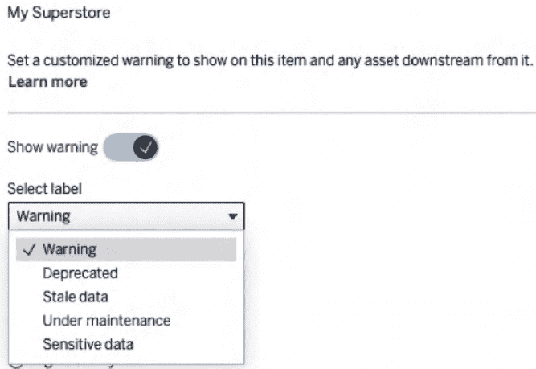

图 16.7: 选择标签

**提取刷新监控**弹出窗口看起来非常相似，只是没有下拉菜单：

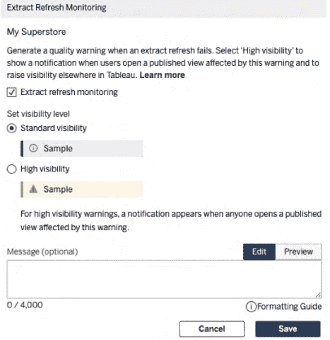

图 16.8: 提取刷新监控

在两种情况下，警告指示器将出现在数据源概览页面上：

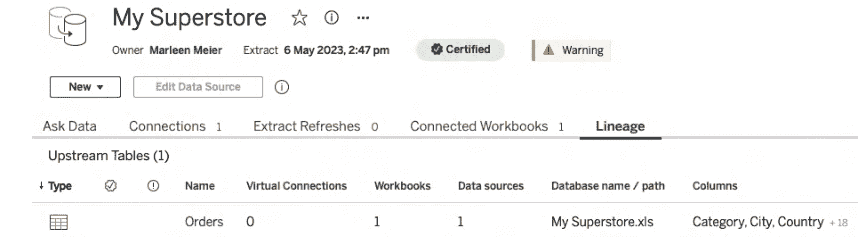

图 16.9: 警告

如果计划提取失败，你也可以查看计划概览页面：

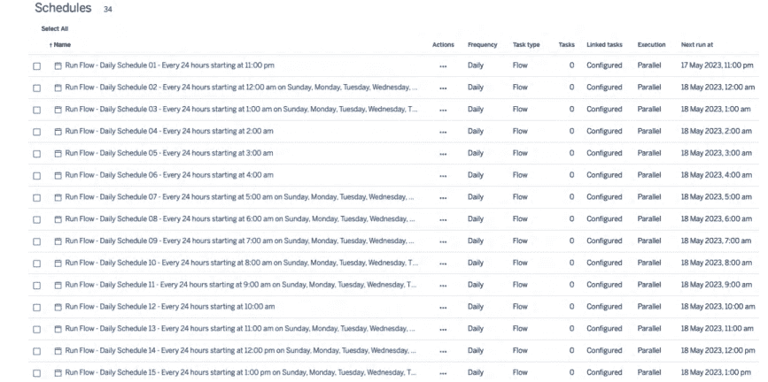

图 16.10: 计划

数据质量警告充当指示器，表明数据在用于分析、报告或决策之前可能需要进一步调查或清洗。它们有助于发现可能影响分析结果准确性、可靠性和有效性的潜在数据问题。处理数据质量警告通常涉及数据清洗、错误更正以及确保数据符合所需的质量标准。

需要注意的是，应对数据质量警告采取行动，因为它们可能影响从数据中得出的洞察的可靠性和有效性。解决数据质量问题并保持高质量数据对于做出明智决策和从数据分析中得出准确结论至关重要。

## Tableau 血缘

数据血缘很重要，因为它能建立对数据的信任，帮助进行数据质量管理和问题解决，促进影响分析，支持法规合规性，加强数据治理和管理实践，协助故障排除和调试，并实现数据和系统的成功集成。数据血缘为数据流提供透明度、理解度和控制力，有助于改进数据治理和决策过程。

要查看血缘，你可以在 Tableau Server 或 Tableau Cloud 上打开任何类型的概览页面——数据源、Prep 流、工作表、工作簿和其他页面——并查看“血缘”选项卡：

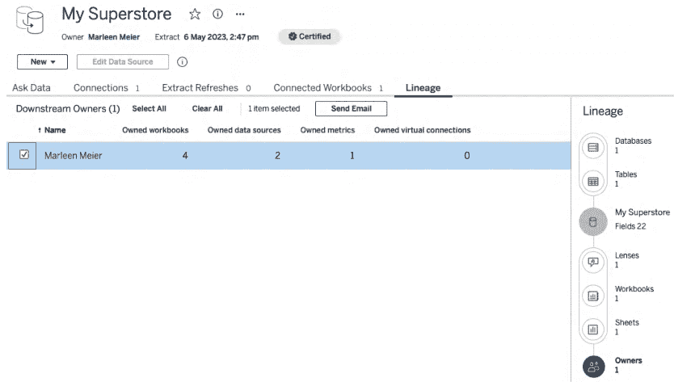

图 16.11: Tableau 血缘

右侧面板会提供关于相应血缘的所有详细信息。从此处，你可以点击任意给定的组件并被重定向到该位置。

## 血缘

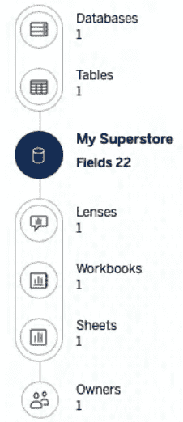

图 16.12: 详细血缘

从表视图中，您甚至可以检查某个列被用在哪里；首先，进入一个表：

| 类型 | 名称 | 虚拟连接 |
|---|---|---|
| [icon] | 订单 | 0 |

图 16.13: 上游表格

然后，单击任意列。观察右侧面板如何显示列 **城市** 用于 **数据库** 和 **表**，但未用于其他任何位置：

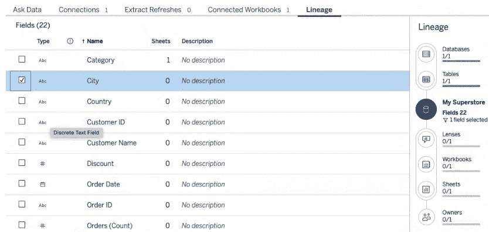

图 16.14: 列血缘

总体而言，数据血缘为数据流提供了透明度、理解和控制。它支持数据质量管理、合规工作和决策过程。通过记录数据的血缘，组织可以改进其数据治理实践，增强数据可信度，并减轻与数据管理和分析相关的风险。

## 数据详情

Tableau 中的 **数据详情** 帮助您和用户了解已发布仪表板中的数据。要访问它，在任何给定的仪表板上，单击左上角的 **数据详情**，并观察右侧弹出的详细信息：

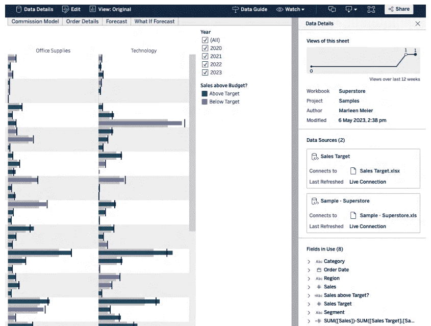

图 16.15: Tableau 数据详情

几秒钟内，**数据详情** 可让您查看随时间变化的视图、数据源和正在使用的字段。

## 数据指南

数据指南（如数据字典或数据参考指南）是一种文档资源，提供关于数据元素结构、内容和含义的详细信息。它对于数据理解、一致性、集成、质量评估、治理、协作、培训和文档非常重要。数据指南增强了数据管理实践，促进了数据素养，并支持组织内有效的数据利用。

要探索数据指南，请在 Tableau Server 或 Tableau Cloud 上打开一个仪表板，并单击蓝色顶部栏右侧部分的 **数据指南** 按钮：

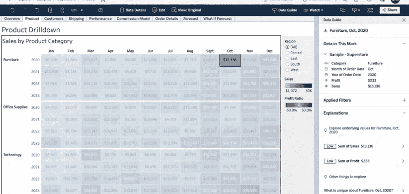

图 16.16: 数据指南

通过在视图中选择一个标记，数据指南会自动填充有关数据点和所用过滤器的详细信息，以及解释。您已在本书前几章中了解过“解释数据”功能，但数据指南使标记的解释和探索比以往任何时候都更容易。

这里还有一个例子，清晰地展示了 Tableau 如何弥合单个数据点与完整数据集平均值之间的差距：

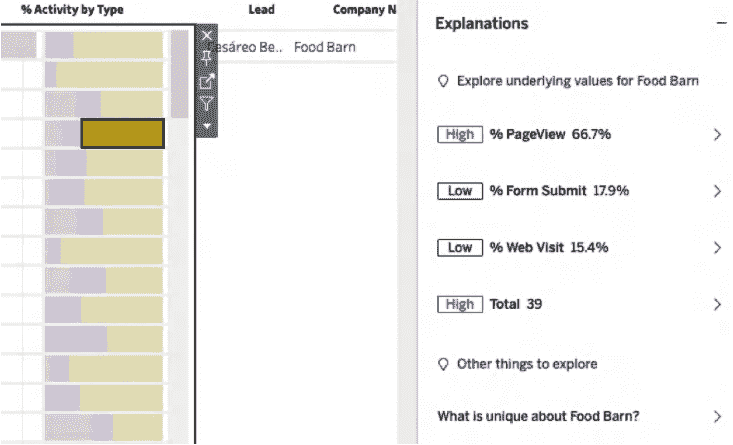

图 16.17: 解释

通过单击一个箭头，会显示更多信息：

### 为什么这比其他标记高？

> 预期范围
> 鉴于可视化中当前值的模型，Singer Lumber 的总计预计在 -7 到 18 之间。这考虑了在度量名称、AGG(Total Activity)、行业上设置的过滤器。了解更多

图 16.18: 文本解释

您甚至可以生成图表来证明这一点：

### Singer Lumber

高总计 171

### 为什么这比其他标记高？

### 贡献维度

- 引荐 URL（活动 - 单击链接）

引荐 URL（活动 - 单击链接）的记录分布与总计相关，这可能解释了为什么 Singer Lumber 的总计更高。

### 按引荐 URL（活动 - 单击链接）分布的记录

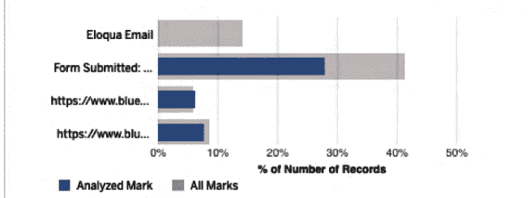

图 16.19: 贡献维度

数据指南还允许您为用户添加描述和资源：

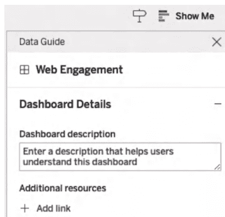

图 16.20: 描述

这就是 Tableau 中数据治理领域的最后一个例子。这是一个庞大的主题，远远超出了 Tableau 的范围，因此我们只是通过研究 GDPR——众多数据法规之一——Tableau 的数据治理功能，以及最后一些实际应用，仅仅触及了表面。这个主题确实值得单独成书，但我想在这里简要地提及它，以分担责任，因为即使您身为 Tableau 开发人员，也有责任并在保障数据安全方面做出改变。希望本章能为您提供足够的思考素材，以便在开发精彩仪表板时更加关注数据治理。

## 总结

数据治理不仅仅是 IT 问题或合规负担。它是一种共同责任，直接影响分析的质量和可信度。本章中我们探索的工具——从认证和血缘到 AI 驱动的文档和回收站——旨在将良好的治理实践变成您工作流中自然的一部分，而非障碍。通过掌握这些功能，您不仅成为一名熟练的仪表板开发人员，还成为组织数据资产值得信赖的管理员。

既然我们已经走到本书的结束，不妨回顾一下我们的旅程：起始于将数据加载到 Tableau、创建第一个可视化并执行第一个函数。接着，我们熟悉了细节层级和表计算，了解了 Tableau Prep Builder、Tableau Server 和一般可视化最佳实践，最后一轮则学习了高级分析以及利用 Tableau 编程工具集成的强大功能。

现在只剩下一个问题：您的下一个 Tableau 项目是什么？欢迎在 Tableau Public 上分享，别忘了添加标签 #MasteringTableau。祝贺大家参与并投入这个学习过程！无论您有更多疑问、意见或反馈，都欢迎联系我或 Tableau 社区。祝您在个人 Tableau 职业生涯中取得成功。
祝 Tableau 使用愉快！

## 在 Discord 上加入我们的社区

加入我们社区的 Discord 空间，与作者和其他读者交流。

https://discord.gg/VXpz9YPUTW

