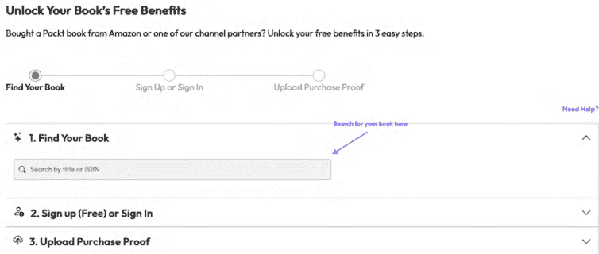
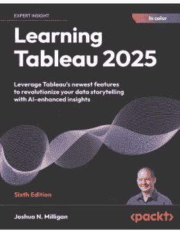
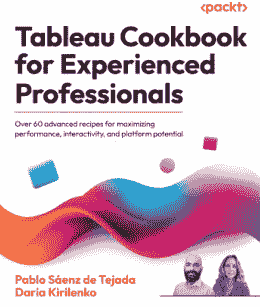

# 17 解锁您的专属权益

您购买的本书包含以下专属权益：

- ### DRM-free PDF 版本
  下载本书的 DRM-free PDF 和 ePub 副本。

- ### 7 天 Packt 图书馆访问权
  获得 8,000+ 本书和视频的 7 天无限访问权。无需信用卡。
  仅限首次 Packt+ 试用用户。

- ### 下一代读者访问权
  在 Packt Reader 上阅读本书，支持进度同步、深色模式和笔记功能。

按照下面的指南解锁这些权益。过程只需几分钟，只需完成一次。

## 在 3 个简单步骤中解锁本书的免费权益

### 步骤 1

为步骤 3 准备好您的购买发票。如果您有实体书，请使用手机扫描并将其保存为 PDF、JPG 或 PNG。

如需了解查找发票的更多帮助，请访问 https://www.packtpub.com/en-us/unlock?step=1。

> **注意：** 如果您是直接从 Packt 购买本书，则无需发票。步骤 2 之后，您即可立即访问专属内容。

### 步骤 2

扫描二维码或访问 packtpub.com/unlock。

打开的页面上（类似于桌面上的图 17.1），按名称搜索本书并选择正确的版本。

图 17.1: 桌面上的 Packt 解锁登陆页面

### 步骤 3

选择书籍后，登录您的 Packt 账户或免费创建一个。然后上传您的发票（PDF、PNG 或 JPG，最大 10 MB）。按照屏幕上的说明完成流程。

### 需要帮助

如果您卡住了并需要帮助，请访问 https://www.packtpub.com/unlock-benefits/help，查看有关如何查找发票等的详细常见问题解答。此二维码将带您前往帮助页面。

> 注意：如果您仍然遇到问题，请联系 customercare@packt.com。

## Packt

packtpub.com

订阅我们的在线数字图书馆，即可全面访问超过 7,000 本书籍和视频，以及行业领先的工具，帮助您规划个人发展并推进职业生涯。如需更多信息，请访问我们的网站。

## 为什么要订阅？

- 使用来自 4,000 多位行业专业人士的实用电子书和视频，减少学习时间，增加编码时间
- 使用专为您定制的技能规划，提升学习效果
- 每月获赠一本免费电子书或视频
- 支持全文搜索，轻松获取关键信息
- 可复制粘贴、打印和收藏内容

在 www.packtpub.com 上，您还可以阅读一系列免费技术文章，订阅多种免费通讯，并获取 Packt 图书和电子书的独家折扣和优惠。

## 您可能喜欢的其他书籍

如果您喜欢本书，可能还对 Packt 的这些其他书籍感兴趣：

## 学习 Tableau 2025

Joshua N. Milligan

ISBN: 9781835886786

- 实施高级 AI 功能以简化数据分析
- 构建并自定义动态仪表板，用于交互式数据讲述
- 利用新的地理空间功能进行全面制图
- 使用 Tableau Prep 的新功能增强数据准备
- 有效整合和分析来自多个来源的数据
- 分享您的数据故事，建立信任与行动的文化

## 经验丰富的专业人士 Tableau 秘籍

Pablo Sáenz de Tejada, Daria Kirilenko

ISBN: 9781835469743

- 构建高级高性能的 Tableau 数据模型和表格
- 使用 LOD 表达式和表格计算解决数据复杂性
- 利用区域可见性构建交互式且用户友好的仪表板
- 优化工作簿性能以改善用户体验
- 使用地图图层、Shapefile 和空间连接分析地理空间数据
- 深入了解 Tableau 的 REST API 功能
- 使用 Tableau 的操作顺序排查计算问题
- 采用行业标准最佳实践保护企业数据资产

## Packt 正在寻找像您这样的作者

如果您有兴趣成为 Packt 的作者，请访问 authors.packt.com 并立即申请。我们曾与成千上万像您一样的开发人员和技术专业人士合作，帮助他们将见解分享给全球技术社区。您可以提交通用申请，申请我们正在招募作者的特定热门话题，或提交您自己的想法。

## 分享您的想法

现在您已经完成了精通 Tableau 2026，我们很乐意听取您的想法！扫描下方的二维码，直接前往本书的 Amazon 评论页面，分享您的反馈或在您购买本书的网站上发表评论。

https://packt.link/r/1806100711
