## 1 使用基于 ASDK 的适配器

WCF LOB Adapter SDK (ASDK) 是一套用于执行和开发面向业务应用程序（LOB）适配器的开发工具和运行时组件，例如 SAP、Oracle、DBMS 等。基于 ASDK 的适配器提供的最大优势是它们不仅可以从 BizTalk 使用，还可以从任何使用熟悉的 WCF 语义并结合 WCF 提供的丰富配置能力的 .NET WCF 兼容应用程序中使用。如果在 BizTalk Server 的早期版本中，开发人员可以在基于 ASDK 的适配器和旧的基于 COM 的 LOB 适配器之间进行选择，那么随着 BizTalk Server 2010 和 BizTalk Adapter Pack 2010 的发布，开发人员唯一的选择就是掌握新技术——旧的传统 LOB 适配器，除了 SQL Server 适配器外，已成为历史，不能与 BizTalk 2010 一起使用。在本章中，我们将涵盖以下主题：

- Understanding the ASDK-based adapter
- ASDK-based adapters vs. WCF services
- Installation of the BizTalk Adapter Pack 2010
- Using the ASDK development tools
- The WCF-Custom adapter and SOAP actions
- ASDK tools and features

主要目标是让您熟悉使用基于 ASDK 的适配器构建 BizTalk 应用程序所涉及的常见步骤和技术，以便在后续章节中，我们能够集中关注每个特定适配器特有的功能。

### 了解基于 ASDK 的适配器

如果您阅读产品文档，您会发现基于 ASDK 的适配器构建在 WCF 通道模型之上，并作为自定义 WCF 绑定公开。这意味着 WCF 客户端能够与基于 ASDK 的适配器通信，就好像它们是 WCF 服务一样。您可能最先想问的问题是，基于 ASDK 的适配器是否实际上是 WCF 服务，只是以新花哨的名字呈现。不，不是！在 WCF LOB Adapter SDK 中使用 WCF 首字母缩写有些误导性；WCF 构成了该技术的基础，但软件并不围绕 Web 服务展开。为了了解适配器如何融入 WCF 基础设施，让我们回顾一些 WCF 基础知识。

为了与客户端建立通信过程，任何 WCF 服务必须至少公开一个终结点。WCF 终结点基于三个元素，称为 WCF 的“A, B, and C”。这三个元素是：

- **Address:** It takes a form of the URI specifying the address where the service can be reached at.
- **Binding:** Bindings specify a communication protocol between the client and the service.
- **Contract:** Contracts specify what operations are exposed by the service.

Communication between client and service is conducted through communication channels; one channel on the client side and its equivalent on the server side. On the server side, when you instantiate the `ServiceHost` class, it instantiates a channel listener, which in turn builds a communication channel for the service. On the client side, the proxy creates a channel factory, which is responsible for building the channel for the client. The channels consist of binding elements, each responsible for its own part of message processing to form a stack of binding elements.


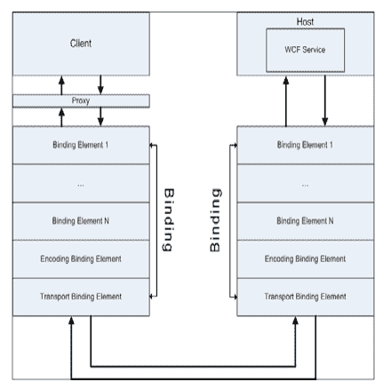

如你在前一图中可以看到，通信通道中的底层是传输层，而 ASDK 基于的适配器恰好就位于通道栈中的这一层。

WCF 的优点在于它在设计时考虑了可扩展性，这使你能够使用针对特定需求定制的自定义传输绑定。与标准 WCF 传输（如 TCP、命名管道、HTTP 和 MSMQ）类似，ASDK 基于的适配器只是可由 BizTalk 应用程序通过标准 WCF 自定义适配器使用的自定义传输绑定元素。如以下图所示，在出站场景中，ASDK 基于的适配器不会像标准 WCF 传输那样通过网络发送消息，而是直接与 LOB 系统通信，然后向客户端发送响应消息。

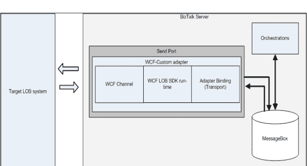

在入站场景中，ASDK 基于的适配器会监视或监听目标 LOB 系统针对特定事件的通知，并生成包含事件特定数据的消息供托管应用程序使用。我们将在本章及后续章节中详细介绍。

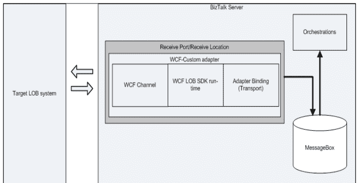

## 基于 ASDK 的适配器与 WCF 服务

关于新适配器，经常被问到的问题之一是引入 ASDK 技术的原因是什么？有什么问题？那些用了多年、可以完美地被几乎所有应用程序使用的老式 WCF 服务有什么问题？为什么微软要重新发明轮子？嗯，这些都是完全合理的问题，这里是答案。WCF 服务本身没有问题；它们和以前一样好，但有一个很大的“但是”——前提是 LOB 应用程序相对静态。想象一下你的 LOB 应用程序在不断演进，而你作为开发者，必须向客户端应用程序公开新的元数据？你要么更新现有契约，要么实现新的契约，并对主机和 WCF 服务执行后续配置步骤。这对从事 LOB 方面的开发团队来说一直是个大麻烦。

> 元数据通常被定义为关于数据的数据。这是一个非常宽泛的定义；在 WCF LOB Adapter SDK 中，元数据可以被定义为目标 LOB 系统中可用的数据类型和操作。例如，对于 SAP，它可以是 IDOC 和 BAPI，或者对于基于 DBMS 的应用程序，可以是存储过程和数据表。确定并公开特定 LOB 应用程序的元数据是适配器设计者的职责。

相比之下，基于 ASDK 的适配器会自动提供设计时元数据发现和解析，无需开发团队付出任何努力即可使新的元数据（根据我们的定义，即功能）可供使用。此过程的细节超出了本章范围，但如果你有兴趣深入了解，随 WCF LOB Adapters SDK 提供的示例适配器可供使用。查看位于 `C:\Program Files\WCF LOB Adapter SDK\Documents\Samples` 目录中的 Contoso 示例适配器如何实现 `IMetadata*` 接口组，你就会明白自动元数据发现和解析背后的原理。实现 `IMetadata*` 接口确实需要适配器开发人员付出大量努力，但最终结果绝对值得。

现在你已经熟悉了架构基础，让我们继续进行适配器的安装。

## 安装

BizTalk Adapter Pack 2010 的安装过程并不复杂，但与 BizTalk 的一切一样，需要准确性和一些耐心。第一步要做的是确保你的系统满足先决条件要求。你必须在计算机上安装以下组件：

- Windows XP SP2、Windows Server 2003、Windows Server 2008、Windows Vista 或 Windows 7
- 用于开发目的的 Visual Studio 2010
- 带有 Windows Communication Foundation 适配器的 BizTalk Server 2010。WCF 适配器默认未安装；在安装 BizTalk Server 2010 时必须显式启用它。

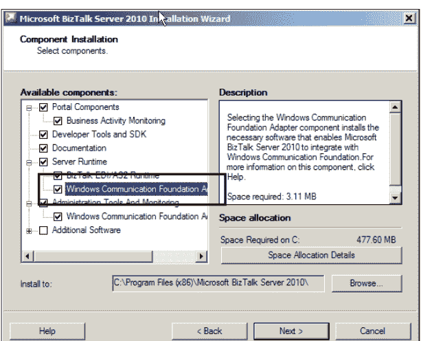

完成验证后，你可以继续进行安装，本质上是以下步骤的顺序：

- 1. 安装 WCF LOB Adapter SDK。
- 2. 安装 BizTalk Adapter Pack 2010。
- 3. 安装额外的客户端库以在适配器与其目标 LOB 系统之间启用通信。唯一不需要任何额外组件的适配器是 SQL 适配器。

从上述步骤来看，安装额外的客户端库是最耗时且最容易出错的过程。我们将在专门介绍 SAP 适配器的章节中详细探讨这一主题。

尽管安装 WCF LOB Adapter SDK 和 BizTalk Adapter Pack 是直接的过程，但在 64 位环境中存在一个陷阱。如果你的计算机运行在 32 位操作系统下，你只需要安装 WCF LOB Adapter SDK 和 BizTalk Adapter Pack 的 32 位版本。在 64 位环境中，情况稍微复杂一些。首先你必须安装 WCF LOB Adapter SDK 的 64 位版本和 BizTalk Adapter Pack 2010 的 64 位版本。然后，如果你在设计时使用 Visual Studio 和 BizTalk 管理控制台等工具，或在运行时使用 32 位 BizTalk 主机实例，你将必须安装 BizTalk Adapter Pack 的 32 位版本和客户端库。这听起来可能违反直觉，但考虑到 Visual Studio 和 BizTalk 管理控制台是 32 位应用程序，因此只能与 32 位组件交互，这种要求就变得清晰了。因此，如果在 64 位环境中运行 BizTalk 安装程序时，它提供同时安装 BizTalk Adapter Pack 2010 的 32 位和 64 位版本，请不要感到惊讶。现在我们已经熟悉了要求，可以开始 ASDK 适配器的安装了。

## 安装 WCF LOB Adapter SDK

第一步是奠定基础，即安装 WCF LOB Adapter SDK。

- 1. 从 BizTalk 安装 DVD 或 ISO 的 `\Setup\BT Setup` 文件夹启动 `setup.exe`，然后选择 **Install Microsoft BizTalk Adapters**。
- 2. 选择 **Step 1: Install Microsoft WCF LOB Adapter SDK**。请注意，安装程序会自动安装正确版本；你无需在 32 位和 64 位之间显式选择。

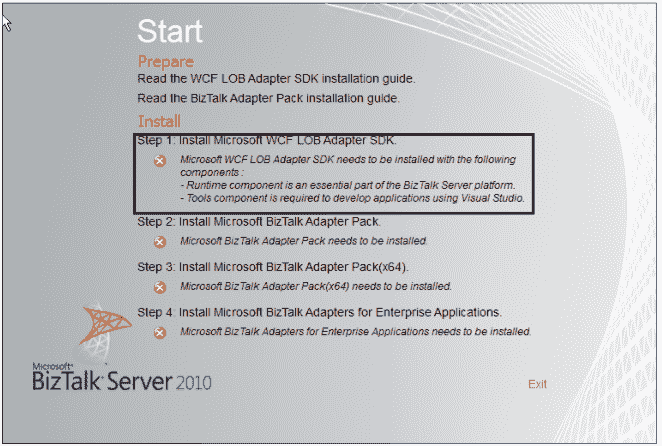

- 3. 在 **Welcome** 屏幕上，单击 **Next** 按钮。
- 4. 接受许可条款并单击 **Next**。
- 5. 在 **Installation Type** 屏幕上，单击 **Custom** 按钮。**Custom Setup** 屏幕将显示出来。
- 6. 你始终必须安装运行时组件，无论是否计划使用 UI 工具。如果你在计划使用 UI 设计时组件的计算机上安装，例如 Visual Studio 的 **Add Adapter Service Reference plug-in**，以及 BizTalk 管理控制台的 **BizTalk Server Add-in**，你必须启用 **Tools** 和 **BizTalk Server Add-in** 组件的安装。本章后面的演练中，你还需要随 WCF LOB Adapter SDK 提供的 **Samples**。

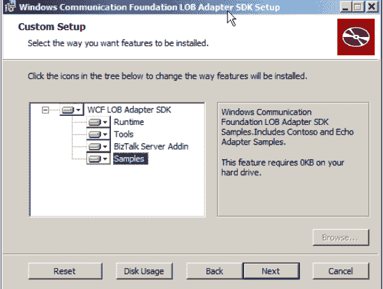

- 7. 单击 **Next**，然后单击 **Install** 开始安装。
- 8. 安装完成后，单击 **Finish** 按钮关闭 WCF LOB Adapter SDK 安装程序并返回主适配器安装窗口。

## 安装 BizTalk Adapter Pack 2010

我们现在将安装 BizTalk Adapter Pack 2010。请注意，如果你处于 64 位环境，安装程序会提供同时安装 BizTalk Adapter Pack 2010 的 32 位和 64 位版本。


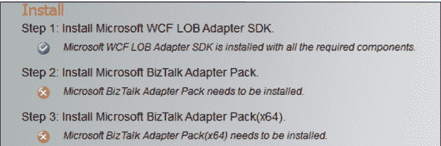

以下是需要遵循的流程：

- 1. 在主适配器设置窗口中，单击链接以安装相关版本的 BizTalk Adapter Pack。
- 2. 在欢迎屏幕上，单击“下一步”。
- 3. 接受许可条款并单击“下一步”。
- 4. 在“选择设置类型”屏幕上，单击“自定义”按钮。
- 5. 在“自定义设置”屏幕上，选择要使用的适配器并单击“下一步”。

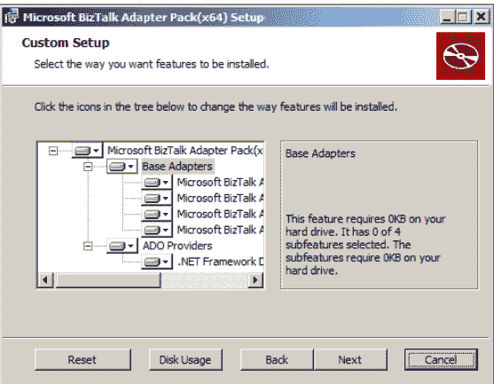

- 6. 单击“安装”开始安装。
- 7. 安装完成后，单击“完成”以完成操作并关闭设置窗口。

要完成 BizTalk Adapter Pack 2010 的安装，您需要为除 SQL 之外的所有适配器安装额外的客户端组件。对于本书中涉及的 SAP 适配器，我们将在第 4 章提供逐步指导。如果您仅计划使用 SQL 适配器，则无需进一步步骤，此时您已拥有使用和开发 SQL 适配器所需的一切。

## 使用 ASDK 开发工具

在本节中，我们将向您展示如何使用 ASDK 提供的工具，以便 BizTalk 应用程序能够使用基于 ASDK 的适配器。为此，我们将使用 Echo 适配器，即 ASDK 提供的两个示例适配器之一。这是一个非常简单的适配器，用于模拟对虚构 LOB 系统的操作，但此时我们不需要任何复杂的东西，因为无论适配器如何，ASDK 工具的工作方式完全相同。因此，Echo 适配器的简洁性对我们有利——我们将集中于本质，而将现实世界适配器的复杂性留给各自的章节。作为额外的奖励，Echo 适配器附带完整的源代码，位于 C:\Program Files\WCF LOB Adapter SDK\Documents\Samples 目录中，以及一个安装包。在撰写本书之时，Echo 适配器的设置包尚未更新以用于 Visual Studio 2010 和 .NET 4.0；为了让您更轻松，我们为 .NET 4.0 32/64 位环境准备了设置，并将软件包放在包含本书代码示例的 ZIP 文件中。如果您尚未下载示例，请现在下载。

## Echo 适配器

让我们先简要讨论 Echo 适配器提供的功能。与 BizTalk Adapter Pack 2010 中的“大兄弟”一样，Echo 适配器支持两种消息交换模式。

- Inbound： 在入站场景中，Echo 适配器作为接收端口基础设施的一部分，监视指定文件文件夹中是否有新的 TXT 扩展名文件；一旦有新文件到达，适配器会向 BizTalk 应用程序发送通知。通知的形式为符合以下 XSD 架构的 XML 消息：

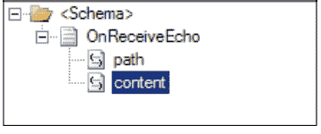

- path 元素包含正在监视新文件的[content]


以下是需要遵循的流程：

- 1. 在主适配器设置窗口中，单击链接以安装相关版本的 BizTalk Adapter Pack。
- 2. 在欢迎屏幕上，单击“下一步”。
- 3. 接受许可条款并单击“下一步”。
- 4. 在“选择设置类型”屏幕上，单击“自定义”按钮。
- 5. 在“自定义设置”屏幕上，选择要使用的适配器并单击“下一步”。


- 6. 单击“安装”开始安装。
- 7. 安装完成后，单击“完成”以完成操作并关闭设置窗口。

要完成 BizTalk Adapter Pack 2010 的安装，您需要为除 SQL 之外的所有适配器安装额外的客户端组件。对于本书中涉及的 SAP 适配器，我们将在第 4 章提供逐步指导。如果您仅计划使用 SQL 适配器，则无需进一步步骤，此时您已拥有使用和开发 SQL 适配器所需的一切。

## 使用 ASDK 开发工具

在本节中，我们将向您展示如何使用 ASDK 提供的工具，以便 BizTalk 应用程序能够使用基于 ASDK 的适配器。为此，我们将使用 Echo 适配器，即 ASDK 提供的两个示例适配器之一。这是一个非常简单的适配器，用于模拟对虚构 LOB 系统的操作，但此时我们不需要任何复杂的东西，因为无论适配器如何，ASDK 工具的工作方式完全相同。因此，Echo 适配器的简洁性对我们有利——我们将集中于本质，而将现实世界适配器的复杂性留给各自的章节。作为额外的奖励，Echo 适配器附带完整的源代码，位于 C:\Program Files\WCF LOB Adapter SDK\Documents\Samples 目录中，以及一个安装包。在撰写本书之时，Echo 适配器的设置包尚未更新以用于 Visual Studio 2010 和 .NET 4.0；为了让您更轻松，我们为 .NET 4.0 32/64 位环境准备了设置，并将软件包放在包含本书代码示例的 ZIP 文件中。如果您尚未下载示例，请现在下载。

## Echo 适配器

让我们先简要讨论 Echo 适配器提供的功能。与 BizTalk Adapter Pack 2010 中的“大兄弟”一样，Echo 适配器支持两种消息交换模式。

- Inbound： 在入站场景中，Echo 适配器作为接收端口基础设施的一部分，监视指定文件文件夹中是否有新的 TXT 扩展名文件；一旦有新文件到达，适配器会向 BizTalk 应用程序发送通知。通知的形式为符合以下 XSD 架构的 XML 消息：


- path 元素包含正在监视新文件的[content]


以下是需要遵循的流程：

- 1. 在主适配器设置窗口中，单击链接以安装相关版本的 BizTalk Adapter Pack。
- 2. 在欢迎屏幕上，单击“下一步”。
- 3. 接受许可条款并单击“下一步”。
- 4. 在“选择设置类型”屏幕上，单击“自定义”按钮。
- 5. 在“自定义设置”屏幕上，选择要使用的适配器并单击“下一步”。


- 6. 单击“安装”开始安装。
- 7. 安装完成后，单击“完成”以完成操作并关闭设置窗口。

要完成 BizTalk Adapter Pack 2010 的安装，您需要为除 SQL 之外的所有适配器安装额外的客户端组件。对于本书中涉及的 SAP 适配器，我们将在第 4 章提供逐步指导。如果您仅计划使用 SQL 适配器，则无需进一步步骤，此时您已拥有使用和开发 SQL 适配器所需的一切。

## 使用 ASDK 开发工具

在本节中，我们将向您展示如何使用 ASDK 提供的工具，以便 BizTalk 应用程序能够使用基于 ASDK 的适配器。为此，我们将使用 Echo 适配器，即 ASDK 提供的两个示例适配器之一。这是一个非常简单的适配器，用于模拟对虚构 LOB 系统的操作，但此时我们不需要任何复杂的东西，因为无论适配器如何，ASDK 工具的工作方式完全相同。因此，Echo 适配器的简洁性对我们有利——我们将集中于本质，而将现实世界适配器的复杂性留给各自的章节。作为额外的奖励，Echo 适配器附带完整的源代码，位于 C:\Program Files\WCF LOB Adapter SDK\Documents\Samples 目录中，以及一个安装包。在撰写本书之时，Echo 适配器的设置包尚未更新以用于 Visual Studio 2010 和 .NET 4.0；为了让您更轻松，我们为 .NET 4.0 32/64 位环境准备了设置，并将软件包放在包含本书代码示例的 ZIP 文件中。如果您尚未下载示例，请现在下载。

## Echo 适配器

让我们先简要讨论 Echo 适配器提供的功能。与 BizTalk Adapter Pack 2010 中的“大兄弟”一样，Echo 适配器支持两种消息交换模式。

- Inbound： 在入站场景中，Echo 适配器作为接收端口基础设施的一部分，监视指定文件文件夹中是否有新的 TXT 扩展名文件；一旦有新文件到达，适配器会向 BizTalk 应用程序发送通知。通知的形式为符合以下 XSD 架构的 XML 消息：


- path 元素包含正在监视新文件的[content]


以下是需要遵循的流程：

- 1. 在主适配器设置窗口中，单击链接以安装相关版本的 BizTalk Adapter Pack。
- 2. 在欢迎屏幕上，单击“下一步”。
- 3. 接受许可条款并单击“下一步”。
- 4. 在“选择设置类型”屏幕上，单击“自定义”按钮。
- 5. 在“自定义设置”屏幕上，选择要使用的适配器并单击“下一步”。


- 6. 单击“安装”开始安装。
- 7. 安装完成后，单击“完成”以完成操作并关闭设置窗口。

要完成 BizTalk Adapter Pack 2010 的安装，您需要为除 SQL 之外的所有适配器安装额外的客户端组件。对于本书中涉及的 SAP 适配器，我们将在第 4 章提供逐步指导。如果您仅计划使用 SQL 适配器，则无需进一步步骤，此时您已拥有使用和开发 SQL 适配器所需的一切。

## 使用 ASDK 开发工具

在本节中，我们将向您展示如何使用 ASDK 提供的工具，以便 BizTalk 应用程序能够使用基于 ASDK 的适配器。为此，我们将使用 Echo 适配器，即 ASDK 提供的两个示例适配器之一。这是一个非常简单的适配器，用于模拟对虚构 LOB 系统的操作，但此时我们不需要任何复杂的东西，因为无论适配器如何，ASDK 工具的工作方式完全相同。因此，Echo 适配器的简洁性对我们有利——我们将集中于本质，而将现实世界适配器的复杂性留给各自的章节。作为额外的奖励，Echo 适配器附带完整的源代码，位于 C:\Program Files\WCF LOB Adapter SDK\Documents\Samples 目录中，以及一个安装包。在撰写本书之时，Echo 适配器的设置包尚未更新以用于 Visual Studio 2010 和 .NET 4.0；为了让您更轻松，我们为 .NET 4.0 32/64 位环境准备了设置，并将软件包放在包含本书代码示例的 ZIP 文件中。如果您尚未下载示例，请现在下载。

## Echo 适配器

让我们先简要讨论 Echo 适配器提供的功能。与 BizTalk Adapter Pack 2010 中的“大兄弟”一样，Echo 适配器支持两种消息交换模式。

- Inbound： 在入站场景中，Echo 适配器作为接收端口基础设施的一部分，监视指定文件文件夹中是否有新的 TXT 扩展名文件；一旦有新文件到达，适配器会向 BizTalk 应用程序发送通知。通知的形式为符合以下 XSD 架构的 XML 消息：


- path 元素包含正在监视新文件的[content]


以下是需要遵循的流程：

- 1. 在主适配器设置窗口中，单击链接以安装相关版本的 BizTalk Adapter Pack。
- 2. 在欢迎屏幕上，单击“下一步”。
- 3. 接受许可条款并单击“下一步”。
- 4. 在“选择设置类型”屏幕上，单击“自定义”按钮。
- 5. 在“自定义设置”屏幕上，选择要使用的适配器并单击“下一步”。


- 6. 单击“安装”开始安装。
- 7. 安装完成后，单击“完成”以完成操作并关闭设置窗口。

要完成 BizTalk Adapter Pack 2010 的安装，您需要为除 SQL 之外的所有适配器安装额外的客户端组件。对于本书中涉及的 SAP 适配器，我们将在第 4 章提供逐步指导。如果您仅计划使用 SQL 适配器，则无需进一步步骤，此时您已拥有使用和开发 SQL 适配器所需的一切。

## 使用 ASDK 开发工具

在本节中，我们将向您展示如何使用 ASDK 提供的工具，以便 BizTalk 应用程序能够使用基于 ASDK 的适配器。为此，我们将使用 Echo 适配器，即 ASDK 提供的两个示例适配器之一。这是一个非常简单的适配器，用于模拟对虚构 LOB 系统的操作，但此时我们不需要任何复杂的东西，因为无论适配器如何，ASDK 工具的工作方式完全相同。因此，Echo 适配器的简洁性对我们有利——我们将集中于本质，而将现实世界适配器的复杂性留给各自的章节。作为额外的奖励，Echo 适配器附带完整的源代码，位于 C:\Program Files\WCF LOB Adapter SDK\Documents\Samples 目录中，以及一个安装包。在撰写本书之时，Echo 适配器的设置包尚未更新以用于 Visual Studio 2010 和 .NET 4.0；为了让您更轻松，我们为 .NET 4.0 32/64 位环境准备了设置，并将软件包放在包含本书代码示例的 ZIP 文件中。如果您尚未下载示例，请现在下载。

## Echo 适配器

让我们先简要讨论 Echo 适配器提供的功能。与 BizTalk Adapter Pack 2010 中的“大兄弟”一样，Echo 适配器支持两种消息交换模式。

- Inbound： 在入站场景中，Echo 适配器作为接收端口基础设施的一部分，监视指定文件文件夹中是否有新的 TXT 扩展名文件；一旦有新文件到达，适配器会向 BizTalk 应用程序发送通知。通知的形式为符合以下 XSD 架构的 XML 消息：


- path 元素包含正在监视新文件的[content]


以下是需要遵循的流程：

- 1. 在主适配器设置窗口中，单击链接以安装相关版本的 BizTalk Adapter Pack。
- 2. 在欢迎屏幕上，单击“下一步”。
- 3. 接受许可条款并单击“下一步”。
- 4. 在“选择设置类型”屏幕上，单击“自定义”按钮。
- 5. 在“自定义设置”屏幕上，选择要使用的适配器并单击“下一步”。


- 6. 单击“安装”开始安装。
- 7. 安装完成后，单击“完成”以完成操作并关闭设置窗口。

要完成 BizTalk Adapter Pack 2010 的安装，您需要为除 SQL 之外的所有适配器安装额外的客户端组件。对于本书中涉及的 SAP 适配器，我们将在第 4 章提供逐步指导。如果您仅计划使用 SQL 适配器，则无需进一步步骤，此时您已拥有使用和开发 SQL 适配器所需的一切。

## 使用 ASDK 开发工具

在本节中，我们将向您展示如何使用 ASDK 提供的工具，以便 BizTalk 应用程序能够使用基于 ASDK 的适配器。为此，我们将使用 Echo 适配器，即 ASDK 提供的两个示例适配器之一。这是一个非常简单的适配器，用于模拟对虚构 LOB 系统的操作，但此时我们不需要任何复杂的东西，因为无论适配器如何，ASDK 工具的工作方式完全相同。因此，Echo 适配器的简洁性对我们有利——我们将集中于本质，而将现实世界适配器的复杂性留给各自的章节。作为额外的奖励，Echo 适配器附带完整的源代码，位于 C:\Program Files\WCF LOB Adapter SDK\Documents\Samples 目录中，以及一个安装包。在撰写本书之时，Echo 适配器的设置包尚未更新以用于 Visual Studio 2010 和 .NET 4.0；为了让您更轻松，我们为 .NET 4.0 32/64 位环境准备了设置，并将软件包放在包含本书代码示例的 ZIP 文件中。如果您尚未下载示例，请现在下载。

## Echo 适配器

让我们先简要讨论 Echo 适配器提供的功能。与 BizTalk Adapter Pack 2010 中的“大兄弟”一样，Echo 适配器支持两种消息交换模式。

- Inbound： 在入站场景中，Echo 适配器作为接收端口基础设施的一部分，监视指定文件文件夹中是否有新的 TXT 扩展名文件；一旦有新文件到达，适配器会向 BizTalk 应用程序发送通知。通知的形式为符合以下 XSD 架构的 XML 消息：


- path 元素包含正在监视新文件的[content]


以下是需要遵循的流程：

- 1. 在主适配器设置窗口中，单击链接以安装相关版本的 BizTalk Adapter Pack。
- 2. 在欢迎屏幕上，单击“下一步”。
- 3. 接受许可条款并单击“下一步”。
- 4. 在“选择设置类型”屏幕上，单击“自定义”按钮。
- 5. 在“自定义设置”屏幕上，选择要使用的适配器并单击“下一步”。


- 6. 单击“安装”开始安装。
- 7. 安装完成后，单击“完成”以完成操作并关闭设置窗口。

要完成 BizTalk Adapter Pack 2010 的安装，您需要为除 SQL 之外的所有适配器安装额外的客户端组件。对于本书中涉及的 SAP 适配器，我们将在第 4 章提供逐步指导。如果您仅计划使用 SQL 适配器，则无需进一步步骤，此时您已拥有使用和开发 SQL 适配器所需的一切。

## 使用 ASDK 开发工具

在本节中，我们将向您展示如何使用 ASDK 提供的工具，以便 BizTalk 应用程序能够使用基于 ASDK 的适配器。为此，我们将使用 Echo 适配器，即 ASDK 提供的两个示例适配器之一。这是一个非常简单的适配器，用于模拟对虚构 LOB 系统的操作，但此时我们不需要任何复杂的东西，因为无论适配器如何，ASDK 工具的工作方式完全相同。因此，Echo 适配器的简洁性对我们有利——我们将集中于本质，而将现实世界适配器的复杂性留给各自的章节。作为额外的奖励，Echo 适配器附带完整的源代码，位于 C:\Program Files\WCF LOB Adapter SDK\Documents\Samples 目录中，以及一个安装包。在撰写本书之时，Echo 适配器的设置包尚未更新以用于 Visual Studio 2010 和 .NET 4.0；为了让您更轻松，我们为 .NET 4.0 32/64 位环境准备了设置，并将软件包放在包含本书代码示例的 ZIP 文件中。如果您尚未下载示例，请现在下载。

## Echo 适配器

让我们先简要讨论 Echo 适配器提供的功能。与 BizTalk Adapter Pack 2010 中的“大兄弟”一样，Echo 适配器支持两种消息交换模式。

- Inbound： 在入站场景中，Echo 适配器作为接收端口基础设施的一部分，监视指定文件文件夹中是否有新的 TXT 扩展名文件；一旦有新文件到达，适配器会向 BizTalk 应用程序发送通知。通知的形式为符合以下 XSD 架构的 XML 消息：


- 路径元素包含正在监视新文件的[content]


以下是需要遵循的流程：

- 1. 在主适配器设置窗口中，单击链接安装相关版本的 BizTalk Adapter Pack。
- 2. 在欢迎屏幕单击“下一步”。
- 3. 接受许可条款并单击“下一步”。
- 4. 在“选择设置类型”屏幕单击“自定义”按钮。
- 5. 在“自定义设置”屏幕选择要使用的适配器并单击“下一步”。


- 6. 单击“安装”开始安装。
- 7. 安装完成后单击“完成”以完成操作并关闭设置窗口。

要完成 BizTalk Adapter Pack 2010 安装，您需要为除 SQL 外的所有适配器安装额外客户端组件。关于本书涉及的 SAP 适配器，第 4 章将提供逐步指导。若仅计划使用 SQL 适配器，则无需进一步步骤，此时您已拥有使用和开发 SQL 适配器所需的一切。

## 使用 ASDK 开发工具

本节将展示如何使用 ASDK 提供的工具，使 BizTalk 应用程序能够使用基于 ASDK 的适配器。为此我们将使用 Echo 适配器，即 ASDK 提供的两个示例适配器之一。这是一个非常简单的适配器，用于模拟对虚构 LOB 系统的操作，此时不需要复杂功能，因为无论适配器如何，ASDK 工具的工作方式完全相同。因此 Echo 适配器的简洁性对我们有利——我们集中于本质，将现实世界适配器的复杂性留给各自章节。额外奖励是 Echo 适配器附带完整源代码，位于 C:\Program Files\WCF LOB Adapter SDK\Documents\Samples 目录，以及安装包。撰写本书时，Echo 适配器的设置包尚未更新以用于 Visual Studio 2010 和 .NET 4.0；为方便您使用，我们为 .NET 4.0 32/64 位环境准备了设置，并将软件包放在包含本书代码示例的 ZIP 文件中。若尚未下载示例，请现在下载。

## Echo 适配器

先简要讨论 Echo 适配器提供的功能。与 BizTalk Adapter Pack 2010 中的“大兄弟”一样，Echo 适配器支持两种消息交换模式。

- Inbound： 入站场景中，Echo 适配器作为接收端口基础设施的一部分，监视指定文件夹中是否有新的 TXT 文件；一旦有新文件到达，适配器会向 BizTalk 应用程序发送通知。通知形式为符合以下 XSD 架构的 XML 消息：


- 路径元素包含正在监视新文件的[content]


以下是需要遵循的流程：

- 1. 在主适配器设置窗口中，单击链接安装相关版本的 BizTalk Adapter Pack。
- 2. 在欢迎屏幕单击“下一步”。
- 3. 接受许可条款并单击“下一步”。
- 4. 在“选择设置类型”屏幕单击“自定义”按钮。
- 5. 在“自定义设置”屏幕选择要使用的适配器并单击“下一步”。


- 6. 单击“安装”开始安装。
- 7. 安装完成后单击“完成”以完成操作并关闭设置窗口。

要完成 BizTalk Adapter Pack 2010 安装，需为除 SQL 外的所有适配器安装额外客户端组件。关于本书涉及的 SAP 适配器，第 4 章将提供逐步指导。若仅计划使用 SQL 适配器，则无需进一步步骤，此时您已拥有使用和开发 SQL 适配器所需的一切。

## 使用 ASDK 开发工具

本节展示如何使用 ASDK 提供的工具，使 BizTalk 应用程序能够使用基于 ASDK 的适配器。为此我们使用 Echo 适配器，即 ASDK 提供的两个示例适配器之一。这是一个非常简单的适配器，用于模拟对虚构 LOB 系统的操作，此时不需要复杂功能，因为无论适配器如何，ASDK 工具的工作方式完全相同。因此 Echo 适配器的简洁性对我们有利，我们集中于本质，将现实世界适配器的复杂性留给各自章节。额外奖励是 Echo 适配器附带完整源代码，位于 C:\Program Files\WCF LOB Adapter SDK\Documents\Samples 目录，以及安装包。撰写本书时，Echo 适配器的设置包尚未更新以用于 Visual Studio 2010 和 .NET 4.0；为方便您使用，我们为 .NET 4.0 32/64 位环境准备了设置，并将软件包放在包含本书代码示例的 ZIP 文件中。若尚未下载示例，请现在下载。

## Echo 适配器

先简要讨论 Echo 适配器提供的功能。与 BizTalk Adapter Pack 2010 中的“大兄弟”一样，Echo 适配器支持两种消息交换模式。

- Inbound： 入站场景中，Echo 适配器作为接收端口基础设施的一部分，监视指定文件夹中是否有新的 TXT 文件；一旦有新文件到达，适配器会向 BizTalk 应用程序发送通知。通知形式为符合以下 XSD 架构的 XML 消息：


- 路径元素包含正在监视新文件的[content]


以下是需要遵循的流程：

- 1. 在主适配器设置窗口中，单击链接安装相关版本的 BizTalk Adapter Pack。
- 2. 在欢迎屏幕单击“下一步”。
- 3. 接受许可条款并单击“下一步”。
- 4. 在“选择设置类型”屏幕单击“自定义”按钮。
- 5. 在“自定义设置”屏幕选择要使用的适配器并单击“下一步”。


- 6. 单击“安装”开始安装。
- 7. 安装完成后单击“完成”以完成操作并关闭设置窗口。

要完成 BizTalk Adapter Pack 2010 安装，需为除 SQL 外的所有适配器安装额外客户端组件。关于本书涉及的 SAP 适配器，第 4 章将提供逐步指导。若仅计划使用 SQL 适配器，则无需进一步步骤，此时您已拥有使用和开发 SQL 适配器所需的一切。

## 使用 ASDK 开发工具

本节展示如何使用 ASDK 提供的工具，使 BizTalk 应用程序能够使用基于 ASDK 的适配器。为此我们使用 Echo 适配器，即 ASDK 提供的两个示例适配器之一。这是一个非常简单的适配器，用于模拟对虚构 LOB 系统的操作，此时不需要复杂功能，因为无论适配器如何，ASDK 工具的工作方式完全相同。因此 Echo 适配器的简洁性对我们有利，我们集中于本质，将现实世界适配器的复杂性留给各自章节。额外奖励是 Echo 适配器附带完整源代码，位于 C:\Program Files\WCF LOB Adapter SDK\Documents\Samples 目录，以及安装包。撰写本书时，Echo 适配器的设置包尚未更新以用于 Visual Studio 2010 和 .NET 4.0；为方便您使用，我们为 .NET 4.0 32/64 位环境准备了设置，并将软件包放在包含本书代码示例的 ZIP 文件中。若尚未下载示例，请现在下载。

## Echo 适配器

先简要讨论 Echo 适配器提供的功能。与 BizTalk Adapter Pack 2010 中的“大兄弟”一样，Echo 适配器支持两种消息交换模式。


生成工件的第一步是建立与目标系统的连接。大多数 LOB 系统在连接过程中需要有效的客户端凭据，我们的 Echo 系统也不例外，尽管它相当宽容——在 **Client credential type** 下拉列表中选择 **Username** 后，您可以为 **User name** 和 **Password** 输入任何您喜欢的内容，但请不要留空。

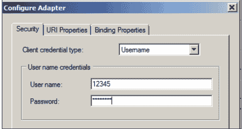

此外，除了有效的凭据外，为了建立连接，我们还需要提供主机名、端口号以及其他 LOB 应用程序特定的参数——这就是 **URI Properties** 选项卡的作用。切换到此选项卡并注意其中显示的属性。与用户名和密码一样，您可以输入任何您喜欢的内容或接受默认值。

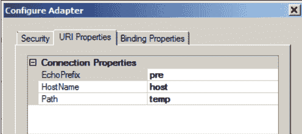

虽然 Echo Adapter 只需要三个元素来构建连接 URI，但来自 BizTalk Adapters Pack 2010 的实际适配器需要更多详细信息才能连接到其 LOB 系统。为便于比较，下图显示了建立与 SAP 的连接所需的属性：

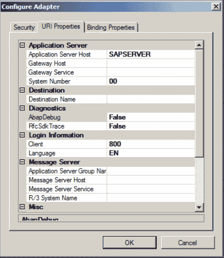

- 最后，我们需要通过设置 Binding Properties 选项卡上显示的属性来配置适配器公开的绑定。对于我们的场景，我们可以接受所有属性的默认值。

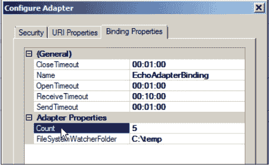

现在，单击 **OK** 关闭 Configure Adapter 对话框并返回到 **Consume Adapter Service** 窗口。请注意，**Configure a URI** 文本框现在包含一个已配置的连接字符串，该字符串由 URI 属性选项卡的值构建而成。

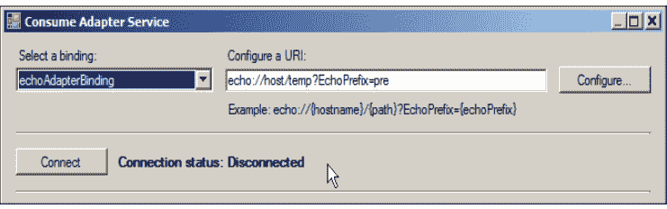

如果我们构建的连接字符串正确，单击 **Connect** 按钮将建立与 Echo 系统的活动连接。如果连接被接受，我们将看到类别树填充了传出类别——传出契约类型是 Consume Adapter Service 插件默认选择的类型。

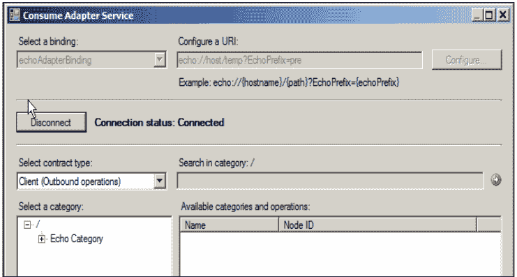

接下来，我们需要选择要在应用程序中使用的操作并将它们添加到所需操作列表中。在 Select a category 树中单击 Echo Category 节点，然后在 Available categories and operations 面板中，选择 EchoString 并单击 Add 按钮。此操作将 EchoString 添加到屏幕底部的所需操作列表中。最后一步是通过将屏幕底部的文件名前缀设置为 EchoOutbound 来帮助 Consume Adapter Service 插件生成描述性的文件名。

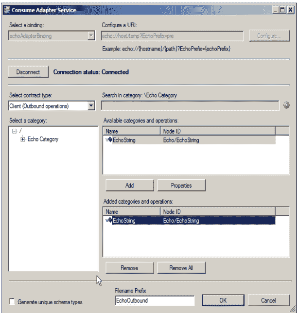

最后，单击 OK 关闭 Consume Adapter Service 向导窗口并返回 Visual Studio，在那里我们看到 BizTalk 项目中添加了两个新文件。一个文件是 EchoString 操作的 XSD 架构，另一个是 XML 绑定文件。部署应用程序后，您将使用 BizTalk 管理控制台导入此文件以创建物理 WCF-Custom 发送端口，该端口配置为执行 EchoString 操作。

不幸的是，我们必须处理的一个不便之处是 **Consume Adapter Service add-in** 不允许在一轮运行中为不同契约类型生成工件。要为入站操作生成架构和绑定文件，我们需要再次打开 **Consume Adapter Service add-in** 并重复该过程。在 **Security** 选项卡上，指定用户名和密码，对于 **URI Properties** 和 **Binding Properties** 选项卡上的属性，您可以接受默认值。

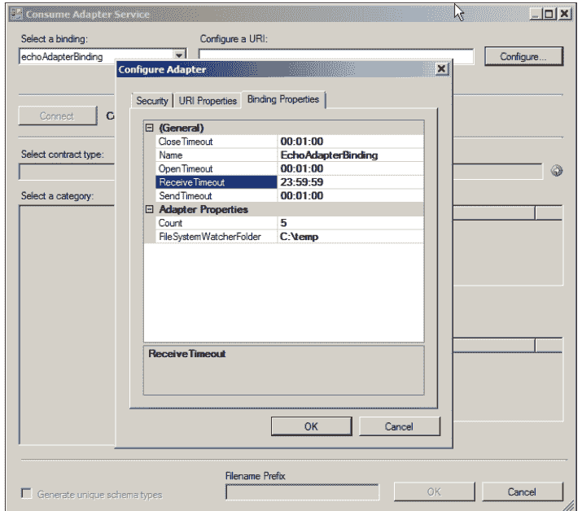

- 然后，一旦建立了成功的连接，在 **Select contract type** 下拉列表中选择 **Service**，在 **Select a category** 面板中单击 **EchoCategory**，并将 **OnReceiveEcho** 添加到所需操作列表中。将屏幕底部的 **Filename Prefix** 设置为 **EchoInbound**。
- 单击 **OK** 返回 Visual Studio。我们的 Visual Studio 解决方案现在应如下所示，其中添加了两个新文件：

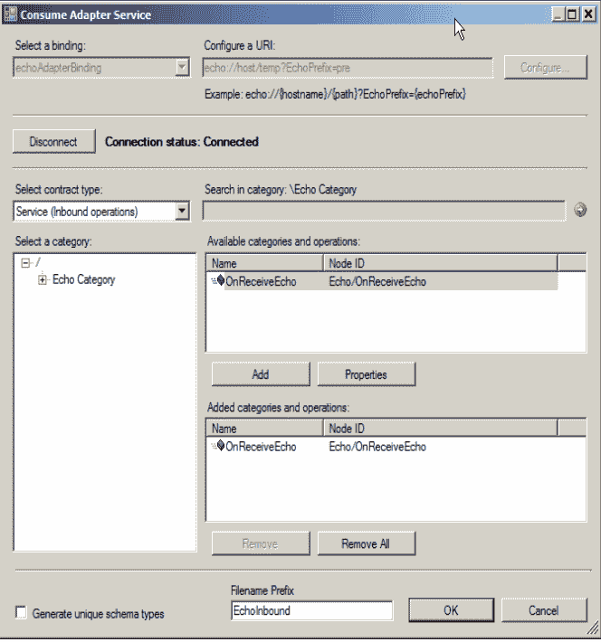

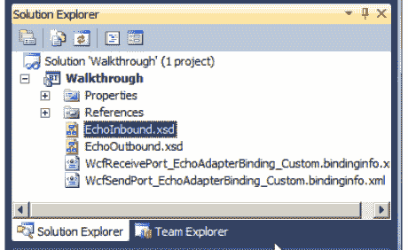

最后，为了完成架构，双击 EchoOutbound.xsd 文件以打开架构编辑器并区分 EchoStringResult 字段。我们将在编排中使用此字段。

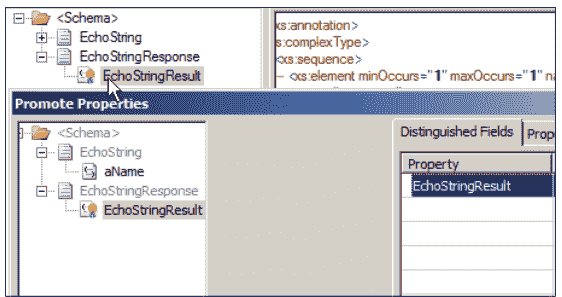

从技术上讲，此时我们已拥有构建 BizTalk 应用程序所需的所有组件。在继续之前，让我们做一些外观上的更改。

首先，将 WcfSendPort_EchoAdapterBinding_Custom.bindinginfo.xml 重命名为 SendPort.Bindinginfo.xml。同样，将 WcfReceivePort_EchoAdapterBinding_Custom.bindinginfo.xml 重命名为 ReceivePort.Bindinginfo.xml。

接下来，我们需要为接收端口和接收位置提供更具描述性的名称。打开 ReceivePort.bindinginfo.xml 文件，并按如下方式更改 ReceivePort 和 ReceiveLocation Name 属性：

```
<DistributionListCollection />
<ReceivePortCollection>
  <ReceivePort Name="Echo_ReceiveNotification" IsTwoWay="false" Bin
    <Description>ReceivePort for EchoAdapterBinding.</Description>
    <ReceiveLocations>
      <ReceiveLocation Name="EchoWcfCustom_ReceiveNotification">
        <Description xsi:nil="true" />
```

对于 SendPort.bindinginfo.xml 文件，找到 SendPort 节点并将 Name 属性更改为 SendEchoString。

```
<SendPortCollection>
  <SendPort Name="SendEchoString" IsStatic="true" IsTwoW
    <Description>SendPort for EchoAdapterBinding.</Descr
```

4. 现在我们已准备好所有工件，可以继续构建示例应用程序。

5. 向项目添加 BizTalk 编排并将其命名为 ProcessEcho。

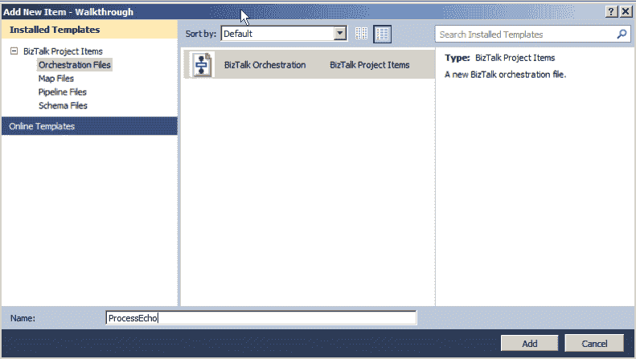

6. 切换到 **OrchestrationView** 并创建三个编排消息，其值如下：

- Identifier: **msgReceiveNotification**, Message Type: **Walkthrough.EchoInbound**
- Identifier: **msgEchoStringRequest**, Type: **Walkthrough.EchoOutbound.EchoString**
- Identifier: **msgEchoStringResponse**, Type: **Walkthrough.EchoOutbound.EchoStringResponse**

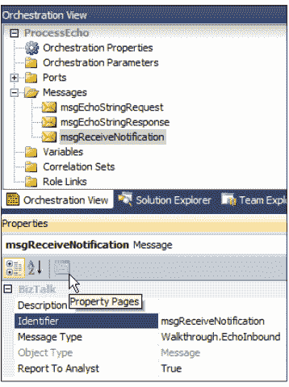

7. 为了构建传出消息，向项目添加一个映射并命名它。

8. **Inbound_To_Outbound**。

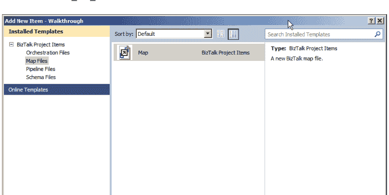

9. 指定 **OnReceiveEcho** 作为源消息类型，对于目标架构，指定 **EchoOutbound**，并选择 **EchoString** 作为根节点。源和目标架构设置后，连接 **content** 和 **aName** 元素。

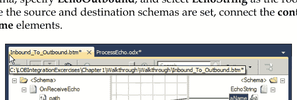

10. 接下来，我们需要绘制编排流程。从工具箱中，按以下顺序和属性将形状拖到编排表面：

- Shape: **Receive**, Name: **ReceiveNotification**, Activate: True, Message: **msgReceiveNotification**

- Shape: **Construct**, Name: **ConstructEchoOutbound**, Message Constructed: **msgEchoStringRequest**。在 Construct 内部拖动 Transform 形状并使用以下值进行配置：Name: **Transform**, Input Messages: **msgReceiveNotification**, Map Name: **Inbound_To_Outbound**, Output Messages: **msgEchoStringRequest**
- Shape: **Send**, Name: **SendEchoString**, Message: **msgEchoStringRequest**
- Shape: **Receive**, Name: **ReceiveEchoResponse**, Message: **msgEchoStringResponse**
- Shape: **Expression**, Name: **WriteToLog**

11. 配置 **WriteToLog** 表达式形状以执行以下代码：

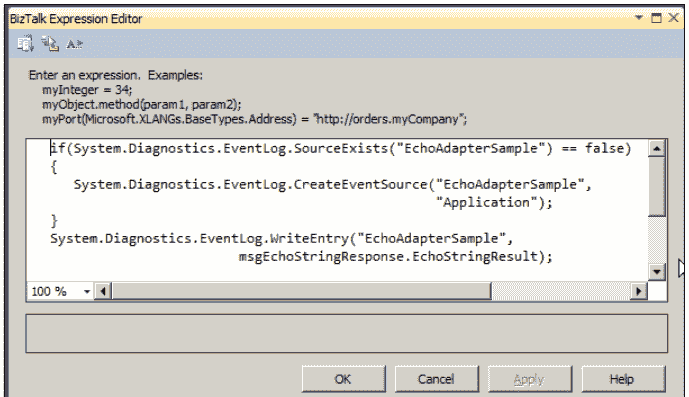

12. 为了使编排能够接收和发送消息，我们需要添加两个逻辑编排端口。第一个端口是一个单向端口，用于接收初始入站消息；第二个端口是一个请求-响应端口，用于向适配器发送传出消息以进行处理并接收响应。右键单击 **Port Surface** 并选择 **New Configured Port** 以启动 **Port Configuration Wizard**。以下是第一个单向端口的设置。

- Name: **ReceiveInitialEcho**


- 端口类型：**创建新端口**，端口类型名称：**InitialEchoType**，通信模式：**单向**，访问限制：**内部**
- 通信端口方向：**我将始终在此端口接收消息**，端口绑定：**稍后指定**

13. 再次运行向导以创建用于外发操作的逻辑端口。

- 名称：**SendEchoString**
- 端口类型：**创建新端口**，端口类型名称：**SendEchoStringType**，通信模式：**请求-响应**，访问限制：**内部**
- 通信端口方向：**我将始终在此端口发送请求并接收响应**，端口绑定：**稍后指定**

14. 将逻辑端口与相关形状连接。将 **ReceiveNotification** 接收端口的 **请求** 与 ReceiveNotification 形状连接。对于 **SendEchoString** 发送端口，将 **请求** 与 **SendEchoString** 形状连接，并将 **响应** 与 **ReceiveEchoResponse** 形状连接。完成后，编排应与以下图像匹配：

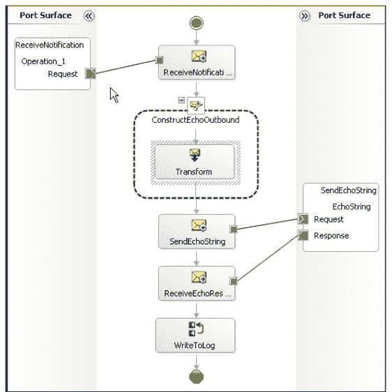

15. 构建应用程序并解决任何错误消息。

16. 在部署应用程序之前要做的最后一件事是为应用程序程序集指定强名称密钥，并为 BizTalk 应用程序提供名称。在“解决方案资源管理器”中，右键单击项目名称并选择“属性”。从“项目属性”窗口切换到“签名”选项卡以指定强名称密钥文件。您可以生成新的密钥文件，也可以使用计算机上任何现有的密钥文件。然后，激活“部署”选项卡并为应用程序名称输入 Chapter01_Walkthrough。

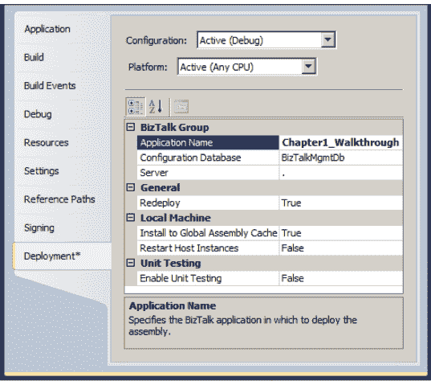

17. 几乎完成了；我们终于进入部署阶段。转到 BizTalk 管理控制台并创建一个名为 Chapter01_Walkthrough 的新应用程序。您必须先创建应用程序；否则 Visual Studio 将在组中的默认应用程序中部署解决方案。

18. 在“解决方案资源管理器”中，右键单击解决方案名称，选择“部署”，并等待确认部署成功的消息。

19. 为了完成部署，我们需要创建应用程序物理端口。这就是 Consume Adapter Service 插件为我们生成的绑定文件发挥作用的地方。打开 BizTalk 管理控制台，展开“应用程序”节点，右键单击 Chapter01_Walkthrough，并选择“导入 | 绑定”。导航到解决方案目录并导入接收端口的绑定文件。然后重复该过程以导入发送端口的绑定。忽略有关应用程序名称不匹配的弹出消息并单击“是”。

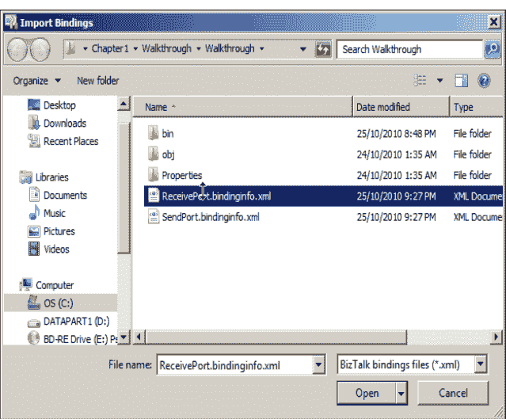

20. 出于安全原因，Consume Adapter Service 插件在生成绑定文件时不包含用户名和密码。对于物理端口，我们必须使用 WCF-Custom 传输属性窗口手动设置它们。让我们从发送端口开始。在 BizTalk 管理控制台中，双击 SendEchoString 端口，然后单击“配置”，切换到“凭据”选项卡，并输入任意用户名和密码。

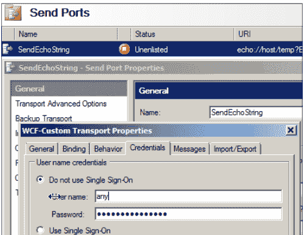

21. 指定接收位置的用户名和密码。在 BizTalk 管理控制台中，双击 EchoWcfCustom_ReceiveNotification 接收位置，然后单击“配置”以打开 WCF-Custom 传输属性窗口。如您所见，对于接收位置，此窗口的外观略有不同。没有“凭据”选项卡；相反，您必须切换到“其他”选项卡并在那里指定用户名和密码。

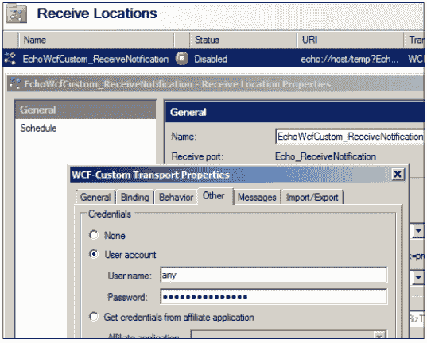

22. 在启动应用程序之前最后一步是绑定编排。在 BizTalk 管理控制台中双击 ProcessEcho 编排以打开“编排属性”窗口。激活“绑定”选项卡并将属性设置为以下图像所示：

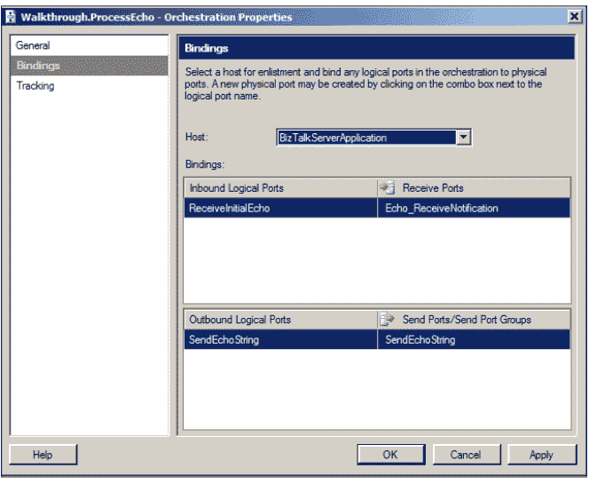

23. 单击“确定”关闭“编排属性”窗口，然后启动应用程序。

如果我们向适配器监控的 c:\temp 文件夹提交文件，我们将收到以下错误消息：

```
The adapter failed to transmit message going to send port
"SendEchoString" with URL " echo://host/temp?EchoPrefix=pre ".
It will be retransmitted after the retry interval specified for
this Send Port. Details:"Microsoft.ServiceModel.Channels.Common.
UnsupportedOperationException: Incorrect Action
<BtsActionMapping xmlns:xsi="http://www.w3.org/2001/XMLSchema-instance" xmlns:xsd="http://www.w3.org/2001/XMLSchema">
  <Operation Name="EchoString" Action="Echo/EchoString" />
</BtsActionMapping>. Correct the specified Action, or refer to the
documentation on the allowed formats for the Actions. Note that
Actions are case-sensitive.
```

问题正是错误消息所告诉我们的——应用于发送端口的 SOAP 操作设置不被适配器理解。在 MSDN 论坛上最常被问到的问题之一是“我使用 Consume Adapter Service 插件生成的 SOAP 操作设置导入了绑定，为什么它们不被适配器理解？”。我们将在完成演练后不久揭开这个问题的神秘面纱，并阐明 WCF 自定义适配器如何处理操作。现在，为了修复问题并完成应用程序，请转到 BizTalk 管理控制台并执行以下操作：

1. 双击 `SendEchoString` 发送端口。在 **发送端口属性** 窗口中单击 **配置** 以打开 **WCF-Custom 传输** 属性窗口。

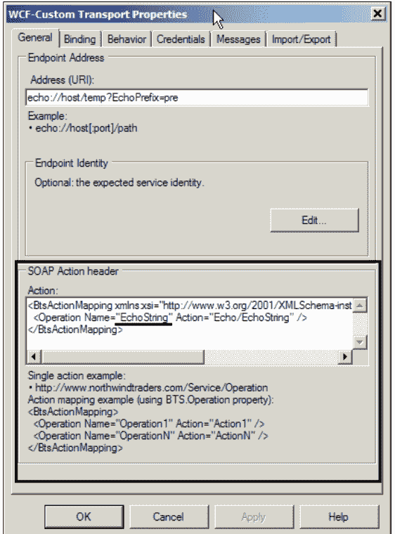

2. 在 **SOAP 操作头** 部分的 **操作** 文本框中，注意 **名称** 属性的值，即 **EchoString**。您需要做的是使编排逻辑发送端口名称与 **名称** 属性的值匹配。第一个选项是将逻辑端口名称从 Operation_1 更改为 EchoString，然后当然重新部署应用程序。

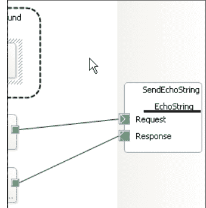

3. 如果您不想重新部署应用程序，一个替代选项是将 **名称** 属性值设置为 **Operation_1**，使 **操作** 框的内容如下所示：

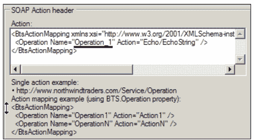

4. 虽然从纯技术角度来看这是一个完全有效的解决方案，但使用这种不具描述性的名称是一种值得怀疑的做法，应避免。我们在此仅出于说明概念的目的而提出它。最佳做法不是将操作名称保留为默认值 Operation_1，而是在设计编排时为其赋予描述性名称，然后调整物理端口操作映射。

因此，让我们正确地操作，只需将逻辑端口操作名称更改为 EchoString。完成后，重新部署应用程序。现在，您可以创建一个包含单个单词“Echo”的文件，将其拖放到 C:\temp 文件夹中，并查看事件日志中 Echo 适配器返回的回显消息。请不要忘记，文件必须具有 TXT 扩展名。

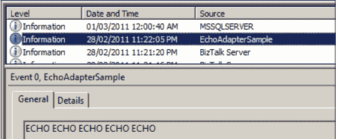

## WCF-Custom 适配器和 SOAP 操作

现在，正如所承诺的，让我们更深入地了解 SOAP 操作以及 WCF-Custom 适配器如何处理它们。SOAP 操作背后的想法非常简单。本质上，SOAP 操作只是附加到传入 WCF 消息的标签，告诉适配器它必须执行什么操作。

为了通过具体示例说明概念，让我们参考随 Echo 适配器提供的源代码。我们感兴趣的重点是 Microsoft.ServiceModel.Channels.Common.IOutboundHandler 接口的 Execute 方法。此接口是所有支持外发操作的 ASDK 基于适配器必须实现的接口之一。Execute 由 ASDK 运行时调用以执行外发操作。以下是实现：

```csharp
/// <summary>
/// Executes the request message on the target system and returns a response message.
/// If there isn't a response, this method should return null
/// </summary>
/// <param name="message">The Message to be executed</param>
/// <param name="timeout">The timeout for the operation</param>
/// <returns>the response message, null if there was no response</returns>
public Message Execute(Message message, TimeSpan timeout)
{
    OperationMetadata om =
        this.MetadataLookup.GetOperationDefinitionFromInputMessageAction(message.Headers.Action);
    if (om == null)
    {
        throw new AdapterException("Invalid operation " + message.Headers.Action);
    }

    switch (message.Headers.Action)
    {
        case "Echo/EchoString":
            return CreateEchoStringResponseMessage(message);

        default: throw new AdapterException("Invalid Operation " + message.Headers.Action);
    }
}
```

代码不言自明，正如您所清楚看到的，是以操作为中心的。如果随 SOAP 头一起传递的操作被识别，适配器将执行请求的操作，如果没有，则适配器会以“无效操作”异常进行响应。由于 Echo 适配器只公开一个操作，使用操作似乎是不必要的，但想象一下适配器公开多个操作的情况？在这种情况下，使用 SOAP 操作是帮助适配器决定执行什么操作的非常合乎逻辑的方式。

将 BizTalk 消息与适当的 SOAP 操作关联（或附加适当的处理标签，如您所愿）有两种不同的方法。一种是使用所谓的“操作映射”配置物理发送端口。另一种是在运行时动态设置操作。


## 操作映射

您在大多数情况下会使用操作映射——这是配置物理端口最简单的方式，因为 Consume Adapter Service Wizard 会完成大部分工作。对于设计时您所选择的操作，Consume Adapter Service Wizard 会在 BtsActionMapping 包装器内部生成相应的 Operation 条目，并将该映射放置到它将生成的物理端口绑定文件中。一般形式下，操作映射如下所示：

```
<BtsActionMapping>
  <Operation Name ="Operation1" Action = "Action1" />
  <Operation Name = "Operation2" Action = "Action2"/>
  ...
  <Operation Name = "OperationN" Action = "ActionN"/>
</BtsActionMapping>
```

为了处理操作映射并将 SOAP 操作标签附加到传入消息，WCF-Custom 适配器使用以下算法：

当传出消息离开编排时，编排实例会使用逻辑端口操作名称设置 BTS.Operation 上下文属性。一旦订阅机制从消息框中提取消息并将其交给物理端口进行处理，WCF-Custom 适配器会尝试查找操作映射中 Name 与 BTS.Operation 属性匹配的 Operation。如果找到匹配项，则适配器会将相应的 Action 值附加到消息并将其发送到自定义绑定以执行。如果未找到匹配项，则 WCF-Custom 适配器会将整个 BtsActionMapping 视为一个大的操作，因此自定义绑定将获得以下操作：
`<BtsActionMapping><Operation Name="Operation 1" Action =......</BtsActionMapping>` 其后果相当可预测 – "Invalid action" 异常。因此，规则很明确：对于每个编排传出操作，对应的物理端口操作映射中必须有一个 Operation 条目，其 Name 属性值与编排操作名称匹配。

需要注意的是，对于基于内容路由的场景，其中您不使用编排而仅依赖消息引擎提供的功能，您无需编写自定义管道组件来设置 BTS.Operation 上下文属性。幸运的是，WCF-Custom 适配器支持一种替代的单操作格式。

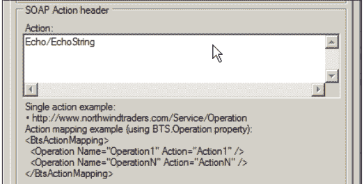

本质上，这意味着所有到达为单操作处理配置的发送端口的消息都将被标记为相同的操作，而不管 BTS.Operation 上下文属性如何。由于 Echo 适配器仅支持一个操作，因此单操作方法是一种完全适用于我们示例应用程序的替代解决方案。

## 动态设置 SOAP 操作

在您希望将对要执行哪个操作的决策推迟到运行时时，可以使用 WCF.Action 上下文属性。您需要做的就是向编排添加一个 Expression 形状并配置该形状以执行类似于下面所示的代码：

```
YourOutboundMessage (WCF.Action) = "DesiredAction"
```

正如您所见，WCF-Custom 适配器提供了足够的灵活性来应对您可能遇到的几乎任何情况。一旦您理解了概念和可用选项，只需准确操作，不超过几分钟即可配置发送端口。

## ASDK 工具和功能

到目前为止，您基本上已拥有开始构建依赖于基于 ASDK 的适配器的应用程序所需的所有必要信息。然而，与任何严肃的技术一样，ASDK 无疑也是如此，其中一些区域和功能如果被滥用可能会成为头痛的来源或降低您的工作效率。而且，与任何严肃的技术一样，也有工具可以帮助您有效解决潜在问题。

在本节中，我们将讨论以下适用于所有基于 ASDK 的适配器的主题：

- 生成架构 - 有用的提示
- 处理超时
- 跟踪和追踪

### 生成架构

完成演练后，您可能会得出结论，生成架构可能是决定您使用适配器的体验是快速顺畅还是需要花费大量时间排查应用程序问题的最重要步骤。如果这是您的判断，您绝对是正确的。在这里，我们想为您提供一些提示和建议，这可能会提高您的工作效率并帮助避免潜在问题：

- 如果您对 **Consume Adapter Service** 插件生成的架构文件名称不满意，请随意将其更改为您喜欢的名称或贵组织采用的命名约定。
- 正如您可能知道的，BizTalk 架构会被编译成 .Net 类。您可以自由更改要生成的 .NET 类的名称和命名空间。只需在解决方案资源管理器中单击架构文件并在 **Properties** 窗口中进行更改。这样，您将使引用 XSD 文件中定义的类型变得更容易、更直观。
- 您可以根据需要区分或提升架构字段。但是，请注意，如果出于任何原因您需要重新生成架构，您的提升将会丢失。

- 在绝大多数情况下，您无需更改 Consume Adapter Service 插件生成的架构的命名空间和根节点名称。正如您所知，这两个元素构成了文档类型，是消息引擎订阅机制的基石。如果您仍然有非常充分的理由更改类型，则该更改必须伴随自定义管道组件。对于入站场景，管道组件必须将适配器生成的文档转换为匹配您的自定义文档类型。否则，消息引擎将抛出臭名昭著的 "subscription not found" 异常。对于出站场景，您的自定义管道组件必须将您的自定义文档转换为适配器期望的类型，即 Consume Adapter Service 插件为您生成的类型。否则消息将被适配器拒绝。
- 如果您计划在同一 BizTalk 组中使用多个应用程序使用 ASDK 适配器，则必须格外谨慎。如果您在不同的 Visual Studio 项目中为同一操作生成架构，您将最终出现同一消息类型在 BizTalk 管理数据库中出现两次的情况。此配置的后果是消息引擎将抛出异常，报告其无法解析消息类型或找到订阅，因为多个架构匹配了消息类型。
- 为避免这种情况，我们建议将 **Consume Adapter Service add-in** 生成的架构放入单独的 Visual Studio BizTalk 项目中，您可以从其他 Visual Studio BizTalk 项目引用该项目。部署时，您需要将包含架构的程序集添加到单独的 BizTalk 应用程序，例如 `YourOrganization.Common`，然后从组中的其他 BizTalk 应用程序引用该应用程序。
- 另一种选择是配置 XMLReceive 或 XMLTransmit 管道，并在 DocumentSpecNames 属性中设置完全限定的架构名称。

- 使用 **Consume Adapter Service Wizard** 时，您可能注意到 **Consume Adapter Service Wizard** 底部的 **Generate Unique Schema Types** 复选框，并想知道这是否是我们刚刚讨论的问题的更简单解决方案。
- 不幸的是，此复选框处理的是从根本上相似但最终不同的问题。考虑以下场景：您想要为例如名为 **LOBOOperationA** 的操作生成架构。**LOBOOperationA** 的架构使用复杂类型 **CT1** 的参数。假设您关闭了 **the Consume Adapter Service Wizard**，并在稍后重新打开它以生成架构 **for LOBOOperationB**，它使用相同的复杂类型 **CT1**。在您生成 **LOBOOperationB** 的架构并编译项目后，您将收到错误消息，报告同一类型 **CT1** 在不同的 XSD 文件中被定义了两次。为解决这种情况，您可以执行以下操作：
  - 在可能的情况下，将您计划使用的所有操作的架构一次性生成到 Consume Adapter Service addin 中。addin 能够识别这种情况并将共享类型的定义放在单个单独的 XSD 文件中，该文件由主 XSD 文件使用 **Import** 指令引用。
  - 如果您的应用程序正在演进，并且您唯一的选择是在多次运行中生成架构，则选中 **Generate Unique Schema Types** 可以通过为复杂类型生成唯一的命名空间来解决问题。

最佳方法是仅运行一次插件并一次性生成所有架构，但正如经常发生的那样，在实际项目中这种解决方案并不总是可行。因此，在许多情况下，您最好的选择是使用 Generate Unique Schema Types 复选框。即使操作不使用共享类型，保持此复选框选中也不会造成任何损害。


## 超时

如果你已按照演练操作，你应该已经注意到在“配置适配器”对话框的“绑定属性”页面上设计时可用的超时相关绑定属性组。

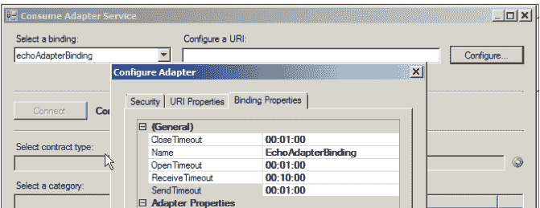

在导入 ASDK 生成的绑定文件后，这些属性可通过 WCF-Custom 传输属性对话框的“绑定”选项卡访问。

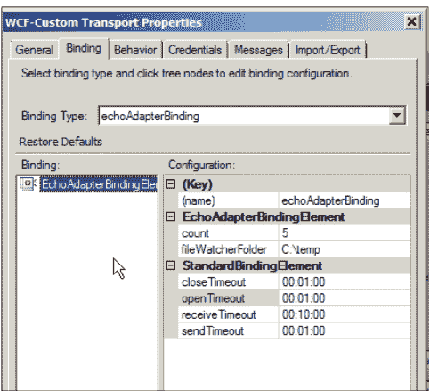

下表列出了每个属性的用途以及 ASDK 设置的默认值：

| 属性 | 用途 |
|---|---|
| openTimeout | 打开连接超时。默认值是 1 分钟。 |
| closeTimeout | 关闭连接超时。默认值是 1 分钟。 |
| sendTimeout | 外发请求-响应超时。该属性指定适配器在抛出异常之前等待目标 LOB 响应的时长。默认值是 1 分钟。 |
| receiveTimeout | 接收操作超时。基本上，该属性指定适配器等待来自目标 LOB 的入站消息的时长。默认值为 10 分钟。 |

在处理外发场景中的超时异常时，可能会很诱人通过简单地增加 sendTimeout 值来解决问题。然而，你的第一道防线应该是与 LOB 应用程序管理员沟通，以确定是否可以通过优化 LOB 应用程序端的性能来解决问题。盲目增加 sendTimeout 值来掩盖问题绝对不是最佳解决方案。

对于入站操作，你必须将 receiveTimeout 属性设置为足够大的值，以不干扰你特定的接收位置配置。如果你抓耳挠腮试图弄清楚为什么你的适配器行为完全“无法解释”——例如，使用专用配置属性而不是轮询数据库时以随机且无明显规律的间隔轮询数据库，首先要检查的就是 receiveTimeout 设置。在许多情况下，调整此属性会神奇地解决甚至看似无关的问题。我们将在后续章节中再次讨论此主题。默认值是 10 分钟；最大支持值是 24.20:31:23.6470000（24 天）。

## 跟踪和消息日志记录

当适配器行为不符合预期时，跟踪和消息日志记录是 ASDK 提供的实用功能，可帮助你识别问题的根源。它们在入站场景中尤其有用，在这些场景中，ASDK 适配器及其底层 LOB 可能会充当客户端。在这种场景中，可能的异常，例如我们刚刚讨论的接收超时，将不会传播到你的 BizTalk 应用程序。最好情况下，异常可能会出现在 BizTalk 计算机的事件查看器中，最坏情况下则完全不会出现，让你无从猜测。

使用跟踪和消息日志记录功能，你可以跟踪并记录 BizTalk Server 与 ASDK 适配器之间的通信、ASDK 适配器内部的通信，以及在 SAP 适配器的情况下，ASDK 适配器与其目标 LOB 应用程序之间的通信。简而言之，要激活跟踪，只需将跟踪选项添加到应用程序配置文件中——用于设计时跟踪的 Visual Studio 或用于运行时的 BizTalk 服务器。我们已将文件名和其位置放在下表中：

| 应用程序/环境 | 位置 |
|---|---|
| Visual Studio，32 位环境 | <installation drive>:\Program Files\Microsoft Visual Studio 10.0\Common7\IDE\devenv.exe.config |
| Visual Studio，64 位环境 | <installation drive>:\Program Files (x86)\Microsoft Visual Studio 10.0\Common7\IDE\devenv.exe.config |
| BizTalkServer，32 位环境 | <installation drive>:\Program Files\Microsoft BizTalk Server 2010\BTSNTSvc.exe.config |
| BizTalkServer，64 位环境 | <installation drive>:\Program Files (x86)\Microsoft BizTalk Server 2010\BTSNTSvc.exe.config for 32-bit host instances <installation drive>:\Program Files (x86)\Microsoft BizTalk Server 2010\BTSNTSvc64.exe.config for 64-bit host instances |

产品文档提供了可直接使用的配置节，可复制粘贴到适当的配置文件中。目前可在 http://msdn.microsoft.com/en-us/library/cc185440(BTS.10).aspx 获取。如果位置发生变化，你可以使用你喜欢的搜索引擎搜索 “WCF LOB SDK Diagnostic tracing”。

## 摘要

在本章中，我们为讨论 BizTalk Adapter Pack 2010 中适配器的特性和功能奠定了良好的基础。我们已涵盖：

- 架构基础以及引入新的基于 WCF 的技术 WCF LOB Adapter SDK（ASDK）的原因
- 使 BizTalk 应用程序能够使用基于 ASDK 的适配器的主要步骤
- 一些最佳实践，使你的工作更高效且无麻烦

在下一章中，我们将向你介绍 WCF SQL Adapter，可能是 BizTalk Adapter Pack 2010 中使用最广泛的适配器。
