## 2 WCF LOB SQL 适配器

### WCF LOB SQL 适配器

WCF LOB SQL Adapter 是 BizTalk Adapter Pack 2010 中提供对 SQL Server 数据库连接的适配器。BizTalk Server 解决方案与 SQL Server 数据库交互非常常见，使其成为 BizTalk 最受欢迎的适配器之一。与包中的所有适配器一样，它基于 Microsoft Windows Communication Foundation Line-of-Business Adapter SDK（ASDK）。如第 1 章所述，它不仅可以从 BizTalk Server 解决方案中使用，还可以从任何基于 .NET 的应用程序中使用。

WCF LOB SQL Adapter（本章中我们将其称为 ASDK SQL 适配器或简称适配器）应作为旧 SQL Adapter 的替代品使用。ASDK SQL 适配器提供多种新功能、改进的性能，并支持自 SQL Server 2000 以来的所有版本的 SQL Server。旧的 SQL Adapter 依赖于 SQL Server 的 SQLXML 功能，而新适配器遵循 .NET Framework 并通过 ADO.NET 与 SQL Server 通信。

> 有关这两个适配器的更深入讨论，请参阅此博客文章：http://connectedthoughts.wordpress.com/2011/01/18/wcf-sql-versus-the-old-sql-adapter/

在本章前半部分，我们将涵盖以下主题：

- 支持的操作
- 在 Visual Studio 中设计时使用适配器
- 使用 BizTalk 管理控制台配置物理端口
- 通过 WCF-Custom 与 WCF-SQL 专用适配器使用

在第二部分，我们将构建一系列 BizTalk 应用程序，以说明你在项目中可能遇到的最常见集成场景。

为了充分利用本章，你必须熟悉 ASDK 提供的 Consume Adapter Service 向导以及使 BizTalk 应用程序能够使用基于 ASDK 的适配器所涉及的主要步骤。如果你需要复习记忆，或尚未安装 BizTalk Adapter Pack 2010，请参阅第 1 章，我们在其中详细介绍了这些主题。

## 支持的操作

ASDK SQL 适配器提供了一套广泛的灵活且可配置的操作，涵盖开发人员可能遇到的几乎所有需求。根据特定操作在 BizTalk Server 消息子系统中的位置，操作分为两组——入站和出站。

## 入站操作

在入站场景中，ASDK SQL 适配器作为接收端口基础设施的一部分从 SQL Server 查询数据。然后将数据提交到 MessageBox 以进行进一步处理。

下表列出了适配器支持的以下入站操作及其描述：

| 操作 | 描述 |
|---|---|
| TypedPolling | TypedPolling 是最常见的入站操作。由轮询语句生成的结果集的模式是强类型的，这对于使用 BizTalk 映射器进行消息转换非常方便。我们将在“示例”部分详细讨论此操作。 |
| Polling | 与 TypedPolling 操作类似。区别在于由轮询语句生成的结果集的模式是弱类型的。通常它用于经典的 .NET 场景，而很少被 BizTalk Server 应用程序使用。 |
| Notification | 通知选项允许适配器接收有关数据库更改的通知。我们将在“示例”部分讨论此操作。 |
| XmlPolling | ASDK SQL 适配器提供 XmlPolling 以支持返回 XML 的现有存储过程，并与旧 SQL Adapter 兼容。对于此操作，Consume Adapter Service 向导不提供支持。XmlPolling 的模式要么在运行时使用 FOR XML 子句的 XMLSCHEMA 参数生成，要么手动在 Visual Studio 中生成。 |


## 出站操作

在出站场景中，ASDK SQL 适配器作为发送端口基础设施的一部分，对数据库实体执行操作并将响应传回调用方。

下表显示了适配器支持的出站操作：

| 操作 | 描述 |
|---|---|
| 强类型存储过程 | 使 BizTalk 应用程序能够调用强类型存储过程。适配器生成的响应消息为强类型。 |
| 存储过程 | 与调用强类型存储过程类似。不同之处在于适配器生成的結果集的架构为弱类型。 |
| 标量函数 | 使 BizTalk 解决方案能够调用标量函数并接收标量值结果。 |
| 表值函数 | 使 BizTalk 解决方案能够调用表值函数并接收强类型结果。 |
| 表 | 使 BizTalk 解决方案能够对 SQL Server 表执行 Select、Insert、Update 和 Delete 操作，并还能够通过 VarText 和 VarBinary 操作类型设置 varchar(max)、nvarchar(max) 或 varbinary(max) 数据类型的表列。 |
| 视图 | 使 BizTalk 解决方案能够对 SQL Server 视图执行 Select、Insert、Update 和 Delete 操作，并还能够通过 VarText 和 VarBinary 操作类型设置 varchar(max)、nvarchar(max) 或 varbinary(max) 数据类型的视图列。 |
| 执行非查询 | 启用执行任何非 SELECT 语句，包括 DDL 语句。对于 INSERT、UPDATE 和 DELETE 语句，响应消息包含受影响的行数。对于其他语句，它始终为 -1。 |
| 执行读取器 | 启用对表和视图执行任何 SELECT 语句。您可以执行用分号分隔的多个语句。响应消息包含 DataSets 数组。 |
| 执行标量 | 启用执行任何 SELECT 语句。仅返回结果集中第一行的第一列。 |
| 复合操作 | 复合操作是适配器支持的一种特殊操作类型。它使 BizTalk 解决方案能够以任意顺序将多个 Insert、Update、Delete、Procedure 和强类型存储过程操作组合成在单个事务中执行的单个操作。 |

我们将在本章的练习部分展示最常用的出站操作。

## 在 Visual Studio 中使用 ASDK SQL 适配器

正如您在第 1 章中记得的那样，为项目中打算使用的操作生成架构和绑定文件是使 BizTalk 应用程序能够使用基于 ASDK 的适配器的重要步骤之一。此任务的首选工具是 Consume Adapter Service 向导，这是 ASDK 提供的设计时工具。要调用该向导，我们必须右键单击 Visual Studio 项目，选择 Add...，然后选择 Add Generated Items...。在 Add Generated Items 窗口中，我们需要选择 Consume Adapter Service 并单击 Add。一旦 Consume Adapter Service 窗口显示出来，第一步就是指定适当的绑定。ASDK SQL 适配器由 sqlBinding 表示——在 Consume Adapter Service 向导中执行其他操作之前，您必须在 Select a binding 下拉列表中选择它。

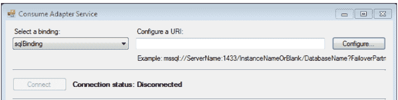

然后，在选择绑定后，我们单击 Configure 按钮打开 Configure Adapter 窗口以指定数据库连接性和绑定属性。

## 提供凭据

Configure Adapter 窗口的 Security 选项卡允许我们指定访问 SQL Server 的凭据。ASDK SQL 适配器仅支持两种模式 – Windows 身份验证和 SQL Server 身份验证，但 Client credential type 下拉列表提供四种：

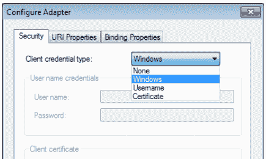

这些选项是通用的，旨在满足不同基于 ASDK 的适配器的要求，因此让我们针对 ASDK SQL 适配器回顾这些选项：

- **None** – 此选项与 Windows 相同。
- **Windows** – 适配器将使用 Windows 身份验证连接到 SQL Server。
- **Username** – 适配器将使用 User name 和 Password 字段中提供的凭据连接到 SQL Server。
- **Certificate** – 即使选择了 Certificate 选项，适配器也会忽略它并使用 Windows 身份验证。映射到证书的用户不受支持，因此此选项不适用于 ASDK SQL 适配器。

请记住，只有用户有权访问的 SQL Server 对象才会显示在 Consume Adapter Service 向导上。因此，请确保在选择 Windows 身份验证模式时，Visual Studio 运行的帐户对项目所需的数据库对象具有适当的访问权限。对于 SQL Server 身份验证指定的用户名也适用相同的情况。

## 连接到 SQL Server URI 属性

URI Properties 选项卡是我们指定构建 SQL Server 连接字符串所需属性值的位置。

例如，要连接到名为 BT2010DEV-PC 的 SQL Server 默认实例上的名为 AdventureWorksCh2 的数据库，运行在默认端口 1433 上且没有故障转移服务器，我们可以指定以下内容：

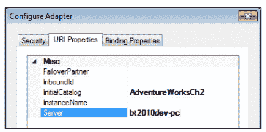

这将映射到以下连接 URI：

```
mssql://BT2010DEV-PC//AdventureWorksCh2?
```

> 如果这样更方便，您也可以在主 Consume Adapter Service 向导窗口的 URI 文本框中输入连接字符串，而不是使用 URI Properties 选项卡。

一般形式下，SQL Server 的 URI 连接字符串如下所示：

```
mssql://[Server_Name[:Portno]]/[SQL_SERVER_Instance_Name]/[Database_Name]?FailoverPartner=[Partner_Server_Name]&InboundId=[Inbound_ID]
```

其中：

- 服务器名称 (Server_Name)、端口 ([:Portno]) 和实例名称 ([SQL_SERVER_Instance_Name]) 确定要连接的 SQL Server 实例，而数据库名称 ([Database_Name]) 指定数据库。如果您连接到 SQL Server 的默认实例，可以将 SQL_SERVER_Instance_Name 部分留空。
- 如果 SQL Server 实例还具有在主服务器无响应时由适配器使用的故障转移伙伴，则使用伙伴服务器名称 ([Partner_Server_Name])。
- 需要注意的连接 URI 的最后一部分是 InboundID ([Inbound_ID])。使用 TypedPolling 操作生成唯一架构并唯一标识相应的接收位置时必须设置它。如果我们使用 InboundID 生成架构，那么在相应的接收位置配置中提供相同的 InboundID 也是至关重要的。如果我们不这样做，将会收到运行时错误，指示 BizTalk 无法按消息类型找到文档规范。
- 在内部，LOB SQL 适配器使用 URI 和绑定属性的组合来构建最终的 ADO.NET 连接字符串，如以下博客文章中所述：

```
http://connectedthoughts.wordpress.com/2011/01/18/how-the-wcf-sql-adapter-builds-the-ado-net-connection-string/
```

## 绑定属性

Binding Properties 选项卡是我们配置适配器运行时行为的位置：

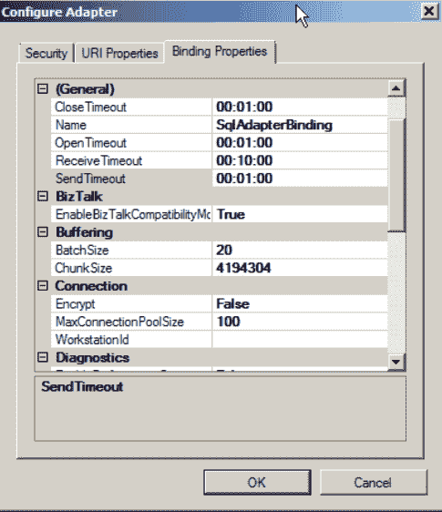

此选项卡上显示的属性反映在 Consume Adapter Service 向导生成的绑定文件中。对于出站操作，我们通常可以接受默认值，因为默认值对于大多数情况来说是足够的。在默认值不令人满意的情况下，我们始终可以使用 BizTalk Admin Console 对物理端口进行调整。

对于入站操作，情况稍微复杂一些。由于入站操作的性质，Consume Adapter Service 向导不提供默认值，我们必须显式提供配置设置。我们可以在设计时完成，然后导入绑定文件以创建配置的接收位置，或者稍后使用 BizTalk Admin Console 提供设置。唯一的例外是用于配置 TypedPolling 入站操作的 PollingStatement 属性。此属性直接影响 Consume Adapter Service 向导为操作生成的架构，因此必须在开发时设置。当我们部署应用程序时，我们必须确保接收位置上设置的 PollingStatement 属性与我们在开发时使用的一致。如果这听起来令人困惑，请继续阅读。我们在示例部分提供了对 TypedPolling 操作和适用配置属性的详细说明。

## 生成架构

完成连接性和绑定设置后，我们单击 OK 关闭 Configure Adapter 窗口并返回到主 Consume Adapter Service 窗口。此时，Configure a URI 文本控件包含基于我们在 Configure Adapter 窗口的 URI 选项卡上指定的属性构建的连接 uri 字符串。

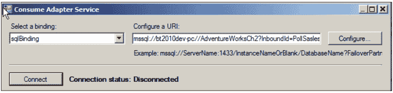

现在我们单击 Connect 按钮；如果连接成功建立，Consume Adapter Service 向导将授予我们访问适配器公开的操作的权限：

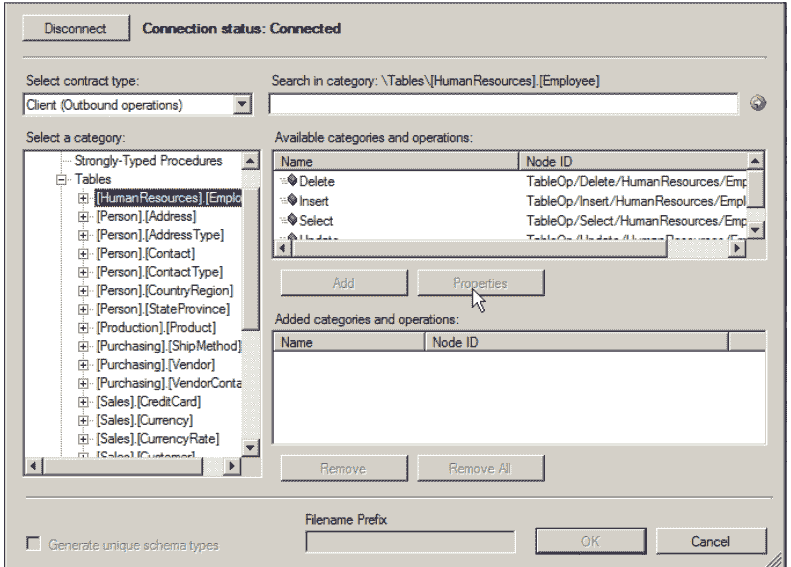

首先，我们需要在“Select contract type”控件中选择合约类型。然后，在“Available categories and operations”面板中，我们可以选择所需的操作并单击“Add”，将操作添加到“Added categories and operations”列表中。收集完所有所需操作后，我们可以单击“OK”关闭向导。此操作将返回到 Visual Studio，您将在其中看到一个或多个 xsd 架构和一个绑定文件已添加到项目中。如果需要为另一种合约类型生成架构，则必须再次进入 Consume Adapter Service Wizard 并重复该过程。

## BizTalk 管理控制台中的 ASDK SQL 适配器

部署应用程序后，并使用 BizTalk Admin Console 导入由 Consume Adapter Service Wizard 为我们生成的绑定文件后，我们可能需要为特定环境调整适配器配置。

### 入站操作

要访问入站场景的适配器属性，我们必须导航到适当的接收位置并双击它以打开 **Receive Location Properties** 窗口。然后单击 **OK** 打开 **WCF-Custom Transport Properties** 多标签对话框。

**General** 选项卡为我们提供了 Address（URI）文本控件以设置或修改连接字符串：

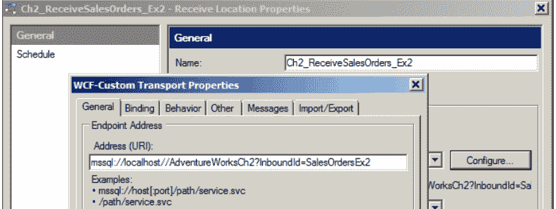

**Bindings** 选项卡顾名思义，是可以访问绑定属性的地方：

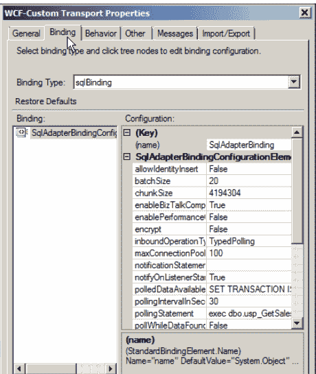

名为 Other 的选项卡用于指定访问目标数据库的凭据：

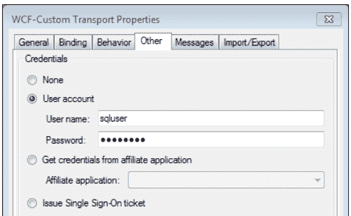

我们可以采用以下选项来指定凭据：

- **None** – 适配器将使用 Windows 身份验证，并使用 Receive Handler 主机实例运行的帐户的身份
- **User account** – 此选项允许指定用户名和密码以使用 SQL Server 身份验证模式连接到目标数据库
- **Get credentials from affiliate application** – 允许指定 Single Sign-On 关联应用程序以获取凭据

在大多数情况下，您无需处理 **Behavior**、**Messages** 和 **Import/Export** 选项卡提供的配置选项。如果仍有必要，请参阅 WCF-Custom 适配器文档。

### 出站操作

出站场景的配置过程与入站基本相同。您必须找到适当的发送端口，双击它以打开 **Send Port Properties** 窗口，然后单击 **Configure** 按钮以打开 **WCF-Custom Transport Properties** 窗口。**General** 选项卡为您提供对 URI 连接字符串以及 SOAP 操作的访问。

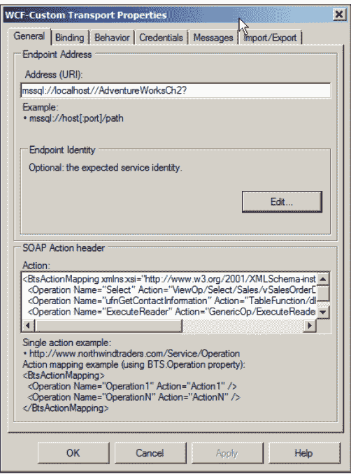

**Credentials** 选项卡如您所猜测，允许您提供访问数据库的凭据：

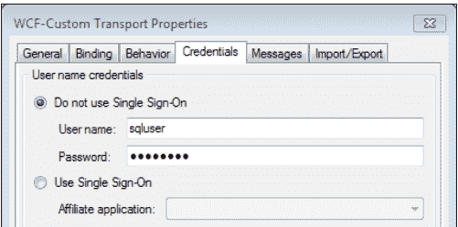

可用选项如下：

- **Do Not Use Single Sign On** – 如果 User name 和 Password 字段为空，适配器将使用 Windows 身份验证和 Send Handler 帐户身份连接到数据库。否则适配器将使用 User name 和 Password 控件中指定的凭据使用 SQL Server 身份验证。
- **Use Single Sign On** 允许选择 Single Sign On 关联应用程序来提供凭据。

与接收位置一样，**General, Bindings, and Credentials** 选项卡上显示的属性涵盖了大多数配置场景。对于复杂情况，请参阅 WCF-Custom 适配器文档。

## WCF-SQL 与 WCF-Custom 适配器

除了 WCF-Custom，代表 ASDK SQL 适配器的 sqlBinding 还可以通过随 BizTalk Server 2010 Adapter Pack 安装的专用 WCF-SQL BizTalk 适配器访问。这些适配器之间的区别在于 WCF-SQL 适配器提供了一个针对 sqlBinding 量身定制的更直观的 UI。例如，通过单击专用 WCF-SQL 适配器 General 选项卡上的 Configure，我们可以填充一个表来构建连接字符串，而使用通用的 WCF-Custom 则必须直接输入整个字符串，正如您在上一节中看到的那样。

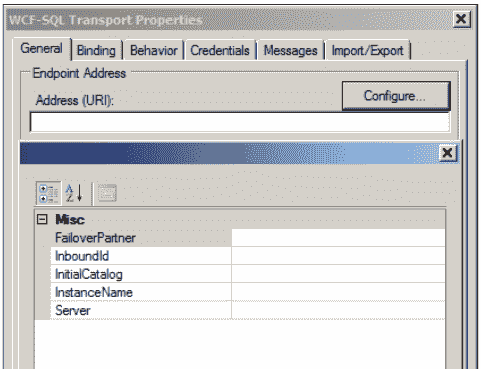

要在 BizTalk Admin Console 中创建 WCF-SQL 适配器，我们需要执行以下步骤：

- 1. 右键单击 Adapters，然后选择 New - Adapter.

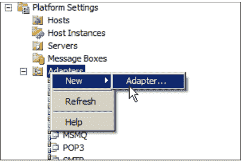
- 2. 单击 **Adapter** 下拉列表并选择 **WCF-SQL**。在 **Name** 文本框中输入 **WCF-SQL** 并单击 **OK** 按钮：

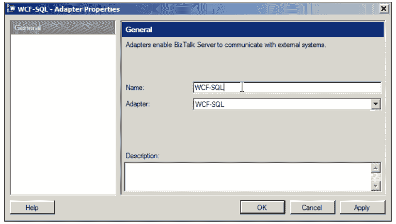

重要的是要理解，无论您使用 WCF-Custom Adapter 还是 WCF-SQL 适配器，都不会丢失功能。使用 WCF-SQL 适配器简化了维护 BizTalk 环境所涉及的管理任务。由于 WCF-Custom 适配器可以利用多种不同的绑定，包括 Oracle、SQL、SAP 以及允许我们连接到云的绑定，因此显式创建专用适配器以避免混淆可能是有益的。权衡之处在于，开发时为您生成的绑定文件将无济于事，因为它们使用的是 WCF-Custom 适配器。归根结底，没有对错之分；您可以根据个人风格和偏好选择其中之一。本章我们依赖 WCF-Custom；在 SAP 章节中，我们将使用专用的 WCF-SAP 适配器，以便您能够比较方法。为了结束本次讨论，我们想为您提供一个 URL，如果您选择使用 WCF-SQL 适配器并且因此需要手动配置 SOAP 操作，您可能会觉得有用。按照位于 http://msdn.microsoft.com/en-US/library/dd788515(v=BTS.10).aspx 页面上提供的链接，您将找到 ASDK SQL 适配器支持的操作的 SOAP 操作。

## ASDK SQL 适配器示例

在本节中，我们将介绍 ASDK SQL 适配器提供的一些常用操作。我们准备了一些易于遵循的示例，重点关注适配器操作的细节，而不是构建整个 BizTalk 应用程序本身或所使用的 SQL Server 对象的细节。

对于这些示例，我们有一个场景，其中销售订单详细信息保存在 SQL Server 数据库中的几个不同表中。生成数据库工件的脚本随本章附带的示例代码一起提供。

示例中使用的三个主要表是 SalesOrderHeader、SalesOrderStatus 和 SalesOrderDetails。

SalesOrderHeader 表包含有关订单的基本信息，包括到期时间、发货时间、帐号、CustomerID、SalesPersonID 等：

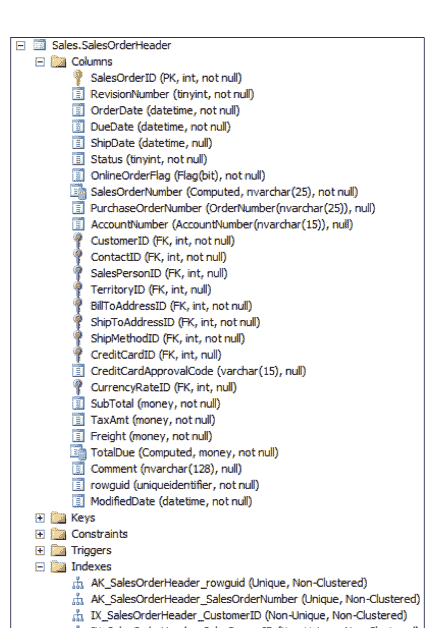

**SalesOrderStatus** 表从系统集成角度跟踪订单的状态。由于我们不希望 BizTalk 多次处理订单，因此需要管理已消耗的记录。此表允许我们通过在 **ProcessingIndicator** 字段中指定 GUID 来标记记录正在被处理。当其设置为 NULL 时，表示行需要由 BizTalk Server 处理。

**OrderStatus** 列用于标识销售订单处理的各个阶段，而 SalesOrderID 是与实际保存销售订单信息的表的链接：

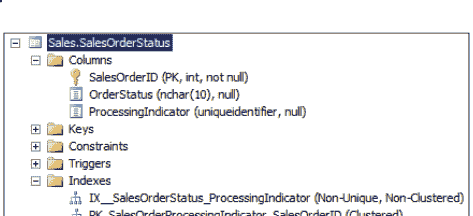

**SalesOrderDetail** 表为我们提供了有关订单的一些补充信息，包括 **UnitPrice**、**Discount**、**CarrierTracking Number** 等：

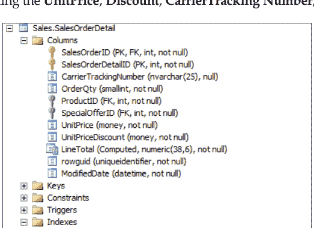


就设计接收方 T-SQL 代码以避免死锁而言，旧 SQL 适配器的最佳实践仍然适用于新的 ASDK SQL 适配器。主要区别在于新适配器不需要在存储过程末尾使用 FOR XML，并且它生成的架构更易于配置以进行拆批。旧 SQL 适配器的最佳实践可以在此处在线找到：http://msdn.microsoft.com/en-us/library/cc507804(BTS.10).aspx

如果适配器调用的 T-SQL 代码无法更改以遵循最佳实践，并且有多个 BizTalk Server 主机实例映射到运行轮询接收位置的主机，则可能会发生 SQL Server 死锁或检索到重复数据。在这些情况下，对主机进行集群可以确保解决方案在避免死锁的同时保持高度可用。

有关集群 BizTalk 主机的更多信息，可在此处找到：http://kentweare.blogspot.com/2009/04/clustering-biztalk-hosts.html。

另一个选项是根据您的场景设置适当的事务隔离级别。有关详细信息，请访问此链接 http://msdn.microsoft.com/en-us/library/dd788041(v=bts.10).aspx。

### 示例 1—TypedPolling 和拆批

第一个示例将演示如何使用 ASDK SQL 适配器的 **TypedPolling** 操作来轮询数据库，以查找尚未由 BizTalk Server 处理的销售订单。

**TypedPolling** 操作是当 BizTalk Server 解决方案需要轮询 SQL Server 获取数据时最常用的操作。轮询结果的架构是强类型的，可以轻松用于映射或将其元素提升以进行基于内容的路由。

我们创建了一个存储过程，该过程返回尚未由 BizTalk Server 处理的前 100 行。我们稍后将更详细地描述该存储过程。

由于我们已经有了存储过程，如本示例的数据库脚本中提供的那样，我们下一步是生成表示该过程生成的 resultset 的类型化架构。在 Consume Adapter Service Wizard 中，我们将 **sqlBinding** 设置为绑定并单击 **Configure** 以打开 **Configure Adapter** 窗口以指定 URI 和绑定属性。在 **URI Properties** 选项卡上，我们设置属性以连接到我们的示例 **AdventureWorksCh2** 数据库。注意，如果您的 SQL 服务器是本地的，您可以为 **Server** 属性指定 "localhost"：


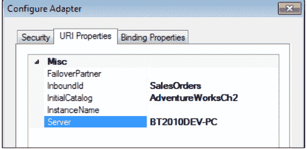

**InboundId** 的值在适配器构建 TypedPolling 入站操作架构的命名空间时使用，也用于其生成的绑定文件中，该文件包含稍后将使用的 BizTalk 端口配置。此值可确保从同一数据库轮询的多个接收位置之间的连接 URI 唯一。非常重要的一点是我们配置接收位置时使用的 **InboundId** 必须与在 Consume Adapter Service 向导中使用的相同。否则，我们可以预期会出现 BizTalk 运行时错误。

**Binding Properties** 选项卡是我们设置支持类型化轮询操作的适配器属性的地方。以下是我们需要设置的一些重要属性：

- 1. **inboundOperationType** 需要为此场景设置。 由于我们有兴趣从 SQL Server 接收强类型结果集，因此需要将此属性的值填充为 **TypedPolling**。
- 2. **PolledDataAvailableStatement** 在运行时用于检查是否有可轮询的数据。 如果它在第一列中返回正值，则会执行 **PollingStatement** 语句。 这种方法的优点是我们可以提供一个轻量级查询来确定是否存在数据，而不是在执行时可能消耗更多资源的更复杂的轮询查询。 在此示例中，我们使用查询配置 **PolledDataAvailableStatement**，该查询检查尚未处理的销售订单：
- 3. 你可能已经注意到我们在语句开头设置了隔离级别，并在 select 查询上提供了 SQL 提示。 这是为了避免多服务器环境中的死锁。

```
SET TRANSACTION ISOLATION LEVEL READ COMMITTED
SELECT COUNT(*) FROM Sales.SalesOrderStatus WITH(UPDLOCK ROWLOCK READPAST )
WHERE OrderStatus = 'Pending' AND ProcessingIndicator IS NULL
```

- 4. PollingStatement 设置是每次 PolledDataAvailableStatement 返回正值时将执行的语句。 开发期间使用的相同 PollingStatement 必须在配置接收位置时使用。 这是必需的，因为该设置在运行时由适配器使用，以创建与 Consume Adapter Service 向导生成的架构匹配的消息。 为本示例的目的，我们将把 PollingStatement 设置为存储过程，该过程返回尚未处理的最初 100 个销售订单并将它们标记为已处理：

```
exec dbo.usp_GetSalesOrdersToProcess
```


> 你也可以用分号分隔多个 T-SQL 语句。 例如，如果你有一个用于获取销售订单的存储过程和另一个用于将它们标记为已处理的存储过程，则 PollingStatement 可以是：
> 
> exec dbo.usp_GetSalesOrdersToProcess; exec dbo.usp_UpdateSalesOrdersToProcess

我们的存储过程使用新的 GUID 值更新 ProcessingIndicator 为 NULL 的最初 100 行的 ProcessingIndicator 列。 然后它返回 SalesOrderHeader 表中与这 100 行相关的数据。 我们选择在选择它们之前更新我们想要处理的记录。 通过这种方法，我们可以确保控制每次轮询事件想要返回给 BizTalk 的记录数量。
以下是存储过程：

```
CREATE PROCEDURE [dbo].[usp_GetSalesOrdersToProcess]
AS
SET nocount on
set xact_abort on
SET TRANSACTION ISOLATION LEVEL READ COMMITTED

declare @procIndicator uniqueidentifier
set @procIndicator = NEWID();

UPDATE Sales.SalesOrderStatus WITH (ROWLOCK)
SET ProcessingIndicator = @procIndicator,
    OrderStatus ='Processing'
FROM (
SELECT TOP 100 SalesOrderID
FROM  Sales.SalesOrderStatus WITH(UPDLOCK ROWLOCK READPAST)
WHERE ProcessingIndicator IS NULL AND OrderStatus ='Pending' ORDER BY SalesOrderID)
AS t1
WHERE (Sales.SalesOrderStatus.SalesOrderID = t1.SalesOrderID)

SELECT TOP 100 soh.[SalesOrderID], [RevisionNumber]
, [OrderDate], [DueDate]
, [ShipDate], [Status]
, [SalesOrderNumber], [PurchaseOrderNumber]
, [AccountNumber], [CustomerID]
, [ContactID], [BillToAddressID]
, [ShipToAddressID], [ShipMethodID]
, [CreditCardApprovalCode], [SubTotal]
, [TaxAmt], [Freight]
, [TotalDue], [Comment]
FROM Sales.SalesOrderHeader soh WITH(UPDLOCK ROWLOCK READPAST)
INNER JOIN Sales.SalesOrderStatus sos ON soh.SalesOrderID = sos.SalesOrderID
WHERE sos.ProcessingIndicator = @procIndicator
```

- 5. **PollingIntervalInSeconds** 指定 BizTalk Server 将运行设置在 **PolledDataAvailableStatement** 属性上的 SQL 语句的频率。 轮询间隔必须仔细设置，以避免在数据不经常更改时进行不必要的轮询，同时也要以足够高的频率轮询，以便及时捕获更改。 我们将其设置为 60 秒。
- 6. 我们示例中要介绍的最后一个属性是 **PollWhileDataFound**。 我们的目标是从 SQL Server 获取 100 个销售订单的批次。 将轮询语句返回的行数限制与 **PollWhileDataFound** 属性（设置为 true 时）结合使用是确保适配器创建多个较小消息的好做法。 该技术也很重要，因为 BizTalk Server 可以并行处理多个消息，而不是创建一个大消息。 设置为 true 时，**PollWhileDataFound** 属性指示适配器忽略 **PollingInterval** 属性并连续调用轮询语句。 对于我们当前的示例，我们将此属性设置为 **False**，以便我们能清楚地了解 BizTalk 的轮询行为。 如果我们持续处理所有数据，它将降低我们对 BizTalk 轮询周期的可见性。

以下是为我们的示例配置的 **Binding Properties** 选项卡：

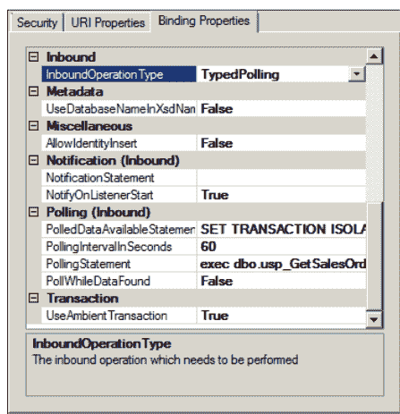


在轮询场景中值得特别关注的属性是 **ReceiveTimeout**。 此属性表示适配器等待入站消息的时间量。 Microsoft 文档建议将此属性设置为最大允许值 24.20:31:23.6470000（24 天）。 设置这样大的值不会影响适配器的性能。 我们确实需要确保此值超过我们的轮询间隔，以确保在达到此超时阈值之前，我们的 BizTalk Server(s) 与 SQL Server 之间具有连接性。

有关 ASDK SQL 适配器属性的更多信息，请访问以下 TechNet 链接：http://technet.microsoft.com/en-us/library/dd787981(BTS.10).aspx

在设置绑定属性后，我们需要连接到我们的 SQL Server，选择 **Service (Inbound operations)**，选择根/类别，并添加 **TypedPolling** 操作：

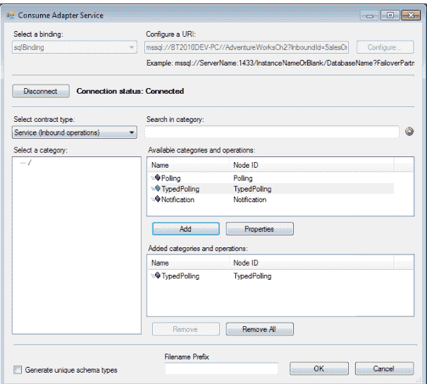

一旦我们按照前一图像所示配置了 Consume Adapter Service 向导，我们现在可以单击 **OK** 按钮。 Consume Adapter Service 向导随后将架构添加到 BizTalk Server 项目（在本示例中，架构名为 `TypedPolling.SalesOrders.xsd`），并创建包含物理接收端口和位置配置详细信息的绑定文件。

我们在 Typed Polling 场景中使用的架构包括存储过程的结果集的数组。 如果我们希望 BizTalk Server 进一步拆分它，架构很容易配置。 我们的存储过程被创建为每次轮询最多返回 100 个销售订单。 我们可以修改适配器创建的架构，以便 XmlDisassembler 管道将这些重复节点中的每一个拆分为单独的消息。 第一步是将 <Schema> 节点的 Envelope 属性设置为 Yes：

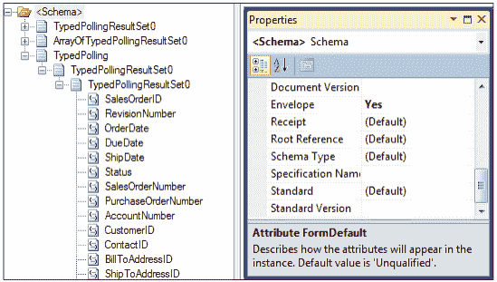

然后，将 TypedPolling 节点的 Body Xpath 值设置为第一个 TypedPollingResultSet0。 这将告诉 XmlDisassembler 此记录下方的任何内容都应拆分为单独的消息：

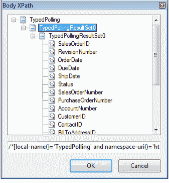

前两个步骤是在开发期间为 TypedPolling 架构配置其消息以便拆分所需设置的所有内容。


部署解决方案后，由 Consume Adapter Service 向导创建的绑定文件可以导入到 BizTalk Administration Console 中，以创建接收端口和接收位置，并包含我们在开发期间创建的所有 URI 和绑定设置。示例代码中包含整个解决方案的示例绑定文件。

此接收位置随后将轮询尚未处理的销售订单，将其作为批处理传递给 BizTalk Server，并对包含销售订单信息的每条消息进行拆分。以下 XML 显示了其中一条拆分后的消息：

```
<TypedPollingResultSet0 xmlns="http://schemas.microsoft.com/Sql/2008/05/TypedPolling/SalesOrders">
<SalesOrderID>43669</SalesOrderID>
<RevisionNumber>10</RevisionNumber>
<OrderDate>2001-07-01T00:00:00Z</OrderDate>
<DueDate>2001-07-13T00:00:00Z</DueDate>
<ShipDate>2001-07-08T00:00:00Z</ShipDate>
<Status>5</Status>
<SalesOrderNumber>S043669</SalesOrderNumber>
<PurchaseOrderNumber>PO14123169936</PurchaseOrderNumber>
<AccountNumber>10-4020-000578</AccountNumber>
<CustomerID>578</CustomerID>
<ContactID>295</ContactID>
<BillToAddressID>895</BillToAddressID>
<ShipToAddressID>895</ShipToAddressID>
<ShipMethodID>5</ShipMethodID>
<CreditCardApprovalCode>25877Vi80261</CreditCardApprovalCode>
<SubTotal>881.4687</SubTotal>
<TaxAmt>70.5175</TaxAmt>
<Freight>22.0367</Freight>
<TotalDue>974.0229</TotalDue>
</TypedPollingResultSet0>
```

本示例演示了如何使用 ASDK SQL Adapter 和 BizTalk Server 的开箱即用功能来轮询并从 SQL Server 中提取数据。

## 示例 2—Select、表值函数和 Execute Reader

本第二个示例在第一个示例的基础上构建，但重点关注出站操作。我们将通过对其他与销售订单相关的表进行后续调用来扩展场景，以检索数据，从而使用所有必需的销售订单详细信息完成消息。

对于本示例，我们将查询与第一个示例中每个拆分消息相关的其他 SQL Server 对象，以演示一些出站适配器操作，然后构建包含所有销售订单详细信息的最终规范消息。

用于丰富销售订单详细信息的数据库对象如下：

- 名称为 Sales.vSalesOrderDetailProduct 的 SQL 视图，返回包含产品信息的订单行明细。ASDK SQL 适配器支持查询 SQL Server 表和视图。使用此方法的一个限制是，我们无法从 ASDK SQL 适配器调用中将视图与其他视图或表进行连接。但是，此问题有解决方案。SQL Server 视图可以修改以满足我们可能有的任何额外数据需求。
- 一个返回联系人详细信息的表值函数 ufnGetContactInformation。从 BizTalk 的角度来看，表值函数的工作方式类似于存储过程。我们能够提供强类型请求并接收强类型响应。
- 一个动态 select 语句，将使用 ExecuteReader 操作执行以检索额外的客户详细信息。ExecuteReader 操作非常灵活，因为它没有强类型的结果集，并且开发人员在设计时不需要访问表。这种方法的挑战在于它要求 BizTalk 开发人员处理来自 SQL Server 的未类型化响应消息。如果我们想解析或转换这些响应消息，可能需要我们编写自定义 XSLT。

要为本示例中使用的出站操作生成架构，在建立成功连接后，我们在 **Select contract type** 下拉列表中设置 **Client(Outbound operations)**。在 **Select a category** 面板中，我们展开了 Views 节点，选择 vSalesOrderDetailView 并将 "Select" 添加到所需操作列表中。然后，我们添加位于 **Table Valued Functions** 节点下的 ufnGetContactInformation 函数。最后，我们添加位于 "/" 根节点下的 **ExecuteReader** 操作。

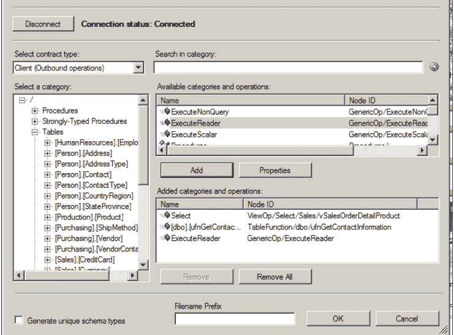

我们现在可以单击 OK 按钮关闭向导并生成架构。

首先让我们讨论我们想要在 vSalesOrderDetailProduct 视图上执行的 SELECT 操作的架构。要构建 SELECT 语句，ASDK SQL 适配器要求我们在 Select 节点下的 Columns 元素中指定以逗号分隔的所需列。同一节点下的 Query 元素是指定用于过滤 SELECT 语句结果集的 "WHERE" 子句的位置。

架构的响应部分是强类型的，并包含来自 vSalesOrderDetailProduct 视图的所有列。请注意，列是用 Min. Occurs. xsd 属性设置为 0 定义的。这意味着适配器返回的响应消息将仅包含 Columns 元素中列出的列：

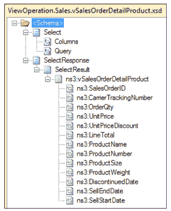

对于表值函数，Consume Adapter Service 向导会生成一个架构，允许我们为函数参数提供值——请注意 ufnGetContactInformation 节点下的 ContactId 元素。架构的响应部分是强类型的，并包含 ufnGetContactInformation 函数返回的表的定义：

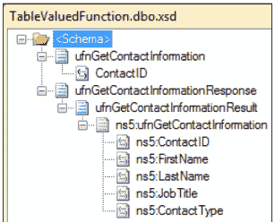

要执行 **ExecuteReader** 操作，我们需要在 **ExecuteReader** 节点下的 **Query** 元素中指定一个 SELECT 语句。适配器为此操作生成的响应是 DataSet 节点的数组。架构中每个 DataSet 节点都有两个 <Any> 元素，第一个将具有 DataSet 的架构，第二个将是数据的 ADO.NET diffgram：

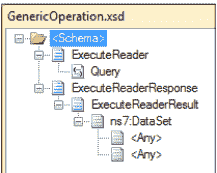

现在我们有了出站操作的架构，我们可以创建一个单一映射，从传入的销售订单头消息中一次性生成所有三个请求消息。要生成多目标映射，我们双击 Transform 形状，为新映射指定 **Transform.SalesOrder_to_LookupRequests** 名称，然后指定请求和三个响应消息：

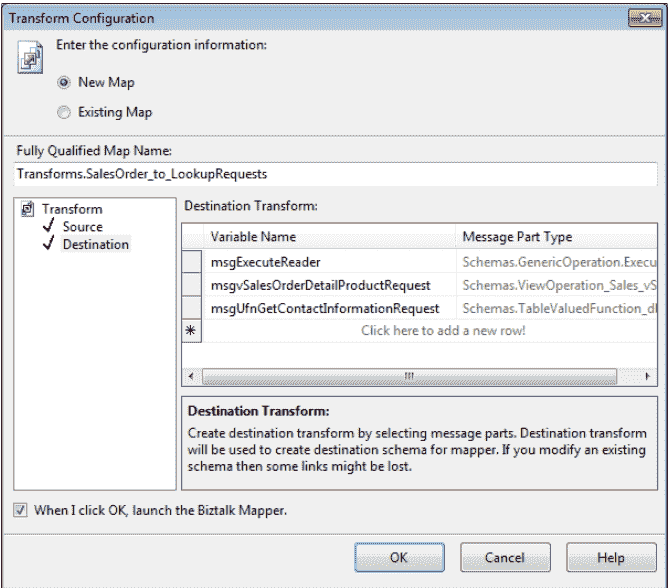

一旦我们单击 **OK**，映射设计器就会显示出来，其中包含我们打包在一个目标架构中的三个架构。

以下图像显示了我们在示例应用程序中使用的完全配置的映射：

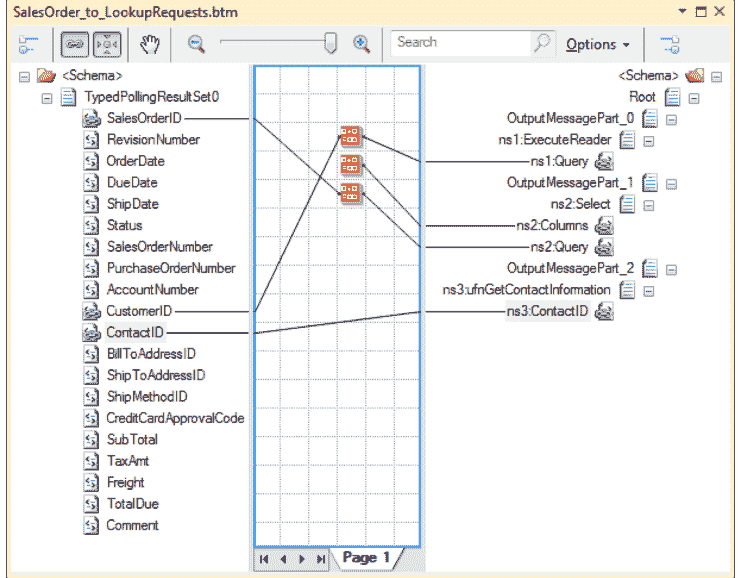

要设置 **ExecuteReader** 请求消息的 **Query** 属性，我们使用字符串连接函数体构建一个由多个表连接组成的 select 语句，以返回客户的地址信息。然后，我们将源消息中的 CustomerID 元素链接起来，以使用 WHERE 子句完成该语句：

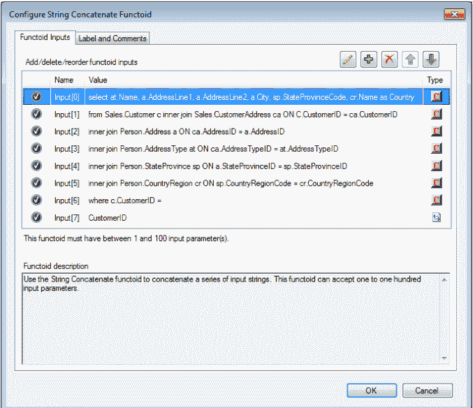

对于我们想要针对 vSalesOrderDetailsProduct 视图运行的 select 语句，我们需要指定所需的列和 WHERE 子句。字符串连接函数体用于将 Columns 元素设置为 *。这将告诉适配器应选择视图中的所有列。另一个字符串连接函数体用于填充 Query 元素。我们使用输入架构中的 SalesOrderID 元素构建 WHERE 子句，其中 SalesOrderID = SalesOrderID。

最后，我们需要为 ufnGetContactInformation 表值函数指定输入参数。此函数只有一个参数：ContactID。因此，我们将源架构中的 ContactID 拖到目标架构的 ContactID 元素。

BizTalk 的一个不错的功能是在编排中重用逻辑端口的能力。这允许我们将逻辑端口绑定到 BizTalk Administration Console 中的单个物理端口，以进行全部三次查找。这减少了我们必须创建和维护的发送端口数量。我们还可以在编排中使用并行形状同时执行全部三个操作。


## WCF LOB SQL 适配器

为了表示完整的销售订单，我们有一个名为 SalesOrder.xsd 的架构。并行形状完成后，对 SQL Server 执行全部三个操作后，我们就可以将它们的响应和原始销售订单头数据映射到最终的 SalesOrder 消息：

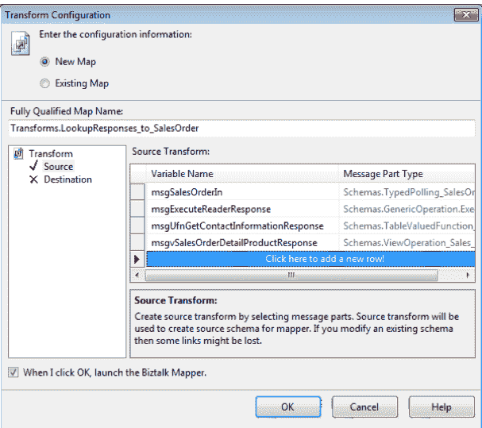

这就是 LookupResponses_to_SalesOrder 映射的外观：

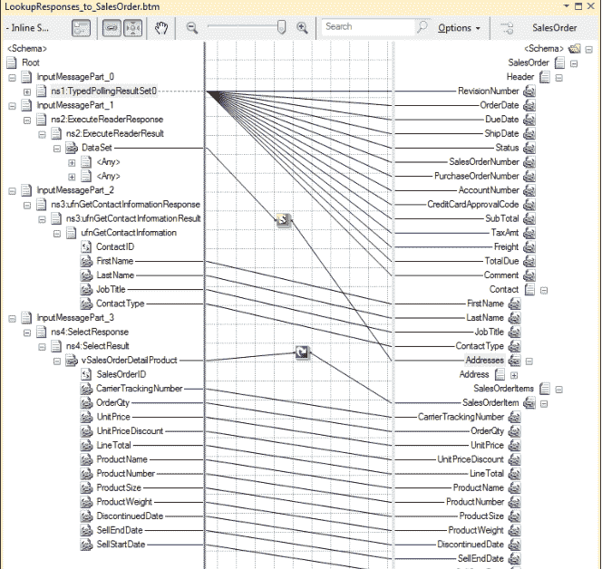

如你所见，前面的映射相当直接，除了 ExecuteReaderResponse 节点外。如我们之前讨论的，Execute Reader 操作存在权衡。权衡在于我们的结果集将是无类型的，这意味着我们需要执行一些自定义工作来将此消息转换为强类型消息。为此我们需要编写一些 XSLT 并使用内联 XSLT 调用模板脚本 functoid 来映射 diffgram 内容：

```
<xsl:template name="AddressTemplate">
    <xsl:param name="param1" />
    <xsl:if test="count(//NewTable) > 0">
        <xsl:element name="Addresses">
            <xsl:for-each select="//NewTable">
                <xsl:element name="Address">
                    <xsl:if test="Name">
                        <xsl:element name="Name">
                            <xsl:value-of select="Name" />
                        </xsl:element>
                    </xsl:if>
                    <xsl:if test="AddressLine1">
                        <xsl:element name="AddressLine1">
                            <xsl:value-of select="AddressLine1"/>
                        </xsl:element>
                    </xsl:if>
                    <xsl:if test="AddressLine2">
                        <xsl:element name="AddressLine2">
                            <xsl:value-of select="AddressLine2"/>
                        </xsl:element>
                    </xsl:if>
                    <xsl:if test="City">
                        <xsl:element name="City">
                            <xsl:value-of select="City"/>
                        </xsl:element>
                    </xsl:if>
                    <xsl:if test="StateProvinceCode">
                        <xsl:element name="StateProvinceCode">
                            <xsl:value-of select="StateProvinceCode"/>
                        </xsl:element>
                    </xsl:if>
                    <xsl:if test="Country">
                        <xsl:element name="Country">
                            <xsl:value-of select="Country"/>
                        </xsl:element>
                    </xsl:if>
                </xsl:element>
            </xsl:for-each>
        </xsl:element>
    </xsl:if>
</xsl:template>
```

这就是该示例开发阶段的内容。最终的编排包含两个映射和全部三个并行执行的出站操作，看起来如下：

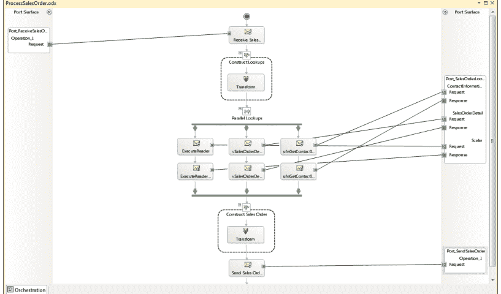

现在解决方案的开发已完成，我们可以部署它并导入绑定文件，该文件位于本章源代码的 BindingFiles 文件夹中。此绑定文件创建一个发送端口，由三个操作共享，其绑定属性与创建架构时设置的属性相同。需要重点查看的是 WCF-Custom 适配器“常规”选项卡上的 SOAP Action 头属性：

```
<BtsActionMapping xmlns:xsi="http://www.w3.org/2001/XMLSchema-instance" xmlns:xsd="http://www.w3.org/2001/XMLSchema">
<Operation Name="Select" Action="ViewOp/Select/Sales/vSalesOrderDetailProduct" />
<Operation Name="ufnGetContactInformation" Action="TableFunction/dbo/ufnGetContactInformation" />
<Operation Name="ExecuteReader" Action="GenericOp/ExecuteReader" />
</BtsActionMapping>
```

这提供了操作与 SOAP 操作之间的映射。请参阅第 1 章，了解 SOAP 操作和操作如何协同工作的详细信息。

当我们启用解决方案后，几秒钟后我们将收到包含销售订单数据的新消息。以下是处理后的销售订单示例：

```
<ns0:SalesOrder xmlns:ns0="http://Schemas.SalesOrder" xmlns:xsi="http://www.w3.org/2001/XMLSchema-instance">
<Header>
<RevisionNumber>28</RevisionNumber>
<OrderDate>2001-07-01T00:00:00Z</OrderDate>
<DueDate>2001-07-13T00:00:00Z</DueDate>
<ShipDate>2001-07-08T00:00:00Z</ShipDate>
<Status>5</Status>
<SalesOrderNumber>SO43660</SalesOrderNumber>
<PurchaseOrderNumber>PO18850127500</PurchaseOrderNumber>
<AccountNumber>10-4020-000117</AccountNumber>
<CreditCardApprovalCode>115213Vi29411</CreditCardApprovalCode>
<SubTotal>1553.1035</SubTotal>
<TaxAmt>124.2483</TaxAmt>
<Freight>38.8276</Freight>
<TotalDue>1716.1794</TotalDue>
<Contact>
<FirstName>Takiko</FirstName>
<LastName>Collins</LastName>
<JobTitle>Purchasing Manager</JobTitle>
<ContactType>Store Contact</ContactType>
<Addresses>
<Address>
<Name>Main Office</Name>
<AddressLine1>6055 Shawnee Industrial Way</AddressLine1>
<City>Suwanee</City>
<StateProvinceCode>GA </StateProvinceCode>
<Country>United States</Country>
</Address>
</Addresses>
</Contact>
</Header>
<Items>
<Item>
<CarrierTrackingNumber>6431-4D57-83</CarrierTrackingNumber>
<OrderQty>1</OrderQty>
<UnitPrice>419.4589</UnitPrice>
<UnitPriceDiscount>0.0000</UnitPriceDiscount>
<LineTotal>419.458900</LineTotal>
<ProductName>Road-650 Red, 44</ProductName>
<ProductNumber>BK-R50R-44</ProductNumber>
<ProductSize>44</ProductSize>
<ProductWeight>18.77</ProductWeight>
<SellEndDate>2003-06-30T00:00:00Z</SellEndDate>
<SellStartDate>2001-07-01T00:00:00Z</SellStartDate>
</Item>
<Item>
<CarrierTrackingNumber>6431-4D57-83</CarrierTrackingNumber>
<OrderQty>1</OrderQty>
<UnitPrice>874.7940</UnitPrice>
<UnitPriceDiscount>0.0000</UnitPriceDiscount>
<LineTotal>874.794000</LineTotal>
<ProductName>Road-450 Red, 52</ProductName>
<ProductNumber>BK-R68R-52</ProductNumber>
<ProductSize>52</ProductSize>
<ProductWeight>17.42</ProductWeight>
<SellEndDate>2002-06-30T00:00:00Z</SellEndDate>
<SellStartDate>2001-07-01T00:00:00Z</SellStartDate>
</Item>
</Items>
</ns0:SalesOrder>
```

## 示例 3—查询通知和多个结果集

在本示例中，我们将介绍 ASDK SQL 适配器的两个高级功能。我们将使用查询通知来取代之前示例中用于检索尚未处理的销售订单的类型化轮询。我们还将使用多个结果集来检索销售订单信息并替换示例 2 中创建的查找操作。

尽管轮询入站操作非常常见，但轮询原则本身需要一些考虑。在没有数据返回时频繁轮询会浪费系统资源。在有数据返回时轮询不频繁意味着解决方案的效率不如预期。仔细考虑轮询间隔和轮询语句可以缓解这些限制，但通知是一种替代且通常更好的选择。

> ASDK SQL 适配器帮助信息中有一节很好地介绍了通知与轮询之间的差异，可在以下文章中找到：
> http://msdn.microsoft.com/en-us/library/dd788096(BTS.10).aspx

ADO.NET 为 ASDK SQL 适配器提供了一种通知选项：查询通知。查询通知构建在 SQL Server Service Broker 队列之上，并在 SQL Server 查询结果发生变化时向 BizTalk Server 引发事件。适配器封装了此功能，使用 ADO.NET SqlDependency 通知对象在查询结果更改时接收通知信息。

我们可以在“配置适配器”窗口和“绑定属性”选项卡中配置通知属性。可用的两个属性是 NotificationStatement 和 NotifyOnListenerStart。这些设置对我们在“使用适配器服务向导”中生成的 SQL 架构没有影响，并在配置接收位置时进行更详细的讨论。

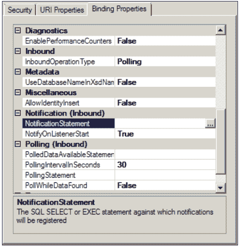

输入 Connection URI 后，我们需要单击“连接”，并确保将“服务（入站操作）”选为合约类型，因为查询通知是入站操作。接下来，我们选择“通知”操作并单击“确定”按钮。

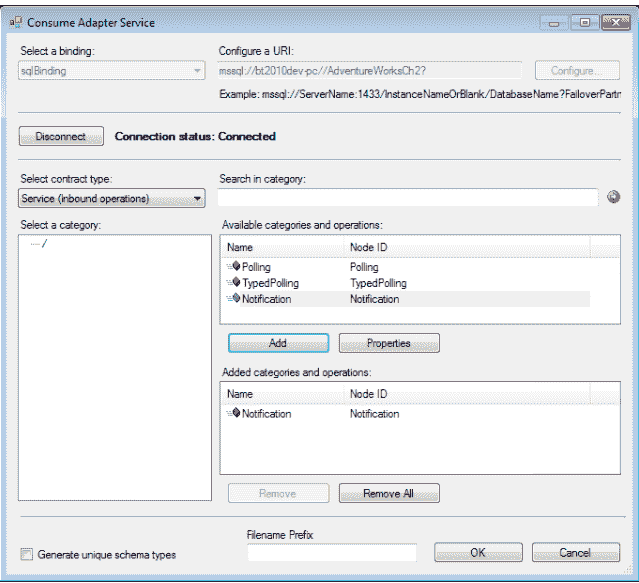

为“通知”操作创建的架构是通用的，其作用只是告知 BizTalk Server 解决方案有数据可供处理：

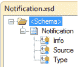

架构的元素与 ADO.NET 关于查询更改接收到的信息相关，包含：

- **Info** – 此单个元素保存 System.Data.SqlClient.SqlNotificationInfo 枚举的值，提供有关适配器接收到的通知的附加信息。
- **Source** – 这将包含 System.Data.SqlClient.SqlNotificationSource 枚举的值，表示适配器接收到的通知的来源。


-   **类型** – 这将包含 System.Data.SqlClient.SqlNotificationType 枚举的值。大多数情况下这将是 change，表示通知查询的数据发生了更改。请参阅 MSDN 以获取这些枚举的详细信息。

当我们在接收位置中的 **NotifyOnListenerStart** 绑定选项设置为 true 时，适配器会生成一条通知消息，其硬编码值为 Info = ListenerStarted、Source = SqlBinding 和 Type = Startup。

我们的编排将过滤掉不需要的通知消息，检索任何待处理的销售订单，然后对销售订单进行拆批。请注意我们如何区分通知模式的全部三个元素。这是因为我们将在此编排中的 **Decide** 形状中使用它们。以下是编排的开始部分，其中包括我们用来仅过滤插入、更新或侦听器启动通知的表达式：

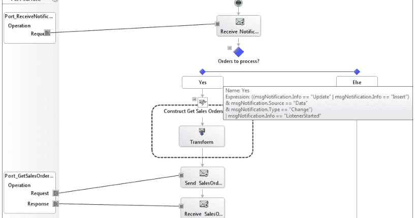

如果通知符合我们的 decide 形状条件，编排将执行名为 usp_GetSalesOrdersToProcess 的存储过程，以检索待处理的销售订单列表。在拆批之前，通过消息分配形状中的 Xpath 语句，编排首先通过计算存储过程返回的销售订单数量来检查是否有实际数据需要处理。这很重要，因为触发的通知并不总是意味着有销售订单需要处理，因为我们将 NotifyOnListenerStart 设置为 True。以下是编排中将订单拆分为单个消息的部分：

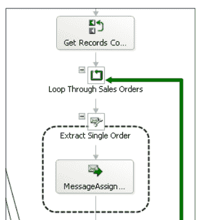

我们将响应消息 msgGetSalesOrdersToProcessResp 提供给编排表达式形状中可用的 xpath 方法。此 xpath 表达式将计算存储过程返回的节点数。以下是用于确定是否有需要处理的销售订单的完整表达式：

```
recCount = System.Convert.ToInt32(xpath(msgGetSalesOrdersToProcessResp, "count(/*[local-name()='usp_GetSalesOrdersToProcessResponse' and namespace-uri()='http://schemas.microsoft.com/Sql/2008/05/TypedProcedures/dbo']/*[local-name()='StoredProcedureResultSet0' and namespace-uri()='http://schemas.microsoft.com/Sql/2008/05/TypedProcedures/dbo']/*[local-name()='StoredProcedureResultSet0' and namespace-uri()='http://schemas.microsoft.com/Sql/2008/05/ProceduresResultSets/dbo/usp_GetSalesOrdersToProcess']')"));
```

> 在 BizTalk 模式编辑器中使用您想要评估的元素的 **Instance XPath** 属性来查找要使用的正确 xpath。该属性在以下页面中进行了描述：
> http://msdn.microsoft.com/en-us/library/ee253960(BTS.10).aspx

现在我们使用查询通知替代了类型化轮询。开发实现更复杂，但对解决方案所做的更改的主要优势如下：

-   一旦设置了处理指示器，我们的未结销售订单将立即处理
-   由于不再轮询，对数据库的调用更少，从而将系统资源利用率保持在最低限度

我们对解决方案进行的下一个改进与在发送最终销售订单消息之前如何丰富销售订单信息有关。ASDK SQL 适配器的一个强大功能是它可以处理多个结果集。我们创建了一个名为 usp_GetSalesOrderDetails 的存储过程，它接收销售订单 ID 并执行三个不同的 select 语句，分别对应 Example2 中的三个查找——函数调用、select 语句和视图调用。以下是存储过程：

```sql
CREATE PROCEDURE [dbo].[usp_GetSalesOrderDetails]
@SalesOrderId [int]
AS
SET NOCOUNT ON
SET XACT_ABORT ON
SET TRANSACTION ISOLATION LEVEL READ COMMITTED

DECLARE @ContactId int

SELECT * FROM Sales.vSalesOrderDetailProduct
WHERE SalesOrderID = @SalesOrderId

SELECT
at.Name, a.AddressLine1
, a.AddressLine2, a.City
, sp.StateProvinceCode, cr.Name as Country
FROM
Sales.SalesOrderHeader soh
inner join Sales.Customer c on soh.CustomerID = c.CustomerID
inner join Sales.CustomerAddress ca ON C.CustomerID = ca.CustomerID
inner join Person.Address a ON ca.AddressID = a.AddressID
inner join Person.AddressType at ON ca.AddressTypeID =
at.AddressTypeID
inner join Person.StateProvince sp ON a.StateProvinceID =
sp.StateProvinceID
INNER JOIN Person.CountryRegion cr ON sp.CountryRegionCode =
cr.CountryRegionCode
WHERE soh.SalesOrderID = @SalesOrderId

SELECT @ContactId = ContactId FROM Sales.SalesOrderHeader
WHERE SalesOrderID = @SalesOrderId
SELECT * FROM dbo.ufnGetContactInformation(@ContactId)
```

ASDK SQL 适配器将处理符合全部三个结果集的模式生成。以下是存储过程模式在 Consume Adapter Service 向导中作为强类型过程出站操作被选中后的外观。请注意，它在 usp_GetSalesOrderDetails 节点下具有 SalesOrderId 作为输入，并返回全部三个强类型结果：

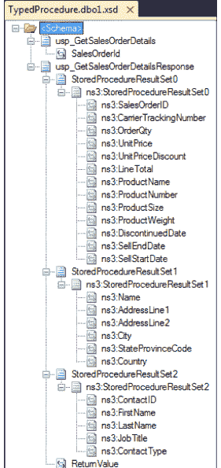

通过创建此存储过程并使用多个结果集功能，我们可以看到以下优势：

-   仅建立一次与数据库的连接即可提取所有销售订单详细信息
-   为全部三个结果仅创建一种模式，使其在映射中使用更方便

一旦我们丰富了销售订单信息，我们将把来自 SQL Server 的 SQL 响应写入磁盘，以便查看包含三个不同结果集的 XML 文档。

过程中的下一步是使用状态 "Processed" 更新我们的 SalesOrderTable 中已处理的订单。为此，我们有一个非常简单的映射：

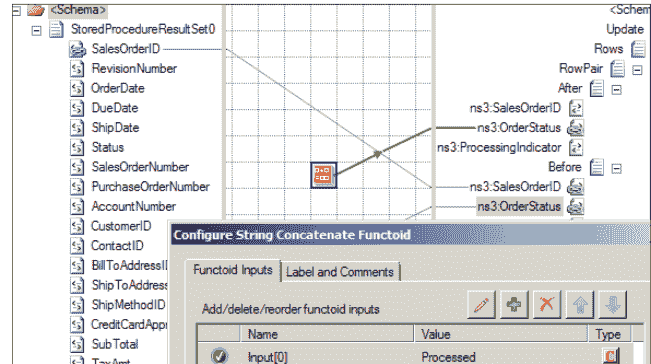

我们编排的最后一步是通过 FILE 适配器将 SalesOrderStatus 表更新的结果写入文件文件夹：

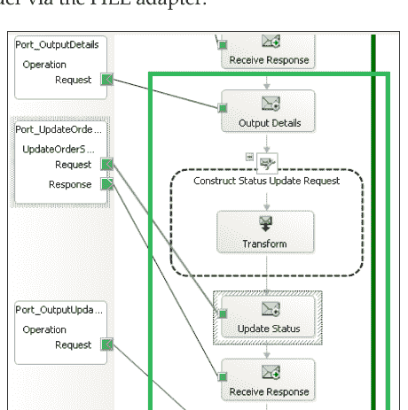

解决方案部署后，我们需要配置 SQL 通知接收位置。sqlBinding 设置用于配置查询通知：

-   1. **InboundOperationType** 必须设置为 **Notification**。
-   2. **NotificationStatement**：在此处设置适配器将监视更改的 SQL 语句。当语句的结果发生变化时，适配器会引发通知。在此示例中，我们将使用与 Example 1 中用于类型化轮询的 **PolledDataAvailableStatement** 非常相似的查询进行配置。对于通知查询，我们使用 select 语句来检查尚未处理的销售订单：
-   3. **NotifyOnListenerStart** 属性在启用接收位置时生成通知。这确保 BizTalk 会在接收位置被禁用期间从 SQL Server 检索任何更新的数据。在我们的解决方案中，我们希望尽快处理任何未结销售订单，因此我们将保持其设置为 **True**。

```
SELECT SalesOrderID FROM Sales.SalesOrderStatus
WHERE ProcessingIndicator IS NULL and OrderStatus ='Pending'
```

按照上述讨论配置后，我们的通知接收位置的绑定属性选项卡如下所示：

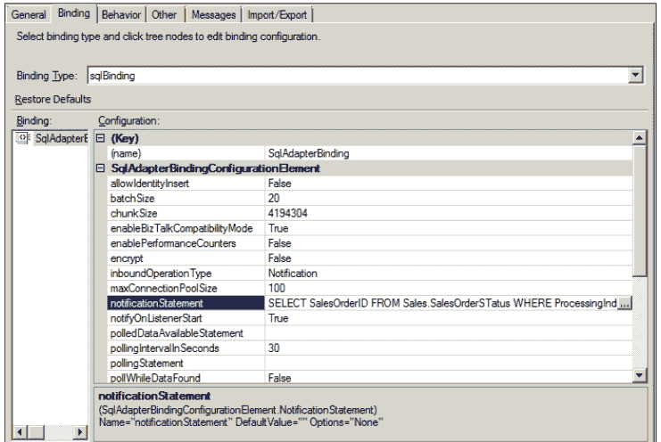

## Example 4 – Composite Operations

本章中我们要讨论的最后一个操作是复合操作。复合操作的目的是能够在单个工作单元或事务的上下文中执行多个数据库操作。即使我们调用多个操作，我们也期望所有操作作为一个整体要么全部成功，要么全部失败。想法是如果我们需要插入/更新多个表，我们希望所有插入/更新都成功，否则我们希望回滚操作以使我们的表保持同步。

我们再次进入 Consume Adapter Service 向导。有两个表对我们特别感兴趣：SpecialOffer 和 SpecialOfferProduct。SpecialOfferProduct 表将特价优惠和产品联系在一起。我们希望对这两个表都执行插入操作。

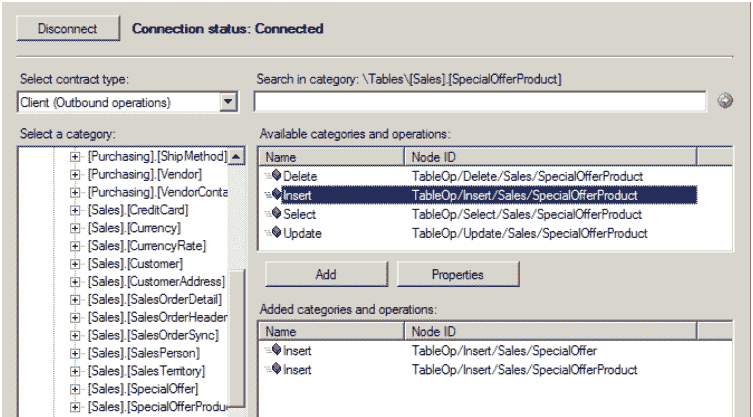

向导完成后，我们将发现两个对我们感兴趣的模式，它们模拟我们的数据库表：SpecialOffer.xsd 和 SpecialOfferProduct.xsd：

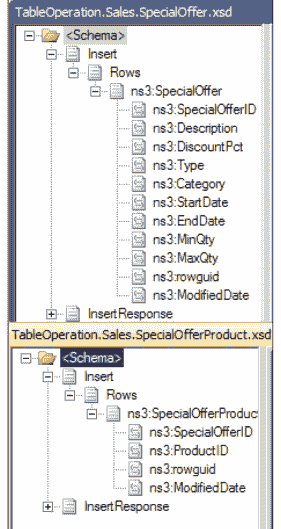

为了构建复合操作，我们需要有一个包含多个根节点的单一架构。在第一个根节点下，我们添加所有操作执行请求架构，在另一个根节点下我们添加所有操作响应架构。根节点的唯一命名约定规则是，操作响应根节点必须与操作根节点相同并后缀为 'Response'。对于此示例，我们创建了一个名为 **CompositeSchema.xsd** 的架构，并创建了两个根节点：**Request** 和 **RequestResponse**。

一旦我们有了根节点，我们就可以使用 BizTalk Server 架构的 Import 属性将两个更新架构导入到复合架构中：

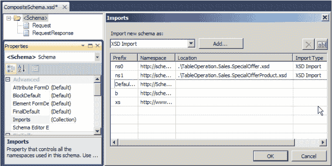

在导入架构后，我们需要确保所有父节点都指定了正确的 Data Structure Type。如以下图像所示，我们在 Request 根节点下有两个 Insert 节点。在这些 Insert 节点中的每一个中，我们为 SpecialOffer 请求和 SpecialOfferProduct 请求提供 Data Structure 类型。同样，我们对 RequestResponse 节点也做同样的操作：

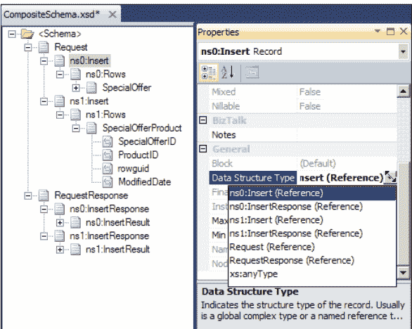

下面是我们的映射，它将演示如何从单个请求中获取数据并将其拆分到复合架构中的多个请求节点中。当此映射通过 BizTalk 运行后，我们将以单个事务的形式将数据插入到 **SpecialOffer** 和 **SpecialOfferProduct** 表中：

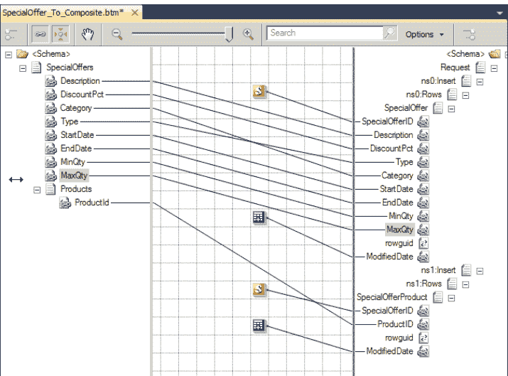

在我们为复合操作创建的 solicit response 发送端口上，我们需要使用一个名为 **CompositeOperation** 的特殊 Action 名称：

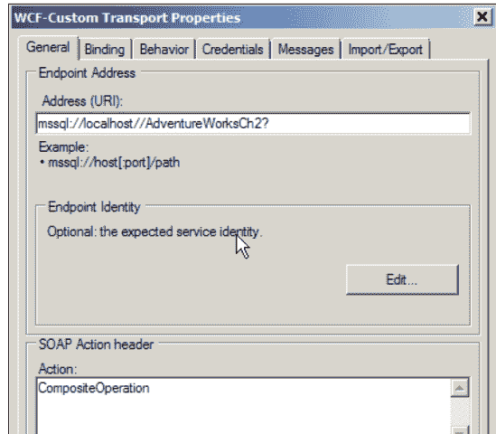

另一个需要注意的适配器属性位于 **Binding** 选项卡上，名为 **useAmbientTransaction**，应设置为 **True**。结合在 SOAP Action 头中提供 CompositeOperation，此属性指示适配器将执行多个操作，并且这些操作必须作为单个事务执行。

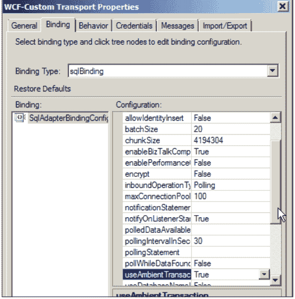

通过对两个表更新使用复合操作，我们具有以下好处：

- 对两个操作使用相同的事务。这意味着如果出现异常，两者都会回滚。这对我们的解决方案很重要，因为我们希望两个更新一起执行，如果其中一个失败，两者都会回滚。
- 使用相同的数据库连接。适配器将为复合操作中的所有更新、插入和删除语句使用来自连接池的相同连接，从而最大限度地降低连接池耗尽连接的风险。

现在有了我们的复合架构和将传入请求转换为复合消息的映射，我们可以构建解决方案的其余部分：

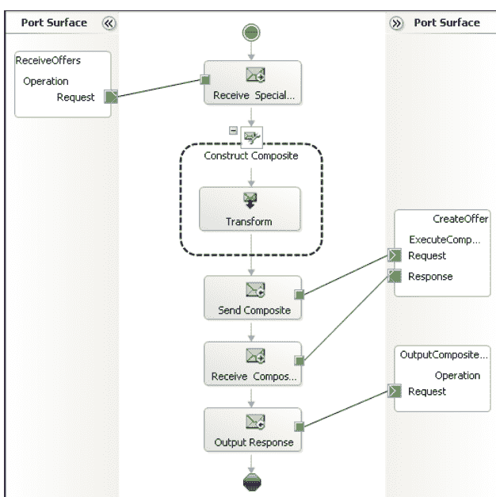

在部署应用程序后，我们可以通过复制 ...\Chapter02\Example4\SpecialOffer.xml 文件并将其粘贴到 Chapter02\Example4\FileDrop 文件夹来初始化此过程。

如果我们检查 SpecialOffer 和 SpecialOfferProduct 表，我们会发现我们在这两个表中都有 SpecialOfferID 为 182 的记录（在您的系统上可能会有所不同，因为 Special_Offer_To_Composite 映射中的第一个脚本化函数化为 SpecialOfferID 生成一个随机数），并且时间戳相似。这些记录作为单个事务写入此数据库。预期复合操作运行没有问题，因此 SQL Server 响应中没有传递回数据。

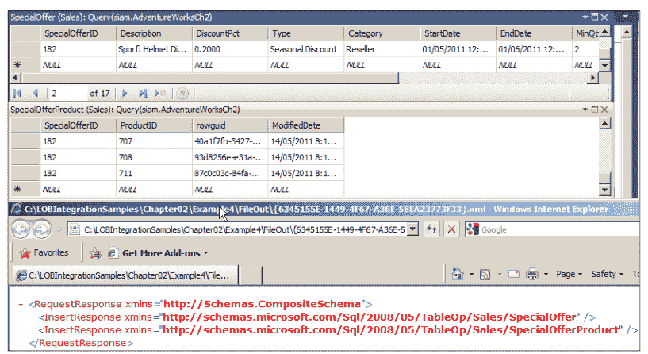

## 摘要

在本章中，我们学习了如何使用 ASDK SQL 适配器将 SQL Server 和 BizTalk Server 2010 集成。

BizTalk Server 解决方案经常集成到 SQL Server，本章中的最佳实践和示例应有助于 BizTalk 开发人员在构建集成解决方案时。

在下一章中，我们将研究 BizTalk Server 和 Microsoft Dynamics CRM 的集成。
