## 3 将 BizTalk Server 与 Microsoft Dynamics CRM 集成

### 将 BizTalk Server 与 Microsoft Dynamics CRM 集成

Microsoft Dynamics CRM 2011 是来自 Microsoft 的最新最强大的关系管理软件。此产品版本引入了对用户界面的广泛改进、新的 WCF 编程模型、基于角色的表单、数据分析仪表板、与 SharePoint 2010 的紧密集成、Windows Azure 集成等等。任何评估小型或大型 CRM 项目的人都应考虑 Dynamics CRM 2011。但我们如何使 Dynamics CRM 成为企业环境中集成的一部分？本章重点关注这个问题。

在本章中，我们将介绍：

- 什么是 Microsoft Dynamics CRM 以及它解决了什么问题？
- 为什么要将 Dynamics CRM 与 BizTalk Server 集成
- BizTalk Server 如何向 Dynamics CRM 发出请求
- Dynamics CRM 如何向 BizTalk Server 发送数据

### 什么是 Microsoft Dynamics CRM？

客户关系管理是几乎每个企业的关键部分。Dynamics CRM 2011 为 CRM 的三个传统领域提供了解决方案：销售、营销和客户服务。

对于有兴趣管理销售团队的客户，Dynamics CRM 2011 具有强大的功能集。这包括将团队组织到区域、定义价格表、管理机会、维护组织结构、跟踪销售渠道、启用移动访问等等。

如果您使用 Dynamics CRM 2011 进行营销工作，那么您有能力从多个来源导入数据、计划活动并设置目标列表、创建大规模通信、跟踪活动响应、与销售团队共享线索并分析营销计划的成功情况。

Dynamics CRM 2011 还可作为客户服务场景的强大中心。功能包括丰富的账户管理、案例路由和管理、内置知识库、呼叫中心资源调度、称为 Dialogs 的脚本化问答工作流、合同管理等。

除了这三个领域之外，Microsoft 将 Dynamics CRM 作为通用应用程序平台 xRM 进行推广，其中“X”代表任何类型的关系管理。Dynamics CRM 具有强大的底层框架，用于屏幕设计、安全角色、数据审计、实体定义、工作流和移动性等。无需将这些基础方面构建到每个应用程序中，我们可以在 Dynamics CRM 中构建我们的数据驱动应用程序。

Microsoft 在 Dynamics CRM 2011 的此版本中做出了进入云的大举措。公司历史上首次，产品在线发布（Dynamics CRM Online）早于本地软件。应用程序的主机版本运行与本地版本相同的代码库，这意味着为本地实例构建的代码在云中也能正常工作。除了在 CRM 主机上的大举措外，Microsoft 还将 Windows Azure 集成融入了 Dynamics CRM 2011。具体来说，我们现在有能力配置对 Azure AppFabric Service Bus 端点的调用。为此，下游服务必须实现特定的 WCF 接口，并且在 CRM 中，Azure AppFabric 插件配置为通过 Azure AppFabric Service Bus 中继服务调用该下游服务。为了使 BizTalk Server 适应这种模式，我们希望构建一个代理服务，该服务实现所需的 Dynamics CRM 2011 接口并将请求转发到 BizTalk Server 端点。本章不会演示此场景，因为重点仅放在与本地实例的集成上。

### 为什么集成 Dynamics CRM 和 BizTalk Server？

将这两种技术结合在一起有许多原因。请记住，BizTalk Server 是一个企业集成总线，连接不同的应用程序。可能存在将数据囤积在特定应用程序中的自然倾向，但如果我们采用实时消息交换，我们实际上可以拥有一个更敏捷的企业。


考虑这样一种场景：客户的完整“联系历史”分布在多个系统中。Dynamics CRM 2011 联系中心可能仅服务于特定受众，而公司内部的其他系统则保存着有关公司客户的额外详细信息。一种设计选择可能是按计划间隔将这些信息批量加载到 Dynamics CRM 2011 中。然而，更有效的方法可能是调用 BizTalk Server 服务，该服务汇总跨系统的數據并返回客户与公司历史的综合视图。

类似地，思考一下系统之间如何共享信息。公司的公共网站可能包含一个注册页面，访客可以在此注册以获取更多信息和更深入的内容访问权限。该注册事件与公司内部的多个系统相关。我们可以将初始注册消息发送到 BizTalk Server，然后将该消息广播给希望了解该客户的多个系统。营销应用程序可能希望通过个性化电子邮件回应，欢迎该人访问网站。销售团队可能会决定跟进该人，如果他们表示对购买产品感兴趣。我们的 Dynamics CRM 2011 客户服务中心可以选择自动添加注册事件，以便在该客户来电时随时准备就绪。在这种情况下，BizTalk Server 充当数据的中央路由器，并调用已公开的 Dynamics CRM 服务来创建客户和交易。

在本章剩余部分，我们将了解如何查找驻留在 Dynamics CRM 中的数据、如何将新数据推送到 Dynamics CRM，以及如何将数据从 Dynamics CRM 推送出来。

## Communicating from BizTalk Server to Dynamics CRM

从 BizTalk Server 向 Dynamics CRM 2011 发送请求的方式在本版本中发生了显著变化。在之前的 Dynamics CRM 版本中，可用于与平台通信的 BizTalk“发送”适配器是可用的。Dynamics CRM 2011 不再随附适配器，建议开发人员使用产品公开的 WCF 端点。

Dynamics CRM 具有 WCF REST 和 SOAP 端点。REST 端点只能在 CRM 应用程序内部使用。例如，您可以构建所谓的 Web 资源，该资源嵌入在 Dynamics CRM 页面中。该资源可以是 Microsoft Silverlight 或 HTML 页面，从三个不同的 Dynamics CRM 实体中查找数据并在页面上汇总它们。此 Web 资源可以与 Dynamics CRM REST API 通信，后者对 JavaScript 客户端友好。不幸的是，您无法从 Dynamics CRM 环境外部使用 REST 端点，但由于 BizTalk 无法与 REST 服务通信，这对 BizTalk 集成影响不大。

与 ASMX Web 服务前身不同，Dynamics CRM SOAP API 是静态的，并使用通用的 `Entity` 数据结构运行。不是拥有一个动态 WSDL 来公开系统中所有标准和自定义实体的类型定义，Dynamics CRM 2011 SOAP API 拥有一组操作（例如 Create、Retrieve），它们使用单一对象类型运行。`Entity` 对象具有一个属性，用于标识其表示的具体对象（例如 Account 或 Contract），以及一个名称/值对集合，表示其表示的对象中的列和值。例如，一个 Entity 的 `LogicalName` 可能设置为 "Account"，并且具有 "telephone1"、"emailaddress" 和 "websiteurl" 的列。

本质上，这意味着从 BizTalk Server 与 Dynamics CRM 2011 交互时，我们有两个选择。我们的第一个选项是直接使用和调用未类型化的 SOAP API。执行此操作涉及从规范模式创建到无类型 `Entity` 模式的映射。在执行 Retrieve 操作的情况下，我们可能还必须将无类型 Entity 消息映射回结构化消息以进行进一步处理。下面，我们将通过一个示例来说明这一点。

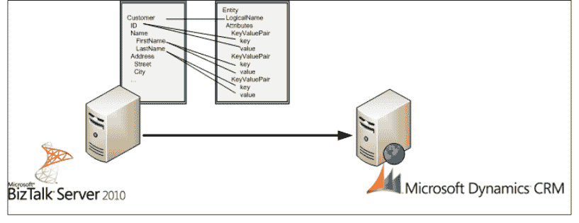

第二个选项涉及为 BizTalk Server 调用创建类型化代理服务。Dynamics CRM 拥有功能丰富的解决方案开发工具包 (SDK)，允许我们创建类型化对象并将其发送到 Dynamics CRM SOAP 端点。该代理服务随后将向 BizTalk 公开类型化接口，该接口使用强类型模式按预期运行。即将进行的练习演示了此场景。

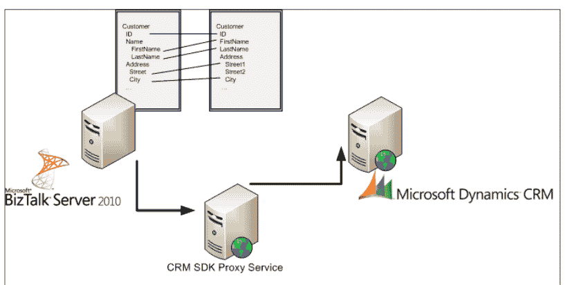

哪个选择最好？对于简单的解决方案，直接与 Dynamics CRM 2011 SOAP API 交互可能是可以的。如果您正在更新实体上的几个字段，或检索一对数据值，则无类型模式的混乱程度值得采用直接的解决方案。然而，如果您对实体进行大规模更改，或获取整个实体并发布到 BizTalk 总线以供更多订阅者接收，那么严格使用类型化代理服务是最好的选择。然而，我们将在下面查看两种场景，您可以自行做出选择。

## Integrating Directly with the Dynamics CRM 2011 SOAP API

在以下一系列步骤中，我们将了解如何在 BizTalk Server 中使用本地 Dynamics CRM SOAP 接口。我们首先将了解如何查询 Dynamics CRM 以返回 Entity。之后，我们将了解在 Dynamics CRM 中创建新 Entity 的步骤。

### Querying Dynamics CRM from BizTalk Server

在此场景中，BizTalk Server 将请求特定 Dynamics CRM “contact” 记录的详细信息，并将查询结果发送到另一个系统。

### Building the BizTalk components

在这第一组步骤中，我们定义规范 BizTalk 模式，添加 Dynamics CRM 模式，创建格式之间的映射，并构建将所有部分连接起来的编排：

- 1. 转到本书的代码包并导航到 `C:\LOBIntegration\Chapter3-DynamicsCrm`，并打开名为 `Chapter3-DynamicsCrm.sln` 的 Visual Studio 2010 解决方案文件。
- 2. 在 Visual Studio 2010 中，创建一个名为 **Chapter3-DynamicsCRM.AccountInt** 的新 BizTalk 项目。此项目将保存此解决方案的所有 BizTalk 工件。右键单击项目，选择 **Properties**，并设置强名称密钥，并将部署应用程序设置为 **Chapter3**。
- 3. 右键单击 BizTalk 项目并选择添加新项。选择 (XML) 模式项类型并将模式命名为 `Customer_XML.xsd`。
- 4. 此模式反映了我们组织对客户的内部定义。对 Dynamics CRM 的查询结果应映射到此结构。我们的客户由标识符、名称、地址集、电话号码集和电子邮件地址定义。以下图像反映了模式的结构：

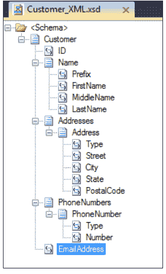

- 5. 添加对 Dynamics CRM SOAP 端点的引用，以便生成我们需要用于使用服务的工件。Dynamics CRM 2011 实例的 WCF SOAP 端点形式为：`http://<server name>/<instance name>/XRMServices/2011/Organization.svc`
- 6. 右键单击 BizTalk 项目并选择 **Add** 然后 **Add Generated Items**。选择 **Consume WCF Service**。在 BizTalk WCF 服务使用向导的 **Metadata source** 页面上，选择元数据的来源为 **Metadata Exchange (MEX) endpoint**。在向导的 **Metadata Endpoint** 页面上，输入您的 Dynamics CRM SOAP 端点的 URL。单击 **Metadata Address (URL)** 旁边的 **Get** 按钮后，移动到向导的下一页并单击 **Import**。
- 7. 向导向 BizTalk 项目添加大量文件。这包括两个绑定文件、一个编排（包括消息和编排端口定义），以及七个表示此服务使用的数据类型的模式。
- 8. 不幸的是，为此端点生成的模式被认为无效。它们彼此之间没有正确的链接，并且在打开其中一个时会出现错误。您可以手动更正每个模式，或者，更好的是，利用可以从 Microsoft 网站下载的 Dynamics CRM SDK 中包含的有效 BizTalk 模式。
- 9. 删除服务引用添加的七个 XSD 模式。
- 10. 右键单击 BizTalk 项目并选择 **Add** 然后 **Existing Item**。导航到您已解压 Dynamics CRM SDK 包的位置，找到 `sdk\schemas\crmbiztalkintegration` 文件夹并选择七个 "organizationservice" 模式，然后单击 **Add**。

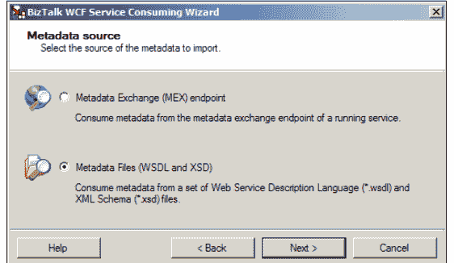


- 11. 不幸的是，通过 Dynamics CRM 服务引用生成的编排现在会因新架构与生成的架构相比类型名称的微小变化而出现错误。既然我们最终会替换所有架构并导致编排损坏，为什么还要费力添加服务引用呢？仍然添加服务引用的一个好处是获取绑定文件。Dynamics CRM 端点具有特定的配置，这些配置与标准的 BizTalk WCF 绑定并不完全匹配。这些绑定文件使我们第一次就能更轻松地正确配置 Dynamics CRM 发送端口。注意，在实际操作中，最好构建一个包含 Dynamics CRM 架构的单个项目，并在未来的项目中引用它。

- 12. 从 BizTalk 项目中排除生成的编排并构建项目，以确认添加的架构有效。

- 13. 右键单击 BizTalk 项目并选择添加新项。选择 **Map** 类型并将其命名为 `Customer_To_CrmContactQuery.btm`，然后单击 **Add**。

- 14. 对于源架构，选择 `Chapter3-DynamicsCRM.AccountInt.Customer_XML` 消息类型。此映射接收 `Customer` 消息类型，最初仅在 `ID` 字段中包含值。当从 Dynamics CRM 收到响应时，我们将填充 `Customer` 消息其余节点的。

- 15. 对于目标架构，选择 `Chapter3-DynamicsCRM.AccountInt.organizationservice_schemas_microsoft_com_xrm_2011_contracts_services` 消息类型。提示时，选择 `Retrieve` 作为根节点。我们的映射现在看起来像以下图像：

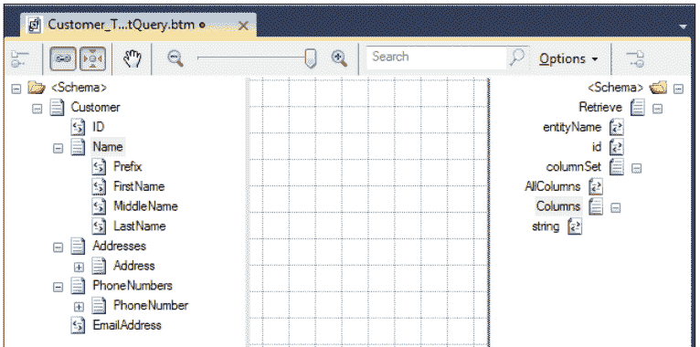

- 16. 如前所述，Dynamics CRM 的 `Retrieve` 架构是无类型的。提供正在查询的实体的名称（`entityName`）、目标记录的唯一 ID（`id`），以及我们想要的具体属性的列表（`Columns`）或请求记录的所有属性（`AllColumns`）。

- 17. 我们可以通过在 BizTalk Mapper 的 **Properties** 窗口中设置节点的 value 属性来硬编码 `entityName` 值，但这些设置以后可能很难找到。一种通过 functoid 视觉上表示默认节点值的方法。从 Visual Studio 2010 工具箱中，打开 **Advanced Functoids** 选项卡并将 **Value Mapping** functoid 拖到映射网格中。通过双击打开 functoid，并将第一个参数的值设置为 `true`（使其始终适用），并将 **Result** 值设置为 `contact`（这是 Dynamics CRM 实体的正式名称）。最后，将 functoid 的输出拖到目标架构中的 `entityName` 节点。

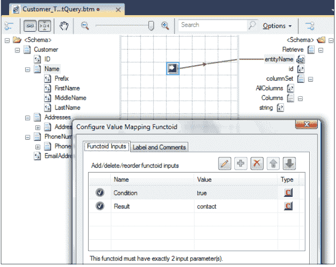

- 18. 如上所述，源架构中最初包含值的唯一字段是 ID 字段。将该源字段映射到目标中的 id 字段。请注意，由于目标字段 id 附带了一个查找 GUID 格式的模式，请将源节点的 Value 属性设置为有效的 GUID，以便映射可以成功测试。不要担心在运行时引入副作用，因为在 Visual Studio 2010 之外对源架构节点设置的任何 Value 都会被忽略。但是，请注意，设置目标架构节点的 Value 属性确实会导致该值在运行时推送到映射的消息中。

- 19. Dynamics CRM 联系人对象中有 146 个字段，因此选择返回所有列可能过于冗余。如果确实想要检索所有列，只需将目标架构的 AllColumns 节点设置为 true 即可。但是，在本例中，我们将只请求特定列。为了在 Columns 节点下生成重复元素，请编写一些自定义 XSLT。从 Visual Studio 2010 工具箱中，在 Advanced Functoids 下，将 Scripting functoid 拖到映射网格中。

- 20. 双击 functoid 并切换到 Script Functoid Configuration 选项卡。由于此自定义 XSLT 没有源架构输入，且目标是发出一组 XML 元素，因此选择 Inline XSLT 选项。输入以下 XML 以仅检索所需的列。请注意显式的命名空间声明，以正确“键入”字符串并防止服务调用期间出现错误：

```
<string xmlns="http://schemas.microsoft.com/2003/10/Serialization/Arrays">salutation</string>
<string xmlns="http://schemas.microsoft.com/2003/10/Serialization/Arrays">firstname</string>
<string xmlns="http://schemas.microsoft.com/2003/10/Serialization/Arrays">middlename</string>
<string xmlns="http://schemas.microsoft.com/2003/10/Serialization/Arrays">lastname</string>
<string xmlns="http://schemas.microsoft.com/2003/10/Serialization/Arrays">address1_addresstypecode</string>
<string xmlns="http://schemas.microsoft.com/2003/10/Serialization/Arrays">address1_line1</string>
<string xmlns="http://schemas.microsoft.com/2003/10/Serialization/Arrays">address1_city</string>
<string xmlns="http://schemas.microsoft.com/2003/10/Serialization/Arrays">address1_stateorprovince</string>
<string xmlns="http://schemas.microsoft.com/2003/10/Serialization/Arrays">address1_postalcode</string>
<string xmlns="http://schemas.microsoft.com/2003/10/Serialization/Arrays">telephone1</string>
<string xmlns="http://schemas.microsoft.com/2003/10/Serialization/Arrays">emailaddress1</string>
```

- 21. 保存并关闭映射。

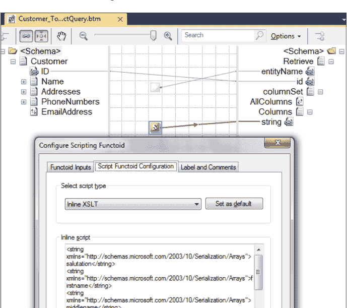

- 22. 右键单击 BizTalk 项目并添加新项。选择 Map 类型，将名称设置为 CrmContact_To_Customer.btm。

- 23. 对于源架构，选择 Chapter3-DynamicsCRM.AccountInt.organizationservice_schemas_microsoft_com_xrm_2011_contracts_services 类型并选择 RetrieveResponse 作为根。

- 24. 对于目标架构，选择 `Chapter3-DynamicsCRM.AccountInt.Customer_XML` 消息类型。生成的映射将如下所示：

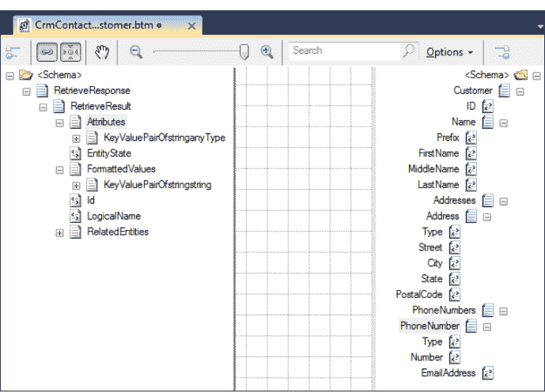

- 25. 从 Dynamics CRM 返回的消息（即此映射的源）包含返回实体的字段和值的数组。`Attributes` 节点包含实体的所有值。当涉及选项集或值列表时（例如 `addresstypecode`），Attributes 值将为“1”，而 `FormattedValues` 节点（包含选项集值的更友好表示）将为 `addresstypecode` 提供一个条目，其值将为“Default Value”。

- 26. 为了将重复的 `KeyValuePairOfstringanyType` 映射到结构化的目标字段，我们可以构建一个长的自定义 XSLT 块、每个部分的单独 XSLT 块，或尝试使用其他 functoid（例如使用 **Value Mapping** 的 **Logical** functoid）来匹配重复的源节点与目标节点。在本示例中，构建单独的 XSLT 块以填充整个目标架构。

- 27. 将 Scripting functoid 拖到映射表面并将其设置为使用 **Inline XSLT**。此 functoid 连接到目标 ID 节点，且没有来自源字段的链接。此 functoid 的 XSLT 查找与持有 `contactid` 值的 `key` 节点关联的 `value` 节点。

```
<ID>
<xsl:value-of select="//*[local-name()='KeyValuePairOfstringanyType']/*[local-name()='key']='contactid']/*[local-name()='value']"/>
</ID>
```

- 28. 接下来，将另一个 Scripting functoid 拖到映射表面并将其也设置为使用 Inline XSLT。将其连接到 Name 目标节点。与之前的 functoid 类似，它将找到 Name 下每个元素对应的 key 节点的 value 节点。以下是检索请求值的 XSLT 部分的突出显示。

```
<Name>
<Prefix>
<xsl:value-of select="//*[local-name()='KeyValuePairOfstringanyType']/*[local-name()='key']='salutation']/*[local-name()='value']"/>
</Prefix>
<FirstName>
<xsl:value-of select="//*[local-name()='KeyValuePairOfstringanyType']/*[local-name()='key']='firstname']/*[local-name()='value']"/>
</FirstName>
<MiddleName>
<xsl:value-of select="//*[local-name()='KeyValuePairOfstringanyType']/*[local-name()='key']='middlename']/*[local-name()='value']"/>
</MiddleName>
<LastName>
<xsl:value-of select="//*[local-name()='KeyValuePairOfstringanyType']/*[local-name()='key']='lastname']/*[local-name()='value']"/>
</LastName>
</Name>
```

- 29. 添加另一个使用 Inline XSLT 的 Scripting functoid，并将其连接到名为 Addresses 的目标节点：

```
<Addresses>
<Address>
<Type>
<xsl:value-of select="//*[local-name()='KeyValuePairOfstringstring']/*[local-name()='key']='address1_addresstypecode']/*[local-name()='value']"/>
</Type>
<Street>
<xsl:value-of select="//*[local-name()='KeyValuePairOfstringanyType']/*[local-name()='key']='address1_line1']/*[local-name()='value']"/>
</Street>
```

```
<City>
<xsl:value-of select="//*[local-name()='KeyValuePairOfstringanyType']/*[local-name()='key']='address1_city']/*[local-name()='value']"/>
</City>
<State>
<xsl:value-of select="//*[local-name()='KeyValuePairOfstringanyType']/*[local-name()='key']='address1_stateorprovince']/*[local-name()='value']"/>
</State>
<PostalCode>
<xsl:value-of select="//*[local-name()='KeyValuePairOfstringanyType']/*[local-name()='key']='address1_postalcode']/*[local-name()='value']"/>
</PostalCode>
</Address>
</Addresses>
```

30. 接下来，添加一个利用**内联 XSLT**并连接到 PhoneNumbers 节点的 Scripting 函数体：

```
<PhoneNumbers>
<PhoneNumber>
<Type>Business</Type>
<Number>
<xsl:value-of select="//*[local-name()='KeyValuePairOfstringanyType']/*[local-name()='key']='telephone1']/*[local-name()='value']"/>
</Number>
</PhoneNumber>
</PhoneNumbers>
```

31. 最后，添加一个使用**内联 XSLT**并连接到目标架构中 EmailAddress 节点的 Scripting 函数体：

```
<EmailAddress>
<xsl:value-of select="//*[local-name()='KeyValuePairOfstringanyType']/*[local-name()='key']='emailaddress1']/*[local-name()='value']"/>
</EmailAddress>
```

32. 最终的映射如下图所示：

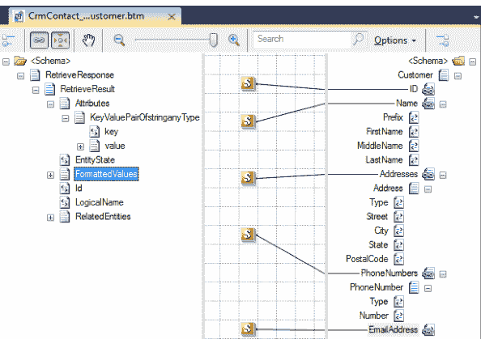

33. 此服务将由 BizTalk 协调流程使用，因此右键单击 BizTalk 项目并添加新项。选择协调流程并将名称设置为 QueryCrmCustomer.odx。此解决方案可以通过消息传递直接使用服务（无需协调流程），但由于生成的 BizTalk 发送端口将具有多个可能的调用操作（例如 Create、Retrieve、Update），因此协调流程是设置目标操作的最简单方法。

34. 创建四个协调流程消息：类型为 Chapter3-DynamicsCRM.AccountInt.Customer_XML 的 Customer_Input，类型为 Chapter3-DynamicsCRM.AccountInt.Customer_XML 的 Customer_Output，类型为 Chapter3-DynamicsCRM.AccountInt.organizationservice_schemas_microsoft_com_xrm_2011_contracts_services.Retrieve 的 ContactRetrieve_Request 以及类型为 Chapter3-DynamicsCRM.AccountInt.organizationservice_schemas_microsoft_com_xrm_2011_contracts_services.RetrieveResponse 的 ContactRetrieve_Response。

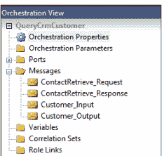

- 35. 勾画出一个协调流程：接收消息、转换消息、向服务发送请求、接收响应、转换响应并发送最终消息。顶部的 Receive 形状，名为**接收请求**，与 `Customer_Input` 消息关联。名为**构造查询**的 Construct 形状构建 `ContactRetrieve_Request` 消息。Transform 形状使用之前构建的 **Customer_To_CrmContactQuery** 映射。下一个名为**发送请求**的 Send 形状使用 `ContactRetrieve_Request` 消息，而其后的名为**接收结果**的 Receive 形状获取 `ContactRetrieve_Response` 消息。下一个名为**构造输出**的 Construct 形状构建 `Customer_Output` 消息。其 Transform 形状使用 **CrmContact_To_Customer** 映射，其中 Transform 目标设置为 `Customer_Output`。最后，名为**发送结果**的 Send 形状与 `Customer_Output` 消息关联。
- 
- 36. 添加一个单向协调流程端口，用于接收消息并与**接收请求**形状关联。
- 
- 37. 添加一个单向协调流程端口，用于发送消息并连接到**发送结果**形状。
- 
- 38. 创建一个双向协调流程端口，用于发送消息并接收响应。确保将此端口的操作名称设置为**检索**。此处的操作名称必须与正在调用的 Dynamics CRM Web 服务方法的操作名称相对应。

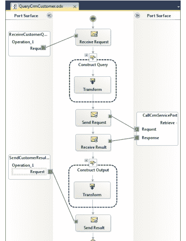

39. 构建并部署 BizTalk 项目。

我们现在拥有配置完成解决方案的消息端口所需的组件。

## 配置 BizTalk 端点

在本练习的这一部分，我们将配置 BizTalk 消息端口，这些端口接收查询请求、调用 Dynamics CRM 2011、转换响应消息，并通过 FILE 适配器将规范的 Customer 消息写入磁盘。

- 1. 打开 BizTalk 管理控制台并找到 Chapter3 应用程序。
- 2. 向应用程序添加一个新的接收端口（Chapter3.PickupCustomerQuery）和接收位置（Chapter3.PickupCustomerQuery.FILE），该位置将从文件系统接收“查询请求”消息。
- 3. 右键单击 Chapter3 应用程序并选择导入然后绑定。将指向由引用 Dynamics CRM Web 服务生成的 OrganizationService_Custom.BindingInfo.xml 绑定文件，该文件现在位于 Visual Studio 中的 BizTalk 项目内。导入完成后，将显示一个新的发送端口。

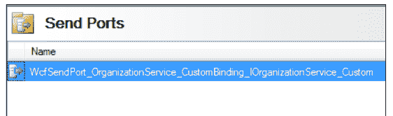

- 4. 双击新的发送端口以查看其设置。请注意，它使用 WCF-Custom 适配器并应用自定义 WCF 绑定。服务使用发送端口主机实例的凭据调用，因此我们无需向发送端口本身添加凭据。
- 5. 添加一个新的发送端口，用于发出 Dynamics CRM 响应消息。此单向发送端口使用 FILE 适配器并将消息发送到文件系统。

- 6. 消息端口就位后，我们现在将协调流程绑定到这些端口。查看 Chapter3 应用程序中的 Orchestrations 文件夹并双击 QueryCrmCustomer 协调流程。
- 7. 将协调流程绑定到主机、 newly 创建的接收端口、生成的发送端口和 FILE 发送端口。

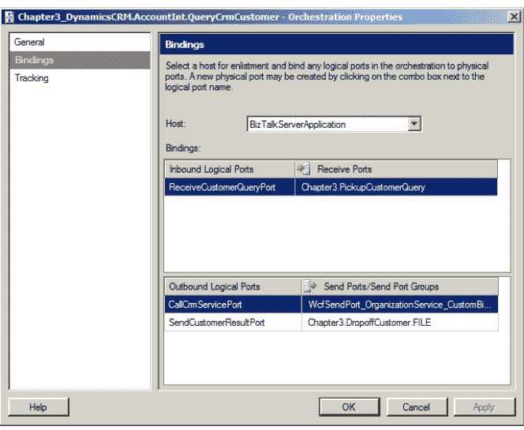

- 8. 启动接收位置、发送端口和协调流程。

我们现在拥有用于接收“查询”消息的通道、调用 Dynamics CRM 2011 的发送端口以及发送服务结果的发送端口。

请记住，发送到 Dynamics CRM 的查询消息中的主字段是记录的 ID。因此，需要一个 Customer 消息的 XML 实例，其中仅填充 ID 值。

- 1. 导航到您的 Dynamics CRM 2011 实例并打开您要查询的客户记录。查看浏览器中的地址并检索记录的 GUID 并删除 URL 编码。

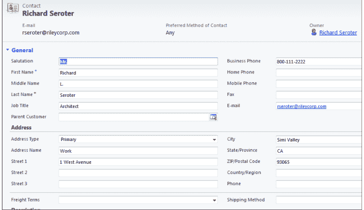

2. 将记录 ID 添加到 Customer_XML 消息生成的实例的 ID 字段中。

```
<ns0:Customer xmlns:ns0="http://Chapter3-DynamicsCRM.AccountInt.Customer_XML">
  <ID>C210E386-D58A-E011-A552-000C29D4FA55</ID>
  <Name>
    <Prefix />
    <FirstName />
    <MiddleName />
    <LastName />
  </Name>
  <Addresses>
```

3. 将 XML 实例文件复制到 BizTalk 接收位置轮询的文件夹中。

4. 查看发送端口传输最终消息的文件夹。我们应该看到一条消息，其中包含从 Dynamics CRM 格式化的值，格式为 `Customer_XML` 消息。

```
<ns0:Customer xmlns:ns0="http://Chapter3-DynamicsCR
  <ID>c210e386-d58a-e011-a552-000c29d4fa55</ID>
  <Name>
    <Prefix>Mr.</Prefix>
    <FirstName>Richard</FirstName>
    <MiddleName>L.</MiddleName>
    <LastName>Seroter</LastName>
  </Name>
  <Addresses>
    <Address>
      <Type>Primary</Type>
      <Street>1 West Avenue</Street>
      <City>Simi Valley</City>
      <State>CA</State>
      <PostalCode>93065</PostalCode>
    </Address>
  </Addresses>
  <PhoneNumbers>
    <PhoneNumber>
      <Type>Business</Type>
      <Number>800-111-2222</Number>
    </PhoneNumber>
  </PhoneNumbers>
  <EmailAddress>rseroter@riley corp.com</EmailAddress>
</ns0:Customer>
```

我们在这里看到的是如何创建到 Dynamics CRM “retrieve” 消息的映射，如何将该查询的非结构化结果放入结构化格式，以及如何设置 BizTalk 组件以路由和调用请求。接下来，我们将看到如何从 BizTalk Server 向 Dynamics CRM 添加记录。

## 从 BizTalk Server 向 Dynamics CRM 添加新记录

我们已经看到与 Dynamics CRM 2011 SOAP 端点关联的无类型架构如何使映射变得具有挑战性。具体来说，我们刚刚看到如何从 DynamicsCRM 获取无类型消息并将其转换为结构化、规范架构。但如果要将规范架构映射到无类型消息呢？在本练习中，我们将获取 `Customer_XML` 消息并将其映射到 Dynamics CRM `Create` 消息，并在我们的 DynamicsCRM 实例中添加一条记录。

## 构建 BizTalk 组件

本练习基于前一个练习。在此步骤中，我们将定义一个新的映射并构建一个调用 Dynamics CRM `Create` 操作的协调流程：

- 1. 右键单击 BizTalk 项目并添加新项。选择 **Map** 类型并将映射命名为 `Customer_To_CrmContactCreate.btm`。
- 2. 将映射的源设置为 `Customer_XML` 消息类型。对于目标架构，选择 `organizationservice_schemas_microsoft_com_xrm_2011_contracts_services` 类型并选择 Create 消息。

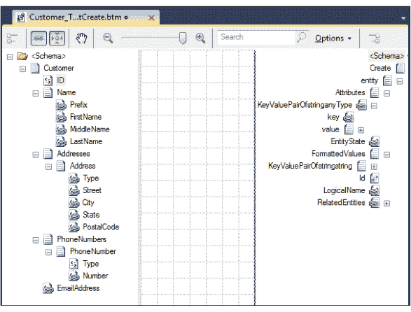

3. 在本例中，我们必须将每个源字段复制到重复的 `KeyValuePairOfstringanyType` 节点。我们将利用 BizTalk Server 2010 的功能，该功能允许您将映射方面整齐地分割为称为页面的逻辑容器。将第一个页面重命名为 **Entity Name**。

从映射表面上的 **Advanced Functoids** 选项卡拖动 **Value Mapping** functoid。双击 **Value Mapping** functoid，并手动将第一个参数（**Condition**）的值设置为 **true**，并手动将 **Result** 参数设置为 **contact**。

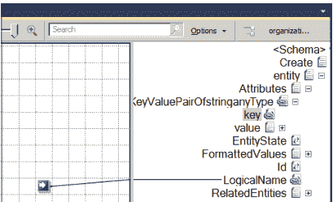

4. 在映射中创建一个新页面并将页面命名为 **Looping**。虽然我们可以选择仅使用自定义 XSLT 来构建目标架构，但本练习展示了如何使用 BizTalk functoid 使该任务变得更轻松。如果将一组节点连接到 **Looping** functoid，然后将 Looping functoid 的输出连接到目标节点，您就可以创建一个环境，让我们将源中的各个节点复制到目标的重复节点中。从工具箱的 **Advanced Functoids** 部分拖动 **Looping** functoid 到映射上。将以下节点连接到它：`Prefix, FirstName, MiddleName, LastName, [Address] Type, Street, City, State, PostalCode, Number, EmailAddress.`

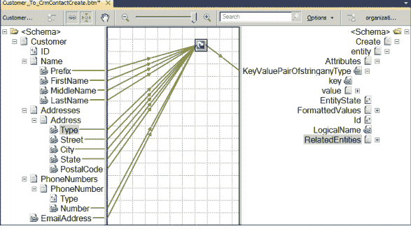

5. 创建另一个名为 **Any Pairs** 的映射页面。在此页面上，将各个节点连接到重复的目标节点。然而，有一些注意事项。首先，`KeyValuePairOfstringanyType` 下的 `key` 节点期望保存 Dynamics CRM 实体属性的名称。我们的规范架构与 Dynamics CRM 实体属性的名称并不完全匹配。因此，我们必须进行一些转换以设置正确的值。此外，由于 `KeyValuePairOfstringanyType` 可以将任何数据类型作为列值保存，因此在创建时必须显式“键入” `value` 节点。例如，对于字符串值，我们必须添加一个“string”属性。

6. 将 Scripting functoid 拖到映射表面并将其连接到 `Prefix` 源节点和 `key` 目标节点。将 **Script type** 设置为 **Inline XSLT Call Template**。添加下面的 XSLT。请注意，`xsi:type` 属性已添加到 `value` 节点中，并且类型设置为 `xs:string`：

```
<xsl:template name="SetPrefixValue">
<xsl:param name="param1" />
<key xmlns="http://schemas.datacontract.org/2004/07/System.Collections.Generic">salutation</key>
<value xmlns="http://schemas.datacontract.org/2004/07/System.Collections.Generic" xmlns:xs="http://www.w3.org/2001/XMLSchema" xmlns:xsi="http://www.w3.org/2001/XMLSchema-instance">
<xsl:attribute name="xsi:type">
<xsl:value-of select="xs:string" />
</xsl:attribute>
<xsl:value-of select="$param1" />
</value>
</xsl:template>
```

7. 对之前连接到循环 functoid 的每个源节点重复此过程，并确保为每个脚本使用不同的 XSLT 模板名称。列表中排除的是 [Address] Type 节点，该节点必须以不同的方式处理，正如我们稍后将看到的那样。请注意，我的映射如下：

| 源节点 | XSLT 模板名称 | CRM 键名称 |
|-------------|--------------------|--------------|
| Prefix | SetPrefixValue | salutation |
| FirstName | SetFNameValue | firstname |
| MiddleName | SetMNameValue | middlename |
| LastName | SetLNameValue | lastname |
| Street | SetStreetValue | address1_line1 |
| City | SetCityValue | address1_city |
| State | SetStateValue | address1_stateorprovince |
| PostalCode | SetPostalValue | address1_postalcode |
| Number | SetPhoneValue | telephone1 |
| EmailAddress | SetEmailValue | emailaddress1 |

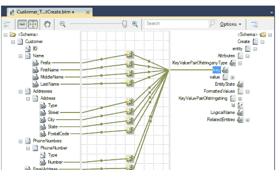

8. 现在我们准备处理 Address Type 属性，该属性不是字符串，而是值列表中的一个条目（称为 Option Sets）。将新的 Scripting functoid 拖到映射表面并将其设置为使用 **Inline XSLT Call Template**。添加以下 XSLT：

```
<xsl:template name="SetAddrTypeValue">
<xsl:param name="param1" />
<key xmlns="http://schemas.datacontract.org/2004/07/System.Collections.Generic">address1_addresstypecode</key>
<value xmlns="http://schemas.datacontract.org/2004/07/System.Collections.Generic"
    xmlns:xs="http://www.w3.org/2001/XMLSchema"
    xmlns:xsi="http://www.w3.org/2001/XMLSchema-instance"
    xmlns:a="http://schemas.microsoft.com/xrm/2011/Contracts">
    <xsl:attribute name="xsi:type"><xsl:value-of select="'a:OptionSetValue'" /></xsl:attribute>
    <Value xmlns="http://schemas.microsoft.com/xrm/2011/Contracts"><xsl:value-of select="$param1" /></Value>
    </value>
</xsl:template>
```

9. 将 Address 节点下的 Type 节点连接到此 functoid，并将 functoid 的另一端连接到 KeyValuePairOfstringanyType 下的 key 节点。

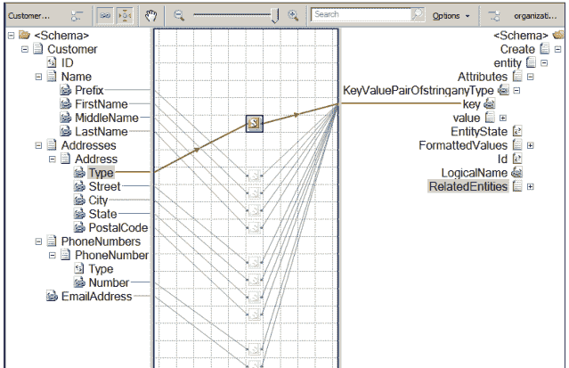

- 10. 映射完成后，最后的任务是构建一个消耗 Dynamics CRM 服务并发出结果的编排。在本例中，对 Create 操作的调用结果是一个 GUID，表示新记录的唯一 ID。在此 BizTalk 项目中添加一个名为 `CreateCrmCustomer.odx` 的新编排。
- 11. 创建三个编排消息：类型为 `Chapter3-DynamicsCRM.AccountInt.Customer_XML` 的 `Customer_Input`、类型为 `Chapter3-DynamicsCRM.AccountInt.organizationservice_schemas_microsoft_com_xrm_2011_contracts_services.Create` 的 `ContactCreate_Request`，以及类型为 `Chapter3-DynamicsCRM.AccountInt.organizationservice_schemas_microsoft_com_xrm_2011_contracts_services.CreateResponse` 的 `ContactCreate_Response`。
- 12. 构建一个编排流程，该流程接收消息、转换消息、向服务发送请求、接收响应并发送最终消息。顶部的 Receive 形状，名为 **Receive Request**，与 `Customer_Input` 消息关联。名为 **Construct Create** 的 Construct 形状构建 `ContactCreate_Request` 消息。Transform 形状使用刚刚构建的 **Customer_To_CrmContactCreate** 映射。下一个名为 **Send Request** 的 Send 形状使用 `ContactCreate_Request` 消息，而其后的名为 **Receive Result** 的 Receive 形状则获取 `ContactCreate_Response` 消息。最后的名为 **Send Result** 的 Send 形状也使用 `ContactCreate_Response` 消息。
- 13. 添加一个单向编排端口，该端口接收消息并与 **Receive Request** 形状绑定。
- 14. 添加一个单向编排端口，该端口发送消息并连接到 **Send Result** 形状。
- 15. 创建一个双向编排端口，该端口发送消息并接收响应。将此端口的 Operation 名称设置为 **Create**。请记住，此处的操作名称必须与正在调用的 Dynamics CRM Web 服务方法的操作名称相对应。
- 16. 构建并部署 BizTalk 项目。

我们现在已构建了映射和编排，以便成功调用此服务。

## 配置 BizTalk 端点

我们的最终任务是配置 BizTalk 消息组件以向 Dynamics CRM 服务发送消息。由于上一次练习，我们已经有一系列可重用的端口配置，可以在此次利用它们。

- 1. 打开 BizTalk 管理控制台并确认应用程序的更新已成功部署。可以通过在 **Chapter3** 应用程序下的 **Orchestrations** 文件夹中查找我们的新编排来确认。
- 2. 双击编排以将其绑定到消息端口。
- 3. 设置主机值，对于初始接收端口，重用上一次练习中创建的端口。当接收端口绑定到编排时，结果订阅会同时查看端口的名称和传入的消息类型。因此，在本例中，由于我们对两种类型都使用 `Customer_XML` 消息输入，因此必须取消注册之前的编排，以防止它也拾取此消息。
- 4. 设置编排也重用上一次练习中的发送端口。这包括调用 Dynamics CRM 的生成的发送端口，以及将服务结果消息发送到文件系统的端口。

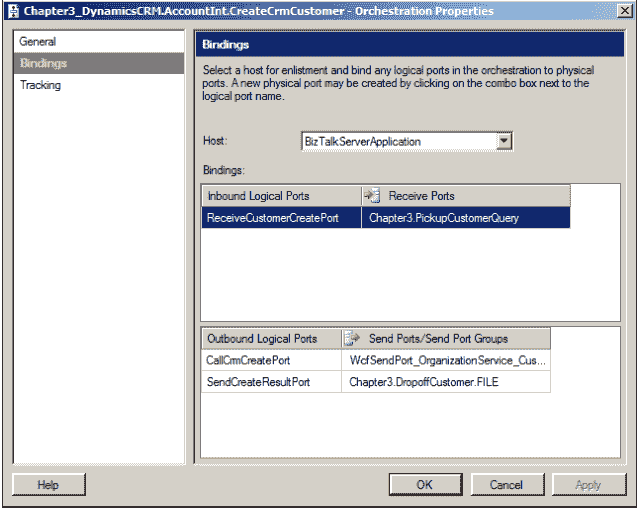


5. 启动编排，并确保接收位置、发送端口和主机也已启动。记得取消注册之前的编排，以免它也拾取消息。

6. 为 Customer_XML 消息类型创建一个 XML 实例文件，并用尚未存在于 Dynamics CRM 中的新联系人详细信息填充它。

```
<ns0:Customer xmlns:ns0="http://Chapter3-DynamicsCRM.Account">
  <ID />
  <Name>
    <Prefix>Mr.</Prefix>
    <FirstName>Michael</FirstName>
    <MiddleName>W.</MiddleName>
    <LastName>Scott</LastName>
  </Name>
  <Addresses>
    <Address>
      <Type>3</Type>
      <Street>200 West Dunder Avenue</Street>
      <City>Scranton</City>
      <State>PA</State>
      <PostalCode>19446</PostalCode>
    </Address>
  </Addresses>
  <PhoneNumbers>
    <PhoneNumber>
      <Type>Business</Type>
      <Number>800-BUY-PAPR</Number>
    </PhoneNumber>
  </PhoneNumbers>
  <EmailAddress>michael.scott@dundermifflin.com</EmailAddress>
</ns0:Customer>
```

7. 将此文件放入由我们的 FILE 接收位置监控的文件夹中。

8. 如果一切配置正确，我们应该在 Dynamics CRM 实例中看到一条新记录，并且有一个文件保存该新记录的唯一 ID。

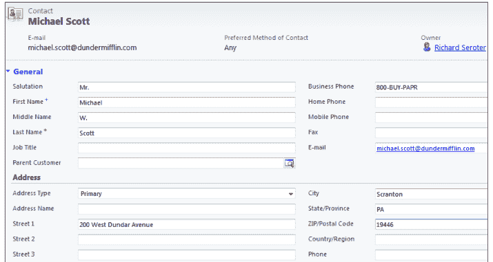

在本练习中，我们看到了如何从规范模式创建非类型化服务请求消息，并成功地从 BizTalk Server 在 Dynamics CRM 中创建记录。

## 使用 BizTalk Server 与 Dynamics CRM 代理服务

### 设置

代理服务策略需要安装 Dynamics CRM 2011 SDK。确保将 XRM 程序集添加到开发机器的全局程序集缓存中。此外，无论是否使用 Dynamics CRM 的新基于声明的安全策略，您仍需要安装 Windows Identity Foundation (WIF) 组件，因为客户端程序集与 WIF 之间存在依赖关系。

### 生成代理服务

代理服务的关键在于代表 Dynamics CRM 应用程序中标准和自定义实体的类型化类：

- 1. 在 Windows 命令提示符中，导航到 CRM SDK 下载包下的 `bin` 目录。
- 2. 执行 CrmSvcUtil.exe 实用工具，该实用工具为 Dynamics CRM 2011 中的实体创建 .NET 类。此实用工具有一系列命令行参数包括：
- a. url – Dynamics CRM Organization 服务的端点地址
- b. out – 生成代码的文件名
- c. username – 具有调用 Dynamics CRM 服务权限的用户名
- d. password – 具有调用 Dynamics CRM 服务权限的用户的密码
- e. domain – 调用 Dynamics CRM 服务的用户所在的目录域
- f. namespace – 生成代码中使用的 .NET 命名空间

使用这些参数，生成早期绑定 Dynamics CRM 类的示例查询如下所示：

```
CrmSvcUtil.exe /url:http://<server>/<orgName>/XRMServices/2011/
Organization.svc /out:"C:\temp\CrmEntities.cs" /
username:<username> /password:<password> /domain:<domain> /
namespace:Chapter3.CrmProxyService
```

- 3. 生成的 C# 类包含目标 Dynamics CRM 系统中存在的所有标准和自定义实体的定义。此类允许我们仅处理类型化实体，避免与原始 Entity 格式交互。
- 4. 在 Visual Studio 2010 中，创建一个新的 **Web Site** 项目，类型为 **WCF Service**，并将其命名为 Chapter3-DynamicsCRM.SvcProxy。
- 5. 右键单击新项目并选择 **Add Existing Item**。找到之前生成的 CrmEntities.cs 类并将其包含在此项目中。将它添加到项目的 App_Code 文件夹中。
- 6. 再次右键单击项目并选择 **Add New Item**。选择 **WCF Service** 类型并将其命名为 CrmCustomerProxy.svc。
- 7. 显示此服务的契约，其中将包含 BizTalk 将调用的数据类型和操作。请注意，CrmEntities.cs 类不包含 WCF 可序列化类型。因此，我们不能简单地从服务返回 Dynamics CRM "customer" 类型。在 ICrmCustomerServiceProxy.cs 中定义一个新类来描述客户。请注意，在此示例中我们使用单个 CRM 实体 Customer。需要对我们希望向 BizTalk 公开的每个实体执行类似的练习。

```
[DataContract(Namespace="http://chapter3/data")]
public class Customer
{
    [DataMember]
    public string NamePrefix { get; set; }
    [DataMember]
    public string FirstName { get; set; }
    [DataMember]
    public string MiddleName { get; set; }
    [DataMember]
    public string LastName { get; set; }
    [DataMember]
    public string PrimaryAddressStreet { get; set; }
    [DataMember]
    public string PrimaryAddressCity { get; set; }
    [DataMember]
    public string PrimaryAddressState { get; set; }
    [DataMember]
    public string PrimaryAddressPostalCode { get; set; }
    [DataMember]
    public string PhoneNumber { get; set; }
    [DataMember]
    public string EmailAddress { get; set; }
}
```

8. 也在该 ICrmCustomerProxy.cs 文件中，添加服务契约。此契约包含单个操作，该操作接收客户对象并返回包含新记录唯一标识符的字符串。

```
[ServiceContract(Namespace="http://chapter3/service")]
public interface ICrmCustomerProxy
{
    [OperationContract]
    string AddCustomer(Customer newCustomer);
}
```

9. 切换到生成的 CrmCustomerProxy.cs 文件并为所需的 AddCustomer 操作添加占位符。

10. 在继续之前，向此项目添加程序集引用。指向 Dynamics CRM SDK 下载的 bin 文件夹中包含的 Microsoft.Xrm.Sdk.dll。

11. 在 CrmCustomerProxy.cs 代码类的顶部，添加三个引用：

```
using Microsoft.Xrm.Sdk;
using Microsoft.Xrm.Sdk.Client;
using System.ServiceModel.Description; //for credentials
using Chapter3.CrmProxyService; //generated class
```

12. 通过代码调用 Dynamics CRM WCF SOAP 服务时，我们可以选择使用 SDK 中包含的特殊服务代理类（OrganizationServiceProxy）。通过将此代理类与 Dynamics CRM WCF 行为（ProxyTypesBehavior）结合使用，我们可以仅使用类型化对象，让这些对象在幕后转换为实体和从实体转换。在 AddCustomer 操作开始时，添加以下代码，该代码为服务代理创建变量并定义客户端凭据对象：

```
OrganizationServiceProxy proxy;
ClientCredentials creds = new ClientCredentials();
creds.Windows.ClientCredential =
System.Net.CredentialCache.DefaultNetworkCredentials;
```

13. 定义两个变量，一个保存我们的 Dynamics CRM 联系人对象，另一个保存创建新联系人时返回的 GUID 值。

```
Contact newContact;
Guid newContactId;
```

14. 我们准备实例化用于调用 Dynamics CRM 服务的自定义服务代理。请注意，我们的凭据对象会传递给构造函数。在代理实例化后，将自定义 Dynamics CRM WCF 行为添加到端点：

```
using (proxy = new OrganizationServiceProxy(new
Uri("http://<server>/<instance>/XRMServices/2011/Organization.
svc"),
null,
creds,
null))
{
    proxy.ServiceConfiguration.CurrentServiceEndpoint.
Behaviors.Add(new ProxyTypesBehavior());
}
```

15. 在服务客户定义和 Dynamics CRM 联系人实体之间创建映射：

```
newContact = new Contact();
newContact.Salutation = newCustomer.NamePrefix;
newContact.FirstName = newCustomer.FirstName;
newContact.MiddleName = newCustomer.MiddleName;
newContact.LastName = newCustomer.LastName;
newContact.Address1_Line1 = newCustomer.PrimaryAddressStreet;
newContact.Address1_City = newCustomer.PrimaryAddressCity;
newContact.Address1_StateOrProvince = 
newCustomer.PrimaryAddressState;
newContact.Address1_PostalCode = 
newCustomer.PrimaryAddressPostalCode;
newContact.Telephone1 = newCustomer.PhoneNumber;
newContact.EMailAddress1 = newCustomer.EmailAddress;
```

16. 最后，调用服务，传入 Dynamics CRM 实体，并获取 GUID 响应。从服务操作返回 GUID 的字符串值：

```
newContactId = proxy.Create(newContact);
```


17. 构建服务并将其部署到本地 Web 服务器。在浏览器中打开服务以确保其配置正确：

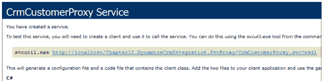

18. 如果需要，您也可以尝试使用 WCF Test Client 调用此服务。请确保服务位于以具有 Dynamics CRM 2011 访问权限的域账户运行的应用程序池中。

我们现在拥有一个完整且可用的代理服务，它作为外观位于实际的 Dynamics CRM 2011 WCF 端点之前。该代理公开了一个干净的类型化接口，BizTalk 可以轻松使用，我们接下来将会看到。

## Building the BizTalk components

在这组步骤中，我们从 BizTalk 项目中消费代理服务，并创建将我们的规范模式转换为服务期望的格式所需的映射：

- 1. 返回 Visual Studio 2010，导航到现有的 BizTalk Server 项目。我们将为此新的 WCF 服务添加引用并配置调用代理服务所需的 BizTalk 组件。右键单击 BizTalk 项目，然后选择 **Add**，再选择 **Add Generated Items**。
- 2. 逐步完成 BizTalk WCF 服务消费向导，并将元数据源选择为 MEX 端点。在下一页上，将地址设置为我们的 WCF 服务的 Web 地址：

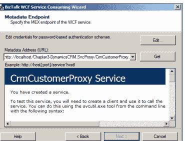

3. 完成向导并查看解决方案中包含的新工件。这包括绑定文件、模式和编排：

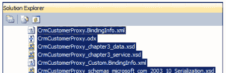

4. 右键单击 BizTalk 项目并添加一个类型为 Map 的新项，并将映射命名为 Customer_To_CrmContactProxy.btm。

5. 将映射的源设置为 Customer_XML，目标设置为 Chapter3-DynamicsCRM.AccountInt.CrmCustomerProxy_chapter3_service，并选择 AddCustomer 根节点。

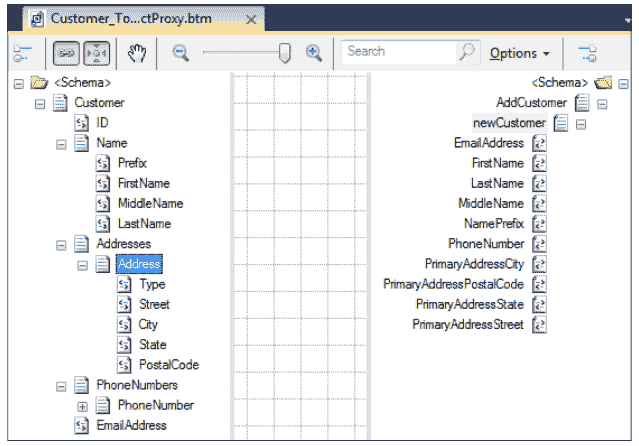

6. 将适用的源节点连接到相应的目标字段。

7. 我们直接从 BizTalk 消息传递消费此服务，因此不需要构建编排来调用代理服务。构建并将 BizTalk 项目部署到 BizTalk Server。

这组步骤生成了我们调用位于 Dynamics CRM 前面的外观服务所需的 BizTalk 工件。与之前需要创造性地转换未类型化模式的练习不同，这组服务模式是强类型的，易于使用。

## Configuring the BizTalk endpoints

接下来，我们将配置调用服务并路由响应的 BizTalk 消息组件：

- 1. 打开 BizTalk 管理控制台，并确保新的代理服务模式是 **Chapter3** 应用程序的一部分。
- 2. 当我们为代理服务创建服务引用时，BizTalk WCF 服务消费向导生成了一个绑定文件，该文件定义了一个能够调用代理服务的发送端口。右键单击 **Chapter3** 应用程序，选择导入绑定并选择 BizTalk 项目中包含的 `CrmCustomerProxy_Custom.BindingInfo.xml` 文件。
- 3. 打开生成的发送端口。端口配置无需更改，但我们将向此发送端口添加新的映射和筛选器。在端口配置的 **Outbound Maps** 选项卡上，选择 **Contact_To_CrmContactProxy** 映射。
- 4. 切换到 **Filters** 选项卡并为 `Customer_XML` 类型的消息类型添加订阅。

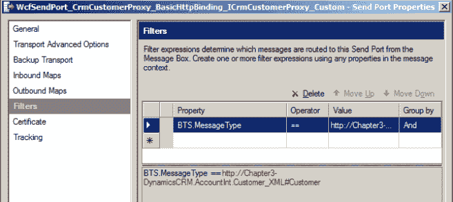

5. 我们的最后一个配置项是发送端口，它监听此服务调用的响应并将消息发送到文件系统。创建一个新的单向静态发送端口。将适配器设置为 FILE 并设置发送端口将发送响应消息的位置。转到端口配置的 **Filters** 选项卡。在这里，我们将为响应消息类型添加订阅。

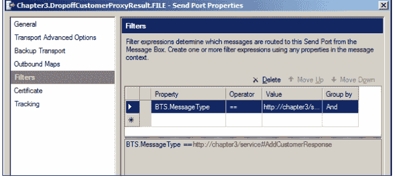

6. 注销所有先前定义的发送端口和编排，以消除使用相同的 Customer_XML 消息类型作为输入产生的任何副作用。

7. 向 BizTalk Server 发送包含客户定义的 文件：

```
<ns0:Customer xmlns:ns0="http://Chapter3-DynamicsCRM.Acc...">
  <ID />
  <Name>
    <Prefix>Mr.</Prefix>
    <FirstName>Jim</FirstName>
    <MiddleName>P.</MiddleName>
    <LastName>Halpert</LastName>
  </Name>
  <Addresses>
    <Address>
      <Type>3</Type>
      <Street>200 West Dundar Avenue</Street>
      <City>Scranton</City>
      <State>PA</State>
      <PostalCode>19446</PostalCode>
    </Address>
  </Addresses>
  <PhoneNumbers>
    <PhoneNumber>
      <Type>Business</Type>
      <Number>800-BUY-PAPR</Number>
    </PhoneNumber>
  </PhoneNumbers>
  <EmailAddress>jim.halpert@dundermifflin.com</EmailAddress>
</ns0:Customer>
```

8. 结果，我们应该在 Dynamics CRM 中看到新的记录，并在磁盘上看到一个保存该记录标识符的文件。

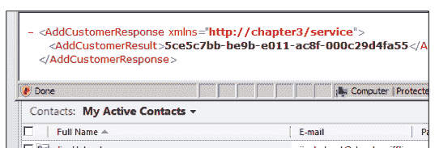

在本练习中，我们展示了一种直接构建外观或代理服务的方法，该服务位于 Dynamics CRM 2011 前面并公开易于使用的类型化接口。底层代理服务利用了 Dynamics CRM SDK，因此在任何时候我们都不需要处理基础 Entity 对象。

## Communicating from Dynamics CRM to BizTalk Server

可以想象许多 Dynamics CRM 要么向 BizTalk Server 发布数据，要么查询 BizTalk 暴露的服务端点的场景。例如，当客户请求退还缺陷产品时，呼叫中心代理可能会在 Dynamics CRM 中记录此请求。电话结束后，Dynamics CRM 应向退货处理系统发送消息，该系统处理客户账户的记账。在另一个场景中，BizTalk Server 可能是数据聚合服务的主机，该服务查询存储“customer”数据的三个企业系统并汇总响应。当呼叫中心代理查看客户记录时，Dynamics CRM 可能希望执行该服务，以便他们更全面地了解该客户与公司的交互。

Dynamics CRM 可以与 BizTalk Server 通信的有三个可行位置。首先，Dynamics CRM 表单能够在表单生命周期的各个点执行客户端 JavaScript。确实可以使用 JavaScript 调用 Web 服务，包括 BizTalk Server 暴露的 Web 服务。然而，请注意，JavaScript 调用 Web 服务通常是同步的，如果表单必须不断等待来自分布式服务的响应，则可能会对用户体验产生负面影响。此外，在 Dynamics CRM 中运行的 JavaScript 是客户端的，并直接绑定到其所在的页面。如果我们以编程方式与 Dynamics CRM 实体交互，则客户端脚本中存在的任何代码都不会被调用。例如，如果在创建“account”记录后我们通过 JavaScript 向 BizTalk 发送消息，如果我们以编程方式创建“account”记录，则此逻辑不会触发。

Dynamics CRM 可以通过工作流与 BizTalk Server 通信的第二个位置。Dynamics CRM 中的工作流是一个自动化过程，其中一组步骤根据我们定义的规则执行。例如，当销售机会关闭时，我们运行一个工作流，该工作流向客户记录添加消息，通知与机会相关的所有方，并向流失的潜在客户发送礼貌的电子邮件。工作流基于 Windows Workflow 4.0 技术，可以在 Dynamics CRM 应用程序本身或 Visual Studio 2010 中构建。Dynamics CRM Web 应用程序允许我们使用先前注册的工作流步骤拼凑工作流。如果我们需要新的工作流步骤或需要构建复杂的东西，我们可以进入 Visual Studio 2010 并在那里定义工作流。为什么我们会选择使用工作流向 BizTalk Server 发送消息？如果您有一个可以按计划或按需执行的长时间运行的流程，并且希望用户能够修改流程，那么工作流可能是正确的选择。

Dynamics CRM 与 BizTalk Server 之间通信的最后策略是使用插件。插件是基于服务器的应用程序扩展，执行业务逻辑并直接绑定到实体。这意味着无论我们使用 Dynamics CRM Web 界面还是通过 API 工作，它们都会被调用。我可以根据情况同步或异步运行插件。例如，如果我们在保存记录之前需要验证记录上的数据，我们可以设置插件在“保存”操作提交之前运行，并对无效信息提供一些用户反馈。或者，我们可以选择在记录保存后异步调用插件并将数据传输到我们的服务总线 BizTalk Server。在以下练习中，我们将利用插件将数据从 Dynamics CRM 发送到 BizTalk Server。

## Integration to BizTalk Server

在本次首次演练中，我们将构建一个插件，该插件从 Dynamics CRM 通信到位于的 BizTalk Server。每当 Dynamics CRM 中的 Account 记录发生更改时，就会向 BizTalk 发送事件消息。

## Setup

本练习利用了您 Visual Studio 2010 解决方案中已有的 BizTalk Server 项目。我们将从 BizTalk Server 发布一个 Web 服务，该服务接收消息并将其路由到将消息写入文件系统的 BizTalk 发送端口。

- 1. 如果您尚未执行，请转到本书的代码包并导航到 C:\LOBIntegration\Chapter03\Chapter3-DynamicsCRM 并打开名为 Chapter3-DynamicsCRM.sln 的 Visual Studio 2010 解决方案文件。


- 2. 找到名为 **Chapter3-DynamicsCRM.AcctRouting** 的 BizTalk Server 项目并打开它。

- 3. 书中的代码包包含一个名为 `AccountEventChange_XML.xsd` 的自定义架构，并注意当账户发生变化时我们希望从 Dynamics CRM 2011 获取哪些元素。第一个元素 `EventSource` 用于指定变更事件的来源，因为组织的账户变更可能由多个系统共享。

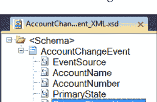

- 4. 此 BizTalk 项目应设置为部署到名为 Chapter3 的 BizTalk 应用程序。构建并将项目部署到指定的 BizTalk Server。

- 5. 确认部署成功后，启动 BizTalk WCF 服务发布向导。我们将使用此架构在 BizTalk Server 中公开一个 Web 服务入口点，以便 Dynamics CRM 2011 可以调用。

- 6. 在 WCF 服务类型向导页面中，选择 **WCF-BasicHttp** 适配器，并设置服务以公开元数据，并让向导在 **Chapter3** 应用程序中为我们生成一个接收位置：

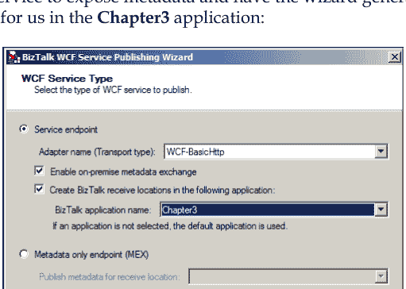

- 7. 在创建 WCF 服务向导页面中，选择将架构发布为 WCF 服务。此选项使我们能够对与服务相关的命名进行精细控制。

- 8. 在下一页中，删除服务定义中已有的双向操作。将最顶层的服务定义重命名为 AccountChangeService 并为服务分配相同的名称。右键单击服务并创建一个名为 PublishAccountChange 的新单向操作。右键单击操作的请求消息并从 BizTalk 项目的 DLL 中选择 AccountChangeEvent 消息：

- 9. 在以下向导页面中，将服务的命名空间设置为 http://Chapter3/AccountServices。

- 10. 接下来，将我们的服务位置设置为 http://localhost/AccountChangeService 并选择允许匿名访问生成的服务的选项。最后，通过在最终向导页面上单击创建按钮来完成向导。

- 11. 确认向导成功创建了 IIS 主持的 Web 服务以及 BizTalk 接收端口/位置。确保 IIS Web 服务在具有访问 BizTalk 数据库权限的应用程序池下运行。

- 12. 为了测试此服务，首先转到 BizTalk Server 管理控制台并找到 Chapter3 应用程序。

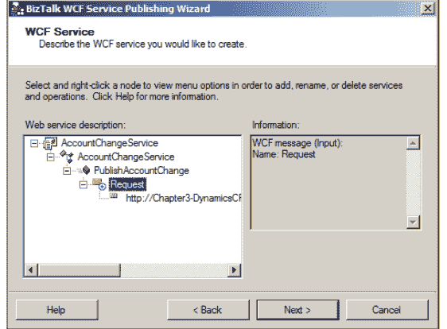

- 13. 右键单击 **Send Ports** 文件夹并创建一个新的、静态的单向发送端口，命名为 **Chapter3.SendAccountChange.FILE**。将发送端口设置为使用 FILE 适配器，并选择章节代码包中存在的 `FileDrop\DropCustomerChangeEvent` 文件夹：

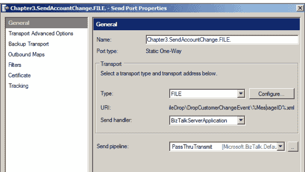

- 14. 此发送端口应侦听所有账户变更事件消息，而不管它们来自哪个接收位置（和系统）。转到此发送端口的 **Filters** 选项卡。将筛选器 **Property** 设置为 **BTS.MessageType**，并将筛选器 **Value** 设置为 `http://Chapter3-DynamicsCRM.AcctRouting.AccountChangeEvent_XML#AccountChangeEvent`。

- 15. 剩下的就是测试我们的服务。打开 WCF 测试客户端应用程序并添加对 `http://localhost/AccountChangeService/AccountChangeService.svc` 的新服务引用。

- 16. 调用 `PublishAccountChange` 方法，如果一切配置正确，我们将看到 BizTalk Server 发出的与我们的服务输入参数匹配的消息：

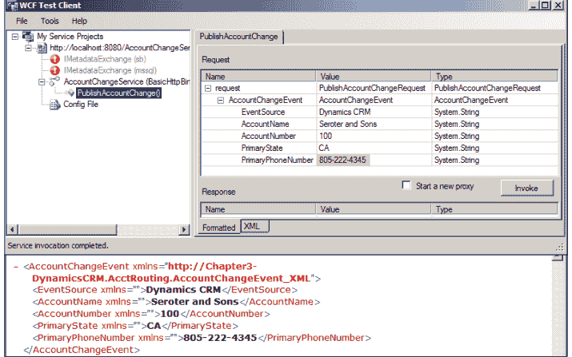

我们现在已准备好编写 Dynamics CRM 插件，该插件调用此 BizTalk 服务。

## 编写 Dynamics CRM 插件

Dynamics CRM 插件是使用自定义代码扩展产品开箱即用行为的强大方法。我们为本次练习构建的插件调用了上面构建的服务。

开始之前，请确保已下载 Dynamics CRM 2011 SDK 并将 `microsoft.xrm.sdk.dll` 程序集安装到全局程序集缓存中。

- 1. 在现有的 Chapter3-DynamicsCRM Visual Studio 2010 解决方案中，向解决方案添加一个名为 `Chapter3-DynamicsCRM.AcctPlugin` 的新类库项目。

- 2. 为此项目添加新引用并指向 `microsoft.xrm.sdk.dll` 程序集。此程序集包含我们正确定义插件所需的接口和类型。

- 3. 现在，我们需要对 BizTalk 生成的 WCF 端点进行服务引用。选择为项目添加新的服务引用。指向我们之前创建的服务并将命名空间设置为 **AcctChangeSvc**：

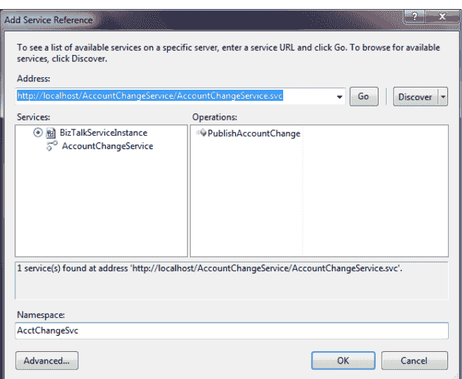

- 4. 向项目添加一个名为 `AccountEventPlugin.cs` 的新类文件。

- 5. 在新类的顶部，添加两个额外的 "using" 语句，指向 `Microsoft.Xrm.Sdk` 和 `System.ServiceModel`。这些程序集包含我们定义插件和消费 BizTalk 生成的服务所需的一切。

- 6. 公共类应实现 `IPlugin` 接口，该接口有一个名为 `Execute` 的单个必需操作：

```
public class AccountEventPlugin : IPlugin
{
    public void Execute(IServiceProvider serviceProvider)
    {
    }
}
```

- 7. 根据您的用例，您可能需要在 Dynamics CRM 记录上存储成功插件调用的结果。在此场景中，我们将简单地将插件执行详细信息记录到计算机的事件日志中。因此，Execute 操作中的第一行如下：

```
System.Diagnostics.EventLog.
WriteEntry("Application", "Plugin invoked successfully", System.
Diagnostics.EventLogEntryType.Information);
```

- 8. 接下来，我们需要获取有关传递给插件的数据实体的上下文。IPipelineExecutionContext 包含此类信息，以及插件正在执行的运行时环境：

```
IPluginExecutionContext context = (IPluginExecutionContext)
serviceProvider.GetService(typeof(IPluginExecutionContext));
```

- 9. 我们将从 Account 中提取数据，因此需要一个引用此实体的变量。在声明此变量时，其值为 null：

```
Entity accountEntity = null;
```

- 10. 因为插件可以在各种场景中使用，因此进行一些预防性错误检查是明智的。首先，我们可以确保传递给插件的对象确实是 Dynamics CRM 实体。前面定义的上下文对象包含一组输入参数，其中包含来自请求消息的数据：

```
if (context.InputParameters.Contains("Target") && context.
InputParameters["Target"] is Entity)
{
}
```

- 11. 如果插件目标是实体，则将之前定义的 accountEntity 变量设置为传递给插件的实体：

```
//retrieve entity from input params
accountEntity = (Entity)context.InputParameters["Target"];
```

- 12. 我们本可以将此插件绑定到任何 Dynamics CRM 实体，因此应该检查并确保传递给插件的实体类型有效：

```
//if the target account type isn't "account" exit
if (accountEntity.LogicalName != "account")
{
    System.Diagnostics.EventLog.WriteEntry(
"Application",
"Target is not 'account' type",
System.Diagnostics.EventLogEntryType.Error);
    return;
}
```

- 13. 需要认识到的一件关键事情是，当 Dynamics CRM 事件管道中发生“更新”事件时，只有实体的已更改字段会被放入上下文的属性包中。为了访问账户实体的整个负载，我们可以使用 Image。Image 是实体在保存到 Dynamics CRM 之前或之后的表示。我们对 Account 实体感兴趣的四个字段可以从上下文的一部分 PostEntityImages 集合中检索。这里我们使用名称“PostEventImage”，并将在将此插件与 Dynamics CRM 注册时稍后引用它：

```
Entity acctImage = context.PostEntityImages["PostEventImage"];

string acctName = accountEntity["name"].ToString();
string acctNumber = accountEntity["accountnumber"].ToString();
string state = accountEntity["address1_stateorprovince"].ToString();
string phone = accountEntity["telephone1"].ToString();
```

- 14. 借助必要的数据元素，我们现在可以创建 WCF 服务输入对象。AccountChangeEvent 对象是之前建立的服务引用的一部分：

```
AcctChangeSvc.AccountChangeEvent acct = new AcctChangeSvc.AccountChangeEvent();
acct.EventSource = "Dynamics CRM";
acct.AccountName = acctName;
acct.AccountNumber = acctNumber;
acct.PrimaryState = state;
acct.PrimaryPhoneNumber = phone;
```

- 15. 我们现在可以从代码中调用服务。首先，创建一个对与 BizTalk 生成的服务关联的绑定类型的引用。在此示例中，使用没有任何安全设置打开的 BasicHttpBinding：

```
BasicHttpBinding binding = new BasicHttpBinding(BasicHttpSecurityMode.None);
```

- 16. 接下来，需要一个端点地址。输入与 BizTalk 端点关联的完整服务 URL：

```
EndpointAddress addr = new EndpointAddress("http://localhost/AccountChangeService/AccountChangeService.svc");
```

- 17. 这些信息就是实例化我们在服务引用中定义的服务客户端所需的一切：

```
AcctChangeSvc.AccountChangeServiceClient client =
    new AcctChangeSvc.AccountChangeServiceClient(binding, addr);
```


18. 调用 PublishAccountChange 操作，并在成功后向机器的事件日志写入一条消息：

```
client.PublishAccountChange(acct);

System.Diagnostics.EventLog.WriteEntry("Application",
"Service called successfully",
System.Diagnostics.EventLogEntryType.Information);
```

插件现已准备好部署并在 Dynamics CRM 环境中注册。

## 注册插件

Microsoft 作为 SDK 的一部分提供了一个插件注册工具。该工具位于 SDK 的 `SDK\Tools\PluginRegistration` 文件夹中。在运行插件注册工具之前，将 `Chapter3-DynamicsCRM.AcctPlugin.dll` 复制到托管 Dynamics CRM 的服务器上的 `<installation directory>\Program Files\Microsoft CRM\server\bin\assembly`。如果您以后想调试它或不使用数据库存储选项，则需要将程序集放在此处。如果您选择将插件程序集存储在 Dynamics CRM 数据库中，并且不关心调试插件，那么在注册期间程序集可以位于任何位置：

- 1. 插件注册工具作为示例应用程序包含在 Dynamics CRM SDK 中。前往我们解压 SDK 的位置并导航到 `tools\pluginregistration` 文件夹。构建项目并启动可执行文件。
- 2. 连接到 Dynamics CRM 2011 实例。
- 3. 点击注册新程序集的选项：
- 4. 导航到 `Chapter3-DynamicsCRM.AcctPlugin.dll` 程序集并点击 **加载程序集**。

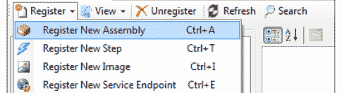

- 5. 将隔离模式指定为 **无**。还有一个额外的 **沙盒** 选项，它对该模式下运行的插件引入了一系列限制。沙盒插件在访问文件系统、事件日志、网络等方面有限制。当提供托管环境时，这是一个非常有用的选项，因为提供商可以限制共享环境中每个客户可以部署的插件类型。
- 6. 接下来，选择存储插件的位置。默认选项是 **数据库**，但我们也可以将文件存储在磁盘上或全局程序集缓存中。将位置设置为 **数据库**。
- 7. 点击 **注册选定的插件** 按钮以加载并在 Dynamics CRM 数据库中注册插件：

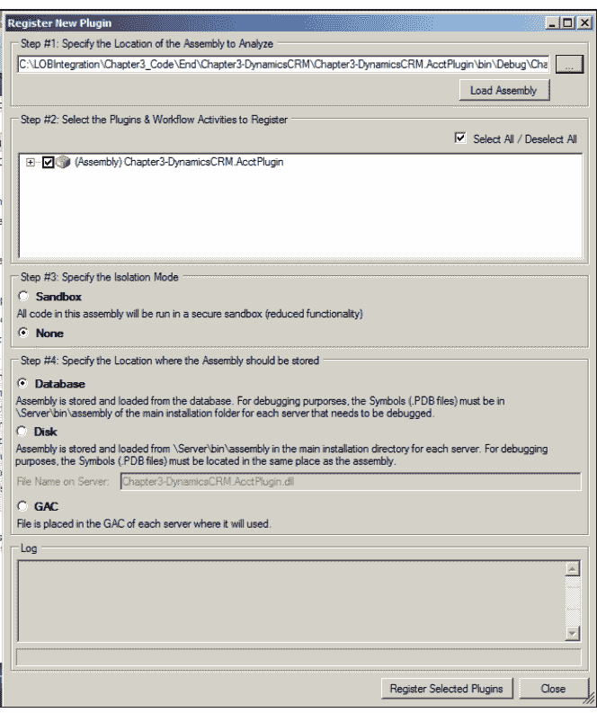

- 8. 接下来，在 **已注册的插件和自定义工作流活动** 窗口中，选择我们的新插件，然后从菜单中选择 **注册**，再选择 **注册新步骤**。
- 9. 此窗口允许我们注册应触发插件的事件和实体。将事件（在 Dynamics CRM 中称为 **消息**）设置为 **更新**。有许多消息选项，包括 Create、Close、Merge、Retrieve 等。
- 10. 将 **主实体** 值设置为 **account**。这是其消息将启动插件的实体。请注意，通过使用 **筛选属性** 属性，我们可以设置实体的哪些字段会触发消息。
- 11. 将 **事件管道执行阶段** 设置为 **后操作**。插件在实体处理的执行管道内运行。在“pre”阶段运行的插件在消息保存到 Dynamics CRM 之前运行。这是在进行数据验证的有用位置。“post”阶段是数据提交到 Dynamics CRM 后应运行逻辑的好地方。在我们的例子中，我们希望在实体更新后将消息发送到 BizTalk Server。选择 **后操作** 旁边的单选按钮。
- 12. 最后，设置执行模式。插件可以同步或异步运行。在保存之前验证数据的插件应同步运行，以便在遇到任何错误时通知用户。在这种情况下，我们的服务应在 Dynamics CRM 用户完成实体更新后执行，并且在调用 BizTalk 服务时我们不想中断或延迟用户。将 **执行模式** 设置为 **异步**：

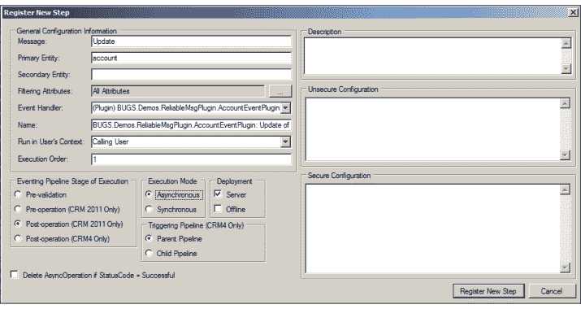

13. 在步骤注册后，我们的最后一步是注册一个映像。请记住，Update 消息仅包含已更改的字段。如果我们需要访问实体的其他字段，我们必须调用 Dynamics CRM 服务，或者更好的是，使用传递到插件中的映像。从 **已注册的插件和自定义工作流活动** 窗口中选择插件，选择 **注册**，然后点击 **注册新映像** 按钮。

14. 将 **映像类型** 设置为 **后映像**，并将 **名称** 和 **实体别名** 设置为 **PostEventImage**。**参数** 设置允许我们设置实体中希望在映像中可用的字段。将此值保留为 **所有属性**。最后，点击 **注册映像** 按钮。

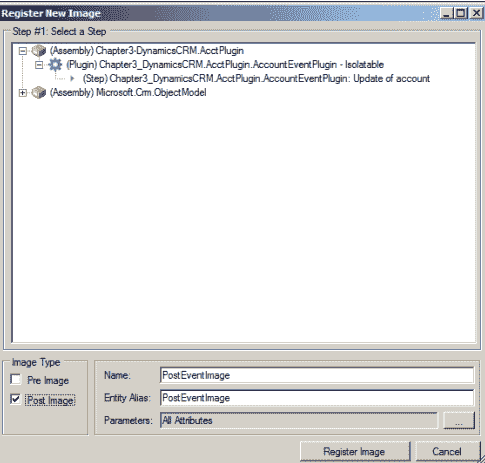

15. 此时，我们的配置应如下所示：

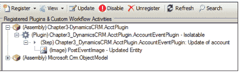

我们现在已成功构建了 Dynamics CRM 2011 插件并将其注册到系统中。此插件将在账户记录保存后异步触发，并在 `IPluginExecutionContext` 对象中传递完整的映像。

## 测试插件

要测试此配置，我们只需更改特定账户的详细信息即可。由于我们注册此插件在账户实体的任何更改时触发（而不是过滤哪些属性启动插件），任何更改的属性都可以：

- 1. 打开 Dynamics CRM 2011 并导航到“Accounts”视图。
- 2. 打开任何现有账户以查看其属性。

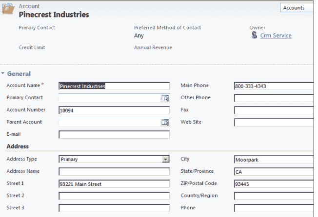

- 3. 更改账户的任意一个属性。在上面的示例中，我将账户号码从 10094 改为 10095。插件应几乎立即启动。检查托管 Dynamics CRM 2011 的机器的事件日志并观察表示成功的事件。
- 4. 接下来，切换到 BizTalk Server 发送账户更改事件到的文件夹，并确认事件已发布在那里。

```
<AccountChangeEvent xmlns="http://Chapter3-DynamicsCRM.AcctRoute">
  <EventSource xmlns="">Dynamics CRM</EventSource>
  <AccountName xmlns="">Pinecrest Industries</AccountName>
  <AccountNumber xmlns="">10095</AccountNumber>
  <PrimaryState xmlns="">CA</PrimaryState>
  <PrimaryPhoneNumber xmlns="">800-333-4343</PrimaryPhoneNumber>
</AccountChangeEvent>
```

此简单测试展示了 Dynamics CRM 实体中的更改如何立即向 BizTalk Server 发送消息以进行额外处理。

## 摘要

Microsoft Dynamics CRM 2011 提供了多种集成选项。虽然它不再为 BizTalk 消费提供强类型 SOAP 接口，但我们有多种方式向 Dynamics CRM 发送消息。要将消息从 Dynamics CRM 发送到 BizTalk Server，我们有许多选择，包括本章中演示的插件模型。随着 Dynamics CRM 2011 在市场上的成熟，预计将看到更多将其与 BizTalk Server 集成的创造性方法。

在下一章中，我们将了解如何安装 WCF-SAP 适配器的先决条件 DLL。了解扩展的、定制的和开箱即用的 IDOC 以及如何发送和接收它们。
