## 4 WCF SAP 适配器—发送和接收 IDOC

### WCF SAP 适配器—发送和接收 IDOC

SAP 是一家大型企业软件公司，于 1972 年在德国曼海姆成立。SAP 是 Systeme、Anwendungen、Produkte 的缩写，翻译成英语为 Systems Applications and Products。该公司历史上专注于构建业务应用程序，因为五位原始联合创始人以前曾在 IBM 工作。

SAP 提供了一个全面的开发平台，并许可针对行业特定功能量身定制的特定领域模块。一些模块包括人力资源 (HR)、财务 (FI)、物料管理 (MM)、工厂维护 (PM)、供应链管理 (SCM)、兼容单元 (CU)、公用事业 (ISU) 和客户关系管理 (CRM)。除了这些模块之外，还存在称为 BASIS 的底层平台组件。BASIS 管理员通常负责配置和维护关系数据库管理系统 (RDBMS)、部署传输（部署包）以及为请求连接到 SAP 接口的外部系统配置访问权限。

在本章中，我们将讨论以下主题：

- 什么是 SAP？
- 为什么人们使用它？
- SAP 的市场份额
- 为什么人们选择 BizTalk 与 SAP 集成？
- BizTalk 开发人员可能面临的挑战
- WCF SAP 适配器的安装
- 先决条件文件
- 所需的 SAP DLL


- 32 位与 64 位注意事项
- WCF-SAP 适配器与 WCF 自定义适配器
- IDOC 架构生成
- 什么是 IDOC？
- 入站与出站 IDOC 的区别
- IDOC 深度解析
- 控制记录
- 合作伙伴配置文件/程序 ID
- 扩展 IDOC
- 构建 BizTalk 应用程序
- 测试 BizTalk 应用程序
- 自定义 IDOC
- 平面文件 IDOC 注意事项

## 为什么人们使用 SAP？

许多中型和大型企业都依赖 SAP 来提供运行其业务的软件。 通常，这些组织采用的是“购买”而非“构建”的理念。 许多 CIO 倾向于这种做法，因为构建软件可能不是公司的核心竞争力。 由于 SAP 也提供开发平台，企业通常可以自定义与内部实践不符的 SAP 功能。 SAP 的定制相当常见，因为每个企业都不同，而且世界各地各司法辖区的法规也各不相同。

由于 SAP 平台非常全面，大多数开发人员或顾问会专注于特定模块，例如物料管理 (MM) 或工厂维护 (PM)。 在每个模块中，SAP 资源会专攻功能角色或更技术性的 ABAP 角色。 ABAP，即高级业务应用编程，是一种与 COBOL 非常相似的编程语言。 ABAP 仍然是 SAP 程序员构建程序时使用的主要语言。 近来，随着 SAP 引入 NetWeaver 堆栈，Java 开始变得流行。 NetWeaver 是 SAP 向面向服务架构 (SOA) 转型的尝试，这与 SAP 所建立的主机式文化截然不同。

NetWeaver 中直接与 BizTalk 竞争的组件称为流程集成 (PI)。 PI 可用于在模块间集成 SAP 功能，也可用于与其他外部系统集成。 PI 拥有与 BizTalk 类似的工具，包括消息转换、业务流程编排和适配器等功能。

## 为什么人们选择 BizTalk 来集成 SAP？

BizTalk 通常会与 PI 竞争，当组织开始将 SAP 与其他内部和外部系统集成时。 有些组织会选择 SAP 路线，其他组织会选择 Microsoft 路线，还有一些组织会使用这两种技术的组合来解决其集成需求。

选择引入 BizTalk 的组织通常出于以下原因：

- SAP PI 资源稀缺且昂贵
- Microsoft 拥有出色的开发生态系统
  - 为了验证这一点，只需浏览 Microsoft 的 MSDN 论坛、BizTalkGurus.com 或现有的众多 BizTalk 博客即可。 BizTalk 集成相关信息的数量在 BizTalk 的竞争对手中是无与伦比的。
- 一致的开发体验
  - 许多，如果不是大多数，BizTalk 开发人员在涉足 BizTalk 之前曾担任过 .NET 程序员。 虽然一些集成概念对 .NET 程序员来说很陌生，但他们开发应用程序的环境并非如此。 .NET 和 BizTalk 开发人员都在 Visual Studio 中执行开发任务。 添加服务引用和架构开发等任务在这两种技术之间也极其相似。 SAP 平台上的开发工具不具备 Visual Studio 所提供的精细度和持续改进。
- 开发人员生产力
  - Microsoft 赞助了一项生产力研究，以确定 PI 与 BizTalk 之间的总拥有成本。 BizTalk 与 SAP PI 相比表现非常出色。 整个研究可在以下位置找到：http://www.microsoft.com/downloads/en/details.aspx?FamilyID=6EC68631-2B4C-485F-83CF-7C26893839C4&displaylang=en

另一个需要考虑的方面是你将集成哪些其他系统。 BizTalk 的优势之一是能够很好地与 Microsoft 和非 Microsoft 平台集成。 本书本身就是 BizTalk 能够与如此多不同平台集成的证明。 这一观点通常是促使决策者最终选择 BizTalk 的关键因素。 BizTalk 能够可靠、高效、经济地与 SAP 集成，并且还能与其他非 SAP 系统集成。 虽然 SAP PI 非常擅长与 SAP 集成，但在与非 SAP 系统集成时表现并不理想。

## BizTalk 开发人员可能面临的挑战

BizTalk 开发人员在与 SAP 集成时面临的一些最具挑战性的障碍并非技术性的。 通常，这些挑战与政治有关。 许多 SAP 资源对 Microsoft 的看法是，Microsoft 的系统不稳定、未准备好用于企业环境，并且充满安全漏洞。 考虑到大多数 SAP 系统运行在 UNIX 或其衍生系统之上，这些看法并不令人意外。 事实是，Microsoft 在企业领域已经成熟，可以与 SAP、Oracle 和 IBM 等竞争。 其他担忧通常涉及 BizTalk 适配器是否对 SAP 系统做了不应该做的事情。 我记得几年前有一位 BASIS 管理员坚决认为没有任何 Microsoft“连接器”会连接到他的系统。 在这些情况下，重要的是要强调 Microsoft 经历的认证流程，以确保其相关产品获得 SAP 认证。 BizTalk 适配器包恰好是获得 SAP 如此评级的这些技术之一。

领地之争经常发生，因为 SAP 资源可能会觉得“外来者”在侵占他们的地盘。 我过去曾与一位 SAP 顾问合作过，他坚称可以通过使用 SAP 数据仓库/商业智能来移动数据，从而完成集成工作。 这显然不是正确的决定，但那个人不想看到部分控制权转移到 Microsoft。

事实是，每当你构建跨多种技术和团队的集成解决方案时，你需要作为一个团队来构建、测试和排除解决方案的故障。 这要求开发人员和架构师放下偏见和自我，以便作为一个团队工作。 最终结果应该为组织提供价值，而不是参与其中的个人。 我发现在这方面有帮助的是尝试理解他们的术语。 如果你是新的 BizTalk“高手”，他们可能不会很高兴看到你在这里，更不用说学习你的术语了。 但是，如果你能学习他们的术语，可能会使过渡更顺利。

作为 BizTalk 开发人员，你需要与你的 BASIS 管理员建立积极的工作关系。 构建 IDOC 解决方案需要 BASIS 管理员付出一些努力，因为他们必须创建 BizTalk 账户、程序 ID 或合作伙伴配置文件，以便 BizTalk 处理各种 IDOC。

## WCF SAP 适配器的安装

WCF SAP 适配器的安装已在第一章中介绍过；然而，本章有几个具体的细节值得提及。

## 32 位与 64 位

如果我们的 BizTalk 环境是 32 位，则无需执行任何额外操作。 如果我们的 BizTalk 环境是 64 位，则需要同时安装适配器的 32 位和 64 位版本。 原因在于许多 BizTalk 工具仍然是 32 位应用程序，包括 Visual Studio 和 BizTalk 管理控制台。 因此，即使我们的运行时可能是 64 位，我们仍需要 32 位版本来生成架构并配置将使用 SAP 适配器的任何接收位置或发送端口。

## SAP 先决条件 DLL

安装 BizTalk 适配器包是不够的。 你需要从 SAP Marketplace 获取两个软件包。 SAP Marketplace 相当于 Microsoft 的 MSDN 和 TechNet 服务。 这是注册客户和合作伙伴可以获取 SAP 软件下载和技术文档的地方。 SAP Marketplace 需要登录，任何支付 SAP 支持的组织都会有一个。 最有可能的是我们的 BASIS 管理员拥有登录凭据，因此我们可能需要请他们为我们下载软件包。 此外，请注意，每个软件包都特定于 SAP 的某个版本，无论是 Unicode 还是非 Unicode 安装。 在下载任何软件包之前，最好与 BASIS 管理员进行沟通。


The first package that we need to obtain contains the SAP RFC SDK DLLs. These RFC DLLs get used during design time generation of SAP schemas and during the runtime operations when BizTalk is sending and receiving messages with SAP. Microsoft using these DLLs is a good thing and strengthens our case for having Microsoft handle the integration with an SAP system since we are using SAP code when establishing connections.

我们需要获取的第一个软件包包含 SAP RFC SDK DLL。这些 RFC DLL 在设计时生成 SAP 架构期间以及 BizTalk 与 SAP 发送和接收消息时的运行时操作期间使用。Microsoft 使用这些 DLL 是一件好事，并且加强了我们让 Microsoft 处理与 SAP 系统集成的理由，因为我们在建立连接时使用的是 SAP 代码。

The second package is called `R3DLLINST.zip` and contains the Microsoft runtime DLLs. Even though these are Microsoft DLLs, they are still available through the SAP Marketplace.

第二个软件包名为 `R3DLLINST.zip`，包含 Microsoft 运行时 DLL。尽管这些是 Microsoft DLL，但它们仍然可以通过 SAP Marketplace 获取。

Within the BizTalk Adapter Pack installation folder, an install guide called `InstallationGuide.htm` exists in the `C:\Program Files\Microsoft BizTalk Adapter Pack (x64)\Documents` folder for 64-bit systems. Similarly, a document will exist on a 32-bit system in the `C:\Program Files\Microsoft BizTalk Adapter Pack\Documents` folder. A table exists that describes the prerequisite DLLs that are required for specific versions of SAP. Microsoft has included a link within each section that will take us directly to the location within the SAP Marketplace to download the package and get more specific information. The SAP client version that we will be using for this chapter is SAP client 7.0 so the URLs that we will follow are:

在 BizTalk Adapter Pack 安装文件夹中，名为 `InstallationGuide.htm` 的安装指南位于 64 位系统的 `C:\Program Files\Microsoft BizTalk Adapter Pack (x64)\Documents` 文件夹中。同样，在 32 位系统上，文档将存在于 `C:\Program Files\Microsoft BizTalk Adapter Pack\Documents` 文件夹中。存在一个表格，描述了特定 SAP 版本所需的先决条件 DLL。Microsoft 在每个部分中都包含了一个链接，可直接带我们到 SAP Marketplace 中的位置下载软件包并获取更具体的信息。本章将使用的 SAP 客户端版本是 SAP client 7.0，因此我们将遵循的 URL 为：

| Download Purpose | SAP Note ID | Download URL |
|---|---|---|
| RFC SDK | 27517 | http://go.microsoft.com/fwlink/?LinkID=94691 |
| Microsoft Run Time DLLs | 684106 | http://go.microsoft.com/fwlink/?LinkID=94693 |

When we navigate to the SAP note for the installing the SAP RFC SDK, we are prompted to download the assemblies from another URL: `http://service.sap.com/swdc`.

当我们导航到安装 SAP RFC SDK 的 SAP 备注时，会提示我们从另一个 URL 下载程序集：`http://service.sap.com/swdc`。

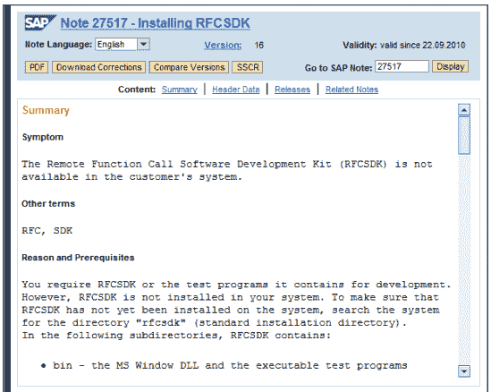

Once we navigate down the website's hierarchy of Support Packages and Patches - Entry by Application Group - Additional Components - SAP RFC SDK UNICODE - SAP RFC SDK 7.00 UNICODE we end up with the download section that we are interested in. If we are running a 64-bit environment, then we need both 32-bit and 64-bit packages due to the differences between the 32-bit BizTalk design/admin tools and the 64-bit BizTalk runtime.

一旦我们沿着网站的层级结构导航到 Support Packages and Patches - Entry by Application Group - Additional Components - SAP RFC SDK UNICODE - SAP RFC SDK 7.00 UNICODE，我们就会到达感兴趣的下载部分。如果我们运行的是 64 位环境，则需要同时获取 32 位和 64 位软件包，这是由于 32 位 BizTalk 设计/管理工具与 64 位 BizTalk 运行时之间的差异。

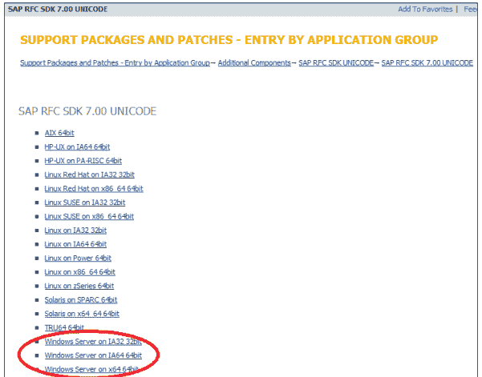

These software packages that exist in the SAP Marketplace have been packaged in a SAP specific package tool called SAPCAR. In order to open these packages, we need to download the SAPCAR tool.

这些存在于 SAP Marketplace 中的软件包已使用名为 SAPCAR 的 SAP 特定打包工具进行打包。为了打开这些软件包，我们需要下载 SAPCAR 工具。

We can download SAPCAR from the same location as where we found the RFC SDK.

我们可以从找到 RFC SDK 的同一位置下载 SAPCAR。

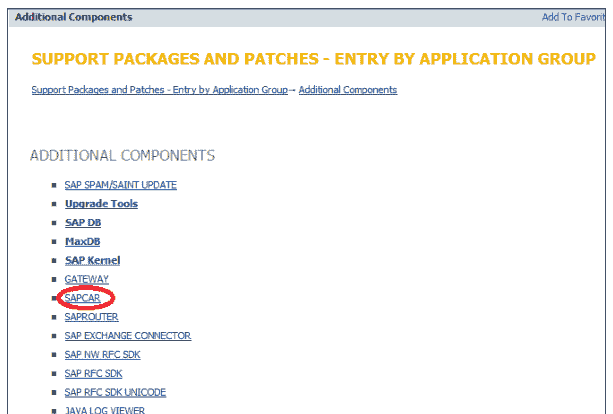

Once again we will need to choose the platform that we will be using when extracting the SAR package.

再次提取 SAR 软件包时，我们需要选择将使用的平台。

Once we have SAPCAR downloaded, we need to open a command line prompt and change our directory to the location where we saved the SAPCAR.exe. If we execute a command similar to the one below, we will be able to extract the SAR archive.

一旦下载了 SAPCAR，我们需要打开命令提示符并将目录更改为保存 SAPCAR.exe 的位置。如果执行类似于下面的命令，我们将能够提取 SAR 归档。

```
F:\Dev\SAP>SAPCAR_0-10003696.exe -xfv "RFC_25-20001765.SAR"

SAPCAR: processing archive RFC_25-20001765.SAR (version 2.01)

SAPCAR: 61 file(s) extracted
```

The result of this command being executed is that a folder called rfcsdk is created that will contain several sub folders including a bin and lib folders.

执行此命令的结果是创建一个名为 rfcsdk 的文件夹，其中将包含多个子文件夹，包括 bin 和 lib 文件夹。

- If we are running a 64-bit BizTalk environment, then we need to copy the SAP DLLs from the 32-bit SAR package and 64 bit SAR package to multiple locations.

- 如果我们运行的是 64 位 BizTalk 环境，则需要从 32 位 SAR 软件包和 64 位 SAR 软件包复制 SAP DLL 到多个位置。

- If you are installing both 32 bit and 64 bit Adapters and DLLs, you need to pay close attention to Microsoft's install instructions. The installation instructions that are provided as part of the adapter install specify the following:
  - "On a 64-bit computer, the 32-bit version of the DLLs must be added to the C:\Windows\SysWow64 folder. The 64-bit version of the DLLs must be added to the C:\Windows\System32 folder." These instructions defy common logic so be sure not to overlook this step. You can also read about this step in the SAP Adapter's Frequently Asked Questions page: http://msdn.microsoft.com/en-us/library/cc185322(BTS.10).aspx

- 如果您同时安装 32 位和 64 位适配器和 DLL，则需要仔细注意 Microsoft 的安装说明。随适配器安装提供的安装说明指定如下：
  - "On a 64-bit computer, the 32-bit version of the DLLs must be added to the C:\Windows\SysWow64 folder. The 64-bit version of the DLLs must be added to the C:\Windows\System32 folder." 这些说明违背了常识，因此请务必不要忽略此步骤。您也可以在 SAP Adapter 的常见问题解答页面中阅读有关此步骤的信息：http://msdn.microsoft.com/en-us/library/cc185322(BTS.10).aspx

In the demo environment for this book, the following 64-bit DLLs and libraries have been copied into the %WINDOWS%\System32 directory from the bin directory that was created in the SAPCAR process.

在本书的演示环境中，以下 64 位 DLL 和库已从 SAPCAR 过程中创建的 bin 目录复制到 %WINDOWS%\System32 目录中。

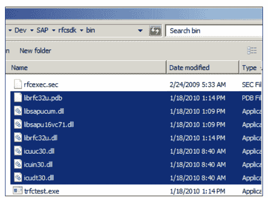

We now need to copy the following libraries from the 64-bit lib directory into the %WINDOWS%\System32 directory.

我们现在需要从 64 位 lib 目录复制以下库到 %WINDOWS%\System32 目录。

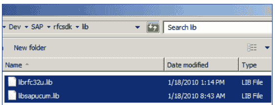

The end result is that the following nine files should all end up in the %WINDOWS%\System32 directory as illustrated in the following screenshot:

最终结果是以下九个文件都应位于 %WINDOWS%\System32 目录中，如以下屏幕截图所示：

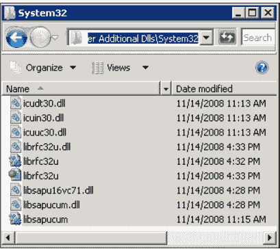

Similarly, the following 32-bit DLLs need to be copied into the %WINDOWS%\SysWOW64 directory. The 32-bit DLLs should come from the 32 bit SAR archive that we previously downloaded.

同样，以下 32 位 DLL 需要复制到 %WINDOWS%\SysWOW64 目录。32 位 DLL 应来自我们之前下载的 32 位 SAR 归档。

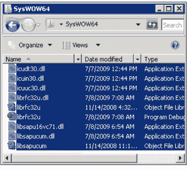

The next set of prerequisite DLLs that we need to deal with are the Microsoft runtime DLLs. Once again, these DLLs can be retrieved from the SAP Marketplace via the URL that is specified in the BizTalk Adapter Pack Installation Guide. Navigating to http://go.microsoft.com/fwlink/?LinkID=94693 will render the following page. After reviewing the content that SAP has provided, we want to click on the **Attachments** link.

我们需要处理的下一组先决条件 DLL 是 Microsoft 运行时 DLL。再次，这些 DLL 可以通过 BizTalk Adapter Pack 安装指南中指定的 URL 从 SAP Marketplace 获取。导航到 http://go.microsoft.com/fwlink/?LinkID=94693 将显示以下页面。在查看 SAP 提供的内容后，我们希望单击 **Attachments** 链接。

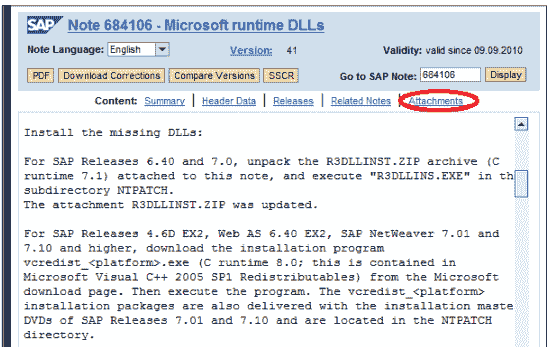

The file that we are interested in is r3dllinst.zip. Click on the link to download this package.

我们感兴趣的文件是 r3dllinst.zip。单击链接下载此软件包。

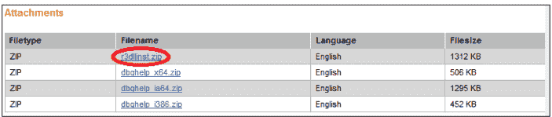

Once we have the r3dllinst.zip downloaded, we need to extract this package and will end up with the following files in the nt patch folder:

一旦下载了 r3dllinst.zip，我们需要提取此软件包，并在 nt patch 文件夹中得到以下文件：

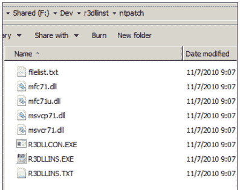

We now want to execute R3DLLINS.EXE and should get prompted with the following message. Click OK to proceed with the installation of these DLLs.

我们现在想要执行 R3DLLINS.EXE，并应收到以下提示消息。单击 OK 继续安装这些 DLL。

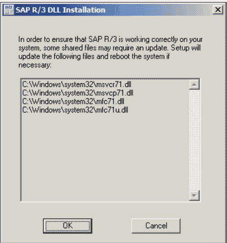

This concludes the prerequisite DLLs that are required in order for the SAP adapter to function properly. We will validate the SAP Adapter functions properly in an upcoming section when we generate IDOC schemas. If we are able to generate Schemas via Visual Studio, then we know our 32-bit installation is complete. We will not know about our 64-bit assemblies until we try to process a message.

这完成了 SAP 适配器正常运行所需的先决条件 DLL。我们将在生成 IDOC 架构时在即将到来的部分验证 SAP 适配器是否正常运行。如果我们能够通过 Visual Studio 生成架构，则我们知道 32 位安装已完成。我们在尝试处理消息之前不会知道 64 位程序集的情况。

## WCF-SAP Adapter vs WCF Custom Adapter with SAP binding

## WCF-SAP 适配器与带 SAP 绑定的 WCF 自定义适配器

When we generate schemas for SAP artifacts, the binding file that is also generated will use the WCF-Custom Adapter with an SAP Binding Type. With this binding type selected, we can manipulate any SAP-related property.

当我们为 SAP 工件生成架构时，同时生成的绑定文件将使用带 SAP 绑定类型的 WCF-Custom 适配器。选择此绑定类型后，我们可以操作任何与 SAP 相关的属性。

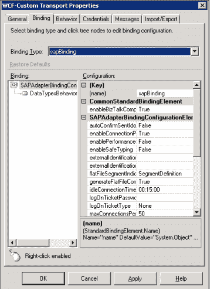

The challenge with using the WCF-Custom Adapter is that when we configure the URI for our SAP server, the interface is not very intuitive. The SAP connection string is confusing at best and one missing key stroke will result in an error.

使用 WCF-Custom 适配器的挑战在于，当我们配置 SAP 服务器的 URI 时，界面并不十分直观。SAP 连接字符串最多令人困惑，缺少一个键入就会导致错误。

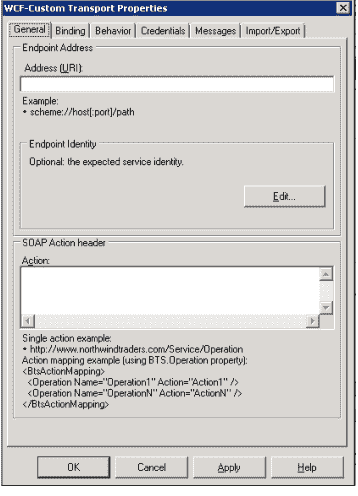

## WCF SAP Adapter – Sending and Receiving IDOCs

## WCF SAP 适配器 – 发送和接收 IDOC

Conversely, the WCF-SAP adapter is a little more intuitive when we configure our SAP URI. By clicking the Configure button, we have a well-organized table to populate, which reduces the complexity of providing a valid SAP connection string.

相反，在配置 SAP URI 时，WCF-SAP 适配器更直观一些。通过单击 Configure 按钮，我们有一个结构良好的表格需要填写，这降低了提供有效 SAP 连接字符串的复杂性。

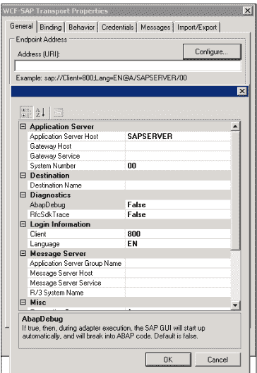

To create a WCF-SAP adapter, we need to perform the following steps:

创建 WCF-SAP 适配器，我们需要执行以下步骤：

- 1. Right mouse click on Adapters and then select New - Adapter.

- 1. 右键单击 Adapters，然后选择 New - Adapter。

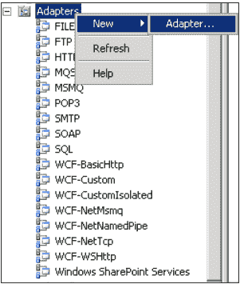

2. Click the Adapter drop-down list and select WCF-SAP. In the Name text box, type in WCF-SAP and click OK button.

2. 单击 Adapter 下拉列表并选择 WCF-SAP。在 Name 文本框中输入 WCF-SAP，然后单击 OK 按钮。

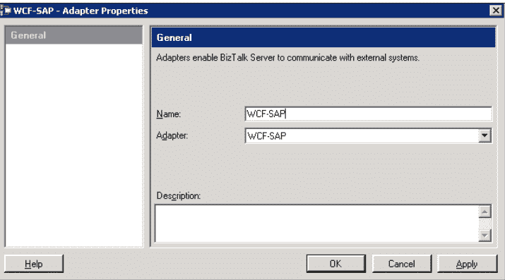

It is important to understand that no matter whether you use the WCF-Custom Adapter or WCF-SAP Adapter, you are not losing functionality. Using the WCF-SAP adapter simplifies the administration tasks that are involved in maintaining our BizTalk environment. Since the WCF-Custom adapter can leverage many different bindings including Oracle, SQL, SAP, and bindings that allow us to connect to the cloud, it is beneficial to explicitly create these adapters to avoid confusion.

重要的是要理解，无论您使用 WCF-Custom 适配器还是 WCF-SAP 适配器，都不会丢失功能。使用 WCF-SAP 适配器简化了维护 BizTalk 环境所涉及的管理任务。由于 WCF-Custom 适配器可以利用多种不同的绑定，包括 Oracle、SQL、SAP 以及允许我们连接到云的绑定，因此明确创建这些适配器以避免混淆是有益的。

## Supported SAP configurations

## 支持的 SAP 配置

The following SAP configurations are supported. New to BizTalk 2010 is the support for SAP 7. For the purpose of this chapter, the SAP system that is being used is SAP ECC 6.0 but the following versions are supported:

以下 SAP 配置受支持。BizTalk 2010 的新功能是支持 SAP 7。为了本章的目的，所使用的 SAP 系统是 SAP ECC 6.0，但以下版本受支持：

- Supported server versions: SAP 7, SAP ECC 6.0 Unicode, SAP ECC 5.0 Non-Unicode, SAP ECC 5.0 Unicode, SAP R/3 4.7 Non-Unicode, SAP R/3 4.7 Unicode, SAP R/3 4.6c Non-Unicode, SAP ERP 6.0 with EHP 4.0
- Supported client versions: SAP RFC SDK 7.11 UNICODE, SAP RFC SDK 7.1 UNICODE, SAP RFC SDK 7.0 UNICODE, SAP RFC SDK 6.4 UNICODE

- 支持的服务器版本：SAP 7、SAP ECC 6.0 Unicode、SAP ECC 5.0 Non-Unicode、SAP ECC 5.0 Unicode、SAP R/3 4.7 Non-Unicode、SAP R/3 4.7 Unicode、SAP R/3 4.6c Non-Unicode、SAP ERP 6.0 with EHP 4.0
- 支持的客户端版本：SAP RFC SDK 7.11 UNICODE、SAP RFC SDK 7.1 UNICODE、SAP RFC SDK 7.0 UNICODE、SAP RFC SDK 6.4 UNICODE


## IDOC 架构生成

在完成 SAP Adapter 的安装和配置后，我们现在将重点关注 IDOC。我们将探索 IDOC 的以下功能：

- IDOC 是什么
- 如何生成 IDOC 架构并理解重要属性

### IDOC 是什么？

IDOC 是 Intermediate Document（中间文档）的缩写，是一种 SAP 规范，用于在 SAP 系统内部以及与 BizTalk 等外部系统之间交换信息。SAP 人员将 IDOC 视为类似于 BizTalk 人员思考 XSD 架构的方式。不同之处在于 IDOC 结构类似于平面文件，而 XSD 架构基于 XML。

SAP 具有一致的结构，包括包含与 IDOC 关联的元数据的 Header 段。Header 在所有 IDOC 类型中保持一致，但 IDOC 的主体将根据 IDOC 支持的功能而不同。SAP 为不同的系统功能提供特定的 IDOC 结构。HR Timesheet IDOC 看起来会与采购订单大不相同。每个 IDOC 都有特定于该 IDOC 的段。我们可以将段视为类似于 XML 节点。如果您问 SAP 人员 IDOC 是否有重复的节点，他们可能不理解您的问题。但是，如果您问 IDOC 是否有重复的段，他们会立即理解。

### 如何生成 IDOC 架构

现在我们对 IDOC 有了一些基本了解，让我们继续生成一个 IDOC 以获得更好的理解。就像我们之前为 SQL Server 生成架构一样，我们将利用 Consume Adapter Service。我们可以通过右键单击 BizTalk 项目并选择 Add - Add Generated Items...Consume Adapter Service 来启动此向导。

1. 我们现在处于熟悉的领域，因为在之前的章节中使用过此向导。这次我们想要从“选择绑定”下拉列表中选择 sapBinding。

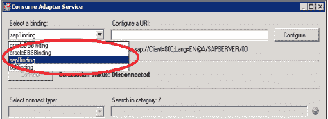

2. 我们现在需要配置 URI，可以通过单击 **Configure** 按钮来完成。我们需要处理的第一个区域是 **Security** 选项卡。在此选项卡中，关于 **Client credential type** 我们有几个不同的选项：

- None
- Windows
- Username
- Certificate

我大胆猜测我们永远不会遇到不需要提供凭据的情况，所以我们不会使用 **None**。本演练中使用的 SAP 系统不驻留在 **Windows** 平台上，因此该选项不可用。如果您的 SAP 系统支持 Windows 身份验证，那么使用这种类型的身份验证是值得考虑的。证明我们身份没有特定要求，因此不需要 **Certificate**。这就剩下提供标准的 **Username** 和 **Password**。通常，这些凭据由 SAP 安全管理员分配，有时由 BASIS 管理员分配。这些是用户通过 SAP GUI 访问 SAP 时提供的同类型凭据，只是具有额外的权限。

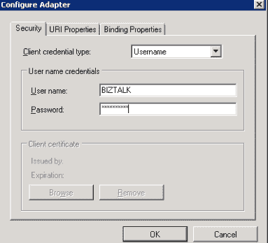

3. 我们接下来要关注的选项卡是 **URI Properties**。我们需要填充的基础属性包括：

- Application Server Host
- System Number
- Client

**Application Server Host** 是物理 SAP 应用服务器的名称，或更可能是虚拟 DNS 别名。此值在各个 SAP 景观，即 DEVELOPMENT/TEST/PRODUCTION 中很可能唯一。

**System Number** 是 SAP 特定实例的唯一数字标识符。**Client** 在此上下文中用于在 SAP 系统内分隔数据。例如，如果您有子公司共享一个 SAP 系统，但希望数据隔离，那么您可以创建多个客户端，以便区分一家公司的数据与另一家公司的数据。如果您熟悉 Dynamics CRM，**Client** 相当于一个 Organization。此数字在各个 SAP 景观中很可能相同，但在共托管情况下您可能有多个值。这些都是您很可能从 BASIS 管理员处获得的值。

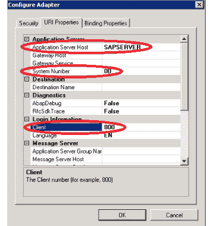

4. 我们需要关心的最后一个选项卡是 **Binding Properties** 选项卡。在此选项卡中，我们将指定与 BizTalk 如何与 SAP 交互相关的一些属性。需要注意的是，其中许多设置可以在您准备配置应用程序时在 BizTalk Administration 控制台中更改。在下一张截图中，我们将集中讨论两个特定属性：

- **ReceiveTimeout** – 可能是需要设置的最重要的生产属性之一。此属性指定 BizTalk 在关闭之前等待传入消息的持续时间。默认值是 10 分钟，时间几乎不够。如果我们不修改此设置，在生产环境中当超过此阈值时，BizTalk 停止监听 IDOC 时，我们可能会得到一些不理想的结果。最大值是 24.20:31:23.6470000（24 天）。要了解有关此属性的更多信息，请参阅以下博文：http://kentweare.blogspot.com/2010/03/biztalk-adapter-pack-sap-binding.html
- **EnableBizTalkCompatibilityMode** – 指定是否应加载 BizTalk 分层通道绑定元素，这将允许 BizTalk 事务流向 SAP。使用 BizTalk 中的 WCF-SAP Adapter 时，此值应始终设置为 true。

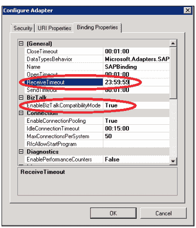

5. **Binding Properties** 选项卡中还有一些我们感兴趣的其他属性：

- **EnableSafeTyping** – 并非所有 SAP 数据类型都有 .NET 数据类型等价物。通过启用安全类型，BizTalk 在尝试将 SAP 数据类型绑定到 .NET 数据类型时对类型的要求会“更宽松”。了解此属性如何改变应用程序的行为非常重要。如果您期望从 SAP 获取日期，当此属性设置为 True 时，数据很可能将被转换为字符串。说实话，根据个人经验，我在与 IDOC 集成时不需要将此属性设置为 true，但在调用 RFC 和 BAPI 时需要更改该属性。
- **GenerateFlatFileCompatibleIDOC** – 此属性指定 `<appinfo>` 节点是否应包含段类型或段定义以解析平面文件 IDOC。通过将属性设置为 True，并不意味着您必须使用平面文件来处理 IDOC。最好将此值保持为 true，因为它为您将来使用平面文件提供了灵活性。
- **ReceiveIDOCFormat** – 以前使用基于 .NET Connector 的 SAP Adapter 时，您必须将 IDOC 作为平面文件处理。在 WCF 版本的 Adapter 中情况不再如此。我们现在有机会在不使用平面文件架构和管道的情况下以 XML 发送和接收消息。如果我们指定 **Typed** 则我们将以 XML 消息接收消息。我们也有能力指定 String 或 RFC。如果我们想使用平面文件架构/管道则需要指定 String。如果我们想以带有 RFC 参数的 WCF 消息接收 IDOC 则需要指定 RFC。请注意，这些属性可以在 BizTalk Administration 控制台中配置接收位置时进行修改。

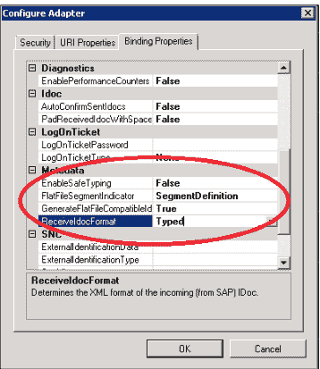

6. 现在配置已设置好，单击 OK 按钮返回主向导。

7. 只要我们正确配置了向导，现在就可以单击 Connect 按钮建立与 SAP 的连接。


8. 我们接下来需要问自己的问题是这是一个入站还是出站操作。重要的是记住提出此问题时的上下文。该问题是从 BizTalk 角度提出的。 此 IDOC 将是 BizTalk 的出站操作还是入站操作？由于我们将 IDOC 发送到 SAP，因此我们希望指定客户端（出站操作）。

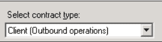


9. 如果我们想要从 SAP 接收 IDOC，我们将需要指定服务（入站操作）：

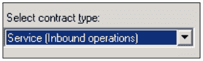

10. 下一个需要关注的区域是“搜索类别”功能。为了使该功能正常工作，我们需要指定“选择类别”，因为我们无法搜索 SAP 整个 BAPI、IDOC、RFC 和 TRFC 目录。为本次演示的目的，我们将选择 IDOC。

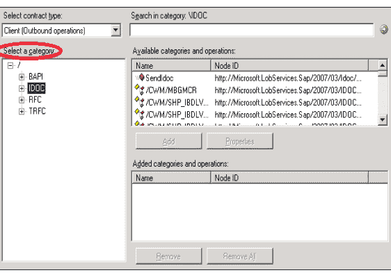

11. 在此文本框中，我们可以提供通配符搜索，然后点击绿色箭头执行搜索。在这种情况下，我们可以提供术语 CONF，这将搜索确认 IDOC。

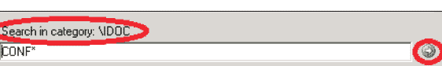

12. 我们将在“可用类别和操作”列表中看到搜索结果。我们感兴趣的特定 IDOC 是 CONF32 IDOC。一旦选择了此 IDOC，我们可以点击“添加”，然后该 IDOC 将被添加到“已添加类别和操作”列表框中。

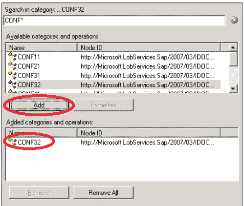

13. 使用旧的基于 .NET Connector 的适配器，一个 IDOC 等于一个 BizTalk XSD 架构。这已不再是这种情况。Consume Adapter Service 向导将为每个 IDOC 生成多个架构。原因在于向导会为特定的 SAP 类型创建架构，然后将其导入到主架构或父架构中。如果解决方案中有许多 IDOC，这可能会变得非常混乱，除非提供文件名前缀。如果我们提供前缀，例如 CONF32，所有架构都将以此前缀开头，这将使我们能够组织和区分我们的架构。

14. 一旦我们提供了此前缀，我们可以点击“确定”按钮，我们的 IDOC 架构将被生成。

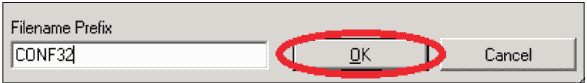

15. 虽然这种方法很方便，但它也带来了一些问题。当您点击“确定”按钮时，它将从 SAP 系统下载 IDOC 的每个版本。这可能会导致您拥有比感兴趣的更多架构，并且也可能导致 Consume Adapter Service 向导超时，因为要检索的数据太多。

16. 我们还有另一个选择，即浏览 IDOC 目录并找到我们感兴趣的 IDOC 的确切版本。正如以下图像所示，我们的 SAP 系统中有许多不同版本的 IDOC。选择您感兴趣的 IDOC 版本，点击“添加”按钮。如果我们使用之前提到的步骤下载所有版本，我们的 BizTalk 解决方案将会变得极其臃肿。通过浏览到我们感兴趣的确切版本，我们将只下载该版本以及包含复杂类型的任何支持架构。

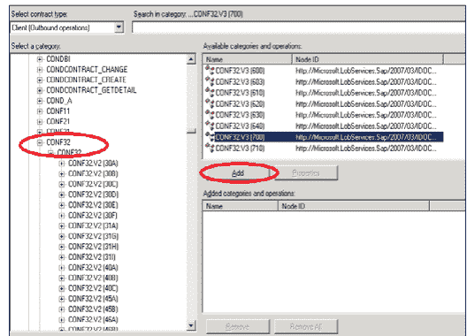

17. 我们现在有机会提供文件名前缀。如果我们不提供前缀，向导将提供一个非常通用的文件名，这无法将其与其他 SAP 架构区分开。我们应该使用描述性前缀，以便我们能够轻松地区分此架构与解决方案中将拥有的其他架构。我们可以点击“确定”按钮将架构添加到 BizTalk 解决方案中。

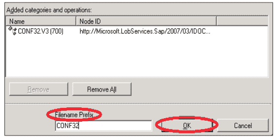

18. 我们现在会发现有六个构件被添加到我们的解决方案中。
我们感兴趣的主要架构是 CONF32IDOCoperation.CONF32.700.3.Send.xsd。剩余的架构用于支持发送 IDOC，我们还拥有一个绑定文件，其中包含我们用于配置 Consume Adapter Service 向导的值。

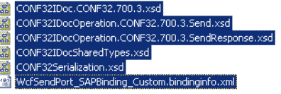

19. Consume Adapter Service 向导允许我们一次生成单个 IDOC 架构或多个 IDOC。当处理多个架构时，我们需要小心 IDOC 不要共享可能导致编译错误的底层公共类型。为了避免这些编译时错误，我们可以选中“生成唯一架构类型”复选框。通过这样做，我们将增加添加到解决方案中的架构数量。额外的架构将包含唯一的命名空间，这使我们能够避免编译时错误。

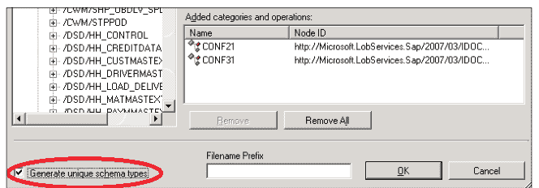

> 注：BizTalk 2010 的新功能是 SAP URI 可以在 Consume Adapter Service 向导的启动之间保存。以前，每次我们想要生成架构时，都必须填充整个 URI 配置。这是一个节省大量时间和极其方便的功能，已被添加。请注意，如果您使用用户名作为客户端凭据类型，则每次运行向导时仍需要提供密码。

## IDOC Deep Dive

现在是时候更深入地了解 IDOC 的结构，以便更好地理解 BizTalk 开发人员必须了解的一些段。

在每个 IDOC 架构中，您可以期望以下元素：

- EDI_DC40
- SAP table(s), that is, E2CONF5
- guid

EDI_DC40 节点也称为标头节点或记录。在此节点中，我们会发现需要填充的多个字段，包括：

| Element Name | Purpose |
|---|---|
| IDOCTYP | IDOC 的基本结构。 |
| CIMTYP | 自定义扩展的结构。如果扩展了 SAP 基本结构，则必须为扩展指定名称。 |
| MESTYP | 消息的逻辑表示。名称应提供业务上下文含义。 |
| SNDPOR | 发送系统端口 |
| SNDPRN | 发送系统/合作伙伴 |
| SNDPRT | 发送方合作伙伴类型 |
| RCVPRT | 接收方合作伙伴类型 |
| RCVPRN | 接收系统/合作伙伴 |
| IDOCTYP | IDOC 的基本结构 |

根据 IDOC 的不同，IDOC 中可能表示一个或多个 SAP 表。在 CONF32 IDOC 的情况下，只有一个，称为 E2CONF5。在此段或节点中，有多个字段需要我们填充。

| Element Name | Purpose |
|---|---|
| LDATE | 确认的逻辑日期/实际日期。在我们的情况下，我们只需提供当前日期。 |
| BUDAT | 确认的过账日期。在我们的情况下，我们只需提供当前日期。 |
| LTIME | 确认的逻辑时间/实际时间。在我们的情况下，我们只需提供当前时间。 |
| ERTIME | 确认的录入时间。在我们的情况下，我们只需提供当前时间。 |
| ARBPL | 工作中心 |
| AUFNR | 此字段用于提交作业的订单号。 |
| VORNR | 订单号通常与其关联操作，因此我们可以利用此字段提供操作号。 |
| ISMW | 已执行工作的持续时间。 |

最后，存在一个 GUID 元素，它与 SAP 事务 ID (TID) 相关联。我们可以提供自己的 GUID，或让适配器提供 GUID。

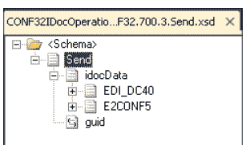

## Building a BizTalk application – Sending IDOC

我们将要构建的应用程序将从我们的工单管理系统接收车辆工时表，转换数据并构建 CONF32 确认 IDOC。您可能会问自己“车辆有工时表”？是的！此场景是现实世界解决方案的一个示例，我们在能源部门有员工在进行能源基础设施维护工作。就像我们期望跟踪员工在工作上花费的时间一样，我们也希望跟踪已使用设备的时长。车辆构成了作业总体成本的很大一部分，因此我们希望确保这些成本在 SAP 中得到记录。开箱即用的 CONF32 IDOC 允许我们在无需定制的情况下将此信息发送到 SAP。

1. 我们要进行的第一个任务是生成 **CONF32** IDOC。为了简化此过程，我们可以利用本章中 *How to Generate IDOC schemas* 部分讨论的步骤。最终结果是我们应该具有以下架构：

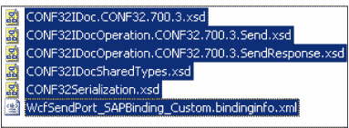

2. 下一个需要关注的区域是生成表示工单管理系统将发送的 XML 的架构。本章源代码中存在一个名为 `VehicleTime.xsd` 的简单架构。

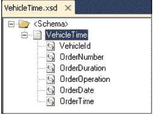

3. 我们现在需要构建一个名为 `VehicleTime_to_CONF32.btm` 的映射。在此映射中，我们将有两个选项卡。我们要构建的第一个选项卡是 **Control Record** 选项卡。在此选项卡中，我们需要向 SAP 提供有关我们即将发送的 IDOC 的元数据。SAP 将使用此信息来确定应如何处理 IDOC。SAP 还将使用提供的合作伙伴信息来确定提交 IDOC 的 BizTalk 用户是否具有适当的权限。


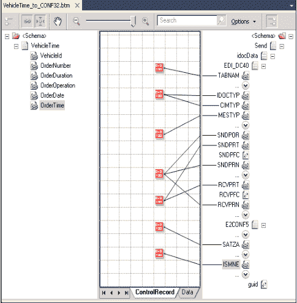

4. 下表包含已提供给每个节点的数值。此信息通常是静态的，但最好将此信息存储在公共的 Helper 类中，这样如果需要更改，就可以在一个地方进行修改。为本章的目的，我们将使用 String Concatenate functoids 直接嵌入此信息。请注意，像 SNDPOR、SNDPRN 和 RCVPRN 这样的某些值在你的 SAP 系统中很可能不同。

| Node | Value |
|------|-------|
| /EDI_DC40/TABNAM | EDI_DC40 |
| /EDI_DC40/IDOCTYP | CONF32 |
| /EDI_DC40/CIMTYP | CONF32 |
| /EDI_DC40/MESTYP | CONF32 |
| /EDI_DC40/SNDPOR | MTSIDOC |
| /EDI_DC40/SNDPRT | LS |
| /EDI_DC40/SNDPRN | MTSIDOC |
| /EDI_DC40/RCVPRT | LS |
| /EDI_DC40/RCVPRN | MTSIDOC |
| /E2CONF5/SATZA | I20 |
| /E2CONF5/ISMNE | H |

5. 我们接下来要创建的是 **Data** 选项卡。在此选项卡中，我们将专注于从工单管理系统传递的数据，并执行 SAP 所需的任何格式处理。

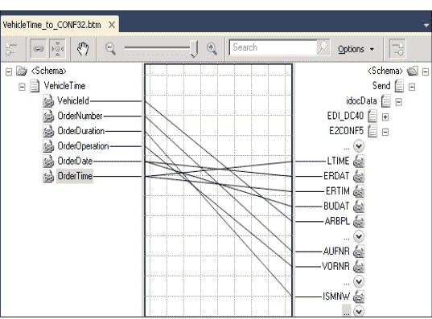

Note: BizTalk 2010 映射器的新功能是可以仅显示当前已映射的节点。要启用此功能，请单击 **Switch to relevance tree view for destination schema** 按钮。选中后，BizTalk 映射器将仅显示当前正在映射的节点。此功能在映射具有许多节点的 SAP IDOC 时非常有帮助。

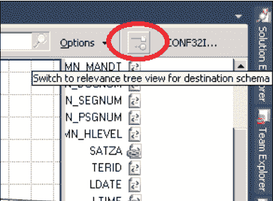

6. 在 BizTalk 映射完成后，我们可以专注于 BizTalk 协调，该协调将负责在工单管理系统和 SAP 之间编排事件。协调将负责以下功能：

- a. 接收包含车辆时间的工单管理请求。
- b. 将此请求转换为 SAP CONF32 IDOC 请求。
- c. 接收 SAP CONF32 IDOC 响应。
- d. 将 SAP CONF32 IDOC 响应写入磁盘，以便我们可以验证与 SAP 的交换是否成功。

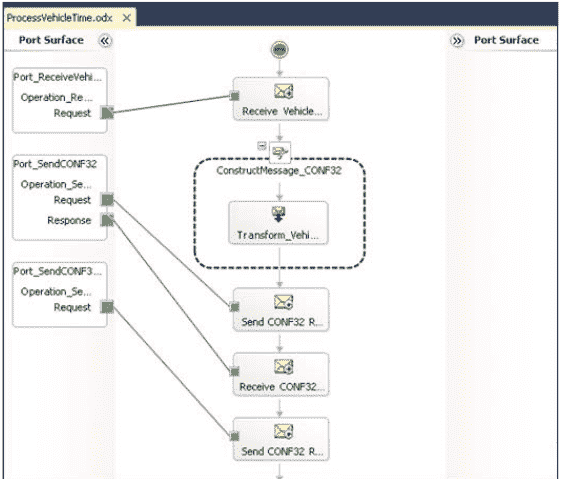

7. 由于我们不使用 Flat File 架构，而是选择使用 SAP 适配器的 SOAP 消息功能，因此现在可以通过右键单击解决方案并选择部署解决方案来部署我们的应用程序。

8. 进入 BizTalk 管理控制台后，我们会发现一个名为 Chapter04-SAPIDOCs 的应用程序现在已存在。

9. 在此应用程序中，我们可以找到一个名为 **ReceiveVehicleTimeSheet** 的接收端口和一个名为 **ReceiveVehicleTimeSheetFromDisk** 的接收位置。此接收位置将使用 **FILE** 适配器、**BizTalkServerApplication** 接收处理程序和 **XMLReceive** 接收管道。

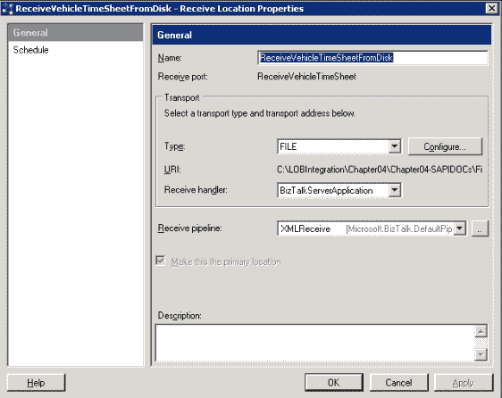

10. 我们将有两个发送端口，其中第一个是用于与 SAP 通信的发送端口。Consume Adapter 向导生成了一个绑定文件，我们可以使用它自动生成发送端口。此方法的问题在于绑定文件将使用 WCF Custom 适配器，这不允许我们轻松操作 SAP 连接详细信息。由于我们通常在非生产环境中创建 SAP IDOC 架构，因此我们不太可能充分利用生成的绑定文件，因为在每个 BizTalk 环境中的目标都会不同。

11. SAP 发送端口的名称为 **SendCONF32IDOC**。它将使用 WCF-SAP 自定义适配器、**BizTalkServerApplication** 发送处理程序、**XMLTransmit** 发送管道和 **XMLReceive** 管道。通过单击配置按钮，我们可以进一步探索 SAP 适配器公开的属性。

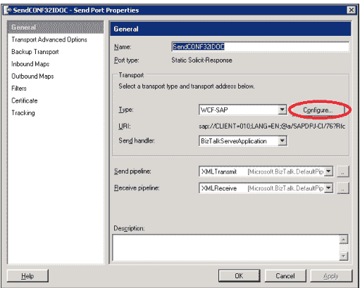

12. General 选项卡将公开我们的端点地址和 SOAP Action 头。要进一步探索地址 URI，我们可以单击配置按钮。

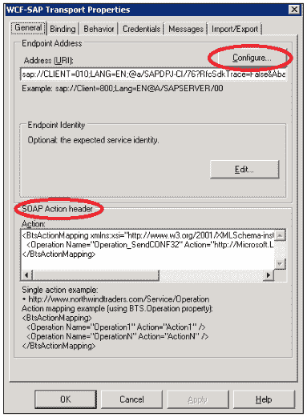

13. General 选项卡上的配置按钮是使用 WCF-Custom 适配器配合 SAP 绑定与使用 WCF-SAP 适配器之间的关键区别之一。如以下图像所示，WCF-SAP 适配器在配置 SAP 配置时为我们提供了更多选项。我们想要填充的关键属性是：

- a. Application Server Host
- b. System Number
- c. Client

14. 如果你不确定组织的数值，请联系你的 BASIS 管理员。

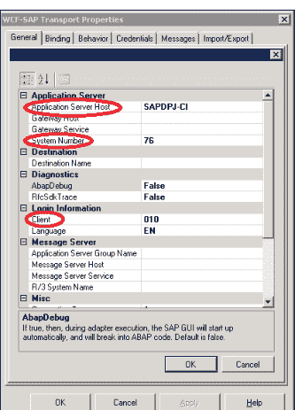

15. 我们需要关注的下一个选项卡是 Credentials 选项卡。在此选项卡中，我们将提供用于与 SAP 通信的 BizTalk 凭据。我们可以指定用户名/密码组合或 SSO 联盟应用程序。为本章的目的，我们将简单提供用户名/密码。

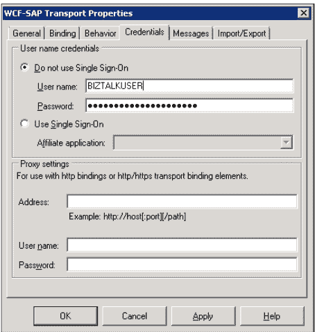

16. 我们需要创建的下一个发送端口是将 SAP IDOC 响应写入磁盘的发送端口。此发送端口的名称为 **SendIDOCResponseToDisk**，它将使用 **FILE** 适配器、**BizTalkServerApplication** 的发送处理程序、**PassThruTransmit** 的发送管道。

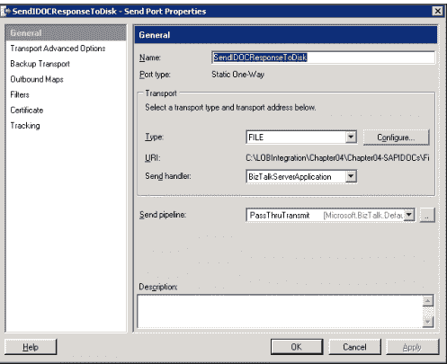

17. 现在我们需要配置我们的编排以使用我们刚刚创建的接收端口和发送端口。

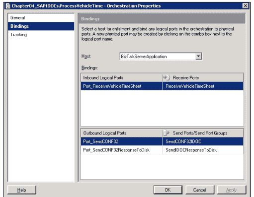

18. 现在我们可以启动我们的应用程序，以便准备进行应用程序测试。

## Testing BizTalk Application

我们的应用程序测试涉及将示例文件复制并粘贴到接收位置配置的热文件夹中。文件内容将包括：

- VehicleID
- Order Number
- Order Duration
- Order Operation
- Order Date
- Order Time

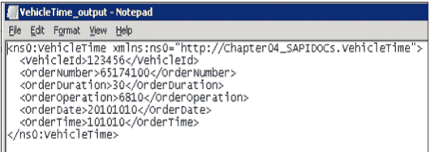

- 1. 要初始化测试，请复制并粘贴位于 C:\LOBIntegration\Chapter04\Chapter04-SAPIDOCs\FileDropfolder 的 VehicleTimeSample.xml 文件。
- 2. BizTalk 将使用此文件并开始处理文件。
- 3. 一旦 BizTalk 与 SAP 通信，SAP 应向 BizTalk 返回响应。
- 4. BizTalk 将采用此响应并生成一个名为 IDOCoutput{GUID}.xml 的文件。

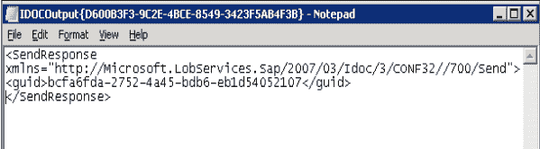

## Custom IDOCs

前面的示例包含了一个“开箱即用”的 CONF32 SAP IDOC。虽然能够开箱即用地与 SAP 集成极具吸引力，但现实是，对于组织感兴趣的每个集成场景都期望有一个开箱即用的 IDOC 是不现实的。大多数组织会在考虑构建自定义 IDOC 之前尝试使用开箱即用的 IDOC。当被迫构建时，SAP 开发人员有几个选项：

- Extend existing IDOCs.
- Copy an IDOC structure and modify as you see fit.
- Start a new IDOC from Scratch.

扩展 IDOC 涉及保持 IDOC 结构完整，但添加场景所需的额外段。这是当你只缺少几个段并希望利用 SAP 现有工作时理想的解决方案。

如果 SAP 有一个与你的场景 somewhat 相似的 IDOC，你可以复制该现有结构，然后根据需要添加或删除段。

虽然 SAP 确实提供了一个丰富的平台来运行你的业务，但它们不可能预见每一个集成场景。这就给我们提供了自定义构建一个解决我们独特集成场景的 IDOC 的选项。

BizTalk 能够通过这三种机制与 SAP 集成。使用开箱即用的 IDOC 是首选选项，因为它不需要自定义，并且你可以确保 SAP 在未来版本中提供支持。如果你编写自定义 IDOC 并且其执行的功能与 SAP 的升级路径冲突，你的组织将自行解决任何问题。

在生成自定义 IDOC 时，从 BizTalk 角度来看不需要任何特殊操作。我们继续使用 Consume Adapter Service 向导，就像我们尝试为开箱即用 IDOC 生成架构一样。


> Note: 如果构建自定义 IDOC 的 SAP 开发人员说 IDOC 可用，但在 Consume Adapter Service 向导中你看不到它在可用 IDOC 列表中，请要求他们确保 IDOC 已发布。

下面是一张自定义 IDOC 的图像。如你所见，它与 SAP 开箱即用 IDOC 看起来并没有太大不同。架构将同时具有 **idocData** 和 **EDI_DC40** 节点。剩余的节点或段是由 SAP 开发人员构建的。


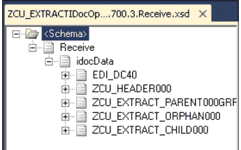

类似于开箱即用的 IDOC，我们的自定义 IDOC 架构也将继承共享类型。

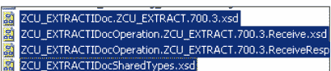

## 从 SAP 接收自定义 IDOC

- 1. 以下演练将描述接收自定义 IDOC（或标准 IDOC）所涉及的内容。本演练的源代码未包含在本书的源代码中，因为在 SAP 内部构建自定义 IDOC 超出了本书的范围。由于在与 SAP 集成时很可能会出现自定义场景，因此本演练包含在本章中，但会根据贵组织中 SAP 的实施方式而有所不同。

- 2. 接收带类型 IDOC 时，需要进行配置才能成功处理消息。当我们部署包含任何 IDOC 架构的 BizTalk 应用程序时，我们需要添加对 Microsoft.Adapters.SAP.BiztalkPropertySchema.dll 的引用。

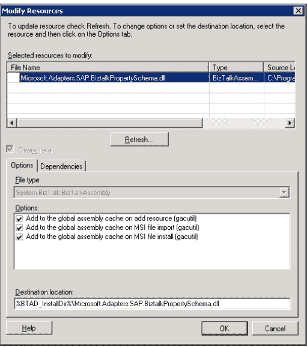

- 3. 如果未添加此引用，在尝试处理 SAP IDOC 时，您可以在事件查看器中看到以下运行时错误：

```
"System.Exception: Loading property information list by namespace failed or property not found in the list. Verify that the schema is deployed properly."
```

- 4. 由于此错误仅在首次接收 IDOC 时才会出现，将此资源引用添加到任何部署脚本中是您希望包含的内容。

- 5. 在放置了适当的引用后，我们可以继续配置我们的 BizTalk 应用程序，该应用程序由接收端口和发送端口组成。鲜为人知的是，在交换 IDOC 时，您可以选择指定单向或双向端口。IDOC 响应通常提供来自 SAP 的事务 ID，因此除非您有兴趣跟踪此信息，否则可能不需要使用双向端口。

- 6. 部署包含任何自定义 IDOC 架构的 BizTalk 应用程序。

- 7. 创建一个名为 **ReceiveCustomIDOC** 的单向接收端口和一个名为 **ReceiveCustomIDOCFromSAP** 的接收位置。我们将使用 **WCF-SAP** 适配器、**BizTalkServerApplication** 接收处理程序和 **XMLReceive** 接收管道。


- 8. 单击 **Configure** 按钮，以便我们可以提供 SAP 连接信息。

- 9. 进入 WCF-SAP 传输属性对话框后，我们需要单击 **Configure** 按钮以提供 SAP 连接信息。


- 10. 类似于我们前一个示例中的 SAP 发送端口，我们需要提供 **Application Server Host**、**System Number** 和 **Client**。


- 11. 如果我们向下滚动，将会发现一些在发送端口配置中未包含的额外属性：
  - a. **Gateway Host** – 根据 SAP 系统的配置，此值可能与 Application Server Host 相同。
  - b. **Gateway Service** – 此值通常以 "sapgw" 开头，后跟 System Number。
  - c. **Program Id** – 这是由您的 BASIS 管理员提供的数值。它也可能被称为 Partner Profile，并充当 SAP IDOC 接口的授权容器。例如，在 SAP 中此 **WOMIDOC Program ID** 配置中，将存在我们即将接收的此自定义 IDOC 的条目。此外，我们的 BizTalk 用户将被授予发送或接收这些类型 IDOC 的权限。如果 BizTalk 尝试发送其没有权限的 IDOC，SAP 将接受该消息但不会处理它。


- 12. 我们需要处理的下一个选项卡是 Other 选项卡。此选项卡为我们提供各种凭据选项。再次，我们将使用 Username/ Password 作为身份验证类型。


- 13. 接收端口配置完成后，现在是关注发送端口的时候了。在此简单场景中，我们不会让编排处理此消息，而是让发送端口订阅此接收端口并将 IDOC 的内容写入文件文件夹。此发送端口的名称为 SendCustomIDOCToDisk。它将使用 FILE 适配器、BizTalkServerApplication 发送处理程序和 PassThruTransmit 发送管道。

- 14. 在 Filters Property 中，我们希望针对我们的 ReceiveCustomIDOC Receive Port 创建一个订阅。这样做将允许我们处理通过接收端口接收的任何消息，并将其写入发送端口中指定的 URI。


- 15. 在此阶段，接收端口和发送端口都已配置好后，我们可以同时启用发送端口和接收位置。

## 测试 BizTalk 应用程序—接收自定义 IDOC

将 SAP 与 BizTalk 集成时，此过程的这一部分几乎总是变得困难。原因在于 BizTalk 会监听 SAP 消息。您无法指示 BizTalk 去从 SAP 检索 IDOC。您可以将其视为托管 Web 服务；客户端系统必须发起请求。在此情况下，客户端是 SAP。

SAP 是一个非常庞大的系统，有许多屏幕或事务需要调用才能启动向 BizTalk 发送 IDOC。最终结果是您几乎总是需要团队协作或记住生成 IDOC 的复杂步骤。随着小错误的解决，此过程可能会让 BizTalk 和 SAP 开发人员都感到沮丧。

对 SAP 开发人员和 BizTalk 开发人员都可能有益的方法是让 SAP 资源生成初始 IDOC 并让 BizTalk 处理该 IDOC。如果 BizTalk 开发人员需要对他的接口执行额外的测试，甚至负载测试，他可以通过使用名为 "WE19" 的 SAP 事务来实现。此事务将重新处理传入和传出的 IDOC。

如果我们想重新发送 IDOC 到 BizTalk，我们需要知道原始 IDOC 的 IDOC 编号，然后就可以从 SAP 重新提交消息到 BizTalk。为了获取 IDOC 编号，我们将使用名为 "WE02" 的事务。大多数 SAP 开发人员都可以访问这两个事务，因此 BizTalk 开发人员获得这些事务的相同访问权限不应太困难。除了在负载测试场景中尝试处理太多消息外，用户使用这两个事务几乎不会造成什么损害。

现在让我们逐步介绍浏览 WE02、获取 IDOC 编号，然后在 WE19 中使用该 IDOC 编号将 IDOC 提交到 BizTalk 的过程。

- 1. 登录 SAP GUI 后，在导航文本框中输入 WE02 并按 *Enter*。
- 2. 在 WE02 中，我们可以限制希望查询的时间范围。如果您的组织处理大量 IDOC，您希望确保此查询窗口很小。指定查询时间范围后，我们可以单击 **Execute** 按钮，该按钮以带绿色勾号的时钟表示。


- 3. 查询结果返回后，我们将看到最近发送或接收的 IDOC 列表。在屏幕左侧，我们可以通过单击 **Inbound** 或 **Outbound** IDOC 来细化结果。我们甚至可以在只关注该类型时单击我们感兴趣的特定 IDOC 类型。还值得注意的是此显示中包含的各种列。**Status** 和 **Status code** 列有助于了解 IDOC 的成功/失败情况，而 **Direction** 列有助于区分 IDOC 是入站还是出站。


- 4. 我们使用 WE02 事务的主要原因是获取之前发送的 IDOC 的 IDOC 编号。获取它的最简单方法是扫描 **IDOC Number** 列并记下我们感兴趣的 IDOC 的值。


5. 一旦我们有了 IDOC 编号，我们可以导航到 WE19 交易并在“现有 IDOC”文本框中填写该编号，且不带前导零。要执行该交易，请单击“执行”按钮。


6. IDOC 的段落现在将显示。我们现在需要决定 SAP 对此 IDOC 应该做什么。如果这是入站 IDOC，则我们将单击“标准入站”按钮。由于这是一个出站 IDOC，我们将单击“标准出站处理”按钮。需要注意的是，SAP 并不会重新处理此消息。它只是复制原始消息并通过端口将其发送到 BizTalk 服务器。当此消息发送到 BizTalk 时，SAP 内不会进行任何额外的重新处理。


7. 我们现在有机会指定希望发送到 BizTalk 的 IDOC 副本数量。在我们的场景中，我们将选择 1 份副本并单击绿色复选标记。此功能在 BizTalk 开发者希望进行应用程序负载测试时提供了有趣的机会。如果您决定使用 WE19 交易来对 BizTalk 应用程序进行负载测试，请确保您与 BASIS 团队进行沟通，以便减轻 SAP 中的任何性能问题。


8. SAP 现在将提交此消息并显示确认消息。


9. 正如预期，BizTalk 将接收此消息并将其发送到文件 drop。当我们打开文件时，我们将看到 IDOC 以 XML 形式表示，其基于 Consume Adapter Service 向导生成的 XSD 架构。

```
<Receive xmlns="http://Microsoft.LobServices.Sap/2007/03/Idoc/3/ZCU_EXTRACT//700/Receive">
  <idocData>
    <EDI_DC40 xmlns="http://Microsoft.LobServices.Sap/2007/03/Types/Idoc/3/ZCU_EXTRACT//700">
      <ZCU_HEADER000 xmlns="http://Microsoft.LobServices.Sap/2007/03/Types/Idoc/3/ZCU_EXTRACT//700">
      ...
      <ZCU_EXTRACT_PARENT000 xmlns="http://Microsoft.LobServices.Sap/2007/03/Types/Idoc/3/ZCU_EXTRACT//700">
        <DATAHEADERCOLUMN_SEGNAM>ZCU_EXTRACT_PARENT000</DATAHEADERCOLUMN_SEGNAM>
        <DATAHEADERCOLUMN_SEGNAM>010</DATAHEADERCOLUMN_SEGNAM>
        ...
        <CU_ID>C2S33NXXX</CU_ID>
        <CU_ACTION>INSTALL</CU_ACTION>
        <CU_CATEGORY>2</CU_CATEGORY>
        <CU_DESCRIPTION>DrPh #2 AGSR SB Haddock</CU_DESCRIPTION>
        <CU_TYPE>CONDUCTOR</CU_TYPE>
```

## Receiving flat file IDOCs

如果我们仔细检查 BizTalk 在前一场景中从 SAP 接收到的消息，我们会注意到命名空间中有一个有趣的地方。DOCREL（文档版本）包含在 Consume Adapter Service 向导生成的架构的命名空间中。

```
<Receive xmlns="http://Microsoft.LobServices.Sap/2007/03/Idoc/3/ZCU_EXTRACT//700/Receive">
  <idocData>
    <EDI_DC40 xmlns="http://Microsoft.LobServices.Sap/2007/03/Types/Idoc/3/ZCU_EXTRACT//700">
      <ZCU_HEADER000 xmlns="http://Microsoft.LobServices.Sap/2007/03/Types/Idoc/3/ZCU_EXTRACT//700">
      ...
      <ZCU_EXTRACT_PARENT000 xmlns="http://Microsoft.LobServices.Sap/2007/03/Types/Idoc/3/ZCU_EXTRACT//700">
        <DATAHEADERCOLUMN_SEGNAM>ZCU_EXTRACT_PARENT000</DATAHEADERCOLUMN_SEGNAM>
```

如果我们检查接收 IDOC 从 SAP 时填充的上下文属性，我们会发现 SAP 正在发送正在发送的 IDOC 的 DOCREL。


那么大问题是什么呢？这不是什么大问题，直到贵组织下一次执行 SAP 升级时。如果新的 SAP 版本会递增 DOCREL 编号，那么您的 BizTalk 订阅将无效，因为您的订阅将查找版本 700 的文档，而 SAP 将发送版本 710（或其他编号）。

一种缓解这种情况的方法是使用平面文件管道，这使我们作为开发者能够控制接收消息的命名空间。只要 IDOC 结构不变，这种方法就能在升级后继续使用。

这种类型的架构版本问题应该在 SAP 升级的集成测试期间暴露出来。然而，经历过 SAP 升级后，我不希望自己成为导致为解决 DOCREL 架构版本问题而花费 X 天/周/月努力的原因。

在与 SAP IDOC 集成时使用平面文件管道并不是一个新概念，因为在 BizTalk Adapter Pack 之前，使用基于旧版 .NET Connector 的适配器接收 IDOC 时，这是唯一的方法。确实有一些额外的开销，因为您需要创建额外的管道，但避免 DOCREL 问题可能值得这种轻微的麻烦。


有关此问题的更多信息，请访问以下博客文章：http://kentweare.blogspot.com/2010/01/biztalk-adapter-pack-20-sap-adapter.html

## Summary

在本章中，我们了解了 SAP、其软件的使用方式、与之集成时的一些挑战、标准和自定义 IDOC，以及在构建集成解决方案时帮助 BizTalk 开发者使用的一些 SAP GUI 交易。

SAP 通常代表组织的系统记录，或皇冠上的明珠。增加高效集成 SAP 的能力将为贵组织打开许多新的企业机会，这可能带来竞争优势。

虽然与 SAP 集成需要一些底层先决知识，但一旦组织实现了第一个接口，额外的接口可以非常快速地实现，因为基础组件已经建立并且可以继续利用。BizTalk 非常有能力在关键任务情况下与 SAP 集成，不应因 SAP 管理员的偏执而被否定。

正如您可能已经开始认识到的那样，与 SAP 集成是一个非常大的主题，甚至值得一整本书专门讨论，更不用说一章了。考虑到这一点，本书中还包含了一章，讨论使用远程函数调用（RFCs）和 BAPI 以同步模式集成 SAP。您可以在第 5 章阅读有关 RFC 和 BAPI 功能的所有内容。
