## 5 WCF SAP Adapter RFCs and BAPIs

在上一章中，我们讨论了在与 SAP 集成时使用 IDOC 的各种情况。在本章中，我们将继续研究其他 SAP 集成技术，包括 RFC 和 BAPI。

在本章中，我们将讨论以下主题：

- SAP RFC 和 BAPI 概述
- RFC/BAPI 与 IDOC
- 架构生成
- 自定义与开箱即用的 RFC/BAPI
- RFC 演练
- BAPI 演练
- 提示、陷阱和故障排除

## Overview of SAP RFCs and BAPIs

RFC 和 BAPI 术语经常被互换使用，尤其是由非 SAP 资源使用。技术上，它们非常相似，但在细节层面上运行。接下来的一节中，我们将进一步发现这两种技术之间的相似性和差异。

## RFCs

RFC 代表 Remote Function Call，远程函数调用，是在 SAP 系统之间交换数据或在非 SAP 系统与 SAP 系统之间交换数据时的标准 SAP 接口。您可以将 RFC 想象成类似 C# 方法，不同之处在于 SAP 提供了一个接口，允许与 SAP 系统进行通信。有三种不同类型的 RFC：

| RFC Type | Description |
|---|---|
| Synchronous RFC | 正如名称所示，此类型的 RFC 在 SAP 与 SAP 系统之间或 SAP 与非 SAP 系统之间交换信息时使用请求-响应连接。由于请求-响应需求的流行，这可能是最受欢迎的 RFC 类型。 |
| Transactional RFC (tRFC) | “Transactional RFCs（tRFCs）是在逻辑工作单元（LUW）的一部分中调用的 RFC。在 SAP 系统中，LUW 包含完成业务或编程任务所需的所有步骤。tRFC 代表调用 RFC 的一种方式；它不是唯一的 SAP 构件。” 此 RFC 之前被称为异步 RFC，有其原因。一旦请求从客户端发送，SAP 将处理这些数据并关联唯一的事务 ID。此 ID 和相应数据将存储在 SAP 中，这允许断开连接的客户端在重新上线时接收信息。此 ID 也在调用 RfcConfirmTransID 操作时使用，该操作将确认 tRFC 调用并允许 SAP 从其数据库中删除当前条目。tRFC 保证所有逻辑工作单元（LUW）将被执行，但不能保证事务的顺序在执行过程中会被保持。另请注意，使用此方法会有性能损失。 |
| Queued RFC (qRFC) | 如果您需要保证多个事务，无论是入站还是出站，按顺序执行，则 qRFC 提供按顺序、一次仅交付。就像其他有序交付场景一样，使用此方法会有性能损失。注意：qRFC 客户端功能已从 Microsoft BizTalk Adapter 3.0 起在 BizTalk 中弃用。有关 qRFC 的更多信息，请参阅此链接：http://msdn.microsoft.com/en-us/library/cc185531(BTS.10).aspx |

本书的范围侧重于同步 RFC。有关 tRFC 的更多信息，请参阅 MSDN：http://msdn.microsoft.com/en-us/library/cc185268(v=BTS.10).aspx


## BAPIs

描述业务应用编程接口（BAPI）最简单的方式是 RFC 启用的函数模块。函数模块是属于一起的特定领域函数的逻辑分组。例如，我们可能有一个人力资源（HR）函数模块，其中包含所有可用的 HR 操作。BAPI 与 RFC 之间的关键区别在于它们操作的详细程度。可以认为 BAPI 在业务流程级别运行，而 RFC 则在更低或更细粒度的级别运行。

## RFCs/BAPIs vs. IDOCs

经常出现的一个问题是何时使用 RFCs/BAPIs 与 IDOCs。实际上取决于几个因素：

- 您的集成场景是同步还是异步？
- 是否存在开箱即用的接口？
- 您是否试图将多个事件/流程串联起来？
- 您的流程是否需要 SAP 工作流？

## Synchronous vs asynchronous

同步场景更适合利用 RFCs/BAPIs，因为它们具有即时的请求/响应机制。例如，假设 SAP 是贵组织内客户的记录系统，但您选择为特定应用使用 Dynamics CRM/XRM。如果不必，我们就不想在两个系统中手动输入客户信息。因此我们可以构建一个接口来查询 SAP 以检索组织中现有客户的主数据。在这种情况下，如果我们期望立即响应，就不希望使用 IDOC，因为 BizTalk 会发送 IDOC 然后必须异步等待 SAP 的响应。当 SAP 将响应发送回 BizTalk 时，我们可能需要将此响应与发送到 SAP 的请求进行关联，以便 BizTalk 能够向调用应用程序提供正确的响应。

相反，如果您的场景不需要立即响应，例如即发即弃场景，则使用异步模式可以提供一些额外的缓冲来将消息传递给 SAP。在提供订单更新给 SAP 的工单管理系统（WOM）中，WOM 系统希望更新能够到达 SAP，但不需要立即反馈消息已发送。例如，如果我们的 SAP 系统有定期维护窗口执行备份，我们不希望 WOM 系统在此计划停机期间被中断。BizTalk 可以使用其开箱即用的重试机制可靠地将此消息传递给 SAP。

## Does an out-of-box interface exist?

这种情况可能两种方式都可行。并非所有接口都一样。例如，可能存在允许您提交员工考勤记录的 IDOC，而 RFC/BAPI 可能不存在，反之亦然。能够使用开箱即用接口并减少或防止 SAP 定制，是一种在一种接口类型与另一种接口类型之间做出选择的合理情况。

## Are you trying to chain multiple events/processes together?

本章前面我们介绍了逻辑工作单元的概念。如果您有多个逻辑上将业务流程联系在一起的工作单元，那么使用 RFC/BAPI 是更好的选择，因为它能够提交和回滚事务。IDOC 是彼此不相关的独立实体。

## Workflow

如果您需要在集成场景中执行 SAP 工作流，那么使用 IDOC 是更好的替代方案。您不希望 BizTalk 在客户端的请求-响应情况下处于中间位置，而 SAP 正在执行工作流。此处的风险是 SAP 工作流的执行可能因工作流负载和优先级而变得难以预测。

## Schema generation

如果您阅读了一些前面的章节，您已经非常熟悉 Consume Adapter Service Wizard。考虑到这一点，我们将简要回顾此向导以涵盖 RFC/BAPI 材料。

## Outbound operations

执行客户端出站操作（来自 BizTalk）时，我们可以选择以下合约类型：

- BAPI
- IDOC
- RFC
- TRFC

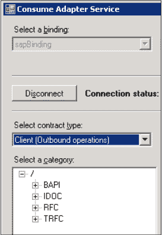

如果我们展开 BAPI 节点，我们会发现我们的架构是根据其在 SAP 系统中的功能角色进行排序的。

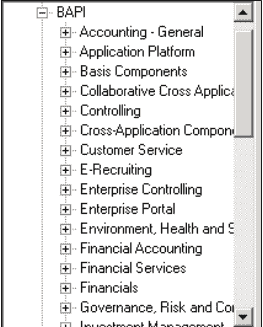

## Inbound Operations

执行服务入站操作（到 BizTalk）时，我们可以选择以下合约类型：

- IDOC
- RFC
- TRFC

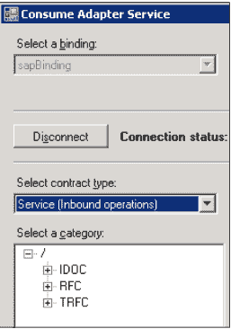

## Calling RFCs/tRFCs hosted in BizTalk

如果您还记得，RFC 与 BAPI 之间的关键区别之一是业务对象仓库。BizTalk 不会在任何地方存储这些业务对象，因此 BizTalk 无法托管 BAPI，因为底层的函数模块将不可用。

BizTalk 托管 RFC 有趣之处在于 SAP 可以消费它，甚至不会知道它是在调用外部系统而不是另一个 SAP 系统。显然，配置端点的 BASIS 管理员会知道，但 Microsoft 利用 SAP 的 RFC SDK 来确保互操作性。如果您的组织反对定制 SAP，此架构也提供了一些有趣的机会。您可以将此功能从 SAP 中抽象出来，并在像 BizTalk 这样更敏捷的环境中实现它。也许您的组织没有 ABAP 技能或资源带宽来编码 RFC，而选择利用 BizTalk 技能集。

RFC 被托管在 BizTalk 中更实际、更可能的使用是数据驻留在 SAP 之外，而 SAP 需要以同步方式获取此信息。在这种情况下，SAP 将调用 BizTalk 托管的 RFC，而 BizTalk 将检索下游信息并将其返回给 SAP。

BizTalk 托管 RFC 的真实世界示例是一家能源公司，需要通过 Web 服务从外部系统检索计量读数。该公司没有 SAP 经验或技术栈来支持从 SAP 安全地调用外部 Web 服务。这些外部 Web 服务使用复杂类型，是安全的，并且托管在合作伙伴的数据中心。解决此问题的方案包括 BizTalk 托管一个 SAP 可以按需调用的 RFC。反过来，BizTalk 将从该外部系统获取所需的计量读数信息，并以 SAP 所期望的格式将结果返回给 SAP。

## Custom objects

如果我们正在查找自定义对象（例如 RFC），我们将在 \ RFC\OTHER 层次结构中找到它们。SAP 最佳实践表明，只要您有自定义对象，就用字母 'Z' 为其添加前缀。这是一个很棒的概念，尤其是对于母语不是德语的非 SAP 资源。虽然文档和命名约定正在改进，但仍有大量表、字段和程序使用德语单词或缩写，对英语母语的 BizTalk 人员来说完全没有意义。通过利用用 "Z" 为自定义对象添加前缀的做法，SAP 和 Microsoft 资源都可以轻松识别自定义对象。

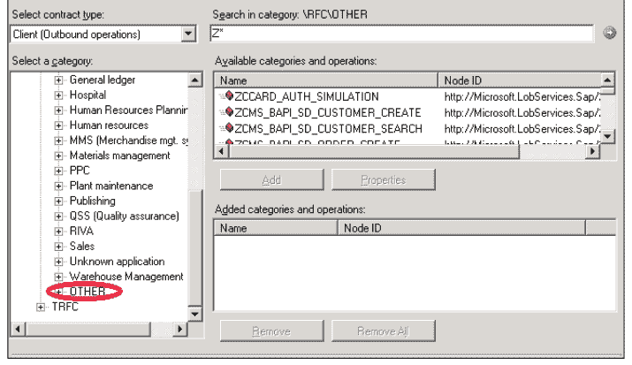

## Transactions

调用执行创建、更新或删除操作的 BAPI 时，有必要为以下两个额外操作生成架构：

- **BAPI_TRANSACTION_COMMIT**
- **BAPI_TRANSACTION_ROLLBACK**

调用其中任一操作是必需的，因为我们可能在操作多组数据，我们希望所有数据都成功或都不成功。

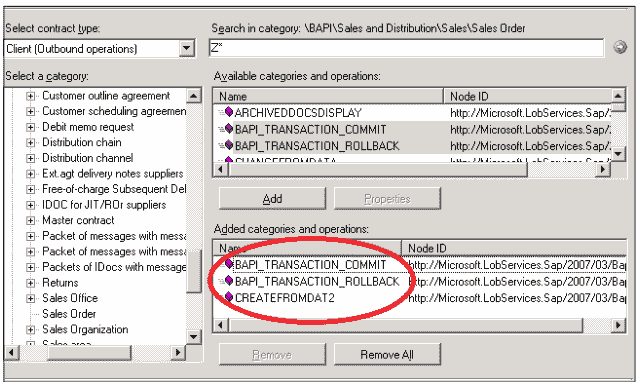

为方便起见，我们将同时生成所有这些架构。需要注意的是，BAPI_TRANSACTION_COMMIT 和 BAPI_TRANSACTION_ROLLBACK 操作是通用的，可以与其他 BAPI 结合使用。如果您计划在环境中拥有多个 BAPI 集成场景，将这些架构放在公共项目中可能是一个更可持续的解决方案。

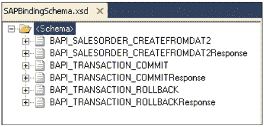


## 自定义与开箱即用的 RFC/BAPI

在最近的一个项目中，我与 SAP 团队合作，以确定可以利用哪些接口来满足我们的业务需求。不幸的是，这是一项非常耗时的练习。除非项目人员之前使用过开箱即用的 RFC/BAPI，否则通常需要通过试错来确定某个接口是否合适。很容易通过 Consume Adapter Service Wizard 使用关键字浏览 SAP 接口目录，找到合适的接口，却发现它并不完全符合你的场景。例如，我们希望通过 Dynamics CRM 调用 BizTalk 接口在 SAP 中查找客户。我们找到一个名为 BAPI_CUSTOMER_FIND 的 BAPI，看起来“应该”非常合适。不幸的是，该 BAPI 并未返回我们所需的所有主数据。另一个名为 BAPI_CUSTOMER_GETDETAIL 的 BAPI 可以与 FIND BAPI 结合使用来满足我们的需求。这意味着我们必须调用两个 BAPI 才能实现从 SAP 中提取客户信息的目标。

作为架构师，我们需要开始评估选项以确定最佳行动方案。在这种情况下，我们选择编写一个自定义 BAPI 来提供搜索功能并返回 CRM 所需的适当字段。我们觉得可以让 BizTalk 进行一系列连续调用，但选择了更简洁的“Wrapper”BAPI 方法。“Wrapper”BAPI 这个术语是我们创造的，用来描述将多个系统调用包装在一个 BAPI 中。在此 BAPI 中，SAP 开发人员负责捕获跨调用发生的错误，并确保事务根据需要提交或回滚。SAP 资源还声称他们可以插入更多调试和跟踪语句，有助于长期支持系统。利用 Wrapper BAPI 的另一个原因是来自 Dynamics CRM 的调用是同步的。我们不希望 CRM 在 BizTalk 向 SAP 发出多次调用时“卡住”等待 BizTalk 的响应。

现在我们已经介绍了部分 SAP 术语并讨论了开发人员和架构师在与 SAP 集成时面临的一些决策，让我们进入一些实际场景，在这些场景中我们同时调用 RFC 和 BAPI。

## 构建 BizTalk 应用程序——RFC 演练

我们将要演练的场景涉及一家能源公司的报价系统。客户将委托能源公司建设基础设施，以便为其工厂/办公室/家庭/农场等供电。报价系统基于 Dynamics CRM/XRM 平台构建。作为报价系统的一部分，我们在向客户提供报价时需要能够考虑我们的材料成本。SAP 在供应链管理和物料管理方面的优势使其有意义继续在 SAP 中利用此功能。在我们的场景中，SAP 是所有物料管理的系统记录。由于商品市场的变化，材料成本在一年内会波动，平均移动价格也会随之变化。我们不想对客户报价过高或过低，因此在向客户提供报价之前需要获取材料的移动平均价格。

- 1. 我们将要使用的 RFC 称为 **BAPI_MATERIAL_GET_DETAIL**，它是开箱即用的。等等！我以为我们在本次演练中讨论的是 RFC，为什么它以“BAPI”开头呢？好吧，请记住本章前面我们讨论过，所有 BAPI 都是 RFC，并且由于架构是从 \RFC 类别生成的，我将其视为 RFC。
- 2. 在生成架构时，使用 **文件名前缀** 是一个良好的实践。我个人偏好使用 BAPI 的名称作为 **文件名前缀**；这样在 Visual Studio 内部就不会产生混淆。

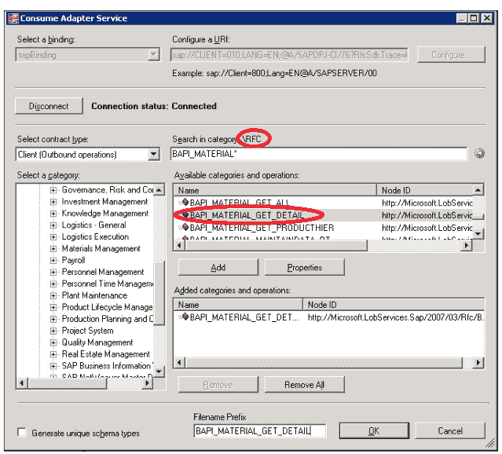

- 3. 在 Visual Studio 内部，我们会找到两个生成的架构，名为：BAPI_MATERIAL_GET_DETAILRfc.xsd 和 BAPI_MATERIAL_GET_DETAILTypes.xsd。

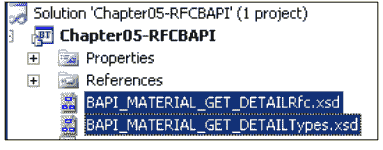

- 4. 在 **BAPI_MATERIAL_GET_DETAILRfc.xsd** 架构内部，我们会发现请求和响应记录都存在。**BAPI_MATERIAL_GET_DETAILTypes.xsd** 架构仅包含底层的 SAP 数据类型。

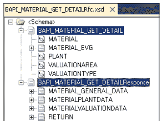

- 5. 接下来，我们想要构建一个我们的 CRM 系统可以填充的架构。该架构名为 **MaterialDetailRequest.xsd**，包含三个元素。为简化起见，所有字段的类型均为字符串。

| 字段名称 | 用途 |
|---|---|
| MaterialID | 用于区分不同材料的标识符。 |
| Plant | 货物生产或提供的地点。在我们的情况下，我们会将仓库视为 Plant。 |
| ValuationArea | 存在两种类型的估值区域：公司和工厂。由于成本可能因来源工厂而异，这可能会影响价格。假设你在偏远地区有一个工厂或仓库。检索特定材料可能需要额外的运输成本。相反，如果你有一个中央仓库，那么你可能希望使用公司级别的成本，使其在材料之间保持一致。在我们的示例中，我们将使用工厂级别，并在此请求消息中提供工厂 ID 作为值。 |

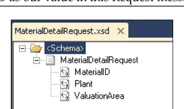

> 注：最好不要将系统生成的架构暴露给消费客户端。对于 SAP 来说，生成的架构通常对用户/开发人员不友好，我们不希望将这种复杂性传递给系统集成能力可能不如 BizTalk 或中间件团队的团队。我们也不希望因为 SAP 架构发生变化而不得不管理客户端接口的破坏。例如，如果我们将旧的 SAP 适配器架构暴露给客户端消费系统，然后决定升级 BizTalk 接口以支持新的 WCF-SAP 适配器，我们将对客户端应用程序产生大量不必要的更改。

- 6. 我们现在想要创建一个名为 **MaterialDetailRequestDisk_to_MaterialDetailRequestSAP.btm** 的映射，将我们的 **MaterialDetailRequest** 转换为我们的 **BAPI_MATERIAL_GET_DETAIL** 请求。

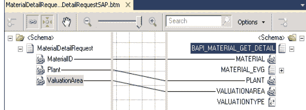

- 7. 接下来，我们需要构建一个映射，将 **BAPI_MATERIAL_GET_DETAILResponse** 转换为可以发送回调用 CRM 系统的 **MaterialDetailResponse**。执行此操作的映射称为 **MaterialDetailResponseSAP_to_MaterialDetailResponseDisk.btm**。正在映射的节点如下：

| BAPI_MATERIAL_GET_DETAIL 响应 | MaterialDetail 响应 |
|---|---|
| /MATERIAL_GENERAL_DATA/MATL_DESC | MaterialDescription |
| /MATERIAL_GENERAL_DATA/MATL_TYPE | MaterialType |
| /MATERIAL_GENERAL_DATA/BASE_UOM | UnitOfMeasure |
| /MATERIAL_GENERAL_DATA/NET_WEIGHT | NetWeight |
| /MATERIAL_GENERAL_DATA/CREATED_ON | MaterialCreateDate |
| /MATERIAL_GENERAL_DATA/LAST_CHNGE | MaterialLastUpdated |
| /MATERIALVALUATIONDATA/MOVING_PR | MovingPrice |
| /MATERIALVALUATIONDATA/PRICE_UNIT | PriceUnit |
| /MATERIALVALUATIONDATA/CURRENCY | Currency |

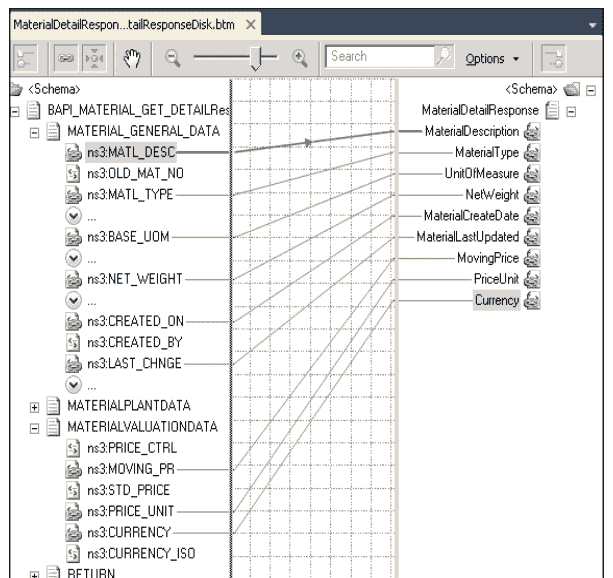

- 8. 为了协调所有这些事件，需要一个名为 **ProcessGetMaterialDetails.odx** 的编排。在此编排内部，会发生以下事件：
  - a. 我们接收一个 Material Detail Request 实例。
  - b. 将 Material Detail Request 转换为 SAP BAPI_MATERIAL_GET_DETAIL 请求。
  - c. 向 SAP 发送 BAPI_MATERIAL_GET_DETAIL 请求并接收 BAPI_MATERIAL_GET_DETAIL 响应。
  - d. 将 BAPI_MATERIAL_GET_DETAIL 响应转换为 Material Detail Response。
  - e. 将 Material Detail Response 发送回调用应用程序。

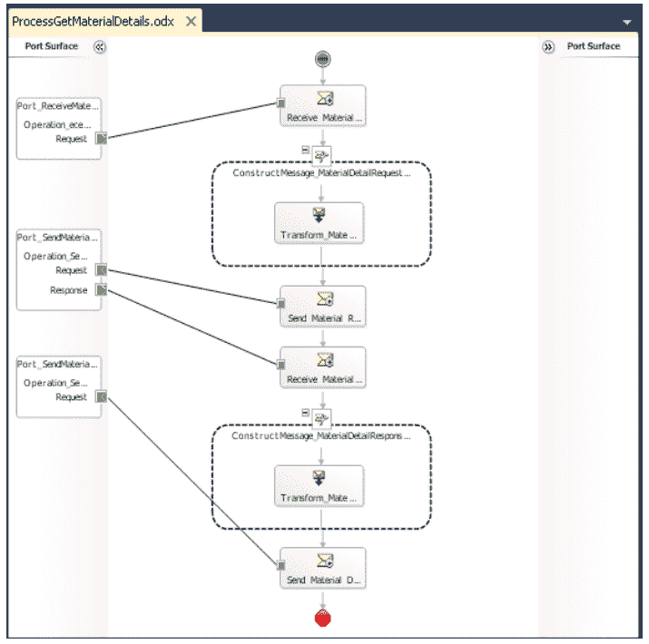


9. 在已放置签名的密钥 **Chapter05-RFCBAPI.snk** 后，我们可以右键单击 Chapter05-RFCBAPI 解决方案并部署我们的应用程序。

10. 进入 BizTalk 管理控制台后，我们会发现一个名为 Chapter05-RFCBAPI 的应用程序。

11. 我们需要创建一个名为 **ReceiveMaterialDetailRequest** 的接收端口，其下有一个名为 **ReceiveMaterialDetailRequestFromDisk** 的接收位置。此接收位置将使用 **FILE** 适配器、**BizTalkServerApplication** 接收处理程序和 **XMLReceive** 接收管道。

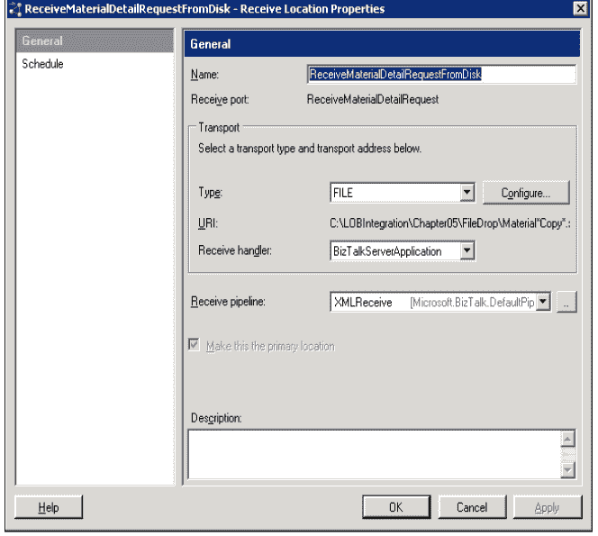

12. 此解决方案需要两个发送端口。我们要处理的第一个是名为 **SendMaterialDetailRequestToSAP** 的 SAP 双向发送端口。此发送端口将使用 **WCF-SAP** 适配器、**BizTalkServerApplication** 发送处理程序、**XMLTransmit** 发送管道和 **XMLReceive** 接收管道。

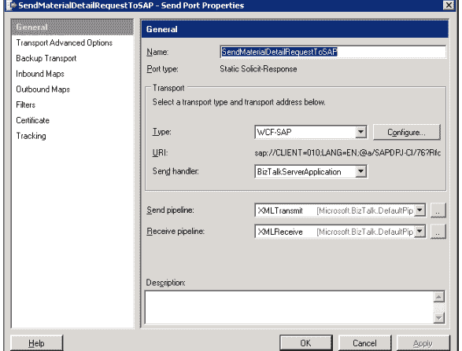

> 注：与第 4 章类似，我选择使用 WCF-SAP 适配器而不是使用 SAP 绑定的 WCF-Custom 适配器。使用 WCF-SAP 适配器其实是一种个人偏好。我喜欢在填充 SAP 连接信息时可用的更简洁的界面，并且它与其他用于连接 SQL Server 和 Oracle 的 WCF-Custom 端口有所区别。这种方法的一个缺点是，当使用“使用适配器服务向导”生成绑定文件时，需要额外的工作来提取其中包含的值并将其包含在新端口中。

- 13. 单击 **Configure** 按钮以编辑 SAP 特定属性。
- 14. 再次单击 **Configure** 按钮以编辑 SAP URI。与第 4 章中的 IDOC 配置类似，我们希望填充以下值：
    a. **Application Server Host**
    b. **System Number**
    c. **Client**

15. 如果您不确定贵组织的这些值，请联系您的 BASIS 管理员。

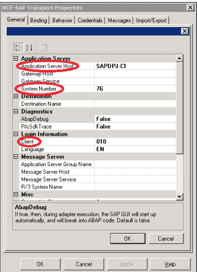

16. 单击确定按钮关闭此对话框。

17. 我们的 SOAP Action 头的 Action 值必须与我们在编排中提供的逻辑操作名称匹配。也就是说，我们需要在发送端口中提供以下 Action。

```
<BtsActionMapping xmlns:xsi="http://www.w3.org/2001/XMLSchema-instance" xmlns:xsd="http://www.w3.org/2001/XMLSchema">
<Operation Name="Operation_SendMaterialDetailRequestToSAP" Action="http://Microsoft.LobServices.Sap/2007/03/Rfc/BAPI_MATERIAL_GET_DETAIL" />
</BtsActionMapping>
```

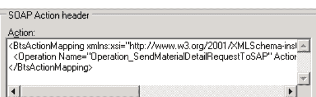

18. 在“绑定”选项卡中，我想强调两个属性：
- a. EnableBizTalkCompatibilityMode – 调用 BizTalk 中的 SAP 操作时，此值应始终设置为 True。
- b. EnableSafeTyping – 由于并非所有 .NET 和 SAP 类型都相同，我们有时需要在日期周围放宽一些限制。例如，如果从 RFC/BAPI 返回可选日期，我们可能会遇到以下错误：为了解决此问题，我们可以将 EnableSafeTyping 属性设置为 True。这样，WCF-SAP 适配器将把 SAP DATS 值作为字符串而不是 DateTime 暴露出来。

```
Microsoft.ServiceModel.Channels.Common.XmlReaderGenerationException: An error occurred when trying to convert the byte array [30-00-30-00-30-00-30-00-30-00-30-00-30-00-30-00] of RFCTYPE RFCTYPE_DATE with length 8 and decimals 0 to XML format.
```

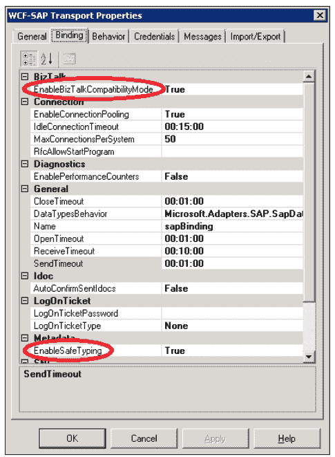

19. 在 **Credentials** 选项卡上，我们需要提供我们的 SAP 凭据。在此场景中，我们使用 **Username/Password** 凭据。

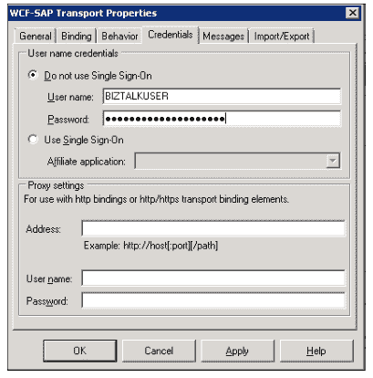

20. 我们接下来要处理的发送端口将把物料明细响应发送到磁盘，以便调用应用程序可以消费它。此发送端口的名称为 **SendMaterialDetailsResponseToDisk**。发送端口将使用 **FILE** 适配器、**BizTalkServerApplication** 发送处理程序和 **PassThruTransmit** 发送管道。您可以在源代码的 C:\LOBIntegration\Chapter05\BindingFiles 中获取此解决方案的绑定文件，这样您就不必手动键入整个配置。

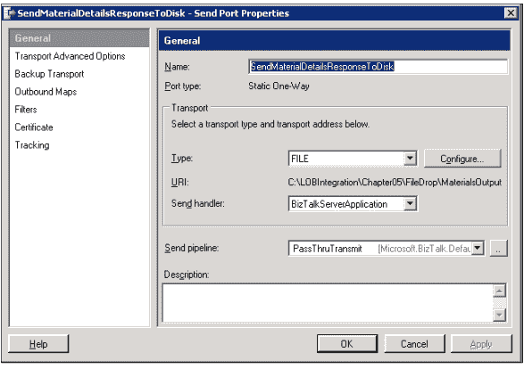

21. 为了启动我们的应用程序，我们必须将编排绑定到我们刚刚创建的物理接收和发送端口。

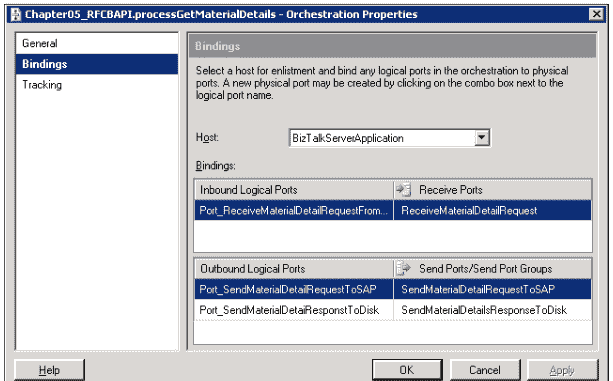

## 测试 BizTalk 应用程序—RFC 演练

1. 我们的应用程序现已构建并部署，我们准备好通过执行以下步骤开始测试：在重启 BizTalkServerApplicationHost 实例并启动应用程序后，我们可以处理 MaterialDetailRequest.xsd 的一个实例。名为 MaterialDetailRequest.xml 的示例文件已包含在 C:\LOBIntegration\Chapter05\FileDrop 文件夹中。要处理此文件，我们只需复制并粘贴该文件即可。

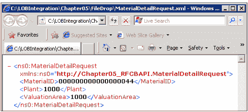

注：此示例文件中提供的值代表用于构建此解决方案的 SAP 系统中存在的 master 数据。这些值可能在您的 SAP 系统中无效。建议您咨询组织内的 SAP 资源，以便他们为您提供系统中存在的数据。

- 2. BizTalk 应消费此文件，联系 SAP，从 SAP 接收响应，并将结果写回同一文件夹。

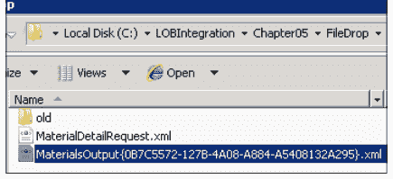

- 3. 当我们检查 MaterialsOutput[GUID].xml 文件时，我们会发现有关我们感兴趣的物料的信息，包括移动价格。

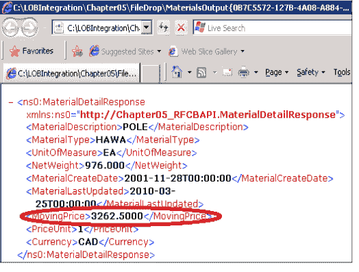

在此示例中，我们在调用客户端和 BizTalk 之间使用了异步消息传递。在此场景中使用异步通信在与 SAP 通信时给了我们一些喘息空间。在这种情况下调用 SAP RFC 是一个非常快速的操作（~2 秒），但如果 SAP 出现问题，我们有时间重试调用 SAP。

如果我们与客户端应用程序有同步场景，那么在客户端超时之前我们就没有太多时间重试调用 SAP。在这些同步情况下，我建议将 SAP 发送端口的重试值设置为 0，然后确保我们向客户端返回响应，表明 SAP 不可用。这提供了一些好处：
- 我们不会在客户端已经超时并切断与 BizTalk 的连接时尝试重试连接到 SAP。
- 如果 SAP 宕机，BizTalk 将能够立即检测到这种情况并向客户端应用程序发送否定确认消息。否则，我们要等到 BizTalk 耗尽其重试阈值后才会知道。
- 然后客户端系统可以向客户端提供清晰、用户友好的错误消息，表明存在问题。

## 构建 BizTalk 应用程序—BAPI 演练

我们现在将扩展我们的 RFC 场景并更新现有的 Chapter05-RFCBAPI 项目。一旦我们的客户从报价系统收到报价并决定继续由我们公司执行工作，我们希望利用 SAP 的销售和分销功能。SAP 在销售和财务方面也具有优势，因此我们不想在报价系统中尝试构建该功能，而是希望利用 SAP 在该领域的核心能力。

报价系统将创建销售订单请求，并提供有关客户以及与工作相关的物料的信息。作为回报，SAP 将创建可用于计费的销售订单，并将订单号返回给报价系统。

让我们通过生成我们的 SAP 架构开始解决方案：
- 1. 再次，我们将利用一个开箱即用的接口 **CREATEFROMDAT2b**，它可以在 **\BAPI\Sales and Distribution\Sales\Sales Order** 类别中找到。如本章架构生成部分所述，我们还需要包含 **COMMIT** 和 **ROLLBACK** 操作，因为我们将在 SAP 中创建数据。出于方便的目的，我们将同时生成所有架构。
- 2. 再次，我们不想向报价系统公开我们的 SAP 请求，因此我们将公开一个更用户友好的架构，称为 **CreateSalesOrderRequest.xsd**。在此架构内部，我们将找到以下元素。所有元素都是字符串，**isCommitted** 除外，它是一个布尔值。

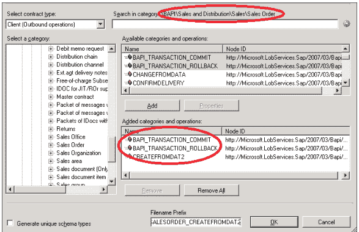

| 字段名称 | 用途 |
|---|---|
| /Header/DocumentType | 也称为订单类型。典型值是 OR（英文值）或 TA（德文值）。 |
| /Header/SalesOrganization | 物流内的组织单位，根据其销售需求对公司进行结构化。 |
| /Header/DistributionChannel | 分销渠道决定了物料或服务如何销售以及如何分销给客户，例如零售、批发、自提。 |
| /Header/Division | 部门是 R/3 系统中物流中的组织单位。 |
| /Header/SalesOffice | 负责此交易的销售办公室或销售区域。 |


| 字段名称 | 用途 |
|---|---|
| /Header/RequestedDate | 产品或服务所需的日期。 |
| /Header/PurchaseNo | 描述采购编号的文本。 |
| /Header/Currency | 交易发生的货币。 |
| /Material/MaterialID | 我们希望包含在采购订单中的物料项目的 ID。 |
| /Material/TargetQU/ | 目标计量单位。 |
| /Partner/PartnerRole | 业务伙伴角色用于按业务术语对业务伙伴进行分类。您分配给业务伙伴的角色反映了其拥有的功能以及其可能涉及的业务交易。 |
| /Partner/Number | 用于识别客户的编号。 |
| isCommitted | 该字段用于演示目的。它将触发是否要提交订单或回滚订单。为了便于确定该值是否为真或假，该字段已被标记为区分字段。 |

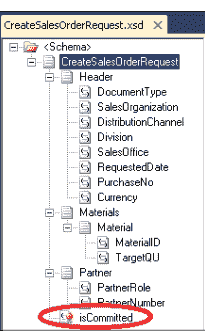

3. 下一步是创建一个映射，将我们的报价系统中的 CreateSalesOrderRequest 转换为我们的 SALESORDER_CREATEFROMDAT2 SAP BAPI 调用。此映射的名称为 CreateSalesOrderRequest_to_SALESORDER_CREATEFROMDAT2.btm。以下图像包含详细的映射说明。请注意，Material 节点是递归节点，因此添加了循环 functoid 以确保在目标消息中创建正确数量的 BAPISDITM 节点。

4. 我们还希望确保 **BAPIRET2** 节点被实例化，以便 SAP 可以返回任何错误。**BAPIRET2** 是一个常用表，用于返回刚刚执行的 BAPI 的状态。即使您调用的是自定义 BAPI，返回此节点也是一个良好的实践。为了在我们的请求消息中提供此节点，我们只需从根节点拖动一个链接到 **BAPIRET2** 节点。

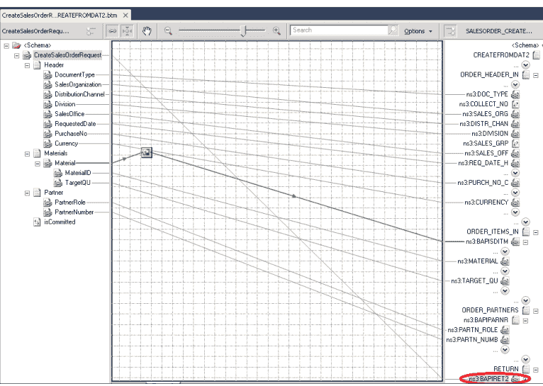

5. 一旦我们向 SAP 发送了 SALESORDER_CREATEFROMDAT2 请求并收到响应，我们就需要向我们的报价系统提供响应消息。已创建名为 **CreateSalesOrderResponse.xsd** 的架构来处理此职责。在此架构中，我们将找到三个元素。**CustomerNumber** 和 **SalesOrderNumber** 为字符串，而 **isCommitted** 为布尔值。

| 字段名称 | 用途 |
|---|---|
| CustomerNumber | 由于我们将在报价系统和 BizTalk 之间使用异步消息传递，我们希望提供销售订单所属的客户编号。 |
| SalesOrderNumber | 这是 SAP 在销售订单成功创建时提供的标识符。 |
| isCommitted | 该字段也用于演示目的，并将向报价系统提供交易是已提交还是已回滚的指示。我们还将把该字段标记为区分字段，以便我们可以在 ProcessCreateSalesOrder.odx 编排中方便地更新此标志。 |

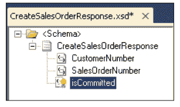

6. 负责将 SAP 响应转换为报价系统响应的映射称为 **SALESORDER_CREATEFROMDAT2Response_to_CreateSalesOrderResponse.btm**。

7. 由于 **isCommitted** 字段未从 SAP 返回，我们将从 String Concatenate functoid 设置初始值为 true，并随后在我们的 `ProcessCreateSalesOrder.odx` 编排中的 Message Assignment 形状内更新此标志。

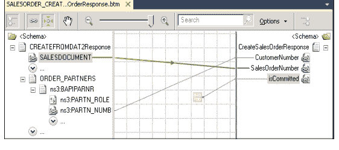

8. 在本章的 Schema Generation 部分，我们讨论了通过 BAPI 创建、更新和删除数据时需要提交或回滚事务。为了满足提交事务的要求，我们需要创建一个映射来实例化 BAPI_TRANSACTION_COMMIT 消息的实例。此映射的源消息可以是任何内容，因为我们在 Commit 消息中不使用任何消息正文负载数据。考虑到这一点，CreateSalesOrderRequest 消息应该可以工作。名为 CreateSalesOrder_to_BAPI_TRANSACTION_COMMIT.btm 的映射已包含在本章的源代码中，以满足我们的需求。

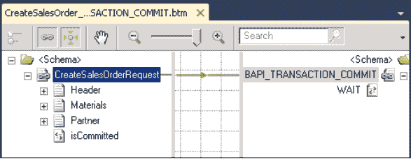

9. 同样，我们需要创建一个处理回滚场景的映射。名为 CreateSalesOrderRequest_to_BAPI_TRANSACTION_ROLLBACK.btm 的映射已为此目的创建，其逻辑与 Commit 映射相同。

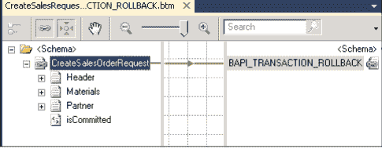

10. 我们现在可以将在名为 ProcessCreateSalesOrder.odx 的编排中组装所有这些构件。由于此编排比 SAP 章节中的其他编排更大，我们将将其分解为几个部分。

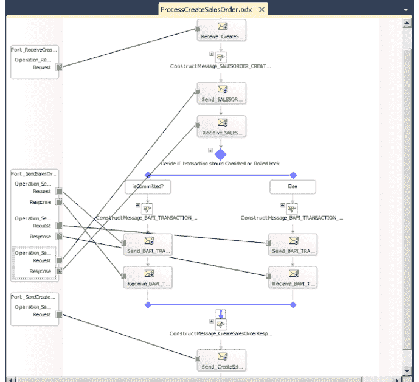

11. 我们的初始步骤将涉及以下操作：
- a. 接收我们的 CreateSalesOrderRequest 消息的一个实例。
- b. 将我们的 CreateSalesOrderRequest 消息转换为我们的 SALESORDER_CREATEFROMDAT2 SAP 请求消息。
- c. 更新消息上下文以将 ConnectionState 设置为 "OPEN"。通过将其设置为 OPEN，我们指示适配器为事务打开一个新通道。为了设置此消息上下文，我们需要为 Microsoft.Adapters.SAP.BiztalkPropertySchema.dll 添加程序集引用。您可以在以下位置找到此 dll：
- i. 32 位: C:\Program Files (x86)\Microsoft BizTalk Adapter Pack\bin
- ii 64 位: C:\Program Files\Microsoft BizTalk Adapter Pack (x64)\bin\
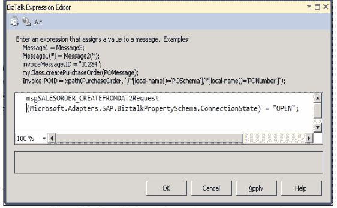
- e. 向 SAP 发送 SALESORDER_CREATEFROMDAT2Request。
- f. 从 SAP 接收 SALESORDER_CREATEFROMDAT2Response。

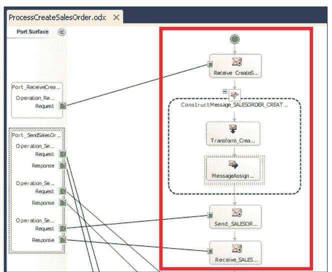

12. 我们现在想要执行检查以确定是否应在 SAP 中提交事务。为此，我们将向编排添加一个 Decide 形状，然后检查我们的请求消息的 isCommitted 标志是否设置为 true：

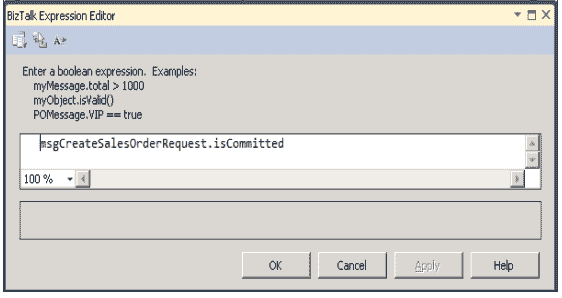
- a. 如果 msgCreateSalesOrderRequest.isCommitted 设置为 true，则我们将继续调用一个转换，将我们的 CreateSalesOrderRequest 消息转换为我们的 BAPI_TRANSACTION_COMMIT 消息的一个实例。
- b. 一旦此消息被转换，我们需要在 Message Assignment 形状中更新其消息上下文属性。在此形状中，我们希望将 **ConnectionState** 属性设置为 "**CLOSE**"。通过将此属性设置为 **CLOSE**，我们指示适配器提交事务并关闭通道。
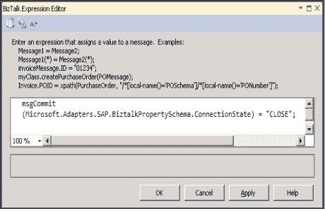
- c. 我们现在希望向 SAP 发送我们的 **BAPI_TRANSACTION_COMMIT** 消息。
- d. 一旦事务已提交，SAP 将向我们发送响应消息，确认事务已完成。
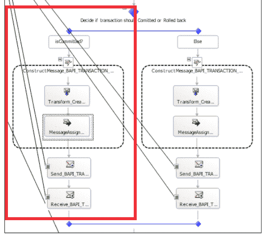

13. 如果 `msgCreateSalesOrderRequest.isCommitted` 设置为 false，我们希望回滚事务而不是提交事务。
- a. 为了回滚事务，我们需要通过转换我们的 CreateSalesOrderRequest 消息来创建一个 **BAPI_TRANSACTION_ROLLBACK** 消息的实例。
- b. 一旦此消息被转换，我们需要在 Message Assignment 形状中更新其消息上下文属性。在此形状中，我们希望将 **ConnectionState** 属性设置为 "ABORT"。通过将此属性设置为 **ABORT**，我们指示适配器中止事务并关闭通道。
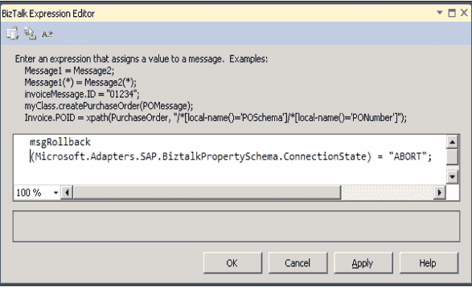
- c. 我们现在希望向 SAP 发送我们的 **BAPI_TRANSACTION_ROLLBACK** 消息。
- d. 一旦事务已被中止，SAP 将向我们发送响应消息，确认事务已被取消。
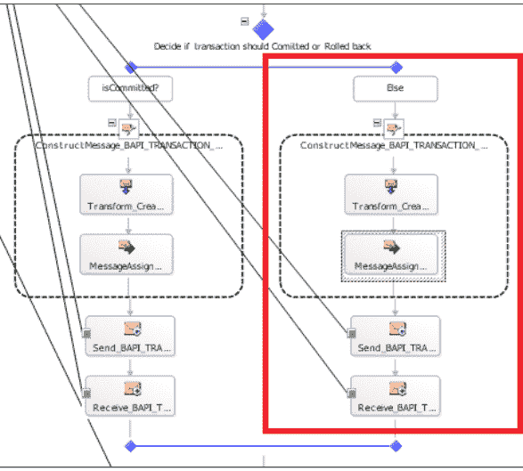

14. 剩余步骤包括将我们的 SALESORDER_CREATEFROMDAT2Response 转换为我们将发送给报价系统的 CreateSalesOrderResponse。
- a. 为了演示目的，我们在 CreateSalesOrderResponse 消息上添加了一个标志，以指示是否设置了 Commit 标志。在 Message Assignment 形状中，我们只需分配在 CreateSalesOrderRequest 消息中填充的值。
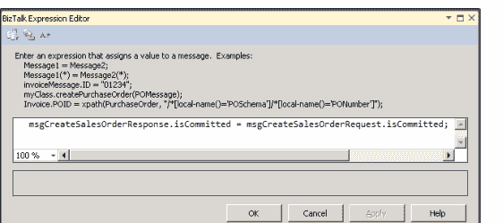


b. 向报价系统发送 CreateSalesOrderResponse 消息。

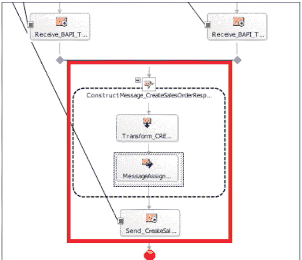

15. 由于我们已更新 Chapter05-RFCBAPI 解决方案，因此无需重新添加强名称密钥；我们可以右键单击 Visual Studio 解决方案文件并部署我们的应用程序。

16. 在 Chapter05-RFCBAPI 应用程序内部，我们需要添加一个接收端口 ReceiveCreateSalesOrderRequests 来接收来自报价系统的消息。我们现在需要为此接收端口创建一个名为 ReceiveCreateSalesOrderRequestsFromQuotingSystem 的接收位置，它将使用 FILE 适配器、BizTalkServerApplication 接收处理程序和 XMLReceive 接收管道。由于我们与之前的示例共享一个热文件夹，因此需要提供文件掩码 CreateSales*Copy*.xml。

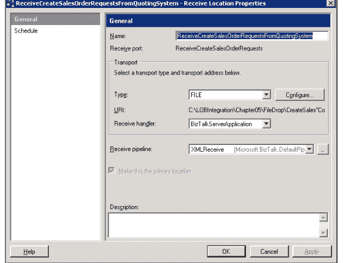

17. 我们现在需要创建发送端口。我们将创建的第一个发送端口将用于与 SAP 通信。我们将创建的发送端口名为 SendCreateSalesOrdersToSAP，负责发送 BAPI_SALESORDER_CREATEFROMDAT2、BAPI_TRANSACTION_COMMIT 和 BAPI_TRANSACTION_ROLLBACK 消息。

18. 此发送端口将使用 WCF-SAP 适配器、BizTalkServerApplication 发送处理程序、XMLTransmit 发送管道和 XMLReceive 接收管道。

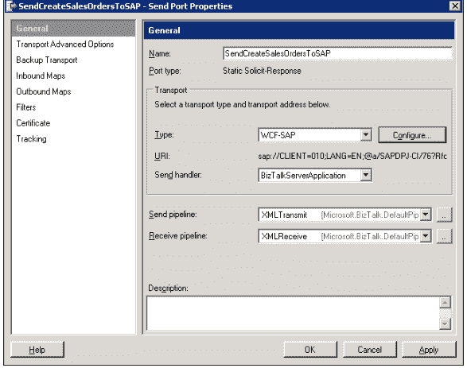

- 19. 单击 **配置** 按钮以编辑 SAP 特定属性。
- 20. 再次单击 **配置** 按钮以编辑 SAP URI。就像我们在第 4 章中的 IDOC 配置一样，我们希望填充以下值：
    - a. **应用程序服务器主机**
    - b. **系统编号**
    - c. **客户端**

21. 如果您不确定贵组织的这些值，请联系您的 BASIS 管理员。

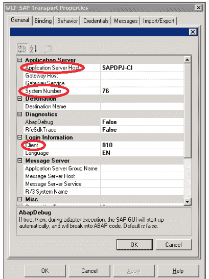

22. 单击 OK 按钮关闭此对话框。

23. 我们现在需要使用在编排中创建的操作名称更新 SOAP Action 头。由于此发送端口负责发送创建销售订单、提交和回滚消息，因此我们需要在此文本框中提供三个条目：

```
<BtsActionMapping xmlns:xsi="http://www.w3.org/2001/XMLSchema-instance" xmlns:xsd="http://www.w3.org/2001/XMLSchema">
<Operation Name="Operation_SendCreateSalesOrderCommit" Action="http://Microsoft.LobServices.Sap/2007/03/Bapi/BUS2032/BAPI_TRANSACTION_COMMIT/BAPI_TRANSACTION_COMMIT" />
<Operation Name="Operation_SendCreateSalesOrderRollback" Action="http://Microsoft.LobServices.Sap/2007/03/Bapi/BUS2032/BAPI_TRANSACTION_ROLLBACK/BAPI_TRANSACTION_ROLLBACK" />
<Operation Name="Operation_SendSalesOrderRequestsToSAP" Action="http://Microsoft.LobServices.Sap/2007/03/Bapi/BUS2032/CREATEFROMDAT2/BAPI_SALESORDER_CREATEFROMDAT2" />
</BtsActionMapping>
```

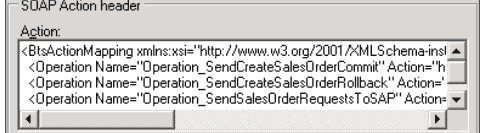

24. 在 **绑定** 选项卡上，我们希望确保 **EnableBizTalkCompatibilityMode** 和 **EnableSafeTyping** 设置为 **True**。

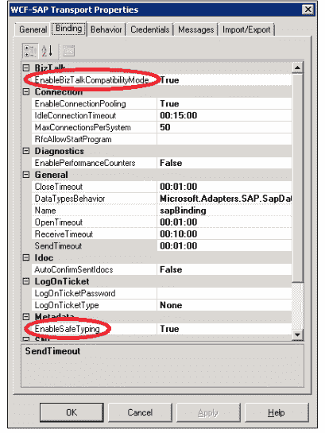

25. 在 **凭据** 选项卡上，我们需要提供 SAP 凭据。在此场景中，我们使用 **用户名/密码** 凭据。

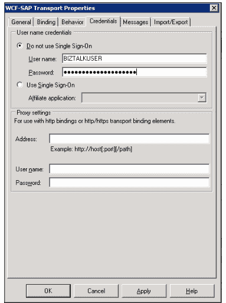

26. 我们需要创建的最后一个发送端口将负责将销售订单状态发送回报价系统。发送端口名为 **SendCreateSalesOrderResponsesToQuotingSystem**，使用 **FILE** 适配器、**BizTalkServerApplication** 发送处理程序和 **PassThruTransmit** 发送管道。您可以在源代码的 C:\LOBIntegration\Chapter05\BindingFiles 中获取此解决方案的绑定文件，这样就无需手动输入所有这些配置。

27. 最后，我们需要将 **ProcessCreateSalesOrder** 编排绑定到我们刚刚创建的物理接收和发送端口。

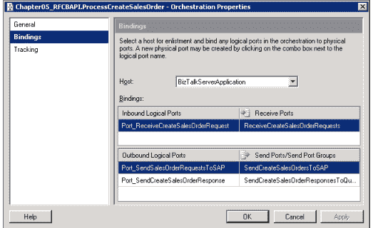

28. 我们现在可以重启 BizTalkServerApplication 主机实例并启动我们的应用程序。

## 测试 BizTalk 应用程序—BAPI 演练

应用程序构建并部署后，我们现在可以通过执行以下步骤来测试应用程序：

- 1. 从 C:\LOBIntegration\Chapter05\FileDrop 文件夹复制名为 CreateSalesOrderRequest_Commit.xml 的示例文件并粘贴到同一文件夹中。此文件包含 isCommitted 标志设置为 true，因此 BizTalk 将尝试提交此事务。

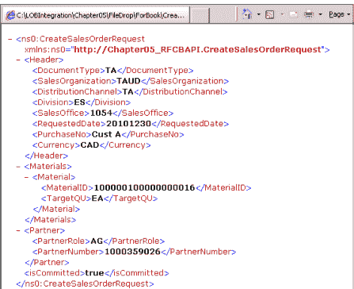

2. BizTalk 将接收此文件，然后在 SAP 中创建销售订单，提交事务，然后向我们的报价系统发送名为 **SalesOrderResponse{GUID}.xml** 的响应。此文档将包含刚刚在 SAP 中创建的 **SalesOrderNumber**。

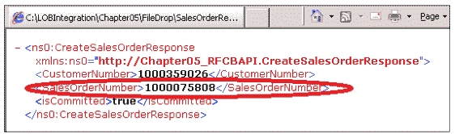

3. 要执行回滚场景，我们可以复制并粘贴位于 C:\LOBintegration\Chapter05\FileDrop 文件夹中的 CreateSalesOrderRequest_Rollback.xml。与 CreateSalesOrderRequest_Commit.xml 的区别在于 **isCommitted** 标志设置为 **false**。


4. 当此文件通过 BizTalk 处理时，将创建销售订单并返回销售订单号。不同之处在于此事务是回滚而不是提交。此外，在我们发送给报价系统的响应消息中，**isCommitted** 标志设置为 **false**。


以下是操作销售订单时一些有用的 SAP GUI 事务的表格：

| SAP 事务 | 目的 |
|---|---|
| VA01 | 创建销售订单 |
| VA02 | 修改/更改销售订单 |
| VA03 | 显示销售订单 |

## 提示、陷阱和故障排除

使用 RFC 和 BAPI 为 BizTalk 开发人员提供了工具箱中的另一个工具。以下是我在集成 RFC 和 BAPI 时遇到的提示、问题和行为列表：

- 1. RFC 和 BAPI 可以处理大量数据。虽然我不了解具体的上限，但我曾意外调用过返回超过 100 MB 数据的 RFC。这并不意味着调用返回 100 MB 的 RFC 是个好主意，但这意味着这是可能的。
- 2. 请务必与您的 SAP 对应人员确认，在提供特定对象的 ID 时是否需要提供前导零。在我们的物料演练中，我们需要提供前导零才能成功调用操作。
- 3. 调用 RFC 或 BAPI 时，如果 SAP 的响应中缺少特定段或重复节点，则可能是由于请求文档中缺少该节点所致。我们之前示例中 BAPIRET2 节点就是这种行为的完美示例。与前导零类似，这种行为在我看来似乎并不完全一致。
- 4. 使用 RFC 跟踪工具也可以在问题发生时提供可见性。RFC 跟踪工具非常细粒度，可以为您提供正在发送的报文负载的详细信息。要了解有关此跟踪工具的更多信息，请阅读以下链接中的故障排除部分：http://msdn.microsoft.com/en-us/biztalk/ee705492。

- 5. 在花费大量时间尝试调试 BizTalk 解决方案之前，从 SAP 资源获取“示例”数据总是有益的。一旦拥有有效数据，您将花费更少的时间进行故障排除，而将更多时间用于开发/测试解决方案。RFC/BAPI 可能因多种原因而失败，而 SAP 资源比 BizTalk 资源更能确定发生了什么。
- 6. 执行 BAPI 事务时，必须使用单个主机实例执行。如果此情况适用并且您需要高可用性，那么您应该查看集群主机实例。这将允许您一次运行单个主机实例，但在系统故障的情况下，您将拥有一个被动节点，该节点可以成为活动节点并自动继续处理。
- 7. 当 BAPI 创建或更新记录时，在更改提交之前，其他 BAPI 实例无法读取这些更改。
- 8. 执行 BAPI 事务时，您需要使用相同的连接操作这些对象。请参阅 http://msdn.microsoft.com/en-us/library/cc185482(v=BTS.10).aspx 以了解所有连接状态的细分。

## 摘要

在本章中，我们继续学习 SAP 以及 BAPI/RFC 同步处理。我们学习了提交和回滚事务，以及 BizTalk 开发人员在与 SAP 通信时面临的一些提示、技巧和陷阱。

从过去两章中，您可以看到与 SAP 集成是一个庞大的主题，因为 SAP 是一个非常丰富的平台。然而，与 SAP 集成对 BizTalk Server 来说是一个很大的增值，因为托管在 SAP 中的业务流程通常代表关键任务服务。

在下一章中，我们将转换方向，学习 BizTalk 如何通过利用 Microsoft 的 AppFabric Service Bus 集成云和本地服务。


## 6 使用 Windows Azure AppFabric Service Bus 进行 BizTalk 集成

在当今的商业环境中，组织需要能够快速、安全地与不断变化的业务合作伙伴集成的能力。成功地将本地服务暴露给其他部门或整个组织可能需要付出赫拉克勒斯式的网络和安全努力。如何安全地暴露深埋在防火墙和网络路由器后面的服务？当合作伙伴增加或情况发生变化时，我们可以采取哪些措施来避免脆弱的安全模型崩溃？今天构建这种类型的分布式应用程序是可能的，但它需要对基础设施进行大量投资，并且需要各方做出多项让步。

本章将涵盖：
- 包含在名为 Windows Azure AppFabric 的 Microsoft 云计算集成平台中的内容
- AppFabric Access Control 服务和 AppFabric Service Bus 旨在解决的问题
- 如何利用本地部署的 BizTalk Server 安全地消费 Windows Azure AppFabric 消息并发布到 Windows Azure AppFabric 云环境

## 什么是 Windows Azure AppFabric？

Windows Azure AppFabric 是 Microsoft Windows Azure 云服务的一部分，后者是一组由 Microsoft 主持的用于构建解决方案的功能。AppFabric 是一种“平台即服务”（PaaS）解决方案，作为云中的中间件运行。此中间件包括安全云消息传递（Service Bus）、跨联合身份存储的统一访问控制（Access Control）、分布式应用程序缓存（Caching）以及类似 BizTalk 的集成服务（Integration）。预计 Caching 和 Integration 服务将在 2011 年下半年发布。就本章而言，重点将放在 Service Bus 和 Access Control 服务上。

## AppFabric Access Control

AppFabric Access Control 服务使用“声明转换”来为连接的应用程序创建联合安全策略。在下面的各节中，我们将探讨在尝试统一身份模型时面临的问题，以及 AppFabric Access Control 服务如何提供帮助。

### 问题场景

“你是谁，你能做什么？”这是应用程序安全的根本问题。我们的许多应用程序选择通过本地存储的凭据和角色来回答这个问题，但这会导致杂乱、难以管理的[content]
## 6 使用 Windows Azure AppFabric Service Bus 进行 BizTalk 集成

在当今的商业环境中，组织需要能够快速、安全地与不断变化的业务合作伙伴集成的能力。成功地将本地服务暴露给其他部门或整个组织可能需要付出赫拉克勒斯式的网络和安全努力。如何安全地暴露深埋在防火墙和网络路由器后面的服务？当合作伙伴增加或情况发生变化时，我们可以采取哪些措施来避免脆弱的安全模型崩溃？今天构建这种类型的分布式应用程序是可能的，但它需要对基础设施进行大量投资，并且需要各方做出多项让步。

本章将涵盖：
- 包含在名为 Windows Azure AppFabric 的 Microsoft 云计算集成平台中的内容
- AppFabric Access Control 服务和 AppFabric Service Bus 旨在解决的问题
- 如何利用本地部署的 BizTalk Server 安全地消费 Windows Azure AppFabric 消息并发布到 Windows Azure AppFabric 云环境

## 什么是 Windows Azure AppFabric？

Windows Azure AppFabric 是 Microsoft Windows Azure 云服务的一部分，后者是一组由 Microsoft 主持的用于构建解决方案的功能。AppFabric 是一种“平台即服务”（PaaS）解决方案，作为云中的中间件运行。此中间件包括安全云消息传递（Service Bus）、跨联合身份存储的统一访问控制（Access Control）、分布式应用程序缓存（Caching）以及类似 BizTalk 的集成服务（Integration）。预计 Caching 和 Integration 服务将在 2011 年下半年发布。就本章而言，重点将放在 Service Bus 和 Access Control 服务上。

## AppFabric Access Control

AppFabric Access Control 服务使用“声明转换”来为连接的应用程序创建联合安全策略。在下面的各节中，我们将探讨在尝试统一身份模型时面临的问题，以及 AppFabric Access Control 服务如何提供帮助。

### 问题场景

“你是谁，你能做什么？”这是应用程序安全的根本问题。我们的许多应用程序选择通过本地存储的凭据和角色来回答这个问题，但这会导致杂乱、难以管理的[content]
## 6 使用 Windows Azure AppFabric Service Bus 进行 BizTalk 集成

在当今的商业环境中，组织需要能够快速、安全地与不断变化的业务合作伙伴集成的能力。成功地将本地服务暴露给其他部门或整个组织可能需要付出赫拉克勒斯式的网络和安全努力。如何安全地暴露深埋在防火墙和网络路由器后面的服务？当合作伙伴增加或情况发生变化时，我们可以采取哪些措施来避免脆弱的安全模型崩溃？今天构建这种类型的分布式应用程序是可能的，但它需要对基础设施进行大量投资，并且需要各方做出多项让步。

本章将涵盖：
- 包含在名为 Windows Azure AppFabric 的 Microsoft 云计算集成平台中的内容
- AppFabric Access Control 服务和 AppFabric Service Bus 旨在解决的问题
- 如何利用本地部署的 BizTalk Server 安全地消费 Windows Azure AppFabric 消息并发布到 Windows Azure AppFabric 云环境

## 什么是 Windows Azure AppFabric？

Windows Azure AppFabric 是 Microsoft Windows Azure 云服务的一部分，后者是一组由 Microsoft 主持的用于构建解决方案的功能。AppFabric 是一种“平台即服务”（PaaS）解决方案，作为云中的中间件运行。此中间件包括安全云消息传递（Service Bus）、跨联合身份存储的统一访问控制（Access Control）、分布式应用程序缓存（Caching）以及类似 BizTalk 的集成服务（Integration）。预计 Caching 和 Integration 服务将在 2011 年下半年发布。就本章而言，重点将放在 Service Bus 和 Access Control 服务上。

## AppFabric Access Control

AppFabric Access Control 服务使用“声明转换”来为连接的应用程序创建联合安全策略。在下面的各节中，我们将探讨在尝试统一身份模型时面临的问题，以及 AppFabric Access Control 服务如何提供帮助。

### 问题场景

“你是谁，你能做什么？”这是应用程序安全的根本问题。我们的许多应用程序选择通过本地存储的凭据和角色来回答这个问题，但这会导致杂乱、难以管理的[content]
## 6 使用 Windows Azure AppFabric Service Bus 进行 BizTalk 集成

在当今的商业环境中，组织需要能够快速、安全地与不断变化的业务合作伙伴集成的能力。成功地将本地服务暴露给其他部门或整个组织可能需要付出赫拉克勒斯式的网络和安全努力。如何安全地暴露深埋在防火墙和网络路由器后面的服务？当合作伙伴增加或情况发生变化时，我们可以采取哪些措施来避免脆弱的安全模型崩溃？今天构建这种类型的分布式应用程序是可能的，但它需要对基础设施进行大量投资，并且需要各方做出多项让步。

本章将涵盖：
- 包含在名为 Windows Azure AppFabric 的 Microsoft 云计算集成平台中的内容
- AppFabric Access Control 服务和 AppFabric Service Bus 旨在解决的问题
- 如何利用本地部署的 BizTalk Server 安全地消费 Windows Azure AppFabric 消息并发布到 Windows Azure AppFabric 云环境

## 什么是 Windows Azure AppFabric？

Windows Azure AppFabric 是 Microsoft Windows Azure 云服务的一部分，后者是一组由 Microsoft 主持的用于构建解决方案的功能。AppFabric 是一种“平台即服务”（PaaS）解决方案，作为云中的中间件运行。此中间件包括安全云消息传递（Service Bus）、跨联合身份存储的统一访问控制（Access Control）、分布式应用程序缓存（Caching）以及类似 BizTalk 的集成服务（Integration）。预计 Caching 和 Integration 服务将在 2011 年下半年发布。就本章而言，重点将放在 Service Bus 和 Access Control 服务上。

## AppFabric Access Control

AppFabric Access Control 服务使用“声明转换”来为连接的应用程序创建联合安全策略。在下面的各节中，我们将探讨在尝试统一身份模型时面临的问题，以及 AppFabric Access Control 服务如何提供帮助。

### 问题场景

“你是谁，你能做什么？”这是应用程序安全的根本问题。我们的许多应用程序选择通过本地存储的凭据和角色来回答这个问题，但这会导致杂乱、难以管理的[content]
## 6 使用 Windows Azure AppFabric Service Bus 进行 BizTalk 集成

在当今的商业环境中，组织需要能够快速、安全地与不断变化的业务合作伙伴集成的能力。成功地将本地服务暴露给其他部门或整个组织可能需要付出赫拉克勒斯式的网络和安全努力。如何安全地暴露深埋在防火墙和网络路由器后面的服务？当合作伙伴增加或情况发生变化时，我们可以采取哪些措施来避免脆弱的安全模型崩溃？今天构建这种类型的分布式应用程序是可能的，但它需要对基础设施进行大量投资，并且需要各方做出多项让步。

本章将涵盖：
- 包含在名为 Windows Azure AppFabric 的 Microsoft 云计算集成平台中的内容
- AppFabric Access Control 服务和 AppFabric Service Bus 旨在解决的问题
- 如何利用本地部署的 BizTalk Server 安全地消费 Windows Azure AppFabric 消息并发布到 Windows Azure AppFabric 云环境

## 什么是 Windows Azure AppFabric？

Windows Azure AppFabric 是 Microsoft Windows Azure 云服务的一部分，后者是一组由 Microsoft 主持的用于构建解决方案的功能。AppFabric 是一种“平台即服务”（PaaS）解决方案，作为云中的中间件运行。此中间件包括安全云消息传递（Service Bus）、跨联合身份存储的统一访问控制（Access Control）、分布式应用程序缓存（Caching）以及类似 BizTalk 的集成服务（Integration）。预计 Caching 和 Integration 服务将在 2011 年下半年发布。就本章而言，重点将放在 Service Bus 和 Access Control 服务上。

## AppFabric Access Control

AppFabric Access Control 服务使用“声明转换”来为连接的应用程序创建联合安全策略。在下面的各节中，我们将探讨在尝试统一身份模型时面临的问题，以及 AppFabric Access Control 服务如何提供帮助。

### 问题场景

“你是谁，你能做什么？”这是应用程序安全的根本问题。我们的许多应用程序选择通过本地存储的凭据和角色来回答这个问题，但这会导致杂乱、难以管理的[content]
## 6 使用 Windows Azure AppFabric Service Bus 进行 BizTalk 集成

在当今的商业环境中，组织需要能够快速、安全地与不断变化的业务合作伙伴集成的能力。成功地将本地服务暴露给其他部门或整个组织可能需要付出赫拉克勒斯式的网络和安全努力。如何安全地暴露深埋在防火墙和网络路由器后面的服务？当合作伙伴增加或情况发生变化时，我们可以采取哪些措施来避免脆弱的安全模型崩溃？今天构建这种类型的分布式应用程序是可能的，但它需要对基础设施进行大量投资，并且需要各方做出多项让步。

本章将涵盖：
- 包含在名为 Windows Azure AppFabric 的 Microsoft 云计算集成平台中的内容
- AppFabric Access Control 服务和 AppFabric Service Bus 旨在解决的问题
- 如何利用本地部署的 BizTalk Server 安全地消费 Windows Azure AppFabric 消息并发布到 Windows Azure AppFabric 云环境

## 什么是 Windows Azure AppFabric？

Windows Azure AppFabric 是 Microsoft Windows Azure 云服务的一部分，后者是一组由 Microsoft 主持的用于构建解决方案的功能。AppFabric 是一种“平台即服务”（PaaS）解决方案，作为云中的中间件运行。此中间件包括安全云消息传递（Service Bus）、跨联合身份存储的统一访问控制（Access Control）、分布式应用程序缓存（Caching）以及类似 BizTalk 的集成服务（Integration）。预计 Caching 和 Integration 服务将在 2011 年下半年发布。就本章而言，重点将放在 Service Bus 和 Access Control 服务上。

## AppFabric Access Control

AppFabric Access Control 服务使用“声明转换”来为连接的应用程序创建联合安全策略。在下面的各节中，我们将探讨在尝试统一身份模型时面临的问题，以及 AppFabric Access Control 服务如何提供帮助。

### 问题场景

“你是谁，你能做什么？”这是应用程序安全的根本问题。我们的许多应用程序选择通过本地存储的凭据和角色来回答这个问题，但这会导致安全环境混乱且难以管理。

虽然许多组织在内部身份提供程序上标准化，例如 Microsoft 的 Active Directory，但在组织需要与大量外部方交互时，尝试维护单一身份提供程序可能会很具挑战性。一个解决方案是将外部账户显式添加到内部 Active Directory 中，但这需要大量维护，并且可能赋予外部用户比预期更多的内部应用程序访问权限。我们需要一种方式让每个组织使用自己的身份提供程序，同时能够以干净的方式将这些身份和凭据转换成本系统能够理解的形式。理想情况下，我们的系统应摆脱管理凭据和权限的业务，并能够信任统一的第三方。

### 解决方案

AppFabric Access Control（AC）服务提供了一个基于云的引擎，用于从一个受信任的身份提供程序向另一个受信任的身份提供程序转换声明。AC 服务与指定的颁发者建立信任关系，无论是企业目录，如合作伙伴的 Active Directory，还是网络身份提供程序，如 Google、Facebook 或 Windows Live ID。

这些提供程序向 AC 服务发送一组“声明”。**声明**是关于用户身份的一组信息。安全令牌可能包含有关您的姓名、电子邮件地址、职位和入职日期的声明。如果 AC 服务信任提供这些声明的颁发者，那么这些值就可以被这些声明的消费者视为可信。


例如，我的应用程序可能要求用户经过身份验证，并且还要求特定用户角色（例如“Manager”）来执行操作。此应用程序可以构建为接受声明作为其身份输入。可以想象，构建应用程序以接受来自每个颁发者的这些颁发者特定声明将是一团糟，维护起来也是噩梦。然而，这正是声明转换的强大之处所在。我的应用程序需要特定的声明，AC 服务从所有单个颁发者执行转换到我的单一输出声明类型。通过这种方式，我们的应用程序代码完全与特定身份提供程序解耦，而可以授权大量各方，通过将他们的声明转换到预期的单一格式。AppFabric AC 充当“声明代理”，因为它从多个来源接收声明并将其转换到我们需要的输出格式。

这是一个强大的概念，并且将在接下来的页面中得到充分演示。

## Service Bus

AppFabric Service Bus 允许我们在不不必要地打开网络端口或更改任何基础设施考虑的情况下，以安全的方式将 Web 服务暴露给云。

### 问题场景

连接两个分布式方绝非易事。我们多年来一直通过使用电子数据交换（EDI）和增值网络（VAN）、公司对公司 VPN、FTP 以及一系列其他机制来解决这个问题。在每种情况下，通信都需要专门的软件或对每个组织的基础设施格局进行重大更改。为了实现这一点，必须打开防火墙端口，用户账户会在目标组织的目录中创建，证书可能会交换，等等。此外，当组织为合作伙伴打开 VPN 时，他们可能会无意中启用合作伙伴不应该看到的整个应用程序集的访问。

### 解决方案

AppFabric Service Bus 引入了一种新颖的方式，可以选择性地并安全地将本地部署的 WCF 端点暴露给云。

让我们来看一下 Service Bus 的两个主要组件。首先，我们有一个全局寻址服务，允许我们拥有一个命名空间（例如“Contoso”）并在其下定义 URI。此全局命名空间可以前端一个地理分布并托管在不同环境和容器中的分布式服务集。云命名空间中构建的 URI 充当其后面内部服务的中央参考点。

Service Bus 的第二个，也是主要组件是 Relay Service，它包括一组 WCF 绑定，使任何 WCF 服务都能在云命名空间地址上监听。即使是非 WCF 服务（例如 ASMX 服务、非 .NET 客户端）也能够通过 Relay Service 接收消息。服务客户端调用云端点，请求被中继到内部托管的服务。

Service Bus 利用一些熟悉的基础绑定，同时也引入了一些新绑定。例如，许多标准 WCF 绑定（**BasicHttpBinding**、**WebHttpBinding**、**Ws2007HttpBinding**、**NetTcpBinding**）都有等效的 Relay 绑定（**BasicHttpRelayBinding**、**WebHttpRelayBinding**、**Ws2007HttpRelayBinding**、**NetTcpRelayBinding**）。除了这些 Relay 绑定之外，还有两个额外的绑定是 Service Bus 独有的。**NetOneWayRelayBinding** 通过 TCP 从云到客户端执行单向通信。**NetEventRelayBinding** 是一种广播绑定，也是单向的，但允许多个服务在云端点上监听。如果您希望将客户端服务请求发送到多个服务，您可能会使用此绑定。

## 将 Service Bus 消息发布到 BizTalk Server

BizTalk Server 2010 是 Azure Service Bus 消息的直接接收者。在可预见的未来，组织将继续维护大量的本地部署软件投资，同时希望云扩展其应用程序组合。架构师将特别注意本地部署软件与云平台之间的集成。通过 Azure Service Bus 扩展 BizTalk Server 开辟了大量可能性，并在利用云的可扩展性和可访问性的同时利用先前的软件投资。

### 场景描述

本章的其余部分将通过一个完整的解决方案场景，演示如何通过 Service Bus 将消息发送到 BizTalk Server，并从 BizTalk Server 返回到 Service Bus。

在此场景中，我们代表虚构公司 **WatsonBSafe**。该公司为订阅其服务的组织管理建筑访问安全。他们拥有扫描员工徽章并允许进入公司办公楼内建筑物和房间的技术。WatsonBSafe 有许多客户，每个客户都会向他们发布员工注册表以及授予客户员工访问权限的明确请求。


**Riley Semiconductor** 是 WatsonBSafe 的客户之一。这些组织之间的关系已有多年历史，并且已设置了 VPN，以便 Riley Semiconductor 可以与 WatsonBSafe 的用户访问配置系统进行交互。WatsonBSafe 也会回连到 Riley Semiconductor 以发现访问特定建筑所需的培训课程。


WatsonBSafe 希望摆脱这种模式，但将分阶段进行。首先，他们希望消除为 Riley Semiconductor 用户配置账户的需求，转而依赖于 Riley 建筑访问配置系统提供的声明。因此，本解决方案首先演示如何将基于声明的授权应用于本地 BizTalk 端点。


实现此目标后，我们将把端点迁移到云中，消除 VPN，并建立完全安全的云交换。


代码中附带了本章的入门解决方案。在 Chapter 6 文件夹中，您可以找到一个名为 Chapter6.BuildingAccessManagement.sln 的 Visual Studio 2010 解决方案。在构建以下组件之前，请先打开此解决方案。

## Building the BizTalk solution components

我们首先需要创建一个消息架构，然后配置 BizTalk 和服务端点。

## Defining message schemas

我们首先要构建描述访问请求的架构定义，然后创建一个接受该类型消息的 Web 服务。

- 1. 打开 Chapter6.BuildingAccessManagement.sln 解决方案并创建一个名为 Chapter6.BuildingAccessManagement.BizTalk 的新 BizTalk 项目。
- 2. 使用强名称密钥配置项目，并将其设置为部署到名为 Chapter 6 的 BizTalk 应用程序。
- 3. 在 BizTalk 项目中添加一个名为 AccessRequestEvent_XML.xsd 的新架构。

4. 使用下面列出的字段构造架构，并将每个数据类型设置为“string”。


5. 接下来，定义一个提升字段，以便以后可以根据 CompanyId 字段进行路由。向项目添加一个名为 BuildingAccess_Prop.xsd 的提升属性架构。

6. 在属性架构中添加一个名为 CompanyID 的字段。

7. 将 AccessRequestEvent_XML.xsd 中的 CompanyId 字段映射到属性架构中的 CompanyID 字段。


8. 构建并部署 BizTalk 应用程序。

## Exposing a service endpoint

接下来，我们使用架构来公开本地服务端点。此架构用于构建两个不同的服务，以公开“请求访问”和“撤销访问”操作。为什么我们有两个服务而不是一个具有两个操作的服务？我们希望能够为这些操作添加细粒度的授权控制，如果只有一个接收位置，则很难做到这一点，而 BizTalk WCF 服务发布向导正为每个单独的服务解决方案生成一个接收位置。

- 1. 在 Visual Studio 2010 中，转到“工具”菜单并启动 BizTalk WCF 服务发布向导以构建我们需要的第一个服务端点。
- 2. 选择 WCF-CustomIsolated 适配器，并在以下应用程序选项中选择启用本地元数据交换并创建 BizTalk 接收位置。
- 3. 接下来，选择将架构作为 Web 服务发布。此选项让我们手动构建服务定义，而不是使用编排来生成服务的名称、操作名称和消息类型。


- 4. 在下一个向导窗格中跳过构建 Service Bus 端点的选项。在此阶段，根据我们的第一个用例，我们仅将服务公开给本地消费者。在未来的步骤中，当我们模拟两家公司之间 VPN 的消除时，我们将“云启用”我们的端点。
- 5. 现在，我们有选项可以手动塑造 RequestAccessService 的服务定义。


- 6. 定义服务后，将目标命名空间设置为 http://Chapter6/BuildingAccessManagement。
- 7. 将服务部署到此地址：http://localhost/RequestAccessService。
- 8. 完成向导并通过确认新服务存在于 IIS 中并且与在具有发布到 BizTalk MessageBox 数据库权限的帐户下运行的应用程序池相关联来验证成功部署。

- 9. 如果我们深入研究向导生成的服务，会看到一些有趣的事情。首先，当您打开 svc 文件时，会看到使用了 `CustomWebServiceHostFactory` 而不是标准的 WCF `ServiceHost`。这导致了第二个有趣的点。查看 web.config 文件，注意到 `system.serviceModel` 部分非常稀疏。没有为 Web 服务定义特定的端点。这是因为前面提到的 `CustomWebServiceHostFactory` 会提取接收位置配置详细信息来配置服务。您将在 web.config 文件的 `system.ServiceModel` 中找到的端点是我们元数据交换 (MEX) 端点的定义。
- 10. 切换到 BizTalk Server 管理控制台并打开 **Chapter 6** 应用程序。
- 11. 找到向导生成的接收位置，打开它，并将绑定设置为 **BasicHttpBinding**。
- 12. 启动接收位置并浏览到服务地址，注意到可工作的元数据链接。
- 13. “请求访问”服务完成后，我们再次通过 BizTalk WCF 服务发布向导构建一个“撤销访问”服务。
- 14. 选择与上次向导遍历相同的适配器 (**WCF-CustomIsolated**)，并再次选择从架构构建服务。


- 15. 将服务的目标命名空间设置为 http://Chapter6/BuildingAccessManagement
- 16. 将此服务的部署地址设置为 http://localhost/RevokeAccessService
- 17. 完成向导并通过在 IIS 中找到服务、设置有效的应用程序池以及将生成的接收位置上的绑定设置为 **BasicHttpBinding** 来确认成功。
- 18. 在定义了入站服务通道后，我们现在需要一个订阅已发布内容的发送端口。定义一个新的单向静态发送端口，将我们的消息发送到磁盘。此发送端口的订阅基于消息类型属性。


我们现在拥有解决方案第一部分的基础组件。接下来，我们将定义 Azure AppFabric Access Control (AC) 服务设置，以为内部服务端点叠加细粒度的授权。

## Building the Access Control Service Components

AC 服务可以接收一方提供的声明并将其转换为另一方所需的声明。对于解决方案的这一部分，我们定义一组 AC 规则来管理向 BizTalk 服务端点发送消息的权限。

- 1. 首先，我们需要管理 AC 安全令牌服务 (STS) 的凭据，该服务负责签发有效令牌。访问 http://windows.azure.com 并记录先前创建的服务命名空间的 **Management Key Name** 和 **Current Management Key**。这些值需要访问和管理我们的 STS。
2. 下载并打开 Azure 平台 AppFabric SDK（版本 1.0 可在 http://bit.ly/9kEVfh 获取）并导航到访问控制示例中的 AcmBrowser 应用程序（`AccessControl\ExploringFeatures\Management\AcmBrowser`）。编译并运行 AcmBrowser 应用程序。


3. 在 AcmBrowser 中，将有效的 AC 凭据输入到 **Service Namespace** 和 **Management Key** 中，然后单击 **Load from Cloud** 按钮以确认连接。
4. 创建一个代表 WatsonBSafe 公司的新的发行者。右键单击 **Issuers** 节点并选择 **Create**。
5. 将 **Display Name** 和 **Issuer Name** 设置为 **WatsonBSafe** 并生成密钥。


6. 我们需要为每个与我们通信的供应商创建一个额外的发行者。当供应商调用我们的服务时，他们使用其唯一的发行者，我们将把他们的发行者声明映射到我们的应用程序所理解的声明。创建一个名为 **Riley Semiconductor** 的另一个发行者。


7. 右键单击 **Token Policies** 菜单项以创建 **Token Policy**，它负责签名令牌并应用指定的令牌生存期。新的 Token Policy 命名为 WatsonBSafe Token Policy，并且具有 3600 秒的超时时间以及生成的签名密钥。


8. 在发行者和令牌策略就位后，我们通过右键单击 **Scopes** 菜单项并创建新的作用域来定义一个 **Scope**。AC 作用域是一组规则，用于指定资源的令牌签发行为。设置作用域的名称、**appliesTo** URI（标识这些规则应适用于哪个资源）和令牌策略。之前，我们构建了两个处理“建筑访问管理”的单独服务，但现在我们可以定义一个应用规则的单一逻辑资源。具体来说，定义一个名为 `http://localhost/BuildingAccessManagementService` 的逻辑资源（**appliesTo** 值），该资源由两个先前构建的服务用于验证传入声明。


9. 作用域中最重要的部分是驱动声明签发行为的实际规则。我们拥有既创建又撤销员工对公司建筑访问权限的服务，并且我们希望限制谁可以执行这些操作。任何员工都可以提交建筑访问请求，但只有站点管理员才有权撤销访问权限。在构建管理服务授权的声明之前，我们将构建一个简单的规则，将供应商的电子邮件地址传递给我们的服务。

10. 首先，在新的作用域下，创建一个 **PassThrough** 规则，该规则获取供应商的电子邮件地址并将提供的值复制到选定的输出声明 **PartnerContactEmail**。


11. 接下来，创建我们的服务将用于接受或拒绝供应商数据的规则。在同一作用域下，创建一个名为 **ActivityPermission_Create** 的规则，类型为 **Simple**，并将 **Issuer** 设置为 **Riley Semiconductor**，**Type** 为 **Group**，**Value** 为 **Employee**。我们刚才所做的是定义一个输入声明，我们在其中检查我们的发行者（我们的供应商）是否向我们提供了一个“Group”声明，表明服务调用者是员工。输出声明类型为 **ActivityPermission**，值为 **Create**。


12. 定义另一个名为 **ActivityPermission_Remove** 的规则，该规则使用 **Group** 的声明类型，但值为 **SiteManager**。输出声明的类型为 **ActivityPermission**，值为 **Revoke**。你可以想象，当我们有十几个供应商时，能够将多样化的输入声明映射到单个输出声明是一个强大的概念！

13. 通过单击 ACS 浏览器应用程序工具栏上的 **Save to Cloud** 按钮保存对 AC STS 的更改。

我们在这里所做的是定义了一组规则，我们的服务现在可以在确认服务调用者有权执行所请求的操作时利用这些规则。

## 构建令牌验证器 WCF 行为

在定义了声明后，我们现在需要一种实际验证发送到我们服务的声明的方法。在此练习中，我们构建一个部署为 WCF 端点行为的验证器组件，并拒绝无效的传入令牌。这是一个可重用的组件，因此我们希望避免硬编码任何值，而是依靠运行时配置来提供我们需要验证的声明类型。

- 1. 在现有的 Visual Studio 2010 解决方案中添加一个新的 .NET 类库项目，命名为 Chapter6. ClaimValidationBehavior。添加对 **System.Web**、**System.ServiceModel** 和 **System.ServiceModel.Web** 的引用。
- 2. 在本章提供的代码包中，你将找到一个 `TokenValidator.cs` 文件，该文件取自 AppFabric SDK。此类完成了验证令牌签名、到期日期、发行者等的大部分繁重工作。它还包含一个操作来从令牌中检索声明，以便我们可以查看它们是否与服务要求匹配。将此类添加到我们新的 .NET 项目中。
- 3. 在项目中添加一个名为 `ClaimInspector.cs` 的新类。
- 4. 在类的顶部添加以下“using”语句：
- 5. 确保 `ClaimInspector` 类是公共的，并从 WCF `IDispatchMessageInspector` 接口添加继承。
- 6. 定义一系列将在构造函数中设置并稍后在检查器类中使用的成员变量：

```
using System.ServiceModel;
using System.ServiceModel.Web;
using System.ServiceModel.Dispatcher;
//for http response property
using System.ServiceModel.Channels;
//for copied TokenValidator object
using Microsoft.AccessControl.SDK.ACS.Calculator.AuthorizationManager;
using System.Net;
```

```
private string serviceNamespace;
private string trustedTokenPolicyKey;
private string acsHostName;
private string trustedAudience;
private string claimType;
private string claimValue;
```

7. 接下来，创建一个公共构造函数，接收值并设置成员变量。

```
public ClaimInspector(string serviceNamespace, string trustedTokenPolicyKey, string acsHostName, string trustedAudience, string claimType, string claimValue)
{
    this.serviceNamespace = serviceNamespace;
    this.trustedTokenPolicyKey = trustedTokenPolicyKey;
    this.acsHostName = acsHostName;
    this.trustedAudience = trustedAudience;
    this.claimType = claimType;
    this.claimValue = claimValue;
}
```

8. `IDispatchMessageInspector` 接口需要两个强制操作（AfterReceiveRequest 和 BeforeSendReply），但在填充这些操作之前，我们希望有一个辅助函数，使用我们的 TokenValidator 对象检查传入 HTTP 标头中的有效令牌。

```
private bool CheckValidToken()
{
    bool isValid = true;
    //instantiate the TokenValidator
    TokenValidator tv = new TokenValidator(
        acsHostName,
        serviceNamespace,
        trustedAudience,
        Convert.FromBase64String(trustedTokenPolicyKey));

    // get the HTTP authorization header
    string authorizationHeader = WebOperationContext.Current.IncomingRequest.Headers[HttpRequestHeader.Authorization];

    //if the header is missing return false
    if (string.IsNullOrEmpty(authorizationHeader))
    {
        return false;
    }

    // validate the token and return false if validation fails
    if (!tv.Validate(authorizationHeader))
    {
        return false;
    }
}
```

```
// extract claims from header
Dictionary<string, string> claims =
tv.GetNameValues(authorizationHeader);

// look for requested claim
string permValue = "";
    //if the required claim is missing, return false
if (!claims.TryGetValue(claimType, out permValue))
{
return false;
}

    // check for the matching claim value
if (permValue != claimValue)
{
return false;
}
    //if all checks succeed, return success
return isValid;
}
```

9. `AfterReceiveRequest` 操作现在可以通过辅助函数验证令牌。

```
public object AfterReceiveRequest(
ref System.ServiceModel.Channels.Message request,
IClientChannel channel,
InstanceContext instanceContext)
{
    //check claims using helper function
bool isValid = CheckValidToken();

if (isValid == false)
{
request = null;

return "access denied";
}

return null;
}
```

10. 此操作返回的值会自动用作 `BeforeSendReply` 操作中的上下文参数。在向调用方发送回复之前，我们检查请求是否应被拒绝，如果是，则返回 HTTP 401 状态代码（“unauthorized”）。

```
public void BeforeSendReply(
ref System.ServiceModel.Channels.Message reply,
object correlationState)
{
    //if invalid claim
    if (correlationState != null && correlationState.ToString() ==
    "access denied")
    {
        HttpResponseMessageProperty httpResponse =
        new HttpResponseMessageProperty();
        httpResponse.StatusCode =
        System.Net.HttpStatusCode.Unauthorized;
        reply.Properties["httpResponse"] = httpResponse;
    }
}
```

11. 我们的消息检查器现在已完成，我们可以继续构建我们的服务将利用的实际 WCF 行为。创建一个名为 ClaimVerificationBehavior.cs 的新类文件。

12. 在类的顶部添加以下“using”语句：

```
using System.ServiceModel;
using System.ServiceModel.Description;
```

13. 确保 ClaimVerificationBehavior 类是公共的，并使其继承自 IEndpointBehavior 接口并定义以下成员变量：

```
public class ClaimVerificationBehavior : IEndpointBehavior
{
    private string serviceNamespace;
    private string trustedTokenPolicyKey;
    private string acsHostName;
    private string trustedAudience;
    private string claimType;
    private string claimValue;
```


14. 如前所述，我们的公共构造函数将接受设置成员变量所需的值：

```
public ClaimVerificationBehavior(
string serviceNamespace,
string trustedTokenPolicyKey,
string acsHostName,
string trustedAudience,
string claimType,
string claimValue)
{
this.serviceNamespace = serviceNamespace;
this.trustedTokenPolicyKey = trustedTokenPolicyKey;
this.acsHostName = acsHostName;
this.trustedAudience = trustedAudience;
this.claimType = claimType;
this.claimValue = claimValue;
}
```

15. 行为的最后一部分是接口要求的 ApplyDispatchBehavior 操作，它将我们的 ClaimInspector 对象添加到 WCF 在接收消息时应用的消息检查器列表中。

```
public void AddBindingParameters(ServiceEndpoint endpoint,
System.ServiceModel.Channels.BindingParameterCollection
bindingParameters)
{}

public void ApplyClientBehavior(ServiceEndpoint endpoint, System.
ServiceModel.Dispatcher.ClientRuntime clientRuntime)
{}

public void ApplyDispatchBehavior(ServiceEndpoint endpoint,
System.ServiceModel.Dispatcher.EndpointDispatcher
endpointDispatcher)
{
endpointDispatcher.DispatchRuntime.MessageInspectors.Add(new ClaimInspector(serviceNamespace, trustedTokenPolicyKey, acsHostName, trustedAudience, claimType, claimValue));
}

public void Validate(ServiceEndpoint endpoint)
{}
```

16. 这个谜题的最后一部分是允许我们将此行为作为配置绑定的一部分进行配置的对象。创建一个名为 ClaimBehaviorExtension.cs 的新类。

17. 向该类添加以下三个 "using" 语句：

```
using System.ServiceModel;
using System.ServiceModel.Configuration; //for extension element
using System.Configuration; //for configurationproperty
```

18. 此公共类应继承自 WCF BehaviorExtensionElement 接口。

19. 创建一系列可在服务配置上设置的公共属性。

```
//default constructor
public ClaimBehaviorExtension() {}

[ConfigurationProperty("serviceNamespace", IsRequired=true)]
public string ServiceNamespace
{
    get { return base["serviceNamespace"].ToString(); }
    set { base["serviceNamespace"] = value; }
}

[ConfigurationProperty("trustedTokenPolicyKey", IsRequired=true)]
public string TrustedTokenPolicyKey
{
    get { return base["trustedTokenPolicyKey"].ToString(); }
    set { base["trustedTokenPolicyKey"] = value; }
}

[ConfigurationProperty("acsHostName", IsRequired=true)]
public string AcsHostName
{
    get { return base["acsHostName"].ToString(); }
    set { base["acsHostName"] = value; }
}

[ConfigurationProperty("trustedAudience", IsRequired=true)]
public string TrustedAudience
{
    get { return base["trustedAudience"].ToString(); }
    set { base["trustedAudience"] = value; }
}

[ConfigurationProperty("claimType", IsRequired=true)]
public string ClaimType
{
get { return base["claimType"].ToString(); }
set { base["claimType"] = value; }
}

[ConfigurationProperty("claimValue", IsRequired=true)]
public string ClaimValue
{
    get { return base["claimValue"].ToString(); }
    set { base["claimValue"] = value; }
}
```

20. 接下来，将 BehaviorType 属性设置为实际自定义行为类的 .NET 类型。

```
public override Type BehaviorType
{
    get
    {
        return typeof(ClaimVerificationBehavior);
    }
}
```

21. 最后，描述 CreateBehavior 操作，该操作实例化我们的自定义声明检查器行为并传入服务在其配置设置中定义的所有值。

```
protected override object CreateBehavior()
{
    return new ClaimVerificationBehavior(
        ServiceNamespace,
        TrustedTokenPolicyKey,
        AcsHostName,
        TrustedAudience,
        ClaimType,
        ClaimValue);
}
```

到目前为止，我们已在 AppFabric AC 中定义了声明，并且有一个新的 WCF 行为可以验证声明。接下来，配置 BizTalk Server 2010 以使用我们的自定义行为并验证传入的服务调用。

## 配置 BizTalk 服务以验证声明

BizTalk Server 2010 针对 WCF 具有清晰的扩展点，并且可以在其处理管道中利用服务和端点行为。

- 1. 使用强名称密钥签署自定义 WCF 行为，并将其添加到安装了 BizTalk Server 的服务器的全局程序集缓存 (GAC) 中。
- 2. 为了让 BizTalk Server 找到自定义行为，必须将它们添加到服务器的 machine.config 文件中。在我的服务器上，该文件位于 `C:\Windows\Microsoft.NET\Framework\v4.0.30319\Config\machine.config`。如果您运行的是 64 位机器，请不要忘记同时打开并添加到 64 位 machine.config 文件中 (`C:\Windows\Microsoft.NET\Framework64\v4.0.30319\Config\machine.config`)。
- 3. 在 `machine.config` 文件的 `behaviorextensions` 部分中，添加以下块（根据您的签名密钥更改公钥令牌）。
- 4. 如果 BizTalk Server 管理控制台已打开，请先关闭然后重新打开，以避免任何缓存问题。
- 5. 浏览到 **RequestAccessService** 的接收位置。
- 6. 在适配器配置下访问 **Behaviors** 选项卡并添加新的 **EndpointBehavior**。我们的 **ClaimValidationBehavior** 应该列出并可供选择。

```
<add name="ClaimValidationBehavior" type="Chapter6.
ClaimValidationBehavior.ClaimBehaviorExtension, Chapter6.
ClaimValidationBehavior, Version=1.0.0.0, Culture=neutral,
PublicKeyToken=<your public key>"/>
```


7. 一旦我们将行为添加到接收位置配置中，我们就可以查看公开的属性并根据我们的 AppFabric AC 值设置它们。

| 属性 | 值 | 注释 |
|---|---|---|
| acsHostName | Accesscontrol.windows.net |  |
| claimType | ActivityPermission | 这来自 AC 输出声明 |
| claimValue | Create | 也来自输出声明 |
| serviceNamespace | richardseroter | 使用您的 AppFabric 命名空间的值 |
| trustedAudience | http://localhost/BuildingAccessManagementService | 来自 AC 范围 "appliesTo" 值 |
| trustedTokenPolicyKey | <insert your token policy key> | 来自 AC TokenPolicy |

8. 保存接收位置配置。

我们现在已配置 BizTalk Server 2010 以验证 AppFabric AC 声明。请注意，我们尚未将端点扩展到云中，但即使对于本地到本地的场景，我们仍然可以使用声明。

## 构建服务使用者

为了测试我们的配置，我们需要一个有效的服务使用者。在本章提供的 Visual Studio 2010 入门项目中，您应该能找到一个名为 Chapter6.ServiceConsumer.WinUI 的 Windows 窗体项目。

- 1. 打开 Chapter6.ServiceConsumer.WinUI 项目并添加对 http://localhost/RequestAccessService/RequestAccessService.svc 的服务引用。
- 2. 添加对 System.Web、System.ServiceModel 和 System.ServiceModel.Web 的项目引用。
- 3. 向窗体代码添加以下 "using" 语句：

```
using System.ServiceModel;
using System.ServiceModel.Web;
using System.Web;
using System.Net;    //for HttpWebRequest
using System.IO;    //for Streaming
```

4. 在窗体的代码中添加一个名为 BuildToken 的辅助函数。令牌可以通过几种方式请求，我将在此处演示如何进行简单而有效的请求。

```
private string BuildToken()
{
    //get the scope resource from the form
    string wrap_scope = HttpUtility.UrlEncode(txtScope.Text);
    //get the AC issuer name from the form
    string wrap_name = txtIssuerName.Text;
    //get the AC issuer key from the form
    string wrap_password =
HttpUtility.UrlEncode(txtIssuerKey.Text);

    //build token request
    //NOTE: if you don't pass in the correct (or any) input claims,
    get HTTP 400 error (bad request)
    string tokenReq = "wrap_scope=" + wrap_scope + "&wrap_name=" +
    wrap_name + "&wrap_password=" + wrap_password +
    "&Email=riley@hotmail.com&Group="+ cbSubmitterType.SelectedItem;

    //create web request to AC endpoint
    HttpWebRequest req =
    (HttpWebRequest)WebRequest.Create(
    "https://your namespace.accesscontrol.windows.net/WRAPv0.9");
    req.ContentType = "application/x-www-form-urlencoded";
    req.Method = "POST";

    //stream the token request string
    using (Stream reqStream = req.GetRequestStream())
    {
        var bytes = Encoding.UTF8.GetBytes(tokenReq);
        reqStream.Write(bytes, 0, bytes.Length);
        reqStream.Close();
    }

    //get the token result
    var response = (HttpWebResponse)req.GetResponse();
    var token = new StreamReader(response.GetResponseStream()).
    ReadToEnd();

    //remove the "wrap_access_token" prefix
    string splitToken = token.Split('&').Single(value => value.
    StartsWith("wrap_access_token=", StringComparison.
    OrdinalIgnoreCase)).Split('=')[1];
    string tokenHeader = HttpUtility.UrlDecode(splitToken);

    return tokenHeader;
}
```


5. 为表单的 **btnSubmit** 按钮创建一个单击事件。此单击事件首先通过我们的 `BuildToken` 方法获取一个令牌，然后继续构建调用服务的 WCF 通道栈。不过首先，简单地输出 `BuildToken` 方法的结果，以确保我们可以成功地从 AppFabric AC 服务返回令牌。


6. 手握令牌后，我们可以继续定义 WCF 绑定和端点对象。

```csharp
BasicHttpBinding binding = new BasicHttpBinding();
EndpointAddress address = new EndpointAddress("http://localhost/RequestAccessService/RequestAccessService.svc");
```

7. 接下来，我们为此绑定和地址定义 WCF 通道工厂。

```csharp
ChannelFactory<RequestAccessSvc.RequestAccessServiceChannel> factory =
    new ChannelFactory<RequestAccessSvc.RequestAccessServiceChannel>(binding, address);

RequestAccessSvc.RequestAccessServiceChannel proxy = factory.CreateChannel();
```

8. 最后，我们打开代理，将令牌添加到传出的 HTTP 授权头中，构建消息负载并调用服务。

```csharp
using (new OperationContextScope((IClientChannel)proxy))
{
    //pass in token in service header
    WebOperationContext.Current.OutgoingRequest.Headers.Add(HttpRequestHeader.Authorization, tokenHeader);
    try
{
    //build payload
    RequestAccessSvc.PublishAccessRequestRequest req =
        new RequestAccessSvc.PublishAccessRequestRequest();

    req.AccessRequestEvent =
    new RequestAccessSvc.AccessRequestEvent();
        req.AccessRequestEvent.EmployeeId = txtEmpId.Text;
        req.AccessRequestEvent.LocationId = txtLocation.Text;
        req.AccessRequestEvent.CompanyId = "Riley Semiconductor";
        req.AccessRequestEvent.BuildingNumber = txtBuilding.Text;
        //TODO reader, conditionally set this value
        req.AccessRequestEvent.RequestType = RequestAccessSvc.AccessRequestEventRequestType.Create;
        req.AccessRequestEvent.RoomNumber = txtRoom.Text;
        req.AccessRequestEvent.DateRequested = "2010-10-29";
        req.AccessRequestEvent.DateAccessNeeded = dtNeeded.Text;
        //call service
        proxy.PublishAccessRequest(req);
    }
    catch (Exception ex)
    {
    MessageBox.Show("Error: " + ex.Message);
    }
    finally
    {
        ((IClientChannel)proxy).Close();
        MessageBox.Show("Done!");
    }
```

- 9. 你可能会注意到，与上面的接收位置练习一样；这些步骤仅涉及 Create 服务，而不涉及 Revoke 服务。你可以随意将这些步骤添加到你的解决方案中，但在证明本练习要点的情况下配置此项是不必要的。
- 10. 构建应用程序并确保 Scope、Issuer Name 和 Issuer Key 值与我们的 AppFabric AC 值匹配。
- 11. 创建一个新请求并将 Submitter Type 设置为 Employee。这是服务调用者的有效组分配，因此我们应该看到消息经过 BizTalk 并发送到我们之前构建的发送端口指定的位置。
- 12. 再次提交相同的请求，不过这次将 Submitter Type 属性设置为 Site Manager。提交后，你应该收到一个错误，提示 HTTP 请求未授权。此外，由于未成功发布到 BizTalk，不应有消息写入磁盘。

令牌确实与其生命周期相关，因此实际上我们可以将令牌缓存在客户端，并在一段时间内使用它，直到需要刷新令牌为止。你现在已经构建了一个具有丰富授权控制的 BizTalk Server 2010 服务端点。做得好！

## 创建 Service Bus 访问控制权限

为完成我们示例解决方案的这一部分，我们希望通过 Azure AppFabric Service Bus 将此本地 BizTalk Server 端点扩展到 Azure 云。回顾我们的用例，两个合作伙伴首先消除了使用单一身份提供者的需求，现在他们准备消除 VPN 并通过基于云的 Service Bus 中继进行通信。

之前我们为特定范围和访问规则集配置了 AppFabric AC 服务。AppFabric Service Bus 拥有自己的安全令牌服务，用于管理谁可以向 Service Bus 发送和接收消息。你可以在 AppFabric 门户上看到有两个不同的 STS 端点地址：一个用于 Service Bus，一个用于访问控制服务。


在本次练习中，我们为 WatsonBSafe 公司和我们的合作伙伴 Riley Semiconductor 配置 Service Bus STS。

- 1. 在 AcmBrowser 应用程序中，输入 Service Bus STS 的命名空间和所有者密钥。请注意，Service Bus STS 的命名空间是 AppFabric 命名空间加上 "-sb" 后缀。例如，我的 Service Bus STS 命名空间是 richardseroter-sb。从云中加载当前配置。
- 2. 你可能会注意到，许多 AppFabric Service Bus 的演示都使用 "owner" 发行者名称和管理密钥来进行云监听和发送。在现实世界中，你永远不会分发你的命名空间管理凭据，而是定义特定的范围和发行者权限，将发送者和接收者限制在给定域中。我们将向此 STS 添加特定的发行者和新的范围以反映我们的解决方案场景。请注意，我们不会添加任何服务授权规则，因为我们之前的访问控制设置也将应用于云传输。
- 3. 为 **WatsonBSafe** 添加一个新的发行者，并为 **Riley Semiconductor** 添加另一个。
- 4. Service Bus STS 的默认范围位于命名空间根目录下。这太宽泛了，因此我们将在根目录下定义一个范围。将我们范围的 **AppliesTo** 参数设置为 `http://<your namespace>.servicebus.windows.net/RequestAccessService` 并重用现有的 Service Bus 令牌策略。你可能会注意到，此范围用于物理服务地址，而 AC STS 使用的是逻辑地址。在这种情况下，Service Bus 将为希望绑定到云的特定地址签发声明，因此需要完全匹配。
- 5. 创建一个名为 **Listen** 的新规则。此规则的输入声明使用 **WatsonBSafe** 发行者，类型为 **Issuer**，值为 **WatsonBSafe**。输出声明的类型为 `net.windows.servicebus.action`，值为 **Listen**。基本上，它表示如果服务知道该发行者的发行者名称和密钥，则它们有权在请求的服务 URL 处监听。


- 6. 定义第二个名为 **Send** 的规则，其输入声明使用 **Riley Semiconductor** 发行者，**Type** 为 **Issuer**，**Value** 为 **Riley Semiconductor**。输出声明的类型为 **net.windows.servicebus.action**，值为 **Send**。与之前一样，如果服务客户端知道发行者的发行者名称和密钥，则允许它们向 Service Bus 端点发送请求。


- 7. 将此配置保存到 Service Bus STS。

你现在已使用更精细的发行者和特定资源配置了 AppFabric Service Bus STS，我们的服务可以绑定到该资源，客户端也可以调用它。

## 重新配置 BizTalk 解决方案以使用 Service Bus 绑定

如果在 **BizTalk Server 2010 AppFabric Connect for Services** 发布之前想要 BizTalk Server 监听云端，你必须手动配置一个使用 Service Bus 绑定的 **WCF-CustomIsolated** 端点。这并不是一件特别具有挑战性的事情；然而，由于 Service Bus 绑定不能完全遵守通常用于共享服务 WSDL 的 `serviceMetadata` WCF 行为，因此在轻松共享元数据方面存在问题。BizTalk Server 2010 更新的服务生成向导通过生成云可见的 MEX 端点解决了此问题。


我们可以重建之前构建的、由 BizTalk 生成的服务，但这次选择将我们的端点扩展到云端。请注意，为了实现未来的云启用，我们之前创建了两个不同的服务，而不是一个具有两个端点的服务。新的向导不支持在同一解决方案中包含两个服务端点的概念，因此我们需要两个不同的服务项目。对于本示例，我们将只重建（并启用云）**RequestAccessService**。

- 1. 在 Visual Studio 2010 中，启动 BizTalk WCF 服务发布向导并选择 **WCF-CustomIsolated** 适配器。还选择在 **Chapter 6** 应用程序中拥有元数据终结点和接收位置。
- 2. 在下一个向导页面中，选择 **添加 Service Bus 端点。** 选项。如果看不到此选项，请验证是否确实安装了 BizTalk Server 2010 功能包。
- 3. 选择从模式构建 Web 服务的选项。
- 4. 重建服务，使其与我们最初的 **RequestAccessService** 相同。


- 5. 将服务的目标命名空间设置为 `http://Chapter6/BuildingAccessManagement`
- 6. 将部署位置设置为 `http://localhost/RequestAccessService` 并确保选择覆盖现有服务的选项。
- 7. 后续的向导页面出现是因为我们之前选择了构建 Service Bus 端点的选项。

- 8. 选择 **BasicHttpRelayBinding** 并在 **服务命名空间** 字段中输入您个人的 Service Bus 命名空间值。此外，选择 **在云上启用元数据交换** 选项。这意味着我们的服务中有一个独立的云端点，用于公开元数据描述。您也可以选择使此服务在 Service Bus 命名空间的 ATOM feed 中可发现。


- 9. 在定义 Service Bus 端点后，我们选择服务身份验证参数。在我们的例子中，我们使用 WatsonBSafe 发行者和关联的发行者密钥。下面的配置显示，获取服务元数据不需要客户端身份验证，但实际调用服务需要调用方使用 Service Bus 进行身份验证。


- 10. 完成向导，该向导会覆盖我们现有的 Web 服务和接收位置。进入 BizTalk 管理控制台，找到生成的接收位置并将绑定重置为 **BasicHttpBinding**（不是云中继绑定），并使用之前概述的值重新添加我们的自定义声明授权行为。
- 11. 找到向导生成的 Web 服务并检查 `web.config` 文件。请注意，我们现在总共有三个端点：一个用于本地元数据交换，一个用于云元数据交换，一个用于云中继。向导没有利用接收位置配置来定义服务端点，而是将云所需设置添加到 Azure AppFabric Web 服务端点。然而，这意味着我们的自定义授权行为不会自动应用于我们的云中继端点。行为必须手动添加到 AppFabric 端点，因为它不会从接收位置的配置中提取。
- 12. 找到名为 `sharedSecretClientCredentials` 的端点行为，并使用与接收位置行为相同的值添加我们自定义行为的配置块。
- 13. 保存 `web.config` 文件并在浏览器中浏览服务端点，确认我们的端点配置正确。

```
<ClaimVerificationBehavior
serviceNamespace="<your namespace>"
trustedTokenPolicyKey= <your key here>
acsHostName="accesscontrol.windows.net"
trustedAudience="http://localhost/BuildingAccessManagementService"
claimType="ActivityPermission"
claimValue="Create" />
```

## 重新配置服务使用者以使用 Service Bus 绑定

现在剩下的就是通过云中继调用我们的服务。以下步骤概述了使之成为可能的客户端代码更改。

- 1. 要在 `Chapter6.ServiceConsumer.WinUI` Windows 窗体项目中调用我们的新云端点，我们需要对现有代码进行一些更改。首先，添加对 `System.ServiceBus.dll` 的引用，并在窗体代码中添加一个“using”语句。然后，在窗体的按钮单击事件中，使用 `BasicHttpRelayBinding` 类型重新定义 `binding` 变量。

```
BasicHttpRelayBinding binding = new BasicHttpRelayBinding(EndToEndBasicHttpSecurityMode.Transport, RelayClientAuthenticationType.RelayAccessToken);
```

- 2. 接下来，将端点地址更改为指向云托管端点。

```
EndpointAddress address = new EndpointAddress("https://richardseroter.servicebus.windows.net/RequestAccessService/RequestAccessService.svc");
```

- 3. 为了传入我们的 Service Bus 身份验证令牌，该令牌为我们提供调用服务所需的声明，我们需要定义一个 TransportClientEndpointBehavior。我们使用 SharedSecret 凭据类型并传入 Service Bus 的供应商凭据。

```
TransportClientEndpointBehavior sbBehavior =
    new TransportClientEndpointBehavior();
sbBehavior.CredentialType =
TransportClientCredentialType.SharedSecret;
sbBehavior.Credentials.SharedSecret.IssuerName =
"Riley Semiconductor";
sbBehavior.Credentials.SharedSecret.IssuerSecret =
"HwWbATe00bCpxszylPdJoVns+PNfJCdgK2lUErcWJAE=";
```

- 4. 最后，在我们的通道工厂定义之后，我们添加端点行为。

```
factory.Endpoint.Behaviors.Add(sbBehavior);
```

- 5. 保存并编译客户端应用程序。

如果我们在向云端点提交消息时使用正确的发送者（“Employee”），则可以看到消息通过 BizTalk Server 传输并最终到达文件系统。如果我们尝试使用无效的发送者类型（“Site Manager”）调用服务，则会收到 HTTP 401 错误。

在本演示中，我们看到了如何构建自定义授权管理器并将其应用于本地 BizTalk 生成的 Web 服务。然后很容易稍后扩展该本地服务并添加云端点。这是将现有内部端点通过云扩展到选定外部用户群的有力场景。

## 将 BizTalk Server 消息发布到 Service Bus

BizTalk Server 2010 是 Azure Service Bus 消息的直接使用者。随着越来越多的组织在其企业架构中引入云解决方案，我们将看到对无缝编排这些端点与本地数据和系统日益增长的需求。云服务可以非常轻松地由 BizTalk Server 调用，使 BizTalk 在云与云之间或本地与云之间集成时成为宝贵的资产。

## 场景描述

在此场景中，我们继续与 WatsonBSafe 和 Riley Semiconductor 组织的合作。如果您还记得上一次练习，WatsonBSafe 需要查询 Riley Semiconductor 的培训系统，以便在授予员工进入建筑物或房间的权限之前确定所需的课程。培训服务通过 Service Bus 公开，需要由 BizTalk Server 2010 调用。


## 解决方案设计

对于此解决方案，我们将使用 BizTalk Server 的 WCF-CustomIsolated 适配器以及 Service Bus 绑定来调用培训服务。由于该服务仅查找数据且不需要细粒度安全性，因此我们不会在标准 Service Bus 身份验证流程之外应用任何安全性。

## 构建访问控制服务组件

我们首先需要的是供应商培训服务的 Service Bus STS 配置。在之前的演示中，WatsonBSafe 托管了一个 Riley Semiconductor 发送到的服务。在这里，角色发生了逆转。

- 1. 打开 AcmBrowser 应用程序并使用您的命名空间（加上“-sb”后缀）和默认发行者密钥登录 Service Bus STS。
- 2. 添加一个名为 **TrainingServices** 的新范围，并将范围的 **应用到 URL** 设置为 `http://<your namespace>.servicebus.windows.net/TrainingServices`
- 3. 创建一个名为 **Listen** 的新规则，其中输入声明 **发行者** 为 **Riley Semiconductor**，**类型** 为 **Issuer**，**值** 为 **Riley Semiconductor**。输出声明类型为 `net.windows.servicebus.action`，值为 **Listen**。


- 4. 定义第二个名为 **Send** 的规则，该规则使用 **WatsonBSafe** 发行者，类型为 **Issuer**，值为 **WatsonBSafe**。输出声明类型为 `net.windows.servicebus.action`，值为 **Send**。此规则颁发令牌，允许服务使用者在知道 WatsonBSafe 发行者的凭据时调用服务。
- 5. 将 Service Bus STS 配置保存回云端。


- 6. 返回 Visual Studio 2010 并打开解决方案中存在的 `Chapter6.TrainingService` 项目。
- 7. 打开服务的 `web.config` 文件并进行以下更改：
  - a. 在 `system.ServiceModel/services/service` 下为每个端点完成端点地址，填写您自己的 Service Bus 命名空间。
  - b. 在 `system.serviceModel/behaviors/endpointBehaviors` 处为两个行为设置有效的发行者密钥。
- 8. 构建并部署 TrainingService，并在浏览器中查看服务以确保成功绑定到云。

我们的 TrainingService 现已完成，可供 BizTalk Server 调用。

## 构建 BizTalk 解决方案组件

我们将构建一些 BizTalk 组件，用于调用 TrainingService 并将其结果与访问请求消息合并，以便发出一条包含请求访问的员工以及授予访问权限所需培训的单一消息。

- 1. 在 Visual Studio 2010 解决方案中打开现有的 BizTalk Server 项目。
- 2. 创建一个名为 `AccessRequirements_XML.xsd` 的新架构。此架构保存访问请求详细信息和与访问请求相关的必需培训课程的组合。所有元素的 数据类型均为“string。”
- 3. 确保上述架构将 `Course` 节点设置为无界，以支持无限数量的分配课程。
- 4. 现在我们准备引用云托管的 TrainingService 并生成调用该服务所需的 BizTalk 工件。在 Visual Studio 2010 中右键单击 BizTalk 项目并选择 **添加生成项**。选择 **使用 WCF 服务** 选项。


- 5. 在提示时，输入服务的 MEX 地址（例如，`https://<your namespace>.servicebus.windows.net/TrainingServices/TrainingService.svc_mex`）并单击 **获取** 按钮。您可能会看到错误，但这不会产生负面影响。MEX 查询通过 SOAP 进行，而此向导仅执行简单的 HTTP GET 请求。因此，错误是预期的。


- 6. 完成 BizTalk WCF 服务使用向导，注意向导会在 BizTalk 项目中添加架构、编排和绑定文件。
- 7. 在 BizTalk 项目中创建一个名为 `VerifyRileyAccessRequirements.odx` 的新编排。此编排监听来自 Riley Semiconductor 公司的建筑访问请求，并通过云回调到 Riley Semiconductor 的培训系统，以查找请求建筑所需的培训。从概念上讲，我们可以为每个合作伙伴创建一个编排，或者也可以构建一个更松散耦合的编排，该编排更依赖于发送端口映射以实现特定于目标的格式。在此场景中，我们将构建特定于供应商的编排。
- 8. 定义四个编排级消息：
  - a. **AccessRequestInput** of type **Chapter6.BuildingAccessManagement.BizTalk.AccessRequestEvent_XML**
  - b. **EmployeeTrainingOutput** of type **Chapter6.BuildingAccessManagement.BizTalk.AccessRequirements_XML**
  - c. **TrainingServiceRequest** of multi-part type **Chapter6.BuildingAccessManagement.BizTalk.ITrainingService_GetTrainingForBuildingAccess_InputMessage**
  - d. **TrainingServiceResponse** of multi-part type **Chapter6.BuildingAccessManagement.BizTalk.ITrainingService_GetTrainingForBuildingAccess_OutputMessage**
- 9. 在编排的初始接收形状上添加过滤器。此过滤器将确保只有来自 Riley Semiconductor 的消息进入此编排。


- 10. 在最顶层的接收形状之后，添加一个 **构造/转换** 块，负责构建服务的请求消息。
- 11. 双击 **转换** 形状并选择创建名为 **BizTalk.AccessRequest_To_TrainingServiceRequest** 的新映射的选项。此映射应以 **AccessRequestInput** 消息开始并输出 **TrainingServiceRequest** 消息。
- 12. 在映射中，将 **LocationId**、**BuildingNumber** 和 **RoomNumber** 连接到目标架构中的相应节点。保存映射并返回到编排。
- 13. 在之前的 **构造** 形状下方添加 **发送** 形状和 **接收** 形状。这些新形状负责调用 TrainingService 并接收响应消息。将 **发送** 形状设置为使用 **TrainingServiceRequest** 消息，而 **接收** 形状将使用 **TrainingServiceResponse** 消息。
- 14. 在编排的 **端口表面** 部分创建一个新的已配置端口。对于 **端口类型** 值，选择使用现有端口类型并指向由服务引用创建的端口类型。我们的编排应如下图所示：


- 15. 接下来，我们需要将原始消息与服务调用的结果合并。在编排底部添加一个新的 **构造/转换** 块。
- 16. 双击 **转换** 形状并创建名为 **AccessRequestTrainingResponse_To_EmployeeTrainingOutput** 的新映射。
- 17. 映射的输入同时为 **AccessRequestInput** 和 **TrainingServiceResponse** 消息，并输出 **EmployeeTrainingOutput** 消息。你可能记得可以在 BizTalk Server 中创建多部分映射，但只能在编排内部创建。不能在 Mapper 本身内部创建多部分映射。
- 18. 将相关的源节点连接到目标节点。


- 19. 添加一个最终的发送形状，使用 **EmployeeTrainingOutput** 消息。
- 20. 为初始 **接收** 形状定义一个编排接收端口，为最后一个 **发送** 形状定义一个编排发送端口。最顶层的编排接收端口应为 **直接绑定**，这意味着它侦听 MessageBox 中的数据，而不是绑定到消息端口。
- 21. 构建并部署更新的 BizTalk 解决方案。

我们现在拥有从 BizTalk Server 消费云服务所需的所有编译组件。接下来，我们需要配置 BizTalk 消息组件以与 Windows Azure AppFabric 通信。

## 配置 BizTalk 解决方案以使用 Service Bus 绑定

我们的最终练习是配置 BizTalk 消息组件。

- 1. 切换到 BizTalk Server 管理控制台并找到 **Chapter6** 应用程序。
- 2. 我们需要两个消息端口。首先，我们需要通过 Service Bus 调用 TrainingService 的双向发送端口。无需手动构建此端口，我们可以使用 BizTalk WCF 服务使用向导生成的绑定文件。右键单击 **Chapter6** 应用程序并选择 **导入**，然后选择 **绑定**，并导航到与我们的 BizTalk 项目代码所在文件夹中的 `TrainingService_Custom.BindingInfo.xml` 文件。
- 3. 导入绑定后，我们可以在应用程序中看到一个新的发送端口。打开该端口会显示云地址、云绑定和有效的 WCF 操作。


- 4. 切换到 **行为** 选项卡并添加一个新的端点行为。找到 **TransportClientEndpointBehavior** 并为 Service Bus 设置有效的“发送”凭据。在我们的例子中，这是来自 Service Bus STS 的 WatsonBSafe 发行者及其密钥。
- 5. 我们的最终消息端口是一个单向发送端口，用于传输编排的最终消息。创建一个文件发送端口，将消息发送到文件系统。
- 6. 消息端口完成后，我们可以完成编排绑定。转到 Chapter6 应用程序中的编排，并将传出逻辑端口与适当的发送端口/发送端口组匹配。


- 7. 启动发送端口和编排。

我们可以通过启动客户端应用程序并提交新的建筑访问请求来测试整个端到端解决方案。选择建筑 10 进行第一次请求，注意输出消息中用户没有培训要求。如果发送另一个请求并使用建筑 41，你应该会看到一条消息，其中用户被分配了两门课程。

## 摘要

随着越来越多的组织开始依赖云来运行关键任务应用程序，对简单集成解决方案的需求将会增加。在本章中，我们首先看到了如何以最少的努力将消息从云发送到本地 BizTalk Server。我们执行的大部分工作围绕构建可重用的 WCF 行为，该行为可以验证令牌并在服务上叠加授权层。在 Windows Azure AppFabric 可用之前，这种集成只能通过通过反向代理将 BizTalk Server 暴露给互联网，或使用硬件/软件允许合作伙伴直接访问内部服务总线来实现。现在，通过最少的努力，我们可以选择性地将单个端点暴露给任何经过授权的、可以通过互联网访问的客户端。

除了向云发送消息之外，我们还需要能够消费云服务的能力。我们看到以 BizTalk 消费本地服务的方式消费云端点非常容易。可以想象，编排将内部和外部数据无缝结合的消息解决方案的令人兴奋的可能性。

在下一章中，我们将看到如何使用 Windows SharePoint Services 适配器和 InfoPath 构建集成的 SharePoint 解决方案。


