## 7 与 SharePoint 2010 集成

Microsoft SharePoint Server 是一个平台，允许人们通过交互式 Web 技术进行协作。团队可以通过项目生命周期管理文档集、捕获可用于报表功能的结构化与非结构化数据，并构建复合业务应用程序。

对许多人来说，SharePoint 不被视为业务线 (LOB) 系统。它历史上一直被视为文档管理系统。那么，为什么它会被收录在这本书中呢？现实情况是，随着组织持续在该技术上投入，SharePoint 不断被用作 LOB 系统。SharePoint 不再只是 Word 文档和 PowerPoint 演示文稿的存储位置。SharePoint 本质上是一个平台，很像 BizTalk。不同之处在于 SharePoint 是一个协作平台，而 BizTalk 则是集成平台，除此之外还有其他区别。SharePoint 包含一个名为 SharePoint Foundation 的底层框架。开发人员可以利用 API 和 Web 服务在平台之上构建自定义应用程序。对于喜欢先“购买”再“构建”的组织来说，这是一个有吸引力的方案。即使您的组织有定制开发的需求，我们仍然可以使用 ASP.Net、JQuery、Windows Workflow Foundation (WF) 和 Windows Communication Foundation (WCF) 在 SharePoint 内部构建自定义应用程序。

请注意，SharePoint 2010 使用 .NET 3.5，因此我们无法使用 .NET 4.0 中可用的最新 WF 和 WCF 功能。

组织开始在 SharePoint 平台上构建复合应用程序。这些应用程序通常是独立的应用程序，但随着越来越多的组织希望利用 SharePoint，他们经常需要将信息导入或导出 SharePoint，而这正是使用 BizTalk 增加价值的地方。

一个正在出现的常见场景涉及在可以使用记录系统（System of Record）的地方使用 SharePoint，例如 ERP 系统。SharePoint 允许快速应用程序开发，并且在许多情况下解决方案可以通过配置构建。组织越来越受到快速且经济高效地构建解决方案的压力，这使得 SharePoint 成为一个有吸引力的选择。最终用户也可能更喜欢其用户界面而不是 ERP 的界面。SharePoint 的用户界面，尤其是在 SharePoint 2010 中，与 Office 产品套件中常见的用户界面非常接近。这简化了最终用户的采用和接受，并为用户经常访问的应用程序提供一致的体验。SharePoint 2010 中提供的一项新功能是 Office 功能区。所以无论您喜欢功能区还是讨厌功能区，您都将在 Microsoft Office 套件和 SharePoint 之间获得一致的体验。

记录系统应用程序，例如 ERP，通常需要 SharePoint 应用程序中收集的数据。指定记录系统的组织通常不希望数据在无法核对或报告信息的其他系统中被修改和存储。为了使您的记录系统与其他系统保持同步，您需要集成系统，或者让最终用户将数据输入到多个系统中。企业架构师和最终用户都不希望信息输入到多个位置，因为这会导致数据完整性问题且工作繁琐。使用 BizTalk 集成这些系统可避免这种额外的手动工作，同时在各个系统之间提供可重复、可靠的数据同步。

在本章剩余部分，我们将介绍以下主题：

- SharePoint 与 BizTalk 集成：为什么 SharePoint 与 BizTalk 结合更好
- 了解 SharePoint 集成的组件
- Windows SharePoint Services 适配器的安装
- Windows SharePoint Services 适配器
- 从 SharePoint 接收文档
- 向 SharePoint 发送文档

### SharePoint 与 BizTalk 集成：为什么 SharePoint 与 BizTalk 结合更好

SharePoint 与 BizTalk 结合更好，因为它将 SharePoint 的覆盖范围扩展到企业内部。它不再是一个需要用户手动输入的孤立系统。虽然可以在没有 BizTalk 的情况下集成 SharePoint，但 BizTalk 具有内置功能，可减少集成系统与 SharePoint 所需的时间。集成可以通过 Windows SharePoint Services (WSS) 适配器实现，该适配器包含在 BizTalk 安装中，并通过与 SharePoint 即开即用的 Web 服务进行交互。

组织已通过 BizTalk 找到了一些巧妙的方法来增强或扩展 SharePoint 与其他系统的功能。我们现在将逐步介绍这些不同的场景，展示如何将 SharePoint 和 BizTalk 结合使用，为您的组织提供真正的价值。

### 捕获设备更换图像

**Problem:** 随着一家公用事业配电公司用自动计量表替换传统电表，监管要求必须存储新旧电表的当前读数信息。这些信息需要在特定时间内保留，以防出现计费差异。当出现此类差异时，客户服务代表需要能够轻松搜索这些图像。

**Solution:** 当现场工作人员完成电表安装后，图像会同步到网络文件夹位置，而 BizTalk 的 FILE 适配器正在监视该位置。当 BizTalk 消费文件时，图像将通过发送管道传输，其中文件名会被解析，并检索有关图像的元数据并放置在 Windows SharePoint Services 适配器上下文属性中。这些元数据将被添加到文档库中的 SharePoint 列中，以便可以对其进行排序和分组。

这些图像可以很容易地存储在网络文件共享中，但使用此解决方案有几个优点：

- 可以为这些图像添加元数据，从而改善搜索体验。
- 由于 SharePoint 索引，搜索执行速度比扫描网络文件夹更快，后者可能包含数万张到数十万张图像。
- 可以在 SharePoint 中实施信息策略，在满足监管合规期后清理不必要的文件。

### 车辆维护列表

**Problem:** 当现场车辆完成维护工作时，这些信息需要为财务和监管目的记录在公司的记录系统中，该系统恰好是 ERP。移动工作人员希望快速准确地完成这些信息，以便回到真正的工作上。

**Solution:** 在 SharePoint 内部，我们可以创建一个简单的自定义列表。您可以将自定义列表视为类似于 Excel 电子表格，不同之处在于自定义列表中的数据存储在 SharePoint 数据库中。现场工作人员可以在自定义列表中输入所需的车辆维护信息，而无需输入大量按键。让这些现场工作人员登录复杂的 ERP 系统既耗时又有培训影响。访问 SharePoint 列表只需在 Internet Explorer 中启动书签站点并利用 Windows 身份验证即可，无需提供额外凭据。

这些信息需要传达给 ERP 以用于财务和报告目的；BizTalk 能够定期消费 SharePoint 的 Web 服务并检索此信息，并构建可加载到 ERP 系统中的等效平面文件。本场景的深入演练包含在第 8 章中。

使用此解决方案的一些好处是：

- 简单的用户界面用于输入车辆维护详细信息
- 无需向应用程序提供额外凭据
- 最终用户所需培训很少，因为他们都熟悉 Office 2010 套件

### 现场事件报告

**Problem:** 每当现场工作人员涉及事故或环境事件时，这些信息必须为监管目的进行跟踪。同样，这些信息需要在组织的记录系统中捕获，该系统恰好是 ERP。ERP 系统确实允许用户通过 ERP 系统内的图形用户界面 (GUI) 表单完成这些信息，但要求用户填写 12 个不同的选项卡，这非常耗时。


**解决方案：** 再次，我们希望确保该解决方案易于现场工作人员使用，不需要大量按键或鼠标点击，也不需要大量培训。通过利用存储在 SharePoint 中的 InfoPath 表单，员工可以从现场访问这些表单，并将其提交到 SharePoint，办公室中的某人会在提交信息到 ERP 之前验证这些信息。一旦数据得到验证，BizTalk 将监听这些 InfoPath 请求并转换 InfoPath 消息，然后通过 BizTalk 适配器将信息提交到 ERP 系统。

使用此解决方案的一些好处是：

- 员工生产率提高，因为他们不再需要在 ERP 应用程序中填写 12 个标签页
- 降低培训成本
- 单点登录功能

## 了解 SharePoint 和 BizTalk 集成的组件

对于许多开发人员来说，与 SharePoint 集成可能是一项令人困惑的工作。这在一定程度上与必须存在的要求组件有关，以便在这两个系统之间进行集成。

开箱即用，BizTalk 包含一个名为 Windows SharePoint Services 适配器的适配器。这是在与 SharePoint 文档和表单库通信时使用的适配器。

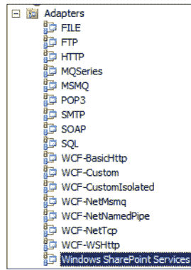

## 与 SharePoint 2010 集成

单独使用此 BizTalk 适配器是不够的。为了使此适配器正常运行，我们还需要安装 Windows SharePoint Services 适配器 Web 服务。此适配器 Web 服务可在 BizTalk 安装光盘上获得，但 Windows SharePoint Services 适配器 Web 服务需要在 SharePoint 服务器上安装。如果您在同一服务器上共同托管 BizTalk 和 SharePoint，则应将其安装在同一服务器上。如果您有远程 SharePoint 服务器，则此适配器 Web 服务只需安装在 SharePoint 服务器上，而无需安装在 BizTalk 服务器上。

> 与远程 SharePoint 安装集成时，BizTalk 服务器和 SharePoint 服务器必须存在于同一域中。

如果在尝试安装适配器 Web 服务的服务器上未检测到 SharePoint，则无法安装此组件，因为在安装应用程序中该选项将被禁用。

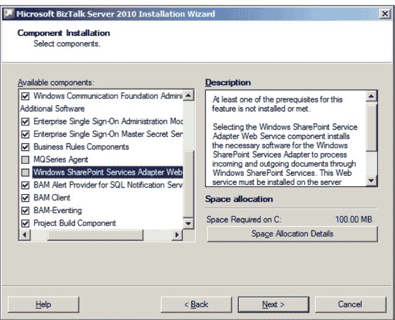

## Windows SharePoint Services 适配器 Web 服务的安装

由于在安装 BizTalk 运行时时已安装 Windows SharePoint Services 适配器，我们将仅关注安装 Windows SharePoint Services 适配器 Web 服务。

下面是在集成 BizTalk 2010 和 SharePoint 时支持的配置。请参阅 http://technet.microsoft.com/en-us/library/bb743377(BTS.70).aspx 获取更多信息。

| SharePoint 版本 | 注释 |
|---|---|
| SharePoint 2010/SharePoint 2010 Foundation | SharePoint 2010 Foundation 是一个免费的基础组件，SharePoint 2010 建立在其之上。 |
| Microsoft Office SharePoint Server (MOSS) 2007/Windows SharePoint Services (WSS) 3.0 SP2 | WSS 3.0 SP2 是一个免费的基础组件，MOSS 2007 建立在其之上。 |

> 只要您在已许可的 Windows 版本上运行它们，SharePoint 2010 Foundation 和 Windows SharePoint Service 3.0 SP2 都是免费的。

1. 一旦我们安装了 SharePoint，或有权访问现有的 SharePoint 环境，我们就可以从 BizTalk 安装介质安装 Windows SharePoint Services 适配器 Web 服务。安装过程将检测到 SharePoint 已安装，因为您可以选择 Windows SharePoint Services 适配器 Web 服务选项。

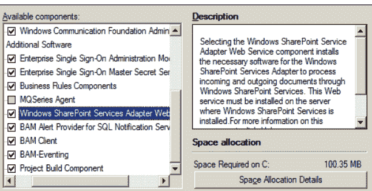

2. 现在我们将被提示确认是否要继续安装 Windows SharePoint Services 适配器 Web 服务。单击“安装”按钮继续。

> 尽管 SharePoint 产品团队已放弃 Windows SharePoint Services 品牌，但 BizTalk 团队仍将此组件称为 Windows SharePoint Services 适配器 Web 服务，即使您可能正在连接到现在使用 SharePoint Foundation 的 SharePoint 2010 环境。

3. 与许多 BizTalk 组件一样，每个实现都有两个方面：安装和配置。我们现在将通过选择“启动 BizTalk 服务器配置”复选框并单击“完成”按钮来配置 Windows SharePoint Services 适配器 Web 服务。

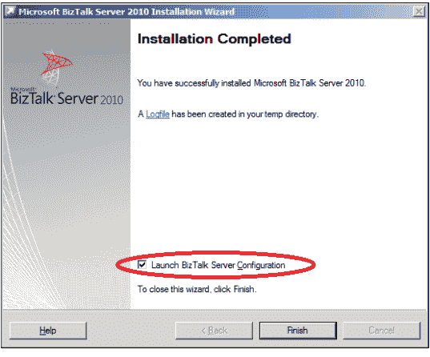

4. 我们现在希望在此计算机上启用 Windows SharePoint Services 适配器。为了启用此适配器，我们需要提供主机实例用户是其成员的 Windows 组。在以下配置中，已在 Active Directory 中创建了一个名为 SharePoint Enabled Hosts 的组，并且一个名为 btslcl 的 BizTalk 主机实例用户帐户已添加到该组中。每个主机实例都在具有执行 BizTalk 任务所需权限的用户上下文下运行，例如与其他端点系统和 BizTalk 消息框等进行交互。

5. 我们还需要提供将部署此适配器 Web 服务的 Windows SharePoint Services/ Foundation 站点的名称。在本例中，我们选择的是 SharePoint 网站的名称，该名称恰好为 **SharePoint-LOB-8080**。

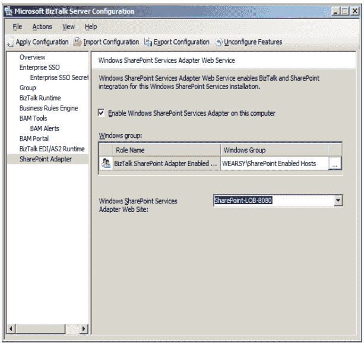

6. 在这一点上，我们准备好单击 **应用配置** 按钮以完成适配器 Web 服务的安装。

7. 我们现在应该看到适配器配置成功的确认。单击 **完成** 按钮完成此任务。

## 注：原生 64 位支持

SharePoint 2010 仅支持 64 位操作系统。考虑到这一点，我们还需要确保托管适配器 Web 服务的服务器上的 IIS 以 64 位原生模式运行。否则，在应用配置设置时可能会出现以下错误。

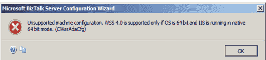

要启用 64 位原生模式，请以管理员身份从命令提示符运行以下命令：

```
C:\inetpub\AdminScripts>cscript adsutil.vbs SET W3SVC/AppPools/Enable32bitAppOnWin64 0
C:\inetpub\AdminScripts>%SYSTEMROOT%\Microsoft.NET\Framework64\v2.0.50727\aspnet_regiis.exe -i
```

8. 一旦配置成功应用，我们可以导航到 Internet Information Services (IIS) 管理器，并发现已创建了一个名为 BTSharePointAdapterWS 的应用程序。

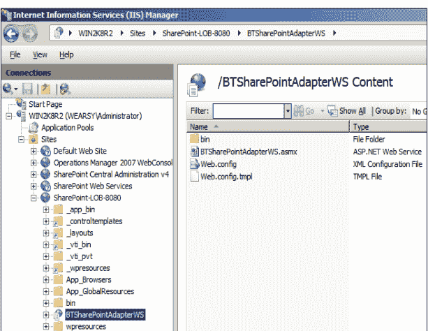

9. 在此 IIS 应用程序中，存在一个名为 BTSharePointAdapterWS.asmx 的 Web 服务。这是 Windows SharePoint 适配器在与 SharePoint 服务通信时使用的 Web 服务。如果您尝试在 Web 浏览器中启动此 Web 服务，您将收到错误提示。此错误仅为显示错误，不会影响 BizTalk 与 SharePoint 的交互。

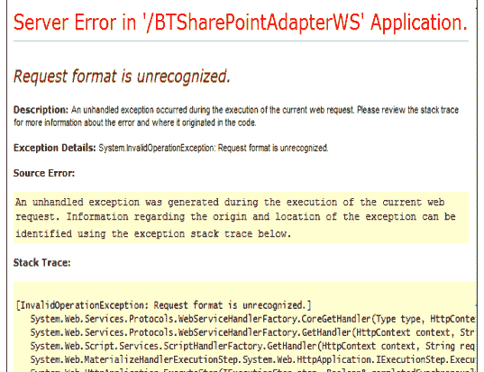


> 注：启用或禁用此错误消息其实是一种个人偏好。保留错误消息会给人一种服务有问题的印象。作为开发人员，我们通常喜欢浏览我们连接的服务。如果我们连接时收到错误消息，我们往往会认为出了问题。只要您正确完成剩余步骤，保留此错误消息启用不会影响与 SharePoint 的连接。

10. 为了消除此错误消息，您需要修改与 BTSharePointAdapterWS.asmx Web 服务位于同一文件夹中的 Web.config 文件。

```
<webServices>
    <protocols>
        <!-- Commented out line below to resolve bad request error-->
        <!--remove name="Documentation"/-->
    </protocols>
</webServices>
```


11. 修改 web.config 文件后，我们可以刷新 Web 浏览器，即会看到服务操作。

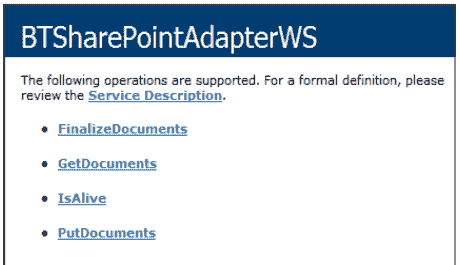

12. BTSharePointAdapterWS.asmx Web 服务公开了四个 Web 方法：

- FinalizeDocuments
- GetDocuments
- IsAlive
- PutDocuments

Windows SharePoint Services 适配器在与 SharePoint 交互时会调用这些方法。这些 Web 服务的实现对 BizTalk 开发人员来说是抽象的，使得与 SharePoint 的集成成为一种良好的体验。

每个 Web 方法都有其独特的目的，让我们进一步研究每个方法。

## FinalizeDocuments

接收来自 SharePoint 的文档时，适配器的默认行为是从源位置删除文件。这种行为模仿了 FILE 和 FTP 适配器的行为，以防止无限循环和消息重复。如果某人已将消息或文档加载到 SharePoint 中，那么当 BizTalk 拾取时，他们很可能不希望完全丢失该消息。为避免这种情况，Microsoft 在适配器中包含了一个名为 Archive Location URL 的属性。此功能将存储当前正在处理的副本，并将其放置到另一个文档或表单库中。Archive Location URL 功能利用 FinalizeDocuments Web 方法来实现正在处理的消息归档。

## GetDocuments

GetDocuments Web 方法由 Windows SharePoint Services 适配器在从 SharePoint 检索文档时使用。Windows SharePoint Services 适配器本质上是一个轮询适配器。Polling Interval 属性将决定适配器应多频繁地连接到 SharePoint。适配器将在每次轮询期间调用此 Web 服务，如果存在文档，则将使用此 Web 服务检索它们。

## IsAlive

IsAlive Web 方法是一个简单的 ping Web 服务，允许 BizTalk 确定 SharePoint 是否在线。

## PutDocuments

每当将文档上传到 SharePoint 时，Windows SharePoint Services 适配器将利用此 Web 服务执行此操作。

> Note: Multi-Node Deployments
> 如果您的组织拥有包含多个角色和服务器的 SharePoint 场，BizTalk 仍可支持此部署。只需在 SharePoint 场中的每个前端服务器上安装 Windows SharePoint Services 适配器 Web 服务。在提供 URL 作为适配器配置的一部分时，请确保使用前端加载这些请求的网络负载均衡器 NLB 的 URL。

## Windows SharePoint Services Adapter configuration

现在 Windows SharePoint Services 适配器和适配器 Web 服务已安装，我们将进一步研究在与 SharePoint 集成时可使用的一些属性。

## Receive Adapter

以下图像将进一步说明 SharePoint Services 接收适配器的配置。

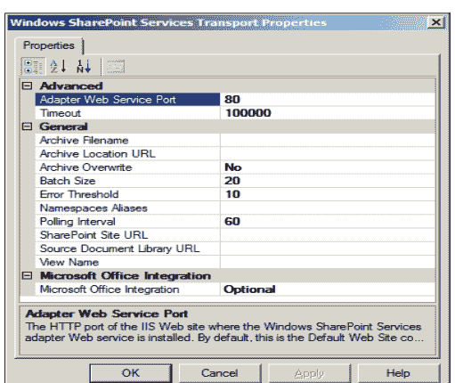

## Adapter Web Service port

IIS Web 应用程序的默认端口为 80。如果我们想在一台 IIS 服务器上运行多个网站，那么我们希望通过让 IIS 监听不同的端口来分隔这些网站。如果您选择这样做，则需要使用正确的端口值填充此属性。本书中的示例将使用端口 8080，因为为本书创建的 SharePoint 站点正在端口 8080 上运行。在 BizTalk 和 SharePoint 服务在同一服务器上共同托管的情况下，我们很可能会遇到这种情况，尤其是在默认网站中安装了 BAM 门户时。如果是这种情况，则需要将 SharePoint 站点与默认站点分开，因此这些站点之一必须在非标准端口上运行。

> Note: Another option is to create another website that uses port 80 but also leverages host headers. If we create a DNS alias for our server, we can then reference this alias as a host header and have multiple sites listening on port 80. IIS will then look at the http header when determining which site should be responsible for handling the request. To learn more about host headers, please refer to the following link: http://technet.microsoft.com/en-us/library/cc424952.aspx.

## Archive File Location URL

从 SharePoint 检索文档时，它们将被从 SharePoint 中删除以防止无限循环。使用另一个文档或表单库的位置填充此属性以归档消息。如果配置的 Archive File Location 不可用或配置不正确，BizTalk 将尝试检索源文档。但是，BizTalk 在解决 Archive File Location 问题之前不会处理文档。源文档将保留在 SharePoint 库中以防止消息丢失。

## Batch Size

由于接收适配器是轮询适配器，您可能希望限制 BizTalk 在单个批处理中从 SharePoint 检索的文档数量。

## Namespaces Aliases

如果我们计划使用 XPath 来填充其他 SharePoint 列，例如 Archive Filename，我们需要提供我们期望的消息的命名空间。例如，我们可以使用 XPath 从消息正文中提取一个值，并将其用作我们正在归档的文件名称的一部分。

## Polling Interval

BizTalk 连接到 SharePoint 以确定是否有待处理的可用消息供消费的时间间隔，以秒为单位。

## SharePoint Site URL

BizTalk 将连接到的 SharePoint 站点的基 URL。例如，如果我们创建了一个文档库，整个 URL 为 http://localhost:8080/sites/BizTalkLineOfBusiness/Completed%20Forms/，那么我们将使用 http://localhost:8080/sites/BizTalkLineOfBusiness/ 填充 SharePoint Site URL，然后将 SharePoint Document Library URL 填充为 Completed%20Forms/。


> Note: Spaces and Special Characters
> SharePoint 文档和表单库的名称中可能包含空格。与包含空格的任何其他 HTTP 地址一样，需要 URL 编码将空格转换为字符序列。此序列表示为 %20。在 BizTalk 配置内部，您可以指定一个空格，通过按空格键，或提供 %20。无论何时导出 BizTalk 绑定文件，您都会发现空格始终表示为 %20。

## View Name

与 FILE 适配器不同，Windows SharePoint Services 适配器不支持文件掩码。默认情况下，BizTalk 在连接时会从文档或表单库中检索所有文档。为了避免这种情况，我们可以提供一个视图名称，BizTalk 将仅检索符合该视图条件的记录。例如，假设我们在 SharePoint 中实现了办公用品审批流程。员工可能会填写 InfoPath 表单并将其保存到 SharePoint 表单库。由于此采购需要员工主管批准，因此我们不希望 BizTalk 在获得批准之前拾取此办公用品请求。我们可以在 SharePoint 中构建一个视图，它仅显示已批准的办公用品请求。然后让 BizTalk 连接到此视图以检索这些已批准的请求。这允许员工和主管在同一表单库中工作，但 BizTalk 仅检索已批准的表单。

## Send Adapter

现在，我们将进一步探索 SharePoint Services 发送适配器的配置。

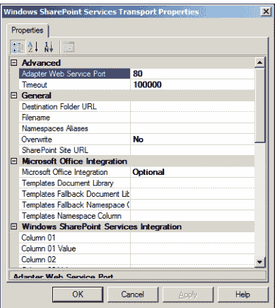

## Adapter Web Service Port

我们 Windows SharePoint Services 适配器 Web 服务已部署的 Web 应用程序的端口。

## SharePoint Site URL

您想要连接到的 SharePoint 站点的基 URL。例如，如果我们创建了一个文档库，整个 URL 为 http://localhost:8080/sites/BizTalkLineOfBusiness/Completed%20Forms/，那么我们将使用 http://localhost:8080/sites/BizTalkLineOfBusiness/ 填充 SharePoint Site URL，然后将 SharePoint Document Library URL 填充为 Completed%20Forms/。

## Namespaces Aliases

如果我们计划使用 XPath 来填充其他 SharePoint 列，例如文件名，我们需要提供我们期望的消息的命名空间。例如，我们可以使用 XPath 从消息正文中提取一个值，并将其用作我们正在归档的文件名称的一部分。我们也可以使用此信息填充 SharePoint 列。


## Microsoft Office 集成

SharePoint 与 BizTalk 集成的关键增值之一是可从 InfoPath 利用的功能。例如，我们可以创建 SharePoint 列，然后使用 InfoPath 字段中的数据或已填充到 BizTalk 适配器上下文属性中的数据来填充这些列。启用此属性将允许启用 InfoPath 预处理指令。这些预处理指令还允许已存放在 SharePoint 中的 XML 消息与表单关联。当您单击启动已存放在的 XML 消息时，SharePoint 将找到其相关模板并启动表单，其中嵌入了 XML 数据。需要注意的是，在 BizTalk 处理此类消息时，它无法看到表单模板标记。它严格处理底层 XML 表单数据，并且实际上不会接收表单模板标记。

## 模板文档库

当 XML 消息已发送到 SharePoint 库，并且我们希望将其与特定的 InfoPath 表单关联时，我们可以填充此属性，以便 SharePoint 知道在哪里找到匹配的表单模板。

## 模板命名空间列

这是存储 InfoPath 解决方案命名空间的 SharePoint 列的名称。

## SharePoint 列

Windows SharePoint Services 适配器公开的属性在填充后将被插入到 SharePoint 库中对应的列中。例如，如果我们有一个审批者场景，我们可以在 SharePoint 库中创建一列，当 BizTalk 将消息插入此库时，它可以从消息正文或从发送端口配置中获取数据，并将该数据插入 SharePoint 列中。列上下文属性的工作方式类似于键/值对。我们需要在“Column XX”属性中插入列的名称，然后在“Column XX Value”属性中插入相关值。可填充的列数上限为 16。

## 其他注意事项

## 上下文属性

与其他适配器类似，Windows SharePoint Services 适配器上下文属性在编排中也可用。在构建动态发送端口方案时，这变得非常有用。

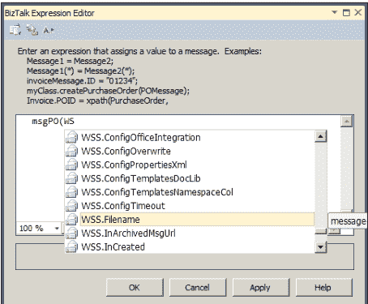

## Windows SharePoint Services 适配器是一个单向适配器

在配置使用 Windows SharePoint Services 适配器的接收位置或发送端口时，我们可以使用单向接收位置或单向发送端口。此场景有趣之处在于，我们知道适配器利用的是双向 Web 服务。这并不意味着 BizTalk 会对 SharePoint 不可用时发生的任何故障或诸如安全故障之类的其他运行时问题毫不知情。这些错误仍会被 BizTalk 捕获并报告。但是，如果您查看 BizTalk 管理控制台中的跟踪服务实例，您将只为每次与 SharePoint 的连接找到一条记录。

再次，Microsoft 为我们抽象了调用 Web 服务所涉及的大量复杂性。Microsoft 架构的另一个好处是，使用 Windows SharePoint Services 适配器时，我们的编排中不需要 SharePoint 代理类。这为我们的解决方案提供了松耦合设计。如果我们有目前利用 FILE 适配器的项目，我们可以轻松更改接收位置或发送端口以使用 Windows SharePoint Services 适配器，而无需重新编译我们的解决方案。我们只需在 BizTalk 管理控制台中更改适配器类型即可。

## 从 SharePoint 接收文档

我们要构建的场景是一个使用 InfoPath、BizTalk 和 SharePoint 2010 Foundation 的假期申请审批系统。员工将填写表单并将其提交到 SharePoint 中的表单库，以便员工的主管进行审批。一旦假期获得批准，BizTalk 将使用此表单、对其进行归档，然后使用 FILE 适配器将已批准的假期申请传递给 ERP 系统。ERP 系统要求此信息以逗号分隔值 (CSV) 文件的形式提供。


> 注意：本章中的示例假定您已拥有现有的 SharePoint 站点。以下链接描述了如何为 WSS 3.0 SP2 和 SharePoint 2010 Foundation 创建 SharePoint 站点：
> 
> WSS 3.0 SP2:
> http://technet.microsoft.com/en-us/library/cc288969(office.12).aspx
> 
> SharePoint 2010 Foundation:
> http://technet.microsoft.com/en-us/library/cc263094.aspx

此解决方案的基础是一个名为 `InfoPath_Vacation_Approval.xsd` 的架构。我们将在 BizTalk 解决方案中使用此架构作为消息类型，但我们也将使用此架构来构建 InfoPath 表单。最终结果是，当审批表单提交到 SharePoint 并被 BizTalk 拾取时，我们将在 BizTalk 中获得一个强类型消息。

此架构是本书源代码中 Chapter7-ReceivingDocuments 解决方案的一部分。

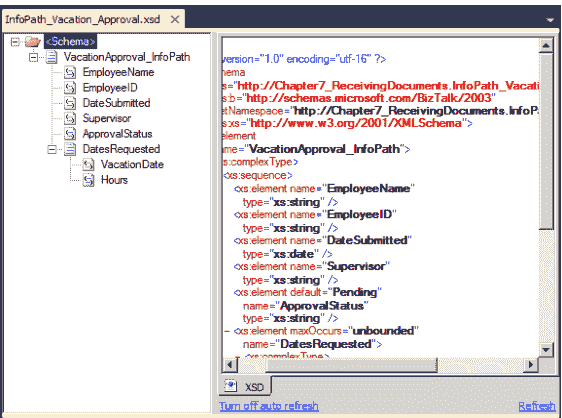

## 构建 InfoPath 表单和 SharePoint 表单库

为了基于此架构设计表单，我们需要打开 Microsoft InfoPath Designer。此示例将使用 InfoPath 2010，但此解决方案也应与 InfoPath 产品的前一版本一起使用：

- 1. 双击“高级表单模板”中的 XML 或架构。

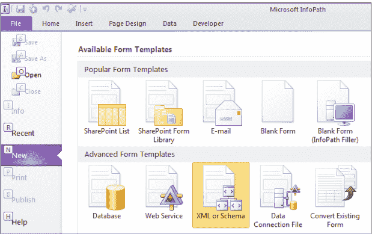

- 2. 浏览到 **InfoPath_Vacation_Approval.xsd** 架构的位置并单击 **Next** 按钮。
- 3. 当提示是否要向主数据源添加另一个 XML 架构或 XML 文档时，选择 **No**，然后单击 **Finish** 按钮。
- 4. 在以下屏幕截图的右侧，我们会注意到在我们的 XSD 架构中创建的字段和节点现在可用于插入到我们的 InfoPath 表单中：
- 5. 我们现在有机会设计表单以符合组织可能拥有的任何外观和感觉或设计标准。

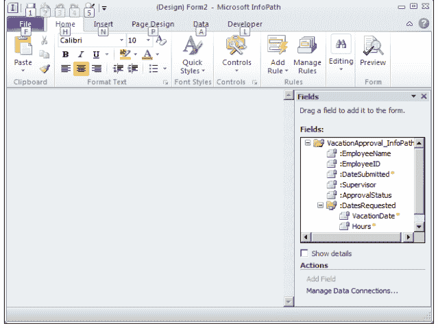

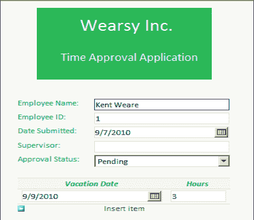

- 6. 完成表单设计后，我们希望将表单发布到 SharePoint 表单库。为此，单击 文件 – 发布 – SharePoint Server。

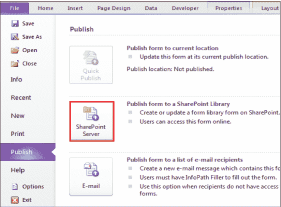

- 7. 提供您希望部署此表单的 SharePoint 站点的 URL，然后单击 Next 按钮。
- 8. 对于此示例，我们希望选择将此表单发布到 **Form Library**，然后单击 **Next** 按钮。

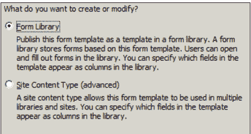

- 9. 我们现在希望 **Create a new form library**，然后单击 **Next** 按钮。

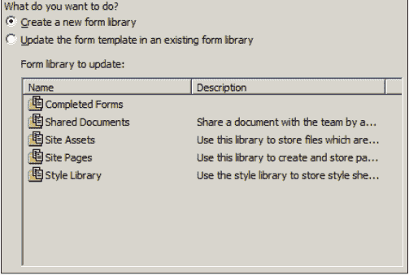

- 10. 为此新表单库提供名称，例如 **Vacation Approval**，然后单击 **Next** 按钮。

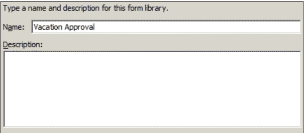

- 11. 指定 **Employee Name**、**Supervisor** 和 **Approval Status** 作为我们希望在表单库中显示的字段。

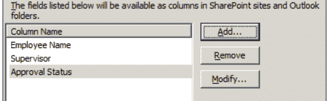

- 12. 发布并验证我们的表单库是否成功部署。请注意，我们应该在库下看到 **Vacation Approval** 链接，并且应该在浏览器右上角看到 **Employee Name**、**Supervisor** 和 **Approval Status** 列。

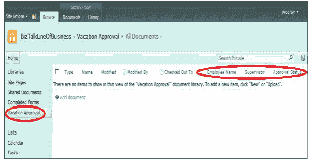

- 13. 单击 **Add document** 链接。

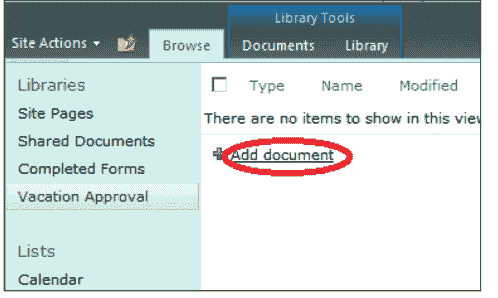

- 14. 我们之前设计的表单将被启动。

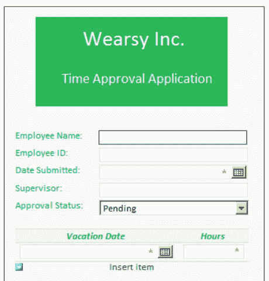

- 15. 我们现在需要返回表单并修改员工完成表单后表单应提交到的位置。提交表单到 SharePoint 库时，我们有几个选项：
  - 使用 InfoPath 客户端自带的 **Submit Form** 按钮
  - 向表单添加按钮控件，然后将 **Submit Form** 操作附加到该按钮

- 16. 我们现在将通过单击 **File -Info - Submit Options -To SharePoint Library** 通过 InfoPath 客户端添加提交表单功能。这使我们能够利用开箱即用的功能，而无需任何额外的配置或脚本。


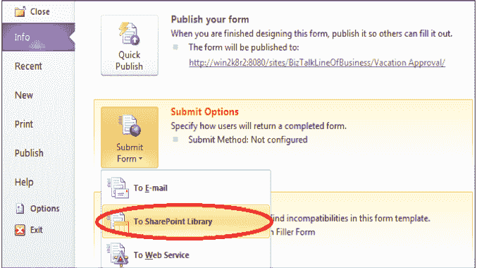

17. 我们需要提供表单库的 URL 以及表单提交时将使用的表单名称。最好使用宏并利用表单中的唯一数据来避免重复的文件名。填充这些文本框后，单击“下一步”按钮继续。

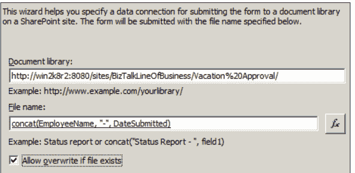

18. 为此数据连接提供一个名称，以描述正在提交的数据类型，然后单击“完成”按钮。

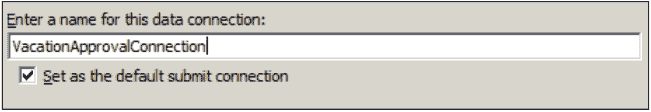

19. 如果自我们最初发布表单以来表单位置未发生变化，我们可以选择快速发布将此最新版本的表单上传到 SharePoint。

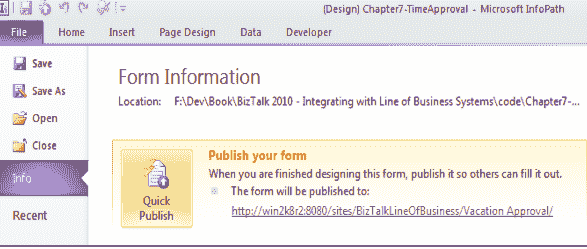

20. 当我们通过单击“添加文档”链接启动新表单时，我们现在将有提交表单的选项。

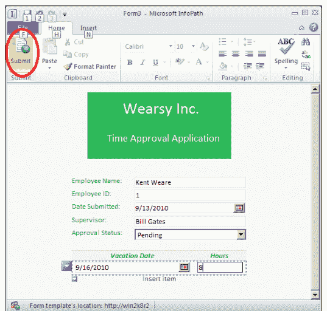

21. 提交后，我们会看到 InfoPath 表单已添加到表单库中，并且元数据已填充到 SharePoint 列中。

## 创建 SharePoint 视图

此时，我们可以配置 BizTalk 从此表单库消费消息，但休假申请尚未获批。我们只想消费已获批准的 InfoPath 表单。

- 1. 为了实现此要求，我们需要在此表单库中创建一个视图，然后配置 BizTalk 仅检索满足该视图要求的文档。
- 2. 要创建视图，请从“库工具”菜单中选择“库”，然后单击“创建视图”。
- 3. 选择标准视图。

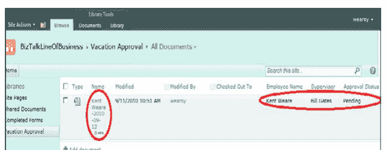

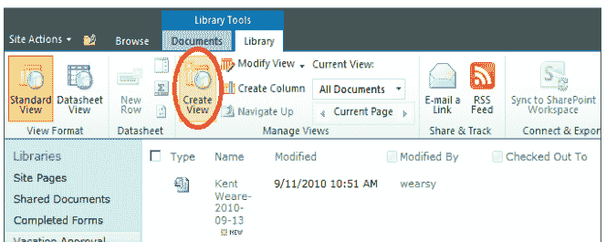

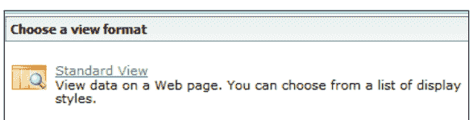

4. 提供适当的视图名称，例如 Approved Vacation Requests，然后单击“确定”按钮。

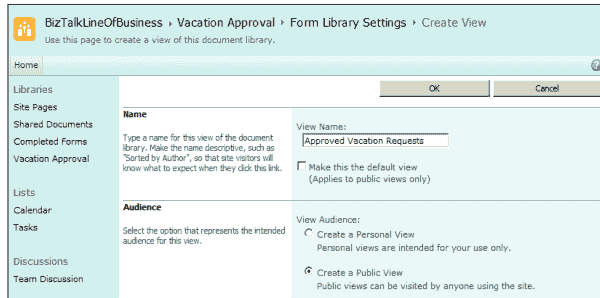

5. 现在，滚动到筛选器部分。我们只想显示审批状态等于“已批准”的表单。

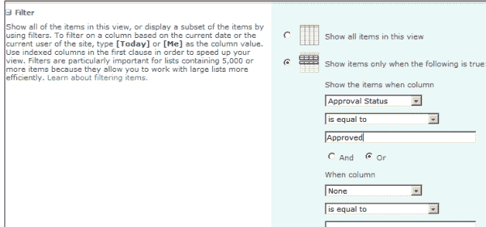

6. 在名为“所有文档”的默认视图中，我们可以看到所有文档，无论其审批状态如何。

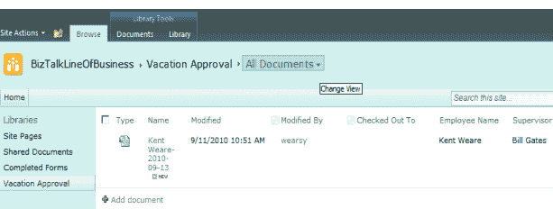

7. 如果我们将视图更改为 **Approved Vacation Requests**，我们将找不到任何列出的文档，因为没有休假申请已被批准。

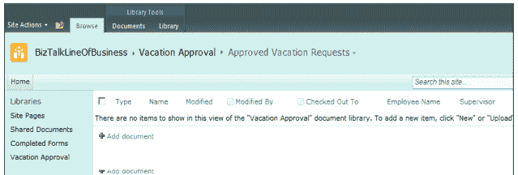

## 创建 SharePoint 归档库

BizTalk 可以利用这些允许文档处于各种状态的相同视图。如果我们在接收位置配置中提供一个视图，BizTalk 将只检索满足该视图条件的文档。

我们还希望确保我们拥有成功休假申请的归档副本。为此，我们将创建另一个名为 **Archived Vacation Requests** 的表单库。

- 1. 在 SharePoint 站点中单击 **Libraries** 链接。

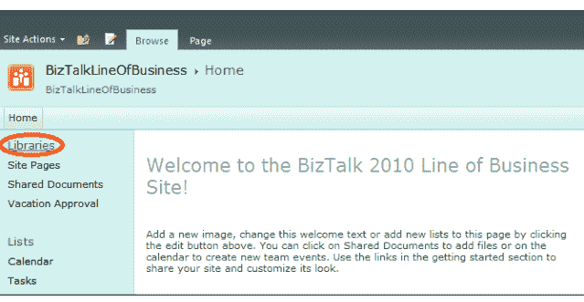

2. 单击 **Create** 链接。

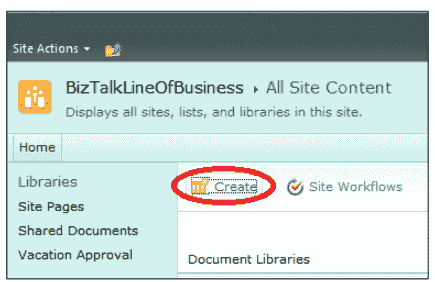

3. 选择 **Form Library**，提供表单库名称，例如 **Archived Vacation Requests**，然后单击 **Create**。

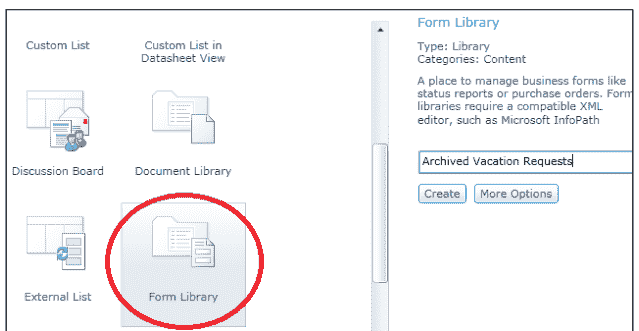

4. 我们现在有一个名为 **Archived Vacation Requests** 的表单库。

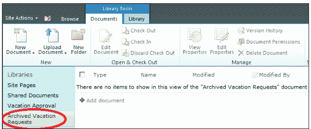

5. 现在，每当 BizTalk 拾取已批准的休假申请时，它将在此表单库中制作表单的归档副本。截至目前，我们已执行以下操作：

- 设计了一个可用于设计 InfoPath 表单的架构
- 设计了 InfoPath 表单
- 创建了表单库
- 发布了 InfoPath 表单并创建了自定义列
- 更新表单以提交到我们的表单库

## 构建应用程序

我们现在将重点关注此解决方案的 BizTalk 部分。一旦获批，此休假申请信息需要提交到组织的 HR 系统，该系统是一个 ERP 系统。此 ERP 系统期望的平面文件类似于下面的文件。

1. 此文件的副本可在本章源代码的 FlatFile 文件夹中找到。

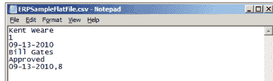

2. 我们现在需要一个能够为我们的 ERP 系统组装平面文件的平面文件架构。解决方案中包含一个名为 ERP_Vacation_Approval_FF.xsd 的平面文件架构。

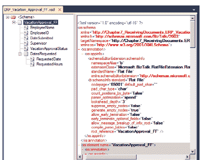

3. 如果没有管道来组装，在我们的例子中，或将消息从 XML 格式拆分为平面文件格式，反之亦然，平面文件架构并无多大价值。在我们的解决方案中，存在一个名为 `SendVacationApproval.btp` 的发送管道，用于获取 BizTalk 内部创建的 XML 消息并组装供 ERP 系统消费的平面文件。此架构中的 **Document Schema** 属性被分配给我们之前创建的平面文件架构 `ERP_Vacation_Approval_FF.xsd`。

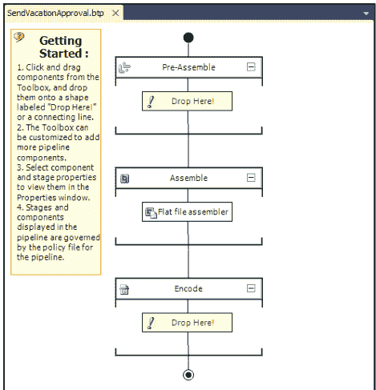

4. 现在我们已经创建了源（InfoPath）和目标（ERP）架构，我们想要创建一个映射来执行这两个消息之间的转换。我们解决方案中此映射的名称为 `InfoPathVacationRequests_to_ERPVacationRequests.btm`。

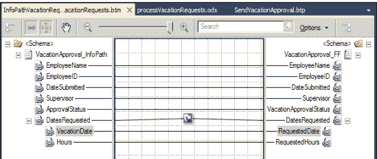

5. 将所有这些组件整合在一起的 BizTalk 工件是一个名为 `processVacationRequests.odx` 的编排。在此编排中，我们将找到以下功能：

- 接收 XML InfoPath 消息
- 将 InfoPath 消息转换为 ERP 消息
- 将 ERP 消息发送到 ERP 系统

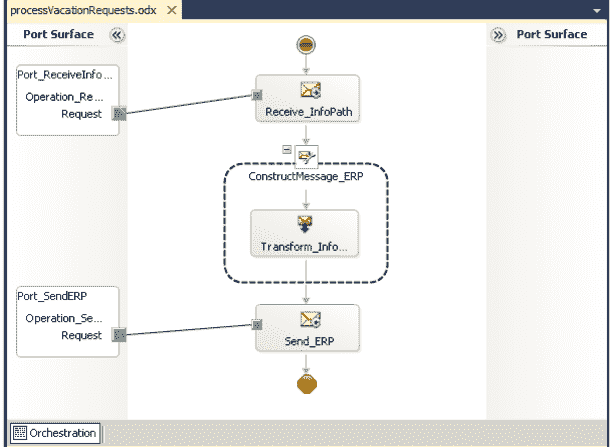

6. 我们现在需要通过右键单击解决方案名称并单击“部署解决方案”来部署我们的解决方案。

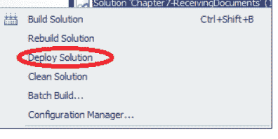

7. 当我们启动 BizTalk Server 管理控制台时，我们会发现已创建了一个名为 **Chapter7-ReceivingDocuments** 的应用程序。我们现在将逐步介绍 **Receive Locations**、**Orchestrations** 和 **Send Ports** 的各种配置设置。

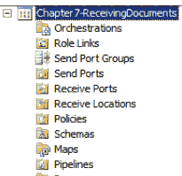

> Note: 你可以在本章源代码中找到的 `Bindings` 文件夹中找到解决方案绑定文件的副本。请注意，绑定文件包含对用于演示本章功能的 8080 端口的引用。如果你的 SharePoint 服务器使用不同的端口，你需要更新配置。

8. 在接收位置节点中，我们将找到一个名为 `ReceiveInfoPathVacationRequest` 的接收位置。此接收位置将使用 Windows SharePoint Services 适配器，使用默认的 **BizTalkServerApplication** 主机，以及 **XMLReceive** 管道。

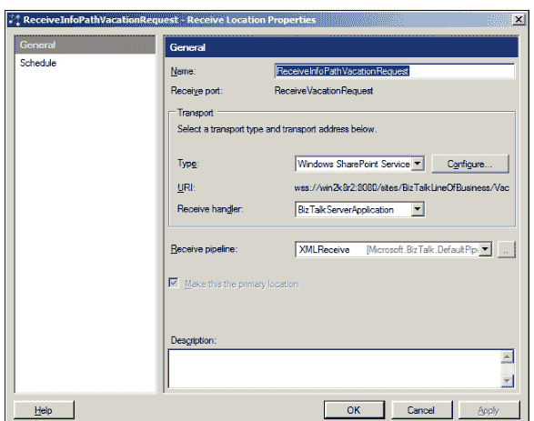

9. 通过单击“配置”按钮，我们可以进一步探索接收位置的配置。

下面是描述重要适配器属性的表格：

| 属性 | 值 | 注释 |
|---|---|---|
| 适配器 Web 服务端口 | 8080 | 在用于构建此解决方案的服务器上，SharePoint 站点创建在 8080 端口，因为该服务器还安装了 BAM 门户。如果您将 SharePoint 安装为默认网站，则您的端口将为 80。 |
| 超时 | 100000 | 适配器在超时之前的时间，以毫秒为单位。 |
| 归档文件名 | %XPATH=//ns0:VacationApproval_InfoPath/EmployeeName%-%XPATH=//ns0:VacationApproval_InfoPath/DateSubmitted%.xml | 我们可以使用接收到的消息中的值来确定将放置在归档中的文件的名称。在这里，我们使用员工姓名和员工提交表单的日期。 |
| 归档位置 URL | Archived%20Vacation%20Requests | 这是存储已归档休假申请的库。 |
| 命名空间别名 | ns0="http://Chapter7_ReceivingDocuments.InfoPath_Vacation_Approval" | 这是构建 InfoPath 表单时使用的 InfoPath_Vacation_Approval.xsd 架构的命名空间。 |
| 轮询间隔 | 60 | BizTalk 连接到 SharePoint 库以检查是否有新的休假申请获批的时间间隔，以秒为单位。 |
| SharePoint 站点 URL | http://win2k8r2:8080/sites/BizTalkLineOfBusiness/ | 用于托管创建和存储休假申请的表单库的 SharePoint 站点的位置。 |
| 源文档库 | Vacation Approval | 我们创建和存储休假申请的表单库的名称。 |
| 视图名称 | Approved Vacation Requests | BizTalk 将用于确定哪些表单可以被消费的视图的名称。 |


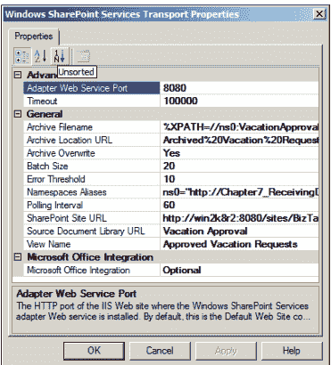

注：用于连接 SharePoint 的接收位置的 BizTalk 主机实例用户需要对文档或表单库具有“参与者”访问权限。有关 SharePoint 权限的更多信息，请参阅以下链接：http://technet.microsoft.com/en-us/library/cc721640.aspx

10. 我们的发送端口将利用 FILE 适配器将已批准的平面文件休假请求传递到 ERP 系统能够从中消费的文件 drop 中。由于 ERP 系统期望的是平面文件，因此我们需要确保正在使用自定义发送管道。我们想要使用的管道是 Send Vacation Approval。

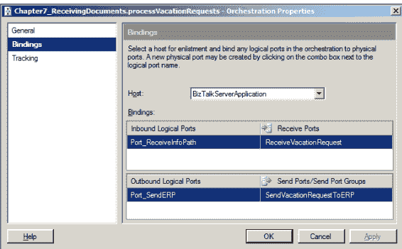

11. processVacationRequests 编排的配置非常简单：

- 我们有一个接收端口用于从 SharePoint 接收 InfoPath 表单
- 一个发送端口，我们将使用它将已批准的休假请求发送到 ERP 系统
- 我们将使用的主机是 BizTalkServerApplication。在尝试执行示例应用程序之前，请记住重新启动此主机实例。


## 测试应用程序

此时，我们已准备好验证我们的解决方案。要测试我们的解决方案，我们需要执行以下操作：

1. 导航到您的 SharePoint 文档库并选择 **添加文档**。
2. 填写 InfoPath 表单并单击 **提交** 按钮。


3. 您现在应该在表单库中有一个文档，其审批状态为 **待处理。**


4. 打开此现有表单，将 **审批状态** 设置为 **已批准**，然后单击 **提交** 按钮。

5. 我们将片刻看到 InfoPath 的审批状态已更改为已批准。


6. 由于审批状态已更改为已批准，BizTalk 现在将消费此消息并将其写入我们的文件夹位置。


7. 如果我们打开文件，将会发现它与 ERP 系统期望的格式相匹配。


## 向 SharePoint 发送文档

在此场景中，我们有一个工作订单管理系统，员工使用它来管理石油和天然气公司的作业或任务。该组织的法律要求是他们必须记录员工在现场发生的任何安全事故。员工将使用此工作订单管理系统来更新其作业的状态，但也会记录任何现场事故。在工作订单管理系统中捕获此信息的问题在于它专为现场设计，不利于可能需要跟踪这些事故以确保监管合规性的办公室员工。

解决此问题的方法是允许现场工作人员在工作订单管理系统中输入事故数据，但将此信息输入 SharePoint，以便办公室员工可以跟踪。工作订单管理系统将输出一个 XML 文件，我们将将其加载到 SharePoint 表单库中。

由于我们不希望办公室员工查看 XML 文档，我们将把此信息加载到 InfoPath 表单中，这将为我们的办公室员工提供良好的用户界面。

将此信息放在 SharePoint 中的另一个好处是我们可以应用信息策略，该策略将设置文档的过期日期，并在文档日期超过文档到期日期时自动将其清除。

## 创建 SharePoint 表单库

在“接收文档”演练中，我们让 InfoPath 客户端为我们创建了一个表单库。这次我们将手动创建内容类型、表单库和 SharePoint 列。内容类型是我们可以用作内容基础的模板。它允许我们在 SharePoint 库中设置默认文档类型，因此如果我们想从 SharePoint 功能区创建新文档，默认情况下它将是我们基于内容类型创建的类型。

1. 在创建内容类型之前，我们需要创建一个 InfoPath 表单，以便我们可以基于它创建内容类型。我们将再次从 XSD 架构开始。在这种特殊情况下，我们将使用的架构名称是 **WorkOrderManagementIncident_InfoPath.xsd**，可在 Chapter7-SendingDocuments 解决方案中找到。

2. 然后我们希望基于 **WorkOrderManagementIncident_InfoPath** 架构设计一个 InfoPath 表单，就像我们在本章“从 SharePoint 接收文档”部分中所做的那样。不同之处在于，我们不会将此表单发布到 SharePoint，也不会将表单提交到 SharePoint，因为我们基本上将 InfoPath 用作这些文档的查看器，并且不会修改它们。


3. 现在我们需要创建内容类型并将此 InfoPath 表单与其关联。为此，请单击“网站操作”下拉菜单，然后单击“网站设置”。


4. 现在，我们需要从“图库”分组中单击“网站内容类型”。


5. 单击“创建”按钮。


6. 提供 **名称**、**父内容类型**，然后选择此网站内容应所属的组。在这种情况下，我们应使用 **自定义内容类型。**


7. 正如我们在本章“接收文档”示例中所看到的，SharePoint 列成为将元数据关联到 SharePoint 中文档的有价值工具。通过填充 SharePoint 列，我们现在可以根据列中包含的信息进行搜索、排序并创建视图。

- 我们现在将列关联到我们的特定内容类型，以便当我们将内容类型添加到文档库时，这些列将可供我们使用 Windows SharePoint Services 适配器填充。单击 **从新建网站列添加** 链接。


8. 我们现在将继续使用以下数据为 **事故日期**、**事故城市** 和 **事故工厂** 创建列。否则，我们将使用默认值。

| 列名称 | 数据类型 | 最大字符数 |
|---|---|---|
| 事故日期 | 日期和时间 | N/A |
| 事故城市 | 单行文本 | 50 |
| 事故工厂 | 单行文本 | 10 |


9. 完成内容类型后，它应如下图所示：


10. 现在我们需要将特定的 InfoPath 表单与此内容类型关联。单击“高级设置”以启动负责此功能的向导。


11. 浏览到表单的位置并选择它。另请确保内容类型未设置为只读。


12. 此时，我们已准备好创建新的表单库，然后将此内容类型与我们新创建的文档库关联。要创建新的文档库，请单击 **网站操作**，然后单击 **更多选项**。


13. 选择 **表单库**，然后提供名称并单击 **创建** 按钮。


14. 我们还希望为表单库设置默认模板。我们需要修改默认模板设置，可以通过单击 **库设置** 来完成。


15. 进入表单库设置页面后，单击“高级设置”链接。


16. 在此屏幕中，我们需要设置模板 URL。通过设置文档模板，当 BizTalk 将文档加载到此表单库中时，SharePoint 将自动尝试将上传的文件与此模板关联。


> 注：我们不需要提供文档模板的完整路径。我们只需要提供基本站点之后的路径。
> 例如，我们站点的基 URL 为：
> 因此，对于文档模板的位置，我们只需要提供文件夹的名称和模板的名称。

```
http://win2k8r2:8080/sites/BizTalkLineOfBusiness/
```

```
Field Incident Forms/Forms/FieldIncidentType/
Chapter7-WorkOrderManagement_Incident.xsn
```

17. 如果我们想要浏览 SharePoint 库使用的文件系统，请单击“库”，然后单击“连接并导出”。这将启动 Windows 资源管理器，并带我们进入存储文档库文件的文件夹。为了更方便，请确保在 Windows 资源管理器中可以看到隐藏文件和文件夹，以便查看 Forms 文件夹。


18. 如果我们导航到表单库并单击“新建文档”按钮，我们的现场事故模板现在将默认启动。


19. 现在我们需要添加之前创建的 FieldIncidentType 中的列。我们可以通过从表单库设置页面单击“从现有站点列添加”链接来完成此操作。


20. 从“从以下位置选择站点列：”下拉列表中选择“自定义列”，然后将 Incident City、Incident Date 和 Incident Plant 添加到“要添加的列：”组合框中，然后单击“确定”按钮。


21. 现在我们将在表单库中看到这些列的显示。


22. 到目前为止，我们已执行以下操作：
- 设计了一个可用于设计 InfoPath 表单的架构
- 设计了一个 InfoPath 表单
- 创建了一个内容类型
- 创建了一个表单库
- 为表单库设置了模板
- 修改表单库的视图以包含我们在内容类型中指定的自定义列

## 构建 BizTalk 应用程序

SharePoint 配置完成后，我们现在需要专注于解决方案的 BizTalk 部分。作为 BizTalk 解决方案的一部分，我们需要执行以下步骤：
- 为我们将从工作订单管理系统接收的消息建立架构
- 创建映射以将此工作订单管理数据转换为 InfoPath 架构类型数据
- 设置 Windows SharePoint Services 适配器上下文属性，以便保留原始文件名的名称
- 将消息发送到 SharePoint 并配置 Windows SharePoint Services 适配器，以便我们可以填充之前配置的内容类型列

1. 工作订单管理系统使用的文件的消息结构与 InfoPath 架构的结构非常相似。不同之处在于工作订单管理系统使用属性而不是元素。


2. 我们将使用的映射非常简单，因为架构结构非常相似。


3. 一旦我们将传入的工作订单管理消息转换为 InfoPath 消息，我们需要在消息分配形状中修改 InfoPath 消息。此消息分配形状的目的是检索传入消息的名称，以便在发布到 SharePoint 后我们可以保留文件的名称。默认情况下，如果您未提供静态或动态文件名，SharePoint 适配器将使用 GUID 作为文件名。


> 注：BizTalk 2010 的新功能是长期以来许多开发人员希望清单上的一个功能：可扩展的表达式编辑器！我从来不明白为什么我们被限制在固定窗口中工作，但很高兴看到此功能终于被添加了。

4. 在此示例中，我们已从编排中操作了适配器上下文属性。我们也可以从自定义管道组件中访问这些属性。这允许仅消息解决方案也利用 Windows SharePoint Services 适配器提供的强大功能。有关操作 SharePoint 适配器上下文属性的完整功能演练，请参阅 Kent Weare 的博客文章：http://kentweare.blogspot.com/2010/01/sharetalk-integration-sharepointbiztalk_16.html
- 总体而言，我们的编排非常简单。我们接收消息，对其进行转换，更新以设置适配器上下文属性，然后将其发送到 SharePoint。


5. 我们现在可以通过右键单击解决方案名称并单击 **Deploy Solution** 来部署应用程序。

6. 在 BizTalk 管理控制台中，我们现在应该看到一个名为 Chapter7-SendingDocuments 的应用程序。我们现在需要一个接收位置来从工作订单管理系统获取文件。此接收位置的名称为 **ReceiveXMLIncident**。它将使用 **FILE** 适配器、**BizTalkServerApplication** 接收处理程序和 **XMLReceive** 接收管道。


7. 发送端口的配置比应用程序的其他部分更有趣。发送端口将利用 Windows SharePoint Services 适配器，通过利用 BizTalkServerApplication 主机实例和 PassThruTransmit 发送管道。

8. 如果我们单击 **Configure** 按钮，我们可以进一步探索适配器的配置设置。

9. 我们的 `processFieldIncidents.odx` 的配置非常简单。我们有一个接收端口，将从中接收现场事故，以及一个发送端口，将用于将 InfoPath 消息发送到 SharePoint。我们再次使用默认主机实例 **BizTalkServerApplication.**


| 属性 | 值 | 注释 |
|---|---|---|
| 适配器 Web 服务端口 | 8080 | 在用于构建此解决方案的服务器上，SharePoint 站点是在端口 8080 上创建的，因为该服务器还安装了 BAM 门户。如果您将 SharePoint 安装为默认网站，则您的端口将为 80。 |
| 目标文件夹 URL | Field Incident Forms | 我们将把这些 InfoPath 文档存放在此处的表单库。 |
| 命名空间别名 | ns0="http://Chapter7_SendingDocuments.WorkOrderManagementIncident_InfoPath" | 这是构建 InfoPath 表单时使用的 `WorkOrderManagementIncident_InfoPath.xsd` 架构的命名空间。 |
| SharePoint 站点 URL | http://localhost:8080/sites/BizTalkLineOfBusiness/ | 用于托管创建和存储现场事故表单的表单库的 SharePoint 站点的位置。 |
| Microsoft Office 集成 | Yes (InfoPath Form Library) | 这指示 SharePoint 尝试使用 InfoPath 模板加载此文档。 |
| 列 01 | Incident City | 我们在建立 FieldIncidentType 内容类型时创建的 SharePoint 列的名称。 |
| 列 01 值 | %XPATH=//ns0:WOMIncident_InfoPath/Location/City% | 这是一个 XPath 表达式，将从我们的消息有效负载中检索事故的城市。 |
| 列 02 | Incident Plant | 我们在建立 FieldIncidentType 内容类型时创建的 SharePoint 列的名称。 |
| 列 02 值 | %XPATH=//ns0:WOMIncident_InfoPath/Location/Plant% | 这是一个 XPath 表达式，将从我们的消息有效负载中检索事故的工厂。 |
| 列 03 | Incident Date | 我们在建立 FieldIncidentType 内容类型时创建的 SharePoint 列的名称。 |
| 列 03 值 | %XPATH=//ns0:WOMIncident_InfoPath/IncidentDate% | 这是一个 XPath 表达式，将从我们的消息有效负载中检索事故的日期。 |


注意：连接到 SharePoint 的发送端口的 BizTalk 主机实例用户需要对文档或表单库具有“Contributor”访问权限。

## 测试应用程序

配置好我们的应用程序后，现在可以启动它并执行测试以确保其正常工作。

- 1. 我们希望在接收位置的文件夹中放置一条与下面类似的消息。此消息的示例可在本章源代码的 Chapter7-SendingDocuments\FileDrop\ 文件夹中找到。

```
<ns0:WOMIncident_XML INCIDENT_DATE="2010-10-10"
  xmlns:ns0="http://Chapter7_SendingDocuments.WorkOrderManagementIncident_InfoPath">
  <Location CITY="Regina" PROVINCE="Saskatchewan" PLANT="2135"
  SERVICE_POINT="23" />
  <Personnel>
  <PERSON NAME="Kurt Weare" ID="9999" POSITION="Area Foreman"
  EMP_OR_CONTR="Employee" />
  </Personnel>
  <VEHICLE VEHICLE_ID="1400" DAMAGE="Front End Damage to Truck" />
  <ENVIRONMENT IS_OIL_SPILL="false" IS_ENV_HAZARD="false"
  IS_WILD_LIFE_IMPACT="true">
  <COMMENTS>While travelling back from Oilfield install, a moose ran into the road
  and I couldn't stop in time to avoid him. Extensive damage to the front end of
  the truck has occurred.</COMMENTS>
  </ENVIRONMENT>
</ns0:WOMIncident_XML>
```

- 2. BizTalk 应拾取此文件，将其转换为 InfoPath 所期望的格式，并发送到 SharePoint。在此过程中，BizTalk 还应使用消息负载中的数据填充 SharePoint 列。


- 3. 请注意，在 Type 列中包含一个 InfoPath 图标。这意味着 SharePoint 已确定该文档中的数据与可在该表单库中找到的 InfoPath 模板相匹配。使此演示有趣的是，在 BizTalk 中我们并未指定 InfoPath 模板名称。事实上 BizTalk 并不知晓此数据与模板匹配，因为我们无需提供任何像在 BizTalk 2006 中那样必须提供的处理指令。为了验证这一点，请打开此发送端口的跟踪消息正文功能并查看消息的内容。您在任何地方都找不到表明此数据属于 InfoPath 模板的迹象。


- 4. 当我们单击此文档的链接时，我们还会发现 InfoPath 客户端已加载，并且我们的 XML 消息已加载到我们的 InfoPath 模板中。


## 摘要

在本章中，我们看到了两个示例，展示了 InfoPath、SharePoint 和 BizTalk 之间紧密的集成。在第一个场景中，我们接收来自现场员工的工时表请求，并仅将已批准的请求发送到我们的工资系统。在第二个场景中，我们演示了工作订单管理系统输出的现场事件被加载到 SharePoint 中。这些场景展示了紧密的集成，使我们能够构建引人注目的解决方案。这使我们作为 BizTalk 开发人员能够快速构建在业务内部具有高度可见性的稳健解决方案。

我们还能够将 SharePoint 扩展到企业中，并将企业带入 SharePoint，这使 IT 能够利用之前的投资。SharePoint 不再是数据被创建并变得陈旧的孤岛。借助 BizTalk 及其适配器套件，我们可以将 SharePoint 功能扩展到 BizTalk 能够通信的任何系统。

Windows SharePoint Services 适配器与 Windows SharePoint Services 适配器 Web 服务的组合在集成文档和表单库时提供了全面的解决方案。然而存在一个限制，即 Windows SharePoint 适配器只能与文档和表单库集成。如果我们想与 SharePoint 的其他功能（如列表）通信，则无法使用适配器进行操作。不要担心，与列表通信时确实存在其他选项，它们将在下一章中讨论。
