## 8 与 SharePoint 集成

### 与 SharePoint 集成
2010 Web 服务

在第 7 章中，发送和接收演练均演示了使用 Windows SharePoint Services（WSS）适配器与 SharePoint 的集成。这些演示真正突出了 SharePoint 的优势，包括在最终用户熟悉的环境中进行表单管理和协作：Microsoft Office。

Windows SharePoint Services 适配器的问题在于它非常以文档和表单库为中心。适配器在与这些库交互时非常出色，但我们不可避免地会被问到 BizTalk 是否可以操作自定义 SharePoint 列表。对此问题的回答是肯定的，也是否定的。适配器本身不支持操作自定义列表，但由于 SharePoint 将操作列表的功能作为服务公开，因此 BizTalk 可以通过该机制与 SharePoint 集成。

在本章中，我们将介绍：

- SharePoint 列表概述
- SharePoint 的列表 Web 服务
- 消费 SharePoint 列表场景演练
- 创建自定义 SharePoint 列表
- 自定义列表 GUID
- 构建 BizTalk 应用程序
- 部署和配置 BizTalk 应用程序
- 测试 BizTalk 应用程序
- 与 SharePoint 集成的其他方式

## SharePoint 列表概述

SharePoint 列表代表 SharePoint 的基础组件。在使用 SharePoint 时几乎不可能以某种方式避免列表。从技术上讲，文档/表单库是一种列表类型，但为本次讨论的目的，我们将把文档/表单库排除在此类别之外。列表在结构和行为上通常类似于数据库表。列表具有列和可以附加的元数据。不同之处在于列表具有可由用户操作的图形用户界面（GUI）。

SharePoint 开箱即提供列表，例如日历和任务列表。我们的讨论将集中在自定义列表上。自定义列表允许我们配置与业务流程相关的特定字段。

下面举例说明了一个名为 BizTalk Environments 的自定义列表。它是一个简单的列表，可用于跟踪 BizTalk 服务器所连接的各种端点。

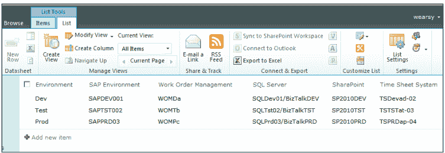

## SharePoint 的列表 Web 服务

使用 MOSS 2007/Windows SharePoint Services 3.0 时，通过 Web 服务操作列表时您只有一个选择。开箱即用的 Web 服务 `Lists.asmx` 允许您通过多种 Web 方法操作列表数据。以下图像说明了 `Lists.asmx` Web 服务公开的许多 Web 方法：

## 列表

支持以下操作。有关正式定义，请查看服务说明。

- AddAttachment
- AddDiscussionBoardItem
- AddList
- AddListFromFeature
- AddWikiPage
- ApplyContentTypeToList
- CheckInFile
- CheckOutFile
- CreateContentType
- DeleteAttachment
- DeleteContentType
- DeleteContentTypeXmlDocument
- DeleteList
- GetAttachmentCollection
- GetList

您将在自定义列表的 `_vti_bin` 文件夹中找到 `Lists.asmx` Web 服务。例如，这里是 `lists.asmx` Web 服务的位置，如果我们要操作前面描述的 BizTalk Environments 列表，我们将使用它。

```
http://localhost:8080/sites/BizTalkLineOfBusiness/Lists/BizTalk%20Environments/_vti_bin/lists.asmx
```

> 注意：如果您在非标准端口上设置了 SharePoint，则只需提供端口号（:8080）。

SharePoint 2010 和 SharePoint 2010 Foundation 引入了另一种消费列表数据的方式，即通过 WCF RESTful 服务。这使我们能够消费 RESTful 端点并将列表中的数据用作 Atom 提要。

**REST** 代表 **Representational State Transfer**，是一种基于 HTTP 的分布式系统灵活软件架构。REST 的详细概述超出了本书的范围。

> 有关 REST 的更详细解释，请访问以下链接：http://en.wikipedia.org/wiki/Representational_State_Transfer


我们可以将 Web 浏览器指向 ListData.svc 服务并提供 BizTalk Environments 列表的名称。相应地，我们列表中存在的所有数据都将作为 Atom feed 返回。该服务需要权限，就像 SharePoint 站点中的任何其他资源一样。该服务不能匿名调用，因此如果您想通过 BizTalk 操作此列表，请确保您的主机实例用户具有参与权限。我们还能够提供 REST 查询以返回列表中数据的子集，就像数据库查询一样。除了通过此接口读取数据外，我们还可以执行插入和更新操作。

我们可以在站点下的 _vti_bin 文件夹中找到 ListData.svc。与 WSS 适配器不同，如果我们的列表名称包含空格，我们需要将其删除，而不是提供空格键的 HTML 等价形式：%20。

```
http://localhost:8080/sites/BizTalkLineOfBusiness/_vti_bin/ListData.svc/BizTalkEnvironments
```

当我们在浏览器中输入此 URL 并按 Enter 时，我们将收到一个 XML 响应，其中包含在列表中捕获的 BizTalk 环境数据。

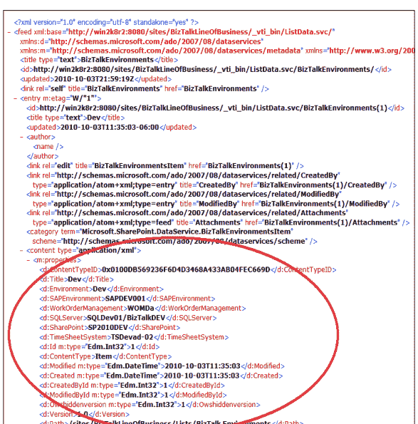

值得注意的是，BizTalk WCF 适配器开箱即用不支持这些 RESTful 接口。当 BizTalk 消费 RESTful 列表服务时，它无法解析部分 XML。在 <entry m:etag="W/"1""> 标签内，存在一个嵌套的引号 ""，BizTalk 将其视为无效 XML。最终结果是此消息在接收管道中被挂起。如果使用 WCF 端点是必不可少的，我们可以编写一个自定义管道组件，在消息发送到消息框之前删除此额外的引号。为了本书的目的，我们将重点关注 Lists.asmx，因为与此服务交互时无需额外编码。

```
<?xml version="1.0" encoding="utf-8" standalone="yes" ?>
<feed xml:base="http://win2k8r2:8080/sites/BizTalkLineOfBusiness/_vti_bin/ListData.svc/"
xmlns:d="http://schemas.microsoft.com/ado/2007/08/dataservices"
xmlns:m="http://schemas.microsoft.com/ado/2007/08/dataservices/metadata" xmlns="http://www.w3.org/200
<title type="text">BizTalkEnvironments</title>
<id>http://win2k8r2:8080/sites/BizTalkLineOfBusiness/_vti_bin/ListData.svc/BizTalkEnvironments/</id>
<updated>2010-10-03T21:59:19Z</updated>
<link rel="self" title="BizTalkEnvironments" href="BizTalkEnvironments" />
<entry m:etag="W/"1"">
<id>http://win2k8r2:8080/sites/BizTalkLineOfBusiness/_vti_bin/ListData.svc/BizTalkEnvironments(1)</id>
<title type="text">Dev</title>
<updated>2010-10-03T11:35:03-06:00</updated>
<author>
<name />
```

由于 Lists.asmx Web 服务基于经典的 ASMX 风格 Web 服务，因此在消费此服务时我们有两个 BizTalk 适配器选项：

- SOAP
- WCF-BasicHttp

SOAP 适配器自 BizTalk 2009 起已被弃用，并在 BizTalk 2010 中继续被弃用。虽然使用此适配器仍然是一个可支持的方案，但如果可能的话，我们最好避免使用它，因为此适配器将在 BizTalk 的未来版本中消失。请参阅官方 MSDN 文档了解更多详细信息：http://msdn.microsoft.com/en-us/library/aa559720(BTS.70).aspx

WCF-BasicHttp 适配器支持消费 WCF 和传统 ASMX Web 服务。该适配器于 BizTalk 2006 R2 引入，并在消费 Web/WCF 服务时继续成为 BizTalk 2010 中可靠的适配器。我们将开发的方案基于 WCF 适配器。

在使用 Lists.asmx Web 服务时，我们需要利用一种名为协作应用程序标记语言（CAML）的技术。CAML 是一种基于 XML 的标记语言，用于通过 Web 服务、客户端对象模型或 SharePoint API 操作 SharePoint。在本书的上下文中，我们将从高层次介绍 CAML，因为本书并不打算成为全面的 CAML 资源。

## 消费 SharePoint 列表方案演练

我们将要演练的真实世界方案是一个车辆维护列表。现场员工将使用此列表来填充与其公司车辆相关的任何维护信息。就像第 7 章中的方案一样，我们不希望现场员工登录我们的 ERP 系统，因为用户体验不适合在外执行日常职责的现场员工。

SharePoint 列表中填充的信息仍需要传到我们的 ERP 系统。此信息由财务和监管部门跟踪，因此重要的是此信息与我们的记录系统进行交换。BizTalk 开发人员面临的一个常见挑战是安排流程以启动编排的能力。大多数 BizTalk 方案始于 BizTalk 接收消息，进而该消息实例化编排。在我们的方案中并非如此，而且由于您无法通过发送消息来开始 BizTalk 编排，我们需要触发一条消息来启动 BizTalk 编排。我们有几个选项：

- BizTalk Scheduled Task Adapter
- SQL Server Polling Adapter

BizTalk Scheduled Task Adapter 是一个开源适配器，可在 codeplex 上获取；http://biztalkscheduledtask.codeplex.com。该适配器允许您安排触发消息，以便在设定时间实例化编排。

SQL Server 适配器，无论是 WCF 还是传统，都可以像 BizTalk Scheduled Task Adapter 一样使用，因为它可以安排每 X 分钟/小时/天执行一次。对于某些环境，运行开源或社区可执行文件是禁止的，因此我们将利用基于 WCF 的 SQL Server 适配器。

使用 SQL Server 适配器（传统或基于 WCF）另一个好处是需要存储我们想要通信的 SharePoint 列表的 SharePoint 列表 GUID。我们可以将此 GUID 存储在 SQL Server 表中，并在消费 SharePoint 列表数据之前从数据库检索此值。随着我们将此解决方案从各种环境（开发/测试/生产）迁移，我们拥有一些可移植性，因为每个 SharePoint 环境将具有唯一的列表 GUID。

一旦我们获得了 SharePoint 列表的 GUID，我们将在构建 CAML 查询时使用此 GUID。然后我们将此查询发送到 Lists.asmx 服务。我们期望 CAML 查询将返回车辆维护列表的结果。此查询的结果将被映射到 ERP 系统期望的平面文件格式。

## 创建自定义 SharePoint 列表


> 注：以下示例假定您已有一个现有的 SharePoint 站点。以下链接描述了如何为 WSS 3.0 SP2 和 SharePoint 2010 Foundation 创建 SharePoint 站点：
> WSS 3.0 SP2：
> http://technet.microsoft.com/en-us/library/cc288969(office.12).aspx
> SharePoint 2010 Foundation：
> http://technet.microsoft.com/en-us/library/cc263094.aspx

我们需要创建一个自定义列表，让我们的现场工作人员输入与其车辆维护相关的数据。BizTalk 稍后将连接到此列表并检索数据，以便将其发送到我们的 ERP 系统。

1. 我们可以通过在 SharePoint 功能区中 **主页** 菜单下方的 **列表** 链接来创建自定义列表。

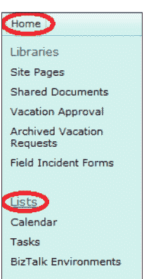

2. 我们现在想要点击 Create 链接。

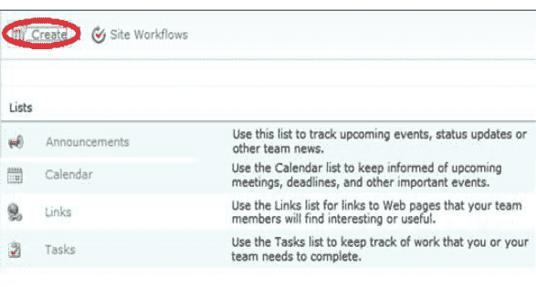

3. 选择自定义列表，提供列表名称 Vehicle Maintenance，然后点击创建按钮。

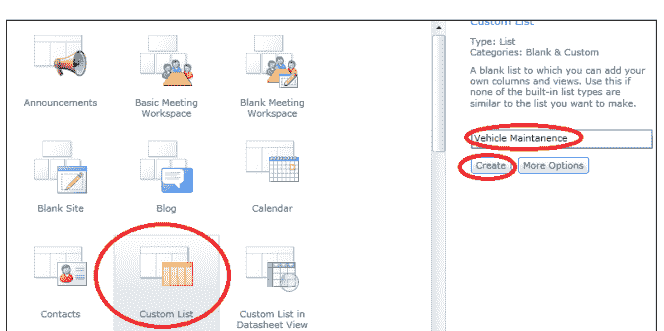

4. 我们现在有一个空列表，想要通过点击创建列按钮来创建自定义列。

5. 向列表添加以下列：

- 标题（系统生成）
- 位置
- 开始时间
- 结束时间
- 单位
- 里程表读数


- 项目
- 为简单起见，我们将数据类型保持为 **单行文本** 并使用默认属性

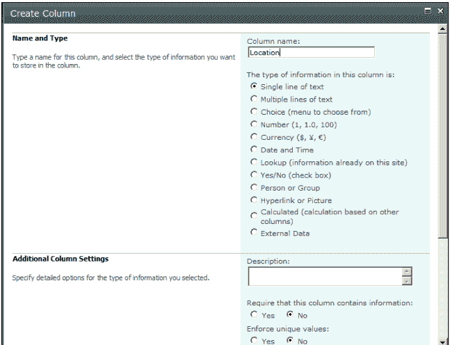

在前面的示例中，我们创建的列名称不包含空格。这是有意为之，因为 SharePoint 会为字段名称维护内部值，然后是显示在 GUI 上的外部名称。在内部，SharePoint 始终使用内部名称。如果内部列名称包含空格，将会创建在运行时难以调试的问题。因此，最好始终在创建列名称时不使用空格，然后在需要更用户友好的列名称时再重命名。

6. 完成后，我们可以通过单击 **添加新项目** 链接来填充我们的列表。

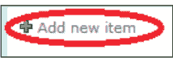

7. 完成后，我们的列表应如下所示：

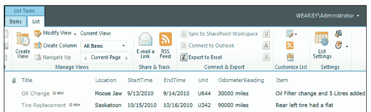

## 自定义列表 GUID

SharePoint 在标识列表时 heavily relies upon GUID 的使用。列表 GUID 对每个环境都是唯一的。因此，如果我们在测试环境中创建自定义列表，它的值将与生产环境中的自定义列表不同。

1. 获取我们的列表 GUID 的第一步是在列表设置页面上。我们可以通过单击列表设置按钮导航到设置。

2. 我们需要确定我们刚刚创建的列表的 GUID。我们可以通过右键单击标题、描述和导航链接并单击复制快捷方式来实现。

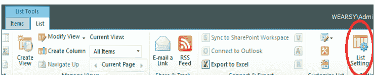

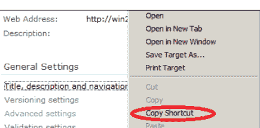

3. 将此值粘贴到记事本等编辑器中。我们得到一个如下所示的 URL：`http://localhost:8080/sites/BizTalkLineOfBusiness/_layouts/ListGeneralSettings.aspx?List=%7B27E9BDCE%2D0D87%2D451C%2DB6C9%2D053C246517AE%7D`
   - 我们的编码列表 GUID 是 "?List=" 之后的值

4. 由于此 GUID 值仍为编码状态，我们希望使用 URL 解码工具对其进行解码。我们可以使用 `http://www.albionresearch.com/misc/urlencode.php` 上的免费服务来解码我们的 GUID。初始值 `%7B27E9BDCE%2D0D87%2D451C%2DB6C9%2D053C246517AE%7D` 被转换为我们的实际 GUID `{27E9BDCE-0D87-451C-B6C9-053C246517AE}`。相反，如果你想自己执行此转换，`'%7B'` 等同于 `'{'`，`'%2D'` 等同于 `'-'`，而 `'%7D'` 等同于 `'}'`。

5. 我们现在希望将此 GUID 值插入到我们的自定义 SQL Server 表中。此表称为 **Lists**，包含一个名为 **ListGUID** 的列。本章源代码中存在一个 SQL 脚本，它将生成适当的 **SharePointList** 数据库、**Lists** 表和 **ListGUID** 列。

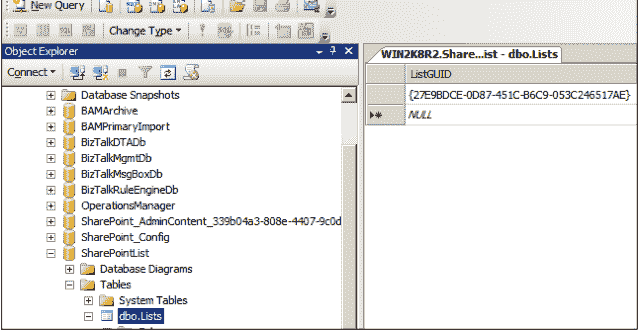

## 构建 BizTalk 应用程序

在本节中，我们将讨论构建 BizTalk 组件所需的组件，以构建一个解决方案，该解决方案将使用自定义 SharePoint 列表并生成平面文件。

## 为 SharePoint Web 服务生成架构

为了使 BizTalk 和 SharePoint 能够有效地相互通信，我们需要在两个系统之间建立一个契约。我们将通过使用 Consume Adapter Service 向导为 SharePoint Web 服务生成架构来建立此契约。这将确保当 BizTalk 向 SharePoint 发送请求时，它能够理解请求并提供 BizTalk 预期响应的响应。在生成 SharePoint 架构之前，我们需要做一件事，那就是添加允许我们与之前创建的数据库表通信的架构。

1. 现在数据库结构已就位，我们可以使用 Consume Adapter Service 向导生成我们的 `GetListGUIDTypedPolling.xsd`。本章未涵盖生成此架构的详细说明，因为类型化轮询在 *第 2 章，WCF SQL Server 适配器* 中进行了介绍。

2. Web 服务公开了 Web 服务描述语言 (WSDL)，与大多数其他 Web 服务类似。我们希望使用 Consume WCF Service 向导来使用此 WSDL。我们可以通过右键单击 **Chapter8-ManipulatingLists** 项目并选择 **添加** 来启动此向导。

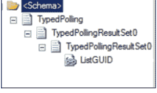

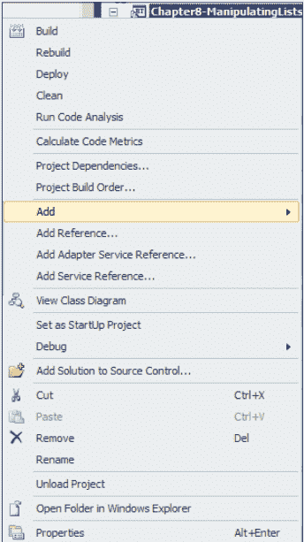

3. 我们现在希望选择添加生成项。

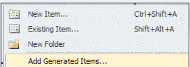

4. 从添加生成项屏幕中，我们希望选择 Consume WCF Service 并单击添加按钮。

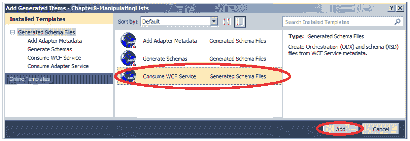

5. 单击下一步按钮继续 BizTalk WCF 服务使用向导。

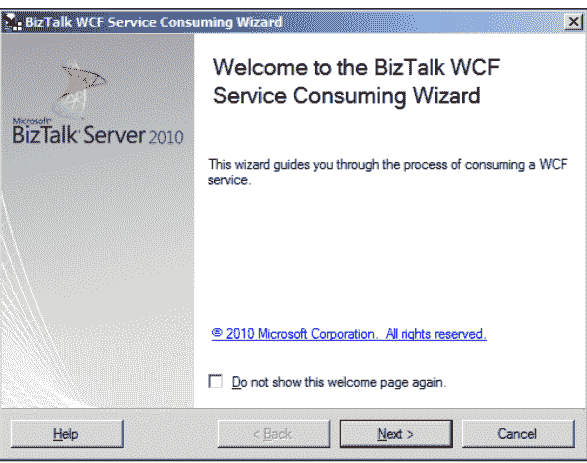

6. 确保选择了元数据交换 (MEX) 端点并单击下一步按钮。

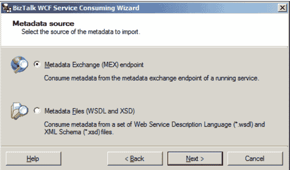

7. 在元数据地址 (URL) 中，我们需要提供 Lists.asmx Web 服务的位置。例如：http://localhost:8080/sites/BizTalkLineOfBusiness/Lists/VehicleMaintenance/_vti_bin/lists.asmx。在这种情况下，BizTalkLineOfBusiness 是 SharePoint 站点的名称，Lists 是此站点中所有列表的位置，我们要使用的列表名称称为 VehicleMaintenance。由于 Lists.asmx 不特定于任何自定义列表，我们可以从任何 Lists.asmx 端点生成架构并将其用于任何列表。通过提供 Lists.asmx 端点的 URL，我们可以单击获取按钮并查看构成 Lists.asmx Web 服务的所有 Web 方法。

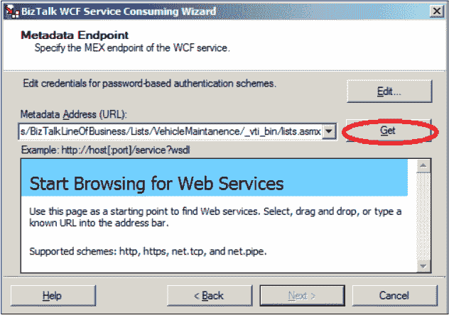

8. 单击下一步继续。

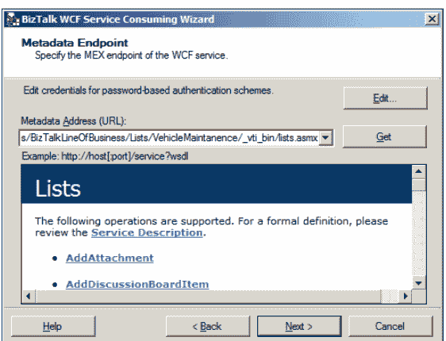

我们现在处于可以导入与 Web 服务关联的架构的位置，可以通过单击导入按钮来完成。

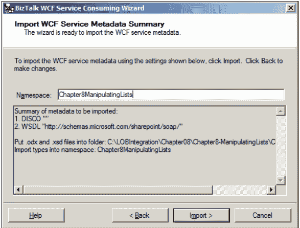

9. 我们会发现五个工件已添加到我们的解决方案中：

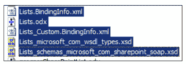

| 工件名称 | 目的 |
|---|---|
| Lists.BindingInfo.xml | 可以与 WCF-BasicHttp 适配器一起使用的绑定文件。 |
| Lists.odx | 模板编排，其中包含与 SharePoint 通信时所需的多个部分消息类型和端口类型。我们不想删除此编排：配置逻辑端口时将需要多个部分消息类型和端口类型。 |
| Lists_Custom.BindingInfo.xml | 此绑定文件与 Lists.BindingInfo.xml 类似，不同之处在于此绑定是用于将使用 basicHttpBinding 的 WCF-Custom 适配器。从根本上讲，使用此绑定的适配器将与 WCF-BasicHttp 适配器的工作方式相同。WCF-Custom 适配器允许在配置发送端口时进行更多选项，包括安全性。 |
| Lists_microsoft_com_wsdl_types.xsd | 此架构在与 Lists.asmx Web 服务交互时为 Lists_schemas_microsoft_com_sharepoint_soap.xsd 架构提供底层支持。 |
| Lists_schemas_microsoft_com_sharepoint_soap.xsd | 这是该集合中最关键的工件，因为它提供了在与 Lists Web 服务中包含的各种 Web 方法通信时所需的结构。 |

10. 当我们下载这些工件时，**Lists_schemas_microsoft_com_sharepoint_soap.xsd** 架构在编译时出现问题。我们得到的错误如下：


似乎 **Consume WCF Service** 向导中存在一个错误，即它插入了一个不包含 **schemaLocation** 的架构导入节点。

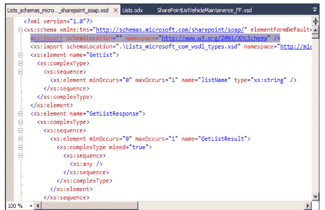

11. 我们可以通过删除第一个 **<xs:import/>** 节点来解决此错误，而不会出现问题。为了删除此行，请打开记事本等文本编辑器，或在 Visual Studio 中通过右键单击 XSD 文件、选择 **打开方式**，然后选择 **XML 编辑器** 来编辑 XSD 文件。


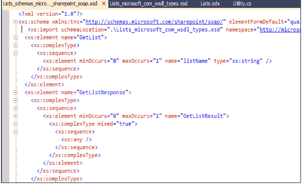

## 编排初始化

消费 SharePoint 列表数据需要 BizTalk 提交请求然后等待响应。在 BizTalk 发送此请求之前，我们需要通过接收触发消息来实例化我们的编排。我们现在将配置 BizTalk 从 SQL Server 接收此触发消息，以便启动我们的编排。

- 1. 在下载了 WCF-SQL 和 Web 服务架构后，我们现在希望通过将逻辑 **Receive Port** 和 **Receive Shape** 拖到我们的编排上构建解决方案。当消息通过此端口处理时，它将初始化此编排，从而允许我们连接到 SharePoint 自定义列表。逻辑端口是一个 **one-way** 端口，并且其 **Port Binding** 为 **Specify later**。然后我们希望配置 **Receive Shape** 以接受名为 **msgSQLConfiguration** 的消息，其类型为 **Chapter8ManipulatingLists.GetListGUIDTypedPolling.TypedPolling**。此接收形状还应将其 Activate 属性设置为 True。将接收到的消息是我们接收位置中指定的轮询查询的结果。此消息将包含我们想要交互的 SharePoint 列表的 GUID。

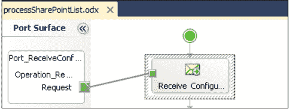

- 2. 我们要提供给 SharePoint 的消息的架构名为 **Lists_schemas_microsoft_com_sharepoint_soap.xsd.** 在此架构中，我们将发现许多节点，这些节点代表需要传递给 `Lists.asmx` Web 服务中可用的各种 Web 方法的 XML 结构。我们最感兴趣的结构是 **GetListItems** 节点。我们将使用此消息从自定义列表中检索数据。为了使用此架构，我们需要在编排中创建一个名为 **msgGetListItemsRequest** 的消息，其类型为 **Chapter8ManipulatingLists.GetListItemsSoapIn.**

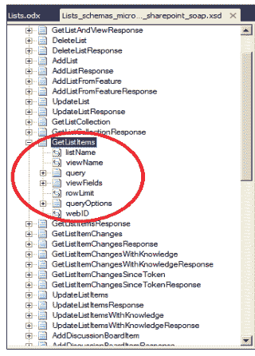

## 映射 SharePoint 请求

编排启动后，现在是时候将我们从 SQL Server 轮询调用中收到的 GUID 传递过去，并将其与其他补充数据一起提供给 SharePoint 请求消息。请求消息为 SharePoint 提供有关 BizTalk 希望从 SharePoint 列表返回的数据的说明。

为了填充我们的 SharePoint 请求消息，我们需要能够从 **msgSQLConfiguration** 消息中检索 GUID 并将其提供给 SharePoint 获取列表项请求消息。此转换发生在名为 **SQLConfiguration_to_GetListItemsRequest.btm** 的映射中，该映射作为本书源代码的一部分提供。

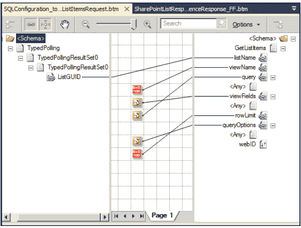

- 1. 在这一点上，我们需要完成 SharePoint 列表请求消息的填充。此消息必须遵循 SharePoint 预期的 CAML 结构。请求消息由七个消息部分组成。

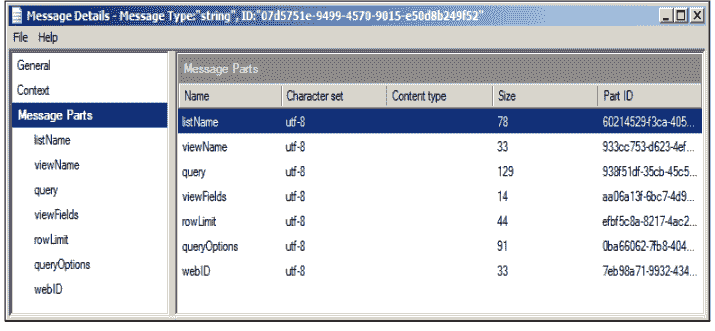

- 2. 我们将从 **SQLConfiguration_to_GetListItemsRequest.btm** 映射中填充这些消息部分的每一个。在 **listName** 节点中，我们希望填充自定义列表的 GUID。在这种情况下，我们将通过将此节点映射到 **listName** 节点来利用 **msgSQLConfiguration** 消息中的 **ListGUID** 元素。

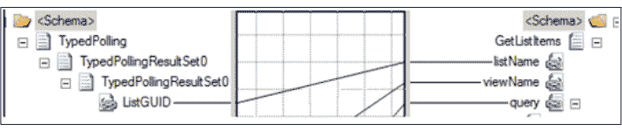

- 3. 对于 **viewName** 属性，我们只需通过 **String Concatenation** Functoid 分配一个空字符串值。在我们的场景中，我们没有利用 SharePoint 视图。

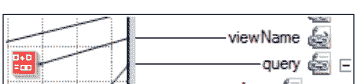

- 4. 在 SharePoint 请求消息的 **query** 节点中，注意它期望的节点类型：**<Any>**。在此架构的上下文中，这意味着它是一个松散类型的节点，并期望我们开发者提供有效的 CAML 标记。然后此 CAML 标记将针对我们的自定义列表执行。如果我们想根据一组条件过滤 SharePoint 列表，我们将在此处执行。由于我们对列表中存储的所有数据感兴趣，我们将查找 **ID** 字段大于 0 的所有记录。由于 ID 是系统列，可以保证它存在，并且 ID 总是从 1 开始，因此如果列表中存在记录，我们将始终返回记录。

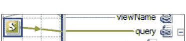

- 5. 为了填充此 CAML 查询，我们可以利用 **Scripting Functoid** 并使其从 XSLT 调用模板返回 XML。我们可以通过右键单击它并选择 **Configure Functoid Script** 来配置此 **Scripting Functoid**。

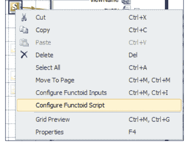

- 6. 进入 Functoid 脚本的配置后，我们可以将 Select 脚本类型设置为 Inline XSLT Call Template 并提供以下 XSLT 标记：

```
<xsl:template name="Query">
    <Where>
        <Gt>
            <FieldRef Name='ID' />
            <Value Type='Number'>0</Value>
        </Gt>
    </Where>
</xsl:template>
```

> 注意：我们也有选项编写一个 .NET Helper 方法，使其返回 XML 并将其分配给此节点。

- 7. 我们需要填充的下一个消息部分是 queryOptions 元素。我们将为此元素遵循与 Query 元素相同的模式。我们将配置一个 Scripting Functoid 来调用 XSLT 模板。此元素的目的是在查询中提供约束，例如包含强制列。在我们的场景中，我们不会强制返回强制列。

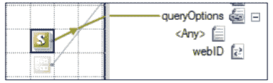

- 8. Inline XSLT Call Template 将包含以下 XSLT 标记：

```
<xsl:template name="QueryOptions">
    <QueryOptions>
        <IncludeMandatoryColumns>FALSE</IncludeMandatoryColumns>
    </QueryOptions>
</xsl:template>
```

- 9. rowLimit 消息部分提供了限制我们感兴趣从 SharePoint 列表返回的行数的能力。此消息部分不需要 XML 节点，因此我们可以简单地从 String Concatenate functoid 提供一个数值文字。


- 10. 在我们的场景中，我们将在 String Concatenate functoid 中提供 1000 的值。

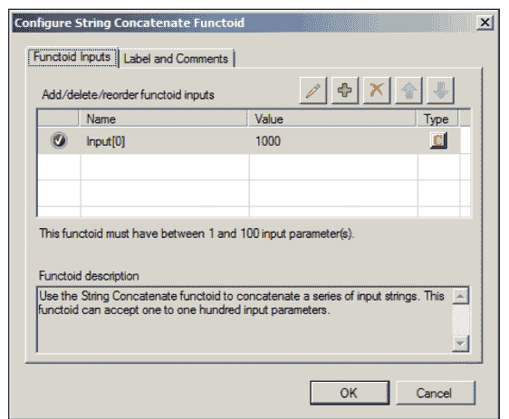

- 11. 我们需要处理的下一个消息部分是 viewFields，它提供了限制 CAML 查询返回的字段数量的能力。在我们的场景中，我们将返回所有用户创建和系统生成的字段。再次，我们将利用调用 XSLT Call Template 的 Scripting Functoid。

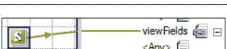

- 12. 在 XSLT Call Template 调用中，我们将提供以下 XSLT 标记：

```
<xsl:template name="ViewFields">
    <ViewFields></ViewFields>
</xsl:template>
```

- 13. 如果我们想操作根网站中的列表，即使 Lists.asmx Web 服务可能位于子站点中，我们也可以在 webID 节点中提供父站点的 GUID。在我们的场景中，我们可以简单地不映射该节点且不提供任何说明。


- 14. 在这一点上，我们已经填充了 SharePoint 获取列表项请求消息并准备将其发送到 SharePoint。为此，我们希望利用 Consume WCF Service Wizard 为我们提供的逻辑端口。创建逻辑端口时，我们希望确保使用名为 Chapter8ManipulatingLists.ListSoap 的现有端口类型。

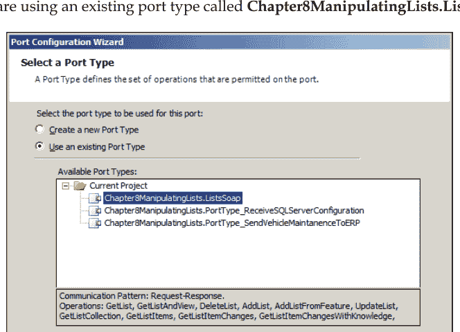

- 15. 配置逻辑端口后，我们会发现所有已公开的各种 Web 方法都已添加到我们的编排中。我们感兴趣的 Web 方法是 **GetListItems**。如果您有兴趣了解此 Web 服务提供的其他 Web 方法的更多信息，请访问以下网页：http://msdn.microsoft.com/en-us/library/ms774517(v=office.12).aspx

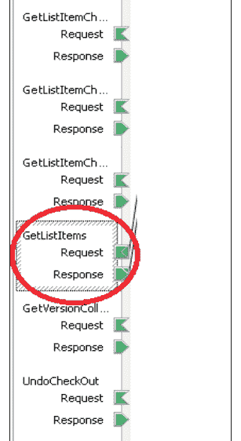

- 16. 然后我们可以将 **Request** 操作拖到 **Send Shape**，并将 **Response Operation** 拖到 **Receive Shape**。


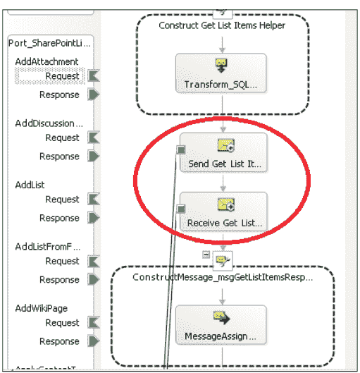

17. **Send Shape** 将发送一条名为 **msgGetListItemsRequest** 的消息，其类型为 **Chapter8ManipulatingLists.GetListItemsSoapIn**。

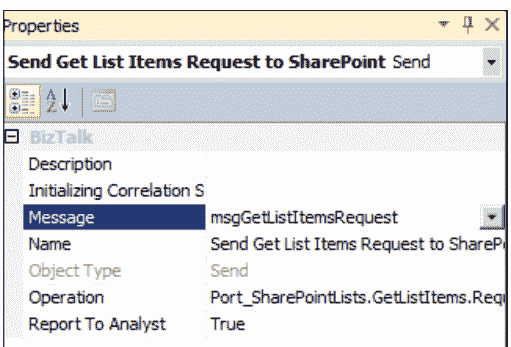

18. **Receive Shape** 将接收一条名为 **msgGetListItemsResponse** 的消息，其类型为 **Chapter8ManipulatingLists.GetListItemsSoapOut**。

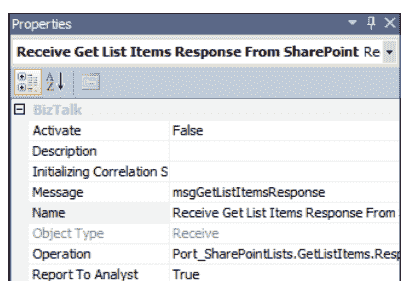

19. 现在我们已经创建了逻辑发送端口并连接了 **Send Shape**，可以向 SharePoint 发送 Get List Items 请求并从 SharePoint 接收响应消息。我们会遇到的问题是 SharePoint 返回的响应消息包含一个未类型化的段落。这意味着 SharePoint 知道它发送回的结构，但 BizTalk 不知道。BizTalk 不知道的原因是 **GetListItemsResponse** 的结构包含一个 **<Any>** 节点，这意味着将返回非结构化 XML。微软选择 **<Any>** 节点的原因是他们不知道我们的自定义列表有多少列，因此保持结构松散以适应更多场景。

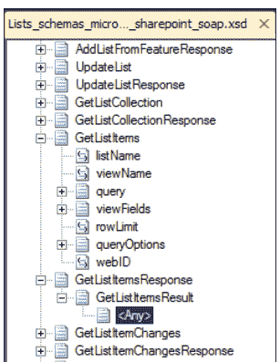

20. 本章源代码的 SampleDocs 文件夹中包含 SharePoint 响应的示例，文件名为 Sample_Response_From_Lists.xml。

```
<GetListItemsResponse xmlns="http://schemas.microsoft.com/sharepoint/soap/">
  <GetListItemsResult>
    <listitems xmlns="uuid:BD6CFE..." ...>
      <rs:data ItemCount="2">
        <z:row ows_Attachments="0" ows_LinkTitle="Oil Change" ows_Location="Moose Jaw" ows_StartTime="9/13/2010" ows_EndTime="9/14/2010" ows_Unit="U644" ows_OdometerReading="30000 miles" ows_Item="Oil Filter change and 5 Litres added" ... />
        <z:row ows_Attachments="0" ows_LinkTitle="Tire Replacement" ows_Location="Saskatoon" ows_StartTime="9/15/2010" ows_EndTime="10/16/2010" ows_Unit="U342" ows_OdometerReading="90000 miles" ows_Item="Rear left tire had a flat" ... />
      </rs:data>
    </listitems>
  </GetListItemsResult>
</GetListItemsResponse>
```

## SharePoint 的非结构化响应

接收非结构化消息段的问题在于，很难将此数据转换为我们可以发送给 ERP 系统的响应。此时我们可以采取以下几种方案：

- 编写一系列 XPath 语句来检索 ERP 系统所需的数值
- 使用此示例消息生成一个 Schema，以便稍后在 BizTalk Map 中使用，将 SharePoint 返回的数据转换为 ERP 系统可以处理的格式

编写大量 XPath 语句容易出错且难以调试。采用第二种方案，我们可以利用 BizTalk Mapper 工具。为此，我们将生成一个 Schema 来结构化 SharePoint 的这些响应，然后将这些响应转换为 ERP 可以消费的消息。

1. 为了为 SharePoint 返回的结构创建架构，我们可以使用“添加生成项向导”的一部分的“生成架构”功能。

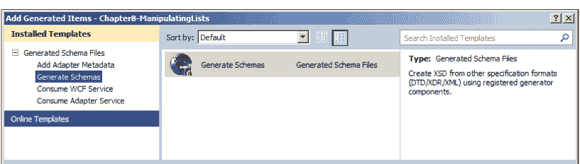

2. 进入“生成架构向导”后，我们需要确保文档类型设置为“格式良好的 XML（未加载）”，然后可以浏览示例文件。我们可以使用名为 Sample_Response_From_Lists.xml 的示例文件，可在本章源代码的 SampleDocs 文件夹中找到。找到该文档后，我们可以单击“确定”继续下一步。

> 示例文件已为您提供方便。如果您想从 SharePoint 生成自己的示例消息，请发送您的 SharePoint 列表请求，然后将响应消息写入文件系统。

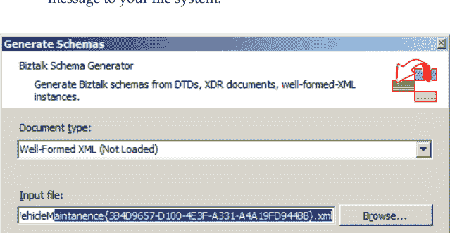

3. 已向我们的项目添加了三个架构。这些架构已被重命名以更好地反映其用途。

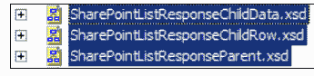

> 注：重命名这些架构时，请确保通过在文本编辑器中打开架构来更新架构内部的引用。我们需要在 SharePointListResponseParent.xsd 中更新 <xs:import> 元素，以反映 SharePointListResponseChildData.xsd 架构的新名称。

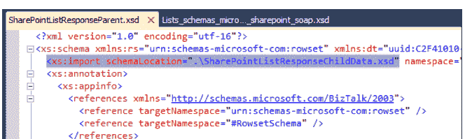

我们还需要在 SharePointListResponseChildData.xsd 中更新 <xs:import> 元素，以反映 SharePointListResponseChildRow.xsd 架构的新名称。

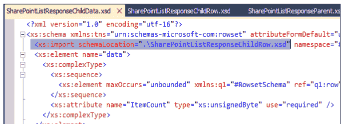

4. 我们接下来要做的修改是更新 **SharePointListResponseParent.xsd** 架构的 **Target Namespace**。打开此架构，选择 **Schema** 文件夹，然后将 **Target Namespace** 更新为：`http://Chapter8ManipulatingLists.SharePointListResponseParent`。我们需要这样做的原因是，在生成此架构时，我们使用的是 SharePoint Get List Items Response 的输出，其中包含 SharePoint 的 Target Namespace。如果不进行此更改，项目中将有两个具有相同 Target Namespace 的架构。这将导致运行时错误，因为 BizTalk 将不知道将传入消息匹配到哪个架构。

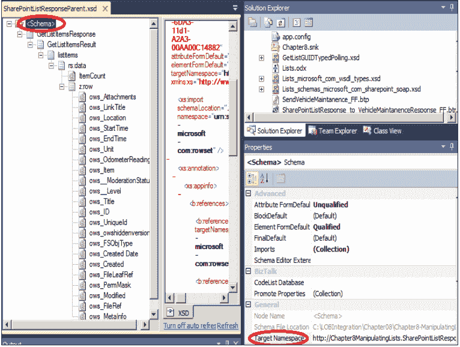

5. 现在我们需要能够将 SharePoint 的结果转换为基于我们 **SharePointListResponseParent.xsd** 架构的消息实例。为此，我们将创建一个名为 **msgGetListItemsResponseHelper** 的新消息，其类型为 **Chapter8ManipulatingLists.SharePointListResponseParent**。然后我们将向编排中添加一个 **Message Assignment** 形状，并将 **Message Constructed** 属性设置为 **msgGetListItemsResponseHelper**。

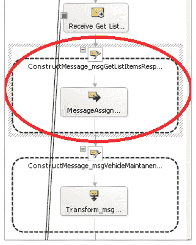

6. 在此 **Message Assignment** 形状中，我们将利用存在于我们的 Helper C# 项目 Chapter8ManipulatingLists.Utility 中的 Helper 方法。

```
//We want a typed response document so that we can map to
//the flat file message for our ERP
msgGetListItemsResponseHelper = Chapter8ManipulatingLists.Utility.toXML(msgGetListItemsResponse);
```

7. toXML 方法将简单地接受来自 SharePoint 的 Get List Items Response 消息，更新 Target Namespace 使其与我们的 msgGetListItemsResponseHelper Target Namespace 匹配，然后将消息返回给 BizTalk，以便将其强制转换为 msgGetListItemsResponseHelper 的架构。Utility 类相当简单，只有一个方法 toXML：

```
using System;
using System.Collections.Generic;
using System.Linq;
using System.Text;
using System.Xml;

//needed to receive message from BizTalk
using Microsoft.XLANGs.BaseTypes;
namespace Chapter8ManipulatingLists
{
```

```
public static class Utility
{
    public static XmlDocument toXML(XLANGMessage msgXlang)
    {
        //Want to receive a typed BizTalk message as an XML Document
        XmlDocument xmlMessage = (XmlDocument)msgXlang[0].RetrieveAs(typeof(System.Xml.XmlDocument));
        try
        {
            //Need to override Target Namespace to use our custom schema instead of the SharePoint response message's Target Namespace
            xmlMessage.DocumentElement.SetAttribute("xmlns", "http://Chapter8ManipulatingLists.SharePointListResponseParent");
        }
        catch (XLANGsException xlngEx)
        {
            throw xlngEx;
        }
        //Return message back to BizTalk
        return xmlMessage;
    }
}
```

## ERP 平面文件

我们的 ERP 系统与其他许多系统一样，有严格的要求，即必须以平面文件形式提供车辆维护数据。BizTalk 拥有丰富的工具集，可让我们轻松满足此要求。

- 现在我们已经从 SharePoint 获得了类型化响应消息，可以将其转换为 ERP 系统期望的格式。我们将再次利用 BizTalk Mapper 来提供此功能。负责此操作的映射名为 **SharePointListResponse_to_VehicleMaintenanceResponse_FF.btm**。


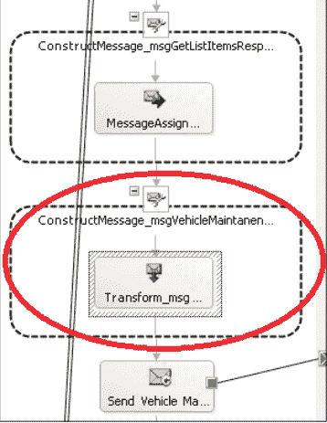

2. 我们将要使用的 ERP 消息的架构名为 SharePointListVehicleMaintenance_FF.xsd，它是一个平面文件架构。我们想要生成的消息的示例存在于 SampleDocs 文件夹中，该文件夹可在本章示例代码中找到。文件的名称为 Vehicle_Maintenance_For_ERP.csv。

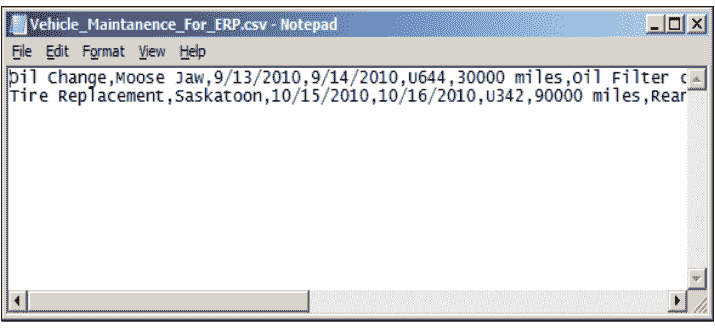

3. 你会注意到平面文件架构的结构与我们之前创建的自定义 SharePoint 列表相似。

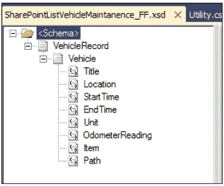

4. 由于这是一个平面文件架构，我们还需要一个平面文件管道来在消息通过发送端口传输时组装该消息。负责此操作的发送管道称为 SendVehicleMaintenance_FF.btp。在 Assemble 阶段，我们希望将一个平面文件装配组件拖到管道的表面上。然后我们希望将文档架构设置为我们的平面文件架构：Chapter8ManipulatingLists.SharePointListVehicleMaintenance_FF。


5. 我们现在希望在编排中放置一个 **Send** 形状并创建一个逻辑发送端口。在 **Send** 形状中，我们希望指定一个名为 msgVehicleMaintenance_FF 的消息，其类型为 **Chapter8ManipulatingLists.SharePointListVehicleMaintenance_FF** 并且逻辑 **Send Port** 为单向，并且其端口绑定设置为 **Specify Later.**


## 部署和配置 BizTalk 解决方案

我们现在准备部署和配置我们的 BizTalk 解决方案。

- 1. 要部署我们的解决方案，请右键单击它，然后单击 **Deploy Solution.**
- 2. 在 BizTalk 管理控制台中，我们应该能找到一个名为 **Chapter8-ManipulatingLists** 的应用程序。此解决方案的绑定文件 `Chapter8-ManipulatingLists.xml` 存在于本章源代码中的 `Bindings` 文件夹内。如果我们导入此文件，我们会发现我们有一个接收端口、一个接收位置和两个发送端口。请注意，此绑定文件中包含的端点可能与您机器上的目标不匹配。

3. 我们的接收端口名为 **RetrieveSharePointGUIDs**，它有一个名为 **RetrieveSharePointGUIDsFromSQL** 的接收位置。接收位置将使用 WCF-Custom 适配器、**BizTalkServerApplication** 主机实例和 **XMLReceive** 管道。


> 注：我们也可以在此解决方案中使用 WCF-SQL 适配器。由于 Consume Adapter Service Wizard 在其自动生成的绑定文件中指定了 WCF-Custom 适配器，我们将使用它。本质上，两个适配器都利用 sqlBinding，因此底层功能相同。

4. 在此接收位置中，我们需要提供一个 **Address (URI)**。在这种情况下，我们可以提供以下内容： `mssql://localhost//SharePointList?InboundId=1`。**Localhost** 表示托管 **SharePointList** 数据库的数据库服务器。我们还必须为此连接提供唯一的 **InboundId**，以防我们配置了多个轮询接收位置使用同一数据库。有关 **InboundId** 属性的更多信息，请参阅第 2 章。


5. 在 **Binding** 选项卡中，有一些我们需要修改的属性，如下所述：

| 属性名称 | 属性值 | 说明 |
|---|---|---|
| Binding Type | sqlBinding | 由于我们使用的是 WCF-Custom 适配器，我们需要提供绑定，并且由于我们连接到的是 SQL Server，我们需要提供 **sqlBinding**。 |
| inboundOperation Type | TypedPolling | 我们的方案使用 TypedPolling，因为我们期望从 **pollingStatement** 查询返回强类型消息。 |
| polledData Available | Select count(*) from Lists | 此属性需要一个查询，在执行时将确定是否继续执行 **pollingStatement**。如果此查询未返回任何数据，则 **pollingStatement** 查询将不会被执行。 |
| pollingIntervalIn Seconds | 30 | 我们希望联系 SQL Server 检索数据的间隔。此值在生产环境中可能无效，但在我们的演示目的中可以使用。在生产环境中，我们可能不希望如此频繁地轮询，因为每次轮询都会给数据库带来一定的压力。 |
| pollingStatement | Select ListGUID from Lists | 此查询将返回我们用于联系 SharePoint 以检索自定义列表数据的 GUID。 |


- 6. 已设置的其余属性是使用 **sqlBinding** 的 **WCF-Custom** 适配器的默认值。
- 7. 我们用于与 SharePoint 通信的发送端口名为 **cfSendPort_Lists_ListsSoap_Custom**。此发送端口还将使用 **WCF-Custom** 适配器、**BizTalkServerApplication** 主机实例、**PassThruTransmit** 发送管道和 **XMLReceive** 接收管道。


8. 我们现在需要指定 Lists.asmx Web 服务的 URL 和我们的 Soap Action 头。下面提供的 URL 代表用于构建此示例的 URL。您需要更新此 URL 以反映您的 SharePoint 服务器。当我们使用 Consume WCF Service Wizard 时，它还生成了一个绑定文件，我们可以用它来填充我们的发送端口。这种方法的一个关键好处是生成的绑定文件将包含所有 Soap Action 头，包括 GetListItemChanges 如下所示：

```
<Operation Name="GetListItems" Action="http://schemas.microsoft.com/sharepoint/soap/GetListItems" />
```


9. 在 Binding 选项卡上，有一些我们需要修改的重要属性，描述如下：

| 属性名称 | 属性值 | 说明 |
|---|---|---|
| Binding Type | basicHttpBinding | 此绑定是我们使用经典 ASP.Net ASMX Web 服务时的最佳选择。 |
| Security | mode=Transport CredentialOnly | 由于我们使用的数据不敏感，因此此方案不需要任何特殊的基于消息的安全性。我们需要为 SharePoint 提供凭据，以便我们可以进行身份验证和授权以操作 SharePoint 列表。在此方案中，我们的 BizTalk 主机实例帐户将被传递。我们的 BizTalk 主机实例帐户还需要连接到站点的 Contribute 访问权限。 |
| Security-Transport | clientCredential Type=Ntlm | 由于我们的 BizTalk 服务器和 SharePoint 服务器存在于同一域中，我们可以利用 Ntlm 凭据类型。 |


10. 在 Behavior 选项卡中，我们需要确保我们有一个 EndpointBehaviour，其类型为 clientCredentials 并启用 Windows Impersonation。


11. 此发送端口的其余设置利用 WCF-Custom 适配器对 basicHttpBinding 的默认属性。

12. 我们的最终发送端口负责将平面文件发送到我们的 ERP 系统。此发送端口的名称为 SendVehicleMaintenanceListToERP。它将利用 FILE 适配器、BizTalkServerApplication 主机实例和我们的自定义 SendVehicleMaintenance_FF 管道。


13. 我们现在需要配置我们的编排，以便我们可以设置主机实例并将我们的逻辑端口与物理端口链接。


## 测试 BizTalk 应用程序

在启用 BizTalk 应用程序之前，让我们回到我们的列表，以确保我们有一些数据可以通过 SharePoint Lists.asmx Web 服务检索。

- 1. 一旦我们到达列表，我们可以通过单击 Add new item 链接来添加新记录。


- 2. SharePoint 为我们提供了一个很好的界面来向我们的自定义列表添加数据。


3. 我们现在有三条记录，BizTalk应在我们的应用程序启动后对其进行处理。


4. 现在让我们启动我们的应用程序。30秒内，我们应该会看到为我们的ERP系统消费而生成的平面文件。


5. 如果我们导航到我们的ERP文件夹，就会发现为我们生成了一个CSV文件。


6. 我们现在可以用记事本或Microsoft Excel等文本编辑器打开此文件。打开后，我们会发现自定义SharePoint列表中的三条记录现在已包含在此CSV文件中。

|  | A | B | C | D | E | F | G |
|---|---|---|---|---|---|---|---|
| 1 | Oil Change | Moose Jaw | 9/13/2010 | 9/14/2010 | U644 | 30000 miles | Oil Filter change and 5 Litres added |
| 2 | Tire Replacement | Saskatoon | 10/15/2010 | 10/16/2010 | U342 | 90000 miles | Rear left tire had a flat |
| 3 | Windshield Replacement | Regina | 10/17/2010 | 10/18/2010 | U007 | 12310 miles | Massive rock flew into Windshield and cracked it |

> 注：与Windows SharePoint Services适配器不同，从此Web服务检索到的数据并未被删除。如果我们只想检索自上次轮询数据库以来添加到列表中的新记录，则必须自行实现此解决方案。这种情况可以通过在SQL Server数据库中添加一列来轻松管理，该列存储上次检索的记录的ID。然后我们将使用此ID作为CAML查询中的条件。

## 与SharePoint集成的其他方式

在过去的两章中，我们回顾了BizTalk可以与SharePoint集成的两种方式：利用开箱即用的Windows SharePoint Services适配器以及使用SharePoint开箱即用的Web服务。还有几种其他与SharePoint集成的方式，我们也应该了解。

## SharePoint客户端对象模型

SharePoint 2010中的新功能是SharePoint客户端对象模型。客户端对象模型主要由两个名为`Microsoft.SharePoint.Client.dll`和`Microsoft.SharePoint.Client.Runtime.dll`的程序集组成。使用这些库时，我们需要在项目中引用它们。此客户端对象模型可由JavaScript、Silverlight和.NET CLR引用。客户端对象模型仍然依赖于CAML，就像Web服务一样，并且从SharePoint返回的数据也是未类型的，就像Web服务一样。客户端对象模型能够操作Webs、Lists、List Items、Content Types、Fields和External Lists。

如果我们想从BizTalk利用此客户端对象模型，我们将创建一个Helper .NET程序集，然后从此Helper项目中添加对对象模型的引用。BizTalk将通过Expression形状或Pipeline组件与此Helper程序集交互。这种方法的好处是性能提高，因为我们避免了MessageBox并直接与SharePoint通信。这种方法的一个缺点是我们避免了MessageBox并负责服务调用的配置。如果SharePoint离线或引发错误，我们需要自行处理这些情况。BizTalk提供深入的跟踪、消息重试和配置，使我们作为开发人员的工作变得更加容易。通过创建避免这些BizTalk核心功能的解决方案，我们冒着开发难以支持的解决方案的风险。

## SharePoint REST服务

本章前面我们讨论了SharePoint 2010中RESTful服务的包含。即使BizTalk WCF-Custom适配器在处理这些服务返回的XML时遇到困难，我们仍然可以借助WCF Data Services让BizTalk与这些服务交互。从.NET Helper项目中，我们可以消费WCF Data服务并操作这些列表。在消息重试、跟踪和配置方面，我们仍将处于与客户端对象模型相同的情况。然而，我们将具有消费Atom提要返回的类型化数据的优势。

## Business Connectivity Services (BCS)

SharePoint 2010的另一个有趣功能是Business Connectivity Services或BCS，不要将其与共享相同缩写的美国大学橄榄球碗锦标赛系列混淆。BCS是SharePoint 2007功能Business Data Catalogue (BDC)的更新。有了BDC，SharePoint可以通过Web服务和数据库连接从外部系统消费数据。例如，如果我们想从SQL Server数据库消费数据，我们可以配置BDC来消费此数据并将其显示为SharePoint中的列表。当需要来自ERP等记录系统的數據时，这是一个理想的解决方案。我们可以使用此技术的一个例子是在SharePoint中创建员工列表，而无需在两个地方维护数据。我们只需使用BDC检索员工信息供SharePoint使用。需要注意的是，BDC/BCS不会复制数据；它只是引用源系统中的数据。

除了BDC提供的所有功能外，BCS还提供了写入数据源的能力。这使我们能够利用SharePoint的用户界面修改ERP和CRM等其他系统中的数据。除了通过数据库连接写入外，我们还可以写入.NET对象和Web/WCF服务。在许多数据库场景中，我们可以在不编写任何代码的情况下使用这些类型的功能。与.NET对象和Web服务交互很可能需要编写一些代码。

## 确定合适的解决方案

那么我们如何知道该采用哪种方法呢？这真的取决于我们自己组织内的架构方向。如果我们的架构原则之一包括减少系统中的自定义编码量，那么使用BizTalk就很有说服力。

如果您的组织并不反对自定义编码，并且可能还没有BizTalk许可证，那么在BizTalk之外使用这些其他技术有很多优点。

## 摘要

在本章中，我们发现了使用SharePoint提供的开箱即用Web服务与其他方式集成SharePoint的方法。我们还介绍了可用于与SharePoint 2010交互的其他技术，包括SharePoint客户端对象模型、RESTful服务和Business Connectivity Services。

在下一章中，我们将远离SharePoint，但继续讨论与ERP系统的集成。这次我们不关注通用的ERP系统，而是将研究与微软的ERP系统Dynamics AX集成时涉及的内容。
