## 9 Microsoft Dynamics AX

### Microsoft Dynamics AX

在本章中，我们将讨论使用BizTalk Dynamics AX适配器与Microsoft Dynamics AX 2009集成。它将是对Dynamics AX 2009应用程序集成框架（AIF）模块中的配置设置以及相关批处理作业设置的完整演练。我们将完成两个BizTalk应用程序，演示同步和异步形式的集成，并展示使用AIF模块的好处。

完成的解决方案包含在本章的代码中。在第一个演练示例中，我们将创建一个BizTalk应用程序来填充汇率表。在第二个演练示例中，我们将创建一个BizTalk应用程序，通过AIF队列从Dynamics AX 2009检索消息。还包括一个控制台应用程序，演示如何利用.NET业务连接器与Dynamics AX 2009集成。

我们将具体涵盖：
- 什么是Dynamics AX？
- 与AX集成的方法
- 安装适配器和.NET Business Connector
- 为BizTalk适配器配置Dynamics AX 2009应用程序集成框架
- 同步演练示例 – 货币汇率
- 异步演练示例 – Dynamics AX 消息流出
- 其他开发和配置说明


## 什么是 Dynamics AX？

Microsoft Dynamics AX（正式名称为 Microsoft Axapta）是微软面向中型和大型客户的企业资源规划（ERP）解决方案。类似 SAP，Dynamics AX 提供了对能够受益于 BizTalk 集成的企业至关重要的功能。Microsoft Dynamics AX 通过其丰富的开发平台和工具完全可定制和可扩展。它与 Microsoft BizTalk Server、Microsoft SQL Server、Exchange 和 Office 等产品具有直接连接。

经常将 Dynamics AX 与 SAP All in One 进行比较。熟悉 SAP 的人也熟悉其相关的实施、维护和定制的高成本。Microsoft Dynamics AX 解决方案比 SAP 提供更高的可定制性、更低的维护成本和更低的每用户成本。ERP 实施往往部分由于用户接受度不足而失败。Dynamics AX 用户界面与 Microsoft Office 和 Microsoft Outlook 等广泛使用的产品具有相似的外观和感觉，这显著提高了用户在使用新 ERP 系统时的舒适度。有关 Dynamics AX 2009 和 SAP 的更多信息，请参阅 http://www.microsoft.com/dynamics/en/us/compare-sap.aspx

## 与 AX 集成的 方法

随 Dynamics AX 2009 包含，微软提供了两种与 Dynamics AX 集成的工具：

- Dynamics AX BizTalk 适配器
- .NET Business Connector

BizTalk 适配器通过 Dynamics AX 2009 中的应用程序接口框架模块（AIF）进行接口，而 .NET Business Connector 直接调用您 AX 源代码中的应用程序对象树（AOT）类。

AIF 模块需要许可证密钥，如果贵组织尚未购买此模块，则会增加集成项目的成本。它提供了一个可扩展的框架，可通过 XML 文档交换实现集成。AIF 模块的一个巨大优势是其与 BizTalk Dynamics AX 适配器的集成功能。其他适配器包括 FILE 适配器和 MSMQ，以及开箱即用的用于消费 XML 文件的 Web 服务。AIF 模块需要相当多的设置和配置，我们将在本章后面讨论。其他优势包括完整且细粒度的安全性、同步和异步模式集成模式的能力，以及交易的完整日志记录和错误处理。

Microsoft BizTalk AX 2009 适配器可以在同步和异步模式下执行 AX 操作（向 AIF 模块公开的函数）以将数据写入 AX。使用哪种模式由 BizTalk 应用程序的设计（通过逻辑端口）决定。单向发送端口会将 XML 数据放入 AIF 队列，而双向发送-接收端口会执行操作并返回响应消息。异步转换将保留在 AIF 队列中，直到执行批处理作业。设置和执行批处理作业可能非常难以管理，我们将在本章后面讨论这一点。也可以使用 BizTalk 适配器从 AX 中提取数据。以异步模式（方向为 OUTBOUND）推送到同一 AIF 队列中的事务可以使用轮询 AX 以获取这些事务的 AX 适配器检索。

.NET Business Connector 需要编写自定义 .NET 代码才能实现。如果您的业务需求是少量点对点集成数据流（或非常少），那么我们建议使用 .NET Business Connector。但是，这通常需要定制才能创建和公开方法。安全性也需要使用代码运行的服务帐户来处理。我们将在本章后面讨论这个问题，并且我们为本章提供了带有源代码的工作示例。

## 安装适配器和 .NET Business Connector

Microsoft BizTalk 适配器 for Dynamics AX 2009 和 .NET Business Connector 可从 Dynamics AX 设置中的集成下的“添加或修改组件”窗口安装。每个组件彼此独立；然而 BizTalk 适配器利用了业务连接器的组件。您无需在 BizTalk 服务器上安装 Dynamics AX 客户端。安装 BizTalk 适配器时，您可以简单地从安装向导中选择所有默认值。对于 .NET 业务连接器，您将被提示输入 Dynamics AX 实例的位置。这仅用作默认配置，可以轻松更改。

## 为 BizTalk 适配器配置 Dynamics AX 2009 应用程序集成框架

AIF 模块的配置涉及多个步骤。它也有助于提高您对 Dynamics AX 设置的细粒度以及为集成可能高度敏感的数据而考虑的安全性考虑的理解。建议此设置以管理员级别的安全性完成，然而只需要对 AIF 模块完全控制。此设置在 Dynamics AX 2009 之前的版本中几乎相同；将注明细微差异。

- 1. 所有 AIF 设置表都可以在 Dynamics AX 下的 **Basic | Setup | Application Integration Framework** 中找到。
- 2. 第一步相当简单，但至关重要。在 **Transport Adapters** 表单中，添加新条目，选择 **Adapter Class** 下拉菜单 **AifBizTalkAdapter**，选择 **Active**，并且 **Direction** 将为 **Receive and Respond**。您还会注意到还有两个开箱即用的适配器：FILE 和 MSMQ。这是一次性设置，对所有公司都有效。
- 3. 接下来，使用 **Channels** 表单为特定的 BizTalk 服务器设置活动通道。选择有意义且可识别的 **Channel ID** 和 **Name**，例如 **BizTalkChannelID** 和 **BizTalkChannel**。将 **Adapter** 选择为 **BizTalk Adapter**，勾选 **Active**，将 **Direction** 设置为 **Both**，**Response channel** 等于 **BizTalkChannelID** 的 Channel ID。将 **Address** 设置为您的 BizTalk 服务器（如下所示的 **I2CDARS1**）。

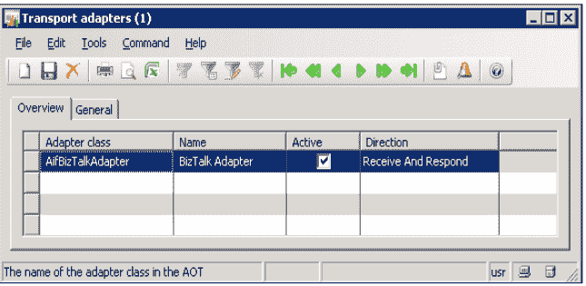

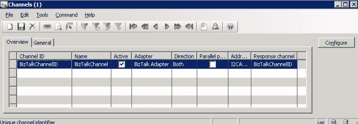

- 4. 然后，单击 Configure 以调出 BizTalk 适配器配置表单。再次将 Server name 设置为 BizTalk 服务器实例的名称。

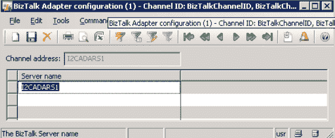

- 5. 此配置在运行时安全连接时是必需的。当使用架构导入向导时，Visual Studio 连接到 Dynamics AX 2009 实例也需要此配置（我们将在本章后面执行此操作）。这也是跨所有公司的一次性设置。
- 6. 现在，在此步骤中，我们将从 Local endpoints 表单设置本地端点。BizTalk 应用程序需要连接的每个公司都需要一个本地端点。选择要配置的公司（在我们的例子中为 CDF）并输入 CDFLocalEndpoint，如图所示。

> 我们建议使用这种命名约定（Company + 'LocalEndpoint'），因为通常您的 BizTalk 应用程序需要指定此值。通常，传入消息将包含用于确定其目标公司的信息，因此您需要在运行时动态确定本地端点。请参阅本章后面的演练示例，其中我们需要向多个 Dynamics AX 公司发送汇率。

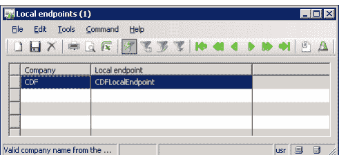

- 7. 接下来，我们需要从 Endpoints 表单创建端点。端点将我们的本地端点、BizTalk 通道、BizTalk 服务帐户和活动的 Dynamics AX 操作链接在一起。同样，每个公司都需要一个本地端点，因此我们将使用相同的命名约定。
- 8. 我们将首先将 Endpoint ID 输入为 CDFEndpoint 并将 Local endpoint ID 选择为 CDFLocalEndpoint。

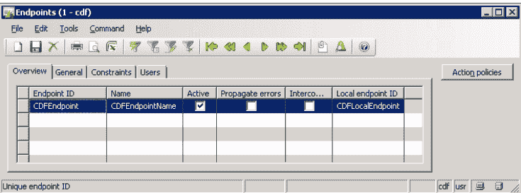

- 9. 在 General 选项卡上，将 Outbound channel ID 指定为 BizTalkChannelID，即我们在上面创建的。这也将允许使用 BizTalk 适配器从 Dynamics AX 2009 检索异步传出消息。


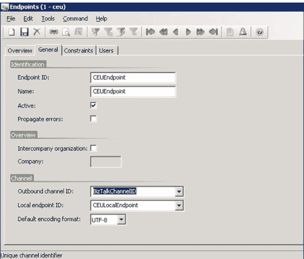

10. 在“Constraints”选项卡上，我们将勾选“无约束”。如有需要，您可以指定诸如“Customer”和“Vendor”之类的约束。现在，从“General”选项卡将记录设置为“Active”，然后保存。

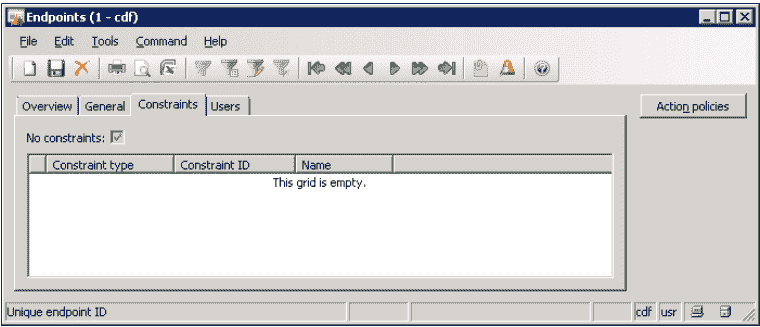

11. 在**Users**选项卡上，我们将添加 AX BizTalk 用户（链接到我们的 BizTalk 主机实例运行所在的 Active Directory 账户），方法是选择**User type**为**User**，然后选择 AX BizTalk（示例中为 **cdar**）用户。因此，AX 中的所有记录都将以此账户作为创建用户。根据您的集成需求，此用户可能还需要其他关联，例如员工。

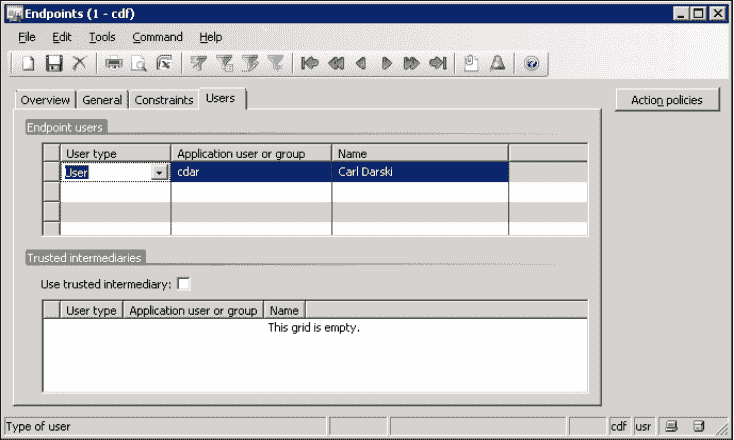

12. 下一步要做的事情（在 AX 中完成 AIF 基础配置设置后）是确定我们将使用哪些**AIF Services**。这将使我们知道使用哪些服务以及需要启用哪些服务。每个服务都有多个相关操作。如果开箱即用的服务中没有满足我们需求的操作，我们可以自定义现有服务或创建自己的服务。这正是 Dynamics AX 自定义速度和便捷性的优势所在。

> 注：在 AX 2009 之前，操作未分组到服务中，因此不存在 AIF Services 表。

13. 对于本示例（我们将在本章后面使用），我们必须使用开箱即用的服务**LedgerExchangeRatesService**。因此，我们将在**AIF services**表单中启用此服务，如以下屏幕截图所示：

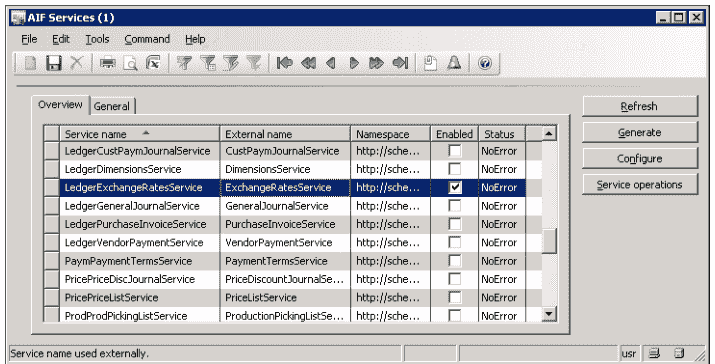

14. 在 AIF Services 表单中，我们可以通过突出显示服务名称、单击“Service operations”、选择特定操作，然后单击“Parameter schema”来检查每个服务的 AX 架构。操作包括 create、delete、find、findkeys、read 和 update。选择 SalesOrderService 并注意 delete 和 update 操作没有传出架构，因为它们不返回消息。

Exchange Rates 表中的基本记录只需要三个字段：（1）Currency code、（2）Exchange Rate 和（3）From Date。我们通常不指定结束日期，因为当输入下一天的汇率时，AX 逻辑会处理此问题。

每个 AIF 服务都与其自己的安全密钥相关联。您必须通过在 Dynamics AX 2009 中为所需的安全密钥分配用户权限来授予 DynamicsAX BizTalk 用户账户访问权限。在较早版本的 Dynamics AX（AIF 中没有服务）中，安全权限必须手动处理。这可以通过创建具有执行每个 AIF 操作所需权限的安全组并将 Dynamics AX BizTalk 用户与该组关联来实现。

1. 现在 AIF 服务已启用，我们可以转到**Actions**表单并查看已启用的四个操作。这些操作是 AIF **LedgerExchangeRatesService** 服务的一部分。请注意，如果不启用服务，就无法单独启用任何默认操作（在 Dynamics AX 的早期版本中，每个单独的操作都需要启用）。

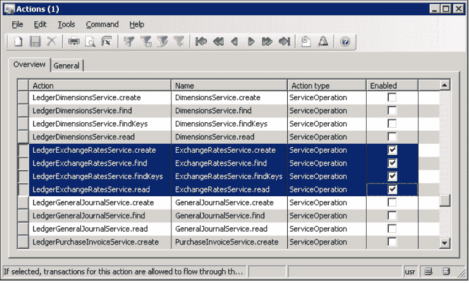

2. 对于每个 Dynamics AX 公司，您需要输入相对于基础货币的货币。因此，如果您有一个以 USD 为基础的公司，另一个以 CAD 为基础的公司，那么您需要在每个公司为每种货币输入汇率。以 USD 为基础的公司需要输入 USD/CAD 汇率，而以 CAD 为基础的公司需要输入 CAD/USD 汇率。因此，如果您使用**LedgerExchangeRatesService** AIF 服务，则需要为每个公司的**Endpoint**重复以下 AIF **Actions** 设置。

3. 现在，我们返回到**Endpoints**表单并单击**Action policies**以打开**Endpoint Action Policies**表单。尽管我们已激活**LedgerExchangeRatesService**，但**Endpoint Action Policies**是操作特定的，因此我们需要为每个操作创建一条记录。在这里，我们将从下拉列表中选择**Action ID**为**LedgerExchangeRatesService.create**；将**Status**设置为**Enabled**，将**Logging Mode**设置为**Log All**。现在，我们需要保存记录。这将启用此表单上的**Configure**按钮，如以下屏幕截图所示：

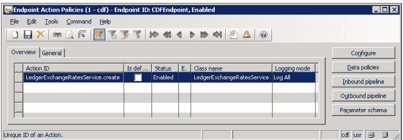

4. 接下来，单击“Configure”以打开“Parameter Data Policies”窗口。

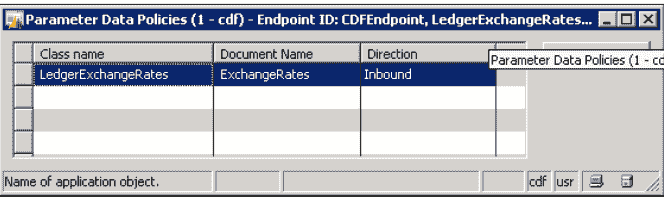

5. 单击“Data policies”；这将打开“Endpoint Action data policies”表单。您会注意到只有必填字段已启用。在这里，我们可以对安全和数据策略进行非常细粒度的控制；然而，对于更复杂的 AX 操作，这可能会非常繁琐。因此，只需单击“Set”，然后单击“Enable all”即可。

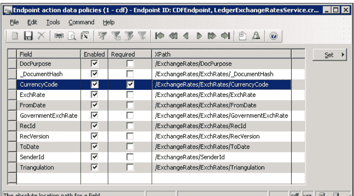

如果您对任何 Dynamics AX 服务进行自定义，例如添加新字段，您需要（1）通过单击“Refresh”按钮（如下图所示）更新 AIF Services，以及（2）在“Endpoint action data policies”表中启用该字段。

通常，集成策略是不覆盖 Exchange Rate 表中（基于货币和日期）已存在的值。事实上，如果我们尝试发送重复的汇率，AIF 将抛出错误。我们可以简单地捕获并忽略此错误；然而，这会在 AIF 异常日志中引入不必要的杂乱。由于我们可以将此表暴露给 AX 业务用户，因此我们希望尽可能限制 AIF 模块抛出的错误数量。

6. 因此，在尝试推送汇率之前，我们希望查询 AX 以查看特定汇率是否已存在。为此，我们可以使用开箱即用的操作 LedgerExchangeRates.find。请注意，该操作的架构将返回汇率列表。因此，现在我们需要重复上述步骤，在 AIF Actions 表单中启用此操作，将其添加到我们的 AIF Endpoint 的 Action policies 中，并在 Endpoint Action data policies 表单中启用所有字段。这完成了在 Dynamics AX 中对 AIF 模块的配置，以便进行本章后面的示例。

## 同步演练示例——货币汇率

理解使用 Dynamics AX BizTalk 适配器所需的行为和设置的最佳方式是通过完整示例进行演练。对许多使用 Dynamics AX 的公司而言，常见需求是填充货币汇率。通常，这需要在收盘汇率发布时每天进行。AX 中的 Exchange Rates（总账 | 设置汇率）表不是跨公司的共享表，因此根据您的组织设置，您可能需要也可能不需要使用多个公司和多个汇率填充汇率表。我们将在以下示例中进一步解释这一点。我们发现这是在学习使用 BizTalk 和 Dynamics AX AIF 模块创建集成应用程序时开始的绝佳实践示例。

对于本示例，我们假设我们的 Dynamics AX 实施中有两个公司；一个以加元（CAD）为基础，另一个以美元（USD）为基础。因此，我们需要重复本章前面显示的 AIF 设置过程，以便在两个公司中使用**LedgerExchangeRates.create**和**LedgerExchangeRates.find**操作。在本示例的其余部分中，我们将把它们称为**daxCADCompany**和**daxUSDCompany**。完整的解决方案，名为**Chapter9-AXExchangeRates**，包含在本章的源代码中。

## Dynamics AX 架构

我们将首先在 Visual Studio 中创建一个新的 BizTalk 项目，**Chapter9-AXExchangeRates**。在 AIF 操作设置完成后（如本章前面所示），下一步是生成 BizTalk 应用程序所需的架构。这是通过在 Visual Studio 2010 中右键单击 BizTalk 项目，单击**Add**，突出显示并单击**Add Generated Items**来完成的。这将打开**Add Generated Items**窗口，在**Templates**部分下 — **Visual Studio installed template**，选择**Add Adapter Metadata**，然后单击**Add**。这将打开**Add Adapter Wizard**窗口（如以下屏幕截图所示），因此我们只需选择**Microsoft Dynamics AX 2009**并单击**Next**。现在，我们需要在**Server name**下填写 AX 服务器实例名称（在我们的示例中为**AX 2009-SHARED**），以及**TCP/IP Port**号（**2712**，这是默认端口号，但可能不同）。现在，从“BizTalk Adapter for Microsoft Dynamics AX Schema Import Wizard”窗口单击**Next**。

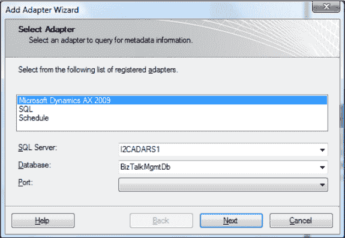


在下一步中指定连接信息。

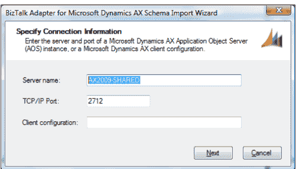

在下一个窗口中，您应该可以看到所有活动的 AIF 服务。请注意，由于 AIF 服务表是全局表，因此您将看到 Dynamics AX 实例中的所有活动服务。这并不意味着每个端点，即每个公司，都配置为接受每个列出的 AIF 服务所提供的操作。这是您首先验证连接性和 AIF 设置是否正确的地方。使用向导在此处出现错误通常是由于 AIF 通道配置错误造成的。

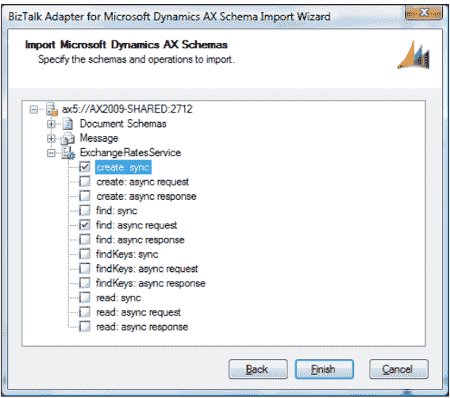

在上方的向导窗口中，您可以看到已启用的 AIF 服务。在我们的例子中，ExchangeRatesService 是我们 Dynamics AX 实例中当前唯一启用的服务。在该服务下，您将看到三种可能的模式（sync、async request 和 async response）来执行这些操作。这三种模式实际上都会生成相同的架构。我们使用哪种模式和操作（create、find、findkeys 或 read）实际上是由我们将发送到 AX 的消息中的元数据以及我们在编排中的逻辑端口配置决定的。现在，单击 Finish。

现在在项目解决方案中，我们可以看到向导将生成两个工件。第一个 ExchangeRates_ExchangeRates.xsd 是调用 LedgerExchangeRates.create 操作时需要发送的消息类型的架构，并且它也是调用 LedgerExchangeRates.find 操作时在响应消息中返回的相同架构。由于我们在两个操作中实际上都在处理同一个 AX 表，即 Exchange Rates，两个操作在部分上（一个将是入站消息，另一个将是出站消息）都需要相同的架构。

第二个工件 BizTalk Orchestration.odx 也由向导默认生成。在编排视图中，我们可以看到还向编排添加了四个多部分消息类型。将编排重命名为更有意义的名称，例如 ProcessExchangeRates.odx。

现在我们已经定义了将在响应消息中返回的消息类型，我们需要定义请求类型是什么。请注意，从编排视图中可以看到，两个消息 ExchangeRatesService_create_Response 和 ExchangeRatesService_find_Request 的类型在 Visual Studio 中出现错误 ‘does not exist or is invalid’。

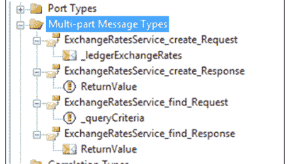

对于开箱即用的 find 操作，我们需要消息类型 DynamicsAX5.QueryCriteria。调用 create 操作时 AX 返回的另一个消息类型是 DynamicsAX5.EntityKey（如果我们调用 createList 操作，则返回的消息类型将为 DynamicsAX5.EntityKeyList）。

这些消息类型的架构位于 **Microsoft.Dynamics.BizTalk.Adapter.Schemas** 程序集中，该程序集可以在 BizTalk 适配器安装位置的 bin 目录中找到。在 Visual Studio 中将此引用添加到项目中。然后，如图所示，从 Select Artifact Type 窗口中重新选择每个无效 Message Part 的适当消息类型。

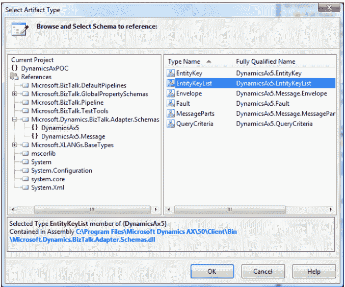

接下来，根据您的组织，通常您可能希望填充中午汇率或收盘汇率。对于我们的示例，我们将使用加拿大银行的收盘 USD/CAD 汇率。这在网站上于 16:30 EST 发布（http://www.bankofcanada.ca/rss/fx/close/fx-close.xml）。

由于此来源已是 XML，请下载并保存一个示例。然后我们使用 BizTalk Schema Generator 从 Visual Studio 生成架构（右键单击解决方案，**添加生成项**，**添加生成架构**，使用 **格式良好的 XML（未加载）** 文档类型）。这将生成我们 BizTalk 应用程序每天需要接收的消息的架构。在提供的示例中，架构是 **ClosingFxRates.xsd**（向导将生成另外四个 .xsd 文件，这些文件在 ClosingFxRates.xsd 中被引用）。

安排下载此 XML 数据文件的一种简单方法是使用 Schedule Task Adapter（http://biztalkscheduledtask.codeplex.com/），该适配器可以免费下载和安装（源代码也可用）。下载并安装适配器（需要 Microsoft .NET Framework 版本 1.1 可再发行组件包），然后使用 BizTalk Server 管理控制台以名称 **Schedule** 添加。我们将在接收位置使用此适配器通过 http 检索 XML。还有可供购买的 RSS 适配器，例如来自 nsoftware（http://www.nsoftware.com/）。但是，对于本示例，计划任务适配器就足够了。

现在，由于我们的汇率来源是第三方架构，并且您对来源的具体要求很可能有所不同，我们将创建一个规范架构 **ExchangeRates.xsd**。如下面架构所示，我们只对几条信息感兴趣：**基准货币**（在我们的示例中为 USD 或 CAD）、**目标货币**（同样为 USD 或 CAD）、**汇率**，最后是**日期**。创建规范架构也将简化我们解决方案的其余部分。

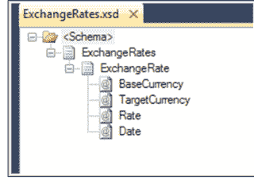

现在我们已经为消息类型定义或引用了所有架构，我们可以向编排添加所需的消息。

我们将首先添加消息 **msgClosingFxRates**。这将是我们来自加拿大银行的原始输入数据，其消息类型来自生成的架构 **ClosingFxRates.RDF**。

对于每个汇率，我们首先需要查询 Dynamics AX 以查看它是否存在，因此我们需要请求消息和响应消息。添加消息 **msgAXQueryExchangeRatesRequest**，它将是多部分消息类型 **ExchangeRatesService_find_Request**，以及 **msgAXQueryExchangeRatesResponse**，它将是多部分消息类型 **ExchangeRatesService_find_Response**。

接下来，我们将创建发送和接收 XML 以从 Dynamics AX 创建汇率的消息。添加消息 **msgAXCreateExchangeRatesRequest**，它将是 **ExchangeRatesService_create_Request** 的多部分消息类型，以及 **msgAXCreateExchangeRatesResponse**，它将是多部分消息类型 **ExchangeRatesService_create_Response。**

最后，我们需要创建两个消息，**msgExchangeRatesUSDCAD** 和 **msgExchangeRatesCADUSD**，它们将具有规范架构 **ExchangeRates** 的消息类型。这些消息将分别包含 USD 到 CAD 和 CAD 到 USD 的汇率。我们创建这两个消息只是为了简化本示例的编排。在实践中，如果您要处理多个汇率，您需要在编排中添加逻辑来循环遍历您感兴趣的汇率列表，并仅使用一个类型为 **ExchangeRates** 的消息多次发送。

正如我们在本章前面讨论的那样，我们需要知道 Dynamics AX 公司名称，以便在发送到 AX 的消息中填充正确的源和目标端点的元数据。对于本示例，我们将使用 **daxCADCompany** 和 **daxUSDCompany** 变量对这两个公司名称进行硬编码，类型为 System.String。我们将添加一个变量 **needToLoadFxRateUSD**，类型为 System.Boolean，我们将在编排中使用它。此外，我们将对变量 **serviceAccountName** 进行硬编码，该变量为 BizTalk 主机实例运行所在的 Active Directory 服务帐户。最后，我们需要一个名为 **xpathQueryCADResultsExpression** 的变量，类型为 System.String，我们将用它来确定我们的查询响应消息。以下是消息和变量的编排视图：

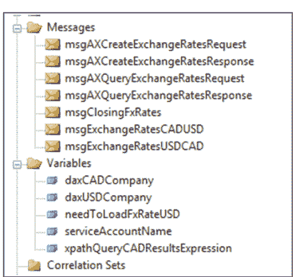

现在，我们需要在编排中添加一个逻辑接收端口和两个逻辑发送端口。

为来自加拿大银行的 XML 收盘汇率创建一个新的逻辑接收端口，设置如下：

| 属性 | 值 |
|---|---|
| 端口名称 | ReceiveClosingFxRates_Port |
| 端口类型名称 | ReceiveClosingFxRates_PortType |
| 通信模式 | One-Way |
| 通信方向 | 我将始终在此端口接收消息 |
| 端口绑定 | 稍后指定 |

创建一个新的发送-接收逻辑端口以查询 Dynamics AX，设置如下：

| 属性 | 值 |
|---|---|
| 端口名称 | QueryAXExchangeRates_Port |
| 端口类型名称 | QueryAXExchangeRates_PortType |
| 通信模式 | Request-Response |
| 通信方向 | 我将发送请求并接收响应 |
| 端口绑定 | 稍后指定 |

创建一个新的第二个发送-接收逻辑端口以发送汇率创建消息，设置如下：

| 属性 | 值 |
|---|---|
| 端口名称 | CreateAXExchangeRates_Port |
| 端口类型名称 | CreateAXExchangeRates_PortType |
| 通信模式 | Request-Response |
| 通信方向 | 我将发送请求并接收响应 |
| 端口绑定 | 稍后指定 |

接下来，我们需要创建两个映射，将加拿大银行的 XML 消息转换到我们的规范汇率消息。请参阅代码示例提供的这两个映射的详细信息。

- ClosingFxRates_To_ExchangeRatesCADUSD.btm
  - CAD 基准货币 – USD 目标货币
- ClosingFxRates_To_ExchangeRatesUSDCAD.btm
  - USD 基准货币 – CAD 目标货币


再者，为了限制此示例的复杂性，我们在一定程度上对这两个映射进行了硬编码，以满足我们的特定需求。如果我们需要创建具有不同基础/目标货币组合的许多消息，那么我们将在编排中添加逻辑并创建更复杂的映射。

现在，我们需要创建另外两个映射，将我们的规范 ExchangeRates 架构转换为 (1) 查询 Dynamics AX 中特定汇率以及 (2) 由 BizTalk Dynamics AX 适配器生成的 ExchangeRatesService_ExchangeRates AIF 架构。

## Dynamics AX 查询消息

DynamicsAx5.QueryCriteria 架构在我们的映射 ExchangeRates_To_AXQueryExchangeRatesRequest.btm 中显示。Dynamics AX 中的每个公司都将有一个基础货币，因此所有汇率都将相对于该基础。对于每个日期，只能存在针对特定目标货币的一个汇率，因此我们将构造一个查询并专门针对该日期进行筛选。我们的查询将返回特定日期下具有多种目标货币的所有汇率，因此我们将编写一个 XPath 表达式来查找我们感兴趣的汇率（将在本演练后面显示）。

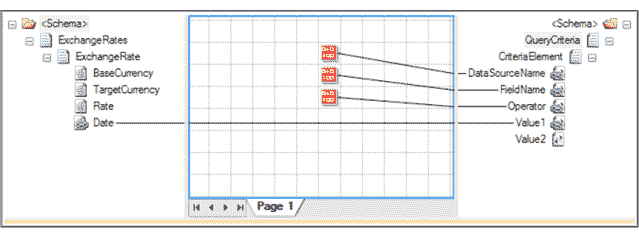

在上面的映射中，我们将使用 String Concatenate functoid 来存储我们需要填充 QueryCriteria 架构的 DataSourceName、FieldName 和 Operator 元素的常量。DataSource 是 Dynamics AX 2009 表名 ExchRates。FieldName 是表的列 FromDate。最后，我们将 Operator 设置为 Equal。

## Dynamics AX 创建消息

如映射 **ExchangeRates_To_AXCreateExchangeRatesRequest.btm** 所示，转换相对简单。Dynamics AX 汇率基于相对于 100 的比例尺而不是 1，因此我们需要使用下面的 Multiplication functoid 将来自我们的 **ExchangeRates** 架构的值乘以 100。请注意，我们可以对任何基础/目标货币组合使用此转换。

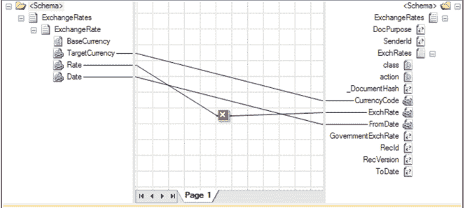

此外，请注意 **ExchangeRates** Dynamics AX 架构中没有维度。通常，在大多数面向业务的消息中，例如销售订单，架构将包含一个用于维度的元素。在这种情况下，我们建议首先在映射中添加与维度数量相同的 String Concatenate functoid，并在 Dynamics AX 架构中从上到下按顺序将链接添加到 **Dimension** 记录下的 **element** 字段，如下所示：

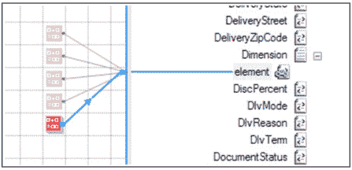

如上所示，在每个 String Concatenate functoid 中，添加零长度字符串输入，然后将每个维度的适当映射逻辑作为输入添加到相对的 concatenate functoid 中。这将确保每次在映射中添加/删除/更改链接时，输出消息都具有正确数量的维度元素并且顺序正确。为了保持映射的可读性，作为标准做法，您可以选择为映射维度创建一个新页面。

继续构建我们的编排，我们将在顶部添加一个 Receive 形状以接收来自加拿大银行的 msgClosingFxRtes 消息，并将 Activate 属性设置为 True。接下来，我们将添加两个 Construct 形状来构造规范消息 msgExchangeRatesUSDCAD 和 msgExchangeRatesCADUSD，每个形状都包含一个 transform 形状，分别使用 ClosingFxRates_To_ExchangeRatesUSDCAD.btm 和 ClosingFxRates_To_ExchangeRatesCADUSD.btm。

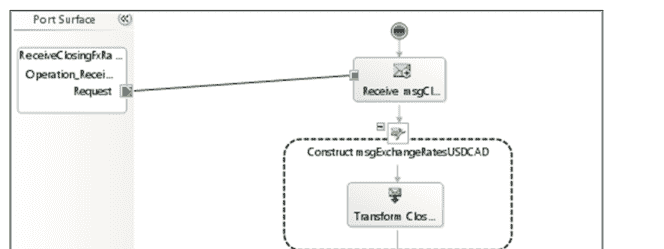

## 编排设置

现在，我们将添加另一个 Construct 形状来构造我们的第一个 msgAXQueryExchangeRatesRequest 消息（这将用于查询我们的基于 USD 的 Dynamics AX 公司）。我们将为 ExchangeRates_To_AXQueryExchangeRatesRequest.btm 添加一个 Transform 形状，并使用 msgExchangeRatesUSDCAD 作为转换的输入。转换形状之后，我们需要添加 Message Assignment 形状以添加 AIF 元数据。Message Assignment 形状的内容如下：

```
msgAXQueryExchangeRatesRequest(DynamicsAx5.MessageId) = System.String.Format("{0:B}",System.Guid.NewGuid());
msgAXQueryExchangeRatesRequest(DynamicsAx5.Action) = "http://schemas.microsoft.com/dynamics/2008/01/services/ExchangeRatesService/find";
msgAXQueryExchangeRatesRequest(DynamicsAx5.DestinationEndpoint) = daxUSDCompany + "LocalEndpoint";
msgAXQueryExchangeRatesRequest(DynamicsAx5.SourceEndpoint) = daxUSDCompany + "Endpoint";
msgAXQueryExchangeRatesRequest(DynamicsAx5.SourceEndpointUser) = serviceAccountName;
```

这一步我们可以看到 AIF 设置中的命名转换非常重要。消息中的 AIF 元数据决定了此消息 intended for 哪个 **SourceEndpoint** 和 **DestinationEndpoint**（分别在 AIF 设置中为 **Endpoint** 和 **Localendpoint** 表）。它还决定了消息针对哪个 AIF **Action** 执行。**SourceEndpointUser** 也必须在每个消息的元数据中明确设置。

现在，我们将添加一个 send 形状，后跟一个 **Receive** 形状以 **Send** **msgAXQueryExchangeRatesRequest** 并接收 **msgAXQueryExchangeRatesResponse** 消息。现在，将 send 和 receive 形状连接到 **QueryAXExchangeRates_Port** 端口，如以下图像所示：

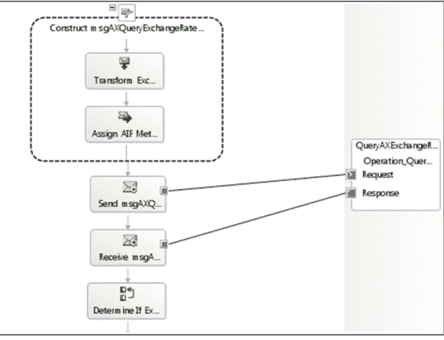

接下来，我们将添加一个 expression 形状。由于我们将接收查询消息中指定的 **FromDate** 对应的所有汇率，我们需要确定基于 USD 的公司是否为 CAD 货币的对应条目。执行此操作的 expression 形状的内容如下：

```
xpathQueryCADResultsExpression = System.String.Format("/*[local-name()='ExchangeRates']/*[local-name()='ExchRates']/*[local-name()='CurrencyCode' and text()='{0}']", "CAD");

// If we find a result, then don't need to load
if (xpath(msgAXQueryExchangeRatesResponse.ReturnValue,
xpathQueryCADResultsExpression) != null)
{
needToLoadFxRate = false;
}
```

由于查询返回汇率列表，我们将使用 XPath 快速确定基础货币的汇率是否在该日期存在。你可能会注意到，我们在 **xpathQueryCADResultsExpression** 中对 **CAD** 货币代码进行了硬编码。在具有多个目标货币的更复杂场景中，你需要添加逻辑来查找你感兴趣的对应货币代码。此外，由于每天可能不会有每种货币的汇率（例如法定假日），你需要为每个货币/日期组合包含此逻辑。

现在，我们将基于 expression 形状中设置的 **needToLoadFxRate** 布尔变量添加一个 **Decide** 形状。如果我们找到了该日期的汇率，则不执行任何操作，否则我们将构造 **msgAXCreateExchangeRatesRequest** 消息并将其发送到 Dynamics AX。

在 decide 形状中未找到汇率的分支中，我们将添加一个包含 transform 后跟 Message Assignment 形状的 Construct Message 形状。我们将使用的映射是 **ExchangeRates_To_AXCreateExchangeRatesRequest.btm**，输入为 **msgExchangeRatesUSDCAD** 消息。

在 expression 形状中，我们需要再次添加 AIF 元数据。内容如下：

```
msgAXCreateExchangeRatesRequest(DynamicsAx5.MessageId) = System.String.Format("{0:B}",System.Guid.NewGuid());
msgAXCreateExchangeRatesRequest(DynamicsAx5.Action) = "http://schemas.microsoft.com/dynamics/2008/01/services/ExchangeRatesService/create";
msgAXCreateExchangeRatesRequest(DynamicsAx5.DestinationEndpoint) = daxUSDCompany + "LocalEndpoint";
msgAXCreateExchangeRatesRequest(DynamicsAx5.SourceEndpoint) = daxUSDCompany + "Endpoint";
msgAXCreateExchangeRatesRequest(DynamicsAx5.SourceEndpointUser) = serviceAccountName;
```

请注意，只有 **DynamicsAX5.Action** 与之前发送到 AX 的查询消息不同。另请注意此处使用了 **daxUSDCompany** 变量。

现在，添加一个 **Send** 形状，后跟一个 **Receive** 形状以发送 **msgAXCreateExchangeRatesRequest** 并接收 **msgAXCreateExchangeRatesResponse** 消息。现在，将 send 和 receive 形状连接到 **CreateAXExchangeRates_Port**。


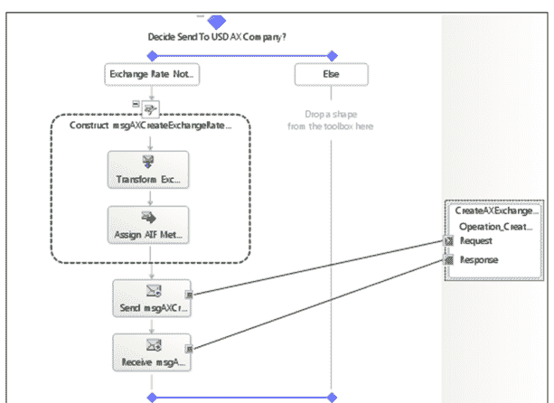

这样就完成了向我们的基于 USD 的 Dynamics AX 公司发送 USD - CAD 汇率的步骤。为了完成我们的示例，我们现在将为基于 CAD 的 Dynamics AX 公司添加 USD - CAD 汇率的逻辑。因此，我们将使用 msgExchangeRatesCADUSD 和 daxCADCompany 替代 msgExchangeRatesUSDCAD 和 daxUSDCompany，从编排设置步骤重复上述操作。参见完整的代码示例。

在提供的示例源代码中，编排中没有内置错误处理。如果向 Dynamics AX 发送消息时出现错误，端口将抛出异常。相当频繁地，尤其是在 AX 2009 之前的 Dynamics AX 版本中，错误消息有时可能相当通用或晦涩。连接错误会有一些有意义的错误消息；然而，逻辑错误则不会。这是因为 AIF 模块是一个面向外部的接口，因此最有帮助的详细错误消息可在 AIF 模块中的异常（基本 | 定期 | 应用程序集成框架 | 异常）表单中找到。

现在我们可以构建和部署解决方案，下一步将是在 BizTalk Server 管理控制台中设置我们的端口配置。

## 端口配置

我们将开始创建一个静态请求-响应发送端口，并输入名称 AXExchangeRates_SendReceivePort。

- 1. 我们将把类型设置为 Microsoft Dynamics AX 2009，并分别将发送管道和接收管道设置为 XML Transmit 和 XML Receive。

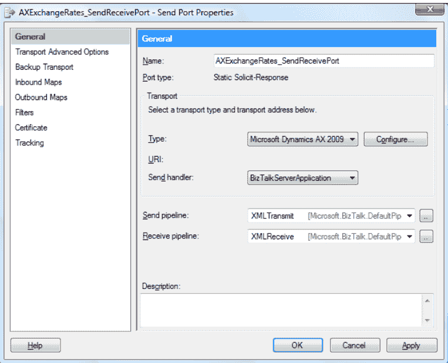

- 2. 单击 Configure 以打开 Microsoft Dynamics AX 2009 传输属性窗口。
- 3. 在此处，我们将从下拉列表中选择身份验证类型为 Host User，并将网关用户设置为 BizTalk 主机实例运行所在的 Active Directory 服务帐户。我们将 AOS 端口设置为 2712，AOS 服务器设置为我们的 Dynamics AX 2009 服务器名称 AX 2009-SHARED。我们可以将默认的同步超时时间保留为 20 分钟。

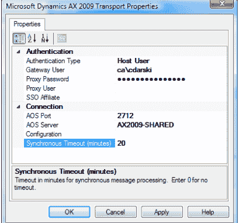

- 4. 单击 Ok 保存此配置。
- 5. 接下来，我们将通过创建一个名为 ReceiveClosingFxRates_ReceivePort 的单向接收端口继续端口配置，其接收位置名为 ReceiveClosingFxRates_ReceiveLocation。我们将使用类型为 Schedule 并将接收管道设置为 XML Receive。

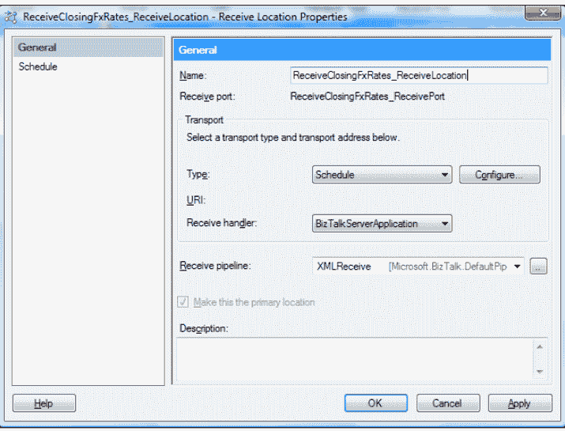

- 6. 接下来，单击 **Configure** 以打开计划传输属性窗口。在此处，我们将输入 **名称** 为 **加拿大银行**，并将配置 **计划** 设置为 **每日计划**，**开始时间** 为 **下午5:00**（假设我们的服务器时间为 EST）。请注意，我们将配置为每天运行，无论周末或银行假日（此时没有新汇率可用），因为我们的编排在尝试创建新的汇率之前会先查询 AX。

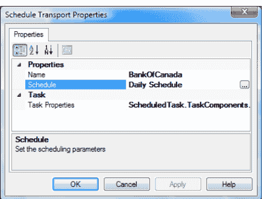

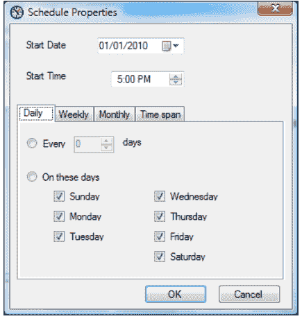

- 7. 现在，从 **计划传输属性** 窗口中单击 **任务属性** 字段以打开 **任务属性** 窗口。

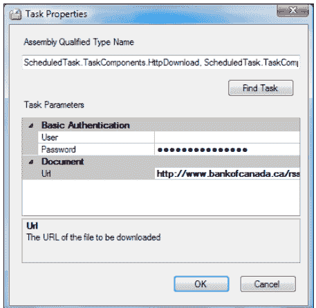

- 8. 在此处，单击 Find Task，这将打开程序集限定类型名称窗口。单击 Browse 按钮，选择 ScheduledTask.TaskComponents.dll 程序集并单击打开。现在，双击 HttpDownload 并单击 Select。单击 Ok。最后，在任务属性窗口中，输入 URL http://www.bankofcanada.ca/rss/fx/close/fx-close.xml，由于不需要身份验证，请将用户名留空。单击 OK 两次并保存。

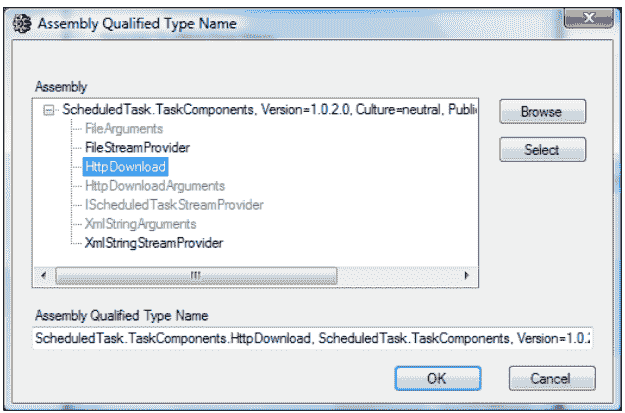

- 9. 在编排属性中，我们将逻辑接收端口分配给刚刚创建的物理端口，并将两个传出逻辑端口都设置为物理发送端口以连接到 Dynamics AX 2009。

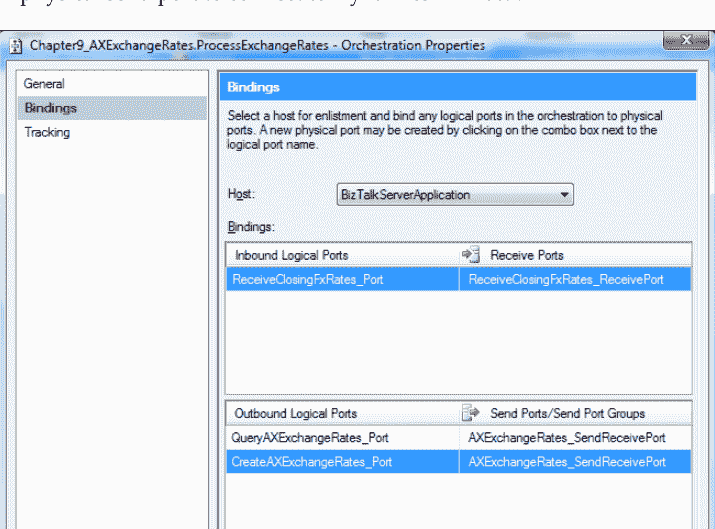

- 10. 在我们启动应用程序后，现在是测试的时候了。我们可以等待到下午 5:00，或者简单地将计划属性窗口中的开始时间更改为当前时间之后的几分钟。你将在 Windows 事件日志中看到一条日志消息，指示计划任务的配置已更改。
- 11. 在计划任务适配器触发并且编排成功完成后，导航到 Dynamics AX 2009 中的文档历史表单（基本 | 定期 | 应用程序集成框架 | 文档历史）。在此处，你将看到来自我们的 BizTalk 应用程序发送和接收的所有四条消息的日志。你还可以通过突出显示其中一个文档历史日志条目，单击 Document logs 打开文档日志表单，最后单击 View XML 来查看 XML 消息。

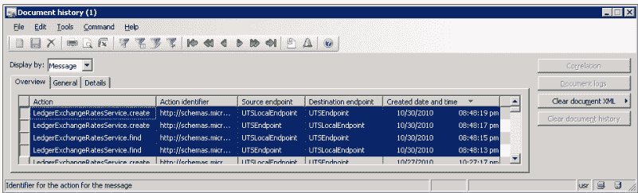

- 12. 验证汇率是否已在表中创建（总账 | 设置 | 汇率）。
- 13. 请注意，文档历史表单是公司特定的，并将记录所有成功和出错的交易。然而，异常表单日志不是公司特定的。因此，尝试将异常链接到文档历史条目可能会很困难。

## 异步演练示例—Dynamics AX 消息流出

现在使用 AIF XML 文档向 AX 发送数据的设置已完成，我们还可以使用 BizTalk 适配器通过此 AIF 模块从 Dynamics AX 检索数据。这是通过 AIF 队列管理器完成的。在整个 Dynamics AX 中，都有“发送电子邮件”按钮，可以让你将数据推送到 AIF 队列中，方向为传出。同样，异步传入消息具有入站方向参数。

我们发现，与其在需要从 AIF 队列检索数据时在多个 BizTalk 解决方案中重复代码，更简单的方法是创建一个通用解决方案来实现此功能。此解决方案将通过在设定的时间间隔轮询队列，使用 BizTalk Dynamics AX 适配器检索所有数据。最小轮询间隔为 1 分钟，因此你放入 AIF 队列中的任何消息都不会立即被 BizTalk 消费。完整的解决方案（Chapter9-AXMessageOutflow）包含在本章的源代码中。

我们将开始在 Visual Studio 中创建一个新的 BizTalk 项目 Chapter9-AXMessageOutflow。添加一个新的编排 ProcessOutboundAXMessage.odx，它将是此示例所需的唯一编排。此外，我们需要添加对 Microsoft.Dynamics.BizTalk.Adapter.Schemas 程序集的引用并使用强名称密钥对项目进行签名。

### 消息设置

接下来，我们将向我们的编排添加两个消息：**msgAxOutboundMessage** 和 **msgAXDocument**。这些将是此示例所需的唯一两个消息。

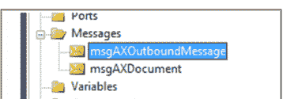

第一个消息 **msgAXOutboundMessage** 的类型为 **DynamicsAX5.Message.Envelope**。架构位于引用的 Microsoft.Dynamics.BizTalk.Adapter.Schemas 程序集中。

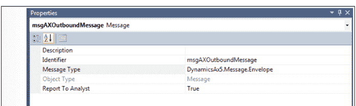

AIF 队列中的所有传出消息都是此类型。如下面的示例屏幕截图所示，我们在 header 节点中有一些元数据，但我们真正感兴趣的是 Body 节点的 XML 内容。Body 节点中 **MessageParts** 节点的内容将是类型为 **ExchangeRatesService_ExchangeRates.xsd**，我们在之前的示例中用它向 AX 发送相同的消息。因此，我们所需的所有入站和出站事务的架构都可以使用适配器生成。

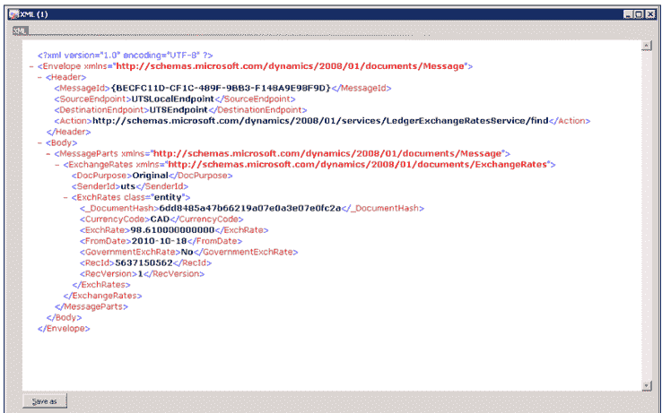

对于第二个消息，由于我们不想指定文档类型，我们将使用 System.Xml.XmlDocument 作为消息类型。

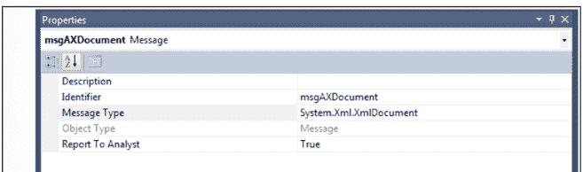

使用 System.Xml.XmlDocument 消息类型为此解决方案提供了很大的灵活性。我们可以将任何消息推送到 AIF 队列，而无需对该 BizTalk 应用程序进行任何更改。只有使用应用程序可能需要添加消息的 AX 架构才能处理它。


## Orchestration setup

接下来，我们创建一个新的逻辑端口，用于接收来自 Dynamics AX 通过 AIF 队列发送的所有消息，设置如下：

| 端口名称 | ReceiveAXOutboundMessage_Port |
| 端口类型名称 | ReceiveAXOutboundMessage_PortType |
| 通信模式 | 单向 |
| 通信端口方向 | 我将始终在此端口接收消息 |
| 端口绑定 | 稍后指定 |

此外，创建一个新的发送端口。在此示例中，我们只需使用 FILE 适配器发送到文件夹，以便可以轻松查看 XML 文档。实际上，其他 BizTalk 应用程序很可能会处理这些消息，因此您可以根据需要修改发送端口。发送端口设置：

| 端口名称 | SendAXDocument_Port |
| 端口类型名称 | SendAXDocument_PortType |
| 通信模式 | 单向 |
| 通信端口方向 | 我将始终在此端口发送消息 |
| 端口绑定 | 稍后指定 |

接下来，我们需要在编排中添加以下内容：

- 接收形状（接收 msgAXOutboundMessage 消息）
- 表达式形状（确定 msgAXDocument 的文件名）
- 消息分配（构造 msgAXDocument 消息）
- 发送形状（发送 msgAXDocument 消息）

我们还将添加两个变量（aifActionName 和 xpathExpression），类型为 System.String，以及 xmlDoc，类型为 System.Xml.XmlDocument。


在表达式形状中，我们希望提取 AIF 操作，以便以类似的方式命名传出 XML 文档。这将使我们能够轻松识别来自 AX 的消息类型。

接下来，我们将在接收下方表达式形状中放入以下内容以提取 AIF 操作名称，我们将在后续传出消息中使用它：

```
aifActionName = msgAXOutboundMessage (DynamicsAx5.Action);
aifActionName = aifActionName.Substring(55,aifActionName.
LastIndexOf('/') - 55);
```

现在，我们需要提取正文消息的内容，即我们感兴趣的 XML 文档。在消息分配形状中，我们将使用 XPath 来提取消息。我们感兴趣的是从 AX 通过 AIF 队列接收的 DynamicsAX5.Message.Envelope 消息中 Body 节点的内容。将以下代码添加到分配形状中以提取 XML，将其分配给我们传出的消息，并设置一个可以在发送端口中使用的通用名称：

```
// Extract Contents of Body node in Envelope Message
xpathExpression = "/*[local-name()='Envelope' and namespace-uri()='http://schemas.microsoft.com/dynamics/2008/01/documents/Message']/*[local-name()='Body'
and namespace-uri()='http://schemas.microsoft.com/dynamics/2008/01/documents/Message']";
```

```
xmlDoc = xpath(msgAXOutboundMessage, xpathExpression);

// Extract the XML we are interested in
xmlDoc.LoadXml(xmlDoc.FirstChild.FirstChild.InnerXml);

// Set the message to the XML Document
msgAXDocument = xmlDoc;

// Assign FILE.ReceivedFileName property
msgAXDocument(FILE.ReceivedFileName) = aifActionName;
```

我们现在可以构建并部署解决方案。接下来，我们将介绍物理端口的设置以及将其绑定到我们的编排。

## Port configuration

创建一个新的接收端口 ReceiveAxOutboundMessage_ReceivePort，以及一个新的接收位置 ReceiveAxOutboundMessage_ReceiveLocation。将类型设置为 Microsoft Dynamics AX 2009，并且我们需要为接收管道选择 PassThruReceive。


点击 **配置** 以打开 **Microsoft Dynamics AX 2009 传输属性** 窗口。在这里，我们将 **身份验证类型** 设置为 **主机用户**，将 **网关用户** 设置为我们的 BizTalk 主机实例运行所在的 Active Directory 账户，**AOS 端口** 设置为 **2712**，**AOS 服务器** 设置为我们的 AX 服务器名称（**AX 2009-SHARED**）。此外，我们将 **轮询间隔** 设置为 **1** 分钟，最后，我们必须将 **直通** 设置为 **True**。这允许我们的解决方案在不解析消息的情况下使用适配器。如果我们将其设置为 `False`，适配器将在从 AIF 队列中移除消息之前尝试解析消息类型，如果不成功则将其设置为错误状态。


接下来，我们将创建一个 **静态单向发送端口**，其 **名称** 设置为 **SendAxDocument_SendPort** 以绑定到我们的逻辑发送端口。将 **类型** 设置为 **文件**，**发送管道** 设置为 **PassThruTransmit**，因为我们可能将不同类型的消息作为 XML 文档发送出去。


点击 **配置** 以打开 **FILE 传输属性** 窗口。将 **目标文件夹** 设置为 **C:\LOBIntegration\Chapter09\Chapter9-AXMessageOutflow\AXOutboundDocuments**，文件名设置为 **%SourceFileName% - %datetime% - %MessageID%.xml**。每个消息类型的 **SourceFileName** 都是相同的，因为它在我们上面的编排中已设置为 Dynamics AX 操作名称。**datetime** 添加到文件名属性中，因为我们通常在排查错误时发现它很有帮助，有时它也是未来集成逻辑所必需的。


现在，我们将两个端口绑定到编排并启动 BizTalk 应用程序。由于 AIF 队列中没有我们需要提取的内容，因此在 BizTalk 服务器端我们看不到太多内容。但是，如果您登录到 Dynamics AX，转到 **在线用户（Administration | Online users）**，您可以验证您的 BizTalk 应用程序是否确实已连接。将有一个连接，其 **会话类型** 为 **Worker** 以验证您的连接。持续点击刷新按钮，您将看到 **会话类型** 为 **Business Connector** 每分钟出现一次（我们的应用程序轮询间隔已设置在端口上）。


现在我们已经验证了连接性，我们需要向 AIF 队列发送一条消息以运行测试。现在禁用接收位置，以便我们可以在 AX 内部看到正在发生的事情，然后再将其从队列中移除。

在 Dynamics AX 中的许多表单（例如汇率）中，您会看到 **电子发送** 按钮。点击汇率表上的按钮，您将看到 **电子发送文档** 窗口弹出。您需要选择一个 **端点 ID**，并且如果愿意，可以从选择按钮中输入筛选条件。请注意，只有启用了 LedgerExchangeRates AIF 服务操作的端点才会出现在下拉列表中。


点击 **确定** 将消息发送到 AIF 队列。现在，尝试在 **会计科目表** 表（**总账 | 会计科目表**）上点击 **电子发送**，并注意以下屏幕截图中显示的错误消息。由于我们尚未激活此 AIF 服务，也未将服务的任何操作添加到任何端点，因此 Dynamics AX 不允许我们发送此消息。


接下来，我们将打开 AIF **队列管理器** 表单（**基础 | 设置 | AIF | 队列管理器**），在这里我们可以看到刚刚从汇率表发送的消息。请注意，日志条目缺少通道和源端点。这是因为默认情况下，**电子发送** 按钮是一个异步过程，需要运行批处理以根据 **目标端点** 的配置指定通道（在我们的例子中是 BizTalk）。


## Batch setup in Dynamics AX

现在我们需要设置一个批处理，以便通过 BizTalk 通道发送此传出消息。如果我们之前以异步模式从 BizTalk 发送过消息，它也会出现在这里，并且需要批处理才能处理。请注意，在 Dynamics AX 中也可以自定义方法，这些方法仍会将消息写入 AIF 队列，但不需要批处理即可被我们的 BizTalk 应用程序提取。

Dynamics AX 2009 允许在服务器上运行批处理作业；但是，早期版本需要活动客户端才能运行批处理作业。可以想象，在生产环境中保持活动客户端打开以运行连续批处理作业，或在需要时手动启动批处理作业可能会非常麻烦。即使具有服务器端批处理作业功能，您也可以选择仅进行同步集成以消除对任何批处理作业的需求。

因此，对于此示例，我们需要创建一个批处理。首先，我们将在批处理作业（Basic | Inquiries | Batch job）表中创建一个新条目。我们输入作业描述为 AIF BATCH 并点击保存。


接下来，点击查看任务按钮，这将打开批处理任务表单。在这里，我们需要添加四个新条目，每个 AIF 类（AifOutboundProcessingService、AifInboundProcessingService、AIFgatewaySendService、AIFGatewayReceiveService）各一个，从下拉列表中选择并为每个设置公司账户。由于批处理任务是公司特定的，可以想象这可能会给您的集成流程带来显著的管理开销。


配置完批处理任务后，保存并关闭窗口。返回“批处理作业”表单并点击“重复”按钮，这将打开下面的窗口。在这里，我们可以配置多个参数，但在本示例中只需将“重复模式计数”设置为 1 并选择“分钟”。

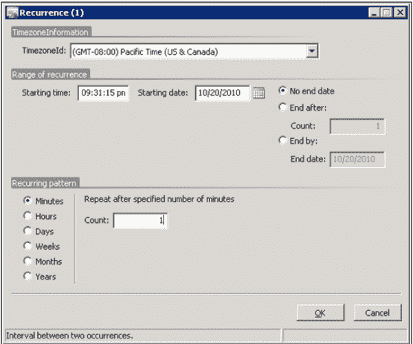

单击“确定”。再次返回批处理作业表单，点击“函数”按钮，这将打开“选择新状态”窗口。

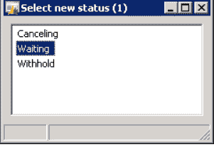

选择“等待”以激活批处理作业。现在，我们返回 AIF 队列管理器表单。约一分钟后点击刷新，你会看到之前发送的同一条传出记录。然而，你会注意到“通道”和“源端点”已被填充。另请注意，状态仍设置为“就绪”。

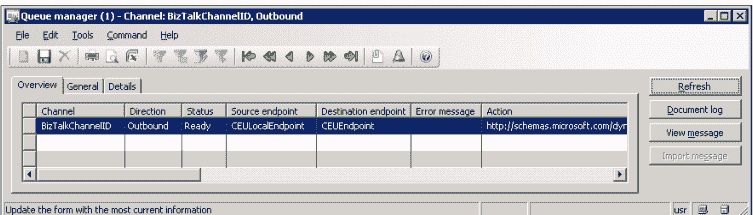

现在，我们返回并在你的 BizTalk 解决方案上启用接收位置。你应该会看到该记录从 AIF 队列中移除，并在发送端口指定的文件夹中找到 XML 文档。

请注意，我们刚刚从 AIF 队列中提取的这条记录将出现在 AIF 文档历史表中。你可以通过选择一条记录，点击“文档日志”，然后点击“查看 XML”来查看 XML。

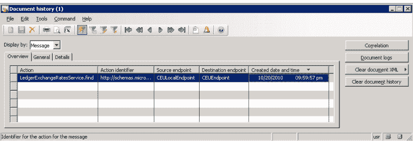

如果出现任何错误，详细消息将出现在 AIF 异常（Basic | Periodic | Application Integration Framework | Exceptions）表单中，并且队列管理器中传出记录的状态将更改为“错误”。可以修复错误，然后将状态改回“就绪”。

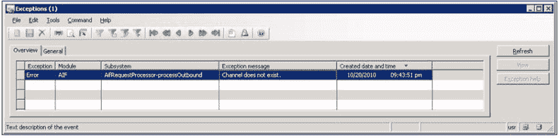

例如，如果我们在端点配置中未指定传出通道，则在批处理作业执行时会出现上述错误。因此，我们可以返回，将 BizTalk 通道添加到配置中，将队列中消息的状态更改为“就绪”；然后，下次批处理作业执行时，该消息将准备好被我们的 BizTalk 应用程序提取。

## 使用 .NET 业务连接器

.NET 业务连接器允许在没有 BizTalk 的情况下与 AX 集成。BizTalk Dynamics 适配器实际上利用了 .NET 业务连接器。然而，它可以独立运行，不需要安装 BizTalk。

从 Dynamics AX 设置安装中安装业务连接器。你会在 AX 安装屏幕的“可选组件”下看到它。为了使其运行，你不需要安装 Dynamics AX 客户端或其他任何 Dynamics 组件。请注意安装与你的 AX 环境版本完全匹配的正确版本；否则在运行时，你将在 Windows 事件日志中收到一条通用错误消息，且没有任何明确的指示说明问题所在。

业务连接器充当一个无 GUI 客户端，可以从自定义 .NET 程序集调用。安装时，会提示你输入将用于初始配置的 Dynamics 环境；此设置可在安装后更改。如本章源代码中包含的示例所示，可在运行时指定业务连接器配置的 AX 实例。最佳实践是使用你的 Dynamics AX 系统管理员应提供的配置文件（这是 AX 客户端用于建立与 AOS 连接的相同配置文件）。如果在运行时未指定配置，则将使用业务连接器设置中的默认配置。运行 Microsoft Dynamics AX 配置实用工具来管理你的默认配置，如下所示：

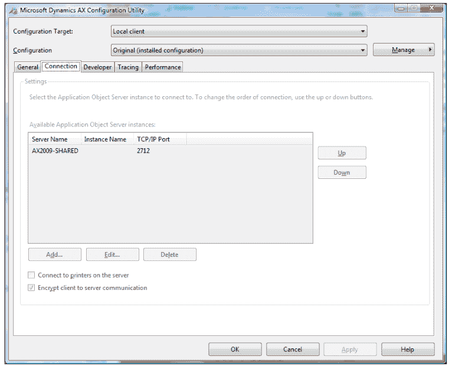

在随附的控制台应用程序示例中（完整解决方案 Chapter9-AXBusinessConnector 包含在本章源代码中），我们创建一个简单的会话对象来查询 Dynamics AX 中的表。更实用的示例将是调用一个带参数的静态方法，例如返回 AxaptaContainer 对象。有关 .NET Business Connector 用法的更多详细信息，请参阅 http://msdn.microsoft.com/en-us/library/aa659581.aspx，因为仅此主题就可以写一整章，这并非本书的意图。

请注意，必须正确释放每个连接，因为如果发生错误，.NET 业务连接器不会自行处理。如你所想，未经监控可能会导致灾难性后果，可能需要重新启动你的 AOS。

就安全性而言，每个连接与使用 Dynamics AX 客户端的连接类似。因此，如果你的 AX 用户是多个安全组的成员，请注意可能的性能问题。另外，请记住 Dynamics AX 中的类不是线程安全的，因此请验证你的集成逻辑是否考虑到了这一点。谨慎使用 .NET 业务连接器与你的自定义代码。

此示例仅对 AX 表执行公司名称查询，但它确实指出了一些关键概念，包括连接的释放、重试的使用和身份验证。在 Program.cs 文件中，只需替换常量、构建并运行。


> 请注意，我们需要引用 **Microsoft.Dynamics.BusinessConnectorNet** 和 **System.Web** 程序集，并且提供的代码的“目标框架”设置为 **.Net Framework 3.5**

## 其他开发和配置说明

### 开发

你的 Dynamics AX 集成需求很可能需要某种定制才能利用 AIF 模块。许多组织非常反对过度定制第三方系统。然而，Dynamics AX 是基于定制概念构建的，因此在集成定制开发需求方面通常可以达到一个平衡点。

可以创建自定义服务来集成几乎任何 Dynamics AX 对象，从而允许自定义查找、创建、读取、更新和删除操作。AX 4.0 SP2 之前的 Dynamics AX 版本不允许在 AIF 操作中执行删除操作。如果需要，你可以自定义现有代码功能以执行删除操作，例如通过设置自定义标志。然而，你仍需要使用已公开的现有操作。

对于开发，建议在你的 Dynamics AX 开发实例中，以运行 Visual Studio 的用户为 Admin 安全组成员。你的生产 BizTalk 服务帐户也可以是 Admin 角色的成员，这使其成为一个功能强大的帐户，但消除了对细粒度安全要求的需要。

### 配置

通常，你的组织会运行多个 AOS 实例以确保高可用性和可接受的在线性能。你可以通过运行本章前面提到的批处理作业流程，在非高峰时段安排所有高资源需求的集成任务。然而，通常需要（或更倾向于）在接近实时进行业务级集成。为了最大限度地减少对在线用户的影响，你可能需要考虑仅为集成任务创建一个单独的 AOS。

在 AIF 服务表单上，“刷新”按钮将扫描整个 AOT（应用程序对象树）中的 AIF 服务并填充所有找到的结果。如果登录用户对连接多个对象的特定服务只有部分权限，则生成的架构可能仅部分完整。因此，对此表（或更具体地说刷新按钮）的访问应尽可能限制为系统管理员。

### 维护

在非高峰时段安排集成任务的缺点是，你的 BizTalk 和 Dynamics AX 支持人员在诊断错误方面的可用性要低得多。AX 集成的支持通常是业务知识和 BizTalk 技术集成技能的结合。我们强烈建议至少你的 BizTalk 支持团队拥有 AIF 队列管理器、异常和文档历史表单以及所有 AIF 配置表单的查看权限。对“在线用户”表单的查看权限对于确认连接也非常有帮助。

在 Dynamics AX 实例发生非计划中断后，你通常需要重新启动 BizTalk 主机实例以重新连接到 AOS。因此，我们建议在与你的其他应用程序不同的主机实例下运行 Dynamics AX 的 BizTalk 应用程序。对于使用 .NET Business Connector 的任何服务也同样适用。


## 摘要

在本章中，我们讨论了使用 BizTalk Dynamics AX 2009 适配器用于 BizTalk 集成应用程序的优势。我们介绍了 Dynamics AX 2009 中 Application Integration Framework 模块所需的配置设置。

在第一个示例中，我们使用了开箱即用的 AIF 服务 **LedgerExchangeRatesService** 来创建一个货币汇率应用程序，演示了 BizTalk 适配器的同步集成模式。在第二个示例中，我们创建了一个通用解决方案来从 Dynamics 检索传出消息，这演示了异步集成（包括批处理作业）的要求。

最后，我们提到了使用 **.NET Business Connector** 与 Dynamics AX 集成，并讨论了在不利用 AIF 模块编写自定义应用程序时需要考虑的影响。在下一章中，我们将讨论与 Salesforce CRM 的集成。一种流行的在 "云" 中运行的 CRM。
